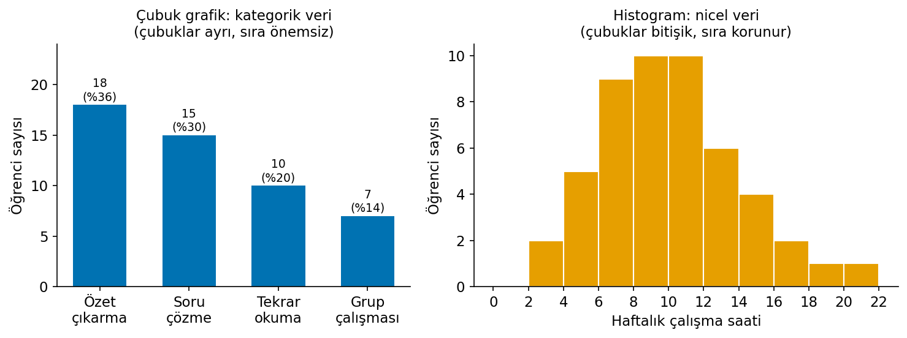
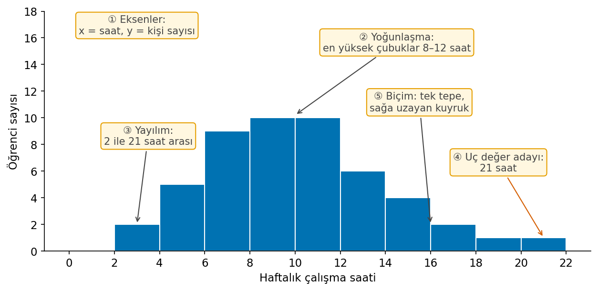
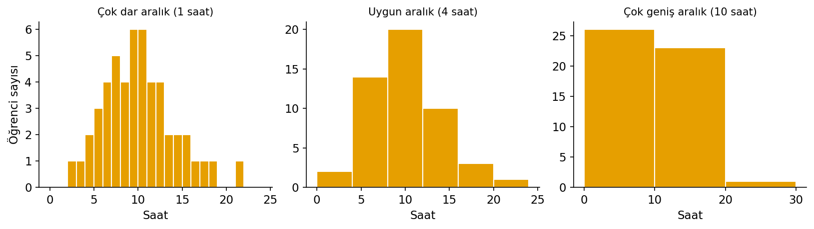
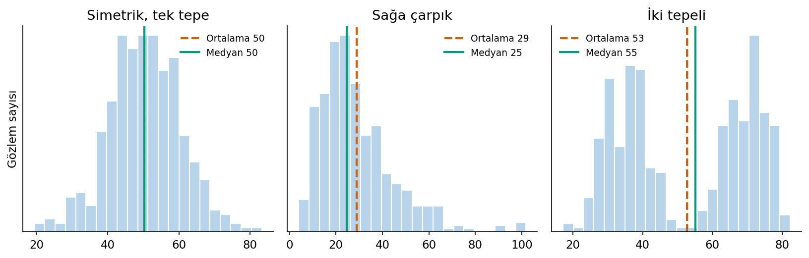
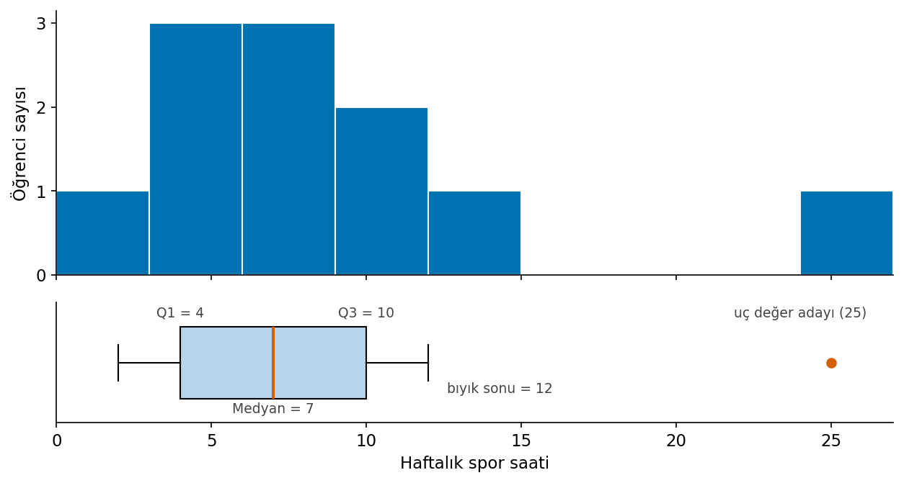
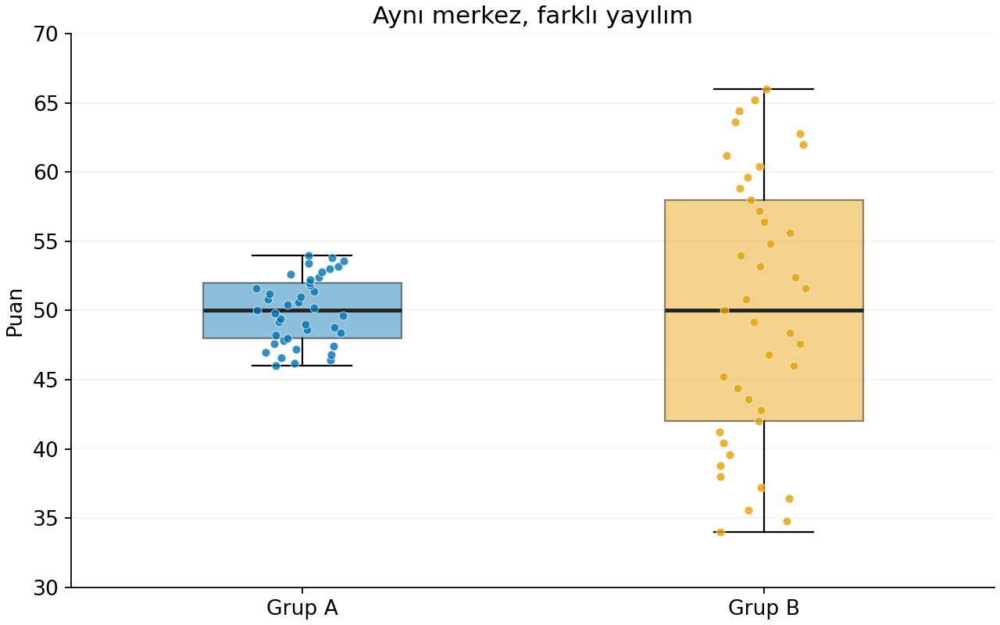
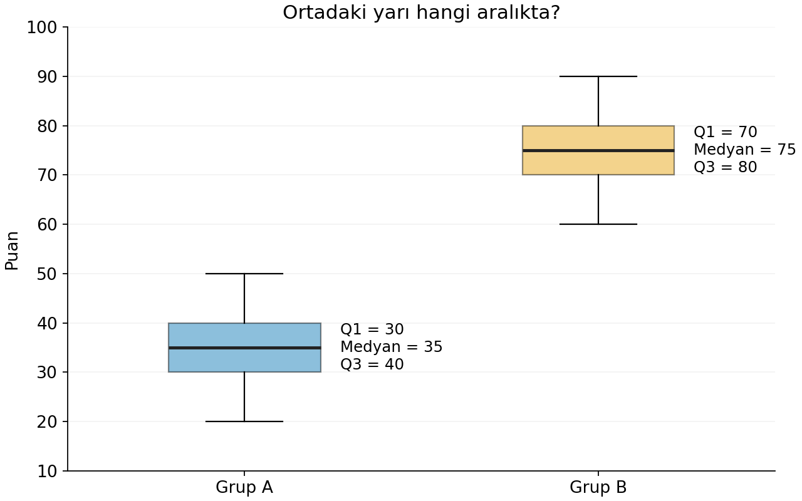
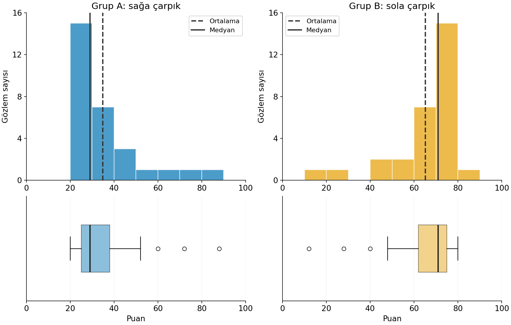
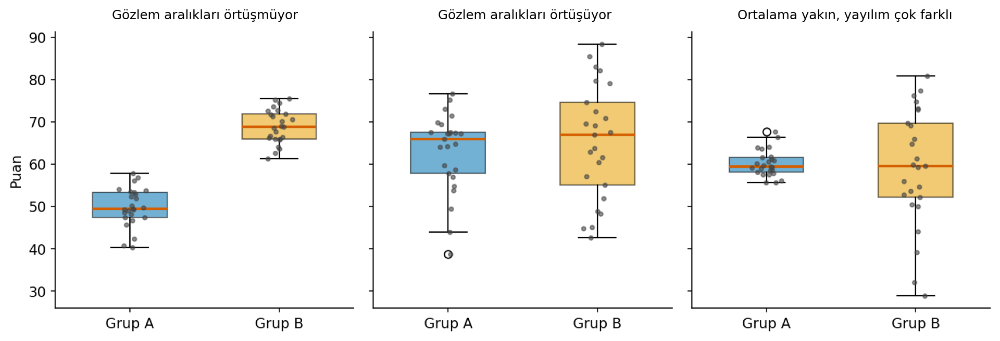
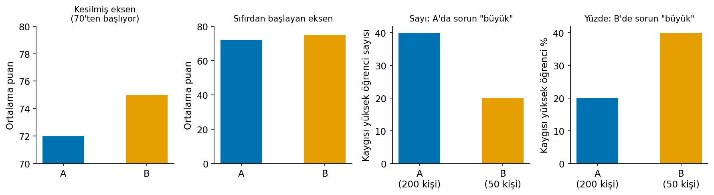

# Çalışma Notu: Grafik Seçimi ve Grafik Okuma

Bir grafikte en yüksek çubuğu bulmak kolaydır. Ama o çubuk daha çok kişiyi mi, daha yüksek bir puanı mı gösteriyor? Bunu anlamak için önce hangi grafiğin neden seçildiğini, sonra grafiğin nasıl okunduğunu bilmek gerekir. Bu not şu soruları sırayla cevaplar:

1. **Değişkenin rolü:** Araştırmada hangi değişkene göre hangi sonuç inceleniyor?
2. **Frekans tabloları:** Kaç kişi, bütünün ne kadarı ve hangi paydaya göre?
3. **Grafik seçimi:** Hangi değişken ve hangi soru için hangi grafik çizilir?
4. **Histogram okuma:** Değerler nerede toplanmış, ne kadar yayılmış, dağılım hangi biçimde?
5. **Kutu grafiği okuma:** Ortadaki değer, ortadaki yarı ve uçlar nerede?
6. **Grupları karşılaştırmak:** Hangi grup daha homojen, değerler nerede yığılmış, gruplar örtüşüyor mu?
7. **Yanıltıcı grafikler:** Doğru sayıları gösteren bir grafik nasıl yanıltabilir?
8. **Grafikten yorum:** Görüleni nasıl cümleye dökeriz?

Bu not, **Genel Özet: Araştırma Sorusu ve Veri Yapısı** notundaki değişken türleri ve ölçme düzeylerini; **Genel Özet: Betimsel İstatistik ve Dağılımlar** notundaki medyan, çeyrekler, standart sapma ve dağılım biçimi kavramlarını kullanır. Bu kavramlar burada yeniden tanımlanmaz, yalnızca grafikte nasıl göründükleri anlatılır.

Her kavram önce kısa bir **tanımla** verilir; ardından açıklanır ve örneklerle gösterilir. Notun sonunda dikkat edilmesi gereken noktalar ve kontrol soruları yer alır.

---

## 1. Değişkenin araştırmadaki rolü

Bir grafikte hangi değişkenin hangi eksene konacağı, değişkenin araştırmadaki rolüne bağlıdır. Bu konu boyunca şu araştırmayı örnek alacağız: bir araştırmacı, gevşeme eğitimi verilen ve verilmeyen öğrencilerin eğitim sonundaki sınav kaygısı puanlarını karşılaştırıyor.

### 1.1 Bağımsız değişken

::: {.callout-important appearance="simple"}
## Tanım
**Bağımsız değişken**, araştırmada etkisi incelenen ya da sonucu açıklamak ve karşılaştırmak için kullanılan değişkendir. (Açıklayıcı ya da yordayıcı değişken olarak da adlandırılır; İng. *independent variable*.)
:::

Araştırmacının sorusu şudur: *Eğitim koşuluna göre kaygı puanı nasıl değişiyor?* Bu soruda karşılaştırmayı kuran değişken eğitim koşuludur (eğitim verildi / verilmedi). Bu yüzden bağımsız değişken eğitim koşuludur.

Bağımsız değişkenin her zaman araştırmacı tarafından belirlenmesi ya da kategorik olması gerekmez. "Uyku süresine göre ertesi günkü dikkat puanı nasıl değişiyor?" sorusunda bağımsız değişken uyku süresidir; saatle ölçüldüğü için niceldir ve araştırmacı onu değiştirmemiş, yalnızca ölçmüştür. "Çalışma süresine göre sınav puanı" ve "bekleme süresine göre müşteri memnuniyeti" sorularında da bağımsız değişken süredir.

Bağımsız değişkeni bulmak için sor: *Sonucu hangi değişkene göre inceliyorum?* Bir değişkene "bağımsız" demek, onun sonuca neden olduğunu kanıtlamaz; yalnızca araştırma sorusundaki yerini anlatır.

### 1.2 Bağımlı değişken

::: {.callout-important appearance="simple"}
## Tanım
**Bağımlı değişken**, bağımsız değişkene göre nasıl değiştiği incelenen sonuç değişkenidir. (Sonuç değişkeni olarak da adlandırılır; İng. *dependent variable*.)
:::

Örnek araştırmada incelenen sonuç, eğitim sonundaki kaygı puanıdır; bağımlı değişken budur. Uyku–dikkat sorusunda dikkat puanı, çalışma süresi–sınav puanı sorusunda sınav puanı, bekleme süresi–memnuniyet sorusunda memnuniyet bağımlı değişkendir.

Rol, değişkenin değişmez bir özelliği değildir; araştırma sorusuna göre belirlenir. "Sınav öncesi kaygı puanına göre o geceki uyku süresi nasıl değişiyor?" sorusunda bu kez uyku süresi bağımlı, kaygı puanı bağımsız değişkendir. Uyku süresi bir önceki örnekte bağımsızdı; ölçülme biçimi aynı kaldığı hâlde rolü değişti.

Rol ile tür de ayrı şeylerdir. Tür, değişkenin değerlerinin ne olduğunu söyler (kategorik mi, nicel mi). Rol, değişkenin araştırma cümlesindeki yerini söyler (açıklayan mı, açıklanan mı). Yalnızca bir değişkenin dağılımını betimliyorsan (örneğin sınıfın kaygı puanlarının histogramı) bağımsız ve bağımlı rolü vermen gerekmez.

### 1.3 Bağımlı ve bağımsız örneklemler

::: {.callout-important appearance="simple"}
## Tanım
**Bağımlı örneklemler**, karşılaştırılan ölçümlerin aynı birimlerden (tekrarlı ölçüm) ya da birbiriyle eşleştirilmiş birimlerden geldiği örneklemlerdir. **Bağımsız örneklemler**, karşılaştırılan grupların farklı ve birbiriyle eşleştirilmemiş birimlerden oluştuğu örneklemlerdir.
:::

Burada "bağımlı" ve "bağımsız" sözcükleri başka bir anlamda kullanılır. Değişken için kullanıldığında rolü anlatırlar; örneklem için kullanıldığında karşılaştırılan ölçümlerin **kimlerden alındığını** anlatırlar.

Eğitim verilen öğrenciler ile verilmeyen öğrenciler farklı kişilerse ve aralarında bir eşleştirme yoksa iki grup **bağımsız örneklemdir**. Aynı öğrencilerin eğitim öncesi ve sonrası kaygı puanları karşılaştırılıyorsa her öğrencinin iki ölçümü birbirine bağlıdır; bu durumda **bağımlı örneklem** vardır.

İkisini ayırmak için sor: *Bir gruptaki her ölçümün öbür grupta aynı kişiye ya da eşleştirilmiş bir kişiye ait bir karşılığı var mı?* Varsa bağımlı, yoksa bağımsız örneklemdir. Bu soru, bağımlı değişkenin ne olduğundan bağımsızdır: iki durumda da bağımlı değişken kaygı puanıdır.

---

## 2. Frekans tabloları

Bir değişkeni grafiğe dökmeden önce çoğu zaman tabloya dökeriz. Bu konuda örnek olarak elli öğrenciye sınava hazırlanırken en çok hangi yöntemi kullandıklarının sorulduğu bir anketi kullanacağız.

### 2.1 Frekans ve yüzde

::: {.callout-important appearance="simple"}
## Tanım
**Frekans**, bir değerin ya da kategorinin veride kaç kez görüldüğüdür. **Yüzde**, bir frekansın toplam içindeki payının 100 ile çarpılmış hâlidir.
:::

| Yöntem | Frekans | Yüzde |
|---|---:|---:|
| Özet çıkarma | 18 | 36 |
| Soru çözme | 15 | 30 |
| Tekrar okuma | 10 | 20 |
| Grup çalışması | 7 | 14 |

"Özet çıkarma" satırındaki 18, bu yöntemi seçen öğrenci sayısıdır. Yüzde 18 / 50 × 100 = %36 olarak bulunur. Aynı satır "18 öğrenci" ya da "öğrencilerin %36'sı" diye okunabilir.

Frekans ve yüzde farklı bilgiler verdiği için birlikte sunulur. Yüzde, farklı büyüklükteki grupların paylarını karşılaştırmayı sağlar; frekans ise bu payın kaç kişiye dayandığını gösterir. Yalnızca "%50" diyen bir rapor, bunun 2 kişiden 1'i mi, 2.000 kişiden 1.000'i mi olduğunu söylemez.

### 2.2 Birikimli yüzde

::: {.callout-important appearance="simple"}
## Tanım
**Birikimli yüzde**, sıralı bir değişkende bir kategoriye kadar olan (o kategori dahil) bütün kategorilerin yüzdelerinin toplamıdır.
:::

Bazen yalnızca bir cevabın payını değil, o cevaba kadar olan cevapların toplam payını merak ederiz. Elli öğrenciye "Sınavdan önceki gece ne sıklıkla uykusuz kalırsınız?" diye sorulmuş olsun:

| Cevap | Frekans | Yüzde | Birikimli yüzde |
|---|---:|---:|---:|
| Hiç | 8 | 16 | 16 |
| Nadiren | 14 | 28 | 44 |
| Bazen | 16 | 32 | 76 |
| Sık sık | 9 | 18 | 94 |
| Her zaman | 3 | 6 | 100 |

"Bazen" satırındaki %32 yalnızca "bazen" diyenlerin payıdır. Aynı satırdaki %76 ise "hiç", "nadiren" ve "bazen" diyenlerin toplamıdır: (8 + 14 + 16) / 50 × 100. Doğru okuma şudur: "Öğrencilerin %76'sı **en fazla bazen** uykusuz kalıyor."

Birikimli yüzde, kategorilerin doğal bir sırası olduğunda anlamlıdır; bu yüzden sıralı ve nicel değişkenlerde kullanılır. Çalışma yöntemleri gibi nominal bir değişkende kategorilerin sırası keyfî olduğu için birikimli yüzdenin bir anlamı yoktur.

### 2.3 Geçerli yüzde

::: {.callout-important appearance="simple"}
## Tanım
**Geçerli yüzde**, eksik cevaplar paydadan çıkarılarak, yalnızca cevap verenler üzerinden hesaplanan yüzdedir.
:::

Herkes cevap verdiğinde katılımcı sayısı ile cevap sayısı aynıdır. Eksik cevap olduğunda bu iki sayı ayrılır ve yüzdenin hangi paydaya göre hesaplandığı önem kazanır.

Altmış katılımcıdan 30'u "evet", 20'si "hayır" demiş, 10'u soruyu boş bırakmış olsun:

| Cevap | Frekans | Yüzde (tüm katılımcılar) | Geçerli yüzde (cevap verenler) |
|---|---:|---:|---:|
| Evet | 30 | 50 | 60 |
| Hayır | 20 | 33,3 | 40 |
| Eksik | 10 | 16,7 | — |

"Evet" cevabı bütün katılımcılara bölünürse 30 / 60 = %50, yalnızca cevap verenlere bölünürse 30 / 50 = %60 bulunur. İkinci değer geçerli yüzdedir. İki hesap da doğrudur; farklı grupları payda olarak kullanırlar.

Bu yüzden "katılımcıların %60'ı evet dedi" cümlesi bu örnekte yanıltıcıdır: %60, katılımcıların değil, cevap verenlerin payıdır. Raporda hangi paydanın kullanıldığı ve kaç kişinin cevap vermediği belirtilir.

---

## 3. Grafik seçimi

Grafik, ölçülen değişkenin anlamını korumalıdır. Bu yüzden grafik seçimi iki soruyla başlar: *Değişken kategorik mi, nicel mi?* ve *Grafikle hangi soruyu cevaplamak istiyorum?*

### 3.1 Çubuk grafik

::: {.callout-important appearance="simple"}
## Tanım
**Çubuk grafik**, kategorik bir değişkenin her kategorisinin frekansını ya da yüzdesini birbirinden ayrı çubuklarla gösteren grafiktir. (Sütun grafiği olarak da adlandırılır; İng. *bar chart*.)
:::

Çalışma yöntemleri tablosunu grafiğe dökmek istediğimizde her yöntem için bir çubuk çizeriz. Çubuğun yüksekliği frekansı ya da yüzdeyi gösterir; hangisi olduğu y ekseninden okunur. Çubuklar arasındaki boşluk, kategorilerin birbirinden ayrı olduğunu anlatır.

Aşağıdaki görselin **sol tarafında** çalışma yöntemlerinin çubuk grafiği var. Özet çıkarma çubuğu 18 kişiyi (%36) gösteriyor; soru çözme 15, tekrar okuma 10, grup çalışması 7 kişi tarafından seçilmiş.

{width="95%" fig-align="center" fig-alt="Solda dört çalışma yönteminin frekansını gösteren ayrık çubuk grafik, sağda elli öğrencinin haftalık çalışma saatlerini gösteren bitişik çubuklu histogram"}

Nominal bir değişkende çubukların sırası serbesttir; yöntemlerin yerini değiştirmek bilgiyi değiştirmez. Sıralı bir değişkende ise (örneğin "kötü, orta, iyi, çok iyi") çubuklar doğal sırayla dizilir.

Çubuk grafik kesikli nicel değişkenlerde de kullanılabilir. Kardeş sayısı gibi az sayıda değer alan bir değişkende her değer (0, 1, 2, 3 kardeş) için ayrı çubuk çizilir ve sayısal sıra korunur. Bu, kardeş sayısını kategorik yapmaz; yalnızca az değer alan bir değişkeni göstermenin uygun yoludur.

Frekans ya da yüzde gösteren bir çubuk grafikte y ekseni **sıfırdan başlar**, çünkü çubuğun boyu sayının kendisini temsil eder (7.1).

### 3.2 Pasta grafik

::: {.callout-important appearance="simple"}
## Tanım
**Pasta grafik**, bir bütünün kategorilere göre paylarını bir dairenin dilimleriyle gösteren grafiktir.
:::

Pasta grafikte dilimlerin toplamı %100'dür ve her dilim bir kategorinin payını gösterir. Ancak göz, birbirine yakın dilimleri karşılaştırmakta zorlanır: %30 ile %36'lık iki dilim pastada neredeyse aynı görünür, çubuk grafikte ise fark açıkça okunur.

Bu yüzden kategorik veride varsayılan tercih çubuk grafiktir. Pasta grafik, kategori sayısı az (2–4) olduğunda ve "yarısı", "dörtte biri" gibi belirgin payları göstermek istediğinde işe yarar. Sıralı bir değişkende pasta grafik, kategorilerin sırasını da gizleyebilir.

### 3.3 Histogram

::: {.callout-important appearance="simple"}
## Tanım
**Histogram**, nicel bir değişkenin değerlerini ardışık sayısal aralıklara bölerek her aralığa düşen gözlem sayısını bitişik çubuklarla gösteren grafiktir.
:::

Çalışma saati gibi çok sayıda farklı değer alan bir değişkende her değere ayrı çubuk çizmek, dağılımı görmeyi zorlaştırır. Histogram değerleri aralıklarda toplar: 0–2 saat, 2–4 saat, 4–6 saat gibi.

Yukarıdaki görselin **sağ tarafında** elli öğrencinin haftalık çalışma saatlerinin histogramı var. x ekseninde yöntem adları yerine saat aralıkları bulunur; bir çubuğu okurken önce kapsadığı saat aralığına, sonra yüksekliğinin gösterdiği öğrenci sayısına bakılır.

Histogram ile çubuk grafik benzer görünür ama farklı şeyler gösterir:

- Çubuk grafikte x ekseninde **kategoriler**, histogramda **sayısal aralıklar** vardır.
- Çubuk grafikte çubuklar **ayrıdır**; histogramda **bitişiktir**, çünkü aralıklar birbirini izleyen sayılardır.
- Nominal bir çubuk grafikte çubukların sırası değiştirilebilir; histogramda aralıkların sırası **değiştirilemez**, çünkü sıra ölçülen miktarın anlamını taşır.

İkisini ayırt etmek için çubukların şekline değil, x ekseninin etiketlerine bak.

### 3.4 Kutu grafiği

::: {.callout-important appearance="simple"}
## Tanım
**Kutu grafiği**, nicel bir değişkenin medyanını, birinci ve üçüncü çeyreğini ve uç değer adaylarını gösteren grafiktir. (Kutu-bıyık grafiği olarak da adlandırılır; İng. *box plot*.)
:::

Kutu grafiği, dağılımın ortasını ve yayılımını tek bakışta gösterir. Kutu Q1 ile Q3 arasını, yani verinin ortadaki yaklaşık yarısını kapsar; kutunun içindeki çizgi medyandır; kutudan uzanan çizgiler (bıyıklar) ve ayrı noktalar uçları gösterir. Nasıl okunduğu 5. konuda ayrıntılı anlatılıyor.

Kutu grafiği ile histogram birbirini tamamlar. Histogram dağılımın **biçimini** (kaç tepe var, kuyruk hangi yöne uzanıyor) gösterir. Kutu grafiği **medyanı, çeyrekleri ve uç değer adaylarını** gösterir ama tepe sayısını göstermez: iki tepeli bir dağılım kutu grafiğinde sıradan bir kutu gibi görünebilir.

### 3.5 Grupları karşılaştıran grafikler

::: {.callout-important appearance="simple"}
## Tanım
**Yan yana kutu grafikleri**, aynı nicel değişkenin farklı gruplardaki dağılımını ortak bir sayısal eksen üzerinde, her grup için ayrı bir kutuyla gösteren grafiklerdir. **Grup histogramları**, aynı nicel değişkenin her gruptaki dağılımını ayrı histogramlarda gösteren grafiklerdir.
:::

Gevşeme eğitimi araştırmasına dönelim. Eğitim verilen ve verilmeyen öğrencilerin kaygı puanlarını karşılaştırmak için her grup için bir kutu çizeriz. Dikey kutularda x ekseninde gruplar (bağımsız değişken), y ekseninde kaygı puanı (bağımlı değişken) bulunur. Böylece hangi grubun medyanının daha yüksek, hangisinin ortadaki yarısının daha geniş olduğu bir bakışta görülür.

Grupların dağılım **biçimlerini** de görmek istiyorsak her grup için ayrı histogram çizeriz. Bu durumda iki kural önemlidir: bütün histogramlarda **aynı puan aralıkları** kullanılır ve gruplar farklı büyüklükteyse y ekseninde **yüzde** gösterilir. 20 kişilik bir grupta 10 öğrenci ile 40 kişilik bir grupta 20 öğrenci aynı aralıktaysa frekanslar farklı, paylar ise aynıdır (%50).

Grupların kaç kişiden oluştuğunu gösteren bir çubuk grafik ise grupların puanlarını karşılaştırmaz; yalnızca grup büyüklüklerini gösterir.

### 3.6 Grafik seçimi: karar tablosu

Grafik seçimi, değişkenin türüne ve cevaplanacak soruya göre yapılır:

| Durum ve soru | Uygun grafik | Eksenler |
|---|---|---|
| Tek nominal değişken: "Kategoriler ne sıklıkta?" | Çubuk grafik | x: kategoriler (sıra serbest); y: frekans ya da yüzde |
| Tek sıralı değişken: "Cevaplar nasıl dağılmış?" | Çubuk grafik (doğal sırayla) | x: sıralı kategoriler; y: frekans ya da yüzde |
| Az değer alan kesikli nicel değişken | Çubuk grafik (sayısal sırayla) | x: değerler; y: frekans ya da yüzde |
| Tek nicel değişken: "Değerler nerede toplanmış, biçim nasıl?" | Histogram | x: sayısal aralıklar; y: frekans ya da yüzde |
| Tek nicel değişken: "Medyan, ortadaki yarı ve uçlar nerede?" | Kutu grafiği | Sayısal eksen boyunca kutu ve bıyıklar |
| Kategorik bağımsız + nicel bağımlı: "Grupların merkezi ve yayılımı nasıl?" | Yan yana kutu grafikleri | x: gruplar; y: bağımlı değişkenin puanı |
| Kategorik bağımsız + nicel bağımlı: "Her grubun dağılım biçimi nasıl?" | Grup histogramları | Her panelde x: puan; y: frekans ya da yüzde |

Yazılım bir sütun için yanlış grafik önerebilir. Terapi türü 1, 2, 3 diye kodlanmışsa yazılım onu sayısal sanıp histogram önerebilir; bu durumda önce değişkenin ölçme düzeyi nominal olarak düzeltilir, sonra çubuk grafik çizilir.

---

## 4. Histogram okuma

Bir histogramı yorumlamak, yalnızca en yüksek çubuğu söylemekten fazlasıdır. Bu konu boyunca elli öğrencinin haftalık çalışma saatleri histogramını kullanacağız. Okuma her zaman aynı sırayla yapılır: **eksenler → yoğunlaşma → yayılım → uçlar → biçim**. Aşağıdaki grafikte bu adımlar numaralı kutularla işaretlenmiştir.

{width="90%" fig-align="center" fig-alt="Elli öğrencinin haftalık çalışma saati histogramı; eksenler, yoğunlaşma, yayılım, uç değer adayı ve biçim numaralı kutularla işaretlenmiş"}

### 4.1 Eksenler

::: {.callout-important appearance="simple"}
## Tanım
Histogramda **x ekseni** ölçülen değişkenin sayısal aralıklarını, **y ekseni** her aralığa düşen gözlem sayısını (frekans) ya da payını (yüzde) gösterir.
:::

Okumaya eksenlerden başlanır. Örnekte x ekseni haftalık çalışma saatini, y ekseni öğrenci sayısını gösteriyor ve y ekseni sıfırdan başlıyor. Bu bilgi olmadan bir çubuğun yüksekliğinin neyi anlattığı bilinemez: buradaki çubuk yüksekliği saat değil, **kişi sayısıdır**.

### 4.2 Yoğunlaşma

::: {.callout-important appearance="simple"}
## Tanım
**Yoğunlaşma**, gözlemlerin en çok toplandığı değer bölgesidir; histogramda en yüksek çubukların bulunduğu yerdir.
:::

Eksenlerden sonra değerlerin nerede toplandığına bakılır. Örnekte çoğu öğrenci **4–12 saat** arasında çalışmış; en yüksek çubuklar **8–12 saat** bölgesinde. En yüksek çubuğun (ya da çubukların) bulunduğu yere dağılımın **tepesi** de denir.

### 4.3 Yayılım

::: {.callout-important appearance="simple"}
## Tanım
Histogramda **yayılım**, gözlemlerin en küçükten en büyüğe kadar kapladığı değer aralığıdır.
:::

Değerlerin nerede toplandığı ile ne kadar geniş bir alana yayıldığı farklı bilgilerdir. Örnekte en küçük değer 2, en büyük değer 21 saattir; değerler 2–21 saat arasına yayılmıştır. İki ayrı histogramın tepesi aynı yerde olabilir ama biri dar, öbürü geniş bir alana yayılmış olabilir.

### 4.4 Uç değer adayı

::: {.callout-important appearance="simple"}
## Tanım
**Uç değer adayı**, diğer gözlemlerden belirgin biçimde uzakta kalan gözlemdir. (İng. *outlier*.)
:::

Ardından uçlara ve boşluklara bakılır. Örnekte 21 saatlik gözlem, en sağdaki seyrek aralıkta tek başına duruyor. Bu gözleme **uç değer adayı** denir.

"Aday" sözcüğü önemlidir: uçta görünmek bir gözlemin hatalı olduğunu göstermez. Haftada 21 saat çalışmak nadir ama mümkündür. Bir uç değer, olanaksız olduğu ya da kayıt hatası olduğu doğrulanmadıkça veride kalır (bkz. **Araştırma Sorusu ve Veri Yapısı** notu, alışılmadık değer).

### 4.5 Biçim

::: {.callout-important appearance="simple"}
## Tanım
Bir dağılımın **biçimi**, histogramın genel görünüşüdür: iki yanının birbirine benzeyip benzemediği (simetri), seyrek değerlerin hangi yöne uzandığı (çarpıklık) ve kaç yoğunlaşma bölgesi olduğu (tepe sayısı).
:::

Son olarak histogramın genel görünüşüne bakılır. Örnekte yoğun bölgeden sağa, yani yüksek değerlere doğru seyrekleşen bir **kuyruk** uzanıyor. Bu, dağılımın **sağa çarpık** olduğunu gösterir.

Çarpıklığın adı **kuyruğun yönünden** gelir, tepenin yerinden değil. Sağa çarpık bir dağılımın tepesi solda, kuyruğu sağdadır. Simetri, çarpıklık ve tepe sayısının tanımları **Betimsel İstatistik ve Dağılımlar** notunda verilir; burada önemli olan, bunların histogramda nasıl göründüğüdür.

Beş adımın hepsi bir araya getirildiğinde okuma şöyle yazılır: "Çoğu öğrenci 4–12 saat çalışmış; en yoğun bölge 8–12 saattir. Değerler 2–21 saat arasındadır. Dağılım sağa çarpıktır ve 21 saatlik bir uç değer adayı vardır."

### 4.6 Aralık genişliği

::: {.callout-important appearance="simple"}
## Tanım
**Aralık genişliği**, histogramda her çubuğun kapsadığı değer aralığının büyüklüğüdür. (İng. *bin width*.)
:::

Histogramı çizerken değerlerin kaç saatlik aralıklarda toplanacağı seçilir ve bu seçim grafiğin görünüşünü değiştirir. Aşağıdaki üç histogramda **aynı elli çalışma saati** kullanılıyor:

{width="100%" fig-align="center" fig-alt="Aynı çalışma saati verisinin bir, dört ve on saatlik aralıklarla üç farklı histogramı"}

Soldaki bir saatlik aralıklar pürüzlü bir görünüş oluşturur; genel biçimi izlemek zorlaşır. Ortadaki dört saatlik aralıklar tek tepeyi ve sağa uzanan kuyruğu açıkça gösterir. Sağdaki on saatlik aralıklarda ayrıntı kaybolur: 0–10, 10–20 ve 20–30 saat aralıklarında sırasıyla 26, 23 ve 1 öğrenci vardır (aralıklar alt sınırı içerir, üst sınırı içermez).

Çok dar aralık rastlantısal dalgalanmaları öne çıkarır; çok geniş aralık dağılımın yapısını gizler. Değişen veri değil, verinin gösterilişidir. Bu yüzden biçim hakkında bir sonuca varmadan önce aynı özelliğin farklı aralık genişliklerinde de görünüp görünmediği kontrol edilir.

### 4.7 Biçime göre özet seçimi

Bir dağılımı tek bir merkez ve tek bir yayılım ölçüsüyle özetlemeden önce biçimine bakılır; çünkü her ölçü her biçimi aynı iyilikte özetlemez. Aşağıdaki üç histogramda kesikli çizgi ortalamayı, düz çizgi medyanı gösteriyor:

{width="100%" fig-align="center" fig-alt="Üç histogram: simetrik dağılımda ortalama ve medyan çakışıyor, sağa çarpık dağılımda ortalama medyanın sağında, iki tepeli dağılımda ikisi de iki tepenin arasında kalıyor"}

**Soldaki** dağılım yaklaşık simetrik ve tek tepelidir; ortalama ve medyan çizgileri üst üste gelir. Bu biçimde **ortalama ve standart sapma** uygun bir özet çiftidir.

**Ortadaki** dağılım sağa çarpıktır: yoğunlaşma solda, kuyruk sağdadır. Ortalama kuyruğa doğru çekilmiştir ve medyanın sağında kalır. Burada tipik değeri **medyan**, yayılımı **çeyrekler açıklığı (IQR)** ile anlatmak daha uygundur. Sağa çarpık dağılımda ortalama genellikle medyandan büyük, sola çarpık dağılımda genellikle küçüktür.

**Sağdaki** dağılım iki tepelidir. Ortalama da medyan da iki tepenin arasında, gözlemlerin az olduğu bölgeye düşer; ikisi de yoğunlaşma bölgelerini temsil etmez. Burada tek bir özet yanıltır. Verinin iki alt gruptan oluştuğu doğrulanırsa gruplar ayrı ayrı özetlenir.

---

## 5. Kutu grafiği okuma

Kutu grafiği, medyanı, çeyrekleri ve uç değer adaylarını bir arada gösterir. Bu konuda örnek olarak 11 öğrencinin haftalık spor saatlerini kullanacağız. Aşağıdaki görselde üstte bu verinin histogramı, altta kutu grafiği var. Histogramda 11 gözlemden 10'u 2–12 saat arasında toplanırken 25 saatlik bir gözlem ayrı duruyor.

{width="90%" fig-align="center" fig-alt="Haftalık spor saatlerinin histogramı ve altında aynı verinin kutu grafiği; Q1 4, medyan 7, Q3 10, bıyık sonu 12, 25 saatlik bir uç değer adayı"}

### 5.1 Kutu: çeyrekler ve medyan

::: {.callout-important appearance="simple"}
## Tanım
Kutu grafiğinde **kutunun kenarları** birinci çeyreği (Q1) ve üçüncü çeyreği (Q3), **kutunun içindeki çizgi** medyanı gösterir. Kutunun uzunluğu **çeyrekler açıklığına** (IQR = Q3 − Q1) eşittir.
:::

Okumaya kutudan başlanır. Örnekte kutunun sol kenarı **Q1 = 4**, sağ kenarı **Q3 = 10** saattir. Q1, değerlerin alttan dörtte birini; Q3, alttan dörtte üçünü ayıran değerdir. Bu yüzden kutu verinin **ortadaki yaklaşık yarısını** kapsar: öğrencilerin ortadaki yarısı haftada 4 ile 10 saat arasında spor yapıyor.

Kutunun uzunluğu IQR'dir: 10 − 4 = **6 saat**. Kutunun içindeki çizgi medyandır: **7 saat**.

Kutunun uzunluğu **yayılımı** gösterir, kişi sayısını değil. Uzun bir kutu "orada daha çok kişi var" demek değildir; ortadaki yarının daha geniş bir aralığa yayıldığı anlamına gelir. Her kutu, kendi grubunun ortadaki yaklaşık yarısını içerir.

### 5.2 Bıyıklar

::: {.callout-important appearance="simple"}
## Tanım
**Bıyıklar**, kutunun iki kenarından, kutudan en fazla 1,5 × IQR uzaklıkta kalan en uç gözlemlere kadar uzanan çizgilerdir.
:::

Bıyıklar, kutunun dışında kalan ama diğer değerlerden çok uzak olmayan gözlemlerin nereye kadar uzandığını gösterir. Bıyığın en fazla nereye kadar uzanabileceği şöyle hesaplanır:

- Üst sınır: Q3 + 1,5 × IQR = 10 + 1,5 × 6 = **19**
- Alt sınır: Q1 − 1,5 × IQR = 4 − 1,5 × 6 = **−5**

Bıyık bu sınıra kadar değil, **sınırın içinde kalan en uç gözleme** kadar çizilir. Örnekte 19'un altındaki en büyük gözlem 12 saattir; bu yüzden üst bıyık 19'da değil, **12'de** biter. Alt tarafta en küçük gözlem 2 saattir ve sınırın içindedir; alt bıyık 2'de biter.

### 5.3 Ayrı noktalar: uç değer adayları

Bıyık sınırlarının dışında kalan gözlemler kutu grafiğinde **ayrı nokta** olarak gösterilir ve uç değer adayı sayılır. Örnekte 25 saat, 19'luk üst sınırın dışındadır ve ayrı bir nokta olarak görünür.

Bu nokta özet ölçülerini farklı biçimde etkiler. Bu verinin ortalaması 8,27, standart sapması 6,33 saattir; 25 saatlik gözlem ortalamayı yukarı çeker ve standart sapmayı büyütür. Medyan (7) ve IQR (6) ise bu tek gözlemden çok az etkilenir. Bu yüzden uç değer adayı olan bir veride **medyan ve IQR** daha iyi bir özet çiftidir.

Ayrı nokta "silinecek kayıt" anlamına gelmez. Değer olanaksız değilse ve kayıt hatası doğrulanmamışsa, yalnızca ayrı göründüğü için silinmez.

### 5.4 Kutu grafiğinden biçim ipuçları

Kutu grafiği biçim hakkında da ipucu verir. Medyan çizgisi kutunun ortasındaysa ve iki bıyık yaklaşık eşit uzunluktaysa dağılım simetriye yakındır. Medyan bir kenara kaymışsa ve bir bıyık öbüründen belirgin biçimde uzunsa dağılım uzun bıyık yönüne çarpık olabilir.

Ancak kutu grafiği **tepe sayısını göstermez**. İki tepeli bir dağılım, kutu grafiğinde tek tepeli bir dağılımla aynı görünebilir. Bu yüzden biçim hakkında karar verirken kutu grafiği histogramla birlikte okunur.

---

## 6. Grupları grafikte karşılaştırmak

İki ya da daha fazla grubun aynı değişkendeki dağılımını karşılaştırırken grafikleri **aynı puan ekseni** üzerinde okuruz. Bu konuda dört soru soracağız: Hangi grup daha homojen? Değerler hangi puanlarda yığılmış? Kuyruklar hangi yöne uzanıyor? Gruplar örtüşüyor mu? Buradaki iş, grafikte görüleni **betimlemektir**; grupların "anlamlı biçimde farklı" olup olmadığına karar vermek değildir.

### 6.1 Homojenlik

::: {.callout-important appearance="simple"}
## Tanım
**Homojen grup**, değerleri birbirine yakın olan, yani yayılımı küçük olan gruptur. Değerleri birbirinden uzak olan gruba **heterojen** denir.
:::

Hangi grubun daha homojen olduğunu anlamak için merkeze değil, **yayılıma** bakılır. Aşağıdaki grafikte A ve B gruplarının kutu grafikleri ve tek tek gözlem noktaları var:

{width="85%" fig-align="center" fig-alt="A ve B gruplarının kutu grafikleri ve gözlem noktaları; A 46–54, B 34–66 puan arasında, iki grubun medyanı 50"}

İki grubun medyanı da **50**'dir; medyan çizgileri aynı hizadadır. Yani merkezler aynıdır. Ama A'nın değerleri 46–54, B'ninkiler 34–66 puan arasındadır. A'nın kutusu ve bıyıkları daha kısa, gözlem noktaları birbirine daha yakındır.

Kısa kutu, A'nın **IQR'sinin daha küçük** olduğunu gösterir. En büyük ile en küçük değer arasındaki fark olan **açıklık** da A'da daha küçüktür (8 puana karşı 32 puan). Bu yüzden **A daha homojendir**.

Dar yayılım, A'nın **standart sapmasının da daha düşük** olmasını bekletir. Ancak kutu grafiği standart sapmanın kesin değerini vermez; yalnızca hangi grupta daha küçük olmasının beklendiğini söyler.

Açıklığı okurken ayrı noktalar unutulmaz. Ayrı nokta yoksa açıklık bıyıkların iki ucu arasındaki mesafedir; ayrı nokta varsa açıklık bu noktaları da içerir. Yalnızca kutuya bakıp uzaktaki noktaları gözden kaçırmak, yayılımı olduğundan küçük görmeye yol açar.

### 6.2 Yığılma

::: {.callout-important appearance="simple"}
## Tanım
**Yığılma**, bir grubun değerlerinin ölçeğin hangi bölgesinde toplandığıdır. Kutu grafiğinde ortadaki yarının (kutunun) bulunduğu puan aralığıyla okunur.
:::

Homojenlik değerlerin ne kadar yayıldığını, yığılma ise **nerede** toplandığını anlatır. Kutunun uzunluğu yayılımı, kutunun eksendeki **konumu** yığılmayı gösterir.

{width="85%" fig-align="center" fig-alt="A grubunda Q1 30, medyan 35, Q3 40; B grubunda Q1 70, medyan 75, Q3 80 olan iki kutu grafiği"}

A'nın ortadaki yarısı **30–40 puanda**, B'ninki **70–80 puanda** toplanmıştır. A'nın değerleri ölçeğin alt-orta bölgesinde, B'ninkiler üst bölgesinde yığılmıştır. Merkezi karşılaştırmak için medyan çizgilerine bakılır: A'nın medyanı **35**, B'ninki **75**'tir; B'nin medyanı daha yüksektir.

Kutular eşit uzunluktadır; ikisinin de IQR'si **10** puandır. Yani iki grup aynı genişlikte yayılmış, ama farklı puan bölgelerinde toplanmıştır. Yığılma ile yayılım bu yüzden ayrı ayrı okunur.

Kutunun üst kenarı medyan değil, **Q3**'tür. B'nin kutusunun yukarıda olması da B'de daha çok kişi olduğunu göstermez; yalnızca B'nin puanlarının daha yüksek olduğunu gösterir. Kutu, kendi içindeki en kalabalık küçük aralığı da göstermez; tepeyi bulmak için histograma bakılır.

### 6.3 Gruplarda çarpıklık

Grupların yığıldığı yer kadar kuyruklarının yönü de farklı olabilir. Çarpıklığı okurken önce histogramda yoğun bölge bulunur, sonra seyrek değerlerin hangi yöne uzandığı izlenir. Aşağıdaki görselde üstte iki grubun histogramları (kesikli çizgi ortalama, düz çizgi medyan), altta kutu grafikleri var:

{width="100%" fig-align="center" fig-alt="Üstte A için sağa, B için sola çarpık histogramlar; kesikli ortalama ve düz medyan çizgileri; altta A'da yüksek, B'de düşük puan tarafında ayrı uç değer adayları bulunan kutu grafikleri"}

**A grubunda** en yüksek çubuk **20–30 puan** aralığındadır. Kuyruk yüksek puanlara, yani sağa uzanır: A **sağa çarpıktır**. Ortalama çizgisi medyan çizgisinin sağındadır (ortalama > medyan). Kutu grafiğinde ayrı uç değer adayları **yüksek puan** tarafındadır.

**B grubunda** en yüksek çubuk **70–80 puan** aralığındadır. Kuyruk düşük puanlara, yani sola uzanır: B **sola çarpıktır**. Ortalama medyanın solundadır (ortalama < medyan). Kutu grafiğinde ayrı uç değer adayları **düşük puan** tarafındadır.

İki grupta da ortalama kuyruğa doğru çekildiği için tipik değeri **medyan**, yayılımı **IQR** ile özetlemek daha uygundur. Okumada üç bilgiyi ayrı ayrı söylemek grafiğin hangi özelliğine bakıldığını açık tutar: en yüksek çubuğun aralığı, kuyruğun yönü ve uç değer adaylarının bulunduğu taraf.

### 6.4 Örtüşme

::: {.callout-important appearance="simple"}
## Tanım
**Örtüşme**, iki grubun değerlerinin ortak bir puan aralığını paylaşmasıdır. **Kutuların örtüşmesi** ortadaki yarıların ortak aralığını; **tüm gözlem aralıklarının örtüşmesi** en küçük ile en büyük değerler arasındaki ortak aralığı anlatır.
:::

"Gruplar örtüşüyor" demeden önce neyin örtüştüğü belirtilir. Kutular örtüşmese bile gözlem aralıkları örtüşebilir; bu iki ifade farklı şeyler söyler.

{width="100%" fig-align="center" fig-alt="Üç grup panelinde solda gözlem aralıkları ayrık, ortada örtüşen, sağda ortalamaları yakın ve yayılımları farklı iki grup"}

**Sol panelde** B'nin en düşük değeri bile A'nın en yüksek değerinden yüksektir. Bu yüzden **tüm gözlem aralıkları hiç örtüşmez**. B'nin medyanı da daha yüksektir.

**Orta panelde** hem kutular hem tüm gözlem aralıkları **kısmen örtüşür**. Medyanlar birbirine yakın, B'nin yayılımı daha geniştir. Aralıkların örtüşmesi, grupların merkez ve yayılımlarının aynı olduğu anlamına gelmez.

**Sağ panelde** ortalamalar yakın, medyanlar yaklaşık aynıdır. B'nin kutusu ve bıyıkları daha uzundur; A daha homojendir. Bu panelde öne çıkan özellik merkezdeki fark değil, **yayılım farkıdır**.

---

## 7. Yanıltıcı grafikler

Bir grafik doğru sayıları gösterdiği hâlde yanlış bir izlenim yaratabilir. Bu konuda iki sık görülen yolu inceleyeceğiz. Aşağıdaki görselin sol iki paneli kesilmiş ekseni, sağ iki paneli sayı ile yüzde farkını gösteriyor.

{width="100%" fig-align="center" fig-alt="Aynı iki ortalama kesilmiş ve sıfırdan başlayan eksenle iki kez çizilmiş; aynı kaygı verisi sayı ve yüzde olarak iki kez çizilmiş ve farklı sonuç gösteriyor"}

### 7.1 Kesilmiş eksen

::: {.callout-important appearance="simple"}
## Tanım
**Kesilmiş eksen**, çubuk grafikte y ekseninin sıfırdan değil, daha yüksek bir değerden başlatılmasıdır.
:::

Çubuk grafikte göz, çubukların **boylarını** karşılaştırır. Eksen sıfırdan başlamazsa çubuk boyları değerlerin kendisini değil, değerlerin eksenin başlangıcından farkını gösterir ve farklar olduğundan büyük görünür.

Sol iki panelde A'nın ortalaması **72**, B'ninki **75** puandır. İlk panelde y ekseni 70'ten başlar; görünür çubuk boyları 72 − 70 = **2** ve 75 − 70 = **5** birimdir. B'nin çubuğu A'nınkinin **2,5 katı** gibi görünür. Oysa gerçek fark yalnızca **3 puandır**. İkinci panelde eksen sıfırdan başlar; çubuklar birbirine yakın görünür ve boy oranı 75 / 72 ≈ **1,04** olur.

Değerler iki panelde de aynıdır; değişen yalnızca gözün karşılaştırdığı uzunluklardır. Bu yüzden frekans ya da ortalama gösteren bir çubuk grafiği yorumlamadan önce y ekseninin nereden başladığına bakılır.

### 7.2 Sayı mı, yüzde mi?

Farklı büyüklükteki grupları karşılaştırırken kişi sayısı ile yüzde farklı sorulara cevap verir. Y eksenine bakmadan yorum yapmak bu iki soruyu karıştırır.

Sağ iki panelde A bölümündeki **200 öğrencinin 40'ı**, B bölümündeki **50 öğrencinin 20'si** yüksek kaygılıdır.

- **Sayı grafiğinde** A'nın çubuğu daha yüksektir (40'a karşı 20). "Kaç öğrenciye destek gerekiyor?" sorusunun cevabı budur: A'da daha çok öğrenci destek bekliyor.
- **Yüzde grafiğinde** A için **%20**, B için **%40** görülür. "Sorun hangi bölümde daha yaygın?" sorusunun cevabı budur: B'de yüksek kaygılıların payı daha büyük.

İki grafik de doğru sayıları gösterir; cevapladıkları sorular farklıdır. Doğru yorum ikisini birbirinin yerine kullanmaz: "Yüksek kaygılı öğrenci sayısı A'da daha fazla; yüksek kaygılıların bölüm içindeki payı ise B'de daha büyük."

---

## 8. Grafikten yorum

### 8.1 Yazılım çıktısını grafikle birlikte okumak

Yazılımın verdiği sayılar, grafikte görüleni kontrol etmeye yarar; grafiğin yerine geçmez. Önce değişken adı, ölçme düzeyi, eksenler ve birimler doğrulanır. Ardından medyan ve çeyrekler kutu grafiğiyle, biçime ilişkin sayılar histogramla karşılaştırılır.

Yazılım çıktısında iki biçim katsayısı sık görülür:

- **Çarpıklık katsayısı:** Pozitif değer sağa çarpıklığa, negatif değer sola çarpıklığa, sıfıra yakın değer simetriye işaret eder. Sağa uzanan bir histogramla birlikte pozitif bir katsayı görmek, iki bilginin tutarlı olduğunu gösterir.
- **Basıklık katsayısı:** Kuyrukların kalınlığıyla ilgilidir. Normal dağılımı sıfır kabul eden basıklık katsayısında pozitif değer, normal dağılıma göre daha kalın kuyruklara işaret eder.

Bu katsayılar tek başına karar verdirmez; histogramla birlikte değerlendirilir.

### 8.2 Grafik okuma cümlesi

Bir grafik yorumunu anlaşılır yapan şey, her gözlemi bir birime ve bir aralığa bağlamaktır. "Dağılım geniş" demek yerine neyin hangi aralığa yayıldığı söylenir. Okuma 4. konudaki sırayı izler: önce ne ölçüldüğü ve yoğunlaşma, sonra yayılım, uçlar ve biçim; özet ölçü seçimi en sonda bu gözlemlere dayandırılır.

Haftalık spor saati örneğinin okuması şöyledir: "11 gözlemin 10'u 2–12 saat arasındadır. Ortadaki yaklaşık yarı 4–10 saatte toplanır; medyan 7, IQR 6 saattir. 25 saatlik bir uç değer adayı vardır. Bu veri için medyan ve IQR daha iyi bir özettir." Her cümlenin grafikte ya da ona eşlik eden sayılarda bir karşılığı vardır.

Grup karşılaştırmasında aynı düzen genişletilir: önce hangi grubun medyanının daha yüksek olduğu, sonra ortadaki yarıların aralıkları ve hangi grubun daha homojen olduğu, en sonda kutuların mı yoksa tüm gözlem aralıklarının mı örtüştüğü söylenir. Grafikte görülmeyen kesin bir standart sapma değeri ya da doğrulanmamış bir veri hatası yoruma eklenmez.

---

## Dikkat edilmesi gereken noktalar

Bu notta en sık karıştırılan noktalar şunlardır. Her biri ilgili konuda anlatıldı; burada tek yerde toplandı.

**Değişkenin rolü (1. konu)**

1. **Rol araştırma sorusundan çıkar, değişkenin kendisinden değil.** Aynı değişken (uyku süresi) bir soruda bağımsız, başka bir soruda bağımlı olabilir.
2. **Rol ile tür ayrı şeylerdir.** Bağımsız değişken nicel de olabilir (uyku süresi); her zaman kategorik değildir.
3. **"Bağımsız" demek neden olduğunu kanıtlamaz.** Yalnızca araştırma sorusundaki yeri anlatır.
4. **Bağımlı değişken ile bağımlı örneklem farklı kavramlardır.** Biri rolü, öbürü ölçümlerin kimlerden alındığını anlatır.

**Frekans tabloları (2. konu)**

5. **Frekans ile yüzde birlikte verilir.** Yalnızca yüzde, arkasındaki kişi sayısını gizler.
6. **Birikimli yüzde "o kategoriye kadar olanlar"dır.** %76, "en fazla bazen" diyenlerin payıdır; yalnızca "bazen" diyenlerin değil. Nominal veride birikimli yüzde anlamsızdır.
7. **Geçerli yüzdenin paydası cevap verenlerdir.** "Katılımcıların %60'ı" demek, eksik cevap varsa yanlıştır.

**Grafik seçimi (3. konu)**

8. **Kategorik değişken için çubuk, nicel değişken için histogram.** Kodlanmış kategoriler (1, 2, 3) histograma konmaz.
9. **Çubuk grafik ile histogram şekil olarak benzer, anlam olarak farklıdır.** x eksenine bak: kategori mi, sayısal aralık mı?
10. **Pasta grafik yakın payları karşılaştırmaya uygun değildir.** Kategorik veride varsayılan tercih çubuk grafiktir.
11. **Grupları karşılaştırırken aynı puan ekseni ve aynı aralıklar kullanılır.** Grup büyüklükleri farklıysa yüzde gösterilir.

**Histogram okuma (4. konu)**

12. **Okuma sırası: eksenler → yoğunlaşma → yayılım → uçlar → biçim.** Yalnızca en yüksek çubuğu söylemek okuma değildir.
13. **Çarpıklığın adı kuyruğun yönünden gelir.** Tepesi solda olan dağılım sağa çarpıktır.
14. **Uç değer adayı silinecek kayıt değildir.** Olanaksız ya da doğrulanmış hata değilse veride kalır.
15. **Aralık genişliği görünüşü değiştirir, veriyi değiştirmez.** Tek bir görünüşe güvenme.
16. **Biçim özet seçimini belirler.** Simetrikse ortalama–SD; çarpık ya da uç değer varsa medyan–IQR; iki tepeliyse tek özet yanıltır.

**Kutu grafiği okuma (5. konu)**

17. **Kutunun kenarları Q1 ve Q3, içindeki çizgi medyandır.** Kutunun üst kenarı medyan değildir.
18. **Uzun kutu "daha çok kişi" demek değildir.** Uzunluk yayılımı gösterir; her kutu kendi grubunun ortadaki yaklaşık yarısını içerir.
19. **Bıyık 1,5 × IQR sınırına kadar değil, sınırın içindeki en uç gözleme kadar uzanır.**
20. **Kutu grafiği tepe sayısını göstermez.** Biçim için histogramla birlikte okunur.

**Grup karşılaştırma ve yanıltıcı grafikler (6. ve 7. konular)**

21. **Homojenlik için merkeze değil, yayılıma bakılır.** Medyanlar aynı olabilir, yayılımlar farklı olabilir.
22. **Kutu grafiği standart sapmanın kesin değerini vermez.** Yalnızca hangi grupta daha küçük olmasının beklendiğini söyler.
23. **Yığılma (nerede) ile yayılım (ne kadar) ayrı ayrı okunur.**
24. **"Örtüşüyor" derken neyin örtüştüğü belirtilir:** kutular mı, tüm gözlem aralıkları mı?
25. **Çubuk grafikte y ekseni sıfırdan başlamalıdır.** Kesilmiş eksen küçük farkları büyük gösterir.
26. **Sayı ve yüzde farklı soruları cevaplar.** "Kaç kişi?" sorusu sayıyla, "ne kadar yaygın?" sorusu yüzdeyle cevaplanır.

## Kontrol soruları

### 1. Konu: Değişkenin araştırmadaki rolü

1. "Gevşeme eğitimi alan ve almayan öğrencilerin eğitim sonundaki kaygı puanları karşılaştırılıyor." Bağımsız ve bağımlı değişken nedir?
2. "Uyku süresine göre ertesi günkü dikkat puanı nasıl değişiyor?" sorusunda bağımsız değişken nedir? Bu değişken kategorik midir?
3. "Sınav öncesi kaygı puanına göre o geceki uyku süresi nasıl değişiyor?" sorusunda uyku süresinin rolü nedir? 2. sorudaki rolüyle karşılaştır.
4. "Bağımsız değişken her zaman kategoriktir." Bu cümle doğru mu? Bir örnekle açıkla.
5. Bir araştırmada çalışma süresi bağımsız, sınav puanı bağımlı değişkendir. Bu, çalışma süresinin sınav puanına neden olduğunu gösterir mi?
6. Aynı öğrencilerin eğitim öncesi ve sonrası kaygı puanları karşılaştırılıyor. Örneklemler bağımlı mı, bağımsız mı?
7. Eğitim alan 30 öğrenci ile almayan farklı 30 öğrencinin puanları karşılaştırılıyor; öğrenciler arasında eşleştirme yok. Örneklemler bağımlı mı, bağımsız mı? Bağımlı değişken nedir?
8. "Bağımlı değişken" ile "bağımlı örneklem" arasındaki fark nedir?
9. Bir sınıfın kaygı puanlarının yalnızca histogramı çizilecek. Bağımsız ve bağımlı değişken belirlemek gerekir mi?

::: {.callout-note collapse="true" title="Cevaplar (1. Konu)"}
1. Bağımsız değişken: eğitim koşulu (aldı/almadı). Bağımlı değişken: eğitim sonundaki kaygı puanı.
2. Bağımsız değişken uyku süresidir. Kategorik değildir; saatle ölçülen nicel (sürekli) bir değişkendir.
3. Bu soruda uyku süresi bağımlı değişkendir. 2. soruda bağımsızdı. Rol araştırma sorusuna göre değişir.
4. Yanlış. "Uyku süresine göre dikkat puanı" sorusunda bağımsız değişken (uyku süresi) niceldir.
5. Hayır. "Bağımsız" demek yalnızca araştırma sorusundaki yeri anlatır; neden–sonuç ilişkisini kanıtlamaz.
6. Bağımlı örneklemler. Her öğrencinin iki ölçümü birbirine bağlıdır.
7. Bağımsız örneklemler (farklı ve eşleştirilmemiş kişiler). Bağımlı değişken kaygı puanıdır.
8. Bağımlı değişken, araştırmada incelenen sonuçtur (rol). Bağımlı örneklem, karşılaştırılan ölçümlerin aynı ya da eşleştirilmiş kişilerden alındığını anlatır.
9. Gerekmez. Yalnızca bir değişkenin dağılımı betimleniyorsa rol belirlenmez.
:::

### 2. Konu: Frekans tabloları

1. Elli öğrenciden 18'i "özet çıkarma" yöntemini seçmiş. Yüzde kaçtır?
2. Bir raporda yalnızca "katılımcıların %50'si evet dedi" yazıyor. Hangi bilgi eksik?
3. Uykusuzluk tablosunda "Nadiren" satırının birikimli yüzdesi 44'tür. Bu sayı neyi gösterir?
4. Aynı tabloda "Bazen" satırının yüzdesi 32, birikimli yüzdesi 76'dır. İkisi arasındaki fark nedir?
5. Çalışma yöntemleri (özet çıkarma, soru çözme, tekrar okuma, grup çalışması) için birikimli yüzde hesaplamak anlamlı mıdır? Neden?
6. Altmış katılımcıdan 10'u soruyu boş bırakmış, 30'u "evet" demiş. Tüm katılımcılara göre ve cevap verenlere göre "evet" yüzdesi kaçtır?
7. Aynı örnekte "katılımcıların %60'ı evet dedi" cümlesi neden yanıltıcıdır? Doğru cümle nasıl kurulur?
8. Geçerli yüzde ile yüzde hangi durumda aynı çıkar?

::: {.callout-note collapse="true" title="Cevaplar (2. Konu)"}
1. 18 / 50 × 100 = %36.
2. Kaç kişiye dayandığı (frekans ve toplam kişi sayısı). %50, 2 kişiden 1'i de olabilir, 2.000 kişiden 1.000'i de.
3. Öğrencilerin %44'ünün "en fazla nadiren" (hiç ya da nadiren) uykusuz kaldığını.
4. %32 yalnızca "bazen" diyenlerin payıdır. %76 ise hiç, nadiren ve bazen diyenlerin toplam payıdır.
5. Hayır. Çalışma yöntemleri nominaldir; doğal bir sırası yoktur. Sıra değiştirilince birikimli yüzde de değişir.
6. Tüm katılımcılara göre 30 / 60 = %50; cevap verenlere göre 30 / 50 = %60 (geçerli yüzde).
7. %60 katılımcıların değil, cevap verenlerin payıdır. Doğru cümle: "Cevap veren 50 kişinin %60'ı evet dedi; 10 kişi soruyu yanıtlamadı."
8. Eksik cevap olmadığında (herkes cevap verdiğinde).
:::

### 3. Konu: Grafik seçimi

1. Terapi türü (1, 2, 3 kodlu) için hangi grafik çizilir? Yazılım histogram önerirse sorun nedir?
2. Haftalık çalışma saati için hangi grafik uygundur? Neden?
3. Kardeş sayısı (0–4) için çubuk grafik çizilebilir mi? Bu, değişkeni kategorik yapar mı?
4. Çubuk grafik ile histogramı ayırt etmenin en güvenilir yolu nedir?
5. Histogramda çubukların sırası değiştirilebilir mi? Nominal bir çubuk grafikte?
6. Hizmet kalitesi ("kötü, orta, iyi, çok iyi") için çubuk grafik çizerken nelere dikkat edilir?
7. Payları %30 ve %36 olan iki kategoriyi göstermek için pasta mı, çubuk mu daha uygundur? Neden?
8. Eğitim alan ve almayan grupların kaygı puanlarının merkezini ve yayılımını karşılaştırmak için hangi grafik çizilir? x ve y eksenlerinde ne bulunur?
9. Aynı iki grubun puan dağılımlarının biçimini karşılaştırmak için hangi grafik çizilir? Hangi iki kurala dikkat edilir?
10. Grupların kaç kişiden oluştuğunu gösteren bir çubuk grafik, grupların kaygı puanlarını karşılaştırır mı?
11. Kaygı puanlarının kaç bölgede yoğunlaştığını görmek için histogram mı, kutu grafiği mi kullanılır?

::: {.callout-note collapse="true" title="Cevaplar (3. Konu)"}
1. Çubuk grafik. Yazılım kodları miktar sanmış olabilir; ölçme düzeyi nominal olarak düzeltilir.
2. Histogram. Çalışma saati çok sayıda değer alan nicel (sürekli) bir değişkendir; değerler aralıklarda toplanarak gösterilir.
3. Evet, her değer için ayrı çubuk çizilip sayısal sıra korunabilir. Bu, değişkeni kategorik yapmaz; kardeş sayısı nicel (kesikli) kalır.
4. x ekseninin etiketlerine bakmak: kategoriler varsa çubuk grafik, sayısal aralıklar varsa histogramdır.
5. Histogramda değiştirilemez, çünkü aralıkların sırası ölçülen miktarın anlamını taşır. Nominal çubuk grafikte değiştirilebilir.
6. Çubuklar doğal sırayla (kötüden çok iyiye) dizilir ve y ekseni sıfırdan başlar.
7. Çubuk grafik. Göz birbirine yakın dilimleri pastada ayırt etmekte zorlanır; çubuklarda fark açıkça okunur.
8. Yan yana kutu grafikleri. x ekseninde gruplar (bağımsız değişken), y ekseninde kaygı puanı (bağımlı değişken).
9. Grup histogramları. Bütün histogramlarda aynı puan aralıkları kullanılır; gruplar farklı büyüklükteyse y ekseninde yüzde gösterilir.
10. Hayır. Yalnızca grup büyüklüklerini gösterir.
11. Histogram. Kutu grafiği tepe sayısını göstermez.
:::

### 4. Konu: Histogram okuma

1. Bir histogramı okurken hangi sıra izlenir?
2. Çalışma saati histogramında (§4) en yoğun bölge hangi aralıktır? Değerler hangi aralığa yayılmıştır?
3. Aynı histogramdaki 21 saatlik gözlem neyi gösterir? Silinmeli midir?
4. Tepesi solda, kuyruğu sağa uzanan bir dağılım nasıl adlandırılır?
5. Aralık genişliği histogramın görünüşünü nasıl etkiler? Çok dar ve çok geniş aralığın sorunu nedir?
6. On saatlik aralıklarla çizilen histogramda (§4.6) 20–30 saat aralığında kaç öğrenci var? Bu öğrenci hangi gözlemdir?
7. §4.7'deki simetrik dağılım için hangi özet çifti uygundur?
8. Sağa çarpık dağılımda ortalama ile medyan arasında genellikle nasıl bir ilişki vardır? Hangi özet çifti uygundur?
9. İki tepeli bir dağılımda ortalama ve medyan neden yanıltıcı olabilir? Ne yapılır?
10. Bir histogramın y ekseni neyi gösterir? Çubuğun yüksekliği saat midir?

::: {.callout-note collapse="true" title="Cevaplar (4. Konu)"}
1. Eksenler → yoğunlaşma → yayılım → uçlar → biçim.
2. En yoğun bölge 8–12 saattir (çoğu öğrenci 4–12 saat arasında). Değerler 2–21 saat arasına yayılmıştır.
3. Uç değer adayıdır. Silinmez; olanaksız bir değer ya da doğrulanmış kayıt hatası değilse veride kalır.
4. Sağa çarpık. Ad kuyruğun yönünden gelir.
5. Değişen veri değil gösteriliştir. Çok dar aralık rastlantısal dalgalanmaları öne çıkarır; çok geniş aralık yapıyı gizler.
6. 1 öğrenci; 21 saatlik uç değer adayıdır.
7. Ortalama ve standart sapma.
8. Ortalama genellikle medyandan büyüktür (kuyruğa doğru çekilir). Medyan ve IQR uygundur.
9. İkisi de iki tepenin arasında, gözlemlerin az olduğu bölgeye düşer ve yoğunlaşma bölgelerini temsil etmez. İki alt grup doğrulanırsa gruplar ayrı özetlenir.
10. Her aralığa düşen gözlem sayısını (ya da yüzdesini). Çubuğun yüksekliği saat değil, kişi sayısıdır.
:::

### 5. Konu: Kutu grafiği okuma

1. Spor saati kutu grafiğinde (§5) Q1, medyan ve Q3 kaçtır? IQR kaçtır?
2. Aynı grafikte öğrencilerin ortadaki yarısı haftada kaç saat arasında spor yapıyor?
3. Üst bıyığın en fazla uzanabileceği sınırı hesapla. Bıyık neden 19'da değil, 12'de biter?
4. 25 saatlik nokta neyi gösterir? Yalnızca ayrı nokta olduğu için silinir mi?
5. Bu veride ortalama 8,27, medyan 7 saattir. Hangisi uç değerden daha çok etkilenmiştir? Hangi özet çifti daha uygundur?
6. "Kutusu uzun olan grupta daha çok kişi vardır." Bu cümle neden yanlıştır?
7. Bir kutu grafiğinde medyan çizgisi kutunun bir kenarına kaymış ve bir bıyık öbüründen çok uzunsa bu ne işaret olabilir?
8. Kutu grafiğine bakarak bir dağılımın iki tepeli olup olmadığı anlaşılabilir mi?
9. Q1 = 20, medyan = 25, Q3 = 30 olan bir kutu grafiğinde kutu hangi puanlar arasındadır? IQR kaçtır?

::: {.callout-note collapse="true" title="Cevaplar (5. Konu)"}
1. Q1 = 4, medyan = 7, Q3 = 10 saat. IQR = 10 − 4 = 6 saat.
2. 4 ile 10 saat arasında.
3. Üst sınır = Q3 + 1,5 × IQR = 10 + 9 = 19. Bıyık, sınırın içinde kalan en uç gözleme kadar uzanır; 19'un altındaki en büyük gözlem 12'dir.
4. Uç değer adayıdır. Olanaksız değilse ve kayıt hatası doğrulanmamışsa silinmez.
5. Ortalama daha çok etkilenmiştir (uç değer onu yukarı çeker). Medyan ve IQR daha uygundur.
6. Kutunun uzunluğu yayılımı gösterir, kişi sayısını değil. Her kutu kendi grubunun ortadaki yaklaşık yarısını içerir.
7. Dağılımın uzun bıyık yönüne çarpık olabileceğine.
8. Hayır. Kutu grafiği tepe sayısını göstermez; histograma bakmak gerekir.
9. Kutu 20–30 puan arasındadır; IQR = 10 puandır.
:::

### 6. Konu: Grupları grafikte karşılaştırmak

1. Homojenlik görselinde (§6.1) iki grubun medyanı kaçtır? Hangi grup daha homojendir? Neden?
2. Aynı görselde iki grubun açıklıkları kaçtır?
3. Aynı görselde standart sapmanın hangi grupta daha düşük olması beklenir? Kesin değeri grafikten okunabilir mi?
4. Yığılma görselinde (§6.2) her grubun ortadaki yarısı hangi aralıktadır? Medyanı daha yüksek grup hangisidir?
5. Aynı görselde iki grubun IQR'si kaçtır? Bu, yayılımları hakkında ne söyler?
6. "B'nin kutusu daha yukarıda, o hâlde B'de daha çok kişi var." Bu yorum neden yanlıştır?
7. Çarpık gruplar görselinde (§6.3) A ve B'nin en yüksek çubukları hangi puan aralığındadır? Kuyruk yönleri nedir?
8. Aynı görselde A ve B'de ortalama ile medyan arasındaki sıra nedir? Uç değer adayları hangi puan tarafındadır?
9. Aynı iki çarpık grupta tipik değeri ve yayılımı özetlemek için hangi ölçü çifti uygundur?
10. Örtüşme görselinin (§6.4) sol ve orta panellerinde tüm gözlem aralıkları örtüşüyor mu?
11. Sağ panelde öne çıkan fark merkez farkı mı, yayılım farkı mı? Hangi grup daha homojendir?
12. "Kutular örtüşmüyor, o hâlde gruplarda ortak değer yok." Bu yorum neden yanlış olabilir?

::: {.callout-note collapse="true" title="Cevaplar (6. Konu)"}
1. İkisinin de medyanı 50'dir. A daha homojendir: kutusu ve bıyıkları daha kısa, değerleri birbirine daha yakındır (46–54).
2. A'nın açıklığı 54 − 46 = 8 puan, B'ninki 66 − 34 = 32 puandır.
3. A'da. Kesin değer kutu grafiğinden okunamaz; yalnızca A'da daha küçük olması beklenir.
4. A'da 30–40, B'de 70–80 puan. Medyanı daha yüksek grup B'dir (75'e karşı 35).
5. İkisinin de IQR'si 10'dur. Ortadaki yarıları aynı genişlikte yayılmıştır, ama farklı puan bölgelerinde toplanmıştır.
6. Kutunun konumu puanların yüksekliğini gösterir, kişi sayısını değil. B'nin puanları daha yüksektir.
7. A'nın en yüksek çubuğu 20–30, B'ninki 70–80 puan aralığındadır. A sağa, B sola çarpıktır.
8. A'da ortalama > medyan, uç değer adayları yüksek puan tarafında. B'de ortalama < medyan, uç değer adayları düşük puan tarafında.
9. Medyan ve IQR. İkisinde de ortalama kuyruğa doğru çekilmiştir.
10. Sol panelde hiç örtüşmez (B'nin en küçük değeri A'nın en büyüğünden yüksek). Orta panelde kısmen örtüşür.
11. Yayılım farkı. Ortalamalar yakın, medyanlar yaklaşık aynıdır; A daha homojendir.
12. Kutular yalnızca ortadaki yarıları gösterir. Kutular örtüşmese bile bıyıklar ve noktalar, yani tüm gözlem aralıkları örtüşebilir.
:::

### 7. ve 8. Konular: Yanıltıcı grafikler ve grafikten yorum

1. A = 72, B = 75 olan bir çubuk grafikte görünür çubuk boylarının oranı 2,5'tir. y ekseni hangi değerden başlıyor?
2. Aynı değerler sıfırdan başlayan eksende çizilirse boy oranı kaç olur?
3. Frekans ya da ortalama gösteren bir çubuk grafikte y ekseni neden sıfırdan başlamalıdır?
4. A bölümünde 200 öğrencinin 40'ı, B bölümünde 50 öğrencinin 20'si yüksek kaygılı. Hangi bölümde daha çok yüksek kaygılı öğrenci var? Hangi bölümde yüksek kaygı daha yaygın?
5. Aynı örnekte "kaç öğrenciye destek gerekiyor?" ve "sorun hangi bölümde daha yaygın?" sorularından her biri için sayı grafiği mi, yüzde grafiği mi kullanılır?
6. Yazılım çıktısında çarpıklık katsayısı pozitif çıkmış. Histogramda ne görmeyi beklersin?
7. Normal dağılımı sıfır kabul eden basıklık katsayısı pozitif çıkmış. Bu neye işaret eder?
8. Çarpıklık ve basıklık katsayıları histogramın yerine geçer mi?
9. "Dağılım geniş" cümlesi neden yetersiz bir grafik yorumudur? Daha iyi bir cümle nasıl kurulur?
10. Kutu grafiğine bakarak "A grubunun standart sapması 4,2'dir" demek doğru mudur?

::: {.callout-note collapse="true" title="Cevaplar (7. ve 8. Konular)"}
1. 70'ten başlıyor. Görünür boylar 72 − 70 = 2 ve 75 − 70 = 5; oran 5 / 2 = 2,5.
2. 75 / 72 ≈ 1,04.
3. Çubuğun boyu sayının kendisini temsil eder. Eksen kesilirse küçük farklar büyük görünür.
4. Sayı olarak A'da daha çok (40'a karşı 20). Yaygınlık olarak B'de daha yüksek (%40'a karşı %20).
5. "Kaç öğrenci?" sorusu için sayı grafiği; "ne kadar yaygın?" sorusu için yüzde grafiği.
6. Sağa (yüksek değerlere) uzanan bir kuyruk, yani sağa çarpık bir dağılım.
7. Normal dağılıma göre daha kalın kuyruklara.
8. Hayır. Grafikte görüleni kontrol etmeye yarar; histogramla birlikte değerlendirilir.
9. Neyin hangi aralığa yayıldığını söylemez. Daha iyi: "Değerler 2–21 saat arasına yayılmıştır; ortadaki yarı 4–10 saattedir."
10. Hayır. Kutu grafiği standart sapmanın kesin değerini göstermez; görülmeyen bir sayı yoruma eklenmez.
:::

---

::: {.callout-tip}
## Dinleyerek tekrar

Grafik seçimi ve grafikle ne yapılacağı [Ses 3 — Grafik, biçim ve normal dağılım](https://drive.google.com/drive/folders/1HdJgyzj0fEquA3zM7CFzQd9tWKgfDBVG?usp=sharing){target="_blank"} içinde kısaca anlatılır. Grafiklerin görsel yorumu sesle verilmez; bu notta görselle çalışın. Sesli özetler yapay zekâ ile üretilmiştir ve bu notun yerine geçmez; fark olduğunda yazılı not esastır.
:::
