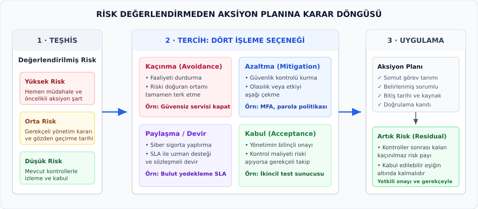

## Riski ölçmek onu ortadan kaldırır mı?

- Geçen hafta H9 değerlendirmesinde varlıkları belirledik, tehdit ve zafiyetleri eşleştirdik.
- Olasılık ve etki düzeylerini H9 matrisinde değerlendirip kırmızı, sarı veya yeşil alanlara yerleştirdik.

Tabloya bakıp "Bu risk çok yüksek" demek tek başına durumu değiştirir mi?

**Değerlendirme teşhistir; teşhis konulduktan sonra ne yapılacağına karar verilmelidir.**

::: {.notes}
Risk analizi ve boşluk (gap) analizi kuruma yalnızca mevcut durumun fotoğrafını çeker. Hangi varlığın nerede zayıf olduğunu, olası bir tehdidin kuruma ne kadar zarar verebileceğini ve mevcut güvenlik açıklarını nitel düzeylerle ortaya koyar. Ancak yalnızca risk analizi yapmak ve riski matriste bir hücreye yerleştirmek, riskin kendisini azaltmaz ya da ortadan kaldırmaz.

Tıpkı bir hastanın tahlil sonuçlarını alıp yüksek tansiyonu olduğunu öğrenmesi gibi; tahlil kâğıdını çekmeceye koymak tansiyonu düşürmez. Tedaviye, perhize veya ilaç kullanımına karar verilmesi ve bunun uygulanması gerekir. Bilgi güvenliğinde de risk değerlendirmesinin bittiği yerde yönetim kararı başlar; bu karar ve uygulama aşamasına "risk işleme" diyoruz.

Örneğin Duru Eğitim Merkezi vakasında `ayrilan-hesap` kaydının Yüksek, `geri-yukleme` ve `takvim-dosyasi` kayıtlarının Orta düzeyde çıkması yalnızca teşhistir. Kurumun kabul ölçütlerine göre bu bulguların hangi stratejiyle ele alınacağına karar verilmedikçe risk aynı düzeyde kalır. Bir sonraki slaytta teşhisten uygulamaya geçişi sağlayan risk işleme sürecinin yapısını inceleyeceğiz.
:::

---

## Risk işleme nedir?

**Risk işleme (risk treatment)**, değerlendirilmiş bir riskin kurumun amaçlarına, önceliklerine ve kabul ölçütlerine göre nasıl ele alınacağının seçilmesi ve bu seçimin hayata geçirilmesi sürecidir.

| Aşama | Sorduğu soru | Ürettiği sonuç |
|---|---|---|
| Değerlendirme (Teşhis) | Tehdit nedir, olasılık ve etki ne düzeydedir? | Risk seviyesi ve gerekçeli risk kaydı |
| İşleme kararı (Tercih) | Bu risk karşısında hangi stratejiyi izleyeceğiz? | Seçilen işleme seçeneği |
| Aksiyon (Uygulama) | Kim, ne zaman, hangi kaynakla ne yapacak? | Onaylı aksiyon planı ve kontrol |

::: {.notes}
Risk işleme tek bir işlem değil, teşhisten uygulamaya uzanan mantıksal bir karar ve uygulama zinciridir. İlk adımda değerlendirilmiş riskin büyüklüğüne ve kurumun kabul ölçütlerine göre bir strateji seçilir. İkinci adımda bu stratejiye uygun teknik, idari veya fiziksel kontroller tasarlanır. Üçüncü adımda ise kimin, hangi kaynakla ve hangi tarihe kadar bu işi yapacağı onaylı bir aksiyon planına bağlanır.

ISO/IEC 27001 standardı, risk işleme sürecinin kurum tarafından önceden belirlenmiş kurallara ve kabul ölçütlerine dayanmasını şart koşar. Bir riskle karşılaşıldığında her çalışan kendi sezgisine göre hareket etmez; nitel 3×3 matristeki seviyeye ve kurumun risk kabul ölçütüne göre seçeneklerden biri belirlenir ve karar yetkilisinin onayından geçer.

Uygulamada sık yapılan hata, değerlendirme tablosunu doldurmayı işin sonu sanmak ya da yönetim kararı olmadan doğrudan rastgele teknik önlem yazmaya geçmektir. Oysa teşhis ile uygulama arasındaki karar halkası eksik kaldığında risk kaydının sahada neyi değiştiremediğini bir sonraki örnekte göreceğiz.
:::

---

## Karar olmadan değerlendirme neyi eksik bırakır?

Bir kurumda işten ayrılan personelin sistem hesaplarının kapatılmadığı fark edildi. Risk kaydı açıldı:
- **Tehdit:** Eski personelin verilere yetkisiz erişmesi
- **Olasılık:** Yüksek (hesaplar aktif)
- **Etki:** Yüksek (müşteri sözleşmelerine tam erişim)
- **Sonuç:** Yüksek Risk (Kırmızı alan)

Bu kaydın varlığı, eski personelin bu akşam sisteme giriş yapmasını engeller mi?

. . .

**Kayıt zafiyeti gösterir; uygulamayı başlatan ise yönetim kararı ve aksiyondur.**

::: {.notes}
Risk kütüğünde "Yüksek Risk" yazması tek başına hiçbir portu kapatmaz ve hiçbir kullanıcı yetkisini kaldırmaz. Hatta tam tersine, bir zafiyetin kurum tarafından bilindiğini ancak gidermek için hiçbir adım atılmadığını belgeleyen bir kayda dönüşebilir. Duru Eğitim Merkezi vakasında 80 kursiyer sözleşmesine erişebilen ve 10 ayrılıştan 2'sinde 7 gün açık kalan `ayrilan-hesap` riskinin kırmızı alanda görünmesi, eski personelin sisteme girmesini kendiliğinden önlemez.

Teşhisin sahada korumaya dönüşmesi için yönetimin somut bir karar vermesi gerekir: açık hesaplar hemen kapatılacak mı, insan kaynakları ayrılış bildirimiyle hesap kapatma süreci birbirine mi bağlanacak, yoksa geçici olarak parolalar mı sıfırlanacak? Kurumun kabul ölçütünde Yüksek risk kabul edilemez olduğundan, karar yetkilisi ve iş sahibi uygun işleme yolunu seçip teknik uygulayıcıya görev olarak atamak zorundadır.

Yönetim kararı alınmadığı ve sorumlu kişiye takvimli bir aksiyon olarak verilmediği sürece kurum aynı tehlikeyle yaşamaya devam eder. Bir sonraki slaytta, değerlendirilmiş bir risk karşısında yönetimin seçebileceği dört temel işleme seçeneğini inceleyeceğiz.
:::

---

## Yönetimin önündeki dört işleme seçeneği

Bir risk değerlendirildiğinde yönetimin seçebileceği dört temel yol vardır:

1. **Riski Azaltma (Mitigation):** Kontrol uygulayarak olasılık veya etkiyi düşürmek.
2. **Riski Paylaşma / Aktarma (Sharing / Transference):** Riskin sonuçlarını veya yönetimini başka bir tarafla paylaşmak.
3. **Riski Kabul Etme (Retention / Acceptance):** Riski mevcut haliyle üstlenip izlemeye almak.
4. **Riskten Kaçınma (Avoidance):** Riski doğuran faaliyete son vermek veya hiç başlamamak.

::: {.notes}
Bilgi güvenliği yönetiminde değerlendirilmiş bir riskle karşılaşıldığında uluslararası kabul görmüş dört temel karar çerçevesi devreye girer: azaltma, paylaşma, kabul etme ve kaçınma. Her risk için aynı yöntem seçilemez; bütçenin yetersiz olması, riskin kuruma olası etkisinin düşük kalması ya da tam tersine riskin kurumun temel hizmetini tehdit edecek kadar yüksek çıkması farklı seçenekleri gündeme getirir.

Burada belirleyici ilke, seçimin rastlantısal olmamasıdır. Seçilen her yolun kurumun iş hedefleriyle, bütçesiyle ve önceden yazılı hale getirilmiş kabul ölçütüyle dengeli bir gerekçesi bulunmalıdır. Örneğin Düşük düzeydeki bir riskte mevcut kontrollerle izleme yeterli görülürken, Yüksek düzeydeki bir riskte olasılık ve etkiyi düşürecek kontroller veya faaliyeti sonlandırma kararı aranır.

Dört seçeneğin her birinde riskin kaynağı, olasılığı, etkisi ya da sonuç yükü üzerinde farklı bir değişim gerçekleşir. Şimdi önce bu dört seçeneğin karar döngüsü içindeki yerini bütünsel şema üzerinde görecek, ardından seçenekleri ikişerli gruplar hâlinde karşılaştıracağız.
:::

---

## Dört işleme seçeneği ve karar döngüsü

{width="100%" fig-align="center" fig-alt="Risk değerlendirmeden dört işleme seçeneğine ve aksiyon planına geçiş karar döngüsü"}

::: {.notes}
Şemayı soldan sağa üç durak olarak okuyun: teşhis, tercih, uygulama. Soldaki durakta H9'dan gelen değerlendirilmiş risk vardır; ortada kurumun bu riske karşı seçebileceği dört işleme seçeneği, sağda ise seçimi gerçek bir işe çeviren aksiyon planı. Risk değerlendirmesi bittiği yerde karar başlar; şema bu geçişi tek bir akış olarak gösterir.

Soldaki durak riski düzeyine göre ayırır. Yüksek risk hemen müdahale ve öncelikli aksiyon ister. Orta risk için gerekçeli bir yönetim kararı ve bir gözden geçirme tarihi aranır. Düşük risk mevcut kontrollerle izlenir ve kabul edilir. Bu eşikler H9'da gördüğümüz kurum kabul ölçütüyle aynıdır; başka bir kurum farklı bir eşik koyabilir, ama eşik her zaman yazılı olmalıdır.

Ortadaki dört kutu kurumun elindeki seçeneklerdir. Kaçınma, riski doğuran faaliyeti ya da ortamı bırakmaktır; örneğin güvensiz bir servisi kapatmak. Azaltma, olasılığı ya da etkiyi aşağı çeker; çok faktörlü doğrulama ya da parola politikası gibi. Paylaşma ya da devir, riskin yükünü sigorta ya da sözleşmeli bir hizmetle başkasıyla bölüşür. Kabul, riskin bilinçli olarak üstlenilmesidir ve yetkili onayı ister. Hiçbiri kendi başına en doğru seçenek değildir; seçimi kurumun amacı, bütçesi ve kabul ölçütü belirler.

Sağdaki durakta aksiyon planının dört ölçütü görünür: somut görev tanımı, belirlenmiş sorumlu, bitiş tarihi ve kaynak, doğrulama kanıtı. Planın sonunda artık risk gelir: kontroller uygulandıktan sonra kalan risk payı. Artık risk kurumun kabul edilebilir eşiğinin altında kalmalıdır; eşiğin üstündeyse ek bir kontrol planlanır ya da başka bir seçenek değerlendirilir. Şemadaki oklar tek yönlü görünse de bu durumda döngü başa döner.

İki yaygın yanlış okumaya dikkat edin. Paylaşma, sorumluluğu devretmek değildir; sigortalı ya da sözleşmeli olsa da riskin sahibi kurum olmaya devam eder. Kabul de "hiçbir şey yapmamak" demek değildir; yazılı gerekçe ve izleme ister. Sonraki slaytlar dört seçeneği tek tek, ardından artık riski ve aksiyon planını ayrıntılandırır.
:::

---

## Riski azaltmak ve riskten kaçınmak

**Riski azaltma**, riskin ortaya çıkma olasılığını, olası etkisini veya her ikisini birden kabul edilebilir bir düzeye indirmek için teknik, idari ya da fiziksel güvenlik kontrolleri uygulamaktır.

**Riskten kaçınma**, risk oluşturan iş sürecini, faaliyeti veya teknolojiyi başlatmamak ya da tamamen durdurmaktır.

| Seçenek | Ne değişir? | Somut örnek |
|---|---|---|
| Azaltma | Kontrol eklenir, olasılık/etki düşer | Paylaşılan klasörlere rol bazlı erişim ve parola kuralı getirmek |
| Kaçınma | Faaliyet durdurulur, risk kaynağı kalkar | Güvenliği sağlanamayan harici dosya paylaşım hizmetini tamamen kapatmak |

::: {.notes}
Azaltma ve kaçınma seçeneklerinin her ikisi de kabul edilemez düzeydeki risklere müdahale eder; ancak azaltma iş sürecini sürdürerek güvenlik kontrolü eklerken, kaçınma riski doğuran faaliyeti tamamen sonlandırır. Uygulamada en sık başvurulan yöntem riski azaltmadır: güvenlik duvarı kurmak, personeli eğitmek, yedekleme yapmak veya şifreleme kullanmak hep olasılığı ya da etkiyi düşüren azaltma kontrolleridir.

Riskten kaçınma ise kontrol eklemek yerine tehlikeyi yaratan işten veya teknolojiden vazgeçmektir. Bir kurum müşterilerine mobil uygulama üzerinden hizmet vermek istiyor ancak altyapısının güvenliğini sağlayamayacağını görüyorsa projeyi iptal etmesi, ya da güvenliğinden emin olunmayan eski bir sunucunun fişini çekip hizmeti sonlandırması kaçınmadır.

İki seçenek arasındaki mekanizma farkı geriye kalan riskte görülür. Azaltma işlemi riski tamamen yok etmez, yalnızca kontrol edilebilir ve yönetilebilir bir düzeye indirir; kaçınmada ise faaliyet bittiği için o faaliyete bağlı risk kaynağı ortadan kalkar. Örneğin Kuzey Üniversitesi kurallarında ayrılan personelin hesabının ayrılış günü 17.30'da kapatılması (Kural 4) ve ardışık 3 başarısız parola denemesinde hesabın 30 dakika kilitlenip BT alarmı üretilmesi (Kural 3), sistemi kapatmadan yetkisiz erişim olasılığını düşüren azaltma kontrolleridir.

Yaygın bir hata, kontrol maliyeti veya zorluğu görüldüğünde kurumun asli iş süreçleri için de kaçınma önermektir; oysa bir eğitim kurumunun öğrenci veya kursiyer kayıtlarını tutmaktan kaçınması mümkün değildir. Bir sonraki slaytta, faaliyetin sürdüğü durumlarda değerlendirilen diğer iki seçeneği—paylaşma ve kabul etmeyi—karşılaştıracağız.
:::

---

## Riski paylaşmak ve riski kabul etmek

**Riski paylaşma (aktarma)**, riskin getirdiği finansal ya da operasyonel sonuç yükünün bir kısmını sözleşme, sigorta veya dış kaynak yoluyla başka bir tarafla paylaşmaktır.

**Riski kabul etme**, riskin seviyesi kabul edilebilir sınırda olduğunda veya kontrol maliyeti olası zarardan yüksek çıktığında, yetkili kararıyla riski üstlenip izlemektir.

| Seçenek | Ne değişir? | Somut örnek |
|---|---|---|
| Paylaşma | Sonuç yükü başka tarafla bölüşülür | Sunucu arızası riskine karşı SLA'li dış bakım hizmeti veya siber sigorta almak |
| Kabul | Ek kontrol yapılmaz, durum izlenir | Düşük etkili bir sistem hatasını loglardan takip etmekle yetinmek |

::: {.notes}
Paylaşma ve kabul etme seçenekleri, kurumun kendi içinde yeni bir teknik kontrol kurmak yerine riskin yükünü nasıl yöneteceğine odaklanır. Paylaşmada finansal veya operasyonel sonuç yükünün bir kısmı sözleşme, sigorta ya da dış kaynak yoluyla başka bir tarafla bölüşülürken; kabul etmede ek kontrol uygulanmaksızın mevcut risk üstlenilir ve izlemeye alınır.

Riski paylaşmak uygulamada çoğunlukla yanlış anlaşılır. Bir hizmeti dışarıdan almak ya da siber sigorta yaptırmak operasyonel riski veya hesap verebilirliği ortadan kaldırmaz. Örneğin bir bulut sağlayıcısı sunucunuzu barındırabilir ve donanım arızası riskinin sonuç yükünü üstlenebilir; ancak kurumun iş ve güvenlik kararının sorumluluğu sürmeye devam eder. Dolayısıyla paylaşma, sorumluluktan kaçmak değil, sonuç yükünü bölüşmek ve yönetimi sözleşmeli olarak paylaşmaktır.

Riski kabul etmek ise "boş vermek" veya "görmezden gelmek" değildir; bilinçli bir yönetim kararıdır ve iki şart aranır. Birincisi, kararın kurumun kabul ölçütüne uygun olarak yetkili yönetici tarafından yazılı gerekçesiyle imzalanmış olmasıdır; Duru Eğitim Merkezi ölçütlerinde Düşük risk iş sahibi izlemesiyle, Orta risk ise gerekçeli yönetim kararı ve gözden geçirme tarihiyle kabul edilebilirken Yüksek risk kabul edilemez. İkincisi ise riskin belirli periyotlarla gözden geçirilmeye devam edilmesidir; çünkü bugün kabul edilen bir risk, yarın sistem büyüdüğünde kabul edilemez hale gelebilir.

Dört işleme seçeneğinin tanımlarını ve sınırlarını gördüğümüze göre, bir sonraki slaytta aynı teknik zafiyetin bu dört farklı yönetim tercihiyle nasıl ele alınabileceğini çözümlü bir örnek üzerinde adım adım inceleyeceğiz.
:::

---

## Çözümlü örnek: Dört seçeneğin aynı duruma uygulanması

| Seçenek | Kurumun alacağı karar | Kararın mekanizması |
|---|---|---|
| **Kaçınma** | Arşiv sorgulama hizmetini sonlandırmak | Faaliyet bittiği için risk kaynağı durdurulur |
| **Azaltma** | Sunucuyu izole VLAN'a alıp interneti kesmek | Olasılık düşürülür; zafiyetli sunucuya erişim zorlaşır |
| **Paylaşma** | Veriyi güvenli bulut sağlayıcıya aktarmak | Altyapı ve bakım yükü sağlayıcıyla paylaşılır |
| **Kabul** | Sadece yerel ağdan haftalık sorguya izin verip log izlemek | Ek maliyet yapılmaz; yetkili onayıyla risk üstlenilir |

::: {.notes}
Kurumda 10 yıllık eski bir sunucuda çalışan arşiv sorgulama yazılımı bulunduğunu ve sunucunun işletim sisteminin artık üretici tarafından desteklenmeyip güvenlik güncellemesi almadığını düşünelim. Aynı teknik zafiyet karşısında yönetimin önünde dört farklı tercih yolu vardır ve hangisinin seçileceği arşiv hizmetinin kritikliğine, bütçeye ve kurumun kabul ölçütüne göre değişir.

Arşiv sorgulama hizmeti artık zorunlu bir iş ihtiyacını karşılamıyorsa, hizmeti tamamen sonlandırarak **kaçınma** seçilir ve risk kaynağı ortadan kaldırılır. Hizmetin sürmesi şartsa ve gizli bilgiler içeriyorsa, sunucuyu izole VLAN'a alıp internet erişimini keserek zafiyetli sunucuya ulaşma olasılığını düşüren **azaltma** uygulanır. Kurum eski donanım ve altyapı bakım yükünü taşımak istemiyorsa, veriyi sözleşmeli ve güvenli bir bulut sağlayıcıya aktararak **paylaşma** yoluna gider. Kurumun bütçesi yoksa ve arşiv hayati değilse, yalnızca yerel ağdan haftalık sorguya izin verip logları izleyerek yetkili onayıyla **kabul** kararı verilir.

Güvenlik uzmanı yönetime bu dört seçeneği, mekanizmalarını ve sonuçlarını sunar; nihai kararı ise bütçeyi ve iş hedeflerini yöneten karar yetkilisi yazılı gerekçeyle verir. Ancak seçilen işlem sahada uygulandığında riskin kendiliğinden bittiği varsayılamaz; bir sonraki slaytta işlem tamamlandıktan sonra kalan durumu sorgulayacağız.
:::

---

## Planlanan işlemler yapıldı; risk bitti mi?

Arşiv sorgulama sunucusunda **azaltma** kararı uygulandı: sunucu izole ağa alındı, erişim iki kişiyle sınırlandı.

| | Risk düzeyi |
|---|---|
| H9 değerlendirmesi (işlemden önce) | **Yüksek** |
| Plandaki hedef (işlemden sonra) | **Orta** |

Yapılması gerekenler yapıldı. Risk Orta düzeye indi mi?

. . .

**Henüz bilinmiyor.** Orta, kâğıda yazılan hedeftir; sunucunun gerçekten izole olduğu ve erişimin sınırlandığı kanıtlanmamıştır.

::: {.notes}
Risk işleme süreçleri çoğu zaman "gereken adımlar yapıldıysa risk de düştü" varsayımıyla erken kapatılır. Oysa tablodaki birinci satır (işlemden önceki Yüksek düzey) H9 değerlendirmesinin sonucudur; ikinci satırdaki Orta düzey ise işlemin başarılı olacağı varsayımına dayanan bir tahmindir.

İzole ağ yapılandırmasının gerçekten çalıştığına ve erişimin yalnızca iki yetkili hesapla sınırlandığına dair doğrulama kanıtı gelene kadar riskin Orta düzeye indiği söylenemez. Bazı kurumlar riski sayısal puanla gösterse de bu derste nitel düzeyler kullanıyoruz; her iki yaklaşımda da kâğıda yazılan değer hedeftir ve ancak kanıt incelendiğinde doğrulanmış değere dönüşür.

Kontroller uygulandıktan sonra geriye kalan bu risk payını ve kâğıt üzerindeki hedef ile kanıtlanmış gerçek durum arasındaki farkı adlandırmak için sonraki iki slaytta "artık risk" ile "beklenen ve doğrulanmış artık risk" kavramlarını ele alacağız.
:::

---

## Artık risk nedir?

**Artık risk (residual risk)**, seçilen güvenlik kontrolleri ve işleme adımları uygulandıktan sonra geriye kalan risktir.

- **Yeniden değerlendirme:** İşleme uygulandıktan sonra kalan durum yeniden değerlendirilir ve H9 matris hücresine göre seviyesi okunur.
- **Sıfır risk yoktur:** Ne kadar güvenlik önlemi alırsanız alın, hiçbir sistemde risk sıfıra inmez.
- **Kabul edilebilirlik sınırı:** Kalan artık risk, kurumun kabul edilebilir risk eşiğinin (risk iştahının) altında kalmalıdır.
- **Yönetim onayı:** Artık risk yönetime açıkça raporlanmalı ve yetkili makam tarafından onaylanmalıdır.

::: {.notes}
Güvenlik yönetiminde en sık düşülen yanılgılardan biri, bir kontrol kurulduğunda tehlikenin tamamen bittiğini sanmaktır. En gelişmiş yeni nesil güvenlik duvarını kursanız bile çalışanların oltalama e-postasına tıklama riski devam eder; şifreleme kullansanız bile şifreleme anahtarının çalınma riski kalır. Kontrol uygulandıktan sonra masada kalan bu paya "artık risk" diyoruz.

Artık riskin düzeyini görmek için işleme adımları tamamlandıktan sonra kalan durum nitel olasılık ve etki ölçütleriyle yeniden değerlendirilir ve H9 matris hücresine göre seviyesi okunur. Örneğin Duru Eğitim Merkezi kabul ölçütüne göre kontrollerden sonra kalan artık risk Düşük ise iş sahibi izlemesiyle, Orta ise gerekçeli yönetim kararı ve gözden geçirme tarihiyle kabul edilebilir; ancak Yüksek kalmışsa kabul edilemez.

Eğer kontrol uygulandıktan sonra kalan artık risk kurumun kabul sınırının üzerindeyse, ek bir kontrol daha planlanır ya da paylaşma ve kaçınma gibi diğer işleme seçenekleri değerlendirilir. Ancak bu değerlendirmede planlama aşamasındaki tahmin ile saha kanıtına dayalı gerçek ölçümü birbirine karıştırmamak gerekir; bir sonraki slaytta bu ayrımı inceleyeceğiz.
:::

---

## Beklenen artık risk ile doğrulanmış artık risk

Risk yönetiminde yapılan en büyük planlama hatası, kâğıt üzerindeki tahmin ile gerçekleşen sonucu birbirine karıştırmaktır:

**Beklenen artık risk**, kontrol planlanırken hedeflenen teorik durumdur. Henüz uygulanmamış bir işlemin riski düşüreceği varsayımıdır.

**Doğrulanmış artık risk**, kontrol sahada uygulanıp etkinlik kanıtı incelendikten sonra yapılan gerçek değerlendirmedir.

```
Planlama: "Yedekleme testi yaparsak veri kaybı riski Düşük olur." (Beklenen)
                ↓ Kontrol uygulanır ve test edilir
Gerçekleşen: Test yapıldı, 3 veritabanından 1'i açılamadı.
                ↓ Kanıta dayalı yeni ölçüm
Sonuç: Risk seviyesi Orta düzeyde kaldı; ek aksiyon gerekir! (Doğrulanmış)
```

::: {.notes}
Bir aksiyon planı hazırladığımızda "bu önlem alınınca risk Yüksek'ten Düşük seviyeye inecektir" şeklinde yazılan değer yalnızca beklenen artık risktir. Planlama aşamasında kontrol henüz uygulanmadığı için bu seviye, seçilen işlemin eksiksiz çalışacağı varsayımına dayanan teorik bir beklentidir.

Doğrulanmış artık riske ulaşabilmek için kontrolün sahada uygulanması ve etkinlik kanıtının incelenmesi şarttır. Kontrol gerçekten kuruldu mu, çalışanlar bu kurala uyuyor mu ve teknik araç doğru yapılandırıldı mı sorularının cevabı test sonucu, denetim kaydı ya da raporla görülmeden risk kapanmış sayılamaz.

Akış şemasındaki yedekleme örneği ve Duru Eğitim Merkezi'ndeki `geri-yukleme` vakası bu farkı açıkça ortaya koyar: planlama aşamasında yedekleme testiyle veri kaybı riskinin Düşük olacağı öngörülür (beklenen artık risk); ancak test yapıldığında 3 veritabanından 1'inin açılamadığı görülürse kanıta dayalı ölçüm riskin Orta düzeyde kaldığını gösterir (doğrulanmış artık risk).

Yaygın hata, aksiyon planı onaylandığı anda beklenen artık riski gerçekleşmiş kabul etmektir; oysa doğrulanmış artık risk beklenenden yüksek çıktığında aksiyonun yeterli olmadığı anlaşılır ve ek aksiyon planlanması gerekir. Bir sonraki slaytta, kararları sahada doğrulanabilir uygulamaya dönüştüren risk aksiyon planının yapısına geçeceğiz.
:::

---

## Karardan uygulamaya: Risk aksiyon planı

**Risk aksiyon planı (risk treatment plan)**, seçilen risk işleme seçeneklerini hayata geçirmek için kimin, hangi kaynakla, ne zamana kadar ne yapacağını ve sonucun nasıl doğrulanacağını belirleyen onaylı yönetim kaydıdır.

- "Güvenliği artıracağız" bir **temennidir**.
- "Parola politikasını güncelleyelim" bir **öneridir**.
- "Sistem yöneticisi, 15 Aralık'a kadar en az 12 karakterli karmaşık parola kuralını aktif hale getirir ve doğrulama raporunu sunar" bir **aksiyon planı maddesidir**.

::: {.notes}
Risk aksiyon planı, strateji ve işleme kararlarını sahada somut işe dönüştüren yönetim köprüsüdür. Bir toplantıda risklerin konuşulması, "güvenliği artıracağız" gibi temennilerde bulunulması veya "parola politikasını güncelleyelim" gibi öneriler getirilmesi, sorumluluk ve takvim bağlamadığı için sahada uygulama başlatmaz.

Bir kararın aksiyon planı maddesi sayılabilmesi için her işin bir sahibi, uygulayıcısı, bitiş tarihi, kaynağı ve sonucunu kanıtlayacak doğrulama belgesi olmak zorundadır. Bu alanlardan biri boş kalırsa iş kurum içinde sahipsiz kalır: bitiş tarihi olmayan işler sürekli ertelenir, kaynağı tanımlanmayan işler bütçe veya zaman engeline takılır, doğrulama yöntemi yazılmayan işlerin ise gerçekten yapılıp yapılmadığı asla bilinemez.

Ayrıca kurumsal görev ayrılığı ilkesi gereği aksiyon planını hazırlayan ile onaylayan aynı kişi olamaz; karar yetkilisi, iş sahibi ve teknik uygulayıcı rolleri birbirinden ayrı tanımlanır. Sonraki iki slaytta eksiksiz bir aksiyon kaydının içermesi gereken zorunlu bileşenleri iki bölüm hâlinde inceleyeceğiz.
:::

---

## Bir aksiyon kaydının zorunlu bileşenleri (1/2)

Eksiksiz bir risk aksiyon planı tablosunda bulunması gereken temel operasyonel alanlar:

| Alan | İşlevi | Örnek |
|---|---|---|
| **Risk / Gerekçe** | Hangi tehdit ve zafiyet için yapılıyor? | Açık eski hesaplar / Yetkisiz veri erişimi |
| **İşleme seçeneği** | Hangi strateji seçildi? | Riski Azaltma |
| **Yapılacak iş** | Somut uygulama adımı nedir? | Ayrılan personelin hesabını 24 saatte kapatma |
| **İş sahibi** | Sonuçtan yönetime karşı kim sorumlu? | BT Hizmetleri Yöneticisi |
| **Teknik uygulayıcı** | İşi sahada kim uygulayacak? | Sistem Yönetimi Uzmanı |

::: {.notes}
Aksiyon kaydının ilk beş alanı, yapılacak uygulamanın hangi risk kaydına dayandığını ve kurumsal sorumluluk zincirinde kime ait olduğunu gösterir. "Risk / Gerekçe" ve "İşleme seçeneği" sütunları, sahada yapılacak teknik ya da idari adımın H9'daki hangi zafiyeti gidermek için ve hangi yönetim stratejisiyle (örneğin Riski Azaltma) yürütüldüğünü birbirine bağlar.

Tabloda özellikle "İş sahibi" ile "Teknik uygulayıcı" arasındaki ayrıma dikkat edin. İş sahibi (örneğin BT Hizmetleri Yöneticisi veya Kuzey Üniversitesi ÖBS vakalarında Öğrenci İşleri Müdürü), sürecin doğru işlemesinden ve yönetime hesap vermekten sorumlu olan birim yöneticisidir. Teknik uygulayıcı ise sunucuya girip komutu yazan ve yapılandırma ayarını fiilen yapan uzmandır.

Bu iki rolün ayrılması hesap verebilirlik ve görev ayrılığı açısından şarttır; hazırlayan ile onaylayan aynı kişi olamaz. Örneğin Kuzey Üniversitesi Kural 4 kapsamında ayrılan personelin hesabının ayrılış günü 17.30'da kapatılması işlemini sahada teknik uygulayıcı gerçekleştirirken, sürecin eksiksiz işlemesinden yönetime karşı iş sahibi sorumludur. Bir sonraki slaytta aksiyon kaydının kaynak, takvim ve kanıt alanlarını inceleyeceğiz.
:::

---

## Bir aksiyon kaydının zorunlu bileşenleri (2/2)

Aksiyon kaydını yönetilebilir ve denetlenebilir kılan kaynak ve doğrulama alanları:

| Alan | İşlevi | Örnek |
|---|---|---|
| **Kaynak** | Ne kadar zaman/bütçe ayrıldı? | 8 adam-saat çalışma |
| **Hedef tarih** | İş ne zamana kadar tamamlanacak? | 2026-12-01 |
| **Durum** | Sürecin güncel aşaması nedir? | Açık / Devam Ediyor / Tamamlandı |
| **Doğrulama kanıtı** | İşin bittiği hangi kayıtla görülecek? | İK ayrılış listesi ve kapatılan hesap logu |

::: {.notes}
Aksiyon kaydının ikinci bölümündeki alanlar, görevin hangi kaynakla ve hangi takvimde yürütüleceğini, ayrıca tamamlandığının nasıl kanıtlanacağını belirler. "Kaynak" ve "Hedef tarih" sütunları işin sürüncemede kalmasını engeller; ne kadar uzman emeği (örneğin 8 adam-saat) veya bütçe ayrıldığı ve işin hangi tarihte biteceği yazılmazsa aksiyon öncelik kazanamaz.

Tablodaki en kritik sütun "Doğrulama kanıtı"dır. Teknik uygulayıcının "ben yaptım" demesi yeterli değildir; bağımsız bir denetçinin ya da iş sahibinin kontrol edebileceği bir İK ayrılış listesi, kapatılan hesap günlüğü (log), onaylı form veya test sonucu kanıt olarak sunulmalıdır.

"Durum" alanı ancak doğrulama kanıtı incelenip doğrulandığında "Tamamlandı" olarak kapatılabilir; kanıt üretilmeden kapatılan kayıtlar kağıt üzerinde kalmış sayılır. Bir sonraki slaytta, bu bileşenleri eksik bırakan yetersiz görev tanımları ile somut ve izlenebilir aksiyon cümlelerini karşılaştıracağız.
:::

---

## "Önlem al" yerine somut görev tanımı

Aksiyon planında işin nasıl tanımlandığı, işin başarı şansını doğrudan belirler:

| Yetersiz tanım | Neden yetersiz? | Somut ve izlenebilir aksiyon |
|---|---|---|
| "Erişim yetkilerini düzelt" | Rol, kapsam ve bitiş kriteri belirsiz | İK bildirimine istinaden uzman hesabı 1 günde kilitler; log İK'ya onaylatılır |
| "Yedekleme güvenliğini sağla" | Sistem, periyot ve test kriteri yok | VT yöneticisi her ayın ilk pazartesi yedeği teste döner ve süreyi raporlar |
| "Personele eğitim ver" | Hedef kitle, süre ve ölçüt belirsiz | Güvenlik sorumlusu 30 günde tüm personele eğitim verir; yoklama dosyalanır |

::: {.notes}
Aksiyon planlarında yetersiz ve muğlak tanımlar, kurum içinde işlerin sürüncemede kalmasının bir numaralı nedenidir. "Erişim yetkilerini düzelt" dendiğinde herkes başka bir şey anlar; sistem uzmanı parolaları değiştirdiğinde görevi bitirdiğini zannederken, iş sahibi ayrılan personelin hesaplarının tamamen kapatılmasını bekler.

Tablodaki ilk iki satırda belirsizliğin nasıl somutlaştırıldığına dikkat edin. "Erişim yetkilerini düzelt" yerine, "İK biriminden gelen ayrılış bildirimine istinaden, sistem uzmanı ilgili hesabı en geç 1 iş gününde kilitler ve işlem günlüğünü İK'ya onaylatır" yazıldığında tetikleyici olay, rol, süre ve kanıt netleşir. Aynı biçimde "Yedekleme güvenliğini sağla" yerine, "Veritabanı yöneticisi her ayın ilk pazartesi günü son alınan yedeği test ortamına geri yükler ve kurtarma süresini rapora kaydeder" denildiğinde Duru Eğitim Merkezi'ndeki `geri-yukleme` benzeri risklerin doğrulanması güvenceye alınır.

Üçüncü satırdaki "Personele eğitim ver" ifadesi de hedef kitle, süre ve kanıt içermediği için denetlenemez. Bunun yerine "Bilgi güvenliği sorumlusu, 30 gün içinde tüm birim personeline 1 saatlik oltalama farkındalık oturumu düzenler ve katılım listesini dosyalar" tanımı kullanıldığında uygulayıcı ne yapacağını, denetleyen ise hangi kanıtı arayacağını tartışmasız biçimde bilir.

Somut bir aksiyon tanımı; eylemi yapan rolü, tetikleyici olayı veya periyodu, süreyi ve geride bırakılacak doğrulama kanıtını açıkça belirtmelidir. Bir sonraki slaytta, bu aksiyon ve kontrol kararlarının uluslararası standartlarda (ISO/IEC 27001 ve 27002) nasıl konumlandırıldığını inceleyeceğiz.
:::

---

## Yönetim sisteminde kontrolün yeri

Risk işleme kararları uluslararası standartlarda nasıl konumlandırılır?

- **ISO/IEC 27001:2022 (Gereksinimler):**
  - **Madde 6.1.3:** Kurumun risk işleme sürecini tanımlamasını, uygun kontrolleri seçmesini ve bir **Uygulanabilirlik Bildirgesi (SoA - Statement of Applicability)** hazırlamasını zorunlu kılar.
  - Artık risklerin risk sahipleri tarafından resmen onaylanmasını şart koşar.

- **ISO/IEC 27002:2022 (Uygulama Rehberi):**
  - Güvenlik kontrollerini (organizasyonel, kişi, fiziksel, teknolojik) detaylandırır ve nasıl uygulanacağına dair rehberlik sağlar.
  - **Unutulmamalıdır:** 27002 kontrolleri zorunlu bir kontrol listesi değildir; kurum kendi risk değerlendirmesine göre ihtiyaç duyduğu kontrolleri seçer ve gerekçelendirir.

::: {.notes}
ISO/IEC 27001 ve ISO/IEC 27002 standartları, kurumun aldığı risk işleme kararlarını yönetim sisteminin denetlenebilir bir parçası haline getirir. ISO/IEC 27001:2022 bilgi güvenliği yönetim sisteminin zorunlu gereksinimlerini ortaya koyarken, ISO/IEC 27002:2022 seçilen güvenlik kontrollerinin organizasyonel, kişi, fiziksel ve teknolojik temalarda nasıl uygulanacağına dair ayrıntılı rehberlik sağlar.

ISO/IEC 27001 standardı kuruma "şu güvenlik duvarını satın alacaksın" demez. Standardın Madde 6.1.3'ü kuruma şunu söyler: risklerini belirle, bunlara uygun işleme seçeneklerini seç, seçtiğin kontrolleri ISO/IEC 27001 Ek A'daki kontrol listesiyle (içeriği 27002'nin kontrolleriyle aynıdır) karşılaştır ve hangilerini neden aldığını, hangilerini neden dışarıda bıraktığını bir Uygulanabilirlik Bildirgesi (SoA) belgesinde açıkla; ardından kalan artık riskleri risk sahiplerine resmen onaylat.

Bu yaklaşım kuruma esneklik kazandırır. Küçük bir danışmanlık firması ya da eğitim merkezi ile binlerce çalışanı olan bir bankanın riskleri aynı değildir; ancak her iki kurum da şablon kontrolleri ezbere kopyalamak yerine kendi riskini doğru işleyip gerekçelendirerek ISO/IEC 27001 belgesi alabilir.

Yaygın bir yanılgı, ISO/IEC 27002'deki tüm kontrolleri istisnasız uygulanması gereken zorunlu bir liste sanmaktır; oysa kurum kendi risk değerlendirmesinde yer almayan kontrolleri gerekçesiyle dışarıda bırakabilir. Bir sonraki slaytta, seçilen ve dışarıda bırakılan kontrollerin kaydedildiği Uygulanabilirlik Bildirgesi'ni örnek satırlar üzerinden inceleyeceğiz.
:::

---

## Uygulanabilirlik Bildirgesi: Hangi kontrol uygulanıyor, hangisi neden dışarıda?

**Uygulanabilirlik Bildirgesi (SoA)**, kurumun ISO/IEC 27001 Ek A'daki kontroller arasından hangilerini seçtiğini, seçtiklerinin uygulanıp uygulanmadığını ve seçmediklerinin gerekçesini gösteren belgedir.

| Kontrol | Seçildi mi? | Gerekçe ve durum |
|---|---|---|
| **5.9** Bilgi ve ilişkili varlıkların envanteri | Evet | Risk kayıtlarındaki her varlığın sahibi envanterde yazılı; **uygulandı** |
| **5.18** Erişim hakları | Evet | Ayrılan personelin açık hesabı riskini azaltma kararı; **planlandı**, İK–BT mutabakatı bekliyor |
| **8.28** Güvenli kodlama | Hayır | Kurum yazılım geliştirmiyor, hazır yazılım kullanıyor; risk senaryosunda yer almıyor |

> Seçmemek de yazılı gerekçe ister. Bildirge, risk işleme kararlarının kontrol düzeyindeki özetidir.

::: {.notes}
Risk işleme kararı ile kontrol arasındaki bağ burada görünür. Bir riski azaltmaya karar verdiğimizde bu kararın karşılığı bir ya da birkaç kontroldür. Kontrolleri Ek A'daki listeyle karşılaştırırız. Bildirge her kontrol için üç şeyi söyler: seçildi mi, neden, ve seçildiyse ne durumda.

Üçüncü sütun iki ayrı bilgi taşır. "Seçildi" ile "uygulandı" aynı şey değildir. Tablodaki 5.18 seçilmiş ama henüz uygulanmamıştır; bu bilgi yazılmazsa bildirgeyi okuyan kişi kontrolün çalıştığını sanabilir. Aynı ayrımı daha önce beklenen ve doğrulanmış artık riskte görmüştük.

Seçilmeyen kontrolün gerekçesi riskle bağlantılı olmalıdır. "Bize gerek yok" gerekçe sayılmaz. Örnekte güvenli kodlama kontrolü dışarıda bırakılıyor, çünkü kurum yazılım geliştirmiyor ve hiçbir risk senaryosu bu kontrole dayanmıyor. Dışarıda bırakma, kabul ya da kaçınma kararının kontrol düzeyindeki yansımasıdır.

Tablodaki ilk satır H5 ve H9 ile bağlantılıdır: risk kaydındaki "bilgi varlığı" alanı envanterden gelir; envanter yoksa risk kaydı sahipsiz kalır.

ISO/IEC 27002:2022 93 kontrolü dört temada toplar: organizasyonel, kişi, fiziksel ve teknolojik. Hiçbir kurumun hepsini aynı biçimde uygulaması beklenmez; hangilerinin neden seçildiğini göstermek kurumun işidir.
:::

---

## Yönetimin gözden geçirmesi: Üst yönetim neyi onaylar?

Risk değerlendirme raporu, **yönetimin gözden geçirmesinde (YGG)** üst yönetime sunulur. Yönetim dört şeyi karara bağlar:

1. **Yöntemin onayı:** Riskler nasıl değerlendirildi; ölçekler ve matris uygun mu?
2. **Kabul edilebilir risk düzeyi:** Kurum hangi düzeye kadar riski yazılı gerekçeyle kabul eder?
3. **Artık risklerin kabulü:** Risk sahiplerinin onayladığı artık riskler yönetimce gözden geçirilir ve kabul edilir.
4. **Planın onayı:** Aksiyon planı, kaynak ve takvim.

> Yönetim raporu okumakla kalmaz; dört kararı verir ve kayda geçirir.

::: {.notes}
Dördüncü haftada yönetimin gözden geçirmesinin bulguları kaynak, sorumluluk ve değişiklik kararlarına bağladığını görmüştük. Risk işleme sürecinde de değerlendirme raporu ve aksiyon planı üst yönetime sunularak dört temel karar kayıt altına alınır.

İlk karar yöntemle ilgilidir: yönetim, nitel olasılık-etki ölçeklerinin ve 3×3 matrisin kurumun amaçlarına uygun olduğunu onaylar. İkinci karar H9'da gördüğümüz kabul ölçütüdür; hangi düzeyin kurumca kabul edilebilir sayıldığını uzman değil, yönetim belirler. Üçüncü karar bu haftanın konusuna doğrudan bağlıdır: standart, artık risklerin risk sahipleri tarafından onaylanmasını ister; yönetimin gözden geçirmesi bu onayları kurumun kabul edilebilir düzeyiyle karşılaştırıp karara bağlar. H9'daki Duru Eğitim Merkezi ölçütünde Yüksek bir artık risk kabul edilemez; Orta düzeydeki artık risk ise gerekçeli yönetim kararı ve gözden geçirme tarihiyle kabul edilebilir. Bu ölçüt kuruma özgüdür; başka bir kurum farklı eşik belirleyebilir. Dördüncü karar, aksiyon planının kaynak ve takvim açısından onaylanmasıdır; yetkili karar olmadan plan harekete geçmez.

Yönetimin gözden geçirmesi tek seferlik değildir; planlı aralıklarla yapılır ve önceki toplantıdaki kararların uygulanıp uygulanmadığı da gözden geçirilir. Bu dört karar yaygın uygulamadır; ISO/IEC 27001:2022 madde 9.3 toplantıyı ve girdi/çıktı başlıklarını tanımlar, karar listesini değil. Bir sonraki slaytta, öğrendiğimiz tüm aksiyon kaydı bileşenlerini bağımsız bir görev üzerinde uygulayacaksınız.
:::

---

## Bağımsız görev: Aksiyon kayıtlarını değerlendirin

Bir kurumun risk toplantısında aşağıdaki üç farklı aksiyon cümlesi önerilmiştir:

- **Öneri A:** "Sistemlerimizin güvenliği artırılacak ve yetkisiz girişler önlenecektir."
- **Öneri B:** "Sistem yöneticisi, sunucu parolalarını iki ay içinde karmaşık hale getirir."
- **Öneri C:** "Riski Azaltma seçeneği kapsamında, BT Hizmetleri Yöneticisi iş sahipliğinde sistem yöneticisi, 15 Aralık'a kadar aktif dizin üzerinde en az 12 karakterli parola kuralını devreye alır; kaynak 4 adam-saat; doğrulama kanıtı politika yapılandırma ekranı ve deneme test kaydıdır."

**Görevleriniz:**
1. Hangi öneri eksiksiz bir aksiyon planı kaydı niteliğindedir? Neden?
2. Diğer iki öneride eksik olan temel unsurları (sorumlu, kaynak, tarih, kanıt vb.) gerekçeleriyle belirtin.

::: {.notes}
Çalışmanızda bu ders boyunca ele aldığımız aksiyon planı bileşenlerini kendi başınıza sınayarak bir ifadenin temenni, öneri ya da denetlenebilir aksiyon kaydı olup olmadığını ayırt edeceksiniz. Üç öneriyi tek tek okuyarak her birini risk aksiyon planının zorunlu alanları açısından değerlendirin.

İncelemenizi yaparken işleme seçeneğinin yazılıp yazılmadığına, iş sahibi ile teknik uygulayıcı rollerinin ayrılıp ayrılmadığına, yapılacak işin somutluğuna, kesin hedef tarihe, ayrılan kaynağa ve doğrulama kanıtına dikkat edin. Her önerinin hangi bileşenleri eksik bıraktığını ve bu eksikliğin sahada takibi nasıl etkileyeceğini gerekçesiyle not edin.
:::

---

## Özet: Değerlendirmeden aksiyona karar zinciri

Bilgi güvenliğinde risk yönetimi, tespitten doğrulamaya uzanan kesintisiz bir zincirdir:

1. **Teşhis:** Riskin olasılık ve etkisini kanıtla belirle (Risk analizi).
2. **Tercih:** Kurumun ölçütlerine göre dört yoldan birini seç (Azaltma, Paylaşma, Kabul, Kaçınma).
3. **Planlama:** Kimin, ne zaman, hangi kaynakla ne yapacağını ve kanıtını belirle (Aksiyon planı).
4. **Doğrulama:** Kontrol uygulandıktan sonra sahada kalan artık riski yeniden ölç ve onayla.

. . .

**Güvenlik yazılan niyetle değil, doğrulanmış kanıtla sağlanır.**

::: {.notes}
Değerlendirmeden doğrulamaya uzanan bu dört adımlı omurga, bir güvenlik yöneticisinin masasında sürekli tekrarlanan karar döngüsüdür. Riskleri nitel olasılık ve etki ölçütleriyle tespit etmek işin yalnızca başlangıcıdır; esas yönetim becerisi, sınırlı bütçe ve zamanla hangi riskin azaltılacağına, paylaşılacağına, kabul edileceğine veya hangi faaliyetten kaçınılacağına kurumun kabul ölçütlerine göre doğru karar vermektir.

Verilen kararların sahada karşılık bulması için iş sahibi, teknik uygulayıcı, kaynak, hedef tarih ve doğrulama kanıtını içeren onaylı bir aksiyon planına dönüştürülmesi şarttır. Kontroller uygulandıktan sonra sahada kalan doğrulanmış artık risk kanıtlarla yeniden ölçülmeli, Uygulanabilirlik Bildirgesi (SoA) ile ilişkilendirilmeli ve yönetimin gözden geçirmesinde üst yönetim onayına sunulmalıdır.

Gelecek dersimizde bu karar zincirinin diğer ayağına bakacağız: bütün önlemlere ve kontrollere rağmen bir güvenlik olayı meydana gelirse ne yapılır? Örneğin Duru Eğitim Merkezi vakasında açık kalan hesaptan 16 Kasım 09.02'de giriş yapılıp 09.05'te alarm üretildiğinde işletilecek olay müdahale adımlarını (en geç 09.20'de sınırlandırma, en geç 09.35'te ilk bildirim) ve olay yönetimi ile aksiyon planı arasındaki ilişkiyi inceleyeceğiz.
:::
