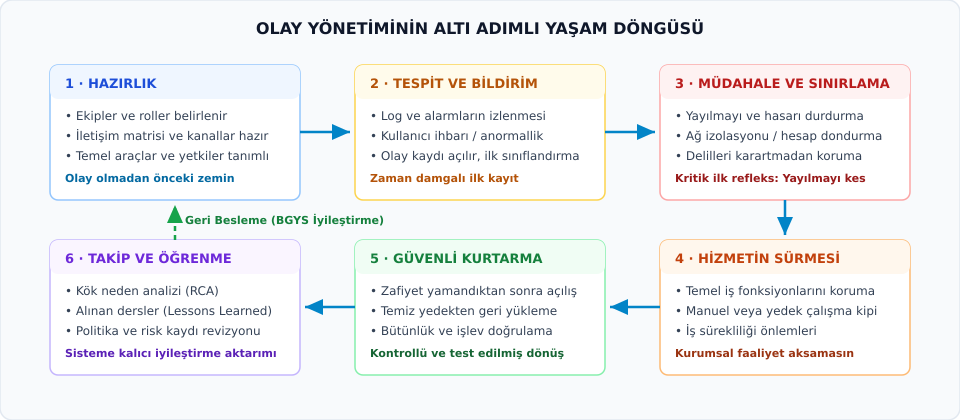

## Tedbir planlanırken olay gerçekleşirse ne olur?

Bir kurumda risk değerlendirmesi yapılmış, açık kalan eski hesapların kapatılması için iki haftalık bir aksiyon takvimi belirlenmiştir.

Çalışmanın üçüncü gününde sistem yöneticisi şu izi görür: **Eski bir çalışanın hesabıyla sabah 09.02'de sisteme girilmiş ve beş müşteri sözleşmesi indirilmiştir.**

Yönetici "Nasılsa iki hafta içinde bu hesapları kapatacaktık" diyebilir mi?

. . .

- **Risk işleme:** Gelecekte yaşanabilecek olumsuzlukları önlemek veya azaltmak için planlanan tedbirdir.
- **Olay yönetimi:** O an gerçekleşmekte olan zararı durdurmak, sistemi kontrol altına almak ve hizmeti sürdürmek için yapılan acil müdahaledir.

::: {.notes}
Geçtiğimiz saatte risk işleme seçeneklerini, artık riski ve aksiyon planının bileşenlerini gördük. Bir risk için aksiyon planı yazmış olmak, o riskin gerçekleşmeyeceğini garanti etmez. Tedbir henüz tamamlanmadan veya hiç beklenmeyen bir açıdan güvenlik ihlali yaşanabilir.

İşte bu noktada planlama dili biter, kriz ve müdahale dili başlar. Yangın çıkma riskine karşı bina planı yapmak başka bir iştir; koridorda alevler yükseldiğinde yangın tüpünü alıp müdahale etmek başka bir iştir. Olay yönetimi, gerçekleşen bir güvenlik olayında kurumun felç olmasını önleyen, sorumlulukları ve adımları önceden belirlenmiş bir işleyiştir.

Senaryodaki gibi iki haftalık bir aksiyon takvimi yürürlükteyken üçüncü gün sabah 09.02'de eski bir hesap üzerinden beş müşteri sözleşmesi indirildiğinde, planlanan takvimin bitmesini beklemek mümkün değildir. Devam eden yetkisiz erişimi o anda kesmek, oturumu düşürmek ve hangi sözleşmelerin dışarı çıktığını tespit etmek gerekir.

Çalışmanızda risk işleme ile olay yönetimini birbirinin alternatifi gibi okumamaya dikkat edin. Risk işleme gelecekteki olasılığı ve etkiyi düşürmeye odaklanırken, olay yönetimi fiilen başlayan zararı sınırlandırır. Bu müdahalenin paniğe dönüşmemesi için önce hangi durumların gerçek bir güvenlik olayı sayıldığını netleştirmemiz gerekir.
:::

---

## Bilgi güvenliği olayı nedir?

**Bilgi güvenliği olayı**, kurumun bilgi varlıklarının gizliliğini, bütünlüğünü veya erişilebilirliğini ihlal eden ya da bu ilkeleri doğrudan tehdit eden, gerçekleşmiş beklenmedik bir durumdur.

Her anormallik bir olay mıdır?

| Durum | Türü | Nedeni |
|---|---|---|
| Parolanın yanlış girilmesi | Güvenlik hadisesi (olay adayı) | Kullanıcı dalgınlığı veya hatalı tuşlama |
| 1 dakikada 500 hatalı deneme | Güvenlik olayı (ihlal girişimi) | Otomatik parola deneme saldırısı |
| Sözleşme dosyasının yetkisiz indirilmesi | Doğrulanmış güvenlik ihlali | Bilgi gizliliğinin fiilen zarar görmesi |

. . .

- Her olağan dışı durum doğrudan güvenlik olayı sayılmaz; önce güvenlik hadisesi olarak değerlendirilir.
- Hadisenin gerçek bir olaya dönüştüğü doğrulandığında kontrollü müdahale başlatılır.

::: {.notes}
Kavramları doğru ayırmak gerekir. Sistemlerde her gün binlerce hadise (event) gerçekleşir: bir sunucu yeniden başlar, bir kullanıcı parolasını yanlış yazar, bir bağlantı kopup tekrar gelir. Bunların hepsi kayıt altına alınabilir ancak hepsi bir "güvenlik olayı" (incident) değildir.

Bir hadisenin olay sayılması için bilgi güvenliğinin üç temel koşulundan (gizlilik, bütünlük, erişilebilirlik) en az birini fiilen zedelemesi ya da doğrudan tehlikeye atması gerekir. Olay tanımı net olmazsa BT ekipleri her küçük uyarıda panik yaşar ya da tam tersine gerçek bir saldırıyı olağan bir sistem davranışı sanarak görmezden gelir.

Tablodaki üç satır bu geçişi somutlaştırır: tek bir yanlış parola girişi kullanıcı dalgınlığıyla açıklanabilecek bir güvenlik hadisesidir ve yalnızca izlenir. Aynı hesaba bir dakikada 500 hatalı deneme yapılması ise otomatik parola deneme saldırısına işaret eder ve güvenlik olayı olarak müdahale başlatır. Sözleşme dosyasının yetkisiz indirilmesi aşamasında ise gizlilik fiilen zarar gördüğü için doğrulanmış güvenlik ihlali söz konusudur.

Hadiseleri değerlendirip gerçek olayı ayıklamak, olay yönetiminin ilk filtresidir. Ancak bir durumun güvenlik olayı olduğu doğrulandığında teknik tespit tek başına yetmez; müdahalenin kim tarafından ve hangi yetkiyle yürütüleceğini belirleyen kurumsal bir sürece ihtiyaç duyulur.
:::

---

## Olay yönetimi nedir ve neden kurumsal bir süreçtir?

**Olay yönetimi**, gerçekleşen bir bilgi güvenliği olayını zamanında tespit etme, doğru kanallara bildirme, etkisini sınırlandırma, sistemi güvenle ayağa kaldırma ve süreçten öğrenilen derslerle kalıcı tedbir alma adımlarının bütünüdür.

Olay anında kişisel inisiyatif yeterli midir?

- Kimin hesabı kapatmaya yetkisi var?
- Müşterilere veya yönetime kim bilgi verecek?
- Deliller toplanmadan sunucu formatlanırsa ne kaybedilir?

. . .

Olay yönetimi bir teknik mühendislik refleksi değil; **hukuki, operasyonel ve idari sorumlulukları belirlenmiş kurumsal bir yönetim sürecidir.**

::: {.notes}
Güvenlik ihlali anı, kurumların en kırılgan olduğu andır. Eğer olay yönetimi süreci önceden tanımlanmamışsa herkes aynı anda farklı bir şey yapar: biri panikle fişi çeker ve hafızadaki saldırı izlerini siler; diğeri üst yönetime haber vermeden durumu örtbas etmeye çalışır; bir başkası ise sosyal medyaya açıklama yapıp kurumu hukuki açıdan zor durumda bırakır.

Kurumsal olay yönetiminin amacı paniği ve belirsizliği ortadan kaldırmaktır. Bir olay gerçekleştiğinde kimin hangi adımı atacağı, kime haber verileceği ve hangi kayıtların korunacağı önceden bellidir. Böylece kriz anında karar tartışması yapılmaz, belirlenen adımlar hızla uygulanır.

Gövdedeki üç soru, olay anında teknik uygulayıcı, iş sahibi ve karar yetkilisinin neden ayrı rollere sahip olduğunu açıklar. Hesabı kilitlemek veya sunucuyu izole etmek teknik bir müdahaledir; delilleri koruyarak kayıt altına almak inceleme ve hukuk boyutudur; üst yönetimi veya dış paydaşları bilgilendirmek ise kurumsal iletişim ve karar sorumluluğudur. Bu rollerin birbiriyle çakışmadan işlemesi için olay yönetimini altı adımlı bir yaşam döngüsü olarak kurgularız.
:::

---

## Olay yönetiminin yaşam döngüsü: altı temel adım

Olay yönetimi karmaşık bir kargaşa değil, birbirini izleyen altı aşamadan oluşan bir döngüdür:

1. **Hazırlık:** Olay gerçekleşmeden önce ekiplerin, araçların ve iletişim kanallarının belirlenmesi.
2. **Tespit ve Bildirim:** Anormalliğin fark edilmesi, doğrulanması ve yetkili ekibe iletilmesi.
3. **Müdahale ve Sınırlandırma:** Hasarın büyümesini önlemek için sistemin veya hesabın izole edilmesi.
4. **Hizmetin Sürmesi:** Kesintiye uğrayan kritik işin alternatif yollarla devam ettirilmesi.
5. **Güvenli Kurtarma:** Sistemin açığı kapatılmış ve test edilmiş biçimde yeniden devreye alınması.
6. **Takip ve Öğrenme:** Yaşanan olayın kök nedeninin analiz edilmesi ve kayıt altına alınması.

::: {.notes}
Altı adım rastgele sıralanmamıştır; her aşama kendisinden sonrakinin girdisini oluşturur. Tespit edilmeyen bir olaya müdahale edilemez; sınırlandırılmamış bir olayda kurtarma çalışması yapılırsa saldırgan tekrar içeri girer; öğrenme adımı işletilmezse aynı olay birkaç hafta sonra yeniden yaşanır.

Döngünün ortasındaki üç adım (müdahale ve sınırlandırma, hizmetin sürmesi, güvenli kurtarma) kriz anındaki operasyonel dengeyi kurar. Şüpheli hesabı veya sunucuyu izole etmek hasarı durdurur ama o hesaba bağlı iş akışını da kesintiye uğratabilir. Bu nedenle kritik hizmet alternatif ve güvenli bir yoldan sürdürülürken, asıl sistemdeki zafiyet kapatılıp doğrulanarak güvenli kurtarma gerçekleştirilir.

Döngünün "olay bitti, unuttuk" şeklinde sonlanmamasına özellikle dikkat edin. Olay yönetimi PUKÖ döngüsünün "Kontrol Et" ve "Önlem Al" aşamalarıyla doğrudan konuşur. Yaşanan her olay, kurumun risk değerlendirmesini ve mevcut politikalarını yeniden gözden geçirmesi için somut bir veridir; bir sonraki slayttaki şema bu geri besleme akışını bütün olarak görselleştirir.
:::

---

## Olay yönetim döngüsü ve BGYS akışı

{width="100%" fig-align="center" fig-alt="Olay yönetiminin altı adımlı yaşam döngüsü ve BGYS geri besleme akışı"}

::: {.notes}
Şema altı adımı iki satırda gösterir. Üst satırı soldan sağa okuyun: hazırlık, tespit ve bildirim, müdahale ve sınırlandırma. Alt satıra inince yön tersine döner ve sağdan sola ilerler: hizmetin sürmesi, güvenli kurtarma, takip ve öğrenme. Altta, öğrenme kutusundan başa dönen "geri besleme" oku BGYS'nin iyileştirme döngüsüne bağlanır; olay yönetimi tek seferlik bir yangın söndürme değil, kurumu her olaydan sonra değiştiren bir döngüdür.

İlk üç kutu olay anına kadar ve olay sırasında yapılanı anlatır. Hazırlık olay yokken yapılır: ekipler, roller, iletişim kanalları ve yetkiler önceden tanımlanır. Tespit ve bildirimde loglar ve alarmlar izlenir, kullanıcı ihbarı ya da anormallik fark edilir, olay kaydı açılır ve ilk sınıflandırma yapılır; şemanın notu bunu "zaman damgalı ilk kayıt" diye özetler. Müdahalede yayılma ve hasar durdurulur; ağ izolasyonu ya da hesap dondurma gibi adımlar atılırken deliller karartılmadan korunur. Kutudaki ifadeyle kritik ilk refleks, yayılmayı kesmektir.

Alt satırdaki üç kutu olayın etkisini ve sonrasını yönetir. Hizmetin sürmesi, temel iş fonksiyonlarını manuel ya da yedek çalışma kipiyle korur; müdahale kararlarının (örneğin bir sistemi izole etmenin) işe verdiği zararı sınırlar. Güvenli kurtarma, zafiyet kapatıldıktan sonra sistemi temiz yedekten açar ve bütünlüğü ile işlevi doğrular; şemadaki ifadeyle kontrollü ve test edilmiş bir dönüştür. Takip ve öğrenme kök nedeni analiz eder, alınan dersleri yazar ve politika ile risk kaydını günceller.

Geri besleme okunu özellikle dikkatle okuyun. Öğrenme adımının çıktısı hazırlık adımının girdisidir: kök neden analizinden çıkan ders risk kaydına işlenir, prosedür ve rol tanımları revize edilir, sonraki olayda hazırlık daha iyi olur. Bu bağ kurulmazsa olay kapatılmış ama kurum aynı yerden tekrar zarar görmeye açık kalmış olur.

Şemayı bir sınav listesi gibi ezberlemek yerine her adıma iki soru sorun: bu adımın sorumlusu kim, geride hangi kayıt kalır? Sonraki slaytlar altı adımı tek tek ele alır; ardından bu zinciri risk aksiyon planıyla karşılaştırır.
:::

---

## Adım 1: Hazırlık — Olay olmadan önce ne belirlenir?

**Hazırlık**, bir güvenlik olayı ortaya çıkmadan önce müdahale ekiplerinin, iletişim kurallarının, yetki sınırlarının ve teknik araçların hazır bulundurulmasıdır.

Hazırlık aşamasında kurum şu soruların cevabını netleştirir:

- **Müdahale ekibi kimdir?** (Teknik uygulayıcı, sistem yöneticisi, güvenlik uzmanı).
- **İletişim yetkilisi kimdir?** (Üst yönetim, kurum sözcüsü, gerekirse hukuki danışman).
- **Hangi kanaldan bildirilecek?** (E-posta çalışmıyorsa acil arama veya alternatif mesajlaşma grubu).
- **Kimin neye yetkisi vardır?** (Örneğin kritik bir sunucuyu ağdan izole etmek için kimseden onay beklemeye gerek var mıdır?).

. . .

Hazırlık yapılmamışsa, olayın ilk 30 dakikası "Kime haber vereceğiz?" tartışmasıyla heba olur.

::: {.notes}
Olay anında plan yazılmaz. Hazırlık aşaması kurumun sakin zamanında yaptığı ev ödevidir. Bir yangın anında itfaiyeyi aramak için telefon numarası aranmaz ya da binada yangın tüpünün yeri tartışılmaz.

Hazırlıkta en kritik unsurlardan biri "yetki sınırları"dır. Gece yarısı bir fidye yazılımının sunuculara yayıldığını gören nöbetçi BT personeli, "Müdürü uyandırmadan sunucunun fişini çekebilir miyim?" tereddüdünü yaşarsa bütün kurum verisi şifrelenebilir. Yetkilerin ve iletişim zincirinin net yazılması bu tereddüdü ortadan kaldırır.

İletişim kanalının yedekli kurgulanması da hazırlığın parçasıdır. Kurumsal e-posta sunucusunun kendisi saldırı altındayken ya da ağ bağlantısı kesilmişken e-posta ile bildirim yapılamaz; bu yüzden nöbet telefonu ve alternatif mesajlaşma kanalları önceden tanımlanır. Tüm bu kararlar bir sonraki slaytta göreceğimiz yazılı çizelgeyle kayıt altına alınır.
:::

---

## Hazırlığın Belgesi: Olay Ekibi ve İletişim Çizelgesi

Hazırlık, olay anında bakılacak yazılı bir çizelgeyle somutlaşır:

| Rol | Olaydaki görevi | Ulaşım |
|---|---|---|
| **Müdahale ekibi (teknik uygulayıcı)** | Hareketi doğrular; hesabı kilitler, sistemi izole eder, kanıtı korur | Nöbet telefonu |
| **İş sahibi** | Etkiyi değerlendirir, hizmetin sürmesini sağlar | Dahili ve cep |
| **Karar ve iletişim yetkilisi** | Bildirimi alır, kritik kararı onaylar, resmi iletişimi yürütür | Cep telefonu |
| **Yedekler** | Her rol için yazılı yedek kişi | Çizelgede yazılı |

> Çizelge kişiye değil role yazılır; güncel olmayan çizelge, olay anında yoktur.

::: {.notes}
Olay gecesi herkes uyuyorken bu çizelgeyi okuyup doğru kişiyi arayabilmek gerekir. Bu yüzden çizelge görevi, yetkiyi ve ulaşım yolunu birlikte yazar. Kişiyi değil rolü esas alırız; çünkü kişi izne çıkabilir, görevden ayrılabilir. Her rolün yedeği bu yüzden yazılıdır.

Çizelge de bir belgedir. H8'de gördüğümüz gibi kimliği, sürümü ve sahibi olur; personel değiştiğinde güncellenir. Eski telefon numaraları ya da ayrılmış personelin adı kalan bir çizelge, çizelge olmamasından daha yanıltıcıdır: ilk dakikalar yanlış kişiyi aramakla geçer.

Çizelgedeki rollerin yetkisi ve görev ayrımı da burada netleşir: teknik uygulayıcı, iş sahibi ve karar yetkilisi ayrı kişilerdir. Müdahale ekibi hesabı kilitlemek için hangi koşulda kimden onay bekler, yoksa beklemeden mi işlem yapar? Bu cevabı olay anında aramamak için hazırlıkta yazarız; böylece tespit ve bildirim adımına geçildiğinde herkes kime, nasıl ulaşacağını bilir.
:::

---

## Adım 2: Tespit ve Bildirim — Anormalliği fark etmek

**Tespit**, bir güvenlik hadisesinin gerçekleştiğinin teknik izler veya kullanıcı bildirimleriyle belirlenmesidir. **Bildirim**, bu durumun vakit kaybetmeden yetkili müdahale birimine aktarılmasıdır.

Gözlem ile kesin hüküm arasındaki fark:

| Gözlenen olgu (İz / Kayıt) | Doğru tespit cümlesi | Hatalı varsayım |
|---|---|---|
| Eski çalışanın hesabıyla giriş yapıldı | "Ayrılan personelin hesabı aktif kullanıldı." | "Ayrılan personel sisteme girdi." |
| Saat 03.00'te 10.000 kayıt indirildi | "Olağan dışı hacimde veri çekme işlemi gerçekleşti." | "Veritabanımız çalındı ve satıldı." |

. . .

İz, sistemdeki eylemi gösterir; eylemi yapan gerçek kişinin kimliği ise araştırma gerektirir.

::: {.notes}
Tespit aşamasında yapılan en büyük hata, gözlenen teknik veri ile kişisel yorumları birbirine karıştırmaktır. Sistem kayıtları bir hesabın kullanıldığını, bir IP adresinden istek geldiğini ya da bir dosyanın indirildiğini söyler. O hesabı gerçekten o kişinin mi kullandığı, yoksa parolanın ele geçirilip üçüncü bir şahıs tarafından mı kullanıldığı ilk bakışta bilinemez.

Bildirim metninde yalnızca olgular yer almalıdır: hangi saatte, hangi hesapla, hangi işlemin yapıldığı ve hangi kayıtların tespit edildiği. Varsayımlarla hareket etmek müdahale ekibini yanlış yönlendirebilir ve asıl tehlikenin gözden kaçmasına yol açabilir.

Tablodaki ikinci örneği bu gözle okuyun: gece 03.00'te 10.000 kaydın indirilmesi, olağan dışı hacimde veri çekme işleminin gerçekleştiğini kanıtlar; ancak verilerin çalınıp satıldığı hükmü o an için kanıtsız bir varsayımdır. Doğrulanmış teknik gözlemin zaman damgasıyla bildirilmesi, bir sonraki adım olan müdahale ve sınırlandırma için sağlam bir zemin kurar.
:::

---

## Adım 3: Müdahale ve Sınırlandırma — Hasarı durdurmak

**Sınırlandırma**, tespit edilen olayın daha geniş sistemlere yayılmasını ve zararın büyümesini engellemek amacıyla uygulanan acil izolasyon tedbirleridir.

Sınırlandırma sırasında iki öncelik yarışır:

1. **Hasarı derhal kesmek:** Şüpheli hesabı kilitlemek, etkilenen bilgisayarı ağdan ayırmak, ilgili servisi geçici olarak durdurmak.
2. **Delil bütünlüğünü korumak:** Sistemi panikle sıfırlamamak, mevcut güvenlik ve sistem loglarını silmeden saklamak.

. . .

Doğru sınırlandırma: Sistemi tamamen yok etmek değil, saldırganın hareket alanını izole edip izleri güvenceye almaktır.

::: {.notes}
Sınırlandırma aşaması bir cerrahın kanamayı durdurmasına benzer. Eğer açık bir hesaptan veri sızıyorsa ilk yapılacak iş o hesabı anında kilitlemektir. Eğer bir sunucuya zararlı yazılım bulaşmışsa sunucunun ağ kablosu çekilir veya sanal ağ anahtarı kapatılır.

Ancak burada çok yaygın bir acemi refleksi vardır: "Hemen format atalım, temizleyelim." Bu yapıldığında saldırganın nereden girdiği, hangi dosyaları değiştirdiği ve sistemde başka bir arka kapı bırakıp bırakmadığı asla öğrenilemez. Olay inceleme izleri de yok edilmiş olur. Bu yüzden sınırlandırma, mevcut logları ve kanıtları yok etmeden izolasyon sağlamalıdır.

Hesabın kilitlenmesi veya sunucunun ağdan ayrılması saldırganı durdurur, fakat aynı anda o sistem üzerinden yürüyen günlük işlemleri de kesintiye uğratabilir. Bu nedenle sınırlandırma kararı alındığı anda, izole edilen kaynağa bağlı kritik işlerin nasıl devam edeceği sorusu gündeme gelir ve dördüncü adıma geçilir.
:::

---

## Adım 4: Hizmetin Sürmesi (Temel İş Sürekliliği)

**İş sürekliliği**, bir olay veya kesinti sırasında kurumun en kritik iş faaliyetlerini önceden kabul edilmiş bir düzeyde sürdürebilme yeteneğidir.

Sistem durdurulduğunda kurum hayatı tamamen durur mu?

- **Sorun:** Şüpheli dosya indirme nedeniyle muhasebe personelinin hesabı kilitlendi.
- **Etki:** Bugün ödenmesi gereken acil tedarikçi faturaları ve maaş bordroları bekliyor.
- **Süreklilik tedbiri:** İlgili işin, kimliği doğrulanmış yetkili yedek bir personel ve geçici güvenli bir oturum üzerinden kontrollü olarak yürütülmesi.

. . .

Olay yönetimi yalnız "sistemi kapatmak" ile ilgilenmez; **kurumun ana işinin güvenli biçimde nasıl akacağını da düzenler.**

::: {.notes}
Güvenlikçiler bazen sadece sistemin güvenliğine odaklanıp kurumun varlık nedenini unutabilir. Bir hastanede şüpheli bir işlem görüldü diye tüm hasta kayıt sistemini günlerce kapatamazsınız. Bir lojistik firmasında tüm sunucuları kapatırsanız tırlar sınır kapısında kalır.

İşte bu yüzden olay aksiyonunun ayrılmaz bir parçası "hizmetin sürmesi"dir. Kritik süreçlerin nasıl devam edeceği önceden düşünülmelidir. İlgili hesap kapatıldıysa, o gün yapılması zorunlu olan kritik onaylar hangi yetkili ikinci kişi üzerinden, nasıl bir çift kontrol mekanizmasıyla yürütülecek? İş sürekliliği bu geçişi sağlar.

Buradaki geçici çalışma düzeninin normal operasyonun yerini kalıcı olarak almadığına dikkat edin. İş sahibi gözetiminde yedek personel ve çift onayla yürütülen süreç, yalnızca acil işlerin aksamaması için kurulan güvenli bir köprüdür; asıl sistemin normal işleyişine dönmesi beşinci adım olan güvenli kurtarma ve doğrulama ile gerçekleşir.
:::

---

## Adım 5: Güvenli Kurtarma ve Doğrulama

**Kurtarma**, olayın etkileri tamamen temizlendikten sonra sistemlerin, hesapların ve verilerin yeniden normal operasyonel duruma getirilmesidir.

Sistem hemen açılır mı? Üçlü kontrol kuralı:

1. **Açık kapatıldı mı?** Olayın gerçekleşmesine yol açan zafiyet giderildi mi?
2. **Kötü niyetli iz temizlendi mi?** Sistemde ek bir yetki, yeni açılmış gizli bir hesap veya zamanlanmış zararlı görev var mı?
3. **Veri ve bütünlük doğrulandı mı?** Geri yüklenen veya açılan veriler sağlam mı?

. . .

Kontrolsüz ve aceleci bir kurtarma, olayın birkaç saat içinde tekrarlanmasıyla sonuçlanır.

::: {.notes}
Kurtarma adımı en çok hata yapılan yerlerden biridir. Üst yönetimin veya müşterilerin "Sistem ne zaman açılacak?" baskısıyla ekipler zafiyeti tam anlamadan sistemi tekrar internete açabilir. Örneğin parolanın nasıl ele geçirildiği bulunmadan hesap yeniden etkinleştirilirse saldırgan aynı parolayla tekrar içeri girer.

Kurtarma aşamasında güvenliğin doğrulandığına dair kanıt gerekir. Parola sıfırlanır, çok faktörlü kimlik doğrulama zorunlu kılınır, yetki listeleri kontrol edilir ve sistem ancak bu adımlardan sonra kontrollü olarak kullanıma açılır.

Üçlü kontrolün son halkası olan veri ve bütünlük doğrulaması da atlanmamalıdır. Yedekten geri yükleme yapıldığında yedeğin sağlam olduğu, dosyaların değiştirilmediği ve içeride gizli bir hesap ya da zamanlanmış görev kalmadığı test edilip kayıt altına alınır. Sistem güvenle normale döndüğünde döngünün son adımı olan takip ve öğrenme aşamasına geçilir.
:::

---

## Adım 6: Takip, Öğrenme ve Kayıt

**Takip ve öğrenme (olay sonrası inceleme)**, yaşanan olaydan kurumsal dersler çıkararak benzer olayların tekrarını önlemek için yapılan analiz ve raporlama sürecidir.

Olay bittiğinde dosya kapanır mı?

| İncelenen soru | Cevabın dönüştüğü yer |
|---|---|
| Olay nasıl başladı ve zafiyet neydi? | Risk değerlendirmesi güncellemesi |
| Tespitte neden 3 gün gecikildi? | İzleme ve kayıt (log) kontrolleri |
| Müdahale sırasında ne aksadı? | Prosedür ve rol tanımları revizyonu |

. . .

Kayıt tutmak sürecin sonunda yapılan bir formalite değildir; **olayın ilk dakikasından itibaren tutulan zaman damgalı kanıt zinciridir.**

::: {.notes}
Olay bittiğinde kurum derin bir nefes alıp eski rutinine dönerse en büyük fırsatı kaçırmış olur. Her güvenlik olayı, kurumun zayıf noktalarını gösteren paha biçilmez bir derstir.

Bu aşamada "kim suçlu?" sorusu değil, "sistemimiz nerede açık verdi?" sorusu sorulur. Ayrılan personelin hesabı neden açık kalmıştı? İK neden BT'ye haber vermedi? Tespit neden anında yapılamadı? Bu soruların yanıtları, doğrudan politika değişikliklerine, yeni teknik kontrollere ve eğitim faaliyetlerine dönüştürülür.

Olay sonrası incelemenin sağlıklı yapılabilmesi, olayın ilk dakikasından itibaren zaman damgalı kayıt tutulmuş olmasına bağlıdır. Saat kaçta tespit edildiği, kimin hangi izolasyon adımını attığı ve hangi kanıtların korunduğu yazılı değilse kök neden analizi tahmine dönüşür. Bir sonraki slayt, altı adımın her birinde hangi rolün hangi kaydı ürettiğini bir arada ortaya koyar.
:::

---

## Olay Akışı: Her Adımın Sorumlusu ve İzi

Altı adımın her birinin bir sorumlusu ve geride bıraktığı bir kayıt vardır:

| Adım | Sorumlu rol | Geride kalan kayıt |
|---|---|---|
| **1. Hazırlık** | Üst yönetim, müdahale ekibi | Olay ekibi ve iletişim çizelgesi, yetki tablosu |
| **2. Tespit ve bildirim** | Fark eden çalışan, müdahale ekibi | Bildirim kaydı (saat, hesap, gözlem) |
| **3. Müdahale ve sınırlandırma** | Müdahale ekibi | Müdahale tutanağı, kanıt (log kopyası) |
| **4. Hizmetin sürmesi** | İş sahibi | Yedek personel ve yetki kaydı |
| **5. Güvenli kurtarma** | Müdahale ekibi | Doğrulama ve tarama kaydı |
| **6. Takip, öğrenme ve kayıt** | Müdahale ekibi, karar yetkilisi | Olay raporu, düzeltici faaliyet kaydı |

> Kaydı olmayan adımın yapıldığı kanıtlanamaz.

::: {.notes}
Altı adımlı yaşam döngüsünü incelerken her satırda iki soruyu birlikte sorarız: bu adımdan kim sorumludur ve ne yapıldığını sonradan nereden görürüz? Sorumlusu olmayan adım kriz anında sahipsiz kalır; kaydı olmayan adım ise yapıldığı hâlde ne iç denetimde ne de hukuki süreçte kanıtlanabilir.

Tabloyu H8'deki karardan kayda zincirle birlikte okuyabiliriz: karar, belge ve kayıt arasındaki bağ olay yönetiminde de geçerlidir. Örneğin kanıt toplama adımı müdahale sırasında yapılır; sistem temizlenmeden ya da yeniden kurulmadan önce log ve disk kopyası alınmazsa bulgu kaybolur. Bu yüzden müdahale tutanağı ile kanıt aynı satırda yer alır.

Sorumlu sütununda rollerin nasıl ayrıldığına da dikkat edin: teknik izolasyonu ve kurtarmayı müdahale ekibi yürütürken, hizmetin sürmesinden iş sahibi, kapanış ve kurumsal karardan ise karar yetkilisi sorumludur. Son satırdaki olay raporu, bir sonraki slaytta ele alacağımız düzeltici faaliyetin doğrudan girdisini oluşturur.
:::

---

## Bulgu Nasıl Kapanır: Düzeltici Faaliyet (Aç–Uygula–Kapa)

**Düzeltici faaliyet**, bir olayın ya da uygunsuzluğun nedenini ortadan kaldırmak için açılan, uygulanan ve sonucu kontrol edilerek kapatılan kayıtlı iştir.

| Aşama | Ayrılan personelin hesabı olayında |
|---|---|
| **Aç:** Kaynağı yaz, kaydı aç | Olay raporu: eski hesap açık kalmış |
| **Uygula:** Kök nedene in | Hesabı kapatmak **düzeltmedir**. Neden, İK'nın BT'ye ayrılışı bildirmemesidir; İK–BT bildirim akışı kurulur |
| **Kapa:** Sonucu kontrol et, ilgililere bildir | Sonraki ayrılışlarda hesap aynı gün kapandı mı? Kanıt varsa kayıt kapanır |

> Kayıt işin yapıldığı gün değil, sonucun kontrol edildiği gün kapanır.

::: {.notes}
Düzeltici faaliyetin kaynağı yalnız olay değildir. Tetkikte bulunan uygunsuzluk, güvenlik testinde çıkan sorun, yönetimin gözden geçirmesinin kararı ve yasalardaki değişiklik de yeni bir kayıt açtırır. Henüz yaşanmamış bir sorunu önlemeye yönelik iş ise önleyici faaliyettir; bu yüzden kısaltma çoğu kurumda DÖF olarak geçer.

Ayrılan hesap örneğinde iki ayrı iş var. Hesabı kapatmak sorunu giderir, ama bir sonraki ayrılışta aynı boşluk açılabilir. Kök neden ortadan kalkmadıkça sorun yeniden doğar. H4'te de düzeltme ile nedene yönelik iyileştirmenin ayrı kanıt istediğini görmüştük. Üçüncü adım, yani kapatma, çoğu zaman atlanır: iş yapılmış görünür ama çalıştığı kontrol edilmez.

ISO/IEC 27001:2022'de bu konu madde 10.2'de (Uygunsuzluk ve düzeltici faaliyet) ele alınır. Dokümanların hiçbiri nihai değildir: düzeltici faaliyet sonunda ilgili prosedür ya da talimat da revize edilir ve H8'de gördüğümüz sürüm ve revizyon izi bu noktada devreye girer. Böylece olay anında başlayan acil müdahale, kalıcı bir risk aksiyonuna bağlanmış olur; bir sonraki slayt bu iki plan türü arasındaki farkı netleştirir.
:::

---

## Karşılaştırma: Risk Aksiyon Planı ile Olay Aksiyon Planı

İki plan türü birbirinin yerine geçmez; farklı zaman dilimlerine ve amaçlara hizmet eder:

| Özellik | Risk Aksiyon Planı | Olay Aksiyon Planı |
|---|---|---|
| **Temel amaç** | Olasılık veya etkiyi önceden düşürmek | Hasarı sınırlandırmak, hizmeti sürdürmek |
| **Zaman baskısı** | Haftalar, aylar (planlı termin) | Dakikalar, saatler (anlık müdahale) |
| **Tetikleyici** | Risk değerlendirmesi, denetim bulgusu | Gerçekleşen olay, alarm, ihlal tespiti |
| **Sorumlu** | Süreç sahibi, proje yürütücüsü | Olay müdahale ekibi, operasyonel roller |

::: {.notes}
Haftanın iki saatini birbirine bağlayan temel ayrım, geleceğe dönük tedbir planlaması ile gerçekleşen krize anlık müdahale arasındaki farktır. Risk aksiyon planı henüz olay yaşanmadan önce olasılığı veya etkiyi düşürmek için proaktif olarak yürütülürken, olay aksiyon planı ihlal veya alarm gerçekleştiği anda reaktif olarak devreye girer ve kanamayı durdurmaya odaklanır.

İki planın tetikleyicisi, zaman ölçeği ve tamamlanma ölçütü birbirinden tamamen farklıdır. Risk aksiyon planında bir kontrolü kurmak için haftalar veya 30 günlük bir termin bulunabilir; bu sürede süreç sahibi hazırlık yapar, kontrolü devreye alır ve etkinlik kanıtıyla riski yeniden değerlendirir. Olay aksiyon planında ise süre dakikalarla ölçülür: hesabı 15 dakikada kilitlemek, yönetimi 30 dakikada bilgilendirmek ve alternatif iş akışını hızla devreye sokmak gerekir; tamamlanma ölçütü ise sistemin güvenle kurtarılması ve kök neden dersinin çıkarılmasıdır.

Duru Eğitim Merkezi örneği üzerinden okuduğumuzda, ayrılan personelin hesaplarının zamanında kapatılması için İK–BT bildirim akışını kurmak bir risk aksiyon planıdır. Buna karşılık açık unutulan bir hesaptan sabah 09.02'de beş sözleşme indirildiğinde 09.05'teki alarmla harekete geçip hesabı kilitlemek ve kayıt işlerini yedek personelle sürdürmek olay aksiyon planıdır.

Çalışmanızda bu iki planı birbirine karıştırmamaya dikkat edin: olay anında uzun vadeli prosedür yazmaya kalkmak hasarın büyümesine yol açar; sadece şüpheli hesabı kilitleyip kök nedene yönelik risk aksiyonu açmamak ise aynı olayın tekrarlanmasına zemin hazırlar. Sonraki slaytlarda Duru Eğitim Merkezi vakasında bu adımların saat saat nasıl işletildiğini inceleyeceğiz.
:::

---

## Çözümlü Örnek: Kurumda Gerçekleşen Yetki Olayı

**Vaka:** Duru Eğitim Merkezi'nde 16 Kasım sabahı 09.02'de, iki hafta önce işten ayrılmış olan bir kayıt görevlisinin hesabıyla sisteme girilmiş ve 5 sözleşme dosyası indirilmiştir. Durum 09.05'te BT uzmanı tarafından fark edilmiştir.

Bu olay için atılacak adımlar ve sorumluluklar:

1. **Tespit ve Doğrulama (09.05 – 09.08):** BT uzmanı olağan dışı alarmı 09.05'te görür; işlem kaydını (log) en geç 09.08'e kadar doğrular.
2. **Sınırlandırma (09.20'den önce):** BT uzmanı şüpheli hesabı tespitten itibaren 15 dakika içinde kilitler ve aktif oturumu sonlandırır.
3. **İlk Bildirim (09.35'ten önce):** Doğrulanan durum ve sınırlandırma bilgisi tespitten itibaren 30 dakika içinde Merkez Müdürü'ne yazılı olarak iletilir.
4. **Hizmetin Sürmesi:** Kayıt biriminin bekleyen sözleşme işlemleri için yetkili kıdemli personel görevlendirilir; geçici çift onay mekanizması kurulur.
5. **Kurtarma ve Öğrenme:** İndirilen dosyaların kapsamı belirlenir, erişim politikası doğrulanır, olay kapanış ve kök neden raporu tamamlanır.

::: {.notes}
Çözümlü örnekte Duru Eğitim Merkezi'nde yaşanan yetki olayının yaşam döngüsü adımlarına nasıl oturduğunu sırayla görüyoruz. BT uzmanı 09.05'te alarmı gördüğünde panikle sistemi sıfırlamak yerine önce 09.08'e kadar erişim ve indirme loglarını doğrulamakta, ardından tespitten itibaren 15 dakikalık hedef süre içinde (en geç 09.20'de) yalnız şüpheli hesabı kilitleyip aktif oturumu sonlandırarak delilleri koruyan bir sınırlandırma uygulamaktadır.

Sınırlandırmanın hemen ardından kurumsal bildirim ve iş sürekliliği devreye girer. Tespitten itibaren 30 dakika içinde (en geç 09.35'te) karar yetkilisi olan Merkez Müdürü'ne hem doğrulanan olgu hem de alınan sınırlandırma tedbiri yazılı olarak bildirilir; aynı anda kayıt birimindeki sözleşme işlemlerinin durmaması için iş sahibi koordinasyonuyla yetkili kıdemli personel ve geçici çift onay mekanizması devreye alınır.

Son aşamada, merkezdeki 80 kursiyer sözleşmesinden hangilerinin indirilen 5 dosya arasında yer aldığı tespit edilir, erişim kontrolleri doğrulanır ve ayrılan personel hesaplarının neden açık kaldığını ortaya koyan kök neden raporu tamamlanır. Böylece acil olay müdahalesi, kalıcı risk aksiyon planına girdi üreterek kapanır; izleyen iki slayt bu akışın resmi zaman tablosuna nasıl kaydedildiğini gösterir.
:::

---

## Çözümlü Örnek: Olay Zaman Tablosu — Tespit ve Müdahale (1/2)

Olay yönetiminin ilk kritik müdahale adımlarının zaman damgalı tablosu:

| Zaman / Hedef | Aşama | Yapılan işlem | Sorumlu | Kanıt / Kayıt |
|---|---|---|---|---|
| **09.02** | Olay | Eski hesaptan 5 dosya indirme faaliyeti | — | Erişim ve indirme log kaydı |
| **09.05** | Tespit | Olağan dışı indirme alarmı görüldü | BT Uzmanı | Güvenlik izleme alarm kaydı |
| **09.08'e kadar** | Doğrulama | Log kayıtları ve hesap durumu teyit edildi | BT Uzmanı | Doğrulanmış hadise notu |
| **09.20'den önce** | Sınırlandırma | Hesap kilitlendi, aktif oturum düşürüldü (<15 dk) | BT Uzmanı | Dizin servisi hesap kilitleme kaydı |

::: {.notes}
Olay günlüğünün (incident timeline) ilk bölümü, 09.02'deki yetkisiz girişten 09.20'deki sınırlandırma hedefine kadar geçen kritik 18 dakikayı kayıt altına alır. 09.05'te görülen alarmın 09.08'e kadar log kayıtları ve hesap durumuyla doğrulanması, yanlış alarmlarla gereksiz kesinti yaşanmasını önlerken 15 dakikalık sınırlandırma hedefinin (<15 dk) kaçırılmamasını sağlar.

Tablonun sağındaki "Sorumlu" ve "Kanıt / Kayıt" sütunlarına birlikte dikkat edin: teknik uygulayıcı rolündeki BT uzmanı attığı her adımda ayrı bir iz bırakır. Erişim logu, alarm kaydı, doğrulanmış hadise notu ve dizin servisi hesap kilitleme kaydı korunduğu için, bir sonraki slaytta yer alan yönetim bildirimi ve kök neden incelemesi somut kanıtlara dayanır.
:::

---

## Çözümlü Örnek: Olay Zaman Tablosu — Bildirim ve Süreklilik (2/2)

Olay yönetiminin bildirim, iş sürekliliği ve kurumsal öğrenme adımları:

| Zaman / Hedef | Aşama | Yapılan işlem | Sorumlu | Kanıt / Kayıt |
|---|---|---|---|---|
| **09.35'ten önce** | Bildirim | Olay ve alınan tedbir Merkez Müdürü'ne iletildi (<30 dk) | BT Uzmanı | Olay bildirim formu / e-posta |
| **Günün akışı** | Süreklilik ve Öğrenme | Geçici devir işletildi, olay ve kök neden raporu tamamlandı | Kayıt Yöneticisi / Müdür | Görevlendirme ve kök neden raporu |

::: {.notes}
Zaman tablosunun ikinci bölümünde sorumluluk yalnız teknik uygulayıcıda kalmaz; iş sahibi (Kayıt Yöneticisi) ve karar yetkilisi (Merkez Müdürü) devreye girer. BT uzmanı tespitten itibaren 30 dakikalık hedef süre içinde (09.35'ten önce) yalnızca "bir sorun var" demekle yetinmez; doğrulanmış olguyu ve tamamlanan hesap kilitleme işlemini yazılı bildirim formu veya e-posta ile Merkez Müdürü'ne iletir.

Zaman damgası ve kanıt alanı belgelemenin omurgasıdır. Günün akışı içinde geçici görevlendirmenin yazılı yapılması ve kök neden raporunun tamamlanması, hem kayıt hizmetinin kesintisiz ve kontrollü sürdüğünü hem de olaydan çıkarılan dersin kurumsal hesap verebilirlik çerçevesinde kayıt altına alındığını kanıtlar.
:::

---

## Bağımsız Görev: Şüpheli Dışa Aktarım Olayı

**Senaryo:** Kuzey Sağlık Hizmetleri'nde cumartesi günü saat 14.15'te, arşiv sunucusundan 3.000 hasta dosyasının harici bir bulut depolama alanına aktarılmaya başlandığı tespit ediliyor. İşlemi yapan hesap, izinli olan bir arşiv memuruna ait. Acil servis hasta kabul bankoları ise hasta geçmişi ve kayıt doğrulama için arşiv veri tabanıyla aynı yerel ağ altyapısını kullanmaktadır.

**Göreviniz:** Aşağıdaki soruları olay yönetimi ilkelerine göre yanıtlayın:

1. **İlk 15 dakikada hangi sınırlandırma adımını atarsınız? Hangi hatalı davranıştan kaçınırsınız?**
2. **Hastanenin acil servisindeki hasta kabul süreçlerinin durmaması için hangi iş sürekliliği tedbirini alırsınız?**
3. **Olay kontrol altına alındıktan sonra kurtarma ve takip aşamasında hangi 3 temel kontrolü gerçekleştirirsiniz?**

*Değerlendirme kriteri: Müdahale hızı (<15 dk), delil bütünlüğünün korunması (formatsız tecrit) ve kritik sağlık hizmetinin kesintisiz sürmesi dengesidir.*

::: {.notes}
Bu bağımsız görevde, veri gizliliğini tehdit eden aktif bir dışa aktarım olayı ile kritik sağlık hizmetinin kesintisiz sürmesi gereksiniminin aynı yerel ağ üzerinde çakıştığı bir senaryoyu analiz edeceksiniz. Çalışmanıza başlarken senaryodaki verileri (olayın cumartesi 14.15'te gerçekleşmesi, hesabın izinli bir personele ait olması ve acil servis bankolarının aynı altyapıyı kullanması) dikkatle ayıklayın ve üç soruyu olay yönetimi yaşam döngüsü sırasıyla yanıtlayın.

Yanıtlarınızı oluştururken değerlendirme kriterindeki üç denge noktasını göz önünde bulundurun: ilk 15 dakika içinde uygulanacak sınırlandırma adımının hızı, inceleme için gereken log ve sistem kanıtlarının karartılmaması ve acil servisteki hasta kabul işleyişinin durdurulmaması. Önerdiğiniz her eylemi hangi rolün yürüteceğini ve geride hangi yazılı kaydın kalacağını belirterek çalışmanızı tamamlayın.
:::

---

## Özet ve Gelecek Hafta Bağlantısı

Bu derste neler kazandık?

- **Risk ile olay arasındaki ayrım:** Gelecekteki olasılığı yönetmek ile kapıya dayanan krizi yönetmek farklı refleksler gerektirir.
- **Altı aşamalı olay yaşam döngüsü:** Hazırlık olmadan müdahale edilemez; kayıt ve öğrenme olmadan döngü tamamlanmaz.
- **Hizmetin sürmesi:** Güvenlik tedbiri alırken kurumun asli işinin durdurulmaması esastır.
- **Olaydan riske geri besleme:** Her olay, kurumun risk değerlendirmesi için en değerli öğrenme kaynağıdır.

. . .

**Sonraki hafta (H11):** Yetki aşımı ve açık hesap olaylarının kök nedeni olan **Roller, Kimlik ve Erişim Yönetimi** dünyasına adım atacağız.

::: {.notes}
İki saatlik risk ve olay aksiyonu bloğunu tamamlamış olduk. Gördüğümüz gibi hem bu hafta ilk saatte ele aldığımız risk işleme kararları hem de ikinci saatteki olay yönetimi süreçleri birbirini tamamlar: risk aksiyon planı geleceğe dönük tedbir kurarken, olay yönetimi gerçekleşen ihlalin hasarını sınırlandırır, kritik hizmeti sürdürür ve düzeltici faaliyet üzerinden risk değerlendirmesini günceller.

Bu iki süreç bizi kaçınılmaz olarak aynı temel soruya getirmektedir: "Bu sisteme kim, hangi yetkiyle, nasıl giriyor?" Olay örneklerinde karşılaştığımız açık unutulan eski personel hesapları ve yetkisiz dosya indirme girişimleri, kök neden olarak erişim kontrolündeki boşluklara işaret eder.

Gerek ayrılan çalışanların hesaplarının zamanında kapatılmaması gerek yetki sınırlarının belirsizliği, kimlik ve erişim yönetiminin sağlıklı kurulmadığı kurumlarda tekrarlayan krizlere dönüşür. Önümüzdeki hafta (H11), iş ihtiyaçlarına göre rollerin nasıl tanımlandığını, en az yetki prensibini ve erişim modellerini ele alarak bu zafiyetlerin kaynağına ineceğiz.
:::
