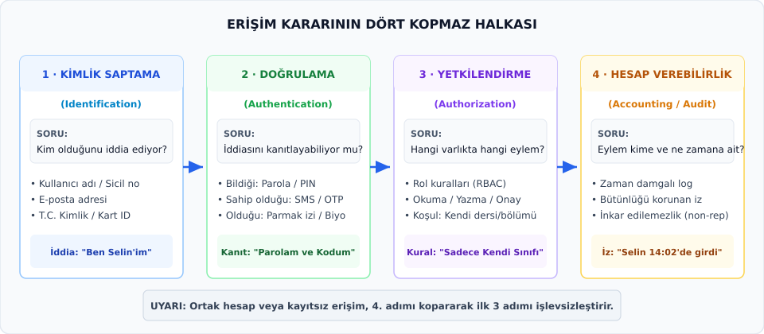

## Sisteme girebilmek her işlemi yapabilmek midir?

- **Durum:** Kullanıcı adı ve parolasıyla sisteme başarıyla oturum açan, ekranda karşılama mesajı gören personel.
- **Yönetimsel güvenlik sorusu:** **"Kullanıcının sisteme başarıyla oturum açmış olması, sistemdeki tüm bilgilere erişebileceği ve her işlemi yapabileceği anlamına gelir mi?"**
- **Kuzey Üniversitesi ÖBS örneği:** Öğretim elemanı, öğrenci işleri memuru ve öğrenci aynı sisteme giriş yapar.
- **Sınır:** Üç rolün de sistem içindeki yetki ve işlem sınırları birbirinden farklıdır.

::: {.notes}
Bir bilişim sisteminde oturum açabilmek güvenliğin ilk adımıdır, fakat tek başına bir erişim yetkisi yaratmaz. Bilgi güvenliği yönetiminde en sık karşılaşılan kavram yanılgılarından biri, kimlik doğrulamayı yetkilendirmeyle bir tutmaktır. Bir personelin kurum ağına veya kurumsal yazılıma parolasıyla başarıyla girebilmesi, o sistemdeki her veriyi görebileceği ya da değiştirebileceği anlamına gelmez.

Kuzey Üniversitesi Öğrenci Bilgi Sistemi (ÖBS) üzerinden bu ayrımı somutlaştırabiliriz. Bir öğretim elemanı sisteme girdiğinde kendi dersinin notlarını girebilmeli, ancak öğrencinin harç borcu durumunu silememeli ya da başka bir öğretim elemanının sınav sonuçlarını değiştirememelidir. Öğrenci işleri memuru özlük ve iletişim kayıtlarını güncelleyebilirken ders notuna müdahale edememeli; öğrenci ise yalnız kendi notunu görebilmeli, başkasının kaydına veya sınav sorularına ulaşamamalıdır.

Çalışmanızda "içeride olan kullanıcı güvenilirdir ve her şeye erişebilir" yanılgısına özellikle dikkat edin. Geçerli bir kullanıcı adı ve parolayla oturum açmış olmak yalnızca kapıdan geçmeyi sağlar; içeride hangi odalara girilebileceği tamamen ayrı yönetim kurallarına dayanır. İzleyen slaytta bu sürecin dört ardışık güvenlik adımına nasıl ayrıldığını inceleyeceğiz.
:::

---

## Bir erişim kararının dört temel adımı

Bir erişim kararı tek bir işlem değildir; sırayla çalışan dört güvenlik mekanizmasından oluşur:

1. **Kimlik saptama (identification):** "Kim olduğunu iddia ediyorsun?"
2. **Kimlik doğrulama (authentication):** "Bu iddiayı nasıl kanıtlarsın?"
3. **Yetkilendirme (authorization):** "Hangi varlık üzerinde hangi işlemi yapabilirsin?"
4. **Hesap verebilirlik (accountability):** "Yapılan işlem kime bağlanabiliyor?"

Bu dört adım bir zincir gibi birbirine bağlıdır; biri eksik kaldığında erişim güvenliği çöker.

::: {.notes}
Erişim yönetimi, dört farklı güvenlik sorusunu ardışık olarak yanıtlayan bir süreçtir. İlk iki adım kullanıcının kim olduğunu ve bu iddianın doğruluğunu belirlerken, üçüncü adım kurumun iş kurallarına göre hangi izinlerin geçerli olduğunu çözer. Dördüncü adım ise işlem gerçekleşirken ve sonrasında devreye girerek yapılan eylemin kim tarafından gerçekleştirildiğini geriye dönük kanıtlar.

Bu mekanizmaların her biri bir öncekinin çıktısını girdi olarak kullanır. Kimlik tekil olarak saptanmadan doğrulama yapılamaz; doğrulanmamış bir kimliğe görev ve yetki sınırı atanamaz; tekil kimlik ve yetki kuralı olmadan da yapılan işlem gerçek bir kişiye bağlanamaz. Dolayısıyla teknik sistemlerde bu dört adım sırasıyla ve eksiksiz işletilmek zorundadır.

Günlük dilde kullanıcılar "sisteme giriş yaptım" dediğinde yalnızca ilk iki adımı kasteder. Oysa bilgi güvenliği yönetimi açısından asıl sınır yetkilendirme aşamasında çizilir ve sistemin denetlenebilirliği hesap verebilirlik mekanizmasıyla korunur. Bir sonraki slayttaki şema, bu dört halkanın birbirine nasıl kenetlendiğini görsel olarak ortaya koymaktadır.
:::

---

## Erişim zinciri: Dört kopmaz güvenlik halkası

{width="100%" fig-align="center" fig-alt="Erişim kararının dört kopmaz halkası: Kimlik saptama, doğrulama, yetkilendirme ve hesap verebilirlik"}

::: {.notes}
Şemadaki dört kutuyu soldan sağa okuyun: kimlik saptama, doğrulama, yetkilendirme, hesap verebilirlik. Her kutu bir soruyla açılır ve tek bir işi yapar. Dördü birbirinin yerine geçmez; zincir olarak çalışır.

Kimlik saptama "kim olduğunu iddia ediyor?" sorusunu sorar. Kullanıcı adı, sicil numarası, e-posta ya da kart numarası bir iddiadır ve bu aşamada kanıt değildir. Örnekte iddia şudur: "Ben Selin'im." Doğrulama bu iddianın kanıtını ister. Kanıt üç türden gelir: bildiği bir şey (parola, PIN), sahip olduğu bir şey (SMS kodu, tek kullanımlık şifre) ve olduğu bir şey (parmak izi gibi biyometrik veri). Örnekte kanıt: "Parolam ve kodum."

Kimlik doğrulanınca soru değişir: bu kişi hangi varlıkta hangi eylemi yapabilir? Yetkilendirme bunu rol kurallarıyla, eylem türüyle (okuma, yazma, onay) ve koşulla (kendi dersi, kendi bölümü) çözer. Örnekte kural: "Sadece kendi sınıfı." Doğrulanmış olmak her şeyi yapabilmek anlamına gelmez; giriş başarısı ile yetki sınırı ayrı konulardır. Dördüncü halka hesap verebilirlik, işlemden sonra çalışır: eylem kime ve ne zamana ait? Zaman damgalı log, bütünlüğü korunan iz ve inkâr edilemezlik bu halkanın malzemesidir. Örnekte iz: "Selin 14.02'de girdi."

Şemanın altındaki uyarıyı gövdeyle birlikte okuyun: ortak hesap ya da kayıtsız erişim dördüncü halkayı koparır ve ilk üç halkayı da anlamsızlaştırır. Üç memurun ortak kullandığı bir hesapta kimlik de doğrulanır, yetki de vardır, ama işlemi hangi memurun yaptığı sonradan kanıtlanamaz. Zincirin gücü en zayıf halkası kadardır.

Sonraki slaytlar halkaları tek tek açar. Her birinde aynı soruyu yineleyin: bu halka eksik olsaydı hangi soruya cevap veremezdik?
:::

---

## Kimlik saptama: Kimlik iddiası

**Kimlik saptama (identification)**, bir kullanıcının veya sürecin sisteme benzersiz bir kimlik bilgisi sunarak kim olduğunu beyan etmesidir.

- Bu aşama bir **iddia** bildirimidir; iddia henüz doğrulanmış veya kanıtlanmış sayılmaz.
- Kişiye özgü benzersiz bir tanımlayıcıyla yapılır (kullanıcı adı, sicil numarası, T.C. kimlik numarası, e-posta adresi).
- Kimlik saptama verisi gizli olmak zorunda değildir; sistemin kullanıcı hesabını dizinde bulmasını sağlar.

Örnek: Kuzey Üniversitesi ÖBS giriş ekranında Selin Hanım'ın kullanıcı adı alanına `selin.kaya` yazması.

::: {.notes}
Kimlik saptama, sistem ile kullanıcı arasındaki ilk temas noktasıdır. Kullanıcı sisteme bir tanımlayıcı sunarak "Ben Selin Kaya'yım" iddiasında bulunur. Sistem bu beyanı aldığında kendi kullanıcı dizininde böyle bir kaydın var olup olmadığını kontrol eder ve sonraki adımlarda hangi hesap profilinin inceleneceğini belirler.

Bu adımda geçerli olan temel koşul gizlilik değil, tekillik ve benzersizliktir. Kurum içinde iki farklı personele aynı sicil numarası veya aynı kullanıcı adı verilemez. Buna karşılık kullanıcı adı, e-posta adresi ya da sicil numarası gizli bir güvenlik sırrı değildir; iş arkadaşları ve öğrenciler bu bilgiyi zaten görebilir.

Kuzey Üniversitesi ÖBS ekranına `selin.kaya` yazılması tek başına hiçbir güvenlik kanıtı taşımaz, çünkü giriş ekranına ulaşan herkes bu metni yazabilir. Beyan edilen bu iddianın gerçekten Selin Hanım'a ait olup olmadığını sınamak için hemen ardından ikinci adımın, yani kimlik doğrulamanın devreye girmesi gerekir.
:::

---

## Kimlik doğrulama: İddianın kanıtlanması

**Kimlik doğrulama (authentication)**, sisteme beyan edilen kimlik iddiasının doğruluğunun geçerli kanıtlarla sınanması sürecidir.

Doğrulama faktörleri:

1. **Bildiği bir şey:** Parola, PIN, güvenlik sorusu yanıtı.
2. **Sahip olduğu bir şey:** Akıllı kart, donanım anahtarı (token), telefona gelen SMS veya mobil onay kodu.
3. **Olduğu bir şey (biyometrik):** Parmak izi, yüz geometrisi, retina taraması.

**Çok faktörlü doğrulama (MFA):** Farklı kategorilerden en az iki doğrulama faktörünün birlikte kullanılmasıdır.

Örnek: Selin Hanım'ın parolasını girdikten sonra cep telefonundaki kurumsal kimlik doğrulama uygulamasından gelen onay bildirimini onaylaması.

::: {.notes}
Kimlik doğrulama, kullanıcının "iddia ettiğim kişi gerçekten benim" beyanını kanıtlama adımıdır. Klasik bilişim sistemlerinde bu işlem çoğunlukla yalnızca parola ile yapılır. Ancak parolanın tahmin edilmesi, çalınması ya da oltalama saldırısıyla ele geçirilmesi durumunda tek faktörlü doğrulama koruma sağlayamaz.

Bu riski azaltmak için kullanılan çok faktörlü doğrulama (MFA), üç ayrı kanıt sınıfından (bildiği, sahip olduğu, olduğu) en az ikisinin bir arada sunulmasını şart koşar. Böylece parola ele geçirilse bile, saldırgan kullanıcının fiziksel olarak sahip olduğu akıllı karta veya cep telefonundaki onay uygulamasına erişemediği sürece oturum açamaz.

Çalışmanızda MFA kavramını değerlendirirken kanıtların farklı kategorilerden gelmesi gerektiğine dikkat edin. Kullanıcıdan hem parola hem de güvenlik sorusu yanıtı (veya PIN) istemek iki aşamalı görünse de ikisi de "bildiği bir şey" kategorisinde yer aldığı için MFA sayılmaz. Selin Hanım örneğinde parola (bildiği) ile mobil uygulama onayı (sahip olduğu) birleşerek gerçek MFA sağlar; kimlik doğrulandıktan sonra ise sıra kullanıcının sistemde ne yapabileceğini belirleyen yetkilendirme adımına gelir.
:::

---

## Yetkilendirme: Hangi varlıkta hangi eylem?

**Yetkilendirme (authorization)**, kimliği doğrulanmış bir kullanıcının belirli bir bilgi varlığı üzerinde hangi işlemleri, hangi sınırlar ve koşullar dahilinde yapabileceğini belirleyen kural ve izin mekanizmasıdır.

Mekanizma zinciri:

$$\text{Doğrulanmış kimlik} \longrightarrow \text{Atanmış iş rolü} \longrightarrow \text{Bilgi varlığı} \longrightarrow \text{İzin verilen eylem}$$

- **İzin verilen eylemler:** Okuma, yazma/düzenleme, silme, onaylama, yetki devretme.
- **Sınır ve koşul:** Zaman aralığı, kendi birimi veya görevlendirildiği ders kapsamı.
- **Örnek (Kuzey Üniversitesi ÖBS):**
  - Selin Hanım sisteme başarıyla giriş yapar; yalnızca görevlendirildiği BGT201 dersinin not giriş alanını düzenleyebilir.
  - Başka bir bölümün ders notlarını değiştiremez ve bütçe kayıtlarını göremez.

::: {.notes}
Doğrulama adımını geçen bir kullanıcının sistemdeki her işlemi yapabilmesi beklenemez. Yetkilendirme, kurumun iş kurallarını ve görev dağılımını bilgi sistemine yansıttığı aşamadır. Kurumda yetkiler kişilerin kıdemine veya isteğine göre değil, yürüttükleri iş rolünün gerektirdiği sorumluluklara göre tanımlanır.

Mekanizma zincirinde doğrulanmış kimlik önce kurumsal bir iş rolüne bağlanır; ardından bu rolün hangi bilgi varlığı üzerinde hangi eylemi (okuma, yazma, silme, onaylama) gerçekleştirebileceği belirlenir. Ayrıca bu izinler zaman aralığı (örneğin yalnızca not giriş takvimi içinde) ve kapsam (yalnızca kendi birimi veya dersi) gibi koşullarla sınırlandırılır.

ÖBS örneğinde Selin Hanım öğretim elemanı rolündedir ve yalnızca görevlendirildiği BGT201 dersinin not çizelgesi üzerinde yazma/düzenleme hakkına sahiptir. Elektrik Programı'ndaki bir dersin notlarını değiştirememesi veya bütçe kayıtlarını görememesi bir sistem hatası değil, yetkilendirme sınırının doğru çalışmasıdır. Kullanıcının yetkisi dahilinde yaptığı işlemlerin nasıl kayıt altına alındığını ise bir sonraki adım olan hesap verebilirlik çözer.
:::

---

## Hesap verebilirlik: İşlemin failine bağlanması

**Hesap verebilirlik (accountability)**, bir bilgi sisteminde gerçekleştirilen her eylemin, denetim izleri ve zaman damgalı günlük kayıtları (log) aracılığıyla işlemi gerçekleştiren tekil kullanıcıya kesin olarak bağlanabilmesi ve geriye dönük incelenebilmesidir.

Temel bileşenler:

- **İnkâr edilemezlik (non-repudiation):** İşlemi gerçekleştiren kullanıcının sonradan "Bu işlemi ben yapmadım" diyememesi.
- **Denetim izi (audit trail):** Kim, ne zaman, hangi ağ adresinden, hangi veri üzerinde, ne tür bir değişiklik yaptı?

Örnek: ÖBS'de BGT201 dersinde bir öğrencinin notu güncellendiğinde sistemin tuttuğu kayıt:  
`2026-11-17 14:32:05 | Kullanıcı: selin.kaya | Varlık: BGT201-Not | Eylem: Güncelleme | Öğrenci: 20250104 | Eski: 60, Yeni: 75`

::: {.notes}
Hesap verebilirlik, güvenliğin geriye dönük denetlenebilmesini sağlayan omurgadır. Sistemde bir hata, yetkisiz değişiklik veya usulsüzlük meydana geldiğinde "Bu işlemi kim, ne zaman ve nasıl yaptı?" sorusuna tartışmasız bir yanıt verilebilmelidir.

Bu güvencenin çalışabilmesi iki temel koşula bağlıdır: Birincisi, her kritik işlemin zaman damgalı ve bütünlüğü korunan bir denetim izi (audit trail) olarak kaydedilmesidir. İkincisi ise işlemin tekil olarak doğrulanmış bir kimliğe bağlanarak inkâr edilemezlik (non-repudiation) sağlamasıdır; böylece kullanıcı sonradan işlemi kendisinin yapmadığını ileri süremez.

ÖBS kayıt örneğine dikkat ederseniz, yalnızca "not değişti" bilgisi tutulmamakta; işlemin tarihi ve saati, `selin.kaya` kullanıcısı, `BGT201-Not` varlığı, `20250104` numaralı öğrenci ile notun eski (60) ve yeni (75) değerleri birlikte yazılmaktadır. Ancak bu denetim kaydının geçerli bir kanıt olabilmesi için önceki üç adımın da eksiksiz çalışmış olması şarttır; izleyen slaytta bu dört adımın neden birbirinin eksiğini kapatamayacağını karşılaştıracağız.
:::

---

## Dört adımın kopmaz zinciri

Dört adımdan herhangi biri eksik bırakıldığında erişim yönetiminin tamamı çöker:

| Eksik adım | Ortaya çıkan güvenlik zafiyeti |
|---|---|
| **Kimlik saptama yok** | Sisteme kimin bağlandığı baştan bilinemez; anonim erişim oluşur. |
| **Kimlik doğrulama yok** | İddia kanıtlanmaz; herkes dilediği kullanıcının adıyla işlem yapar. |
| **Yetkilendirme yok** | Giriş yapan her kullanıcı tüm kurumsal verilere ve işlevlere erişir. |
| **Hesap verebilirlik yok** | Bir usulsüzlük ya da sızıntı olduğunda sorumlunun kim olduğu kanıtlanamaz. |

. . .

Güvenlik mekanizmaları birbirinin eksiğini kapatmaz; her adım kendi bağımsız işlevini yerine getirmek zorundadır.

::: {.notes}
Dört güvenlik mekanizmasını birbirinden bağımsız adalar gibi düşünmemek gerekir. Her halka bir öncekinin ürettiği güvence üzerine inşa edilir; dolayısıyla bir halkadaki boşluk tüm erişim zincirini işlevsiz bırakır.

Tablonun ilk iki satırı kimlik katmanındaki kopuşu gösterir. Kimlik saptama olmadığında sisteme bağlananlar anonim kalır ve hiçbir yetki ya da denetim kuralı kişiye bağlanamaz. Kimlik saptama var ama doğrulama yoksa, ekrana `selin.kaya` yazan herhangi biri hiçbir kanıt sunmadan Selin Hanım'ın hesabıyla sisteme girebilir.

Üçüncü ve dördüncü satırlar ise oturum açıldıktan sonraki yönetim boşluklarını açıklar. Yetkilendirme kurulmadığında, kimliğini başarıyla doğrulayan bir öğrenci veya memur sistemdeki tüm kurumsal verilere ve yönetim ekranlarına sınırsız erişir. Hesap verebilirlik eksik bırakıldığında ise yetkili bir kullanıcının yaptığı hatalı ya da usulsüz işlem sonradan tespit edilip kanıtlanamaz.

Uygulamada sık düşülen yanılgı, çok güçlü bir parola veya MFA kullanmanın içerideki yetkilendirme ve log eksikliğini telafi edeceğini sanmaktır. Oysa güvenlik mekanizmaları birbirinin eksiğini kapatmaz. Aynı bütüncül bakış açısı, bir sonraki slaytta ele alacağımız mantıksal ve fiziksel erişim boyutları için de geçerlidir.
:::

---

## Mantıksal ve fiziksel erişim: Ortak güvenlik sorusu

Erişim yönetimi yalnızca yazılım ve ağ sistemleriyle sınırlı değildir. Kurumun iki temel erişim boyutu vardır:

- **Mantıksal erişim:** Dijital veri tabanlarına, işletim sistemlerine, dosya dizinlerine, ağ kaynaklarına ve uygulama işlevlerine yönelik erişim izinleri.
- **Fiziksel erişim:** Binalara, çalışma ofislerine, sunucu odalarına, veri merkezlerine ve basılı arşiv dolaplarına fiziksel giriş kontrolleri.

İki boyut da aynı temel yönetim sorusunu yanıtlar:

**"Görevi gereği kim, hangi bilgi varlığına, hangi eylem için ulaşabilmelidir?"**

::: {.notes}
Kurumsal bilgi yalnızca sunuculardaki veri tabanlarında değil, fiziksel ortamlarda ve basılı belgelerde de yaşar. Kuzey Üniversitesi'nde öğrenci notları ÖBS veri tabanında (dijital varlık) tutulduğu gibi, öğretim elemanlarının imzaladığı basılı not bildirim fişlerinde, sınav kâğıtlarında ve diploma kütüklerinde (fiziksel varlık) de yer alır.

Bu nedenle erişim yönetimi mantıksal ve fiziksel olmak üzere iki boyutta birlikte yürütülür. Mantıksal erişim kullanıcı hesapları, ağ izinleri ve yazılım rolleri üzerinden dijital varlıkları korurken; fiziksel erişim kartlı geçiş sistemleri, kilitli arşiv dolapları ve sunucu odası kontrolleriyle fiziksel ortamları korur.

Her iki boyut da aynı yönetim sorusuna yanıt verir ve dört erişim adımını kendi ortamında uygular: fiziksel dünyada yaka kartı veya personel kimliği ile saptama yapılır, kart okuyucu ya da biyometrik kontrolle doğrulama sağlanır, hangi odaya veya dolaba girilebileceğiyle yetkilendirme kurulur ve giriş-çıkış kayıtlarıyla hesap verebilirlik işletilir. Bir sonraki slaytta bu iki boyuttan biri ihmal edildiğinde ortaya çıkan boşlukları inceleyeceğiz.
:::

---

## Dijital kilit yetmez: Fiziksel ve mantıksal boşluklar

Bir boyuttaki denetim eksikliği, diğer boyuttaki tüm güvenlik önlemlerini geçersiz kılabilir:

- **Mantıksal koruma var, fiziksel koruma yok:** ÖBS veri tabanında not yetkisi sıkı kurallara bağlıdır; ancak imzalı sınav kâğıtları ve not fişleri koridordaki kilitsiz arşiv odasında tutulmaktadır.
- **Fiziksel koruma var, mantıksal koruma yok:** Sunucu odası kartlı geçişle ve biyometrik kilitle korunuyor; ancak içerideki sistem konsolunda yönetici oturumu kilitlenmeden açık bırakılmış.

Fiziksel kilit dijital açığı, dijital şifreleme de kilitlenmemiş kapıyı telafi edemez.

::: {.notes}
Mantıksal ve fiziksel kontroller birbirinin alternatifi değil, aynı varlığı koruyan tamamlayıcı katmanlardır. Bir boyutta alınan çok sıkı önlemler, diğer boyutta bırakılan basit bir ihmal yüzünden tamamen etkisiz kalabilir.

İlk senaryoda kurum ÖBS yazılımında güçlü parolalar, rol bazlı yetkilendirme ve log kayıtları kurmuştur. Ancak resmi dayanak olan imzalı sınav kâğıtları ve not fişleri koridordaki kilitsiz bir arşiv odasında durmaktadır. Yetkisiz bir kişi yazılıma hiç dokunmadan fiziksel arşivdeki bir evrakı değiştirdiğinde veya yok ettiğinde kurumsal verinin bütünlüğü bozulur.

İkinci senaryoda ise sunucu odası kartlı geçiş ve biyometrik doğrulamayla korunmaktadır; fakat içerideki konsolda sistem yöneticisi oturumu kilitlemeden ekran başından ayrılmıştır. Bakım, temizlik veya refakatli ziyaret kapsamında odaya giren bir kişi hiçbir parola bilmeden doğrudan yönetici yetkisiyle komut çalıştırabilir. Görüldüğü gibi fiziksel ve mantıksal güvenlik birlikte tasarlanmalı; ayrıca içeride yapılan işlemlerin kime ait olduğunun bulanıklaşmaması için bir sonraki slaytta göreceğimiz ortak hesap yasağı uygulanmalıdır.
:::

---

## Ortak hesap kullanımı: Sorumluluk zincirinin kırılması

**Kişiye özgü kimlik ilkesi:** Sistemde her kullanıcının yalnızca kendi adına açılmış benzersiz bir kimlikle işlem yapması ve bu kimlik bilgisini kimseyle paylaşmaması kuralıdır.

**Ortak hesap problemi:** Öğrenci işleri bürosunda üç memurun ortak kullandığı `ogrenci_kayit` hesabı.

- Kimlik saptama: Başarılı (`ogrenci_kayit` hesabı var).
- Kimlik doğrulama: Başarılı (16 haneli karmaşık parola girildi).
- Yetkilendirme: Başarılı (hesabın adres güncelleme izni var).
- **Hesap verebilirlik: ÇÖKTÜ.** Bir öğrencinin iletişim adresi kasıtlı veya hatalı değiştirildiğinde, işlemi üç memurdan hangisinin yaptığı kanıtlanamaz.

::: {.notes}
Kurumlarda pratiklik gerekçesiyle sıkça yapılan en tehlikeli hatalardan biri ortak veya paylaşılan hesap kullanımıdır. Birimlerde "işler hızlı yürüsün, nöbetleşe çalışıyoruz, parolayı yalnızca üçümüz biliyoruz" düşüncesiyle tek bir kullanıcı hesabı birden fazla personel tarafından kullanılır.

Öğrenci işleri bürosundaki `ogrenci_kayit` örneğinde ilk üç adım teknik olarak sorunsuz görünür: hesap dizinde tanımlıdır, 16 haneli karmaşık bir parolayla doğrulanmaktadır ve yalnızca adres güncelleme yetkisiyle sınırlandırılmıştır. Ancak sistem yaptığı her kayda gerçek memurun adını değil, `ogrenci_kayit` ibaresini yazar.

Bir öğrencinin iletişim bilgisi hatalı ya da kasıtlı olarak değiştirildiğinde, üç memurdan hangisinin o anda klavye başında olduğu denetim izinden kanıtlanamaz ve inkâr edilemezlik tamamen çöker. Bu nedenle her personele kişiye özgü tekil hesap açılması zorunludur; fakat tekil hesap açmak da tek başına yetmez, kritik işlemlerde yetkinin tek elde toplanmaması için bir sonraki slayttaki görevlerin ayrılığı ilkesi kurulmalıdır.
:::

---

## Görevlerin ayrılığı: Tek role sınırsız güç vermemek

**Görevlerin ayrılığı (segregation of duties)**, hata, yetki aşımı ve kötüye kullanımı önlemek amacıyla, kritik bir iş sürecinin hazırlama, onaylama, uygulama ve denetleme adımlarının farklı kişilere paylaştırılması ilkesidir.

Temel aktörler ve sorumluluklar:

- **İş / Varlık Sahibi:** İş sürecinin kurallarını belirleyen ve iş gerekçesini onaylayan rol (Bölüm Başkanı / Birim Müdürü).
- **Teknik Uygulayıcı:** Onaylanmış iş kararını teknik sisteme işleyen veya uygulayan rol (BT Yetki Yöneticisi / Sistem Yöneticisi).
- **Kullanıcı:** Tanımlanmış yetkileri günlük iş görevini yürütmek için kullanan personel (Öğretim Elemanı / Memur).

Kural: Yetkiyi talep eden kendi talebini onaylayamaz; teknik uygulayıcı da onay olmadan yetki açamaz.

::: {.notes}
Görevlerin ayrılığı, kurumsal güvenliğin ve iç denetimin en temel ilkelerinden biridir. Bir iş sürecinin başlatılması, onaylanması ve uygulanması tek bir kişinin eline bırakıldığında hem dikkatsizlikten kaynaklanan hatalar fark edilemez hem de yetkinin kötüye kullanılması kolaylaşır.

Erişim yönetiminde bu ayrım üç farklı aktör üzerinden yürütülür: İş veya varlık sahibi (Bölüm Başkanı ya da Öğrenci İşleri Müdürü gibi birim yöneticisi) talebin iş gerekçesini değerlendirip karar verir; teknik uygulayıcı (BT yetki veya sistem yöneticisi) onaylanan kararı sisteme tanımlar; kullanıcı (öğretim elemanı veya memur) ise tanımlanan bu yetkiyi günlük görevinde kullanır.

Buradaki temel sınır, hazırlayan ile onaylayanın ve onaylayan ile uygulayanın aynı kişi olamamasıdır. Örneğin bir BT sistem yöneticisi teknik olarak yetki verme aracına sahip olsa bile, iş sahibinin yazılı onayı olmadan kendi kararıyla hiçbir kullanıcıya yetki açamaz. İzleyen slayttaki çözümlü örnek, bu üç rolün gerçek bir not düzeltme olayında nasıl birlikte çalıştığını göstermektedir.
:::

---

## Rehber çözümlü örnek: Sehven yanlış girilen harf notu

**Olay:** Selin Hanım BGT201 dersinde bir öğrencinin 85 olan vize notunun sehven 58 olarak sisteme girildiğini fark eder. Not ilan süresi kapanmıştır.

Sürecin görev ayrılığı ve erişim adımlarıyla çözümü:

1. **Hazırlama (İşlem Sahibi):** Selin Hanım sınav kâğıdı ve gerekçesiyle resmi bir "Maddi Hata Düzeltme Formu" hazırlar. Selin Hanım ÖBS'de notu tek başına değiştiremez.
2. **İş Onayı (Varlık/Süreç Sahibi):** Bölüm Başkanı sınav kâğıdını ve gerekçeyi inceler; düzeltme kararını resmi olarak onaylar.
3. **Teknik Uygulama (Teknik Yönetici):** BT ÖBS yöneticisi, imzalı onayı sistem kaydına bağlar ve Selin Hanım için ilgili öğrenciye özel geçici bir düzeltme yetkisi tanımlar veya değişikliği sisteme işler.
4. **Denetim İzi (Hesap Verebilirlik):** Sistem kütüğüne tarih, onaylayan sicili, uygulayan sicili ve gerekçe belgesi kaydedilir.

::: {.notes}
Maddi hata düzeltme senaryosu, görev ayrılığının günlük işleyişte nasıl çalıştığını somutlaştırır. Selin Hanım iyi niyetle kendi maddi hatasını düzeltmek istemektedir; ancak not ilan süresi kapandıktan sonra ÖBS'de öğretim elemanının doğrudan not değiştirmesine izin verilmez. Eğer sistem buna izin verseydi, iyi niyetli düzeltme ile yetkisiz not değiştirme arasında hiçbir kontrol farkı kalmazdı.

Çözüm adımlarında her rol kendi sınırında kalır: Selin Hanım işlemi başlatan kullanıcı olarak sınav kâğıdını kanıt gösterip resmi formu hazırlar; Bölüm Başkanı süreç ve varlık sahibi olarak kanıtı inceleyip iş onayını verir; BT ÖBS yöneticisi ise yalnızca bu resmi onaya dayanarak ilgili öğrenci kaydı için geçici ve sınırlı düzeltme işlemini uygular.

Son adımda sistem kütüğüne işlemin tarihi, onaylayan Bölüm Başkanının sicili, uygulayan BT yöneticisinin sicili ve maddi hata formunun referansı birlikte işlenir. Böylece hem yetkilendirme sınırları korunmuş hem de hesap verebilirlik eksiksiz sağlanmış olur; bir sonraki slaytta bu kurumsal düzenin uluslararası standartlardaki karşılığını göreceğiz.
:::

---

## Yönetim sistemi standardı ne bekler?

ISO/IEC 27001 ve ISO/IEC 27002 standartlarında erişim yönetimi hazır bir kontrol listesi değil, kurumsal bir yönetim sürecidir:

- **ISO/IEC 27001:2022 (Gereksinim standardı):** Kurumun erişim kararlarını iş gerekçelerine bağlayan, rolleri ve hakları tanımlı bir süreçle yöneten bir çerçeve kurmasını bekler.
- **ISO/IEC 27002:2022 (Uygulama rehberi):**
  - *Madde 5.15 (Erişim kontrolü):* Erişim kurallarının iş ve bilgi güvenliği gerekçelerine dayandırılması.
  - *Madde 5.18 (Erişim hakları):* Hakların verilmesi, değiştirilmesi ve geri alınması süreci.
  - *Madde 5.3 (Görevlerin ayrılığı):* Çıkar çatışmalarını ve yetkisiz işlemleri önlemek için görevlerin bölünmesi.

Standart belirli bir unvan veya yazılım dayatmaz; kararların yazılı, kurallı ve izlenebilir olmasını ister.

::: {.notes}
Uluslararası standartları okurken en sık düşülen yanılgı, bu metinlerin her kuruma hazır bir yetki listesi veya belirli bir yazılım dayattığını sanmaktır. Oysa ISO/IEC 27001:2022 kurumun erişim kararlarını iş gerekçelerine bağlayan bir yönetim sistemi kurmasını şart koşar; ISO/IEC 27002:2022 ise bu sistemi kurarken yararlanılacak uygulama rehberliğini sunar.

Rehberdeki üç kontrol maddesi ders boyunca incelediğimiz ilkeleri doğrudan karşılar: Madde 5.15 erişim kurallarının keyfî değil iş ve güvenlik gerekçelerine göre belirlenmesini, Madde 5.18 işe girişten görev değişikliğine ve işten ayrılışa kadar erişim haklarının yaşam döngüsüyle yönetilmesini, Madde 5.3 ise hata ve kötüye kullanımı önlemek üzere hazırlama, onay ve uygulama görevlerinin ayrılmasını düzenler.

Bir denetçi kuruma geldiğinde "neden şu yazılımı kullanmadınız" diye sormaz; "erişim kuralınız yazılı mı, yetkiyi hangi iş gerekçesiyle verdiniz, talep eden ile onaylayan ve uygulayan ayrı mı, yapılan işlemlerin denetim izi tutuluyor mu" sorularına kanıt arar. Şimdi izleyen iki slayttaki bağımsız görevde bu ilkeleri yeni bir personel vakası üzerinde uygulayacaksınız.
:::

---

## Bağımsız görev: Yeni personelin yetki talebi (Vaka ve Roller)

**Vaka Verisi:**
- **Kurum ve roller:** Kuzey Üniversitesi Öğrenci İşleri Müdürlüğü'nde Zeynep Hanım (Müdür / Varlık ve İş Süreci Sahibi), Murat Bey (BT Sistem ve ÖBS Yetki Yöneticisi / Mantıksal Uygulayıcı) ve Bina Güvenlik / Arşiv Sorumlusu (Fiziksel Uygulayıcı) görev yapmaktadır.
- **Talep:** İdari birime yeni atanan memur Ahmet Bey (Talep Sahibi) için iki erişim talebi iletilmiştir:
  1. *Fiziksel erişim:* Öğrenci diploma ve mezuniyet kütüklerinin saklandığı kilitli arşiv dolabının anahtarı.
  2. *Mantıksal erişim:* ÖBS üzerinde öğrenci iletişim adresi ve telefon numarası güncelleme yetkisi.

. . .

- **Öğrenci Görevi:** Dört güvenlik adımını (saptama, doğrulama, yetki, hesap verebilirlik) her iki talep için de vaka bağlamında eşleştiriniz.

::: {.notes}
Bu uygulamada, ders boyunca ele aldığımız dört erişim adımını ve rol ayrımlarını somut bir üniversite vakası üzerinde birleştireceğiz. İdari birime yeni atanan memur Ahmet Bey'in görevini yürütebilmesi için hem fiziksel bir varlığa (diploma ve mezuniyet kütüklerinin tutulduğu arşiv dolabı) hem de mantıksal bir sisteme (ÖBS iletişim bilgileri alanı) erişim talebi bulunmaktadır.

Vakayı okurken kurumsal aktörlerin rollerini birbirine karıştırmamaya dikkat edin: Öğrenci İşleri Müdürü Zeynep Hanım varlık ve iş süreci sahibidir, Murat Bey mantıksal erişimin teknik uygulayıcısıdır, Bina Güvenlik / Arşiv Sorumlusu ise fiziksel erişimin uygulayıcısıdır. Bir sonraki slaytta yer alan şablonu bu vaka verilerini temel alarak doldurmanız beklenmektedir.
:::

---

## Bağımsız görev: Cevap şablonu ve başarı ölçütleri

Vaka verisine göre aşağıdaki 4 adımlı cevap şablonunu doldurunuz:

| Güvenlik adımı | Fiziksel erişim (Arşiv dolabı) | Mantıksal erişim (ÖBS güncelleme) |
|---|---|---|
| **Kimlik saptama** | | |
| **Kimlik doğrulama** | | |
| **Yetkilendirme** | | |
| **Hesap verebilirlik** | | |

. . .

**Görünür Başarı Ölçütleri:**
1. Dört güvenlik adımını her iki talep için somut kayıt ve kanıtla eşleştirin.
2. İş/varlık sahibi ile teknik uygulayıcı rollerini açıkça ayırın.
3. İş onaysız yetkilendirmenin doğuracağı yönetimsel zafiyeti gerekçelendirin.

::: {.notes}
Çalışma tablosunu doldururken fiziksel erişim (arşiv dolabı) ve mantıksal erişim (ÖBS güncelleme) sütunlarının her birini kendi mekanizması içinde ayrı ayrı değerlendirin. Her satırda yalnızca genel kavram adını tekrar etmek yerine, vaka verisindeki kişileri ve ilgili adımda kullanılacak somut kurumsal kayıt veya kanıt türünü belirtin.

Çalışmanızı tamamladıktan sonra yanıtlarınızı üç başarı ölçütüne göre kontrol edin: dört adımın her iki erişim türünde de somut kanıtlarla eşleşip eşleşmediğini, iş/varlık sahibi ile uygulayıcı rollerinin birbirinden net biçimde ayrılıp ayrılmadığını ve iş onayı olmadan doğrudan yetki tanımlanmasının görev ayrılığı ilkesinde hangi yönetimsel zafiyeti doğuracağını gerekçelendirdiğinizden emin olun.
:::
