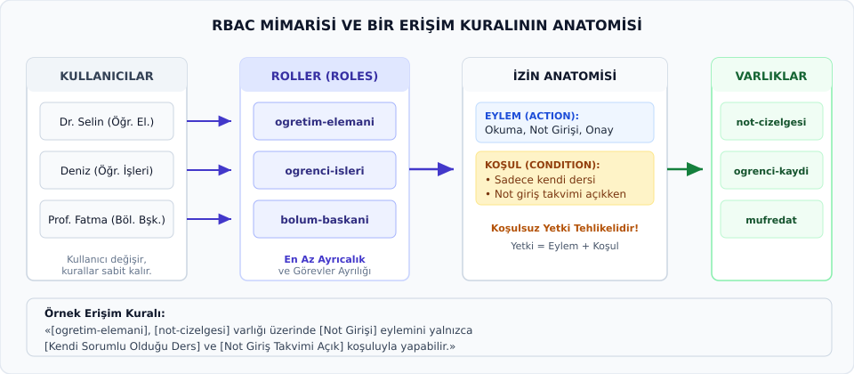

## Kullanıcıya doğrudan izin vermek neden yönetilemez hale gelir?

- Bir kurumda çalışan sayısı ve bilgi sistemleri arttıkça her personele tek tek klasör, veri tabanı ve uygulama izni tanımlama alışkanlığı başlar.
- Yeni başlayan personele geçmiş personelin izinleri kopyalanır ya da tahmini yetkiler açılır.
- Personelin görevi değiştiğinde eski izinlerin hangilerinin kapatılacağı bilinemez.
- Hangi personelin hangi veriye neden eriştiği izlenemez ve denetlenemez hale gelir.

. . .

> **Temel Soru:** İzinleri doğrudan kişilere bağlamak yerine, işin doğasına ve kurumsal görevlere bağlayan bir mimari nasıl kurulur?

::: {.notes}
Bilgi sistemlerinde erişim yönetiminin en yaygın operasyonel tuzaklarından biri, izinleri doğrudan kişilerin kullanıcı hesaplarına tanımlamaktır. Beş ya da on çalışanı olan küçük bir ofiste Ahmet'e dosya paylaşım izni, Mehmet'e veritabanı görüntüleme hakkı vermek ilk bakışta kolay görünebilir. Ancak kurum büyüdükçe, personel sayısı onlarca ya da yüzlerce kullanıcıya ulaştığında bu yöntem tam bir güvenlik kördüğümüne dönüşür.

Bir personel kurum içinde birim değiştirdiğinde ya da ek bir sorumluluk üstlendiğinde, sistem yöneticisi mevcut hakların üzerine yenilerini ekler; eski hakları "işi aksar" endişesiyle silmeye çekinir. Zaman içinde kimin hangi veriye hangi gerekçeyle eriştiği bilinemez hale gelir. Kişiye özgü izin yönetimi hem hesap verebilirliği zayıflatır hem de iç kontrol mekanizmalarını işlemez kılar.

Bu sorunun kalıcı çözümü, izinleri kişilerden soyutlayıp kurumsal iş görevlerine bağlamaktır. Yeni başlayan bir personele önceki çalışanın izinlerini kopyalamak ya da tahmini yetkiler açmak yerine, önce kurumdaki görevin ne gerektirdiği tanımlanmalıdır. Bir sonraki slaytta göreceğimiz rol kavramı, kullanıcı ile bilgi varlığı arasına kurumsal görev katmanını yerleştirerek bu karmaşayı ortadan kaldırır.
:::

---

## Rol kavramı ve rol tabanlı yaklaşım

**Rol**, bir kurumdaki belirli bir iş görevini veya sorumluluğunu yerine getirmek için gereken yetkiler kümesidir.

- **Kişiye değil role tanımlanır:** İzinler tekil kullanıcılara değil, kurumsal rollere tanımlanır.
- **Kullanıcı role atanır:** Kullanıcı göreve başladığında uygun role bağlanır; görevi değiştiğinde veya bittiğinde rolden çıkarılır.

. . .

```text
Kullanıcı (Örn. Selin)  ──►  Rol (Öğretim Elemanı)  ──►  Yetki (Not Girişi)  ──►  Varlık (Ders Notu)
```

. . .

> **Rol $\neq$ Unvan:** Unvan idari ya da akademik bir kadro derecesidir (örn. Doçent, Uzman); rol ise bilgi sisteminde tanımlı görev ve yetki sınırıdır.

::: {.notes}
Rol kavramını günlük dilde kullandığımız personel unvanlarıyla karıştırmamak gerekir. Bir üniversitede "Öğretim Görevlisi", "Doktor Öğretim Üyesi" veya "Şube Müdürü" birer idari ya da akademik unvandır. Bilgi sisteminde ise güvenliğin ve yetkilendirmenin birimi unvan değil, "roldür". Bir öğretim görevlisi bilgi sisteminde "Ders Sorumlusu Öğretim Elemanı", "Bölüm Başkanı" veya "Bologna Komisyonu Üyesi" rollerini üstlenebilir.

Rol tabanlı yaklaşımın en büyük avantajı yönetilebilirlik ve ölçeklenebilirliktir. Kuruma aynı anda başlayan on yeni uzman için yüzlerce izin kutucuğunu tek tek işaretlemek yerine, kullanıcıları önceden hazırlanmış role atamak yeterlidir. Rolün izinlerinde yapılan tek bir güncelleme, o role atanmış tüm personelde aynı anda ve tutarlı olarak yürürlüğe girer.

Akış zincirine dikkat edin: kullanıcı olan Selin, ders notu varlığına doğrudan bağlanmaz; önce "Öğretim Elemanı" rolüne atanır ve "Not Girişi" yetkisini bu rol üzerinden alır. Selin'in dönem sonunda ders sorumluluğu bittiğinde varlık üzerindeki izin ayarlarıyla tek tek uğraşılmaz; yalnızca Selin'in bu rolle olan bağı kaldırılır. Aynı kadro unvanına sahip iki kişiden biri ders yürütürken diğeri yürütmüyorsa, yalnızca ders yürüten kişiye bu rol atanır.

Sık düşülen yanılgı, kadro unvanını doğrudan sistem rolü sanıp aynı unvandaki herkese aynı erişim paketini açmaktır. Peki bir rolün hangi yetkileri kapsayacağına ve sınırlarının nerede biteceğine kim, neye dayanarak karar verir? Bir sonraki slaytta rolün kurumsal dayanağı olan görev tanımı belgesini inceleyeceğiz.
:::

---

## Rol, görev tanımı belgesiyle tanımlanır

**Görev tanımı**, bir rolün neden var olduğunu, kime bağlı olduğunu, nelerden sorumlu olduğunu ve yetkisinin nerede bittiğini yazan belgedir.

| Alan | Örnek: Öğrenci İşleri Uzmanı |
|---|---|
| **Görev adı** | Öğrenci İşleri Uzmanı |
| **Bağlı olduğu rol** | Öğrenci İşleri Müdürü |
| **Görev tanımı** | Sorumlu programın öğrenci kayıt işlemlerini yürütür |
| **Sorumluluklar** | Öğrenci iletişim kayıtlarının güncelliği; mezuniyet ve kayıt kontrolü |
| **Yetki sınırı** | İletişim kayıtlarını okur ve günceller (yalnız sorumlu program); ilan edilmiş notları yalnız okur |
| **Gerekli yetkinlik** | Kayıt süreçleri; kişisel verilerin korunması eğitimi |
| **Vekâlet** | İzinde yerine bakacak rol yazılıdır; hesap devredilmez |

> Görev tanımı, rolün yetki kümesini kurumun kararı olarak yazar; erişim izni bu belgeden türetilir.

::: {.notes}
Önceki slaytta rolün bilgi sisteminde tanımlı bir yetki kümesi olduğunu gördük. Bu yetki kümesi teknik uygulayıcının kendi tahmininden değil, kurumun o görev için yazdığı resmi karardan gelir; görev tanımı bu kararın yazılı hâlidir. Tablodaki "Öğrenci İşleri Uzmanı" örneğinde rolün Öğrenci İşleri Müdürü'ne bağlı olması ve kişisel verilerin korunması eğitimi gibi yetkinlik şartları taşıması, rolün teknik bir ayardan önce kurumsal bir sorumluluk çerçevesi olduğunu gösterir.

Tablodaki her alan farklı bir güvenlik sorusuna yanıt verir. "Bağlı olduğu rol" yetkiyi aşan bir durumda onay için kime gidileceğini söyler. "Yetki sınırı" erişim kuralının varlık, eylem ve koşul parçalarını ilk kez tanımlayan alandır; yalnızca sorumlu programın iletişim kayıtlarını güncelleyebilme ve ilan edilmiş notları yalnızca okuyabilme sınırı buradan doğar. "Vekâlet" alanı ise parola paylaşımı sorununun doğru çözümüdür: bir kişi izindeyken işin yürümesi gerekiyorsa çözüm hesabı devretmek değil, tanımlı vekâlet rolünü işletmektir.

Görev tanımında yazmayan bir yetki talep edildiğinde bu talep kendiliğinden karşılanmaz; ayrı bir erişim talebi olarak gerekçelendirilir ve yönetim onayı ister. Personelin görevi değiştiğinde de hangi yetkilerin kalıp hangilerinin alınacağını yine yeni görevin tanımı belirler. Bir sonraki slaytta görev tanımındaki yetki sınırının bilgi sisteminde dört bileşenli bir erişim kuralına nasıl dönüştürüldüğünü göreceğiz.
:::

---

## Bir erişim kuralının anatomisi: Rol, varlık, eylem ve koşul

Bir yetkilendirme kuralı yalnızca "kim ne yapabilir" sorusuyla kurulamaz; dört temel bileşenin açıkça tanımlanması gerekir:

- **Rol:** Yetkiyi kullanacak tanımlı görev (Kimin görevi?).
- **Varlık:** Erişime konu olan bilgi kaynağı ya da sistem bileşeni (Hangi bilgi varlığı?).
- **Eylem (İzin türü):** Varlık üzerinde yapılmasına izin verilen somut işlem: *Okuma, Düzenleme, Onaylama, Silme, Yetki Tanımlama* (Hangi işlem?).
- **Koşul (Sınır kuralı):** İznin geçerli olduğu birim, program, yarıyıl veya zaman aralığı sınırı (Hangi koşulda?).

. . .

> Koşul tanımlanmamış bir rol yetkisi, kuruma gereksiz ve denetimsiz bir yetki aşımı alanı açar.

::: {.notes}
Yetki tanımlarında en sık yapılan hata, kuralı yalnızca rol ve eylemle sınırlı bırakmaktır. "Öğretim elemanı not düzenleyebilir" ifadesi ilk bakışta doğru bir kural gibi görünse de eksiktir. Hangi öğretim elemanı, hangi bilgi varlığı üzerindeki hangi dersin notunu, ne zamana kadar düzenleyebilir? Bu sorular yanıtlanmadığında yetki sınırı belirsiz kalır.

Varlık ve eylem ayrımı, erişimin "hep ya da hiç" mantığıyla verilmesini engeller. Bir bilgi varlığı üzerinde okuma, düzenleme, onaylama, silme ve yetki tanımlama birbirinden tamamen farklı işlemlerdir. Bir role veri okuma veya düzenleme izni verilmesi, o rolün kayıt silebileceği ya da kendi işlemini onaylayabileceği anlamına gelmez; her eylem görev tanımındaki karşılığına göre ayrı ayrı seçilir.

Belirsizliği ortadan kaldıran dördüncü parça ise "koşuldur". Bir öğretim elemanının not düzenleme yetkisi; yalnızca resmi olarak görevlendirildiği derslerle, yalnızca o yarıyılın aktif not giriş takvimiyle ve belirlenen sistem kurallarıyla sınırlandırılmalıdır. Koşulsuz verilen yetkiler, sistemde iyi niyetli kullanıcılar söz konusu olduğunda bile büyük hatalara ve yetki aşımına zemin hazırlar. Bir sonraki slaytta bu dört bileşenin RBAC mimarisi içinde nasıl bir araya geldiğini şema üzerinde okuyacağız.
:::

---

## Erişim kuralı anatomisi ve RBAC mimarisi

{width="100%" fig-align="center" fig-alt="RBAC mimarisi ve rol-varlık-eylem-koşul erişim kuralı anatomisi"}

::: {.notes}
Şemayı soldan sağa dört sütun olarak okuyun: kullanıcılar, roller, izin anatomisi, varlıklar. Kullanıcı hiçbir varlığa doğrudan bağlanmaz; önce bir role atanır, rol de izinlerle varlıklara bağlanır. Örnekte Dr. Selin öğretim elemanı rolüne, Deniz öğrenci işleri rolüne, Prof. Fatma bölüm başkanı rolüne bağlıdır. Roller de not çizelgesi, öğrenci kaydı ve müfredat gibi varlıklarda kendi izinlerini taşır.

Orta sütun, şemanın asıl öğrettiği yerdir: yetki iki parçadan oluşur, eylem ve koşul. Eylem, varlık üzerinde izin verilen işlemdir: okuma, not girişi, onay. Koşul, iznin nerede ve ne zaman geçerli olduğunu sınırlar: yalnızca kendi dersi, not giriş takvimi açıkken. Sütunun altındaki formül bunu özetler: yetki, eylem ile koşulun toplamıdır. Koşulsuz verilen yetki gereksiz bir yetki aşımı alanı açar.

Şemadaki örnek kural cümlesini parçalarına ayırarak okuyun: "[ogretim-elemani], [not-cizelgesi] varlığı üzerinde [Not Girişi] eylemini yalnızca [Kendi Sorumlu Olduğu Ders] ve [Not Giriş Takvimi Açık] koşuluyla yapabilir." Bir kural bu dört parçadan birini taşımıyorsa eksiktir: rol yoksa kim olduğu, varlık yoksa nerede, eylem yoksa ne yapabileceği, koşul yoksa nerede biteceği belirsizdir.

Kullanıcıdan role geçişin yönetim kolaylığını da görün: kullanıcı değişir, kurallar sabit kalır. Yeni bir öğretim elemanı gelince yüzlerce izin kutusunu tek tek işaretlemezsiniz; kişiyi role atarsınız. Rolün izninde yapılan bir değişiklik o role bağlı herkes için aynı anda geçerli olur. Şemanın altındaki iki ilke, en az ayrıcalık ve görevler ayrılığı, bu yapının güvencesidir: koşul ve rol tasarımı bu ikisini uygulanabilir kılar.

Sık yapılan hata, kuralı yalnızca "öğretim elemanı not girebilir" diye yazıp koşulu atlamaktır. Bu cümle hangi dersi, hangi dönemi, hangi takvimi kapsar? Sonraki örnekte aynı kuralı Kuzey Üniversitesi ÖBS verileriyle dört bileşenli yazacağız.
:::

---

## Örnek: Kuzey Üniversitesi ÖBS'de rol ve koşul kuralı

| Rol | Bilgi Varlığı | İzin Verilen Eylem | Uygulanan Koşul |
|---|---|---|---|
| **Öğretim Elemanı** | Ders Notu Kayıtları | Oku / Düzenle | Yalnız görevli olunan ve takvimi açık dersler |
| **Öğrenci İşleri Uzmanı** | Öğrenci İletişim Kayıtları | Oku / Güncelle | Yalnız sorumlu olunan programın aktif öğrencileri |
| **Öğrenci İşleri Uzmanı** | Ders Notu Kayıtları | Yalnızca Oku | Yalnız ilan edilmiş dönem sonu kesin notları |

. . .

- Öğrenci İşleri Uzmanı notları inceleyebilir; ancak **not girişi yapamaz ya da değiştiremez**.
- Öğretim Elemanı kendi dersinin notunu girebilir; ancak **öğrencinin iletişim adresini güncelleyemez**.

::: {.notes}
Kuzey Üniversitesi Öğrenci Bilgi Sistemi (ÖBS) örneği, aynı sistem içinde çalışan iki farklı rolün yetki sınırlarının varlık, eylem ve koşul bileşenleriyle nasıl ayrıştırıldığını somutlaştırır. Hiçbir role "ÖBS tam yetkisi" verilmemekte; her rol yalnızca kendi iş sürecinin gerektirdiği varlık üzerinde, görev tanımına uygun eylem ve koşulla yetkilendirilmektedir.

Tabloda Öğrenci İşleri Uzmanı'nın iki ayrı bilgi varlığına erişimini karşılaştırın. Öğrenci iletişim kayıtlarını hem okuyabilir hem güncelleyebilir; çünkü görev tanımı sorumlu olduğu programdaki aktif öğrencilerin iletişim bilgilerini güncel tutmaktır. Ancak aynı uzmanın ders notu kayıtlarına erişimi "Yalnızca Oku" eylemiyle ve "yalnız ilan edilmiş dönem sonu kesin notları" koşuluyla sınırlandırılmıştır; henüz ilan edilmemiş sınav notlarını görmesi veya not değiştirmesi engellenmiştir.

Öğretim Elemanı ise yalnızca görevli olduğu ve not takvimi açık derslerin notlarını okuyup düzenleyebilir; buna karşılık öğrencinin iletişim kayıtlarını değiştiremez. İlan edilmiş bir ders notunda maddi hata ortaya çıktığında ne Öğrenci İşleri Uzmanı ne de Öğretim Elemanı bu notu tek başına değiştirebilir; öğretim elemanının gerekçeli başvurusu ve Bölüm Başkanı'nın resmi onayı gerekir. Bu sınır, bir sonraki slaytta inceleyeceğimiz görevlerin ayrılığı ilkesinin rol tasarımındaki karşılığıdır.
:::

---

## Görevlerin ayrılığı rol tasarımını sınırlar

H11-1'de gördüğümüz görevlerin ayrılığı ilkesi, roller tasarlanırken şu kuralı getirir: **aynı kişiye birlikte atanamayan roller vardır.**

| Birlikte atanmaması gereken | Neden |
|---|---|
| Hazırlayıcı ve onaylayıcı (ör. kendi dersinin not düzeltmesini hazırlayan Bölüm Başkanı) | Kendi işlemini kendisi onaylar |
| Onaylayıcı ve teknik uygulayıcı | Onaysız yetki tanımlanabilir |
| Yetki yöneten rol ve kendi yetkisi (ör. BT yöneticisi) | Kendi yetkisini kendisi artırabilir |

> Kural, kişiye değil rol çiftine yazılır; rol atanırken çakışma kontrol edilir.

::: {.notes}
Önceki ders saatinde görevlerin ayrılığını kritik bir işlemin hazırlayan, onaylayan ve uygulayan adımlarının tek kişide birleşmemesi ilkesi olarak tanımlamıştık. Bu ilke rol tasarımına doğrudan bir sınır getirir: tek başına bakıldığında meşru olan iki rol, aynı kullanıcı hesabına birlikte atandığında iç kontrolü ortadan kaldırabilir. Bu yüzden sistem tasarımında hangi rol çiftlerinin birbiriyle çeliştiği baştan tanımlanır.

Tablodaki üç çakışma senaryosu bu tehlikeyi somutlaştırır. Bir Bölüm Başkanı normal şartlarda bölümündeki not düzeltme taleplerini onaylayan makamdır; ancak kendi yürüttüğü ders için not düzeltmesi hazırlıyorsa o işlemde "hazırlayıcı" konumundadır ve kendi talebini kendisi onaylayamaz, üst onay makamı devreye girmelidir. Benzer biçimde, yetki onaylayıcı rol ile teknik uygulayıcı rol aynı kişide birleşirse kurumsal onay sürecini atlayarak yetki açmak mümkün hâle gelir; BT yöneticisinin kendi hesabının yetkilerini tek başına artırabilmesi de denetimsiz bir güç alanı yaratır.

Yaygın hata, rol çakışması kontrolünü yalnızca personel işe ilk girdiğinde yapıp sonradan verilen ek görevleri gözden kaçırmaktır. Kural kişilerin güvenilirliğine göre değil, doğrudan rol çiftine yazılır ve kullanıcıya ikinci bir rol veya vekâlet atanırken sistem tarafından çakışma kontrolü işletilir. Bir sonraki slaytta bu ayrımın kurumsal sorumluluk zincirindeki üç ana aktöre nasıl dağıtıldığını göreceğiz.
:::

---

## Kurumsal sorumluluk zinciri: Varlık sahibi, teknik uygulayıcı ve kullanıcı

Erişim yönetiminde rollerin işlevleri ve yetki sınırları kesin olarak ayrılmalıdır:

- **Varlık Sahibi / İş Onaylayıcısı:**
  - Bilgi varlığının kurumsal değerini, iş amacını ve korunma ihtiyacını bilir.
  - Kimin hangi gerekçeyle erişmesi gerektiğine karar verir ve yetki talebini **onaylar** (Örn. Öğrenci İşleri Müdürü, Bölüm Başkanı).
- **Teknik Uygulayıcı (BT Birimi):**
  - Onaylanmış erişim kurallarını sistemde teknik olarak **tanımlar ve işletir**.
  - **Sınır:** Yetki için tek başına *iş gerekçesi kararı veremez*; onaylanmamış bir talebi sisteme tanımlayamaz.
- **Kullanıcı:**
  - Kendisine tanımlanan erişim hakkını yalnızca meşru iş görevi sınırında kullanır; kimlik bilgilerini devredemez.

::: {.notes}
Bilgi güvenliği yönetiminde en sık karşılaşılan yönetimsel yanılgılardan biri, "BT birimi sistemin sahibidir, her veriye erişebilir ve kimin neye erişeceğine BT karar verir" düşüncesidir. Oysa BT sistem yöneticisi teknik bir uygulayıcıdır; bilginin iş sahibi veya karar yetkilisi değildir. Hazırlayan, onaylayan ve teknik olarak uygulayan rollerin birbirinden ayrılması kurumsal hesap verebilirliğin temel şartıdır.

Öğrenci işleri veri tabanındaki bir bilgiye hangi rolün hangi koşulla erişeceğine Öğrenci İşleri Müdürü, bölüm ders kayıtlarına ilişkin taleplere ise Bölüm Başkanı karar verir; çünkü verinin iş sürecini, doğruluğunu ve idari sorumluluğunu varlık sahibi taşır. BT birimi, varlık sahibinin yazılı onayı olmadan kendi inisiyatifiyle kimseye yetki tanımlayamaz. Aynı şekilde Kuzey Üniversitesi kuralları gereği BT yöneticileri sistemi teknik olarak yönetseler bile personel dosyası içeriğini görüntüleyemez ve meşru iş gerekçesi ile onay olmadan öğrenci kayıtlarını inceleyemez.

Sorumluluk zincirinin üçüncü halkası olan kullanıcı da kendisine tanımlanan yetkinin kişisel sahibi değildir; bu hakkı yalnızca görev süresi ve koşulu içinde kullanabilir, izne ayrıldığında dahi kimlik bilgilerini bir başkasına devredemez. Karar, uygulama ve kullanım birbirinden ayrıldığında kurumdaki her erişim izlenebilir hâle gelir. Bir sonraki slaytta, sistemlerin erişim kararını hangi mimari kurallarla verdiğini açıklayan üç erişim kontrol modeline geçiyoruz.
:::

---

## Erişim kontrol modellerine giriş: DAC, MAC ve RBAC

Erişim kontrol modelleri, *"Bir erişim kararını kim veya hangi mekanizma verir?"* sorusuna verilen temel yanıtlardır:

. . .

- **DAC (İsteğe Bağlı):** Karar varlık sahibinin (oluşturanın) takdirine bağlıdır; esnek ve doğrudan dosya paylaşımı sağlar.
- **MAC (Zorunlu):** Karar merkezi güvenlik etiketine ve izin derecesine bağlıdır; kullanıcı istese dahi yetkiyi devredemez.
- **RBAC (Rol Tabanlı):** Karar kurumsal iş rollerine ve kurallara bağlıdır; yetkiler doğrudan kişiye değil, tanımlı role atanır.

::: {.notes}
Erişim kontrol modellerini teknik kısaltmalar olarak ezberlemek yerine, her modelin "Bir kaynağa erişim kararını kim veya hangi mekanizma verir?" sorusuna nasıl yanıt verdiğine odaklanmak gerekir. Bir kurumun iş yapış biçimi, koruduğu verinin gizlilik düzeyi ve personel ölçeği hangi erişim modelinin seçileceğini doğrudan belirler.

İsteğe bağlı erişim kontrolünde (DAC) karar, dosyayı oluşturan varlık sahibinin kişisel takdirindedir; kullanıcı kendi çalışma klasörünü dilediği iş arkadaşıyla paylaşabilir. Zorunlu erişim kontrolünde (MAC) ise bireysel takdir tamamen kaldırılmıştır; sistem, bilgi varlığının güvenlik etiketi ile kullanıcının güvenlik izin derecesini merkezi kurallara göre karşılaştırır. Kaynağı oluşturan kişi istese bile etiket düzeyi uyuşmayan bir kullanıcıya erişim açamaz; bu katı yapı nedeniyle MAC askeri sistemlerde ve yüksek güvenlikli altyapılarda kullanılır.

Rol tabanlı erişim kontrolü (RBAC) ise erişim kararını bireysel tercihten çıkarıp kurumdaki tanımlı iş rollerine ve kurumsal kurallara bağlar. Kullanıcılar hangi görevi yürütüyorsa o rolün yetki kümesini alır. İş dünyasının ve üniversitelerin ana omurga olarak RBAC modelini tercih etmesinin nedeni, hem kurumsal denetimi sağlaması hem de personel değişimlerine hızla uyum gösterebilmesidir.

Yaygın bir yanlış okuma, kurumların bu modellerden yalnızca birini tek başına uyguladığını sanmaktır. Oysa bir üniversitede öğrenci bilgi sistemi RBAC ile yönetilirken, personelin bireysel ortak klasör paylaşımlarında DAC, çok gizli stratejik belgelerde ise MAC benzeri merkezi etiket kısıtlamaları görülebilir. Bir sonraki slaytta bu üç modelin güçlü yönlerini ve doğurduğu güvenlik risklerini karşılaştırmalı olarak inceleyeceğiz.
:::

---

## Erişim modellerinin karşılaştırması ve sınırları

| Model | Kararın Dayanağı | Güçlü Yönü | Olası Güvenlik Riski |
|---|---|---|---|
| **DAC** | Varlık sahibinin kişisel tercihi | Esneklik, hızlı ve kolay paylaşım | Yetkilerin kontrolsüz yayılması, sızıntı |
| **MAC** | Güvenlik etiketleri ve merkezi kural | Yüksek gizlilik, katı sızıntı engeli | Aşırı katılık, yüksek yönetim maliyeti |
| **RBAC** | Kurumsal iş rolleri ve görev tanımı | Kolay denetim, hızlı personel geçişi | Rollerin gereğinden geniş tasarlanması |

::: {.notes}
Karşılaştırma tablosu, her erişim modelinin sağladığı operasyonel üstünlüğün yanında yönetilmesi gereken özgün bir güvenlik riski barındırdığını gösterir. Hiçbir model kendiliğinden tam güvenlik sağlamaz; modelin başarısı karar dayanağının kurumsal bağlama doğru uygulanmasına bağlıdır.

Üç model arasındaki farkı bir araştırma raporu dosyası üzerinden adım adım okuyalım. DAC modelinde raporu hazırlayan araştırmacı, dosyayı dilediği çalışma arkadaşına kendi kararıyla açabilir. MAC modelinde rapor "Hizmete Özel" güvenlik etiketi taşıyorsa, yalnızca bu düzeyde izin belgesi olan araştırmacılar dosyayı görüntüleyebilir; raporu yazan kişi istese dahi izni olmayan bir meslektaşıyla paylaşamaz. RBAC modelinde ise dosya tekil kişilere açılmaz; "Bölüm Araştırmacısı" rolüne atanmış tüm kayıtlı personel kurumsal görev kuralı gereği raporu okuyabilir.

Modellerin sınırlarına dikkat edin: DAC bireysel üretkenlik ve hızlı işbirliği için çok elverişlidir; ancak paylaşılan bir dosyanın başkalarına tekrar açılmasıyla yetkilerin kontrolsüz yayılmasına ve sızıntıya yol açar. MAC nesne etiketi ile özne güvenlik düzeyi uyumunu merkezi kurallarla zorunlu kılarak sızıntıyı keser; fakat her belgeyi etiketlemek ve her erişimi merkezi olarak yönetmek iş süreçlerini yavaşlatır ve yüksek yönetim maliyeti doğurur.

Kurumsal bilgi yönetiminde omurga olarak seçilen RBAC modelinin en önemli zaafı ise rollerin baştan gereğinden geniş tasarlanmasıdır. Bir role "işler aksamasın" düşüncesiyle görev tanımını aşan yetkiler tanımlandığında, RBAC mimarisi kağıt üzerinde kurulmuş olsa bile aşırı yetkili hesaplar üretir. Bu tehlikeyi sınırlayan temel ilke, bir sonraki slaytta ele alacağımız en az ayrıcalık ilkesidir.
:::

---

## En az ayrıcalık ilkesi (Principle of Least Privilege)

**En az ayrıcalık (least privilege) ilkesi**, bir kullanıcıya ya da role, yalnızca tanımlanmış meşru iş görevini yerine getirebilmesi için zorunlu olan en dar kapsamlı yetkilerin verilmesi kuralıdır.

- *"İhtiyacı olabilir"* ya da *"İleride lazım olur"* varsayımıyla yetki verilmez.
- *"Güvenilir personel"* gerekçesiyle genişletilmiş haklar açılamaz.

. . .

> **Varsayılan İlke: Ret (Default Deny)**  
> Açıkça izin verilmemiş her işlem, sistem tarafından kendiliğinden **yasaklanmış** kabul edilir.

. . .

- *"Erişim yok"* ifadesi bir eksiklik değil; bilinçli, koruyucu bir güvenlik kararıdır.
- Geniş tanımlanan yetkiler, hesabın ele geçirilmesi durumunda saldırganın etki alanını doğrudan büyütür.

::: {.notes}
En az ayrıcalık ilkesi kurumsal erişim güvenliğinin temel yapı taşıdır. Kurumlarda "bu çalışma arkadaşımız çok kıdemli ve güvenilir, ona tüm modüllere erişim verelim" yaklaşımı sıklıkla görülür. Oysa bilgi güvenliği kişilere duyulan öznel güvenle değil, sistemin mimari sınırlarıyla kurulur; görev tanımında yer almayan hiçbir yetki "ileride lazım olur" varsayımıyla açılamaz.

Kullanıcının dürüst ve iyi niyetli olması tek başına koruma sağlamaz. O kullanıcının bilgisayarı zararlı bir yazılıma maruz kalabilir ya da oltalama saldırısıyla hesap parolası ele geçirilebilir. Eğer kullanıcıya işi için gerekmeyen geniş yetkiler tanımlanmışsa, hesabı ele geçiren saldırgan da aynı geniş yetkilerle tüm veri tabanına erişebilir veya kayıtları silebilir. En az ayrıcalık ilkesi, bir hesabın istismar edilmesi ya da hata yapılması durumunda oluşacak etkiyi en dar alanda tutmayı amaçlar.

Bu ilkenin sistem tasarımındaki karşılığı "varsayılan ret" (default deny) kuralıdır: açıkça izin verilmemiş her erişim başlangıçta yasaktır ve "erişim yok" uyarısı bir sistem hatası değil, bilinçli bir güvenlik kararıdır. Örneğin Kuzey Üniversitesi kurallarında tek seferde 5'ten fazla personel dosyasının indirilmesinin yasaklanması ve BT yöneticilerinin dahi personel dosyası içeriğini görüntüleyememesi bu ilkenin somut uygulamalarıdır. Ancak başlangıçta dar tanımlanan yetkiler bile zamanla kontrolsüzce genişleyebilir; bir sonraki slaytta bu birikim tehlikesini inceleyeceğiz.
:::

---

## Yetki birikimi (Privilege Creep) tehlikesi

Yetkiler kurumlarda zamanla kendiliğinden genişleme ve birikme eğilimindedir:

1. **İşe Başlama:** Personel A biriminde göreve başlar $\rightarrow$ A biriminin yetkileri tanımlanır.
2. **Görev Değişimi:** Personel B birimine geçer $\rightarrow$ B biriminin yetkileri eklenir; *ancak eski A yetkileri sistemden silinmez.*
3. **Geçici Proje:** Personele 2 haftalık geçici bir görev verilir $\rightarrow$ Özel yetkiler açılır; *proje bitiminde yetkiler kapatılmaz.*

. . .

```text
Zaman İlerledikçe:
A Birimi Hakları + B Birimi Hakları + Geçici Proje Hakları = Aşırı Yetkili Hesap
```

. . .

- **Sonuç:** Kurumda kimsenin tam olarak neye yetkili olduğunu bilmediği, görev ayrılığını ihlal eden ve denetlenemeyen hesaplar türer.

::: {.notes}
Literatürde yetki birikimi (privilege creep) olarak adlandırılan bu sorun, kurum içi görev hareketlerinin doğal bir yan etkisidir. Kurumlarda yeni yetki talep etmek ve açmak her zaman hızlı işler; çünkü çalışan yeni görevinde bir ekrana erişemediğinde iş durur ve yöneticiler işin yürümesi için talebi hemen onaylar. Ancak çalışan eski biriminden ayrıldığında ya da geçici bir komisyon görevi bittiğinde "artık bu ekrana ihtiyacım kalmadı, yetkimi kapatın" diyen kullanıcıya neredeyse hiç rastlanmaz.

BT birimi de mevcut iş süreçlerini yanlışlıkla durdurma çekincesiyle geriye dönük yetki silme işlemlerinden kaçındığında, yıllar içinde birden fazla birimde çalışmış personelin hesabında tüm eski rollerin izinleri üst üste birikir. Bu durum yalnızca en az ayrıcalık ilkesini bozmakla kalmaz, görevlerin ayrılığı ilkesini de sessizce yıkar: personel yeni biriminde bir işlem başlatıp, eski biriminden kalan onay rolüyle kendi işlemini onaylayabilir hâle gelir.

Geçici projeler ve vekâlet görevleri yetki birikiminin en sık gözden kaçan kaynağıdır; iki haftalık bir çalışma için açılan özel izinlere bitiş tarihi konulmazsa o izin kalıcılaşır. Yetki birikimini önlemenin yolu, erişim haklarını bir kez verilip unutulan statik haklar olarak değil, bir sonraki slaytta göreceğimiz dört aşamalı yaşam döngüsü içinde yönetmektir.
:::

---

## Erişim haklarının yaşam döngüsü

Yetkiler kalıcı ve statik haklar değildir; personelin kurumsal serüveni boyunca dört aşamalı bir yaşam döngüsünde yönetilmelidir:

. . .

1. **Verme (Provisioning):**
   - İşe girişte veya resmi görevlendirmede meşru iş gerekçesi ve yazılı varlık sahibi onayına dayalı başlangıç haklarının açılması.
2. **Gözden Geçirme (Review):**
   - Tanımlı yetkilerin halen meşru görev ihtiyacına uygun olup olmadığının periyodik olarak doğrulanması.
3. **Değiştirme (Modification):**
   - Birim, görev, unvan veya sorumluluk değişiminde eski hakların derhal kapatılıp yeni görev haklarının tanımlanması.
4. **Kaldırma (Deprovisioning):**
   - Görevlendirme süresi bittiğinde, sözleşme feshinde ya da kurumdan ayrılışta tüm erişim haklarının derhal iptal edilmesi.

::: {.notes}
Erişim haklarının yaşam döngüsü, yetki birikimini ve sahipsiz hesap riskini önleyen temel yönetsel süreçtir. Bu döngü yalnızca BT biriminin yürüttüğü teknik bir işlem dizisi değildir; insan kaynakları, varlık sahibi birim yöneticileri ve BT sistem yönetiminin eşgüdümüyle çalışır. Personelin işe girişinden görev değişimine ve kurumdan ayrılışına kadar her idari karar bu döngüde karşılık bulmak zorundadır.

İlk iki adım olan verme ve gözden geçirme, yetkinin doğru sınırda başlamasını ve zamanla aşınmamasını sağlar. Verme aşamasında erişim hakları tahmine göre değil, görev tanımına ve varlık sahibinin yazılı onayına dayanarak rol şablonundan açılır. Gözden geçirme aşamasında ise belirli aralıklarla birim yöneticilerinin önüne mevcut yetki listeleri konur ve "Bu personelin mevcut görevi için bu yetkilere hâlâ ihtiyacı var mı?" sorusu doğrulanır; süresi dolmuş geçici proje veya vekâlet hakları bu kontrolde temizlenir.

Değiştirme ve kaldırma adımları ise güvenlik açıklarının en sık doğduğu geçiş anlarını yönetir. Görev veya birim değişikliğinde eski birime ait hakların kapatılması, yeni görev haklarının açılmasının önkoşuludur. Kurumdan ayrılışta ise kaldırma adımı gecikmeden işletilmelidir: Kuzey Üniversitesi kurallarına göre ayrılan personelin hesabı ayrılış günü saat 17.30'da kapatılır. Daha önce incelediğimiz Duru Eğitim Merkezi vakasında, işten ayrılan 10 personelden 2'sinin hesabının 7 gün boyunca açık unutulması ve 80 kursiyer sözleşmesinin yüksek riske maruz kalması, kaldırma adımının işletilmemesinin doğrudan sonucudur. Bir sonraki slaytta bu dört adımı çözümlü bir rehber örnek üzerinde adım adım inceleyeceğiz.
:::

---

## Çözümlü Rehber Örnek: Misafir öğretim elemanının yetki döngüsü (1/2)

Kuzey Üniversitesi'nde BLP1003 dersini yürüten misafir öğretim elemanı Arda'nın ilk iki döngü adımı:

- **1. Verme (Dönem Başı):**
  - *Tetikleyici:* Rektörlük görevlendirmesi ve Bölüm Başkanı talebi.
  - *İşlem:* ÖBS'de hesap açılır; yalnızca BLP1003 için "Ders Notu Girişi" tanımlanır.

. . .

- **2. Gözden Geçirme (Dönem Ortası):**
  - *Tetikleyici:* Vize sınavları sonrası periyodik kontrol listesi.
  - *İşlem:* Hesabın başka programa yetkilendirilmediği doğrulanır.

::: {.notes}
Bu çözümlü örnekte yaşam döngüsünün ilk iki adımını Kuzey Üniversitesi'nde BLP1003 dersini yürütmek üzere görevlendirilen misafir öğretim elemanı Arda'nın durumu üzerinden okuyoruz. Her adımda üç temel unsurun birlikte bulunduğuna dikkat edin: işlemi başlatan resmi bir tetikleyici olgu (Rektörlük görevlendirmesi ve Bölüm Başkanı talebi ya da vize sonrası kontrol takvimi), bu tetikleyiciye karşılık yapılan sınırlı yetkilendirme işlemi ve denetim izi.

Dönem başında işletilen verme adımında en az ayrıcalık ilkesi ve koşul kuralı doğrudan uygulanır: Arda'ya bölümdeki tüm dersleri kapsayan genel bir erişim açılmaz, yalnızca sorumlu olduğu BLP1003 dersi için not girişi yetkisi tanımlanır. Dönem ortasında vize sınavları sonrasında yapılan gözden geçirme adımında ise Arda'nın hesabında görev tanımı dışında başka bir program veya ders yetkisinin bulunmadığı kontrol edilerek yetki sınırının korunduğu doğrulanır.
:::

---

## Çözümlü Rehber Örnek: Misafir öğretim elemanının yetki döngüsü (2/2)

Misafir öğretim elemanı Arda'nın dönem sonu ve sözleşme bitiş adımları:

- **3. Değiştirme (Dönem Sonu Not İlanı):**
  - *Tetikleyici:* Final notlarının ilan edilerek kesinleşmesi.
  - *İşlem:* Not girişi kapatılır; hesap yalnızca "Okuma" moduna alınır.

. . .

- **4. Kaldırma (Sözleşme Bitimi):**
  - *Tetikleyici:* Yarıyıl görevlendirme süresinin sona ermesi.
  - *İşlem:* ÖBS kullanıcı hesabı askıya alınır, tüm erişimler iptal edilir.

::: {.notes}
Üçüncü adım olan "Değiştirme" aşamasına özellikle dikkat edin: görev süresi henüz bitmemiş olsa bile, final notları sisteme girilip resmi olarak ilan edildiği anda not giriş takvimi koşulu sona erer. Bu nedenle Arda'nın ÖBS üzerindeki yetkisi "düzenleme" düzeyinden "yalnızca okuma" moduna düşürülür. Kesinleşmiş bir notta maddi hata nedeniyle değişiklik yapılması gerekirse, bu işlem artık tek başına değil, gerekçeli başvuru ve Bölüm Başkanı onayıyla yürütülür.

Yarıyıl görevlendirme süresi tamamlandığında ise dördüncü adım olan "Kaldırma" işletilir; Arda'nın ÖBS kullanıcı hesabı askıya alınır ve tüm erişimleri iptal edilir. "Gelecek yarıyıl belki tekrar ders verir" düşüncesiyle hesabın açık bırakılması sahipsiz hesap riski doğuracağından, sözleşme bitimiyle birlikte erişim derhal sonlandırılır.
:::

---

## Sınıf İçi Bağımsız Görev: Görev değişikliğinde hakların yaşam döngüsü

**Vaka Verisi:**
- Kuzey Üniversitesi idari personeli Deniz, kadro unvanı ("Bilgisayar İşletmeni") değişmeksizin **Öğrenci İşleri Birimi**'nden **Kütüphane ve Dokümantasyon Daire Başkanlığı**'na naklen atanmıştır.
- Deniz'in Öğrenci İşleri Birimi'nde görev yaparken tanımlanmış olan ÖBS öğrenci iletişim kayıtlarını okuma/güncelleme ve ders notu görüntüleme yetkileri bulunmaktadır.
- Yeni görev yeri olan Kütüphane biriminde Deniz için ÖBS üzerinde tanımlanmış resmi bir iş görevi ve onaylı yetki talebi henüz bulunmamaktadır.

. . .

**Öğrenci Görevi:**
- Deniz'in görev değişikliği sürecini hakların yaşam döngüsü (verme, gözden geçirme, değiştirme, kaldırma), en az ayrıcalık ve görev ayrılığı ilkeleri doğrultusunda nasıl yöneteceğinizi açıklayınız.

. . .

**Görünür Başarı Ölçütleri:**
1. Görev değişikliği anında işletilecek yaşam döngüsü adımları ve bunların öncelik sırası vaka gerekçeleriyle ortaya konmalıdır.
2. Kadro unvanı ile bilgi sistemindeki iş rolü arasındaki fark açıklanmalıdır.
3. Görev değişikliği anında eski haklar ile yeni hakların durumu ve onay mekanizması netleştirilmelidir.

::: {.notes}
Bu bağımsız görev çalışmasında, kurum içi birim değişikliği yaşayan bir personelin erişim haklarını yaşam döngüsü adımlarıyla değerlendirmeniz beklenmektedir. Çalışmanızda vaka verisindeki üç olguyu birlikte ele almalısınız: personelin kadro unvanının aynı kalması, önceki görev yeri olan Öğrenci İşleri Birimi'nden gelen mevcut ÖBS yetkileri ve yeni atandığı Kütüphane biriminde henüz tanımlı bir ÖBS görevinin veya onaylı yetki talebinin bulunmaması.

Çözümünüzü yapılandırırken slayttaki üç başarı ölçütünü sırasıyla karşıladığınızdan emin olun. Görev değişikliği anında hangi yaşam döngüsü adımlarının hangi öncelik sırasıyla işletileceğini vaka olgularına dayandırarak yazın, kadro unvanı ile bilgi sistemindeki iş rolü arasındaki farkı açıklayın ve eski haklar ile yeni hakların durumunu kurumsal sorumluluk zincirindeki onay mekanizmasıyla ilişkilendirin.
:::

---

## Ders özeti ve sonraki saat

**Bu saatte neler öğrendik?**
- **Rol tabanlı yaklaşım:** İzinler kişiye değil role bağlanır; rol unvan değil yetki paketidir.
- **Erişim kuralı:** Rol, varlık, eylem ve koşul bileşenleriyle eksiksiz kurulmalıdır.
- **Görev tanımı:** Rol, kurumun yazdığı bir belgeyle tanımlanır; yetki sınırı oradan gelir.
- **Görevlerin ayrılığı rol tasarımında:** Hazırlayıcı ve onaylayıcı gibi bazı roller aynı kişiye birlikte atanamaz.
- **Erişim modelleri:** DAC varlık sahibine, MAC merkezi etikete, RBAC kurumsal iş rolüne dayanır.
- **Hakların yaşam döngüsü:** Verme, gözden geçirme, değiştirme ve kaldırma adımlarıyla yetki birikimi engellenir.

. . .

> **Sonraki Ders (Uygulama 1):**  
> Kuzey Üniversitesi ÖBS senaryosu üzerinde kurumsal karar kurallarıyla **Rol–Varlık–İzin Matrisi** oluşturacağız.

::: {.notes}
Erişim yönetiminin ikinci ders saatiyle birlikte kurumsal yetkilendirme mimarisinin teorik çerçevesini tamamladık. İlk saatte kimlik, doğrulama, yetkilendirme ve hesap verebilirlik kavramlarını ayırmıştık; bu saatte ise izinlerin neden tekil kişiler yerine görev tanımı belgesine dayalı rollere bağlandığını ve her erişim kuralının rol, varlık, eylem ve koşul bileşenleriyle nasıl kurulduğunu inceledik.

Kurulan bu mimarinin zaman içinde bozulmaması iki temel güvenceye dayanır: roller tasarlanırken en az ayrıcalık ve görevlerin ayrılığı ilkelerinin korunması, personel hareketlerinde ise verme, gözden geçirme, değiştirme ve kaldırma adımlarından oluşan yaşam döngüsünün eksiksiz işletilmesi. Varlık sahibi, teknik uygulayıcı ve kullanıcı arasındaki sorumluluk sınırları net tutulduğunda hem yetki birikimi hem de onaysız yetki açılması engellenir.

Öğrendiğimiz bu kurallar, bir sonraki ders saatinde yapacağımız "Uygulama 1: Rol–Varlık–İzin Matrisi" çalışmasının doğrudan zeminini oluşturacaktır. Uygulama saatinde Kuzey Üniversitesi ÖBS senaryosundaki gerçek bilgi varlıkları ve iş rolleri üzerinden matris hücrelerini eylem, koşul ve onay gerekçeleriyle birlikte dolduracağız.
:::
