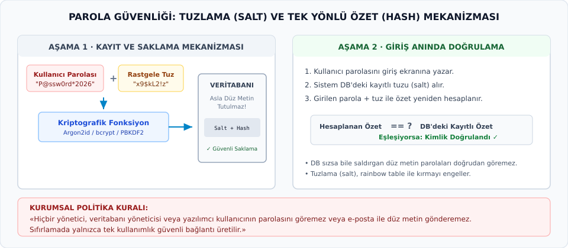

## Güçlü bir parola güvenliğin garantisi midir?

- **Varsayım:** Kurumdaki tüm çalışanlar 16 karakterli, büyük/küçük harf, rakam ve özel simgeler içeren karmaşık parolalar kullanmaktadır.
- **Teknik görünüm:** Sistem dışarıdan bakıldığında kırılamaz bir kimlik doğrulama duvarına sahip görünmektedir.

Ancak sahada şu durumlar yaşanmaktadır:

- Çalışanlar bu karmaşık parolayı akıllarında tutamadıkları için monitörün kenarına veya klavye altına yapıştırmıştır.
- Birim yöneticisi acil bir rapor hazırlamak için izinli memurun parolasını telefonla istemiş ve memur da parolasını amirine vermiştir.
- İlk işe girişte verilen geçici parola üç yıldır hiç değiştirilmemiştir.

Yönetimsel güvenlik sorusu:

**"Parola güvenliği yazılımın uyguladığı teknik bir form kuralı mıdır, yoksa kurumun davranış, sorumluluk ve yönetim kararı mıdır?"**

::: {.notes}
Parola çoğu zaman sisteme girmek için aşılması gereken teknik bir engel veya bir yazılım formu kuralı olarak görülür. Oturum açma ekranındaki kutucuğun sekiz ya da on altı karakter istemesi, büyük/küçük harf, rakam ve özel simge şartı koyması yazılımın teknik konfigürasyonudur. Dışarıdan bakıldığında bu teknik kuralların eksiksiz tanımlanmış olması, kimlik doğrulama duvarının kırılamaz olduğu izlenimini yaratır; ancak tek başına teknik karmaşıklık bilginin güvende olduğu anlamına gelmez.

Sahadaki insan davranışı ve iş yapış biçimi bu teknik duvarı saniyeler içinde işlevsiz bırakabilir. Çalışan karmaşık parolasını unutmamak için monitörün kenarına veya klavye altına yapıştırıyorsa, birim yöneticisi acil rapor gerekçesiyle izinli memurun parolasını telefonla isteyip kullanıyorsa, yazılımın ne kadar güçlü bir algoritma çalıştırdığının önemi kalmaz. Sistem ekrana yazılan karakter dizisinin doğruluğunu teyit eder ve kapıyı açar; fakat klavyenin başında gerçekte kimin oturduğunu kurum artık bilemez.

İlk işe girişte verilen geçici parolanın üç yıl boyunca hiç değiştirilmeden kullanılması da aynı yönetim boşluğunun sonucudur; parolanın ilk üretildiği andan itibaren kimlerin elinden geçtiği belirsizleşir. Dolayısıyla parola güvenliği yalnızca yazılımın zorladığı bir form kontrolü değil; kurumun davranış kurallarını, sorumluluk sınırlarını ve yönetim kararlarını kapsayan yönetsel bir kontroldür. Bir sonraki slaytta parola politikasının teknik mekanizmadan nasıl ayrıldığını dört temel boyut üzerinden karşılaştıracağız.
:::

---

## Parola politikasını teknik kilit değil yönetsel kontrol olarak kurmak

| Boyut | Yönetsel karar (Politika) | Teknik uygulama (Mekanizma) |
|---|---|---|
| **Kuralı koyan** | Üst yönetim ve bilgi güvenliği komitesi | BT sistem yöneticisi ve yazılım ekibi |
| **Temel soru** | "Hangi kural neden gerekli ve sorumlusu kim?" | "Bu kural sistemde nasıl zorunlu kılınır?" |
| **Kapsam** | Çalışan davranışı, gizlilik sözleşmesi, yaptırım | Oturum açma ekranı, karmaşıklık filtresi |
| **Yaptırım** | Disiplin süreci, yetki iptali, idari soruşturma | Girişi engelleme, kilit ve hata mesajı |

::: {.notes}
**Parola politikası (password policy)**, bir kurumda bilgi varlıklarına erişimde kullanılan parolaların oluşturulması, korunması, değiştirilmesi, saklanması ve kullanım kurallarını belirleyen onaylı politika belgesidir. **Yönetsel kontrol niteliği** ise parola kurallarını teknik sistemler uygulasa dahi kuralın kapsamını, sorumluluklarını, kabul edilebilir risk düzeyini ve yaptırımları yönetimin belirlemesi ilkesini ifade eder. Bilgi güvenliği yönetim sisteminin (BGYS) omurgası, bu yönetsel karar ile teknik mekanizma arasındaki ayrıma dayanır.

Tablodaki dört boyutu yan yana okuduğumuzda iki katmanın birbirini nasıl tamamladığını görürüz. Üst yönetim ve bilgi güvenliği komitesi "hangi kural neden gerekli ve sorumlusu kim" sorusuna yanıt vererek çalışan davranışını, gizlilik sözleşmesini ve idari yaptırımları tanımlar. BT sistem yöneticisi ve yazılım ekibi ise bu yönetsel kararı alıp "sistemde nasıl zorunlu kılınır" sorusunu çözer; oturum açma ekranındaki karmaşıklık filtresini, hata mesajlarını ve hesap kilitleme mekanizmasını kurar.

Teknik mekanizmanın doğal bir sınırı vardır: sistem yöneticisi ayarlar üzerinden parola uzunluğunu 12 karakter yapabilir ve hatalı girişleri teknik olarak engelleyebilir; ancak personelin bu parolayı çalışma arkadaşına vermesini veya masasına yazmasını ekran filtresiyle durduramaz. Teknik aracın bittiği bu noktada yönetsel kontrol devreye girer ve çalışan ile kurum arasındaki hukuki ve idari sözleşmeyi işletir; ihlal durumunda disiplin süreci, yetki iptali veya idari soruşturma uygulanmasını sağlar.

Parola politikasını yalnızca bir Active Directory veya yazılım ayarı sanmak yaygın bir yanılgıdır; üst yönetim onayı olmayan bir teknik kısıtlama kurumsal bağlayıcılık taşımaz, teknik karşılığı kurulmamış bir politika metni ise kağıt üzerinde kalır. Bir sonraki slaytta, Kuzey Üniversitesi Öğrenci Bilgi Sistemi (ÖBS) üzerinden bu iki katmanın somut bir kurum politikasında nasıl bir araya geldiğini inceleyeceğiz.
:::

---

## Kuzey Üniversitesi ÖBS: Yönetsel karar ile teknik uygulama örneği

Kuzey Üniversitesi'nde rektörlük ve senato tarafından onaylanan **"Bilgi Güvenliği Parola ve Kimlik Doğrulama Politikası"** yürürlüktedir:

- **Yönetsel Karar (Politika):**
  - "Öğrenci Bilgi Sistemi (ÖBS) ve idari arşiv sistemine erişen tüm personel, en az 12 karakterden oluşan, sözlük sözcükleri içermeyen güçlü parolalar kullanmakla yükümlüdür."
  - "Parolalar hiçbir çalışanla, birim yöneticisiyle veya teknik destek personeliyle paylaşılamaz."
  - "Parolasını paylaşan veya güvensiz ortamda saklayan personel hakkında disiplin soruşturması açılır."

. . .

- **Teknik Uygulama (Mekanizma):**
  - BT Sistem Yöneticisi, bu yönetsel kararı ÖBS kimlik doğrulama modülünde konfigüre eder.
  - Sistem 12 karakterden kısa girdileri reddeder, tek yönlü özet (hash) olarak saklar ve 3 hatalı denemede oturumu geçici kilitler.

::: {.notes}
Kuzey Üniversitesi örneğinde iki farklı rol ve iki farklı sorumluluk katmanı birlikte çalışır. Politika metni rektörlük ve senato onayıyla kurumsal otorite kazanırken, BT sistem yöneticisi kendi inisiyatifiyle kural uydurmak yerine yönetimin onayladığı politikanın teknik gereksinimlerini ÖBS yazılımında hayata geçirir. Böylece teknik ayarların arkasında doğrudan üst yönetimin iradesi yer alır.

Politika maddelerinin her biri sistemde veya idari süreçte somut bir karşılığa dönüşür. En az 12 karakter ve sözlük sözcüğü yasağı ÖBS kimlik doğrulama modülünde otomatik girdi kontrolüyle zorunlu kılınır; parolaların güvenli tutulması gereksinimi veri tabanında tek yönlü özet (hash) saklama ve ardışık 3 başarısız parola denemesinde oturumun geçici olarak kilitlenmesiyle desteklenir. Paylaşım ve güvensiz ortamda saklama yasağı ise teknik ekranın ötesinde doğrudan disiplin soruşturması hükmüne bağlanır.

Eğer senato bu politikayı onaylamamış olsaydı, sistem yöneticisinin koyduğu 12 karakter ve kilitleme kuralı keyfi bir BT dayatması gibi algılanır ve bir parola paylaşımı vakasında kurum hukuki ya da idari disiplin süreci işletemezdi. Yönetsel politika teknik uygulamaya meşruiyet ve bağlayıcılık kazandırır. Bir sonraki slaytta, bu kuralların yalnızca parolanın ilk seçildiği anı değil, tüm yaşam döngüsünü nasıl kapsadığını ele alacağız.
:::

---

## Parolanın yaşam döngüsü: Tek bir an değil, bir süreç

**Parola yaşam döngüsü (password lifecycle)**, geçici parolanın kullanıcıya güvenli ilk tesliminden, periyodik veya olay bazlı değiştirilmesine, unutulduğunda doğrulanmış kanaldan sıfırlanmasına ve hesabın kapatılmasında imha edilmesine kadar geçen süreçtir.

```
[1. Oluşturma] ---> [2. Güvenli İletim] ---> [3. Güvenli Saklama (Hash)]
       ^                                                    |
       |                                                    v
[6. İptal / Sıfırlama] <--- [5. Değiştirme] <--- [4. Günlük Kullanım & Koruma]
```

- Parola yalnızca klavyeden yazıldığı anda var olan bir metin değildir.
- Yaşam döngüsünün herhangi bir adımında güvenlik boşluğu oluşursa, diğer adımlardaki tüm teknik önlemler boşa çıkar.

::: {.notes}
Parolayı yalnızca giriş ekranına yazılan bir veri olarak düşünmek, güvenlik zincirinin büyük bölümünü gözden kaçırmaya yol açar. Gerçekte her parolanın kurumsal sistemde bir doğumu, yaşamı ve sonlandırılması vardır. Kullanıcı kuruma başladığında parolanın nasıl üretildiği, kullanıcıya nasıl teslim edildiği, veri tabanında nasıl saklandığı, günlük kullanımda nasıl korunduğu, unutulduğunda nasıl sıfırlanıp değiştirildiği ve personel ayrıldığında nasıl imha edildiği baştan sona tanımlı bir süreçtir.

Şemayı sol üstteki birinci adımdan başlayarak saat yönünde okuduğumuzda altı halkalı bir döngü görürüz. İlk adımda kurallara uygun parola oluşturulur, ikinci adımda güvenli kanaldan sahibine iletilir ve üçüncü adımda veri tabanında tek yönlü özet (hash) olarak kaydedilir. Sağ alttaki dördüncü adım kullanıcının günlük kullanım ve koruma sorumluluğunu, beşinci adım periyodik veya olay bazlı değiştirmeyi, altıncı adım ise unutma durumunda sıfırlamayı ya da işten ayrılışta hesabın kapatılıp parolanın iptal edilmesini gösterir; sıfırlama işlemi döngüyü birinci adıma geri bağlar.

Bu döngünün gücü en zayıf halkası kadardır; herhangi bir adımda bırakılan boşluk diğer adımlardaki tüm teknik önlemleri boşa çıkarır. Örneğin sistemde 20 karakterli karmaşık parolalar zorunlu tutulsa ve üçüncü adımda en güçlü özetleme algoritmaları kullanılsa bile, yeni başlayan kullanıcıya geçici parolasını WhatsApp üzerinden veya açık e-postayla gönderirseniz ikinci adım olan güvenli iletim kırılmış olur.

Aynı şekilde, birinci ve üçüncü adımlar kusursuz işlese bile dördüncü adımda kullanıcı parolasını çalışma arkadaşıyla paylaşırsa veya altıncı adımda ayrılan personelin hesabı zamanında kapatılmazsa tüm yaşam döngüsü çöker. İzleyen slaytlarda bu altı aşamayı sırasıyla açarak ilk halka olan oluşturma, karmaşıklık ve güvenli iletim ilkelerinden başlayacağız.
:::

---

## Yaşam döngüsü 1: Oluşturma, karmaşıklık ve güvenli iletim

Kurumsal parola politikasının ilk aşamasındaki üç temel ilke:

. . .

1. **Uzunluk ve Karakter Çeşitliliği:** En az 12 karakter; büyük/küçük harf, rakam ve simge kombinasyonu (tahmin edilebilir sözcük ve kurum adı yasağı).
2. **Güvenli İlk İletim:** Açık e-posta veya sözlü iletim yasağı; kapalı zarfta imza karşılığı veya doğrulanmış SMS/güvenli bağlantı ile teslim.
3. **İlk Girişte Zorunlu Değişim:** Sisteme geçici parola ile girildiği an menülere erişim vermeden derhal yeni parola oluşturmaya zorlama.

::: {.notes}
Yaşam döngüsünün ilk aşaması, kaba kuvvet (brute-force) ve sözlük saldırılarına karşı dirençli bir parolanın oluşturulmasıyla başlar. Asgari uzunluk kurumun risk değerlendirmesine göre belirlenir; Kuzey Üniversitesi politikasında bu sınır en az 12 karakterdir. Uzunluğun yanında büyük/küçük harf, rakam ve özel simge çeşitliliği sağlanmalı; kullanıcı adı, kurum adı, doğum yılı (`Kuzey2026!` gibi kolay tahmin edilebilir kalıplar) veya yaygın sözlük kelimeleri sistem filtresiyle reddedilmelidir.

Üretilen ilk geçici parolanın kullanıcıya ulaştırılması, parolanın karmaşıklığı kadar kritik bir kontrol noktasıdır. Geçici parola hiçbir koşulda açık e-posta ile gönderilmemeli veya telefonda sözlü olarak söylenmemelidir; bunun yerine kapalı zarf içinde imza karşılığı teslim edilmeli ya da doğrulanmış kurumsal SMS/güvenli bağlantı kanalıyla iletilmelidir.

Kullanıcı geçici parolasıyla sisteme ilk kez giriş yaptığında ise sistem hiçbir menüye veya işlem ekranına erişim vermeden kullanıcıyı derhal yeni bir parola belirlemeye zorlamalıdır. İlk girişte zorunlu değişim kuralı, geçici parolayı üreten veya iletim sürecinde bulunan kişilerin parolayı bilme olasılığını ortadan kaldıran temel güvenlik kilididir. Bir sonraki slaytta, kullanıcının belirlediği bu yeni parolanın veri tabanında nasıl korunduğunu ve tek yönlü özet (hash) mekanizmasını inceleyeceğiz.
:::

---

## Yaşam döngüsü 2: Saklama güvenliği ve tek yönlü özet (hash)

**Tek yönlü özetleme (cryptographic hashing)**, bir parolanın matematiksel bir algoritma ile geri döndürülemez sabit uzunlukta benzersiz bir özet değere dönüştürülerek saklanmasıdır.

- **Açık metin (cleartext) saklama yasağı:** Parolalar veri tabanında, log dosyalarında veya yedeklerde ASLA okunabilir metin olarak tutulamaz.
- **Geri döndürülemezlik ilkesi:** Veri tabanındaki özet değerden orijinal parolaya matematiksel olarak ulaşılamaz.
- **Tuz (salt):** Her kullanıcı için rastgele üretilip özet hesaplamasına parolayla birlikte katılan değerdir. Aynı parolayı kullanan iki kişinin özeti farklı çıkar; hazır özet tablolarıyla toplu kırma engellenir.

```
Kullanıcı Girişi:  "KzY#92!mP_x" + tuz "a7f3c1..." ---> [Özet Fonksiyonu] ---> "5c9fb9fbd6562c94..."
Veri Tabanı Kaydı:                tuz "a7f3c1..."                              özet "5c9fb9fbd6562c94..."
Sonuç:             Eşleşme BAŞARILI (Sistem parolayı bilmez; kayıtlı tuzla özeti yeniden hesaplayıp karşılaştırır)
```

::: {.callout-important}
Sistem yöneticisi, veri tabanı uzmanı veya rektör dahi hiçbir kullanıcının parolasını göremez, e-posta ile "eski parolanız şuydu" diye hatırlatamaz.
:::

::: {.notes}
Bazı eski web sitelerinde "Parolamı unuttum" düğmesine basıldığında mevcut parolanın e-postaya açık metin olarak gelmesi, o kurumun parolaları açık metin (cleartext) sakladığının ve ağır bir güvenlik zafiyeti barındırdığının kanıtıdır. Kurumsal bilgi güvenliğinde parolalar veri tabanında, sistem kayıtlarında (log) veya yedeklerde asla okunabilir metin olarak tutulamaz; matematiksel bir fonksiyonla geri döndürülemez sabit uzunlukta bir özet değere (hash) dönüştürülerek kaydedilir.

Bu yapıda sistemin kendisi dahi kullanıcının parolasını bilmez. Kullanıcı giriş ekranına parolasını yazdığında sistem, o kullanıcıya ait kayıtlı tuz (salt) değerini alır, girilen parolayla birleştirerek özeti yeniden hesaplar ve veri tabanındaki özetle aynı olup olmadığına bakar. İki özet eşleşiyorsa oturum açılır; böylece veri tabanı çalınsa dahi saldırganın eline doğrudan açık parolalar geçmez.

Tuz kullanımı bu korumayı tamamlayan kritik bileşendir. Tuz olmasaydı `"Parola123"` gibi aynı parolayı seçen herkesin özeti birebir aynı çıkardı; saldırgan en yaygın parolaların özetlerini önceden hesaplayıp (rainbow table) çalınan veri tabanıyla karşılaştırarak çok sayıda hesabı birden çözebilirdi. Her kullanıcıya ayrı rastgele tuz eklendiğinde bu hazır tablolar işlevsiz kalır. Tuz gizli bir anahtar değildir; veri tabanında özetin yanında durur ve görevi özetleri kullanıcıya özgü kılmaktır. Sistem yöneticisi veya üst yönetim parolanızı göremez; bu yüzden unutulan bir parola geri verilemez, ancak sıfırlanabilir. Bir sonraki slaytta bu tuzlama ve doğrulama sürecini görsel şema üzerinde adım adım okuyacağız.
:::

---

## Parola tuzlama ve tek yönlü özet şeması

{width="100%" fig-align="center" fig-alt="Parola saklama güvenliği: Tuzlama (salt) ve tek yönlü özetleme (hash) mekanizması"}

::: {.notes}
Şema iki aşamayı yan yana gösterir: sol tarafta parolanın kaydedilmesi, sağ tarafta girişte doğrulanması. Kayıtta kullanıcının parolası, sistemin ürettiği rastgele bir tuzla birleştirilir. Şemadaki örnekte parola ve "x9$kL2!z" biçiminde bir tuz vardır. Birleşim, Argon2id, bcrypt ya da PBKDF2 gibi bir kriptografik fonksiyondan geçer ve ortaya çıkan özet veri tabanına tuzla birlikte, "salt + hash" olarak yazılır. Veri tabanında hiçbir aşamada düz metin parola tutulmaz.

Girişte aynı yol tersinden değil, ileri doğru yinelenir. Kullanıcı parolasını yazar; sistem veri tabanındaki kayıtlı tuzu alır; girilen parola ile tuzdan özeti yeniden hesaplar ve veri tabanındaki özetle karşılaştırır. Eşleşiyorsa kimlik doğrulanmıştır. Sistem hiçbir noktada parolanın kendisini bilmez; yalnızca iki özetin aynı olup olmadığına bakar. Bu yüzden bir yönetici, veri tabanı uzmanı ya da yazılımcı kullanıcının parolasını göremez ve "eski parolanız şuydu" diye hatırlatamaz.

Şemanın alt köşesindeki iki madde bu mekanizmanın kazancını söyler. Birincisi, veri tabanı sızsa bile saldırgan düz metin parolaları doğrudan göremez. İkincisi, tuz rainbow table ile toplu kırmayı engeller: aynı parolayı kullanan iki kişinin özeti farklı çıkar, çünkü tuzları farklıdır. Tuz gizli bir anahtar değildir; veri tabanında özetin yanında durur ve görevi özetleri kullanıcıya özgü kılmaktır.

Fonksiyon seçimi de tasarımın parçasıdır. Argon2id, bcrypt ve PBKDF2 parola saklama için tasarlanmış, bilerek yavaş çalışan fonksiyonlardır. SHA-256 gibi genel amaçlı özet fonksiyonları çok hızlıdır; çalınan bir veri tabanında saldırgan saniyede milyarlarca tahmin deneyebilir. Kullanıcı için ihmal edilebilir bir gecikme, milyarlarca deneme yapan saldırgan için ciddi bir engeldir.

Şemanın altındaki kurumsal kuralı da okuyun: hiçbir yönetici, veri tabanı yöneticisi ya da yazılımcı kullanıcının parolasını göremez ya da e-postayla düz metin gönderemez; sıfırlamada yalnızca tek kullanımlık güvenli bağlantı üretilir. Özetleme ile şifrelemeyi karıştırmayın: özetin geri çözülmesi yoktur. "Şifremi unuttum" deyince parolası e-postayla düz metin gelen bir sistem, parolaları düz metin saklıyor demektir.
:::

---

## Yaşam döngüsü 3: Kullanım, değiştirme ve geçmiş kontrolü

Parolanın geçerliliği ve değişim dinamikleri:

- **Geçerlilik süresi (ömrü):**
  - Kritik yetkili hesaplarda (ör. BT sistem yöneticisi, veri tabanı yöneticisi) düzenli periyotlarla (ör. 90 gün) parola yenileme zorunluluğu.
  - Normal kullanıcı hesaplarında ise sık değişim baskısı yerine güçlü parola seçimi ve şüphe durumunda anında değişim esastır.
- **Parola geçmişi kontrolü (history):**
  - Kullanıcının eski parolalarını hemen tekrar kullanmasını önlemek için sistemin son $N$ adet (örneğin son 5 veya 10) parolayı hafızasında tutması ve reddetmesi kuralıdır.
- **Olay bazlı zorunlu değişim:**
  - Bir hesapta olağandışı erişim veya oltalama (phishing) şüphesi görüldüğü anda sistemin veya yöneticinin parolanın geçerliliğini tek taraflı derhal sonlandırmasıdır.

::: {.notes}
Eski güvenlik yaklaşımlarında tüm kullanıcılara "30 günde bir parolanızı değiştirin" kuralı dayatılırdı. Ancak insan davranışı araştırmaları ve güncel standart yaklaşımları (NIST kılavuzları gibi), aşırı sık değişim baskısının ters teptiğini göstermiştir: kullanıcılar her ay yeni bir parola bulmak zorunda kaldığında yalnızca mevcut parolanın son rakamını bir artırarak (`Parola1!`, `Parola2!`) tahmin edilmesi kolay örüntüler üretmektedir.

Bu nedenle güncel parola politikası hesapların kritiklik düzeyine göre iki yönlü bir denge kurar. BT sistem yöneticisi ve veri tabanı yöneticisi gibi yüksek yetkili idari hesaplarda düzenli periyotlarla (örneğin 90 gün) parola yenileme zorunluluğu sürdürülürken, normal kullanıcı hesaplarında sürekli değişim dayatması yerine başlangıçta güçlü parola seçimi esas alınır. Değişim sırasında kullanıcının eski parolalarına hemen geri dönmesini engellemek için de parola geçmişi kontrolü (history) işletilir ve sistem son $N$ adet (örneğin son 5 veya 10) parolanın tekrar kullanımını reddeder.

Takvime bağlı rutin değişimin yerini, risk odaklı ve olay bazlı zorunlu değişim alır. Bir hesapta olağandışı erişim hareketi, sızıntı veya oltalama (phishing) şüphesi tespit edildiği anda sistem ya da yönetici mevcut parolanın geçerliliğini tek taraflı olarak derhal sonlandırır. Bir sonraki slaytta yaşam döngüsünün günlük kullanımdaki en kritik davranış kuralına, yani parola paylaşım yasağına ve hesap verebilirlik ilkesine geçeceğiz.
:::

---

## Yaşam döngüsü 4: Paylaşım yasağı ve hesap verebilirlik

Kurumsal parola politikasının en temel davranış kuralı:

$$\textbf{Parola şahsidir; devredilemez, paylaşılamaz ve yazılı olarak bırakılamaz.}$$

Neden paylaşılamaz?

1. **Kimlik doğrulama kişiye özgüdür:** Parola, sistem ile o çalışan arasındaki güven bağıdır.
2. **Hesap verebilirlik (accountability) çöker:**
   - ÖBS'de bir öğrencinin notu değiştirildiğinde sistem logunda `ahmet.demir` yazar.
   - Eğer Ahmet Bey parolasını çalışma arkadaşı Mehmet Bey'e vermişse, notu kimin değiştirdiği kanıtlanamaz.
   - Hukuki ve idari soruşturmada fail belirsizleşir; iki çalışan da suçu birbirine atabilir.
3. **Yetki sınırları anlamsızlaşır:** Bir amir memurunun parolasını aldığında, memurun yetki alanındaki tüm işlemleri kendi adına değil memur adına yapmış olur.

::: {.notes}
Hafta 11'de incelediğimiz hesap verebilirlik (accountability) ilkesi, sistemdeki her işlemin tek bir gerçek kişiye bağlanabilmesini gerektirir. Bir sistemde kimlik saptama, doğrulama ve yetkilendirme mekanizmaları teknik olarak ne kadar kusursuz çalışırsa çalışsın; kullanıcı parolasını bir başkasına verdiği anda sistemde tutulan tüm işlem kayıtları kanıt değerini yitirir.

ÖBS'de bir öğrencinin notu değiştirildiğinde denetim kaydına (log) oturumu açan `ahmet.demir` kullanıcı adı yazılır. Eğer Ahmet Bey parolasını çalışma arkadaşı Mehmet Bey ile paylaşmışsa, mahkemede veya kurum içi disiplin soruşturmasında "işlemi ben yapmadım, parolamı arkadaşım da biliyordu, o yapmış olabilir" savunması ortaya çıkar. Failin kesin olarak kanıtlanamaması, iki çalışanın da suçu birbirine atmasına ve denetim zincirinin çökmesine yol açar.

Aynı durum dikey hiyerarşide de geçerlidir: bir birim amiri memurunun parolasını alıp sisteme girdiğinde, kendi yetki sınırlarının dışına çıkarak memur adına işlem yapmış ve iz bırakmış olur. Bu sakıncaların önüne geçmenin tek yolu, kurum politikasında parolanın şahsiliğini kesin bir dille hükme bağlamak ve parola paylaşımını doğrudan kusur saymaktır; "işler yetişsin", "amir rica etti" veya "arkadaşım izinliydi" gibi gerekçeler yönetsel kontrol karşısında geçersizdir. Bir sonraki slaytta sahada bu kuralı bozan iki tipik karşı örneği inceleyeceğiz.
:::

---

## Karşı örnek: Masadaki not kağıdı ve "acil iş" yanılgısı

Teknik olarak güçlü bir parola seçilmiş olması güvenliği sağlamaya yetmez:

**Senaryo A: Monitöre yapıştırılan sarı not kağıdı**
- Kullanıcı 16 karakterli, kırılması imkansız bir parola belirlemiştir.
- Parolayı unutmamak için ofisteki monitörün köşesine yapıştırmıştır.
- *Sonuç:* Ofise temizlik görevlisi, kargo personeli veya başka bir birimden gelen herkes parolanın sahibidir. Teknik kripto güçlüdür; fiziksel ve yönetsel kontrol sıfırdır.

. . .

**Senaryo B: "İşler aksamasın" diyerek parola paylaşmak**
- Birim amiri: "Selin Hanım yıllık izinde ama acil onay bekleyen evraklar var, parolasını bana mesaj atsın."
- Selin Hanım parolasını amirine iletir; amir giriş yaparak evrakları onaylar.
- *Sonuç:* Amir yetkisini kötüye kullanmasa dahi, o oturumda yapılabilecek herhangi bir silme veya usulsüzlük doğrudan Selin Hanım'ın sorumluluğu altında kaydedilir.

::: {.notes}
İş hayatında sıkça karşılaşılan bu iki karşı örnek, teknik önlemlerin yönetsel davranış kurallarıyla desteklenmediğinde nasıl boşa çıktığını gösterir. İlk senaryoda kullanıcı 16 karakterli, kriptografik olarak kırılması imkânsız bir parola seçerek teknik kurala uymuştur; ancak parolayı monitörün köşesindeki sarı not kağıdına yazarak yönetsel sorumluluğu çiğnemiştir. Fiziksel ortam güvenliği ve gizlilik disiplini sağlanmadıkça parolanın uzunluğu hiçbir koruma sağlamaz; ofise giren herkes o parolanın sahibi haline gelir.

İkinci senaryo ise kurumlarda "işlerin yürümesi" bahanesiyle meşrulaştırılmaya çalışılan en tehlikeli ihlaldir. Yıllık izindeki Selin Hanım acil evrak onayı için parolasını amirine mesajla gönderdiğinde, amir yetkisini kötüye kullanmasa bile o oturumda gerçekleşecek her türlü silme, hata veya usulsüzlük doğrudan Selin Hanım'ın kullanıcı adıyla kayda geçer.

Bir yönetici çalışanından hiçbir koşulda parola talep edemez. Eğer bir personelin izin veya rapor gibi nedenlerle yokluğunda işlerin aksamaması gerekiyorsa, bunun kurumsal çözümü parola istemek değil, yetki devri ve vekalet prosedürünü işletmektir; amir veya vekil memur sisteme kendi kullanıcı adıyla ve tanımlı vekalet rolüyle girmelidir. Bir sonraki slaytta, bu tür ihlaller gerçekleştiğinde kurumun işlettiği yönetsel yaptırım mekanizmasını ele alacağız.
:::

---

## Parola politikası ihlali ve yönetsel yaptırım mekanizması

**Parola politikası ihlali**, kurumsal parola politikasında yasaklanmış davranışların gerçekleştirilmesidir (parolayı devretme, ortak kullanma, güvensiz ortama kaydetme, varsayılan parolayı değiştirmeme).

**Yönetsel yaptırım süreci**, teknik kısıtlamaların engelleyemediği ihlallerde; disiplin soruşturması, yetki kısıtlaması, erişim askıya alma veya zorunlu güvenlik eğitimi gibi idari mekanizmaların işletilmesidir.

- **Teknik tedbirin sınırı:** Sistem monitördeki yapışkan kağıdı göremez, telefonla fısıldanan parolayı duyamaz.
- **Yönetsel tedbirin gücü:** Politika metni, çalışanın iş sözleşmesinin ve kurum disiplin yönetmeliğinin ayrılmaz bir parçasıdır.
- İhlal tespit edildiğinde işletilen yönetsel adımlar:
  1. *Olayın tespiti ve tutanak altına alınması,*
  2. *İlgili hesabın derhal kilitlenmesi ve parolasının resen sıfırlanması,*
  3. *İdari disiplin kuruluna sevk ve sorumluluk tespiti.*

::: {.notes}
Bilgi güvenliği yalnızca yazılımcıların veya sistem mühendislerinin yürüttüğü teknik bir iş değildir; insan kaynakları, hukuk ve üst yönetim süreçleriyle doğrudan iç içedir. Teknik sistem yalnızca ekrana girilen parolanın özetini doğrular; monitördeki yapışkan kağıdı göremez, telefonla fısıldanan parolayı duyamaz ve kuralı ihlal eden çalışana idari bir yaptırım uygulayamaz.

Teknik kısıtlamaların durduramadığı davranışlarda kurumun idari mekanizması devreye girer. Onaylı parola politikası, çalışanın iş sözleşmesinin ve kurum disiplin yönetmeliğinin ayrılmaz bir parçasıdır. Parolayı devretme, ortak hesap kullanma, güvensiz ortama kaydetme veya geçici parolayı değiştirmeme gibi bir ihlal saptandığında önce olay tutanak altına alınır, ardından riskin sürmesini engellemek için hesap derhal kilitlenip parolası resen sıfırlanır ve dosya sorumluluk tespiti için disiplin kuruluna sevk edilir.

Bir kurumda parola politikasının arkasında açık bir yönetim kararı ve yaptırım gücü yoksa, o politika duvarda asılı bir temenniden öteye geçemez. Güvenlik kültürü, ancak teknik kuralların yönetsel yaptırımlarla ve zorunlu farkındalık eğitimleriyle desteklendiği kurumlarda yerleşir. Bir sonraki slaytta, politikanın onaylanmasından uygulanmasına kadar uzanan kurumsal sorumluluk zincirini inceleyeceğiz.
:::

---

## Parola politikasında sorumluluk zinciri

Parola güvenliği tek bir aktörün omuzlarında değildir; tanımlı bir sorumluluk zinciriyle yönetilir:

```
[Üst Yönetim] --------> Politikayı onaylar, kurumsal otorite ve bütçe sağlar
      |
      v
[Varlık Sahibi] ------> Sürecin kritiklik derecesini ve kimlik güvence düzeyini belirler
      |
      v
[BT / Sistem Yön.] ---> Teknik kontrolleri konfigüre eder, güvenli sıfırlamayı işletir
      |
      v
[Kullanıcı] ----------> Parolasını korur, gizli tutar, asla paylaşmaz ve devretmez
```

- **Görev Ayrılığı İlkesi:** BT sistem yöneticisi teknik kuralları koyar ama personelin parolasını öğrenemez veya keyfi değiştiremez.
- Kullanıcı parolasını korur ama kuralları kendi kafasına göre gevşetemez.

::: {.notes}
Erişim yönetimindeki görev ayrılığı ilkesi parola politikasının yürütülmesinde de temel belirleyicidir. Parola güvenliği tek bir birimin veya çalışanın üzerine bırakılamaz; kurum içinde yukarıdan aşağıya tanımlı bir sorumluluk zinciriyle yönetilir ve her halka farklı bir yetki katmanını temsil eder.

Şemayı yukarıdan aşağıya okuduğumuzda ilk sırada üst yönetim yer alır; üst yönetim politikayı onaylayarak kurumsal otorite ve bütçe sağlar. İkinci sıradaki varlık sahibi (örneğin Kuzey Üniversitesi ÖBS'de Öğrenci İşleri Müdürü), kendi sorumluluğundaki verilerin ve sürecin kritiklik derecesini, dolayısıyla gereken kimlik güvence düzeyini belirler. Üçüncü sıradaki BT ve sistem yönetimi bu kuralları yazılımda konfigüre eder ve güvenli sıfırlama altyapısını işletir; son halkadaki kullanıcı ise parolasını korumak, gizli tutmak ve asla paylaşmamakla yükümlüdür.

Bu zincirde hiçbir aktör mutlak ve sınırsız yetkiye sahip değildir. BT sistem yöneticisi "sistemi ben yönetiyorum, herkesin parolasını bilmeliyim veya istediğim hesaba parola atamalıyım" diyemez; bilgi güvenliği standartları yöneticilerin dahi kullanıcı parolalarını göremeyeceği teknik ve yönetsel mimariyi şart koşar. Aynı şekilde kullanıcı da parolanın sahibi olduğu gerekçesiyle güvenlik kurallarını kendi isteğine göre gevşetemez.

Sorumluluk zincirindeki bu görev ayrılığının sahada en somut test edildiği süreç parola sıfırlama adımıdır. Bir sonraki slaytta, Kuzey Üniversitesi ÖBS'de yaşanan acil bir parola unutma vakası üzerinden hatalı uygulama ile güvenli kurumsal sıfırlama prosedürünü adım adım karşılaştıracağız.
:::

---

## Çözümlü örnek: Kuzey Üniversitesi ÖBS parola sıfırlama süreci

**Vaka:** Öğretim Elemanı Selin Hanım ÖBS parolasını unutmuştur. Not giriş döneminin son günüdür ve sisteme acil girmesi gerekmektedir. Selin Hanım BT Destek Masasını telefonla arar.

. . .

**Hatalı ve Güvensiz Uygulama:**
- BT destek çalışanının telefondaki sese güvenerek: *"Hocam, eski parolanızı göremiyorum ama yeni parolanızı geçici olarak 'Kuzey123!' yaptım, hemen sisteme girin"* demesi.
- *Hata:* Kimlik doğrulanmamıştır; arayanın Selin Hanım olduğu kanıtlanmamıştır; parola destek personeli tarafından bilinmektedir.

. . .

**Kurumsal ve Güvenli Çözüm (4 Adımlı Prosedür):**
1. **Bağımsız Kimlik Doğrulama:** BT personeli telefondaki beyanla yetinmez; Selin Hanım'ın sistemde kayıtlı kurumsal telefonuna tek kullanımlık doğrulama kodu gönderir.
2. **Sıfırlama Bağlantısı Üretme:** BT personeli parola belirlemez; sistemden yalnızca süreli (15 dakika geçerli) ve tek kullanımlık bir parola sıfırlama linki tetikler.
3. **Güvenli Kanaldan İletim:** Link yalnızca Selin Hanım'ın resmi kurumsal e-posta adresine ve telefonuna iletilir.
4. **Bizzat Belirleme ve Hashleme:** Selin Hanım linke tıklar, yeni parolasını kendisi yazar. Sistem karmaşıklığı denetler, hashler ve kaydeder.

::: {.notes}
Bu çözümlü örnek, teorik parola yaşam döngüsünün zaman baskısı altında sahada nasıl işlediğini gösterir. Destek masası çalışanları genellikle kullanıcıya yardımcı olmak ve acil işi hızlandırmak refleksiyle hareket eder. Ancak telefonda beyana güvenerek parola sıfırlamak ve `'Kuzey123!'` gibi geçici bir parolayı sözlü olarak iletmek, sosyal mühendislik saldırganlarının en sık istismar ettiği zafiyettir; saldırgan kendisini Selin Hanım gibi tanıtarak bir öğretim elemanının hesabını dakikalar içinde ele geçirebilir.

Güvenli kurumsal çözümde süreç dört adımlı tanımlı bir prosedürle yürütülür ve iki kritik güvence sağlar. İlk olarak, arayan kişinin gerçekten hesap sahibi olduğu telefondaki sesle değil, sistemde kayıtlı kurumsal GSM numarasına gönderilen tek kullanımlık doğrulama koduyla bağımsız bir kanaldan teyit edilir. İkinci olarak, BT destek personeli kendisi bir parola yazmaz; sistem üzerinden yalnızca 15 dakika geçerli ve tek kullanımlık bir sıfırlama bağlantısı tetikler.

Tetiklenen bu bağlantı yalnızca Selin Hanım'ın resmi kurumsal e-posta adresine ve telefonuna gider; Selin Hanım bağlantıya tıklayarak yeni parolasını bizzat belirler ve sistem karmaşıklık kontrolünden sonra parolayı özetleyerek (hash) kaydeder. Böylece ne BT çalışanı yeni parolayı öğrenir ne de doğrulamasız bir kişiye erişim verilir. Bir sonraki slaytta bu dört adımın her birini temel güvenlik ilkeleriyle eşleştirerek tablo üzerinde analiz edeceğiz.
:::

---

## Çözümlü örnek analizi: Güvenlik ilkeleri tablosu

Kuzey Üniversitesi ÖBS parola sıfırlama sürecinin güvenlik ilkeleriyle çözümlenmesi:

| Adım | Güvenlik ilkesi | Karşılanan risk ve yönetsel güvence |
|---|---|---|
| **Kayıtlı GSM / Koda doğrulama** | İki kanallı kimlik teyidi | Sosyal mühendislik ve sahte arama ile hesap ele geçirme riski önlenir. |
| **BT personelinin parola bilmemesi** | En az ayrıcalık ve bilmesi gereken | BT personelinin kullanıcı adına işlem yapması veya şüphe altında kalması engellenir. |
| **Süreli ve tek kullanımlık bağlantı** | Zaman ve kullanım sınırı | Bağlantı ele geçirilse dahi 15 dakika sonra hükümsüz kalır. |
| **İlk girişte zorunlu yeni kayıt** | Parolanın şahsiliği | Parolanın tek sahibi kullanıcıdır; sıfırlama süreci log kayıtlarına kanıt olarak düşer. |

::: {.notes}
Tabloyu incelediğimizde sıfırlama prosedüründeki her teknik ve yönetsel adımın somut bir güvenlik ilkesine ve risk önlemine dayandığını görürüz. Kayıtlı GSM üzerinden yapılan iki kanallı kimlik teyidi sahte aramalarla hesap ele geçirilmesini engellerken, sıfırlama bağlantısının 15 dakika süreyle ve tek kullanımla sınırlandırılması bağlantının daha sonra ele geçirilmesi halinde kullanılmasını önler.

BT personelinin yeni parolayı bilmemesi ve parolanın doğrudan kullanıcı tarafından belirlenmesi ise yalnızca hesap sahibini değil, BT personelinin kendisini de korur. Sistemde ileride yetkisiz bir not değişikliği veya usulsüzlük tespit edildiğinde, BT çalışanı "geçici parolayı ben vermiştim, ben de biliyordum" şüphesi altında kalmaz; sıfırlama bağlantısının kullanıldığı ve parolanın yalnızca kullanıcı tarafından oluşturulduğu log kayıtlarıyla kanıtlanır. Bilgi güvenliği prosedürleri, personeli töhmet altında kalmaktan koruyan kurumsal kalkanlardır. Bir sonraki slaytta bu ilkelerin uluslararası standartlardaki karşılığını inceleyeceğiz.
:::

---

## ISO/IEC 27001 ve 27002'de kimlik doğrulama bilgileri

Uluslararası standartlar parola yönetimini yönetsel bir çerçevede ele alır:

. . .

- **ISO/IEC 27001:** Kimlik doğrulama bilgilerinin tanımlı, kontrollü ve izlenebilir bir süreçle yönetilmesini şart koşar.
- **ISO/IEC 27002:2022 (Kontrol 5.17):** Kurumun kendi risk değerlendirmesine göre kurallar belirlemesini ve belgelendirmesini tavsiye eder.
- **Önerilen Odaklar:** Karmaşık parola seçimi, paylaşım yasağı, kriptografik özet (hash) ve ilk girişte zorunlu değişim.

::: {.notes}
Uluslararası bilgi güvenliği standartları parola güvenliğini yalnızca teknik bir yazılım ayarı olarak değil, kurumsal yönetim sisteminin bir parçası olarak ele alır. ISO/IEC 27001 kimlik doğrulama bilgilerinin tanımlı, kontrollü ve izlenebilir bir süreçle yönetilmesini şart koşarken; ISO/IEC 27002 ezberlenecek katı bir kontrol listesi sunmak yerine yönetsel kontrollerin kurulmasında kurumlara yol gösteren bir iyi uygulama rehberi işlevi görür.

Standart yaklaşımı her kuruma kendi risk değerlendirmesine göre bir parola politikası belirlemesini, bunu belgelendirmesini, üst yönetime onaylatmasını ve bilgi sistemlerinde tutarlı biçimde uygulamasını tavsiye eder. Bu kapsamda ISO/IEC 27002:2022'nin 5.17 numaralı kontrolü (Kimlik doğrulama bilgileri) dört temel noktaya odaklanır: parolaların güvenli seçimi ve karmaşıklığı, parolaların gizli tutulması ve asla paylaşılmaması kuralı, saklama aşamasında kriptografik özet (hashing) kullanılması ile geçici parolaların güvenli dağıtımı ve ilk kullanımda zorunlu değişimi.

Ders boyunca incelediğimiz parola yaşam döngüsü, paylaşım yasağı, sorumluluk zinciri ve güvenli sıfırlama adımlarının tamamı Kontrol 5.17'nin bu çerçevesiyle doğrudan örtüşmektedir. Bir sonraki slaytta yer alan bağımsız görevde, bu ilkeleri Kuzey Üniversitesi'nde yaşanan bir olay senaryosu üzerinde uygulayacağız.
:::

---

## Bağımsız görev: "Rapor acil, parolayı ver" vakası

**Senaryo:** Kuzey Üniversitesi'nde Öğrenci İşleri Müdürü Zeynep Hanım, mesai bitimine yarım saat kala YÖK'e gönderilmesi gereken acil bir öğrenci istatistik raporu hazırlamaktadır. Kendi yetkili bilgisayarı arızalanır. Kurumda BT yönetimi tarafından tanımlanmış bir raporlama rolü veya geçici yetkilendirme prosedürü bulunmamaktadır; sisteme girişte çok faktörlü kimlik doğrulama (MFA) zorunlu değildir. Zeynep Hanım birimde yeni göreve başlayan memur Ahmet Bey'in yanına gider ve şöyle der:

> *"Ahmet Bey, YÖK raporu çok acil, benim bilgisayar açılmıyor. Senin ÖBS kullanıcı adını ve parolanı bir kağıda yaz bana ver, ben yan odadaki boş bilgisayardan girip raporu çekeyim. Sen de mesaiyi bitirip çıkabilirsin."*

Ahmet Bey amirine hayır diyemez; kullanıcı adını ve parolasını bir not kağıdına yazarak Zeynep Hanım'a verir.

. . .

**Sorular:**
1. Bu senaryoda çiğnenen kurumsal parola politikası ve bilgi güvenliği ilkeleri nelerdir?
2. Zeynep Hanım (amir), Ahmet Bey (memur) ve BT Yönetimi'nin yönetsel sorumluluklarını ve hatalarını ayrı ayrı açıklayınız.
3. Görev ayrılığı ve en az ayrıcalık ilkelerine uygun doğru yönetsel çözüm yolu ne olmalıdır?

::: {.notes}
Bu bağımsız görevde olayı yalnızca tek bir çalışanın bireysel hatası olarak görmek yerine, bir bilgi güvenliği yöneticisi bakış açısıyla tüm aktörleri ve kurumsal süreç eksikliklerini birlikte analiz etmeniz beklenmektedir. Senaryodaki zaman baskısını, hiyerarşik ilişkiyi ve sistemdeki prosedür boşluklarını dikkatle okuyarak üç soruyu sırasıyla yanıtlayın.

Çalışmanızda amir baskısı karşısında çalışanın düştüğü ikilemi, birim yöneticisinin kurumsal politika karşısındaki konumunu ve BT yönetiminin sistemsel/yönetsel sorumluluklarını ayrı ayrı değerlendirin. Bir sonraki slayttaki üç aktörlü analiz şablonunu ve görünür başarı ölçütlerini kullanarak yanıtınızı yapılandırabilirsiniz.
:::

---

## Bağımsız görev değerlendirme şablonu ve ölçütler

**Üç Aktörlü Analiz Şablonu:**

| Aktör | Çiğnenen İlke / Hata | Yönetsel Sorumluluk ve Doğru Çözüm |
| :--- | :--- | :--- |
| **Amir (Zeynep Hanım)** | | |
| **Çalışan (Ahmet Bey)** | | |
| **BT Yönetimi** | | |

. . .

**Görünür Başarı Ölçütleri:**
- [ ] **Ölçüt 1 (İlke Tespiti):** Çiğnenen politika maddeleri (parola paylaşım yasağı, parolanın şahsiliği, hesap verebilirlik ilkesi) kavram adlarıyla açıkça belirtilmelidir.
- [ ] **Ölçüt 2 (Üçlü Sorumluluk Analizi):** Amir (Zeynep Hanım), çalışan (Ahmet Bey) ve BT Yönetimi'nin yönetsel sorumlulukları ve hataları ayrı başlıklar altında incelenmeli; hiyerarşik amir-çalışan ilişkisinin bilgi güvenliği kuralını geçersiz kılamayacağı gerekçelendirilmelidir.
- [ ] **Ölçüt 3 (Doğru Yönetsel Çözüm):** Parola paylaşımı yerine kurumsal ilkelere uygun yönetsel bir süreç ve çözüm yolu tanımlanmalıdır.

. . .

*Bir sonraki ders saati:* **Teori 12.2 — Kayıt (log) ve izleme (monitoring): Denetim izi anatomisi ve olağandışı erişim örüntüleri.**

::: {.notes}
Yanıtınızı hazırlarken bu üç aktörlü analiz şablonunu ve üç görünür başarı ölçütünü rehber olarak kullanın. Her aktör için hem çiğnenen ilkeyi hem de doğru yönetsel çözümü tablo hücrelerinde açık kavram adlarıyla gerekçelendirmeye özen gösterin; güvenliğin yalnızca bireysel çalışanların inisiyatifine bırakılamayacağını analizinizde gösterin.

Bir sonraki ders saatinde, bu parolalarla sisteme girildiğinde arka planda hangi denetim kayıtlarının (log) tutulduğunu, sistemin kimin ne yaptığını nasıl izlediğini ve olağandışı erişim örüntülerini nasıl tespit edeceğimizi inceleyeceğimiz Teori 12.2 konusuna geçeceğiz.
:::
