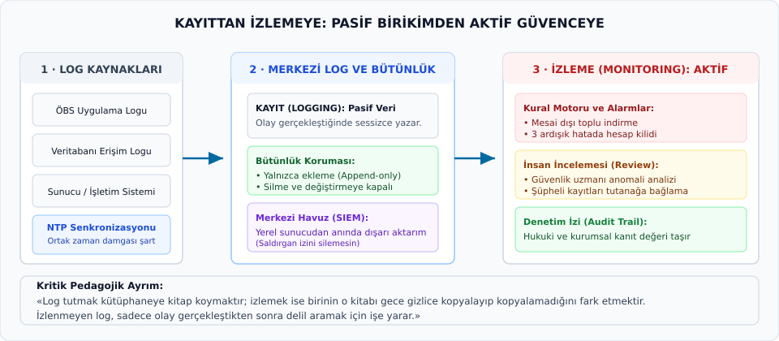

## Kayıt tutmak güvende olmak mıdır?

- Kütüphane kapısındaki deftere binaya giren herkes adını, geliş saatini ve kimlik numarasını yazıyor.
- Defter her gün dolup akşam görevli tarafından dolaba kaldırılıyor; ancak haftalarca, aylarca kimse açıp incelemiyor.
- Bir gün kütüphaneden nadir bir el yazması eserin çalındığı fark ediliyor.

Yönetim soruyor:
**"Biz kapıda kayıt tutuyorduk, bu hırsızlık nasıl haftalarca fark edilmedi?"**

- Kuzey Üniversitesi Öğrenci Bilgi Sistemi'nde (ÖBS) de her gün sunucularda 50.000 satır erişim kaydı üretilip arşivlenmektedir.

**Peki sunucunun sabit diskinde bu kayıtların birikmesi, kurumun güvende olduğunu gösterir mi?**

::: {.notes}
Bilgi güvenliği yönetiminin en kritik iki kavramını ve aralarındaki hayati farkı bu kütüphane senaryosu üzerinden görmeye başlıyoruz: kayıt tutma (logging) ve izleme (monitoring). Bir kurumda giriş-çıkışların veya sistem hareketlerinin deftere ya da sunucu diskine yazılması yalnızca verinin toplanması adımıdır; tek başına koruma veya erken uyarı sağlamaz.

Uygulamada ve kimi zaman kurum yönetimlerinde, bilişim sistemlerinde kütük (log) tutulması güvenliğin sağlanmasıyla eşdeğer görülür. "Sistemimiz her hareketi kaydediyor" düşüncesi sahte bir güvenlik algısı yaratır. Tıpkı kütüphane kapısındaki ziyaretçi defteri her akşam dolaba kaldırılıp haftalarca kapağı açılmadığında yaşandığı gibi; eğer o deftere kaydedilen isimleri kimse okumuyorsa, gece yarısı binaya giren birini ya da deftere sahte kimlikle 30 kez imza atan birini kimse fark edemez. Kuzey Üniversitesi ÖBS sunucularında her gün biriken 50.000 satır erişim kaydı da incelenmediği sürece dolaptaki defterden farksızdır.

Kayıt tutmak pasif bir arşivleme işidir; izleme ise o kayıtların düzenli olarak incelenmesi, olağandışılıkların aranması ve kurallara aykırı durumlarda güvenlik alarmı üretilmesidir. Kayıt tutulmadan izleme yapılamaz, fakat izleme yapılmayan bir kayıt sistemi de kuruma güvenlik güvencesi vermez. Bir sonraki slaytta önce kayıt işlevinin pasif doğasını, ardından izlemenin aktif yapısını ayrıntılı olarak inceleyeceğiz.
:::

---

## Kayıt (logging): Pasif veri birikimi

**Kayıt (logging)**, bir bilişim sisteminde gerçekleşen olayların, kullanıcı işlemlerinin, hata mesajlarının ve sistem durumlarının önceden belirlenmiş alanlarla tarihli ve sıralı olarak kütük dosyalarına yazılması ve saklanması işlemidir.

Kayıt işlevinin temel özellikleri:
- **Pasif veri üretimi:** Sistemdeki bir eylem gerçekleştiğinde arka planda sessizce bir satır metin üretilir ve dosyaya eklenir.
- **Tarihsel arşiv niteliği:** Kayıt geçmişte ne olduğunu belgeler; geleceği tahmin etmez ve o anda kendiliğinden bir müdahale başlatmaz.
- **Delil ve araştırma kaynağı:** Bir güvenlik ihlali yaşandığında adli bilişim incelemesinin ve olay soruşturmasının ilk başvuru kaynağıdır.

Örnek: Kuzey Üniversitesi ÖBS veri tabanı sunucusunun, sisteme başarılı veya başarısız giriş yapan her kullanıcının oturum açma saatini kütük dosyasına yazması.

::: {.notes}
Kayıt işlevini doğru konumlandırmak için onun "pasif" doğasını çok iyi kavramamız gerekir. Bir sunucuda kütük mekanizması devrede olduğunda, işletim sistemi ya da uygulama yazılımı meydana gelen olayları önceden belirlenmiş alanlarla bir günlüğe not eder. Kullanıcı sisteme girdiğinde bir satır yazılır, yanlış parola denediğinde bir satır yazılır, bir öğrencinin notu güncellendiğinde bir satır daha eklenir; ancak bu sırada sistem yapılan işlemin kurallara uygun olup olmadığını sorgulamaz.

Bu mekanizma bir güvenlik kamerasının görüntüyü sabit diske kaydetmesine benzer. Kamera görüntüyü diske yazar, ancak kameranın kendisi yetkisiz kişiyi durdurmaz veya ekrana bakıp "burada yabancı biri var" diyerek karar üretmez. Eğer o kayıtlar saklandığı yerde kalır ve kimse tarafından okunmazsa, sistem yalnızca büyüyen bir veri yığını biriktirmiş olur. Dolayısıyla kayıt, güvenliğin ham maddesidir ama tek başına tamamlanmış bir güvenlik kontrolü değildir.

ÖBS veri tabanı sunucusunun başarılı veya başarısız her oturum açma saatini kütük dosyasına yazması, bir güvenlik ihlali yaşandığında geriye dönük olay soruşturmasının ve adli bilişim incelemesinin ilk başvuru kaynağını oluşturur. Ancak tehditlerin olay anında fark edilmesi ve zararın büyümeden durdurulması için bu pasif birikimin üzerine ikinci bir işlevin, yani bir sonraki slaytta ele alacağımız izleme sürecinin kurulması gerekir.
:::

---

## İzleme (monitoring): Aktif denetim ve inceleme

**İzleme (monitoring)**, tutulan kayıtların, sistem davranışlarının ve kullanıcı hareketlerinin güvenlik politikaları, yetki matrisleri ve olağandışılık ölçütleri çerçevesinde düzenli, sürekli veya otomatik olarak analiz edilmesi ve sapmaların güvenlik uyarısına dönüştürülmesi sürecidir.

İzleme işlevinin temel özellikleri:
- **Aktif denetim:** Veri sadece saklanmaz; önceden belirlenmiş güvenlik kuralları ve eşiklerle sürekli karşılaştırılır.
- **Şimdiki zaman ve erken uyarı:** "Şu anda veya az önce yetkisiz, olağandışı ya da şüpheli bir eylem gerçekleşti mi?" sorusuna yanıt arar.
- **Müdahale tetikleyicisi:** Bir sınır aşıldığında (örneğin 1 dakikada 5 başarısız giriş yapıldığında) sistem yöneticisine bildirim gönderir veya hesabı geçici olarak kilitler.

Örnek: ÖBS izleme mekanizmasının, gece saat 03.00'te peş peşe gelen yetkisiz not değiştirme denemelerini fark edip BT güvenlik sorumlusunun telefonuna acil durum uyarısı düşürmesi.

::: {.notes}
İzleme, kaydedilen ham veriye anlam, bağlam ve aksiyon kazandıran yönetimsel ve teknik süreçtir. Bir önceki slayttaki kamera örneğini sürdürürsek; izleme, güvenlik görevlisinin ekranların başında şüpheli hareketleri takip etmesi veya sistemin tanımlı bir hareketi algılayıp doğrudan alarm çalmasıdır. Burada kütük satırları artık pasif birer arşiv kaydı olmaktan çıkar; güvenlik politikaları, yetki matrisleri ve olağandışılık ölçütleriyle karşılaştırılan canlı bir denetim girdisine dönüşür.

Bu süreçte temel amaç, gerçekleşmekte olan bir saldırıyı veya kurum içindeki bir yetki aşımını henüz zarar büyümeden tespit edebilmektir. Örneğin Kuzey Üniversitesi kurallarına göre ardışık 3 başarısız parola denemesinde hesabın 30 dakika kilitlenmesi ve BT alarmı üretilmesi ya da gece saat 03.00'te peş peşe gelen yetkisiz not değiştirme denemelerinde BT güvenlik sorumlusunun telefonuna acil durum uyarısı düşmesi, kaydın eşik değerlerle buluştuğunda nasıl müdahale tetikleyicisine dönüştüğünü gösterir.

Sık düşülen bir yanılgı, kütük dosyalarını yalnızca altı ayda bir denetim geldiğinde veya bir şikâyet üzerine açıp bakmayı izleme sanmaktır. Oysa düzensiz ve olay sonrası bakış izleme değil, gecikmiş bir incelemedir; gerçek izleme süreklilik, önceden tanımlanmış kurallar ve anormallik arama disiplini gerektirir. Bir sonraki slaytta kayıt ile izleme arasındaki bu farkları beş temel boyutta yan yana karşılaştıracağız.
:::

---

## Kayıt ile izleme arasındaki temel farklar

| Karşılaştırma boyutu | Kayıt (Logging) | İzleme (Monitoring) |
|---|---|---|
| **Eylemin niteliği** | Pasif veri biriktirme ve dosyada saklama | Aktif analiz, karşılaştırma ve alarm üretme |
| **Zaman odağı** | Geçmişe dönük kütük (dün ne oldu?) | Gerçek zamanlı veya dönemsel kontrol (şimdi ne oluyor?) |
| **Temel soru** | "Olay kütüğe yazıldı mı?" | "Kurallara ve yetkilere aykırı bir sapma var mı?" |
| **Sistemdeki rolü** | Otomatik yazma mekanizması (veri kaynağı) | Karar motoru, eşik kontrolü ve yönetici incelemesi |
| **Güvenlik sonucu** | Soruşturma için delil havuzu | Erken uyarı, tehdit tespiti ve hızlı müdahale |

Kural: **İzleme olmadan kayıt kör bir arşivdir; kayıt olmadan izleme ise dayanaksız bir tahmindir.**

::: {.notes}
Tablodaki beş karşılaştırma boyutu, kayıt ve izleme kavramlarının neden asla birbirinin yerine kullanılamayacağını özetler. Kayıt, sistemde gerçekleşen olguyu olduğu gibi tespit edip tarihli olarak saklar; izleme ise bu olgunun kurumsal politikalara, mesai kurallarına ve yetki sınırlarına uygun olup olmadığını sorgular. Birincisi "olay kütüğe yazıldı mı?" sorusuyla yetinirken, ikincisi "kurallara ve yetkilere aykırı bir sapma var mı?" sorusuna yanıt arar.

Zaman odağı ve sistemdeki rol açısından baktığımızda kayıt her zaman geçmişe dönük bir kütük ve otomatik bir yazma mekanizmasıdır. Buna karşılık izleme, gerçek zamanlı eşik kontrolleriyle veya dönemsel yönetici incelemeleriyle şimdiki zamana odaklanan bir karar motorudur. Kayıt süreci tek başına tehditleri durduramaz; ancak soruşturma aşamasında geriye dönük inceleme yapılabilmesi için gereken delil havuzunu hazır tutar.

Kuzey Üniversitesi ÖBS üzerinden somut bir örnek düşünelim: Bir memurun saat 23.30'da sisteme girip bir öğrencinin adres bilgilerini okuması, kayıt açısından yalnızca başarılı bir okuma işlemidir; kayıt bunun iyi mi kötü mü olduğunu bilmez. İzleme süreci devreye girdiğinde ise Kuzey Üniversitesi'nin 08.30–17.30 mesai kuralı ve kampüs içi ağ koşulu hatırlanır; "Bu personel gündüz memurudur, yazılı onay olmadan gece saatinde neden adres sorguluyor?" sorusu sorularak eylem bir erken uyarı ve inceleme konusuna dönüştürülür.

Bu iki işlev birbirini tamamlar ve biri olmadan diğeri güvenlik amacına ulaşamaz: Kayıt tutmazsanız izleme mekanizmasının inceleyeceği hiçbir somut veri bulamazsınız; izleme yapmazsanız tuttuğunuz kayıtların olay gerçekleşirken kuruma hiçbir koruyucu faydası olmaz. Bir sonraki slaytta, pasif kayıttan aktif güvenceye uzanan bu ilişkinin teknik mimaride nasıl kurulduğunu şema üzerinden adım adım okuyacağız.
:::

---

## Kayıttan izlemeye mimari zincir

{width="100%" fig-align="center" fig-alt="Kayıt ile izleme arasındaki mimari zincir: Pasif birikimden aktif güvenceye"}

::: {.notes}
Şemayı soldan sağa üç sütun olarak okuyun: log kaynakları, merkezi log ve bütünlük, izleme. Soldaki sütun kayıttır: ÖBS uygulama logu, veri tabanı erişim logu ve sunucu ya da işletim sistemi logu, olay gerçekleştiğinde sessizce yazar. Bu aşamada hiçbir karar yoktur; yalnızca pasif bir veri birikimi vardır.

Ortadaki sütun, kayıtların güvenilir bir delil olmasını sağlar. Loglar üretildikleri sunucuda kalmaz; anında merkezi bir havuza, yani SIEM'e aktarılır, böylece yerel yönetici ya da saldırgan kendi izini silemez. Havuza yalnızca ekleme yapılabilir, silme ve değiştirme kapalıdır; buna yalnızca ekleme (append-only) ilkesi denir. Tüm sunucular ortak bir zaman kaynağına bağlıdır (NTP), çünkü farklı sistemlerin olaylarını sıraya dizmek için ortak zaman damgası şarttır. Bu üç önlem birlikte denetim izini hukuki ve kurumsal kanıt değeri taşıyan bir kayda dönüştürür.

Sağdaki sütun izlemedir ve şemanın asıl mesajı oradadır. İzleme iki ayaktan oluşur: otomatik kural motoru ve insan incelemesi. Kural motoru, mesai dışı toplu indirme ya da ardışık üç hatalı denemeden sonra hesap kilidi gibi eşikleri anında uygular ve alarm üretir. İnsan incelemesinde güvenlik uzmanı anomalileri analiz eder ve şüpheli kayıtları tutanağa bağlar. Otomatik alarm hız sağlar; insan incelemesi yavaş yayılan ve kurala takılmayan davranışları yakalar.

Şemanın altındaki benzetme kayıt ile izleme farkını toplar: log tutmak kütüphaneye kitap koymaktır; izlemek ise birinin o kitabı gece gizlice kopyalayıp kopyalamadığını fark etmektir. İzlenmeyen log, yalnızca olay olduktan sonra delil aramaya yarar; zararı önleyemez.

Sık yapılan hata "loglarımız var, güvendeyiz" demektir. Şemada sütunları bir zincir olarak okuyun: ilk sütun olmadan inceleyecek veri yoktur, üçüncü sütun olmadan ilk iki sütunun kuruma koruyucu faydası yoktur. Sonraki slaytta bu yanılgıyı örneklerle, ardından denetim izinin anatomisini ele alacağız.
:::

---

## Yaygın yanılgı: "Log tutuyorsak güvendeyiz"

Kurumlarda en sık karşılaşılan yönetsel zafiyetlerden biri, log altyapısı kurmayı bilgi güvenliğinin nihai kanıtı saymaktır.

Gerçek hayatta yaşanan durum:
- Sunucular her gün yüz binlerce satır log üretir.
- Bu loglar büyük arşiv disklerinde sessizce saklanır.
- Kimse log inceleme prosedürü işletmez, eşik tanımlamaz veya raporları okumaz.
- Bir veri sızıntısı olduğunda kurum olayı ancak 6 ay sonra polisten veya basından öğrenir.

Önemli ilke:
**Kayıt tutulması tek başına izleme yapıldığının kanıtı DEĞİLDİR.**

- Bir denetçiye "Biz log tutuyoruz" demek yeterli bir güvence sağlamaz.
- Denetçi ve yönetim şu sorunun yanıtını arar: **"Bu kayıtları kim, hangi sıklıkla inceliyor ve olağandışı bir durum gördüğünde ne yapıyor?"**

::: {.notes}
Değerlendirmelerde ve meslek hayatında en sık düşülen yanılgılardan biri, kayıt tutmayı izleme yapıldığının kanıtı zannetmektir. Sunucuların her gün yüz binlerce satır kütük üretmesi ve bunların büyük arşiv disklerinde saklanması yalnızca teknik bir veri birikimidir. Eğer bu birikimi okuyacak bir inceleme prosedürü işletilmez, eşik kuralları tanımlanmaz ve raporlar okunmazsa, kurum yaşanan bir veri sızıntısını kendi sisteminden değil ancak 6 ay sonra polisten veya basından öğrenir.

ISO 27001 denetimlerinde bu ayrım doğrudan sınanır. Denetçi bir kuruma gittiğinde önce "Log kayıtlarınızı görebilir miyim?" diye sorar ve sistem yöneticisi ekranda akan satırları gösterir. Ancak denetçi hemen ardından ikinci soruyu yöneltir: "Peki bu loglardaki başarısız giriş denemelerini son üç ayda kim inceledi? Bana inceleme tutanağını veya üretilen bir alarm raporunu gösterebilir misiniz?" Birçok kurum tam bu ikinci soruda tıkanır; çünkü ortada kayıt vardır ama izleme kanıtı yoktur.

Kayıt tutma işi teknik bir otomatiğe bağlanabilir; fakat izleme sorumluluk, kural tasarımı ve insan dikkati gerektiren canlı bir süreçtir. Bunu bir arabanın hız göstergesine benzetebiliriz: Göstergenin çalışıyor olması kayıt işlevidir, ancak sürücü göstergeye hiç bakmıyorsa hız sınırını aştığında kaza yapmaktan kurtulamaz. Bir sonraki slaytta, incelenen kayıtların bir güvenlik olayını baştan sona nasıl aydınlattığını gösteren denetim izi kavramına geçeceğiz.
:::

---

## Denetim izi (audit trail): Olayı yeniden canlandırmak

**Denetim izi (audit trail)**, gerçekleşen bir iş sürecinin veya güvenlik olayının başlangıcından sonucuna kadar olan tüm adımlarını kronolojik sırayla yeniden kurgulamaya olanak tanıyan, değiştirilemez kayıtlar zinciridir.

Denetim izinin sağladığı üç temel güvence:
1. **İnkar edilemezlik:** Kullanıcının "Ben o saatte sisteme girmedim, o işlemi ben yapmadım" iddiasını teknik ve yönetsel olarak çürütür.
2. **Kayıp ve hasar tespiti:** Bir yetkisiz değişiklik olduğunda, sistemin eski haline döndürülebilmesi için tam olarak hangi verilerin değiştirildiğini gösterir.
3. **Sorumluluk zinciri:** Hatanın veya kasıtlı eylemin hangi hesap, yetki ve onay adımı üzerinden gerçekleştiğini kanıtlar.

::: {.notes}
Denetim izi kavramı, tekil bir sistem günlüğü satırının çok ötesindedir. Adli bilişimde ve kurumsal denetimde bir güvenlik olayını aydınlatabilmek için olayın filmini başlangıcından sonucuna kadar kare kare yeniden oynatabilmemiz gerekir. "Kronolojik canlandırma" adı verilen bu kurgulama yeteneği, ancak olay adımlarının değiştirilemez bir kayıtlar zinciri halinde birbirine bağlanmasıyla sağlanır.

Kuzey Üniversitesi ÖBS'de bir öğrencinin harç borcunun yetkisiz biçimde silindiğini düşünelim. Eksiksiz bir denetim izi bize şu sırayı adım adım sunmalıdır: Saat 14.10'da kullanıcı `ahmet.demir` sisteme hangi IP adresinden oturum açtı, saat 14.12'de öğrenci harç yönetimi ekranına geçti mi, saat 14.15'te harç silme butonuna bastı mı, veri tabanında eski değer neydi ve yeni değer ne oldu, son olarak sistem bu değişikliği başarıyla onayladı mı?

Bu halkalardan biri bile eksik kalırsa denetim izi kopar; kullanıcının "o işlemi ben yapmadım" iddiası çürütemez, sorumluluk zinciri kurulamaz ve hesap verebilirlik sağlanamaz. Ayrıca eski ve yeni değerlerin kayıtta yer alması, bozulan verinin eski haline döndürülebilmesi için de şarttır. Bir sonraki slaytta, bu zinciri oluşturan her bir erişim kaydı satırında mutlaka bulunması gereken altı temel bileşeni inceleyeceğiz.
:::

---

## Bir erişim kaydının altı temel bileşeni

Bir erişim kaydının güvenlik ve denetim açısından geçerli sayılabilmesi için yanıtlaması gereken altı temel soru:

| Soru | Kayıt alanı (Bileşen) | Örnek veri |
|---|---|---|
| **Ne zaman?** | Zaman damgası (Timestamp) | `2026-11-17 14:22:05` |
| **Kim?** | Kullanıcı kimliği (User ID) | `selin.kaya` |
| **Nereden?** | Kaynak adres (Source IP) | `10.20.4.15 (Dahili)` |
| **Hangi varlığa?** | Hedef varlık (Target Asset) | `ders-notu (Vize)` |
| **Hangi işlem?** | Eylem / İşlem türü (Action) | `Not_Guncelleme` |
| **Sonuç ne?** | Sonuç kodu (Status) | `BASARILI (veya 403)` |

::: {.notes}
Bir güvenlik uzmanı veya denetçi bir kütük satırına baktığında tablodaki altı sorunun yanıtını eksiksiz bulmalıdır. Bu altı alan her erişim kaydının omurgasıdır; içlerinden herhangi biri eksik olduğunda kaydın kanıt gücü zayıflar veya kayıt denetim açısından tamamen geçersiz hale gelir.

İlk üç alanın neden vazgeçilmez olduğunu eksiklikleri üzerinden düşünelim: Zaman damgası yoksa olayın ne zaman gerçekleştiğini bilemez, işlemin Kuzey Üniversitesi'nin 08.30–17.30 mesai saatleri içinde mi yoksa mesai dışında mı yapıldığını ayıramazsınız. Kullanıcı kimliği yoksa ortada ortak bir hesap veya anonim bir hareket var demektir ve faili bulamazsınız. Kaynak adres (IP) yoksa işlemin kampüs içi dahili ağdan mı yoksa kurum dışı harici bir ağdan mı geldiğini anlayamazsınız.

Son üç alan ise eylemin niteliğini ve etkisini ortaya koyar: Hedef varlık yoksa hangi bilginin (`ders-notu` veya `personel-dosyasi` gibi) tehdit altında olduğunu bilemezsiniz; işlem türü yoksa kullanıcının veriyi sadece okuduğunu mu, indirdiğini mi yoksa değiştirdiğini mi ayırt edemezsiniz. Sonuç kodu (`BASARILI` veya `403`) olmadığında ise eylemin bir teşebbüste mi kaldığını yoksa hedefine ulaşıp veriyi ele mi geçirdiğini saptayamazsınız. Bir sonraki slaytta ilk bileşen olan zaman damgasının sunucular arasında nasıl eşzamanlı tutulduğunu göreceğiz.
:::

---

## Zaman damgası ve zaman senkronizasyonu (NTP)

Farklı sunuculardaki olayların birbirine bağlanabilmesi için zaman damgasının kesin ve güvenilir olması gerekir.

Kurumsal risk:
- ÖBS web sunucusunun saati 3 dakika ileri, veri tabanı sunucusunun saati 5 dakika geri, güvenlik duvarının saati ise 10 dakika farklıysa ne olur?
- Bir olay anında hangi eylemin önce, hangi eylemin sonra gerçekleştiği tespit edilemez; neden-sonuç ilişkisi kopar.

Teknik ve yönetsel çözüm:
- **Ağ Zaman Protokolü (NTP - Network Time Protocol):** Kurumdaki tüm sunucuların, yönlendiricilerin ve güvenlik cihazlarının saatlerini ortak, güvenilir ve merkezi bir zaman kaynağıyla sürekli senkronize etme kuralıdır.
- Adli soruşturmalarda ve yasal süreçlerde, zaman senkronizasyonu olmayan loglar **mahkemede veya denetimde delil niteliğini kaybedebilir.**

::: {.notes}
Zaman senkronizasyonu ilk bakışta basit bir teknik detay gibi görünebilir; ancak güvenlik olaylarının aydınlatılmasında ve denetim izinin kurulmasında en hayati unsurlardan biridir. Bir saldırgan kurum ağına sızdığında genellikle tek bir cihaz üzerinde kalmaz; önce dış güvenlik duvarından geçer, ardından ÖBS web sunucusuna erişir ve oradan veri tabanı sunucusuna atlar.

Güvenlik analisti bu saldırıyı incelerken üç farklı sistemin kütüklerini masaya yatırır. Eğer güvenlik duvarı olayı saat 14.00 diye kaydetmiş, veri tabanı sunucusu ise kendi saati 5 dakika geri kaldığı için aynı işlemi 13.55 diye yazmışsa kronolojik sıra tersine döner. Analist saldırının güvenlik duvarından veri tabanına değil, veri tabanından güvenlik duvarına doğru yapıldığını zannedebilir; neden-sonuç ilişkisi kopar ve kronolojik tutarsızlık ortaya çıkar.

Bu riski önlemek için bilgi güvenliği politikalarında kurumdaki tüm sunucuların, yönlendiricilerin ve güvenlik cihazlarının Ağ Zaman Protokolü (NTP) ile ortak ve merkezi bir zaman kaynağına bağlı olması zorunlu bir kural olarak tanımlanır. Zaman senkronizasyonu bulunmayan kayıtlar yasal süreçlerde ve denetimlerde delil niteliğini kaybedebilir. Zamanı doğru kaydetmek kadar, yazılan kaydın sonradan silinmesini önlemek de şarttır; bir sonraki slaytta kayıt bütünlüğünü ele alacağız.
:::

---

## Kayıt bütünlüğü ve merkezi log yönetimi

Log kayıtlarının kendisi de saldırganların veya suistimal yapan personelin ilk hedefidir. Bu nedenle kütüklerin bütünlüğü korunmalıdır.

Temel güvenlik ilkeleri:
- **Değiştirilemezlik (Append-only / Write-once):** Kütük dosyalarına sadece yeni satır eklenebilir. Geçmişe dönük satırlar üzerinde değiştirme (edit) veya silme (delete) yapılamaz.
- **Yerel yönetici tehdidi:** Bir sunucunun yerel sistem yöneticisi (root veya admin yetkisine sahip kişi), yaptığı yetkisiz bir işlemi örtbas etmek için yerel log dosyasını silebilir.
- **Merkezi ve yalıtılmış log sunucusu:** Loglar üretildiği anda yerel sunucudan ağ üzerinden anlık olarak bağımsız, merkezi bir kayıt sunucusuna (ayrı ağ segmenti, ayrı yetkilendirme) iletilmelidir.

Sonuç: **Yerel sistem yöneticisi kendi sunucusundaki logu silse dahi, kopyası merkezi log sunucusunda çoktan arşivlenmiş olur.**

::: {.notes}
Bir bilişim suçunda veya kurum içi suistimalde failin ilk yapacağı iş kendi ayak izlerini silmektir. Sunucuya sızan bir saldırgan ya da yetkisini kötüye kullanan bir kurum çalışanı, işlemini bitirdikten sonra kütük dosyalarını açıp kendi hesabına ait satırları silmek veya değiştirmek ister. Bu nedenle kütüklerin yalnızca üretilmesi yetmez; bütünlüğünün de korunması gerekir.

Eğer kayıtlar yalnızca o sunucunun yerel diskinde (`C:` veya `/var/log` dizininde) duruyorsa, o sunucuda en üst yetkiye (`root` veya `admin`) sahip olan yerel sistem yöneticisi bu dosyaları kolayca silebilir ya da geçmiş satırları düzenleyebilir. Kurumsal güvenlikte teknik uygulayıcıların kendi işlemlerinin denetim izini kontrol edebilmesi, görevler ayrılığı ilkesine aykırı büyük bir zafiyettir.

Bunu önlemenin yolu, kütük dosyalarını yalnızca yeni satır eklenebilir (`append-only`) biçimde yapılandırmak ve merkezi log yönetimi kurmaktır. Kayıt üretildiği saniyede yerel makineden ayrı ağ segmentindeki merkezi bir kayıt sunucusuna kopyalanır. Merkezi log sunucusuna yerel sistem yöneticisinin erişim ve silme yetkisi verilmez; oraya yalnızca bağımsız denetçiler veya güvenlik operasyon ekibi erişebilir. Böylece kayıtların bütünlüğü ve inkâr edilemezliği güvenceye alınır; bir sonraki slaytta bu güvenilir kayıtların içinde hangi olağandışı erişim örüntülerinin arandığını inceleyeceğiz.
:::

---

## Olağandışı erişim örüntüleri (Anomaliler)

İzleme mekanizması sadece kurallara bakmaz; kullanıcının normal iş akışından sapan olağandışı hareketleri (anomalileri) arar.

**Olağandışı erişim örüntüsü (anomaly)**, bir kullanıcının veya sürecin tanımlı iş görevinden, alışılmış mesai saatlerinden, olağan veri hacminden veya coğrafi konumundan belirgin biçimde sapan hareketleridir.

Beş temel şüpheli örüntü türü:
1. **Zamansal anormallik:** Mesai saatleri dışında, gece yarısı veya resmi tatillerde kritik kurumsal verilere erişilmesi.
2. **Hacimsel anormallik:** Normalde günde 10-20 kayıt görüntüleyen bir memurun, dakikalar içinde 5.000 personelin özlük dosyasını topluca dışa aktarması (bulk download).
3. **Konumsal anormallik:** Kurum çalışanının hesabıyla olağandışı bir ülkeden veya kurum dışı güvensiz bir IP bloğundan VPN'siz oturum açılması.
4. **Dizisel başarısız denemeler:** Arka arkaya çok sayıda hatalı parola girişinin hemen ardından gelen tek bir başarılı giriş (kaba kuvvet/brute-force saldırısı belirtisi).
5. **Yetki keşfi (yetki dışı erişim denemeleri):** Görev tanımı dışındaki bir kaynağa yapılan ısrarlı erişim denemelerinin sistem tarafından `403 Yetkisiz Erişim` ile reddedilmesi.

::: {.notes}
İzleme yaparken her başarılı işlem masum, her başarısız işlem de kötü niyetli demek değildir. İnsanlar bazen parolasını unutabilir; bu olağandır. Ancak arka arkaya 50 kez yanlış parola giriliyor ve hemen ardından tek bir başarılı giriş geliyorsa (dizisel başarısız denemeler), bu normal bir unutkanlık değil otomatik bir kaba kuvvet saldırısıdır. Kuzey Üniversitesi'nde ardışık 3 başarısız parola denemesinde hesabın 30 dakika kilitlenmesi ve BT alarmı üretilmesi kuralı tam bu örüntüyü durdurmak için konulmuştur.

Aynı şekilde bir çalışanın kendi görev alanında dosya açma yetkisi olabilir; fakat normalde iş saatinde günde 10-20 kayıt inceleyen bir memur, pazar gecesi saat 04.00'te kurum dışı bir IP adresinden girip 5.000 personelin özlük dosyasını tek bir Excel dosyası olarak indiriyorsa (veya Kuzey Üniversitesi'ndeki tek seferde 5'ten fazla personel dosyası indirme yasağını ve 08.30–17.30 mesai kuralını ihlal ediyorsa), sistem teknik olarak "yetkili kullanıcı girdi" dese bile izleme mekanizması alarm üretmelidir. Çünkü burada zamansal, konumsal ve hacimsel anormallikler birleşmiş; olası bir veri sızıntısı veya hesap çalınması durumu ortaya çıkmıştır.

Beşinci tür olan yetki keşfi, ilk dördünden farklı olarak hiçbir başarılı işlem içermez. Saat ve veri hacmi tamamen normal görünebilir; burada örüntüyü ortaya çıkaran şey, ısrarlı ve görevle ilgisiz arayıştır. Sistem her denemeyi `403 Yetkisiz Erişim` ile reddeder; ama bir bölüm sekreterinin veya memurun kendi görev tanımında olmayan bütçe ya da personel özlük modülüne tekrar tekrar girmeye çalışması, kullanıcının sistemde neyi nerede bulabileceğini yoklamasıdır (probing). Engelleme başarılı olduğu için tekil kayıt "başarısız" görünür; izleme ise bu başarısızlıkların birikimini ayrı bir güvenlik bulgusu olarak okur. Bir sonraki slaytta bu örüntüleri yakalayan iki izleme yöntemini göreceğiz.
:::

---

## İzleme yöntemleri: Otomatik alarmlar ve insan incelemesi

Etkin bir bilgi güvenliği izleme süreci iki tamamlayıcı mekanizmanın birlikte çalışmasıyla kurulur:

1. **Otomatik eşik alarmları (Kural tabanlı izleme):**
   - Önceden tanımlanmış kurallara göre sistemin anında reaksiyon vermesidir.
   - Örnek (Kuzey Üniversitesi kuralı): "Ardışık 3 hatalı parola girildiğinde hesabı 30 dakika kilitle ve ilgili personele/güvenlik sorumlusuna bildirim gönder."
   - Örnek: "Tek seferde 500'den fazla kayıt dışa aktarılırsa işlemi askıya al ve onay iste."

2. **Dönemsel insan gözden geçirmesi (Yönetsel inceleme):**
   - Yetkili yöneticilerin veya güvenlik denetçilerinin log özetlerini ve anormallik raporlarını periyodik olarak (haftalık/aylık) gözden geçirmesidir.
   - Örnek: "Öğrenci İşleri Müdürü'nün her pazartesi sabahı geçen haftaya ait mesai dışı erişim ve yetki reddi raporlarını inceleyip imzalaması."

::: {.notes}
İzleme işlevini ne yalnızca yazılımlara ne de yalnızca insana bırakabiliriz; etkin bir güvenlik mimarisi bu iki tamamlayıcı mekanizmanın birlikte çalışmasıyla kurulur. Otomatik eşik alarmları hız gerektiren durumlarda birinci savunma hattıdır. Bir kaba kuvvet saldırısı saniyeler içinde yüzlerce parola dener veya bir saldırgan dakikalar içinde toplu veri indirmeye çalışır; bir insanın bunu ekrandan fark edip engellemesini bekleyemezsiniz. Tanımlı eşik kuralı (örneğin 3 hatalı parola denemesinde 30 dakika hesap kilidi ve BT alarmı) anında devreye girerek işlemi durdurmalıdır.

Ancak her şüpheli durum önceden yazılmış matematiksel bir eşik kuralıyla yakalanamaz. Bir personelin eşik sınırlarına takılmadan, haftalar içine yayarak yetkisini kötüye kullanmasını veya görev tanımı dışındaki modülleri yoklamasını ancak iş bağlamını bilen bir insan, yani ilgili birim yöneticisi veya güvenlik denetçisi fark edebilir.

Bu nedenle Öğrenci İşleri Müdürü'nün her pazartesi sabahı geçen haftaya ait mesai dışı erişim ve yetki reddi raporlarını inceleyip imzalaması ikinci savunma hattını oluşturur. Burada görevler ayrılığı ilkesi de devreye girer: Raporu teknik olarak hazırlayan sistem yöneticisi ile raporu inceleyip onaylayan iş sahibi (Öğrenci İşleri Müdürü) ayrı kişiler olmalıdır. Bir sonraki slaytta, otomatik alarm ve izleme çalışmadığında bir saldırının nasıl sonuçlandığını çözümlü bir örnek üzerinde göreceğiz.
:::

---

## Rehber çözümlü örnek: Cumartesi gecesi olağandışı hareketlilik

**Olay:** Kuzey Üniversitesi ÖBS sunucusunda öğretim elemanı `mehmet.demir` hesabına ait şu erişim kayıtları tespit edilmiştir:
- *14 Kasım Cumartesi 03.22 - 03.28:* Yabancı bir IP adresinden ardışık 12 adet `Giris_Basarisiz (Hatalı Parola)` kaydı.
- *14 Kasım Cumartesi 03.29:* Aynı IP adresinden `Giris_Basarili`.
- *14 Kasım Cumartesi 03.31:* `ogrenci-iletisim-bilgileri` varlığından `Toplu_Disa_Aktarma (Excel Export)`: 3.500 öğrenci kaydı.

. . .

**Adım adım çözüm ve güvenlik analizi:**
1. **Örüntü teşhisi:** Ardışık 12 başarısız deneme bir **kaba kuvvet (brute-force) saldırısını**; hafta sonu gece 03.29'daki giriş **zamansal ve konumsal anormalliği**; 3.500 kaydın indirilmesi ise **hacimsel anormalliği** gösterir.
2. **Güvenlik anlamı:** Parola tahmin edilmiş veya kırılmış, hesap ele geçirilmiş (account takeover) ve veri sızıntısı (data exfiltration) gerçekleşmiştir.
3. **Kayıt ve izleme değerlendirmesi:** Kurumda **kayıt tutma işlevi çalışmaktadır** (olay saniye saniye kaydedilmiştir). Ancak **izleme işlevi başarısız olmuştur**: Kurum kuralı olan 3. ardışık başarısız denemede hesap kilitlenmemiş, gece yapılan toplu indirmede nöbetçi personele alarm üretilmemiştir.

::: {.notes}
Çözümlü örnekteki dokuz dakikalık zaman çizelgesi, dersimizin ana tezini somutlaştırır: Kurumda kayıt tutulmuştur, ancak izleme ve eşik mekanizması devreye girmediği için saldırgan hedefine ulaşmıştır. Saat 03.22 ile 03.28 arasındaki 12 hatalı parola denemesi kütüğe saniye saniye yazıldığı halde, Kuzey Üniversitesi kuralı olan 3. ardışık başarısız denemede 30 dakikalık hesap kilidi ve BT alarmı çalışmamış; saldırgan 03.29'da hesabı ele geçirip 03.31'de 3.500 öğrencinin iletişim bilgilerini dışa aktarmıştır.

Olay gerçekleştikten sonra kütüklere bakıp "Cumartesi gecesi 3.500 öğrencinin iletişim bilgilerini çalmışlar" diyebilmek bir güvenlik başarısı değil, gecikmiş bir hasar tespitidir. Gerçek başarı, daha üçüncü hatalı deneme yapıldığında o hesabı kilitlemek ve güvenlik sorumlusuna anında şüpheli giriş uyarısı gönderebilmektir; kayıt olayın otopsisini yaparken izleme zararın doğmasını önler. Bir sonraki slaytta bu vakadaki güvenlik önlemlerini önleyici, tespit edici ve düzeltici kontrol türleri üzerinden sınıflandıracağız.
:::

---

## Kayıt ve izleme hangi tür kontroldür?

Kontroller, olay karşısındaki işlevlerine göre üç türe ayrılır:

| Tür | Ne zaman devreye girer? | Bu haftadan örnek |
|---|---|---|
| **Önleyici** | Olaydan önce; olayın gerçekleşmesini zorlaştırır | Parola politikası, 3 hatalı denemede hesap kilidi, rol ve izin sınırı |
| **Tespit edici** | Olay sırasında veya sonrasında; olayı fark ettirir | Erişim kaydının incelenmesi, eşik alarmı, yöneticinin haftalık gözden geçirmesi |
| **Düzeltici** | Olaydan sonra; zararı sınırlar, nedeni giderir | Parolanın sıfırlanması, oturumun sonlandırılması, düzeltici faaliyet |

> Kayıt tek başına olayı fark ettirmez; kaydı tespit edici yapan, onu inceleyen izlemedir.

::: {.notes}
Cumartesi gecesi örneğine bu tablodan bakalım. Önleyici kontrol vardı: üçüncü hatalı denemede hesap kilitlenmesi kuralı. Ama sistem kuralı uygulamadı; önleyici kontrol çalışmadı. Tespit edici kontrol olarak kayıt vardı, ama inceleyen izleme ve alarm yoktu; olay kaydedildi, fark edilmedi. Düzeltici kontroller, yani parola sıfırlama ve oturum kapatma, olay fark edildikten sonra gerekir; bu vakada olay fark edilmediği için düzeltici adımlar da geç kalmıştır. Önleyici kontrolün çalışmaması ve tespit edici kontrolün eksikliği, düzeltici adımın da gecikmesine yol açan bir zincir oluşturdu.

Aynı kontrol bazen birden fazla türün işini görür. Hesap kilidi hem sonraki denemeleri engeller (önleyici) hem yöneticiye bildirim gönderirse fark ettirir (tespit edici). Bu yüzden sınıflandırma kontrolün hangi işi gördüğüne bakılarak yapılır, adına bakılarak yapılmaz.

Kontrolleri bir de niteliğine göre ayırırız: yönetsel (politika, görev dağılımı), teknik (parola kuralı, güvenlik duvarı) ve operasyonel (yedek alma, kimlik kartı kullanımı, kamera kontrolü gibi günlük uygulamalar). Bu geçen derste gördüğümüz yönetsel–teknik ayrımın devamıdır. Bir kontrol hem yönetsel hem önleyici olabilir: parola politikası buna örnektir.

ISO/IEC 27002:2022 her kontrolü önleyici, tespit edici ve düzeltici türlerinden bir ya da birkaçıyla etiketler.
:::

---

## Yönetim sistemi standardı ne bekler?

ISO/IEC 27001 ve ISO/IEC 27002 standartlarında kayıt ve izleme birbiriyle bağlantılı iki temel kontrol olarak tanımlanır:

- **ISO/IEC 27001:2022 (Yönetim standardı - Madde 9.1):**
  Kurum, bilgi güvenliği performansını ve BGYS'nin etkinliğini değerlendirmek için neyin izleneceğini, ne zaman ölçüleceğini, kimin analiz edeceğini ve sonuçların kime raporlanacağını belirlemelidir.
- **ISO/IEC 27002:2022 (Uygulama rehberi):**
  - *Kontrol 8.15 (Günlük kaydı - Logging):* Olayları, kullanıcı işlemlerini, güvenlik olaylarını kaydeden ve koruyan kütüklerin tutulması rehberliği.
  - *Kontrol 8.16 (İzleme faaliyetleri - Monitoring activities):* Ağ ve sistemlerin olağandışı davranışlara karşı düzenli taranması, eşik alarmlarının kurulması ve sonuçların gözden geçirilmesi rehberliği.

Standart yazılım veya marka dayatmaz; **"Kaydet, kaydı koru, kaydı kurallara göre izle ve incelemenin kanıtını sakla"** der.

::: {.notes}
ISO/IEC 27001 ve ISO/IEC 27002 standartlarında kayıt tutma ile izleme faaliyetlerinin ayrı maddelerde ve ayrı kontrol başlıklarında ele alınması, bu iki işlevin yönetim sistemi içindeki farklı rollerini gösterir. Yönetim standardı olan ISO/IEC 27001:2022 Madde 9.1, kurumun bilgi güvenliği performansını değerlendirirken neyin izleneceğini, ne zaman ölçüleceğini, verileri kimin analiz edeceğini ve sonuçların kime raporlanacağını açıkça tanımlamasını bekler.

Uygulama rehberi olan ISO/IEC 27002:2022 ise bu gereksinimi iki ayrı kontrole böler: Kontrol 8.15 doğrudan "Günlük kaydı" (Logging) başlığını taşır ve kütüklerin nasıl toplanacağını, hangi alanları içereceğini ve nasıl korunacağını anlatır. Kontrol 8.16 ise "İzleme faaliyetleri" (Monitoring activities) başlığı altındadır ve toplanan bu kütüklerin olağandışı davranışlara karşı nasıl taranacağını, eşik alarmlarının nasıl kurulacağını ve sonuçların nasıl gözden geçirileceğini tarif eder.

Standartların bu iki konuyu iki ayrı madde olarak düzenlemiş olması, dersimizin ana fikrini uluslararası düzeyde teyit eder: Günlük kaydı tutmak (8.15) başka bir iştir, o günlükleri izlemek ve anormallikleri yakalamak (8.16) başka bir iştir; biri olmadan diğeri BGYS gereksinimini karşılamaz. Şimdi bu ilkeleri bağımsız görevdeki vaka verisi üzerinde uygulayacağız.
:::

---

## Bağımsız görev: Kütüphane personelinin özlük modülü denemeleri

**Vaka Verisi:**
Kuzey Üniversitesi ÖBS kütüklerinde yapılan haftalık rutin incelemede şu kayıt örüntüsü saptanmıştır:
- **Kullanıcı:** Kütüphane Dokümantasyon Dairesi memuru `canan.ozkan`.
- **Zaman:** Hafta içi mesai saatleri içinde (10.00 - 16.00 arası).
- **Hedef Varlık:** ÖBS Personel Özlük ve Maaş Bilgileri Modülü (`personel-dosyasi`).
- **Eylem ve Sonuç:** `Modul_Erisim_Talebi` $\rightarrow$ Gün boyunca tam 40 kez `403 Yetkisiz Erişim / Erişim Engellendi (Yetki Reddi)`.

. . .

**Sorular:**
1. **Örüntü türü ve güvenlik tespiti:** Bu kayıt dizisindeki olağandışı örüntünün türünü ve güvenlik açısından ne anlama geldiğini tanımlayınız.
2. **"Sistem zaten engellemiş" yanılgısı:** Sistemin 40 denemeyi de başarıyla engellemiş olmasının bu olayı kapatmaya neden yetmeyeceğini yönetimsel güvenlik gerekçesiyle açıklayınız.
3. **Yönetsel ve teknik aksiyon:** Bu bulgu karşısında kurumda işletilmesi gereken süreci; sorumlu aktörleri (birim yöneticisi, BT güvenlik sorumlusu), incelenecek ek kayıtları ve düzenlenecek tutanağı belirterek yazınız.

::: {.notes}
Çalışmanızda Kuzey Üniversitesi ÖBS kütüklerinde yapılan haftalık rutin incelemede saptanan bu vaka verisini adım adım analiz etmeniz beklenmektedir. Vaka verisindeki kullanıcı rolünü, zaman aralığını, hedef varlığı ve gün içindeki tekrar sayısını birlikte değerlendirerek üç soruyu sırasıyla ve gerekçeli biçimde yanıtlayın.

Yanıtlarınızı hazırlarken derste incelediğimiz beş olağandışı erişim örüntüsü türünü, teknik engelleme ile yönetsel izleme arasındaki farkı ve kurumsal sorumluluk zincirini temel alın. Üçüncü soruyu yanıtlarken bir sonraki slaytta yer alan beş adımlı aksiyon şablonunu kullanın ve her adımda hangi rolün hangi işlemi ve kaydı yürüteceğini açıkça belirtin.
:::

---

## Bağımsız görev şablonu ve görünür ölçütler

**Soru 3 için Yönetsel ve Teknik Aksiyon Süreci Şablonu:**

| Adım | Sorumlu Rol | İşlem ve Kayıt |
| :--- | :--- | :--- |
| **1. Anlık Müdahale** | | |
| **2. Derinlemesine Log İncelemesi** | | |
| **3. Yönetsel Bildirim** | | |
| **4. İdari ve Disiplin İncelemesi** | | |
| **5. Teknik İyileştirme** | | |

. . .

- **Ölçüt 1 (Örüntü):** Erişim anormalliğini örüntü türüyle tanımlayın.
- **Ölçüt 2 (403 Yanılgısı):** Teknik engelin yönetsel riski bitirmediğini açıklayın.
- **Ölçüt 3 (Sorumluluk Zinciri):** Adımları, rolleri ve tutanakları şablonda eşleştirin.

::: {.notes}
Tablodaki beş satır, üçüncü soruda kuracağınız yönetsel ve teknik aksiyon sürecinin çalışma şablonudur. Çalışmanızda her bir adımı mantıksal müdahale sırasına göre ele alarak "Sorumlu Rol" sütununa ilgili kurumsal aktörü (teknik uygulayıcı, iş/birim sahibi ve karar yetkilisi ayrımına dikkat ederek), "İşlem ve Kayıt" sütununa ise yapılacak somut incelemeyi ve düzenlenecek tutanağı veya raporu yazın.

Çalışmanızı tamamladığınızda yanıtlarınızı slayttaki üç görünür ölçütle karşılaştırarak gözden geçirin. İlk soruda erişim anormalliğini dersteki örüntü türlerinden birine dayandırarak gerekçelendirdiğinizden, ikinci soruda `403` teknik engellemesinin yönetsel inceleme ihtiyacını neden ortadan kaldırmadığını açıkladığınızdan ve üçüncü soruda şablondaki beş adımı görevler ayrılığı ilkesine uygun biçimde doldurduğunuzdan emin olun.
:::

---

## Ders özeti: Kayıttan güvenceye

- **Kayıt tutmak geçmişi dosyalar; izlemek bugünü ve geleceği korur.**
- Bir erişim kaydı; kim, ne zaman, nereden, hangi varlığa, ne yaptı ve sonuç ne sorularının altısını birden eksiksiz yanıtlamalıdır.
- Ortak zaman protokolü (NTP) ve merkezi korunan salt-eklenir (append-only) log mimarisi olmadan kayıtlar güvenilir kanıt oluşturamaz.
- Sistemlerin sadece başarılı işlemleri değil, engellenen ısrarlı denemeleri ve olağandışı örüntüleri de izleyip yönetime raporlaması gerekir.
- **Gelecek saat:** Bu kayıtların personel dosyası vakasında somut olarak incelenmesi ve denetim bulgusu üretilmesi (Uygulama 12.1 ve 12.2).

::: {.notes}
Bu derste ele aldığımız temel ayrımı tekrar vurgulayalım: Kayıt tutmak olayları pasif biçimde arşivleyen bir veri toplama işidir; izleme ise bu kayıtları güvenlik politikaları, mesai sınırları ve yetki kurallarıyla karşılaştırarak erken uyarıya dönüştüren aktif denetim sürecidir. Kayıt olmadan izleme dayanaksız kalır; izleme olmadan kayıt ise yalnızca olay gerçekleştikten sonra bakılan kör bir arşive dönüşür.

Bir erişim kaydının sağlam bir denetim izi oluşturabilmesi ve ISO/IEC 27001 ile 27002 beklentilerini karşılayabilmesi için altı temel soruyu (ne zaman, kim, nereden, hangi varlığa, hangi işlem ve sonuç ne) eksiksiz yanıtlaması gerekir. Üretilen kayıtların delil niteliğini koruması ise tüm sistemlerin ortak bir zaman kaynağına (NTP) bağlanmasına ve kütüklerin yerel yönetici müdahalesine kapalı, salt-eklenir (`append-only`) merkezi bir sunucuda saklanmasına bağlıdır.

Önümüzdeki iki uygulama saatinde (Uygulama 12.1 ve 12.2) bu kavramsal çerçeveyi doğrudan vaka verisi üzerinde kullanacağız. Kuzey Üniversitesi ÖBS personel dosyası erişim kayıtlarını önümüze alacak, gerçek kütük satırlarını kurumsal kurallarla karşılaştıracak ve bir denetçinin önüne konulacak resmi gözden geçirme tutanağını adım adım hazırlayacağız.
:::
