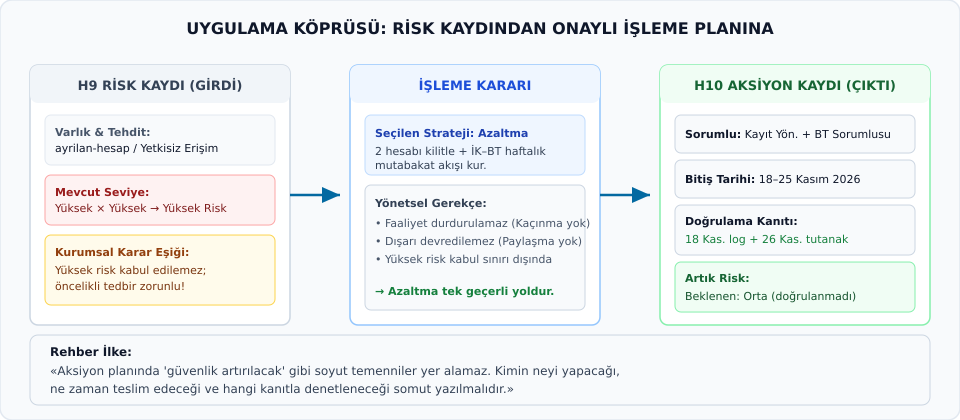

## Görev: Değerlendirilmiş riskten onaylı işleme planına

*   **Temel ilke:** Risk analizi yalnızca teşhistir; tek başına riski azaltmaz, ortadan kaldırmaz ya da yönetmez.
*   **Uygulama verisi:** **Duru Eğitim Merkezi** H9 nitel risk değerlendirme kütüğü, kurumsal roller ve kabul ölçütleri.
*   **Beklenen çıktı:** Seçilen kurumsal stratejiyi, sorumluyu, kaynak-takvim sınırlarını ve doğrulama kanıtını içeren onaylı işleme planı.

**Göreviniz:**

1. Kurumun kurumsal rollerini, kabul ölçütlerini ve H9 risk değerlendirme kütüğünü inceleyin.
2. `ayrilan-hesap` senaryosunun rehber işleme kararını, aksiyon adımlarını ve doğrulanmış artık risk kaydını analiz edin.
3. `geri-yukleme` ve `takvim-dosyasi` durumları için bağımsız risk işleme planlarını başarı ölçütlerine uygun olarak doldurun.

*Kurum, kişiler, sistemler ve operasyonel veriler kurgusaldır.*

::: {.notes}
Geçtiğimiz hafta kurumun hedefleri ile mevcut durumu arasındaki farkları belirleyip bu eksikliklerin olası sonuçlarını H9 nitel risk analiziyle değerlendirmiştik. Ancak olasılık ve etkiyi 3×3 matriste eşleştirerek Yüksek veya Orta risk düzeylerini saptamak yalnızca bir teşhistir; tek başına riski azaltmaz, ortadan kaldırmaz ya da yönetmez. Bu uygulama saatinde kâğıt üzerinde duran risk değerlendirme kaydını onaylı bir risk işleme planına (Risk Treatment Plan) dönüştürüyoruz.

Değerlendirilmiş riskler karşısında hangi kurumsal stratejinin izleneceğini, eylemlerin kim tarafından, hangi kaynak ve takvimle yürütüleceğini ve sonucun sahada nasıl doğrulanacağını **Duru Eğitim Merkezi** verileri üzerinden planlayacağız. Bir riskin gerçekten yönetilebilmesi için kararın kurumsal kabul ölçütlerine dayanması, görevlerin karar yetkilisi, iş sahibi ve teknik uygulayıcı arasında doğru paylaştırılması ve kapanışın somut bir kanıta bağlanması gerekir.

Çalışmanın ilk aşamasında yüksek riskli `ayrilan-hesap` senaryosunu çözümlü rehber örnek olarak adım adım inceleyeceğiz; ardından `geri-yukleme` ve `takvim-dosyasi` durumları için bağımsız işleme planlarını hazırlayacaksınız. Planlamaya geçmeden önce bir sonraki slaytta risk değerlendirme kaydı ile işleme planı arasındaki kurumsal farkı ve karar köprüsünü netleştirelim.
:::

---

## Risk kaydından işleme planına geçiş: Karar köprüsü

Değerlendirme kaydı (Risk Register) ile İşleme Planı (Risk Treatment Plan) arasındaki temel farklar:

| Karşılaştırma Ekseni | Risk Değerlendirme Kaydı | Risk İşleme ve Aksiyon Planı |
|---|---|---|
| **Temel soru** | Risk nedir, tehdit ve zafiyet nerede, düzey ne? | Hangi stratejiyi seçeceğiz, kim ne zaman ne yapacak? |
| **Kurumsal işlev** | Mevcut durum tespiti ve risk düzeyinin hesaplanması | Riski düşürmek için onaylı görev ve bütçe tahsisi |
| **Rol ve yetki** | Risk analisti (ölçer, gerekçelendirir) | Karar yetkilisi (onaylar), İş Sahibi, Uygulayıcı |
| **Temel çıktı** | Nitel olasılık, etki ve 3×3 matris düzeyi | İşleme seçeneği, somut aksiyon, kaynak, kanıt, artık risk |

::: {.notes}
Bir risk kaydında "Yüksek Risk" yazması mevcut zafiyeti kendiliğinden kapatmaz; zafiyeti kapatan, yönetimin verdiği onaylı işleme kararı ve sahada doğrulanan aksiyondur. Risk değerlendirme kaydı (Risk Register) mevcut durumu teşhis ederken, risk işleme planı (Risk Treatment Plan) bu teşhisi ortadan kaldırmak veya kabul edilebilir sınıra çekmek için verilen yönetsel taahhüdü temsil eder.

İki belge arasındaki temel geçiş, yetki ve sorumluluk profilinin değişmesiyle gerçekleşir. Değerlendirme aşamasında risk analisti tehditleri, zafiyetleri ve mevcut kontrol kanıtlarını inceleyerek nitel olasılık ve etki üzerinden 3×3 matris düzeyini hesaplar. İşleme aşamasında ise söz hakkı yönetime geçer: karar yetkilisi stratejiyi onaylayıp kaynak ve bütçe tahsis eder, iş sahibi sürecin takibini üstlenir, teknik uygulayıcı ise sahadaki somut adımları yürütür.

Tablodaki ayrımı somut bir taahhüt cümlesi olarak okuduğumuzda fark netleşir: risk kütüğüne yazılan hiçbir satır tek başına açık bir hesabı kapatmaz, parolayı değiştirmez ya da yedek almaz. İşleme planı ise "Bu risk kurum için kabul edilemezdir; bu nedenle azaltma seçeneği seçilmiştir, BT uzmanı şu tarihe kadar şu adımları atacak, yönetici şu kaynağı sağlayacak ve işin bittiği şu bağımsız test raporuyla kanıtlanacaktır" kararını kayıt altına alır. Analist riskin düzeyini söyler; yönetici ise kaynağın ve zamanın nereye harcanacağına karar verir.

Uygulamada en sık yapılan hata, riskin düzeyini belirlemeyi riski yönetmek sanmak ya da aksiyon planına kimin ne zaman ne yapacağını yazmadan soyut temenniler eklemektir. Bir sonraki slaytta yer alan şema üzerinde, H9 değerlendirme kaydının kabul ölçütleri üzerinden onaylı bir aksiyon kaydına nasıl bağlandığını adım adım göreceğiz.
:::

---

## Karar köprüsü ve onaylı aksiyon şeması

{width="100%" fig-align="center" fig-alt="Risk değerlendirme kaydından onaylı risk işleme ve aksiyon planına geçiş köprüsü"}

::: {.notes}
Şemayı soldan sağa bir köprü olarak okuyun. Soldaki kutu H9'dan gelen risk kaydıdır; ortada işleme kararı vardır; sağda bu kararın çıktısı, yani aksiyon kaydı durur. Her kutu bir öncekine verilmiş cevaptır: kayıt riski tanımlar, karar riske ne yapılacağını söyler, aksiyon kaydı kararı kime ve ne zamana bağladığını yazar.

Soldaki kutuda `ayrilan-hesap` için üç bilgi vardır: varlık ve tehdit (yetkisiz erişim), mevcut seviye (yüksek olasılık, yüksek etki, dolayısıyla Yüksek Risk) ve kurumun karar eşiği. Eşik şudur: Yüksek risk kabul edilemez, öncelikli tedbir planlanmalıdır. Bu satır bütün karara yön verir; çünkü kabul seçeneğini baştan kapatır.

Ortadaki kutu seçilen stratejiyi ve gerekçesini yazar. Seçilen seçenek azaltmadır: iki hesabı kilitlemek ve İK ile BT arasında haftalık mutabakat akışı kurmak. Gerekçe, diğer seçeneklerin neden elendiğini gösterir: faaliyet durdurulamaz, dolayısıyla kaçınma yoktur; kullanıcı erişim yönetimi dışarıya devredilemez, dolayısıyla paylaşma yoktur; Yüksek risk kabul edilemez, dolayısıyla kabul yoktur. Geriye azaltma kalır. İyi bir gerekçe, seçilenin neden doğru olduğunu değil, diğerlerinin neden uygun olmadığını da söyler.

Sağdaki kutu aksiyon kaydının çıktısıdır. Sorumlular kayıt birimi yöneticisi (iş sahibi) ile BT sorumlusu (teknik uygulayıcı); onay ise kurum rolleri slaydında gördüğümüz karar yetkilisindedir. Bitiş tarihi 18–25 Kasım aralığıdır. Doğrulama kanıtı sözlü beyan değildir: 18 Kasım dondurma logu ve 26 Kasım kapatma tutanağı. Artık risk alanı "Beklenen: Orta (doğrulanmadı)" yazar. Bu ifadeyi olduğu gibi okuyun: Orta, kontrol uygulanınca ulaşılması umulan düzeydir; kanıt gelene kadar doğrulanmış sayılmaz.

Altta rehber ilke durur: aksiyon planında "güvenlik artırılacak" gibi soyut temenniler yer alamaz; kimin neyi yapacağı, ne zaman teslim edeceği ve hangi kanıtla denetleneceği somut yazılmalıdır. Bağımsız çalışmanızda bu şemayı bir kontrol listesi gibi kullanın: her çıktı kutusunun kendi kaydınızda karşılığı var mı, gerekçeniz elenen seçenekleri anlatıyor mu, artık riski doğrulanmış gibi yazmadınız mı?
:::

---

## Duru Eğitim Merkezi kurumsal rolleri ve karar ölçütleri

Planlama adımlarında başvurulacak yetki çerçevesi ve kurumsal kurallar:

**Kurumsal Roller ve Sorumluluklar:**
- **Kayıt Birimi Yöneticisi:** Kursiyer sözleşmelerinin, kimlik kayıtlarının ve eğitim operasyonunun **iş sahibidir**; risk izleme ve doğrulama sürecinden yönetime karşı sorumludur.
- **BT Sistem Sorumlusu:** Sunucuların, kullanıcı hesaplarının, yedekleme altyapısının ve ağ izinlerinin **teknik uygulayıcısıdır**.
- **Merkez Müdürü:** Bütçe onayı, kabul edilemez risklerin yönetimi ve birimler arası koordinasyondan sorumlu **nihai karar yetkilisidir**.

**Kurumun Risk Kabul Ölçütleri:**

| Risk Düzeyi | Kurumsal Kabul Koşulu ve Yetki Sınırı |
|---|---|
| **Düşük Risk** | İlgili iş sahibinin rutin izleme kaydıyla kabul edilebilir. |
| **Orta Risk** | Gerekçeli yönetim kararı ve tanımlı bir gözden geçirme tarihiyle kabul sınırında değerlendirilebilir. |
| **Yüksek Risk** | Kurumun kabul sınırı dışındadır. Mevcut hâliyle kabul edilemez; öncelikli tedbir planlanması zorunludur. |

::: {.notes}
Risk işleme planında her aksiyonun kimin tarafından onaylandığı, kimin iş sürecini koruduğu ve kimin teknik adımı uyguladığı net biçimde ayrılmalıdır. Duru Eğitim Merkezi'nde karar yetkilisi (Merkez Müdürü), iş sahibi (Kayıt Birimi Yöneticisi) ve teknik uygulayıcı (BT Sistem Sorumlusu) farklı kişilerdir; işlemi sahada hazırlayan ve uygulayan uzman aynı zamanda o riskin kabulünü veya kapanışını onaylayan makam olamaz.

Kurumun risk kabul ölçütleri, matristen çıkan risk düzeyine göre hangi yönetim kademesinin hangi koşulla karar verebileceğini belirler. Düşük riskler doğrudan ilgili iş sahibinin rutin izleme kaydıyla kabul edilebilirken, Orta riskler kabul sınırında yer alır ve ancak gerekçeli bir yönetim kararı ile tanımlı bir gözden geçirme tarihi bağlanarak kabul edilebilir. Yüksek riskler ise kurumun kabul sınırının bütünüyle dışındadır; mevcut hâliyle bırakılamaz ve öncelikli azaltıcı tedbir planlanmasını zorunlu kılar.

Bu yetki sınırları nedeniyle BT Sistem Sorumlusu tek başına "bu riski kabul ettik" diyemeyeceği gibi, Yüksek düzeydeki bir risk Merkez Müdürü'nün salt sözlü beyanıyla da kapatılamaz. Bir sonraki slaytta inceleyeceğimiz H9 risk değerlendirme kütüğündeki kayıtları okurken, her bir durumun başlangıç düzeyini buradaki kabul eşikleriyle ve üçlü rol yapısıyla eşleştirerek değerlendireceğiz.
:::

---

## H9 risk değerlendirme kütüğü: Yüksek riskli durumlar (1/2)

Geçen hafta hazırlanan ve işleme planına girdi oluşturan yüksek risk kayıtları:

| Kısa Ad | Varlık & Sahibi | Tehdit & Zafiyet | Kontrol Kanıtı | Değerlendirme |
|---|---|---|---|---|
| `ayrilan-hesap` | 80 kursiyer sözleşmesi / Kayıt Yöneticisi | Eski personelin açık kalan hesapla uzaktan yetkisiz erişimi | Kural var; 10 ayrılıştan 2 hesap 7 gün açık kaldı | **Olasılık:** Yüksek **Etki:** Yüksek **Düzey: Yüksek Risk** |
| `geri-yukleme` | Kursiyer Kayıt VT / Kayıt & BT Sorumlusu | Donanım arızasında veritabanının kurtarılamaması | Otomatik yedek var; son 6 haftada 2 test başarısız | **Olasılık:** Orta **Etki:** Yüksek **Düzey: Yüksek Risk** |

::: {.notes}
Geçen haftaki H9 çalışmasından gelen bu iki kayıt, başlangıç düzeyi Yüksek Risk olduğu için kurumun kabul sınırı dışında kalan ve öncelikli tedbir gerektiren durumlardır. İlk kayıt olan `ayrilan-hesap`, 80 kursiyer sözleşmesini barındıran sistemde eski personelin açık kalan hesabıyla uzaktan yetkisiz erişim sağlaması, yani gizlilik kaybı tehlikesini ele alır. Kurumda hesap kapatma kuralı bulunmasına rağmen yapılan kontrolde 10 işten ayrılıştan 2 hesabın 7 gün boyunca açık kaldığı ve sözleşmelere erişebildiği kanıtlandığı için olasılık Yüksek, etki Yüksek ve toplam düzey Yüksek Risk olarak belirlenmiştir.

İkinci kayıt olan `geri-yukleme`, Kursiyer Kayıt Veritabanının olası bir donanım arızasında kurtarılamaması sonucu ortaya çıkacak erişilebilirlik ve bütünlük kaybını inceler. Sistemde 28 gecelik otomatik yedekleme başarıyla çalışsa da ayda iki bakım fırsatı bulunmakta ve son 6 haftadaki 2 geri yükleme denemesinin başarısız olduğu görülmektedir. Olası bir arıza hâlinde başvuru ve kayıt işlerinin 6 saat boyunca duracak olması nedeniyle olasılık Orta, etki Yüksek kesişiminden bu durum da Yüksek Risk sınıfına girmiştir.

Her iki kayıtta da yazılı bir kuralın veya otomatik yedekleme aracının varlığı riski tek başına düşürmeye yetmemiştir; çünkü saha kanıtları kontrolün fiilen işlemediğini göstermektedir. Şimdi H9 kütüğünün ikinci parçasına geçerek kabul sınırında yer alan Orta riskli durumu ve Yüksek risklerle arasındaki karar farkını inceleyelim.
:::

---

## H9 risk değerlendirme kütüğü: Orta riskli durum (2/2)

Kabul sınırında yer alan orta düzey risk kaydı:

| Kısa Ad | Varlık & Sahibi | Tehdit & Zafiyet | Kontrol Kanıtı | Değerlendirme |
|---|---|---|---|---|
| `takvim-dosyasi` | Haftalık Ders Programı / Kayıt & Koordinatör | Ortak alandaki takvimde sehven yetkisiz değişiklik | 8 personelden 6'sının izni açık; ayda 3 hata | **Olasılık:** Yüksek **Etki:** Düşük **Düzey: Orta Risk** |

. . .

- **Pedagojik Ayrım:** Yüksek riskler kurum kabul sınırının dışındadır ve mutlaka azaltıcı tedbir gerektirir. Orta risklerde ise gerekçeli yönetim kararı ve izleme takvimi işletilebilir.

::: {.notes}
Kütüğün üçüncü kaydı olan `takvim-dosyasi`, ortak ağ alanındaki haftalık ders programı dosyasında yetkisiz personelin sehven değişiklik yapmasıyla oluşan bütünlük kaybını ele alır. Kurum kuralı değişiklik yetkisini tek kişiye tanımlamışken, sahada 8 personelden 6'sının yazma izninin açık olduğu ve her iş günü erişim fırsatı bulunduğu saptanmıştır.

Son bir ayda 3 sehven değişiklik hatası yaşanması olasılığı Yüksek düzeyine taşırken, bozulan programın 30 dakika içinde fark edilip düzeltilebilmesi etkiyi Düşük düzeyinde tutmaktadır. Nitel 3×3 matriste Yüksek olasılık ile Düşük etkinin kesişimi bu durumu Orta Risk olarak konumlandırır ve kurumun kabul sınırına yerleştirir.

Önceki slayttaki iki Yüksek riskten farklı olarak, kabul sınırındaki Orta risklerde yönetim maliyet, kaynak ve operasyonel etkiyi tartarak iki farklı yoldan birini seçebilir: ya yetkileri daraltarak riski azaltır ya da gerekçeli yönetim kararı ve tanımlı bir gözden geçirme tarihiyle mevcut riski izleme altına alır. Bu kararların hangi standart alanlarla kayıt altına alınacağını bir sonraki slaytta aksiyon planı mimarisiyle göreceğiz.
:::

---

## Risk aksiyon planı mimarisi: Aksiyon kaydının alanları (1/2)

Onaylı bir risk işleme planı tablosunda bulunması gereken ilk dört temel alan:

1. **Risk Kısa Adı ve Başlangıç Düzeyi:** İlgili riskin kimliği ve değerlendirilmiş düzeyi (ör. `ayrilan-hesap` / Yüksek Risk).
2. **Seçilen İşleme Seçeneği ve Gerekçesi:** Dört seçenekten hangisinin neden seçildiği (Azaltma, Kaçınma, Paylaşma, Kabul).
3. **Yapılacak Somut İş (Aksiyon Adımları):** Kimin neyi nasıl yapacağını belirten net operasyonel adımlar.
4. **Görev ve Sorumluluk Dağılımı:**
   - *Karar Yetkilisi:* Onayı veren ve bütçeyi tahsis eden yönetici.
   - *İş Sahibi:* Sürecin doğru işlemesinden hesap veren yönetici.
   - *Teknik Uygulayıcı:* İşi sahada gerçekleştiren uzman.

::: {.notes}
Onaylı bir aksiyon planı mimarisi, soyut güvenlik niyetlerini denetlenebilir ve hesap verebilir iş paketlerine dönüştürmek için kurulur. Plan kütüğüne "güvenliği artıralım" veya "kontroller sıkılaştırılacak" yazmak bir aksiyon değildir; kaydın ilk dört alanı, hangi riskin neden o yöntemle ele alındığını ve sahada tam olarak hangi işlemin kim tarafından yürütüleceğini tartışmaya yer bırakmayacak biçimde tanımlar.

Kayıt, H9 kütüğündeki risk kısa adı ve başlangıç düzeyiyle açılarak değerlendirme tablosuyla izlenebilir bağ kurar. Hemen ardından gelen işleme seçeneği alanında azaltma, kaçınma, paylaşma veya kabul stratejilerinden biri seçilir; ancak seçeneğin adını yazmak yetmez, kurumsal kabul ölçütleri ve operasyonel kısıtlar üzerinden diğer seçeneklerin neden elendiği de gerekçelendirilmelidir. Üçüncü alanda ise bu stratejiyi hayata geçirecek somut operasyonel adımlar sırasıyla yazılır.

Dördüncü alan, kurumsal görev ayrılığı ilkesini aksiyon kaydına taşır: onayı ve bütçeyi veren karar yetkilisi, iş sürecinin sahibi olan yönetici ve teknik adımı uygulayan uzman ayrı ayrı tanımlanarak hazırlayan ile onaylayan birbirinden ayrılır. Bir sonraki slaytta, bu görev tanımını tamamlayan kaynak, takvim, doğrulama kanıtı ve artık risk alanlarını inceleyeceğiz.
:::

---

## Risk aksiyon planı mimarisi: Aksiyon kaydının alanları (2/2)

Aksiyon kaydını tamamlayan kaynak, doğrulama ve kapanış alanları:

5. **Ayrılan Kaynak ve Hedef Tarih:** Tahsis edilen adam-saat/bütçe ve kesin bitiş takvimi.
6. **Doğrulama Yöntemi ve Kanıtı:** İşin bittiğini gösteren bağımsız sistem logu, test raporu veya tutanak.
7. **Beklenen Artık Risk:** Kontroller uygulandığında hedeflenen teorik olasılık, etki ve matris düzeyi.
8. **Kalan Riskin İzlenmesi ve Kapanış:** Riskin nasıl takip edileceği ve periyodik gözden geçirme kuralı.

::: {.notes}
Aksiyon kaydının ikinci yarısı, planlanan adımların hangi operasyonel sınırlar içinde gerçekleştirileceğini ve gerçekten tamamlanıp tamamlanmadığını nasıl anlayacağımızı belirler. Beşinci alanda tanımlanan kaynak (adam-saat veya bütçe) ile kesin hedef tarih, aksiyonun ucu açık bir temenni olarak kalmasını engeller ve kurumun mevcut kapasitesiyle uyumlu olup olmadığını gösterir.

Altıncı alan olan doğrulama yöntemi ve kanıtı, aksiyonun kapanışını uygulayıcının sözlü beyanından kurtarıp sistem logu, test raporu veya imzalı mutabakat tutanağı gibi bağımsız bir denetim izine bağlar. Yedinci alanda yer alan beklenen artık risk ise planlanan kontroller devreye girdiğinde olasılık veya etkinin nereye ineceğini gösterir; doğrulama kanıtı üretilene kadar bu düzey yalnızca teorik bir beklentidir, kapanmış sonuç sayılmaz.

Kontroller başarıyla uygulansa dahi kurumsal hayatta risk bütünüyle sıfırlanmadığından, sekizinci alanda kalan riskin hangi sıklıkla ve kimin sorumluluğunda izleneceği kayıt altına alınır. Bir sonraki slaytta, bu sekiz temel alanın kurumların kullandığı tek satırlık özet plan tablolarına nasıl yansıdığını ve hangi kritik alanların özet tablolarda gözden kaçabildiğini karşılaştıracağız.
:::

---

## Kurum aynı kaydı tek satırlık plan tablosunda da tutabilir

Birçok kurumun risk işleme planı tablosu yedi sütunludur. Bu sütunlar aksiyon kaydının alanlarına karşılık gelir:

| Kurum tablosundaki sütun | Aksiyon kaydındaki alan |
|---|---|
| Risk | 1. Risk kısa adı |
| Mevcut düzey | 1. Başlangıç düzeyi |
| İşleme yöntemi | 2. İşleme seçeneği |
| Yapılacak işlem | 3. Somut iş |
| Sorumlu | 4. Görev ve sorumluluk |
| Tarih | 5. Hedef tarih |
| Hedeflenen düzey | 7. Beklenen artık risk |
| *Çoğu kısa tabloda yok* | **2. Gerekçe, 6. Doğrulama kanıtı, 8. İzleme ve kapanış** |

**Kısa tabloya sığmayan üç alanı çalışmanızda eksik bırakmayın.**

::: {.notes}
Yönetime sunulan tek satırlık kurum tabloları, sekiz alanlı aksiyon kaydının özet görünümüdür; sekiz alanlı mimari ise bu tablonun arkasındaki denetim ayrıntısını oluşturur. Kısa bir kurum tablosunda "Hedeflenen düzey" sütunu gördüğümüzde bunu beklenen artık risk olarak okuruz: yani planlanan kontrol uygulandığında ulaşılması umulan teorik risk düzeyi.

Bazı kurumlar bu özet tablolarda risk düzeylerini nitel ifadeler yerine sayısal puanlarla (örneğin mevcut 65, hedeflenen 30 gibi) takip etmeyi tercih edebilir. Bu derste değerlendirme ve işleme adımlarını nitel olasılık, etki ve 3×3 matris düzeyleri üzerinden yürütüyoruz; ancak kullanılan ölçek ne olursa olsun tablodaki sütunlar aynı yönetsel işlevi görür.

Ne var ki yedi sütunlu kısa özet tablolar çoğu zaman seçilen yöntemin gerekçesini, işin bittiğini kanıtlayan doğrulama belgesini ve kalan riskin izleme kuralını dışarıda bırakır. Doğrulama kanıtı sütunu olmayan bir tabloda hedeflenen düzeye gerçekten ulaşılıp ulaşılmadığı görünmez; gerekçe yazılmadığında ise kararın kabul ölçütlerine uyup uymadığı denetlenemez. Birazdan inceleyeceğimiz `ayrilan-hesap` rehber örneğinde ve kendi çalışma tablolarınızda bu üç alanı özellikle eksiksiz kuracağız.
:::

---

## Rehber: `ayrilan-hesap` — İşleme kararı ve gerekçe (1/2)

Rehber durumumuz için yönetim kararını ve gerekçesini kuralım:

*   **Risk Kimliği ve Başlangıç Düzeyi:** `ayrilan-hesap` / Yüksek Risk (Kabul edilemez).
*   **Seçilen İşleme Seçeneği:** **Riski Azaltma (Mitigation)**
    *   *Gerekçe:* Kursiyer sözleşmelerinin yönetimi kurumun temel faaliyetidir, faaliyet durdurulamaz (kaçınılamaz); kullanıcı erişim yönetimi iç süreçtir, dışarıya devredilemez (paylaşılamaz); Yüksek Risk kurum kabul sınırının dışındadır (kabul edilemez). Kurallar ve kontroller güçlendirilerek olasılık düşürülmelidir.

::: {.notes}
Çözümlü rehber örneğimiz olan `ayrilan-hesap` kaydında işleme kararını kurarken ilk adım, başlangıçtaki Yüksek Risk düzeyini kurumun kabul ölçütleriyle karşılaştırmaktır. Duru Eğitim Merkezi kurallarına göre Yüksek Risk kabul sınırının dışındadır; dolayısıyla hiçbir işlem yapmadan mevcut durumu sürdürmek (kabul seçeneği) baştan elenir.

İyi bir işleme gerekçesi yalnızca seçilen yöntemi değil, diğer seçeneklerin neden uygulanamadığını da açıklar. Kursiyer sözleşmelerinin tutulması eğitim merkezinin ana faaliyeti olduğu için bu süreçten vazgeçilemez ve riskten kaçınma seçeneği kullanılamaz. Benzer biçimde kurum içi kullanıcı hesaplarının açılıp kapatılması doğrudan iç operasyonun parçasıdır; sorumluluk üçüncü bir tarafa devredilemeyeceği için paylaşma seçeneği de elenir ve geriye riski azaltma seçeneği kalır.

Azaltma stratejisinin hedefi, sözleşmelerin kurumsal değerini (etkiyi) değiştiremeyeceğimiz için açık kalan hesaplar üzerinden yetkisiz erişim gerçekleşme olasılığını düşürmektir. Bir sonraki slaytta, bu olasılığı düşürmek için hangi acil ve süreçsel adımların planlandığını, sorumlulukların nasıl dağıtıldığını ve ne kadar kaynak ayrıldığını göreceğiz.
:::

---

## Rehber: `ayrilan-hesap` — Somut aksiyon ve görev dağılımı (2/2)

Operasyonel adımlar, sorumluluk zinciri ve kaynak sınırları:

*   **Yapılacak Somut İş (Aksiyon Adımları):**
    1.  *Acil Müdahale Adımı:* H9 testinde açık kaldığı saptanan 2 eski personelin kullanıcı hesabı derhal dondurulur, uzaktan erişim izinleri ve parola geçerlilikleri iptal edilir.
    2.  *Süreç Entegrasyonu Adımı:* İK ayrılış bildirimleri ile BT hesap kapatma süreci arasında yazılı mutabakat prosedürü devreye alınır; personelin işten ayrıldığı gün mesai bitimine kadar BT'ye bildirim yapılması ve hesabın aynı gün kapatılması zorunlu kılınır.
*   **Görev Dağılımı:**
    *   *Karar Yetkilisi:* Merkez Müdürü (onay ve kaynak tahsisi).
    *   *İş Sahibi:* Kayıt Birimi Yöneticisi (süreç ve veri sorumlusu).
    *   *Teknik Uygulayıcı:* BT Sistem Sorumlusu (hesap kapatma ve test).
*   **Kaynak ve Hedef Tarih:** 4 BT adam-saati, 2 yönetici adam-saati; acil kapatma 18 Kasım 2026, süreç kontrolü 25 Kasım 2026.

::: {.notes}
Azaltma kararını sahaya indiren aksiyon planı iki tamamlayıcı aşamadan oluşur: önce mevcut açıklığı kapatan acil müdahale yapılır, ardından aynı zafiyetin tekrar üretilmesini önleyen kalıcı süreç kuralı devreye alınır. Yalnızca açık kalan 2 eski hesabı dondurmak yeni işten ayrılışlarda aynı hatanın tekrarlanmasını engellemez; yalnızca İK-BT prosedürü yazmak ise hâlihazırda açık duran iki hesabı o gece korumasız bırakır.

Görev dağılımında üçlü rol ayrımı titizlikle korunmuştur. Hesapları fiilen donduran ve erişim testini yapan BT Sistem Sorumlusu teknik uygulayıcıdır; ancak korunan varlık 80 kursiyer sözleşmesi olduğu için sürecin iş sahibi Kayıt Birimi Yöneticisi, 4 BT adam-saati ile 2 yönetici adam-saatlik kaynağı onaylayan karar yetkilisi ise Merkez Müdürü'dür.

Takvim iki aşamalı kurgulanarak acil riskin 18 Kasım 2026'da derhal kesilmesi, haftalık mutabakat akışının ise bir haftalık uygulama süresi sonunda 25 Kasım 2026'da tamamlanması planlanmıştır. Bu adımların gerçekten uygulandığını ve kâğıt üzerinde kalmadığını gösteren doğrulama kanıtlarını bir sonraki slaytta inceleyeceğiz.
:::

---

## Rehber: `ayrilan-hesap` — Doğrulama kanıtları (1/2)

Aksiyonun yazılması riski düşürmez; sonucun test edilmesi ve belgelenmesi gerekir:

. . .

*   **1. Kanıt (18 Kasım Acil Dondurma):** BT kullanıcı yönetim sistemi hesap dondurma logu ve dış ağdan uzaktan erişim deneme testi raporu (engellendiği teyitli).
*   **2. Kanıt (26 Kasım Süreç Kontrolü):** 19–25 Kasım döneminde gerçekleşen 10 yeni ayrılışın tamamının aynı gün kapatıldığını gösteren İK-BT haftalık mutabakat tutanağı.

::: {.notes}
Plan tablosuna aksiyon adımlarını yazmak riski kendiliğinden düşürmez; her aksiyon adımının sahada gerçekten çalıştığını gösteren bağımsız bir doğrulama kanıtına bağlanması şarttır. Doğrulama aşamasında uygulayıcının "hesapları kapattım" veya "süreci düzelttik" şeklindeki sözlü beyanı kabul edilmez; denetimde tekrar incelenebilir kayıt ve test çıktıları aranır.

Önceki slaytta kurduğumuz iki aşamalı aksiyon yapısına paralel olarak doğrulama kanıtları da iki ayrı tarihte üretilir. İlk kanıt, 18 Kasım'daki acil müdahalenin hemen ardından alınan kullanıcı yönetim sistemi hesap dondurma logu ve dış ağdan yapılan uzaktan erişim denemesinin engellendiğini gösteren test raporudur. İkinci kanıt ise yeni prosedürün gerçekten işlediğini sınamak üzere 19–25 Kasım haftasında işten ayrılan 10 yeni personelin tamamının ayrılış günü kapatıldığını belgeleyen 26 Kasım tarihli İK-BT haftalık mutabakat tutanağıdır.

Buradaki tarih ayrımı kritik bir denetim ilkesini ortaya koyar: 18 Kasım'da planı yazarken riskin Orta düzeye inmesi henüz bir beklentidir; 26 Kasım'da 10 yeni ayrılışın eksiksiz kapatıldığı tutanakla kanıtlandığında ise artık doğrulanmış bir sonuçtan söz edebiliriz. Bir sonraki slaytta bu kanıtların beklenen ve doğrulanmış artık risk kaydına nasıl yansıdığını göreceğiz.
:::

---

## Rehber: `ayrilan-hesap` — Artık risk ve izleme (2/2)

Risk kontroller uygulandıktan sonra sıfırlanmaz; kalan pay yönetilir:

. . .

*   **Beklenen Artık Risk (18 Kasım):** Olasılık Düşük, Etki Yüksek kesişimiyle **Orta Risk** (Kurum kabul sınırına girer; izlemeye devredilir).
*   **Doğrulanmış Artık Risk (26 Kasım):** 10 yeni ayrılış zamanında kapatılmıştır. Ancak geç bildirim ihtimali bütünüyle sıfırlanamaz; risk düzeyi **Orta Risk** olarak doğrulanır.
*   **İzleme Kuralı:** Kayıt Birimi Yöneticisi sorumluluğunda ayda bir kez rutin örneklem kontrolüyle izlenir.

::: {.notes}
Bilgi güvenliğinde "sıfır risk yoktur" ilkesi artık risk hesabında somutlaşır: açık kalan iki hesap kapatıldı ve 10 yeni ayrılış zamanında donduruldu diye risk bütünüyle ortadan kalkmaz. Korunan varlık olan 80 kursiyer sözleşmesinin kurumsal önemi değişmediği için olası bir ihlalin etkisi yine Yüksek kalır; uygulanan teknik ve süreçsel kontroller yalnızca tehdidin gerçekleşme olasılığını Yüksek düzeyden Düşük düzeye indirir.

Nitel 3×3 matriste Düşük olasılık ile Yüksek etkinin kesişimi bize Orta Risk düzeyini verir. 18 Kasım'da aksiyon planı onaylandığında bu Orta Risk düzeyi henüz "beklenen artık risk" niteliğindedir. 26 Kasım'da haftalık mutabakat tutanağıyla 10 yeni ayrılışın aynı gün kapatıldığı doğrulandığında, beklenen bu seviye "doğrulanmış artık risk" hâline gelir.

Gelecekte insan hatası veya iletişim aksaklığı nedeniyle geç bildirim yaşanma ihtimali hiçbir zaman sıfırlanamayacağı için Orta düzeye inen bu risk kendi hâline bırakılmaz. Kurumun kabul ölçütleri doğrultusunda Orta Risk kabul sınırına girer ve iş sahibi olan Kayıt Birimi Yöneticisi sorumluluğunda ayda bir kez rutin örneklem kontrolüyle izleme kütüğüne devredilir. Şimdi bu dört adımda kurduğumuz çözümü tek bir aksiyon kaydı tablosunda birleştirelim.
:::

---

## Rehber özet tablosu: `ayrilan-hesap` aksiyon kaydı (1/2)

| Plan Alanı | Kurumsal Uygulama Kaydı | Dayanak ve Açıklama |
|---|---|---|
| **Risk Kısa Adı** | `ayrilan-hesap` (Yüksek Risk) | H9 değerlendirme kaydı. |
| **İşleme Seçeneği & Gerekçe** | **Riski Azaltma** | Kurum kabul sınırı dışındadır; faaliyet zorunludur. |
| **Yapılacak Somut İş** | 1. 2 eski hesabı derhal kilitlemek (18 Kasım) 2. İK-BT haftalık mutabakat akışı kurmak (25 Kasım) | Acil teknik müdahale ve kalıcı süreçsel önlem. |
| **Yetki ve Roller** | **Onay:** Merkez Müdürü **İş Sahibi:** Kayıt Birimi Yöneticisi **Uygulayıcı:** BT Sistem Sorumlusu | Hesap verebilirlik zinciri. |

::: {.notes}
Bu özet tablo, `ayrilan-hesap` senaryosu için adım adım kurduğumuz karar zincirinin ilk dört alanını tek bakışta bir araya getirir ve birazdan bağımsız çalışmanızda dolduracağınız birinci çalışma tablosunun modelini oluşturur. Tabloda her alan bir öncekinin mantıksal sonucudur: başlangıç düzeyinin Yüksek Risk olması azaltma kararını zorunlu kılmış, azaltma kararı ise hem 18 Kasım'daki acil hesap kilitleme adımına hem de 25 Kasım'daki kalıcı İK-BT mutabakat akışına bağlanmıştır.

Yetki ve roller satırında karar yetkilisi, iş sahibi ve teknik uygulayıcının ayrı ayrı yazılması kurumsal hesap verebilirlik zincirini tamamlar. Şimdi tablonun ikinci yarısına geçerek bu adımların hangi kaynakla, hangi doğrulama kanıtıyla ve hangi artık risk düzeyiyle kapatıldığını görelim.
:::

---

## Rehber özet tablosu: `ayrilan-hesap` aksiyon kaydı (2/2)

| Plan Alanı | Kurumsal Uygulama Kaydı | Dayanak ve Açıklama |
|---|---|---|
| **Kaynak & Takvim** | 4 BT adam-saati, 2 yönetici adam-saati; 18–25 Kasım 2026 | Tahsis edilen operasyonel bütçe ve takvim. |
| **Doğrulama Kanıtı** | 18 Kasım dondurma logu + 26 Kasım 10 ayrılışın kapatma tutanağı | Sözlü beyan değil, bağımsız denetim izi. |
| **Beklenen Artık Risk** | H9 matris kesişimiyle **Orta Risk** (Düşük Olasılık, Yüksek Etki) | Kontrolün hedeflenen teorik sonucu. |
| **Doğrulanan Durum & İzleme**| 26 Kasım kontrolüyle Orta Risk doğrulandı; aylık örneklemle izlenecek | Kayıt Birimi Yöneticisi sorumluluğunda rutin takip. |

::: {.notes}
Özet tablonun ikinci bölümü, planlanan aksiyonun operasyonel maliyetini, denetim kanıtını ve kapanış sonrası izleme düzenini gösterir. Kaynak ve takvim satırında tahsis edilen 4 BT ve 2 yönetici adam-saati ile 18–25 Kasım tarih aralığı netleştirilirken, doğrulama kanıtı satırında hem 18 Kasım dondurma logu hem de 26 Kasım tarihli 10 yeni ayrılışın kapatma tutanağı birlikte aranmıştır.

Son iki satırda beklenen artık risk ile doğrulanan durum arasındaki fark açıkça görülür: `ayrilan-hesap` örneğinde 26 Kasım kontrolü tamamlandığı için Orta Risk düzeyi doğrulanmış ve Kayıt Birimi Yöneticisi sorumluluğunda aylık örneklem izlemesine devredilmiştir. Bir sonraki slaytta başlayacağınız bağımsız görevlerde ise henüz doğrulama testi yapılmamış durumlarda yalnızca beklenen artık riski yazmanız gerektiğine dikkat edin.
:::

---

## Bağımsız görev: İki durum için risk işleme planı üretimi

Şimdi vaka paketindeki diğer iki durum için risk işleme seçeneklerini belirleyecek ve aksiyon planlarını oluşturacaksınız.

**Çalışılacak Durumlar:**
1. `geri-yukleme`: Veri yedekleme ve kurtarma testi durumu (Yüksek Risk / Kabul edilemez).
2. `takvim-dosyasi`: Haftalık ders programı takvim dosyası yetki fazlalığı durumu (Orta Risk / Kabul sınırında).

**Yapılacak Adımlar:**
*   Durumun başlangıç risk düzeyine ve kurumsal kabul ölçütlerine uygun işleme seçeneğini (Azaltma, Kaçınma, Paylaşma, Kabul) belirleyin ve gerekçelendirin.
*   Somut, ölçülebilir ve doğrulanabilir aksiyon adımlarını yazın.
*   Kurumsal rolleri (Merkez Müdürü, Kayıt Birimi Yöneticisi, BT Sistem Sorumlusu) doğru yetkilendirin.
*   Size verilen kaynak ve takvim sınırlarına sadık kalın.
*   Kapanış kanıtını ve beklenen artık riski belirleyin.

::: {.notes}
Bu aşamada, `ayrilan-hesap` rehber örneğinde incelediğimiz sekiz alanlı aksiyon planı mimarisini kullanarak vaka paketindeki `geri-yukleme` ve `takvim-dosyasi` durumları için bağımsız risk işleme planları hazırlayacaksınız. Çalışmanızın amacı, H9 değerlendirme kütüğündeki başlangıç risk düzeylerini Duru Eğitim Merkezi'nin kurumsal kabul ölçütleri, rol dağılımı ve operasyonel kısıtlarıyla birleştirerek denetlenebilir birer aksiyon kaydına dönüştürmektir.

Planlarınızı kurarken önce izleyen iki slaytta verilen durum verilerini ve kaynak-takvim sınırlarını dikkatle inceleyin. Seçtiğiniz işleme seçeneğini kurumsal ölçütlerle gerekçelendirmeyi, karar yetkilisi, iş sahibi ve teknik uygulayıcı rollerini birbirine karıştırmamayı ve aksiyonun kapanışını sözlü beyan yerine somut bir doğrulama kanıtına bağlamayı unutmayın.
:::

---

## Görev verisi ve sınırları: `geri-yukleme` (1/2)

`geri-yukleme` durumu için operasyonel kaynak ve yetki sınırları:

| Boyut | Durum Verisi ve Kurumsal Koşullar |
|---|---|
| **Başlangıç Değerlendirmesi** | **Yüksek Risk** (Orta Olasılık, Yüksek Etki, kabul edilemez) |
| **Mevcut Durum** | 28 gecelik yedek sağlam; son 6 haftada 2 geri yükleme testi başarısız |
| **Kaynak Sınırı** | En çok **8 BT adam-saati** ve **2 Kayıt Birimi adam-saati** |
| **Hedef Tarih** | **20 Kasım 2026** (Test sunucusu ve güncel VT kopyası hazır) |
| **Kritik Koşul** | Henüz test yapılmamıştır; **beklenen artık risk** yazılmalıdır |

::: {.notes}
Bu tablo, `geri-yukleme` durumu için aksiyon planınızı kurarken dışına çıkamayacağınız kurumsal ve operasyonel çerçeveyi tanımlar. Planlayacağınız adımlar en çok 8 BT adam-saati ve 2 Kayıt Birimi adam-saati içinde tamamlanabilmeli, mevcut test sunucusu ve güncel veritabanı kopyası kullanılarak 20 Kasım 2026 hedef tarihine bağlanmalıdır.

Vaka verisinde tanımlanmayan yeni donanım veya sunucu satın alımı gibi bütçe ve yetki sınırını aşan öneriler kurumsal kısıtlara aykırıdır. Ayrıca planlama tarihi itibarıyla doğrulama testi henüz gerçekleştirilmediği için, artık risk alanını doldururken riskin kapandığını varsaymadan yalnızca hedeflenen beklenen artık riski değerlendirmeniz gerekir.
:::

---

## Görev verisi ve sınırları: `takvim-dosyasi` (2/2)

`takvim-dosyasi` durumu için operasyonel kaynak ve yetki sınırları:

| Boyut | Durum Verisi ve Kurumsal Koşullar |
|---|---|
| **Başlangıç Değerlendirmesi** | **Orta Risk** (Yüksek Olasılık, Düşük Etki, kabul sınırında) |
| **Mevcut Durum** | 8 personelden 6'sının yetkisi açık; son ayda 3 sehven hata |
| **Kaynak Sınırı** | En çok **2 planlayıcı adam-saati / hafta** |
| **Yetki ve Onay** | Karar Merkez Müdürü'ndedir; 14 gün sonra gözden geçirme imkânı |
| **Karar Esnekliği** | Merkez Müdürü onayıyla gözden geçirme takvimi veya yetki kısıtlama |

::: {.notes}
İkinci görev verisi olan `takvim-dosyasi` tablosu, kabul sınırında yer alan Orta düzey bir riskin hangi operasyonel kısıtlar altında ele alınacağını gösterir. Planlayacağınız işlem ve kontrollerde haftalık en çok 2 planlayıcı adam-saati sınırı aşılmamalı, harici yazılım alımı gibi vaka dışı maliyetler üretilmemelidir.

Tablodaki yetki ve karar esnekliği satırlarını kurumun risk kabul ölçütleriyle birlikte okuyarak seçeceğiniz işleme stratejisini gerekçelendirin. Hangi stratejiyi seçerseniz seçin, karar yetkilisini, iş sahibini, doğrulama kanıtını ve gözden geçirme veya izleme koşulunu birbiriyle tutarlı biçimde yazmanız beklenmektedir.
:::

---

## Başarı ve değerlendirme ölçütleri

Risk işleme planlarınızı tamamlarken şu dört temel ölçüte göre değerlendirileceksiniz:

. . .

1. **İşleme Seçeneği Uyumu:** Kurum kabul ölçütüyle tutarlı seçim; yüksek risk gerekçesiz kabul edilemez.
2. **Somut Görev Tanımı:** "Önlem alınacak" gibi temenniler yerine rol, adım ve ortam net yazılmalıdır.
3. **Kanıta Dayalı Doğrulama:** Tamamlanma sözlü beyana değil; test günlüğü, matris veya tutanağa bağlanmalıdır.
4. **Artık Risk ve Zamanlama:** Testi yapılmamış aksiyon için risk kapandı denilemez; beklenen risk yazılmalıdır.

::: {.notes}
Hazırlayacağınız risk işleme planlarının kalitesi, kurumsal kabul ölçütleriyle kurduğu tutarlılık ve sahada uygulanabilirlik düzeyi üzerinden anlaşılır. İlk ölçüt olan işleme seçeneği uyumu, seçilen stratejinin başlangıçtaki risk düzeyiyle çelişmemesini şart koşar; özellikle kabul sınırı dışındaki yüksek risklerin tedbir planlanmadan olduğu gibi bırakılması kurumsal politikaya aykırıdır.

İkinci ve üçüncü ölçütler, planın soyut niyet beyanlarından arındırılmasını güvence altına alır. Somut görev tanımı kapsamında eylemi gerçekleştirecek rol, atılacak teknik veya süreçsel adımlar ve kullanılacak ortam açıkça belirtilmeli; doğrulama aşamasında ise aksiyonun tamamlandığı sözlü beyana değil, test raporu, sistem günlüğü veya mutabakat tutanağı gibi bağımsız bir denetim izine bağlanmalıdır.

Son ölçüt, aksiyonun planlanma anı ile doğrulanma anı arasındaki zaman farkını korur. Doğrulama testi henüz yapılmamış bir aksiyon için riskin fiilen düştüğü ve kapandığı yazılamaz; kanıt üretilene kadar yalnızca kontrol uygulandığında ulaşılması hedeflenen beklenen artık risk düzeyi ve izleme kuralı tanımlanmalıdır. Şimdi bu dört ölçütü gözeterek iki çalışma tablosunu doldurmaya geçebilirsiniz.
:::

---

## Çalışma tablosu 1: İşleme seçeneği, aksiyon ve sorumluluklar

Bağımsız iki durum için ilk dört alanı doldurunuz:

| Kısa Ad | Seçilen İşleme Seçeneği ve Gerekçesi | Yapılacak Somut İş (Aksiyon Adımları) | Yetki ve Roller (Onay, İş Sahibi, Uygulayıcı) | Kaynak ve Hedef Tarih |
|---|---|---|---|---|
| `geri-yukleme` |   |   |   |   |
| `takvim-dosyasi` |   |   |   |   |

::: {.notes}
Birinci çalışma tablosunda, `geri-yukleme` ve `takvim-dosyasi` durumları için aksiyon kaydının ilk dört alanını kendi çalışma kâğıdınıza veya formunuza aktararak doldurunuz. İşleme seçeneği sütununda yalnızca seçtiğiniz stratejinin adını yazmakla yetinmeyin; başlangıç risk düzeyini ve kurumsal kabul ölçütlerini dikkate alarak diğer seçeneklerin neden elendiğini veya seçilen yolun neden uygun olduğunu kısaca gerekçelendirin.

Yapılacak somut iş, yetki ve roller ile kaynak ve hedef tarih sütunlarını doldururken görev verisi slaytlarındaki adam-saat ve takvim sınırlarına birebir sadık kalın. Her iki satırda da kararı onaylayan yetkiliyi, sürecin iş sahibini ve işi sahada yürütecek teknik uygulayıcıyı ayrı ayrı belirtmeyi unutmayın.
:::

---

## Çalışma tablosu 2: Doğrulama kanıtı, artık risk ve izleme

Bağımsız iki durum için doğrulama ve izleme alanlarını tamamlayınız:

| Kısa Ad | Doğrulama Yöntemi ve Somut Kanıt | Beklenen Artık Risk (Olasılık, Etki, Matris Düzeyi) | Kalan Riskin Kabulü ve İzleme Koşulu |
|---|---|---|---|
| `geri-yukleme` |   |   |   |
| `takvim-dosyasi` |   |   |   |

::: {.notes}
İkinci çalışma tablosu, birinci tabloda tanımladığınız aksiyon adımlarının nasıl denetleneceğini ve işlem sonrasında kalan riskin nasıl yönetileceğini kayıt altına alır. Doğrulama yöntemi sütununa "kontrol edildi" gibi genel ifadeler yerine, birinci tablodaki aksiyonunuzun tamamlandığını kanıtlayacak somut belge, log veya tutanak adını yazınız.

Beklenen artık risk sütununda, planladığınız kontrol uygulandığında nitel olasılık ve etkinin 3×3 matriste hangi düzeye geleceğini belirtin ve henüz saha testi yapılmamış adımlarda bu değerin beklenen düzey olduğunu göz önünde bulundurun. Son sütunda ise kalan riskin hangi rolün sorumluluğunda ve hangi periyotla izleneceğini tanımlayarak kaydı tamamlayın.
:::

---

## Öz değerlendirme ve plan kontrolü

Risk planlarınızı teslim etmeden önce şu kontrol sorularıyla yanıtlarınızı sınayınız:

1. `geri-yukleme` senaryosunda Yüksek Risk düzeyindeki durumu Merkez Müdürü onayıyla dahi salt sözlü beyanla "riski kabul ettik" diyerek bıraktınız mı?
2. `geri-yukleme` için henüz doğrulama testi yapılmadığı hâlde "test yapıldı, risk hemen Düşük düzeye indi ve kapandı" yazdınız mı?
3. `takvim-dosyasi` senaryosunda "özel erişim yönetim yazılımı satın alalım" gibi 2 saatlik planlayıcı ve bütçe sınırlarını aşan tedbirler yazdınız mı?
4. Aksiyon adımlarında teknik uygulayıcıyı ve somut doğrulama kanıtını belirtmeden yalnızca "önlem alınacak" deyip bıraktınız mı?

::: {.notes}
Çalışma tablolarınızı teslim etmeden önce bu dört kontrol sorusuyla kendi kayıtlarınızı denetleyebilirsiniz; soruların herhangi birine yanıtınız "evet" ise ilgili satırı kurumsal ölçütlere göre düzeltmeniz gerekir. İlk soru kabul ölçütlerine uyumu sınar: `geri-yukleme` senaryosundaki Yüksek Risk durumu kurumun kabul sınırı dışındadır ve Merkez Müdürü'nün onayı olsa dahi salt sözlü beyanla kabul edilemez; mutlaka somut gerekçe ve kabul ölçütlerine uygun azaltıcı tedbir aranır.

İkinci soru beklenen artık risk ile doğrulanmış artık risk arasındaki zamanlama farkını kontrol eder. `geri-yukleme` için 20 Kasım'da yapılması planlanan geri yükleme testi henüz gerçekleştirilmediğinden, test kanıtı olmadan riskin hemen Düşük düzeye indiği ve kapandığı yazılamaz; tabloda yalnızca beklenen artık risk yer almalıdır.

Üçüncü ve dördüncü sorular operasyonel gerçekçiliği ve denetlenebilirliği yoklar. `takvim-dosyasi` durumunda özel erişim yönetim yazılımı satın almak gibi vaka dışı bütçe gerektiren öneriler yerine haftalık 2 saatlik planlayıcı sınırına ve mevcut dosya izinlerine sadık kalınmalıdır; ayrıca hiçbir aksiyon satırı teknik uygulayıcısı ve somut doğrulama kanıtı yazılmadan yalnızca "önlem alınacak" denilerek bırakılmamalıdır. Planlarınızı bu kontrol listesiyle doğruladıktan sonra, son slaytta risk işleme planından gerçek olay müdahalesine nasıl geçileceğine bakalım.
:::

---

## İşleme planından olay yönetimine: 4. Saate çıkış

**Peki, biz işleme planını hazırlarken ya da tedbiri devreye almadan önce tehdit fiilen gerçekleşirse ne olur?**

. . .

*   **Bu saatte tamamlanan (Uygulama 1):**
    *   Değerlendirilmiş üç risk için işleme seçenekleri seçildi.
    *   Aksiyon adımları, sorumlular, takvim ve doğrulama kanıtları kütüğe işlendi.
    *   Beklenen artık risk ile doğrulanmış artık risk ayrımı yapıldı.
*   **Gelecek saatte işlenecek (Uygulama 2):**
    *   Duru Eğitim Merkezi'nde işleme planı sürerken **gerçek bir yetki ihlali olayı** yaşanırsa ne yapılacak?
    *   Açık kalan eski hesaptan 5 sözleşmenin indirildiği tespit edildiğinde: bildirim, acil müdahale, erişim kısıtlama, delil koruma ve güvenli kurtarma adımları nasıl işletilecek?

::: {.notes}
Bu uygulama saatinde hazırladığımız risk işleme planı, henüz gerçekleşmemiş olası tehlikeleri önlemeyi veya etkisini kabul edilebilir sınıra çekmeyi hedefleyen proaktif bir hazırlıktır. Değerlendirilmiş üç risk (`ayrilan-hesap`, `geri-yukleme` ve `takvim-dosyasi`) için uygun işleme seçeneklerini belirledik; sorumluları, kaynak-takvim sınırlarını, doğrulama kanıtlarını ve beklenen ile doğrulanmış artık risk ayrımını kütüğe işledik.

Ne var ki kurumsal hayatta tehditler her zaman aksiyon planındaki hedef tarihin dolmasını beklemez. Biz henüz işleme planını yürütürken veya planlanan kontrolü devreye almadan önce bir zafiyet fiilen istismar edildiğinde, artık olasılık tartışması biter ve "risk yönetimi" yerini doğrudan "gerçekleşmiş olay müdahalesine" bırakır.

Bir sonraki uygulama saatinde (4. saat), Duru Eğitim Merkezi'nde işleme planı sürerken yaşanan gerçek bir yetki ihlali olayını ele alacağız. Açık kalan eski personel hesabından 16 Kasım sabahı 09.02'de giriş yapılıp 5 kursiyer sözleşmesinin indirildiği ve 09.05'te alarm üretildiği tespit edildiğinde; en geç 09.20'ye kadar sınırlandırma, en geç 09.35'e kadar ilk bildirim, erişim kısıtlama, delil koruma ve güvenli kurtarma adımlarının nasıl işletileceğini adım adım çalışacağız.
:::
