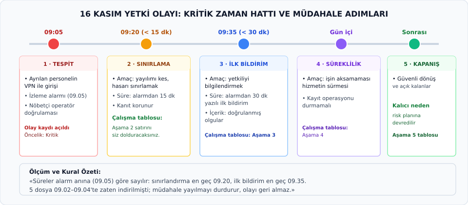

## Görev: Planlanan tedbirden kapıya dayanan kriz müdahalesine

- **Uygulama bağlamı:** Risk işleme planı (Risk Treatment Plan) takvimdeyken sahada gerçekleşen yetki ihlaline acil müdahale, zararı sınırlandırma ve hizmet sürekliliği.
- **Çalışılacak veri:** Duru Eğitim Merkezi kurumsal rolleri, müdahale süre hedefleri ve 16 Kasım sabahı yaşanan `ayrilan-hesap` olay kütüğü.
- **Beklenen çıktı:** Doğrulanan kanıtlara dayalı beş aşamalı olay aksiyon kaydı ve kalıcı risk planına devredilecek açık hususlar tablosu.

**Göreviniz:**

1. Kurumun kurumsal rollerini, kriz anındaki yetki sınırlarını ve operasyonel müdahale hedeflerini inceleyin.
2. 16 Kasım sabahı yaşanan `ayrilan-hesap` yetki ihlali vakasının somut verilerini, doğrulanmış kanıtlarını ve bilinmeyenlerini analiz edin.
3. Rehber satır üzerinden olay aksiyon kaydının alanlarını kavrayın; sınırlandırma, hizmetin sürmesi, güvenli kurtarma ve açık kalan hususlar adımlarını bağımsız olarak planlayın.

*Kurum, kişiler, log kayıtları ve operasyonel veriler kurgusaldır.*

::: {.notes}
Önceki uygulama saatinde kurumun tespit ettiği riskleri azaltmak ve yönetmek üzere bir risk işleme planı (Risk Treatment Plan) hazırlamıştık; ancak güvenlik yönetiminde tedbirlerin planlanması ile sahadaki tehditlerin gerçekleşmesi her zaman aynı takvimde yürümez. Planlanan bir kontrol henüz devreye alınmadan ya da test edilmeden önce kapıya dayanan bir olay karşısında kurumun nasıl refleks vereceği, zararı nasıl sınırlandıracağı ve hizmetin aksamasını nasıl önleyeceği hayati önem taşır. Bu uygulama saatinde proaktif risk yönetiminden reaktif ve acil olay yönetimine (Incident Management) geçiyoruz.

Kâğıt üzerinde `ayrilan-hesap` bulgusu için 18 Kasım'da hesap dondurma ve 25 Kasım'da İK-BT süreç mutabakatı planlanmıştı. Ancak takvim henüz 16 Kasım sabahını gösterirken açık kalan o hesaptan veri indirildi. Tedbir henüz devreye girmemişken olay kapıya dayandığında kimin, hangi yetkiyle, kaç dakika içinde hangi adımı atacağını ve bu adımları nasıl kanıtlı biçimde kayıt altına alacağını bu vakada adım adım çalışacağız.

Çalışmanızda önce Duru Eğitim Merkezi'nin kriz rollerini, müdahale süre sınırlarını ve 16 Kasım vaka verilerini inceleyeceksiniz. Ardından olay aksiyon kaydının yedi alanını çözümlü rehber satır üzerinden analiz edecek; sınırlandırma, ilk bildirim, hizmetin sürmesi, güvenli kurtarma ve kalıcı plana devir aşamalarını çalışma tablolarında bağımsız olarak tamamlayacaksınız. Bir sonraki slaytta, önceki derste kurduğumuz risk aksiyon planı ile bu saatte yürüteceğimiz olay aksiyon planı arasındaki yapısal farkları karşılaştırıyoruz.
:::

---

## Risk aksiyonu ile olay aksiyonunun farkı: Zaman baskısı ve refleksler

Risk aksiyon planı ile olay aksiyon planı arasındaki temel operasyonel farklar:

| Karşılaştırma Ekseni | Risk Aksiyon Planı (Uygulama 1) | Olay Aksiyon Planı (Bu Saat) |
|---|---|---|
| **Zaman boyutu** | Geleceğe dönük (proaktif ve planlı) | Gerçekleşen ana dönük (reaktif ve acil kriz) |
| **Temel amaç** | Riskin olasılık veya etkisini önceden düşürmek | Hasarı durdurmak (sınırlandırma), hizmeti sürdürmek |
| **Zaman baskısı** | Günler, haftalar (planlı termin: 18–25 Kasım) | Dakikalar, saatler (anlık termin: <15 dk, <30 dk) |
| **Kapanış koşulu** | Kontrolün kurulması ve doğrulanmış artık risk | Sistemin güvenle kurtarılması, kök neden raporu |

::: {.notes}
Planlanan bir tedbirin varlığı, sürmekte olan bir olayı kendiliğinden durdurmaz. Risk aksiyon planı henüz gerçekleşmemiş tehditlerin olasılığını veya etkisini düşürmek üzere geleceğe dönük kurgulanırken, olay aksiyon planı fiilen gerçekleşen bir ihlalin ortasında hasarı durdurmak ve kurumun asli hizmetini ayakta tutmak için işletilir. İki plan arasındaki bu ayrım, kriz anında hangi aracın ne zaman kullanılacağını belirleyen temel eşiktir.

İki süreci birbirinden ayıran ana mekanizma tetikleyici olgu ve yönetim yaklaşımıdır. Risk aksiyon planını tetikleyen unsur bir risk değerlendirme kütüğü ya da denetim bulgusudur; yönetim yaklaşımı ise bütçe, proje takvimi, süreç tasarımı ve kalıcı teknik kurulum üzerinden ilerler. Buna karşılık olay aksiyon planını tetikleyen unsur izleme konsoluna düşen bir alarm, izinsiz erişim veya veri indirme tespitidir; burada yönetim yaklaşımı acil teknik sınırlandırma, adli delil koruma ve geçici iş sürekliliği adımlarına dayanır.

Duru Eğitim Merkezi vakası üzerinden okuduğumuzda bu fark somutlaşır: `ayrilan-hesap` riski için 18–25 Kasım aralığına yayılan hesap dondurma ve İK-BT mutabakat prosedürü bir risk aksiyonudur. Oysa 16 Kasım sabahı saat 09.05'te ekrana düşen indirme alarmı karşısında 15 dakika içinde oturumu düşürmek ve 30 dakika içinde delilleri yedekleyip yönetimi bilgilendirmek bir olay aksiyonudur. Kapanış koşulları da farklıdır: risk aksiyonu kontrol doğrulanıp artık risk kabul edilebilir düzeye indiğinde kapanırken, olay aksiyonu sistem güvenle kurtarılıp kök neden kalıcı risk planına devredildiğinde tamamlanır.

Çalışmanızda en çok dikkat etmeniz gereken yanılgı, olay aksiyonunu genel bir süreç iyileştirme projesi gibi yazmaktır. Kriz anında "İK yönetmeliğini güncelledik" veya "yeni kimlik yönetim sistemi satın aldık" gibi haftalar sürecek adımlar olay müdahalesi değildir; olay anında dakikalar içinde hesabı dondurmanız, bağlantıyı kesmeniz ve kurumun meşru kayıt işlerini kilitlememeniz gerekir. Bir sonraki slaytta yer alan zaman çizgisinde, bu dakikalık eşiklerin 16 Kasım sabahındaki vaka akışına nasıl yerleştiğini inceleyeceğiz.
:::

---

## Olay müdahale zaman çizgisi ve kritik eşikler

{width="100%" fig-align="center" fig-alt="Gerçekleşen yetki olayı zaman çizgisi ve acil müdahale süre sınırları"}

::: {.notes}
Zaman çizgisini soldan sağa okuyun. Çizgi 16 Kasım'daki olayı beş aşamaya böler: tespit, sınırlandırma, ilk bildirim, süreklilik, kapanış. Üstteki saatler iki süre sınırını ve bir başlangıç noktasını gösterir: 09.05'te alarm, 09.20'ye kadar sınırlandırma, 09.35'e kadar ilk bildirim.

En önemli ayrıntı başlangıç noktasıdır. Eski personelin hesabıyla giriş 09.02'de yapılmış ve 5 sözleşme dosyası 09.02–09.04 arasında indirilmiştir; ama sayaç bu andan değil, BT'nin alarmı gördüğü 09.05'ten başlar. Bu yüzden 15 dakikalık sınırlandırma hedefi en geç 09.20, 30 dakikalık ilk bildirim hedefi en geç 09.35'tir. Süre hedeflerini kaydederken bu saatleri ham veriden okuyun; kendi tahmininizle ya da yuvarlayarak yazmayın.

Birinci kart vakanın verisini toplar: ayrılan personelin VPN ile girişi, izleme alarmı ve nöbetçi operatörün doğrulaması. Olay kaydı açılmış ve öncelik kritik olarak işaretlenmiştir. İkinci ve üçüncü kartlar süre sınırlı aşamalardır: sınırlandırmanın amacı yayılımı kesmek ve hasarı sınırlamak, ilk bildirimin amacı yetkiliyi doğrulanmış olgularla bilgilendirmektir. Dördüncü ve beşinci kartlarda süre sınırı yoktur; hizmetin sürmesi ve kalıcı nedenin risk planına devri bu aşamaların konusudur. Kartlardaki "Çalışma tablosu" notları, bu aşamaların satırlarını sizin dolduracağınız anlamına gelir; şema bu bilgileri vermez.

Alt şerit iki şeyi birlikte söyler. Birincisi sürelerin alarm anına göre sayıldığıdır. İkincisi daha önemlidir: beş dosya 09.02–09.04'te zaten indirilmişti. Müdahale yayılımı durdurur ama olayı geri almaz. Kayıtta "sorun çözüldü" demek yerine, ne yapıldığını ve ne kadar zararın zaten oluştuğunu ayrı yazmanız gerekir.

Sık yapılan hatalar: sayacı 09.02'den başlatmak, saati yuvarlayarak yazmak, vakada olmayan bir fail ya da sızıntı boyutunu kesin olgu gibi eklemek. Sonraki slaytlarda bu zaman çizgisinin her aşamasını bir olay aksiyon planı satırına çevireceğiz.
:::

---

## Duru Eğitim Merkezi kurumsal rolleri ve olay yetki sınırları

Olay anında yetki karmaşasını ve gecikmeleri önlemek için roller ve karar sınırları önceden belirlenmiştir:

**Operasyonel Roller ve Kriz Görevleri:**

- **BT Sistem Sorumlusu (Müdahale Ekibi):**
  - Olağan dışı sistem ve ağ hareketlerini doğrular.
  - Şüpheli hesapları, ağ oturumlarını ve erişim kanallarını teknik olarak derhal sınırlandırır/kilitler.
  - Mevcut sistem ve erişim loglarını silinmeden ve bozulmadan koruma altına alır.
- **Kayıt Birimi Yöneticisi (İş Sahibi):**
  - İhlal edilen veya erişilen veri varlığının (öğrenci/kursiyer sözleşmeleri) etki kapsamını değerlendirir.
  - Birimin meşru operasyonlarının durmaması için alternatif/yedek yetkili personeli devreye alır.
- **Merkez Müdürü (Nihai Karar ve İletişim Yetkilisi):**
  - Olay müdahale adımlarının onayını verir, birimler arası koordinasyonu sağlar.
  - Kurum içi ve kurum dışı resmi iletişimi ve nihai yönetim kararlarını yürütür.

::: {.notes}
Kriz anında en büyük zaman kaybı, kimin hangi müdahaleyi yapmaya yetkili olduğunun bilinmemesinden doğar. Eğer teknik personel aktif bir veri sızıntısını durdurmak veya şüpheli oturumu düşürmek için üst yönetimin yazılı onayını saatlerce beklemek zorunda kalırsa, 15 dakikalık sınırlandırma hedefi daha ilk adımda kaçırılır. Bu yüzden olay yönetiminde karar yetkilisi, iş sahibi ve teknik uygulayıcı rolleri olay gerçekleşmeden önce birbirinden ayrılır.

Duru Eğitim Merkezi ölçeğinde bu görev ayrımı üç somut aktör üzerinden çalışır: teknik uygulayıcı olan BT Sistem Sorumlusu, şüpheli oturumu derhal kesme ve logları adli bütünlüğü bozulmadan koruma yetkisine sahiptir; ancak iş biriminin çalışma düzenini veya dış iletişimi tek başına belirleyemez. İş sahibi konumundaki Kayıt Birimi Yöneticisi, 80 kursiyer sözleşmesini barındıran süreçte meşru kayıt işlemlerinin durmaması için yedek personeli devreye alır; karar yetkilisi olan Merkez Müdürü ise birimler arası koordinasyonu ve resmi bildirim kararlarını onaylar.

Çalışma tablolarında sorumlu rol sütununu doldururken kurumdaki görev ayrımı ilkesini (hazırlayan ile onaylayanın, teknik uygulayıcı ile iş sahibinin ayrı kişiler olması) korumanız gerekir. Sık yapılan hata, tüm aşamaları "BT birimi yapar" diyerek tek role yıkmak ya da BT sorumlusuna personel görevlendirme ve dış bildirim kararı yazdırmaktır. Bir sonraki slaytta, bu rollerin 9. ve 10. haftadaki risk işleme tablosuyla nasıl bir zaman çelişkisi içinde karşılaştığını göreceğiz.
:::

---

## H9 ve H10 verilerinin yeniden sunumu: Plan henüz tamamlanmamıştı!

Kurumun 9. haftada değerlendirdiği riskler ve 10. haftanın başında hazırladığı işleme takvimi:

| Durum Kısa Adı | H9 Değerlendirmesi | Planlanan İşleme Seçeneği | Hedef Takvim |
|---|---|---|---|
| `ayrilan-hesap` | **Yüksek Risk** (Kabul edilemez) | Riski Azaltma (Dondurma + İK süreci) | 18 Kasım: Dondurma 25 Kasım: Mutabakat |
| `geri-yukleme` | **Yüksek Risk** (Kabul edilemez) | Riski Azaltma (Geri yükleme tatbikatı) | 20 Kasım: Test ortamı |
| `takvim-dosyasi` | **Orta Risk** (Kabul sınırında) | Gerekçeli Kabul veya Azaltma | 14 gün sonra gözden geçirme |

. . .

> **Kritik Çelişki:** Kurum `ayrilan-hesap` için 18 Kasım'ı hedeflemişti; ancak takvim 16 Kasım'ı gösterirken tehdit fiilen gerçekleşti!

::: {.notes}
Nitel 3×3 risk matrisinde "Yüksek Risk" (kabul edilemez) olarak sınıflandırılan bir bulgu için doğru bir işleme planı hazırlamış olmak, kontrol fiilen kurulana kadar kurumun güvende olduğu anlamına gelmez. Duru Eğitim Merkezi 80 kursiyer sözleşmesini ilgilendiren ve son 10 ayrılıştan 2 hesabın 7 gün açık kaldığı tespit edilen `ayrilan-hesap` bulgusu için riski azaltma seçeneğini belirlemiş, 18 Kasım'da hesapların dondurulmasını ve 25 Kasım'da İK-BT süreç mutabakatını takvime bağlamıştır.

Buradaki kritik mekanizma, planlanan termin tarihi ile tehdidin sahada gerçekleştiği an arasındaki iki günlük boşluktur. Risk kütüğünde "18 Kasım'da kapatılacak" yazması, 16 Kasım sabahı o hesaba VPN üzerinden giriş yapılmasını teknik olarak engellemez. Kâğıt üzerindeki tedbir henüz uygulanmadığı için güvenlik açığı sahada aktif kalmış ve tehdit, planlanan dondurma tarihinden iki gün önce gerçekleşmiş bir olaya dönüşmüştür.

Yaygın yanılgı, onaylı bir risk işleme planı bulunduğunda artık sadece termin gününü beklemenin yeterli olduğunu düşünmektir. Oysa 16 Kasım sabahı yaşanan ihlal, konuyu 18–25 Kasım takvimli risk planından çıkarıp dakikalar içinde yönetilmesi gereken acil olay müdahalesi alanına taşır; olay kontrol altına alındıktan sonra ise kalıcı kök neden yeniden bu risk planına bağlanacaktır. Şimdi 16 Kasım sabahı saat 09.02'de başlayan olayın ham verilerini ve kanıt sınırlarını inceleyelim.
:::

---

## Olay vakası: 16 Kasım 09.02 gerçekleşmiş yetki olayı

Duru Eğitim Merkezi'nde 16 Kasım 2026 sabahı yaşanan olay kütüğü:

. . .

**Olayın Gelişimi ve Tespit:**
- **09.02 (Erişim ve İndirme):** İki hafta önce kurumdan ayrılmış olan eski kayıt görevlisinin aktif kalan kullanıcı hesabı üzerinden sisteme uzaktan (VPN/dış IP) başarılı giriş yapıldı.
- **09.02 – 09.04:** Hesap üzerinden Kayıt ve Başvuru Birimi'ne ait **5 kursiyer sözleşme dosyası** (kimlik ve iletişim bilgisi içeren PDF'ler) indirildi.
- **09.05 (Alarm ve Tespit):** BT izleme konsolunda "olağan dışı mesai/lokasyon indirme alarmı" tetiklendi. BT Sistem Sorumlusu bildirimi 09.05'te ekranda gördü.

. . .

**Doğrulanan Olgular ile Bilinmeyenlerin Ayrımı:**
- **Doğrulanan Kanıt:** Eski hesabın oturum açtığı, 5 dosyanın indirildiği IP ve zaman damgasıyla sabittir.
- **Bilinmeyen 1 (Gerçek Kişi):** Hesabı kullanan kişinin gerçekten eski çalışan mı yoksa parolayı ele geçiren başka bir saldırgan mı olduğu bilinmemektedir.
- **Bilinmeyen 2 (Sızıntı Kapsamı):** İndirilen 5 sözleşme dışında başka veri tabanlarına veya dosyalara erişilip erişilmediği henüz araştırılmamıştır.

::: {.notes}
Vaka verisini okurken ilk göreviniz, sistem kayıtlarıyla sabit olan teknik olguları henüz araştırılmamış sorulardan keskin bir çizgiyle ayırmaktır. Olay kütüğü bize üç kesin zaman damgası verir: 09.02'de uzaktan erişimle oturum açılması, 09.02–09.04 aralığında 5 kursiyer sözleşme dosyasının indirilmesi ve 09.05'te izleme konsolundaki alarmın BT Sistem Sorumlusu tarafından görülmesi. Çalışmanızdaki tüm zaman ve kanıt alanları bu doğrulanmış ham veriye dayanmalıdır.

Olay analizinde en kritik disiplin, kayıtlarda görünmeyen hiçbir varsayımı kesinleşmiş olgu gibi aksiyon planına yazmamaktır. Hesabın eski çalışana ait olması, klavyenin başında bizzat o kişinin oturduğunu kanıtlamaz; parolanın başkası tarafından ele geçirilmiş olma ihtimali de, 5 PDF dışında başka verilere erişilip erişilmediği sorusu da olayın başlangıcında "bilinmeyen" statüsündedir. Bir sonraki slaytta, bu olgu ve bilinmeyenler tablosu üzerine kurulan kurumsal müdahale hedeflerini ve süre sınırlarını göreceğiz.
:::

---

## Kurumsal müdahale hedefleri ve süre sınırları

Duru Eğitim Merkezi yönetiminin bu olay için belirlediği operasyonel başarı ölçütleri ve zaman kısıtları:

. . .

1. **Acil Sınırlandırma Hedefi (<15 dakika):**
   - BT Sistem Sorumlusu bildirimi aldığı 09.05 anından itibaren **en geç 15 dakika içinde (en geç 09.20'ye kadar)** ilgili kullanıcı hesabını dondurmalı, aktif oturumu sonlandırmalı ve uzaktan erişim kapısını kapatmalıdır.
2. **Kayıtların Korunması ve İlk Raporlama (<30 dakika):**
   - Olay anına ait sistem, erişim ve indirme logları adli bütünlüğü bozulmadan yedeklenmeli; **en geç 30 dakika içinde (en geç 09.35'e kadar)** Merkez Müdürü'ne yazılı ilk bildirim iletilmelidir.
3. **Temel İş Sürekliliği (Kesintisiz Hizmet):**
   - Kayıt birimindeki meşru kursiyer kayıt ve sözleşme işlemleri durdurulmamalı; yetkili yedek personel devreye alınarak hizmet güvenli biçimde sürdürülmelidir.
4. **Doğrulanmış Güvenli Kurtarma:**
   - Olağan erişim izinleri ancak diğer tüm hesaplar taranıp yetkileri ve güvenlik durumları doğrulandıktan sonra yeniden açılmalıdır.

::: {.notes}
Olay yönetiminde operasyonel başarı "sorunu çözdük" gibi genel ifadelerle değil, önceden tanımlanmış süre eşikleri ve hizmet sürekliliği hedeflerinin karşılanmasıyla ölçülür. Kurum yönetimi kriz anında hem sızıntının büyümesini durdurmak hem de delillerin kaybolmasını ve kayıt işlemlerinin felç olmasını önlemek için dört bağlayıcı hedef koymuştur.

Zaman kısıtlarını hesaplarken dikkat edeceğiniz temel kural, kriz sayacının olayın başladığı 09.02'den değil, alarmın tespit edildiği 09.05 anından başlamasıdır. Buna göre 15 dakikalık acil sınırlandırma hedefi en geç 09.20'de, 30 dakikalık delil yedekleme ve yazılı ilk bildirim hedefi ise en geç 09.35'te tamamlanmak zorundadır. Üçüncü ve dördüncü hedefler ise süre sınırından ziyade koşul sınırına bağlıdır: kayıt hizmetinin yedek personelle kesintisiz sürmesi ve olağan erişimin ancak tüm hesaplar taranıp doğrulandıktan sonra açılması şarttır.

Çalışma tablolarında başlangıç ve bitiş saatlerini planlarken bu eşikleri doğrudan kontrol ölçütü olarak kullanacaksınız. Süre sınırlarını aşan, saat aralığını belirsiz bırakan veya diğer hesaplar doğrulanmadan sistemi normale döndüren bir aksiyon kaydı kurumsal hedefleri karşılamaz. Bir sonraki slaytta, bu hedeflerin yedi sütunlu standart olay aksiyon kaydına nasıl döküldüğünü incelemeye başlıyoruz.
:::

---

## Olay aksiyon planı mimarisi: Müdahale kaydının alanları (1/2)

Olay yönetiminde görevlerin, yetkilerin ve zamanın belgelendiği standart alanlar (Alan 1–4):

| Alan No | Alan Adı | Bu Alanda Ne Açıklanır? |
|---|---|---|
| **1** | **Aşama / Adım No** | Olay yaşam döngüsündeki yeri (Tespit, Sınırlandırma, Süreklilik, Kurtarma, Takip). |
| **2** | **Somut Eylem (Ne yapılacak?)** | Atılacak somut teknik ya da idari adımın açık tanımı. |
| **3** | **Sorumlu Rol (Kim yapacak?)** | Eylemi bizzat icra edecek yetkili kurumsal rol (BT, Kayıt Yöneticisi, Müdür). |
| **4** | **Başlangıç ve Bitiş Zamanı** | Eylemin başladığı ve tamamlandığı saat (dakika hassasiyetiyle). |

::: {.notes}
Acil bir güvenlik olayında yapılan müdahalenin denetlenebilir ve tekrar okunabilir olması, eylemlerin standart bir kayıt mimarisiyle belgelenmesine bağlıdır. İlk dört alan, müdahalenin operasyonel omurgasını kurar: hangi yaşam döngüsü aşamasında olduğumuzu, tam olarak hangi teknik veya idari işlemin yapıldığını, bu işlemi hangi kurumsal rolün yürüttüğünü ve işlemin hangi dakikalar arasında gerçekleştiğini kayıt altına alır.

Bu dört alan kendi arasında sıkı bir nedensellik taşır. Aşama adı (Alan 1) müdahalenin sırasını belirlerken, somut eylem (Alan 2) soyut niyetler yerine icra edilebilir adımları tanımlar. Sorumlu rol (Alan 3) kurumdaki yetki sınırlarına göre tek bir icracıyı işaret eder; başlangıç ve bitiş zamanı (Alan 4) ise işlemin 09.05 alarmından itibaren işleyen 15 ve 30 dakikalık hedeflere uyup uymadığını dakika hassasiyetiyle gösterir.

Kayıt tutarken sık yapılan hata, somut eylem alanına "gerekli inceleme yapıldı" gibi belirsiz ifadeler yazmak ya da zaman alanına başlangıç-bitiş aralığı yerine tek bir saat veya "hemen" kelimesini bırakmaktır. Dakika bazında başlangıç ve bitiş saati yazılmayan bir kayıtta süre sınırlarına uyulduğu doğrulanamaz. Bir sonraki slaytta, bu operasyonel adımları kanıt ve açık hususlarla tamamlayan son üç alanı göreceğiz.
:::

---

## Olay aksiyon planı mimarisi: Müdahale kaydının alanları (2/2)

Dayanak, kanıt ve açık hususların belgelendiği alanlar (Alan 5–7):

| Alan No | Alan Adı | Bu Alanda Ne Açıklanır? |
|---|---|---|
| **5** | **Tetikleyici Dayanak** | Bu eylemin başlatılmasını gerektiren somut bulgu, kural veya yetki kararı. |
| **6** | **İşlem ve Sonuç Kaydı** | Eylemin tamamlandığını kanıtlayan teknik log, tutanak veya yazılı bildirim. |
| **7** | **Açık Kalan Husus / Sınır** | Bu adımın çözemediği, devam eden inceleme veya devredilen kalıcı risk konusu. |

::: {.notes}
Olay aksiyon kaydının son üç alanı (Alan 5–7), yapılan müdahalenin hukuki, teknik ve yönetsel güvencesini oluşturan kanıt ve dürüst sınır omurgasıdır. Bir kriz adımının yalnızca "yapıldı" olarak işaretlenmesi yeterli değildir; o adımın hangi somut gerekçeyle başlatıldığı, tamamlandığının hangi kayıtla kanıtlandığı ve o adım bittiğinde geriye hangi çözülmemiş risklerin kaldığı açıkça belgelenmelidir.

Alanların işleyişinde her sütun farklı bir doğrulama sorusuna yanıt verir. Tetikleyici dayanak (Alan 5), eylemi keyfîlikten çıkarıp bir izleme alarmına, önceki aşamanın doğrulama çıktısına veya kurumsal müdahale kuralına bağlar. İşlem ve sonuç kaydı (Alan 6), sözlü beyan yerine sistem logu, hesap dondurma kaydı, yedekleme tutanağı veya yazılı bildirim gibi denetlenebilir bir kanıt arar. Açık kalan husus alanı (Alan 7) ise atılan adımın kapsam sınırını çizer.

Özellikle yedinci alan, olay yönetiminde "hesabı kapattık, tehlike tamamen bitti" yanılgısını önleyen en kritik emniyet sübabıdır. Örneğin bir oturumu sonlandırmak o andaki veri akışını keser ama daha önce indirilen 5 dosyanın akıbetini veya İK-BT arasındaki süreç boşluğunu çözmez. İzleyen iki slaytta, bu yedi alanın tamamının ilk aşama olan tespit ve doğrulama satırında nasıl uygulandığını çözümlü örnek üzerinden inceleyeceğiz.
:::

---

## Rehber satır analizi: Tespit ve doğrulama adımının belgelenmesi (1/2)

Adım 1'in (Tespit ve Doğrulama) kurumsal olay kütüğünde nasıl belgelendiğini inceleyelim (Alan 1–4):

| Plan Alanı | Kurumsal Uygulama Kaydı (Rehber Çözüm) | Değerlendirme ve Pedagojik Ölçüt |
|---|---|---|
| **1. Aşama / Adım** | Adım 1 — Tespit ve İlk Doğrulama | Olay yaşam döngüsünün ilk adımıdır. |
| **2. Somut Eylem** | İzleme alarmı incelenir, indirme logları çekilir, oturumun aktifliği doğrulanır. | Panik yapmadan olgunun doğrulanmasıdır. |
| **3. Sorumlu Rol** | **BT Sistem Sorumlusu** | İzleme ve log analiz yetkisine sahip teknik roldür. |
| **4. Zaman Aralığı** | **09.05 – 09.08** (Toplam süre: 3 dakika) | Alarm anından hemen sonra hızlıca tamamlanır. |

::: {.notes}
Çözümlü rehber satırın bu ilk bölümü, bağımsız çalışmada dolduracağınız dört aşama için somut bir belgeleme standardı sunar. Olay yaşam döngüsü tespit ve ilk doğrulama aşamasıyla başlar: ekrana düşen alarmın yanlış pozitif (false positive) olup olmadığını anlamak için önce alarm içeriği incelenir, indirme logları çekilir ve şüpheli oturumun hâlen aktif olup olmadığı teknik olarak doğrulanır.

Sorumlu rol ve zaman aralığının yazılış biçimine özellikle dikkat edin. Log analizi ve oturum kontrolü doğrudan teknik bir yetki olduğu için sorumlu rol yalnızca BT Sistem Sorumlusu olarak tanımlanmıştır. Zaman aralığı ise alarmın görüldüğü 09.05'te başlayıp 09.08'de tamamlanacak şekilde 3 dakika olarak kaydedilmiştir; böylece bir sonraki aşama olan acil sınırlandırma için 09.20 eşiğinden önce 12 dakikalık net bir müdahale süresi bırakılmıştır.
:::

---

## Rehber satır analizi: Tespit ve doğrulama adımının belgelenmesi (2/2)

Adım 1'in dayanak, kanıt ve açık kalan sınır alanları (Alan 5–7):

| Plan Alanı | Kurumsal Uygulama Kaydı (Rehber Çözüm) | Değerlendirme ve Pedagojik Ölçüt |
|---|---|---|
| **5. Dayanak** | İzleme konsolundaki olağan dışı mesai/lokasyon alarmı (Kural: Yetkisiz erişim alarmı). | Somut teknik tetikleyicidir. |
| **6. İşlem Kaydı** | Güvenlik konsolu alarm çıktısı ve 09.02–09.04 zaman damgalı 5 indirme satırının log özeti. | Ham veriye dayalı kanıttır. |
| **7. Açık Kalan Sınır** | Oturumun açık olduğu ve dosya indirildiği kesindir; ancak indiren kişinin kimliği bilinmemektedir. | Kanıtlanamayan iddia (fail) peşinen yazılmaz. |

::: {.notes}
Rehber satırın ikinci bölümü, yapılan doğrulamanın nesnel dayanağını, kanıtını ve sınırını kayıt altına alır. Beşinci alanda eylemin tetikleyicisi olarak izleme konsolundaki olağan dışı mesai/lokasyon alarmı gösterilmiş; altıncı alanda ise "kontrol edildi" gibi soyut bir ifade yerine güvenlik konsolu alarm çıktısı ve 09.02–09.04 zaman damgalı 5 indirme satırının log özeti somut kanıt olarak yazılmıştır.

Yedinci alandaki açık kalan sınır ifadesi, analitik dürüstlük ölçütünün nasıl uygulanacağını doğrudan örnekler. Doğrulama sonunda eski hesabın oturum açtığı ve 5 dosyanın indirildiği kesinleşmiştir; ancak hesabı kullanan kişinin gerçek kimliği henüz bilinmemektedir. Kayıtta "eski çalışan verileri çaldı" gibi kanıtlanmamış bir iddia kurulmamış, bilinen teknik olgu ile bilinmeyen fail ayrımı net biçimde korunmuştur. Şimdi bu rehber modeli temel alarak kalan dört aşamayı bağımsız görevde nasıl çalışacağınızı görelim.
:::

---

## Bağımsız görev: Gerçekleşmiş yetki olayı aksiyon planını hazırlama

Rehber satır modelini ve kurum verilerini kullanarak, 16 Kasım yetki olayı için aşağıdaki dört aşamanın olay aksiyon tablosunu hazırlayın:

. . .

**Tamamlanacak Aşamalar:**

1. **Aşama 2 — Acil Sınırlandırma ve Delil Koruma:** Hesabın dondurulması, oturumun düşürülmesi ve logların bütünlüğünün korunması. (<15 dk hedefi).
2. **Aşama 3 — İlk Durum Bildirimi:** Merkez Müdürü'ne yazılı bilgilendirme ve koordinasyonun başlatılması. (<30 dk hedefi).
3. **Aşama 4 — Hizmetin Sürmesi (Temel İş Sürekliliği):** Kayıt işlemlerinin durmaması için yedek personelin görevlendirilmesi ve güvenli yetkilendirme.
4. **Aşama 5 — Güvenli Kurtarma, Doğrulama ve Açık Kalanlar:** Diğer hesapların taranması, sistemin güvenle normale dönmesi ve kalıcı risk planına devredilecek açık hususların listelenmesi.

::: {.notes}
Bu bağımsız görevde amacınız, 16 Kasım sabahı tespit edilen yetki ihlali için dört ardışık müdahale aşamasını yedi alanlı olay aksiyon tablosuna dönüştürmektir. Bireysel ya da ikili çalışma düzeninde, önceki slaytlarda verilen kurumsal rol tanımlarını, vaka zaman damgalarını ve kurumsal müdahale hedeflerini kullanarak her aşama için eksiksiz birer kayıt satırı oluşturacaksınız.

Çalışırken aşamalar arasındaki mantıksal ve zamansal sürekliliği korumaya odaklanın. Her aşamada eylemi yürütecek doğru kurumsal rolü seçmeli, başlangıç ve bitiş saatlerini bir önceki adımın bitişiyle ve kurumun dakika hedefleriyle uyumlu kurmalı, yapılan işlemi doğrulayan somut bir kayıt türü tanımlamalı ve o adımın çözemediği açık hususu bir sonraki aşamaya veya kalıcı risk planına bağlamalısınız. Bir sonraki slaytta, yazdığınız satırların hangi kalite ölçütleriyle değerlendirileceğini inceleyeceğiz.
:::

---

## Başarı ve değerlendirme ölçütleri: Kayıtta aranacak sınırlar

Olay aksiyon planınız değerlendirilirken şu beş temel sınır aranacaktır:

. . .

- **Rol ve Yetki Uyumu:** Teknik işi BT, iş sürekliliğini Kayıt Birimi, nihai onayı Merkez Müdürü yürütmelidir.
- **Zaman Sınırları:** Sınırlandırma en geç 09.20 (<15 dk), ilk bildirim en geç 09.35 (<30 dk) olmalıdır.
- **Somut Kanıt Kaydı:** "Hesap kapatıldı" yerine sistem logu veya tutanak gibi doğrulanabilir kayıt yazılmalıdır.
- **Varsayımsızlık:** Vakada verilmeyen fail kimliği ve senaryolar kesin olgu gibi yazılmamalıdır.
- **Kalıcı Tedbir Ayrımı:** Yapısal İK süreçleri acil müdahalede kapatılamaz; kalıcı risk planına devredilmelidir.

::: {.notes}
Olay aksiyon kaydının kalitesini belirleyen bu beş ölçüt, gerçek bir kriz kütüğünün denetimde geçerli sayılması için aranan asgari sınırlardır. Rol ve yetki uyumu ile zaman sınırları, müdahalenin doğru aktörler tarafından kurumsal süre hedefleri içinde yapılıp yapılmadığını ölçerken; somut kanıt kaydı ve varsayımsızlık ilkeleri belgenin teknik ve hukuki güvenilirliğini korur.

Çalışma tablolarınızı doldururken sık düşülen dört hatadan özellikle kaçınmanız gerekir: teknik müdahale ile iş birimi veya müdür yetkilerini birbirine karıştırmak, alarm anı olan 09.05'i gözden kaçırarak 15 ve 30 dakikalık süre pencerelerini aşmak, vaka verisinde yer almayan polisiye fail senaryoları üretmek ve haftalar sürecek yapısal İK-BT prosedür değişikliklerini acil olay anında tamamlanmış gibi göstermek. İzleyen beş slaytta yer alan çalışma şablonlarını bu beş ölçütü gözeterek sırasıyla doldurabilirsiniz.
:::

---

## Çalışma tablosu: Aşama 2 — Sınırlandırma ve delil koruma

Aşama 2 için çalışma şablonunuzu doldurun:

| Aşama / No | Somut Eylem Tanımı | Sorumlu Rol | Zaman Aralığı | Tetikleyici Dayanak | İşlem ve Kanıt Kaydı | Açık Kalan Sınır |
|---|---|---|---|---|---|---|
| **Aşama 2: Sınırlandırma ve Delil Koruma** | *Şüpheli hesabın kilitlenmesi, oturumun kesilmesi, logların güvene alınması...* | *...* | *...* | *Adım 1 doğrulama sonucu ve acil müdahale kuralı* | *...* | *...* |

::: {.notes}
Bu çalışma tablosunda, ilk doğrulamanın hemen ardından yayılımı durduracak acil sınırlandırma ve adli delil koruma adımlarını belgeleyeceksiniz. Somut eylem sütununu yazarken yalnızca erişimin kesilmesini değil, mevcut sistem ve indirme kayıtlarının bozulmadan koruma altına alınmasını da aynı aşamanın ayrılmaz parçası olarak ele almanız gerekir.

Sütunları doldururken kurumsal rol tanımlarındaki teknik müdahale yetkisini, önceki doğrulama satırının bitiş saati ile kurumsal acil sınırlandırma hedefi arasındaki zaman penceresini kontrol edin. İşlem kaydı alanında yapılan teknik müdahaleyi ve log korumayı kanıtlayan doğrulanabilir çıktıları belirtmeli; açık kalan sınır alanında ise erişimi kesmenin geçmişte gerçekleşmiş işlemleri veya yapısal nedenleri tek başına ortadan kaldırmadığını dikkate almalısınız.
:::

---

## Çalışma tablosu: Aşama 3 — İlk durum bildirimi

Aşama 3 için çalışma şablonunuzu doldurun:

| Aşama / No | Somut Eylem Tanımı | Sorumlu Rol | Zaman Aralığı | Tetikleyici Dayanak | İşlem ve Kanıt Kaydı | Açık Kalan Sınır |
|---|---|---|---|---|---|---|
| **Aşama 3: İlk Durum Bildirimi** | *Olayın kapsamı, yapılan acil müdahale ve riskin Merkez Müdürü'ne iletilmesi...* | *...* | *...* | *Kurumsal olay bildirim prosedürü* | *...* | *...* |

::: {.notes}
Bu çalışma tablosunun amacı, teknik sınırlandırma sonrasında kurum yönetiminin doğrulanmış olgularla bilgilendirilmesi ve koordinasyonun başlatılması adımını kayıt altına almaktır. Bildirim içeriğini tanımlarken yalnızca kanıtlanmış verilerin ve o ana kadar alınan acil önlemlerin raporlanmasına, henüz kesinleşmemiş hususların ise varsayım katılmadan aktarılmasına özen gösterin.

Sorumlu rol, zaman aralığı ve işlem kaydı sütunlarını çalışırken kurumsal müdahale hedeflerindeki ilk raporlama süre sınırını ve kurumsal iletişim akışını esas alın. Sözlü bilgilendirme yerine denetlenebilir yazılı bildirim kanıtının nasıl tanımlanacağını ve bildirim yapıldıktan sonra hangi operasyonel veya inceleme konularının hâlen açık kaldığını ilgili sütunlarda netleştirin.
:::

---

## Çalışma tablosu: Aşama 4 — Hizmetin sürmesi

Aşama 4 için çalışma şablonunuzu doldurun:

| Aşama / No | Somut Eylem Tanımı | Sorumlu Rol | Zaman Aralığı | Tetikleyici Dayanak | İşlem ve Kanıt Kaydı | Açık Kalan Sınır |
|---|---|---|---|---|---|---|
| **Aşama 4: Hizmetin Sürmesi** | *Kayıt operasyonlarının durmaması için yedek yetkili personelin atanması ve çift onay...* | *...* | *...* | *Kayıt birimi iş sürekliliği ihtiyacı* | *...* | *...* |

::: {.notes}
Bu aşamada, güvenlik müdahalesi devam ederken kurumun asli faaliyeti olan kursiyer kayıt ve sözleşme işlemlerinin felç edilmeden nasıl sürdürüleceğini planlayacaksınız. Bilgi güvenliğinde temel iş sürekliliği ilkesi, ihlal edilen kanal kapatılırken meşru iş süreçlerinin kontrollü ve güvenli bir alternatif üzerinden devam ettirilmesini gerektirir.

Tabloyu doldururken teknik sistem yönetimi ile iş birimi sahipliği arasındaki rol ayrımına dikkat edin; iş sürecinin aksamaması için kimin görevlendirme yapacağını ve bu geçici çalışma düzeninin hangi resmi kayıtla belgeleneceğini belirleyin. Açık kalan sınır sütununda ise geçici süreklilik önleminin acil işi yürüttüğünü ancak sistemin genel güvenlik doğrulamasını tek başına tamamlamadığını göz önünde bulundurun.
:::

---

## Çalışma tablosu: Aşama 5 — Güvenli kurtarma ve tarama

Aşama 5 için çalışma şablonunuzu doldurun:

| Aşama / No | Somut Eylem Tanımı | Sorumlu Rol | Zaman Aralığı | Tetikleyici Dayanak | İşlem ve Kanıt Kaydı | Açık Kalan Sınır |
|---|---|---|---|---|---|---|
| **Aşama 5: Güvenli Kurtarma ve Tarama** | *Diğer hesap ve yetkilerin taranması, sistemin güvenli doğrulanması ve olağan erişimin açılması...* | *...* | *...* | *Sistemin temiz olduğunun teyidi kuralı* | *...* | *...* |

::: {.notes}
Beşinci aşama çalışma tablosu, acil kriz düzeninden olağan çalışma düzenine güvenli dönüşün koşullarını belgelemek içindir. Kurumsal müdahale hedeflerinde vurgulandığı üzere, tek bir şüpheli hesabı kapatmak sistemin tamamının temiz olduğu anlamına gelmez; olağan erişim izinlerine dönülmeden önce yapılması gereken kapsamlı kontrol ve doğrulama adımlarını bu satırda tanımlamalısınız.

Çalışmanızda bu doğrulama ve kurtarma işlemini hangi rolün yürüteceğini, sistemin temiz olduğunun hangi teknik çıktılarla kanıtlanacağını ve kurtarma tamamlandığında bile olay müdahalesinin tek başına çözemeyeceği hangi yapısal ya da adli başlıkların kalıcı süreçlere devredileceğini dikkatle ayrıştırın. Bir sonraki slaytta, bu açık başlıkların devir tablosunu ayrıntılı olarak çalışacaksınız.
:::

---

## Çalışma tablosu 3: Doğrulama, açık kalan hususlar ve kalıcı risk bağı

Olay müdahalesi tamamlandığında kurum hangi durumda kalır? Açık kalan hususları ve kalıcı riske devri belirleyin:

| No | Açık Kalan Husus / Boyut | Olay Kapanışındaki Mevcut Durum ve Sınır | Devredilen Süreç / Kalıcı Çözüm Adresi |
|---|---|---|---|
| **1** | **Failin Kimliği Sorunu** *(Adli/Yasal)* | *...* | *...* |
| **2** | **Sızıntının Kapsamı** *(Teknik Boyut)* | *...* | *...* |
| **3** | **Kalıcı Kök Neden** *(Risk Planı Bağı)* | *...* | *...* |

::: {.notes}
Olay müdahalesi tamamlandığında acil kriz durdurulmuş olur; ancak krizin durması kurumun riskinin tamamen bittiği anlamına gelmez. Bir yangını söndürmüş olmak, binadaki elektrik tesisatının arızasını gidermiş olmak demek değildir: yangını söndürmek ve binayı emniyete almak olay yönetimidir; yangına yol açan tesisat kusurunu projelendirip yenilemek ise risk işleme sürecidir.

Bu çalışma tablosunda olay kapanışında açık kalan üç boyutu (adli/yasal açıdan failin kimliği, teknik açıdan sızıntının tam kapsamı ve yapısal açıdan kalıcı kök neden) ayrı ayrı değerlendireceksiniz. Her satırda önce olay kaydı kapanırken eldeki doğrulanmış durumu ve sınırı tanımlamalı, ardından bu konunun hangi inceleme sürecine veya hangi risk işleme planı aksiyonuna devredileceğini yazmalısınız.
:::

---

## Öz değerlendirme ve olay kaydı kontrol listesi

Çalışmanızı teslim etmeden önce aşağıdaki kontrol sorularıyla doğruluğunu sınayın:

. . .

- [ ] **Süre hedefleri tutuyor mu?** Sınırlandırma eylemi bildirimin alındığı 09.05'ten itibaren 15 dakika içinde tamamlanmış olarak görünüyor mu?
- [ ] **Müdür bilgilendirildi mi?** İlk bildirim 30 dakika sınırını aşmadan ve yazılı bir kanıta dayanarak iletildi mi?
- [ ] **Hizmet durduruldu mu?** Kayıt biriminin sözleşme ve başvuru işlemleri felç edilmeden, yetkili yedek personel üzerinden kontrollü devam ettirildi mi?
- [ ] **İşlem kayıtları somut mu?** "Kapatıldı, bakıldı" yerine "hesap dondurma logu, sistem erişim kaydı, onay tutanağı" gibi doğrulanabilir kayıt türleri yazıldı mı?
- [ ] **Açık kalan hususlar dürüstçe ayrıldı mı?** Bilinmeyen gerçek fail veya kesinleşmemiş sızıntı boyutları "olay kapandı" diyerek hasıraltı edilmek yerine açık inceleme işi olarak kaydedildi mi?
- [ ] **Kalıcı kök neden doğru yere bağlandı mı?** İK-BT süreç gecikmesi acil olay kütüğünde kapatılmayıp, H10-1 risk işleme planındaki kalıcı aksiyona devredildi mi?

::: {.notes}
Hazırladığınız olay aksiyon tablolarını teslim etmeden önce bu altı kontrol sorusunu çapraz denetim listesi olarak kullanın. İlk üç soru müdahalenin operasyonel hızını ve iş sürekliliği dengesini sınarken; son üç soru kayıtlarınızın kanıt kalitesini, varsayımsızlık disiplinini ve olay yönetimi ile risk yönetimi arasındaki yapısal bağı kontrol eder.

Tablolarınızda bu sorulardan herhangi birine "hayır" veya "kısmen" yanıtı düşüyorsa, ilgili aşamanın saat aralığını, sorumlu rolünü, kanıt türünü veya açık kalan sınır sütununu yeniden gözden geçirin. Tüm maddeleri doğruladığınızda, 10. haftanın hem risk işleme hem de olay müdahalesi halkalarını birbirine tutarlı biçimde bağlamış olursunuz.
:::

---

## Hafta 10 kapanışı: Olaydan kimlik ve yetki yönetimine (Hafta 11'e çıkış)

**Bu derste, planlanan tedbirlerin ötesinde gerçekleşen bir yetki ihlali krizinde kurumsal reflekslerin, zaman kısıtlarının ve belgeleme adımlarının nasıl işletildiğini deneyimlediniz.**

. . .

**Hafta 10'da Neleri Tamamladık?**
- **Teori:** Risk işleme seçenekleri, artık risk kavramı, olay yönetiminin 6 adımı ve temel iş sürekliliği.
- **Uygulama 1:** Duru Eğitim Merkezi'nin üç riski için onaylı Risk İşleme Planı ve doğrulanmış artık risk kaydı.
- **Uygulama 2:** 16 Kasım yetki olayına acil müdahale, sınırlandırma, iş sürekliliği, delil koruma ve açık hususların kalıcı plana devri.

. . .

**Hafta 11'de Nereye Geçiyoruz?**
- Yaşadığımız olayın kök nedeni neydi? **Kullanıcı kimlikleri, rolleri ve erişim yetkileri!**
- Önümüzdeki hafta: Kimlik doğrulama modelleri, rol tabanlı erişim denetimi (RBAC), yetki matrisleri ve en az yetki (Least Privilege) ilkesi.

::: {.notes}
Onuncu haftanın dört saatlik akışında bilgi güvenliği yönetiminin iki tamamlayıcı yüzünü birlikte kurduk. Teori saatlerinde risk işleme seçeneklerini, artık risk kavramını, olay yönetiminin altı adımını ve temel iş sürekliliğini öğrendik; ilk uygulamada Duru Eğitim Merkezi'nin üç bulgusu için onaylı risk işleme planını hazırladık, bu ikinci uygulamada ise plan henüz takvimdeyken gerçekleşen 16 Kasım yetki olayına dakikalık hedeflerle müdahale edip açık kalan kök nedenleri yeniden kalıcı risk planına bağladık.

Bu vakanın arkasındaki yapısal soruya dikkat edin: Duru Eğitim Merkezi'nde 16 Kasım sabahı yaşanan kriz, özünde bir kimlik ve yetki yönetimi boşluğundan doğmuştur. Kurumdan ayrılan 10 personelden 2'sinin hesabının 7 gün boyunca açık kalması ve 80 kursiyer sözleşmesine uzaktan erişilebilmesi, kimin hangi veriye hangi koşulda erişebileceğinin ve işten ayrılışta yetkilerin nasıl geri alınacağının sistematik bir kurala bağlanmadığını gösterir.

Önümüzdeki hafta (Hafta 11), olay kütüğünde "kalıcı kök neden" olarak işaretlediğimiz bu sorunu kaynağında çözen Kimlik ve Erişim Yönetimi konusuna geçiyoruz. Kimlik doğrulama modellerini, rol tabanlı erişim denetimini (RBAC), kurumsal yetki matrislerinin nasıl kurulduğunu ve en az yetki (Least Privilege) ilkesinin yetki ihlallerini daha oluşmadan nasıl engellediğini inceleyeceğiz.
:::
