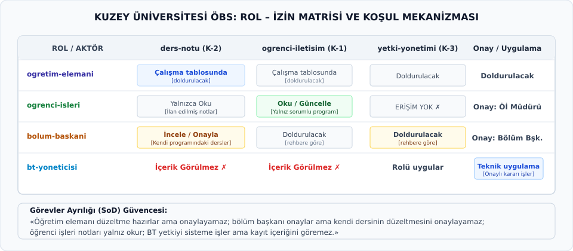

## Görev: Kuzey Üniversitesi ÖBS'de kim, neye, hangi izinle erişmeli?

- **Kurumsal bağlam:** Kuzey Üniversitesi Bilgisayar Programcılığı ÖBS'sinde öğrenci iletişim bilgileri, ders notları ve kullanıcı yetkileri tutulmaktadır.
- **Mevcut sorun:** Geçmişte kişisel ricalarla ve gelişigüzel tanımlanan erişim izinleri yetki karmaşasına ve denetim belirsizliğine yol açmıştır.
- **İncelenecek veriler:** Veri sözlüğündeki üç bilgi kaynağı (`ogrenci-iletisim`, `ders-notu`, `yetki-yonetimi`), iş rolleri, beş kurumsal karar ilkesi ve çözümlü `ogrenci-isleri` rehber satırı.
- **Beklenen çıktı:** `ogretim-elemani`, `bolum-baskani` ve `bt-yoneticisi` rolleri için açık koşul ve gerekçelerle doldurulmuş rol–varlık–eylem–koşul matrisi ve sorumluluk zinciri.

::: {.notes}
Uygulama çalışmasında bir bilgi güvenliği yöneticisinin veya denetçisinin kurumsal bir bilgi sisteminde yürüttüğü temel yetkilendirme tasarımını deneyimleyeceksiniz. Sisteme kullanıcı adı ve parolayla giriş yapabilmek yalnızca kimlik doğrulamadır; kimin hangi bilgi varlığı üzerinde hangi işlemi yapabileceğini ve bu yetkinin kim tarafından onaylanıp uygulanacağını belirlemek ise erişim kontrolünün asıl konusudur.

Çalışmanızda kullanacağınız kısa adlar kurgusallaştırılmış senaryodaki bilgi varlıklarını ve iş rollerini bire bir temsil eder. Önce veri sözlüğünü, kurumsal karar ilkelerini ve çözümlü rehber satırı inceleyecek; ardından kalan üç rol için tabloları doldururken her hücrede kapsam koşullarını ve kurumsal gerekçeleri açık cümlelerle kuracaksınız.
:::

---

## Kurum ve problem: kişisel taleplerden kurumsal düzene

Kuzey Üniversitesi'nde ÖBS kullanımında bugüne kadar şu sorunlar gözlenmiştir:

- **Yetki genişlemesi:** Bir dönem ders veren veya idari işe destek olan personele tam yetki verilmiş, görev bitiminde bu yetkiler geri alınmamıştır.
- **Görevlerin birbirine karışması:** Not düzeltmelerini hazırlayan personelin düzeltmeyi bizzat onaylayabildiği durumlar yaşanmıştır.
- **Teknik yetkinin veri yetkisi sayılması:** BT çalışanlarının sistem bakımını yaparken öğrencilerin kişisel iletişim verilerini ve ders başarı notlarını doğrudan görüntülediği tespit edilmiştir.

Yönetim, tüm erişimleri **rol–varlık–izin matrisi** ile kurumsal kurallara bağlamak istemektedir.

::: {.notes}
Kuzey Üniversitesi'nde gözlenen üç sorun, erişim yönetiminde en sık karşılaşılan yönetsel zafiyetleri somutlaştırır. İlk sorun olan yetki birikmesi (privilege creep), geçici görev veya ders görevlendirmesi biten personelin haklarının kapatılmaması sonucu ortaya çıkar; kişi kurumda kaldıkça yetkileri üst üste eklenir ve en az ayrıcalık ilkesi fiilen ortadan kalkar.

İkinci sorun görevlerin ayrılığı (segregation of duties) ilkesinin ihlalidir; bir işlemi hazırlayan ile onaylayan aynı kişi olduğunda hata veya suistimali yakalayacak iç kontrol mekanizması çöker. Üçüncü sorun ise teknik işletim yetkisi ile veri sahipliğinin karıştırılmasıdır; sistem bakımı yapan bir BT çalışanının teknik erişim olanağına sahip olması, öğrencilerin kişisel iletişim bilgilerini veya ders notlarını görüntüleme meşru hakkı doğurmaz.

Kişisel ricalara ve alışkanlıklara dayalı bu düzensizliği gidermenin yolu, erişim kararlarını kişilere değil tanımlı iş rollerine ve bilgi varlıklarına bağlamaktır. Bir sonraki slaytta kuracağımız matrisin ilk adımı olarak ÖBS'deki üç bilgi kaynağının kapsamını ve koruma önceliklerini inceleyeceğiz.
:::

---

## Veri sözlüğü: bilgi kaynakları

ÖBS içerisinde yönetilen üç temel bilgi kaynağı ve kapsamları:

| Kısa ad | Bilgi kaynağı | Temsil ettiği içerik ve risk alanı |
|---|---|---|
| `ogrenci-iletisim` (K-1) | Öğrenci iletişim kayıtları | Program öğrencilerinin ev adresi, telefon numarası ve kişisel e-posta kayıtları. Gizlilik ve kişisel verilerin korunması önceliklidir. |
| `ders-notu` (K-2) | Ders başarı ve not kayıtları | BGT201, BLP1003 gibi derslerin ara sınav, final, harf notları ve resmi not düzeltme işlemleri. Bütünlük ve görev ayrılığı önceliklidir. |
| `yetki-yonetimi` (K-3) | Kullanıcı ve yetki tanımları | ÖBS kullanıcı hesapları, role atamalar, parola ilkeleri ve erişim izinlerini tutan yönetim kayıtları. Yetkilendirme bütünlüğü önceliklidir. |

::: {.notes}
Veri sözlüğündeki üç bilgi varlığı farklı güvenlik önceliklerine sahiptir ve bu nedenle aynı erişim kuralıyla yönetilemez. `ogrenci-iletisim` doğrudan kişisel verileri barındırdığı için temel risk alanı gizliliktir; bu kayıtlara yalnızca öğrenci işleri süreçlerini yürüten idari rolün kendi program kapsamında erişmesi gerekir.

`ders-notu` öğrencilerin akademik durumunu ve mezuniyet hakkını belirleyen resmi kayıtları kapsar; burada bilginin doğruluğu ve yetkisiz değiştirilmemesi, yani bütünlük ve görev ayrılığı ön plandadır. `yetki-yonetimi` ise ÖBS'deki tüm hesapların ve rol atamalarının tutulduğu yönetim katmanıdır; bu kaynağın bütünlüğü bozulduğunda diğer tüm varlıkların erişim sınırları da aşılabilir.

Matris çalışmasında bir rolün hangi kaynağa erişebileceğine karar verirken önce kaynağın bu koruma önceliğine bakılır. İzleyen iki slaytta bu üç varlık üzerinde işlem talep edebilecek idari, akademik ve teknik iş rollerinin meşru görev sınırlarını ele alacağız.
:::

---

## Veri sözlüğü: iş rolleri — İdari ve akademik (1/2)

Senaryoda tanımlı temel idari ve akademik roller:

| Kısa ad | Rol adı | Kurumdaki meşru iş ihtiyacı ve sınırları |
|---|---|---|
| `ogrenci-isleri` (Öİ) | Öğrenci İşleri Uzmanı | Sorumlu olduğu programın K-1 kayıtlarını günceller; mezuniyet ve kayıt kontrolü için yayımlanmış K-2 notlarını okur. |
| `ogretim-elemani` (ÖE) | Öğretim Elemanı | Yalnız resmi görevlendirildiği derslerin K-2 notlarını okur ve not girişi / düzeltme talebi hazırlar. K-1'e erişimi yoktur. |
| `bolum-baskani` (BB) | Bölüm Başkanı | Programındaki tüm derslerin K-2 kayıtlarını inceler; öğretim elemanlarının hazırladığı not düzeltmelerini onaylar. |

::: {.notes}
İdari ve akademik roller tanımlanırken kişilerin unvanlarına değil, yürüttükleri işin gerektirdiği meşru sınırlara odaklanıyoruz. Öğrenci İşleri Uzmanı (`ogrenci-isleri`) yalnız sorumlu olduğu programdaki öğrencilerin iletişim kayıtlarını güncelleyebilir; ders notlarında ise not verme veya değiştirme yetkisi olmaksızın yalnızca kayıt ve mezuniyet kontrolü amacıyla ilan edilmiş notları okuyabilir.

Öğretim Elemanı (`ogretim-elemani`) yalnız ilgili yarıyılda resmi olarak görevlendirildiği derslerin notlarını okuyup girebilir ve hata durumunda düzeltme talebi hazırlayabilir; öğrencilerin ev adresi ve kişisel telefon bilgilerini içeren iletişim kayıtlarına erişim ihtiyacı yoktur. Bölüm Başkanı (`bolum-baskani`) ise program genelinde akademik denetim yürüttüğü için programındaki tüm derslerin not kayıtlarını inceleme ve öğretim elemanlarının hazırladığı düzeltme taleplerini onaylama görevini üstlenir.

Kurumsal hayatta aynı kişi birden fazla şapka taşıyabilir; örneğin Bölüm Başkanı aynı zamanda bir dersin öğretim elemanıdır. Ancak sistemde işlem yapılırken hangi şapkayla hareket edildiği ayrılmalı ve kimse kendi hazırladığı işlemi yönetici şapkasıyla onaylamamalıdır; bu ayrımı tamamlayan teknik ve üst onay rollerini bir sonraki slaytta göreceğiz.
:::

---

## Veri sözlüğü: iş rolleri — Teknik ve üst onay (2/2)

Senaryoda tanımlı teknik işletim ve üst onay rolleri:

| Kısa ad | Rol adı | Kurumdaki meşru iş ihtiyacı ve sınırları |
|---|---|---|
| `bt-yoneticisi` (BT) | BT Yetki Yöneticisi | Onaylanmış talepleri K-3 üzerinde uygular; K-1 ve K-2 içeriklerini doğrudan görüntüleme meşru hakkı yoktur. Kendi yetkisinde üst onay makamı BT Daire Başkanı / Genel Sekreterlik, uygulayıcı ise ikinci bağımsız sistem yöneticisidir. |
| `dekanlik-mudurluk` (DM) | Dekanlık / Müdürlük | Bölüm başkanının bizzat hazırladığı düzeltmelerde görev ayrılığı gereği bağımsız onay makamıdır. |

::: {.notes}
Teknik işletim ile üst onay makamlarının veri sözlüğünde ayrı tanımlanması, sorumluluk zincirindeki tıkanmaları ve çıkar çatışmalarını önler. BT Yetki Yöneticisi (`bt-yoneticisi`) erişim kararını veren iş sahibi değil, onaylanmış yetki talebini `yetki-yonetimi` üzerinde sisteme işleyen teknik uygulayıcıdır.

Teknik uygulayıcı olmanın iki kesin sınırı vardır: birincisi, sistemi yönetmek öğrenci iletişim kayıtlarını veya ders notlarını doğrudan görüntüleme hakkı vermez; ikincisi, BT yöneticisi kendi hesabına ilişkin yetki değişikliklerini kendisi onaylayıp uygulayamaz. Bu durumda iş onayı BT Daire Başkanı veya Genel Sekreterlikten alınır, teknik tanımlamayı ise ikinci bağımsız sistem yöneticisi gerçekleştirir.

Dekanlık / Müdürlük (`dekanlik-mudurluk`) rolü ise akademik süreçteki görev ayrılığı istisnasını çözer: Bölüm Başkanı kendi verdiği bir ders için not düzeltmesi hazırladığında kendi işlemini onaylayamayacağı için devreye bağımsız üst onay makamı girer. Rollerin ve varlıkların bu sınırları, bir sonraki slaytta inceleyeceğimiz beş kurumsal karar ilkesinin temelini oluşturur.
:::

---

## Kurumsal karar ilkeleri (1–3)

Kuzey Üniversitesi Yönetim Kurulu'nun onayladığı kurallar:

1. **İş ihtiyacı ve kapsam sınırı:** Her erişim izni belgelenmiş bir iş görevine ve ilgili program/yarıyıl sınırına bağlıdır. "Gerekebilir" veya "güvenilir çalışan" gerekçesiyle geniş izin verilemez.
2. **Onay ve uygulama ayrılığı:**
   - K-1 erişim kararını **Öğrenci İşleri Müdürü** onaylar.
   - K-2 erişim kararını ilgili **Bölüm Başkanı** onaylar.
   - BT Yetki Yöneticisi onaylı kararı K-3'e uygular. **Teknik uygulama iş gerekçesi onayı değildir.**
3. **Görevlerin ayrılığı (hazırlayan ≠ onaylayan):** K-2 not düzeltmesini hazırlayan kişi aynı işlemde onaylayıcı olamaz. Bölüm Başkanı kendi dersi için düzeltme hazırlarsa, bağımsız onay makamı **Dekanlık / Yüksekokul Müdürlüğü** olur.

::: {.notes}
Yönetim Kurulu'nun ilk üç ilkesi, bir erişim izninin hangi gerekçeyle doğacağını ve kimler tarafından kontrol edileceğini belirler. Birinci ilke olan iş ihtiyacı ve kapsam sınırı, "bilmesi gereken kadar" (need-to-know) yaklaşımını zorunlu kılar; bir çalışanın güvenilir olması veya kıdemi, görevlendirildiği program ya da yarıyıl dışındaki kayıtlara erişmesine gerekçe yapılamaz.

İkinci ilke, verinin iş sahibi ile teknik uygulayıcıyı birbirinden ayırır. Öğrenci iletişim kayıtlarına erişim ihtiyacını Öğrenci İşleri Müdürü, ders notlarına erişim ihtiyacını ise Bölüm Başkanı değerlendirip onaylar; BT Yetki Yöneticisi iş gerekçesi üretmez, yalnızca yazılı onayın varlığını doğrulayarak `yetki-yonetimi` üzerinde gerekli rol atamasını yapar.

Üçüncü ilke, kritik akademik kayıtlarda hata ve suistimali önleyen görevlerin ayrılığı kuralıdır. İlan edilmiş bir ders notunda düzeltme gerektiğinde öğretim elemanı yalnız talebi hazırlar, Bölüm Başkanı ise kontrol ederek onaylar; düzeltmeyi hazırlayan kişi Bölüm Başkanı'nın kendisiyse onay yetkisi bir üst bağımsız makam olan Dekanlık veya Yüksekokul Müdürlüğü'ne geçer.
:::

---

## Kurumsal karar ilkeleri (4–5)

Kalan iki kural ve "Erişim Yok" ilkesi:

4. **Yetki yaşam döngüsü ve geçici erişim:**
   - Rol değişikliğinde veya kurumdan ayrılışta eski haklar derhal kaldırılır.
   - Geçici görevlendirmelerde resmi görev yazısı, erişim kapsamı, başlangıç ve bitiş tarihi belgelenir; süre sonunda hak otomatik kapatılır.
5. **Ayrıcalıklı hesabın içerik yasağı ve kendi yetkisini artıramama:**
   - BT yetki yöneticilerine veya sistem yöneticilerine, sırf teknik erişim yetkileri bulunduğu için akademik ve kişisel verileri (`ogrenci-iletisim`, `ders-notu`) okuma veya değiştirme izni verilemez.
   - BT yöneticisi kendi yetkisini kendisi artıramaz; BT yetki taleplerinde iş onay makamı **BT Daire Başkanı / Genel Sekreterlik**, teknik uygulayıcı ise **ikinci bağımsız sistem yöneticisidir**.
   - Arıza ve performans incelemesinde veri görme zorunluluğu doğarsa gerekçeli resmi izin alınır ve oturum loglanır.

> **Kural:** Matriste açıkça izin verilmeyen her hücreye **"Erişim Yok"** yazılır. Boş bırakmak belirsizliktir.

::: {.notes}
Yetki yaşam döngüsü ve ayrıcalıklı hesap kuralları, başlangıçta doğru kurulan bir matrisin zaman içinde aşınmasını engeller. Dördüncü ilke uyarınca personel birim değiştirdiğinde veya kurumdan ayrıldığında eski rolüne ait izinler derhal kaldırılır; vekâlet ya da geçici görevlendirmelerde ise erişim ucu açık bırakılmaz, resmi görev yazısıyla başlangıç ve bitiş tarihleri tanımlanarak süre sonunda otomatik olarak kapatılır.

Beşinci ilke, sistem yöneticilerinin sahip olduğu ayrıcalıklı hesapları denetim altına alır. Teknik bakım veya yetki tanımlama görevi, `ogrenci-iletisim` ve `ders-notu` içeriklerini görüntüleme hakkı vermez; arıza giderme sırasında veriye temas edilmesi zorunluysa önceden gerekçeli resmi izin alınması ve oturumun ayrıntılı biçimde kayıt altına alınması şarttır. Ayrıca hiçbir BT yöneticisi kendi yetkisini kendisi artıramaz; üst onay ve ikinci bağımsız uygulayıcı şartı burada da geçerlidir.

Slaydın altındaki "Erişim Yok" kuralı matris yazımının temel disiplinidir. Bir kesişim hücresini boş bırakmak denetimde "bu durum unutulmuş mu, yoksa izin mi verilmemiş?" belirsizliği yaratır; hücreye gerekçesiyle birlikte "Erişim Yok" yazmak ise bilinçli bir güvenlik sınırını belgeler.
:::

---

## Matris anatomisi: rol–varlık–eylem–koşul

Erişim kuralını kuran dört temel bileşen ve yönetim zinciri:

. . .

1. **Rol:** Karar verilen kurumsal iş rolü (`ogrenci-isleri`, `ogretim-elemani`, vb.).
2. **Kaynak (Varlık):** Erişilen bilgi kaynağı (`ogrenci-iletisim`, `ders-notu`, `yetki-yonetimi`).
3. **İzin / Eylem:** Meşru işlem türü (`Oku`, `Güncelle`, `Sil`, `Erişim Yok`).
4. **Koşul ve Sorumluluk:** Kapsam sınırı, iş gerekçesi, iş onaylayıcısı ve teknik uygulayıcı.

::: {.notes}
Bir erişim kuralının denetlenebilir olması için matristeki her satırın dört bileşeni eksiksiz yanıtlaması gerekir. İlk üç bileşen hangi iş rolünün (`ogrenci-isleri`, `ogretim-elemani` vb.), hangi bilgi varlığı üzerinde (`ogrenci-iletisim`, `ders-notu`, `yetki-yonetimi`), hangi eylemi (`Oku`, `Güncelle`, `Sil` ya da `Erişim Yok`) gerçekleştirebileceğini tanımlar.

Dördüncü bileşen ise izni sınırsız bir hak olmaktan çıkaran koşul ve sorumluluk zinciridir. Bu sütunda iznin hangi program, ders veya zaman aralığında geçerli olduğu (kapsam sınırı), hangi kurumsal görev için gerektiği (iş gerekçesi), bu ihtiyacı hangi veri veya süreç sahibi yöneticinin onayladığı (iş onaylayıcısı) ve onaylanan kararı sistemde kimin tanımladığı (teknik uygulayıcı) birlikte yazılır.

Uygulamada en sık düşülen yanılgı, izin sütununa yalnızca "Oku" veya "Güncelle" yazıp koşul ve onay zincirini atlamaktır. Koşulu ve onaylayıcısı belirtilmeyen bir izin, sistemdeki tüm kayıtları kapsayan kontrolsüz bir yetkiye dönüşür; bir sonraki slayttaki mimari şemada bu dört bileşenin tüm roller için nasıl bir araya geldiğini göreceğiz.
:::

---

## Rol-izin matrisi mimarisi ve görevler ayrılığı

{width="100%" fig-align="center" fig-alt="Kuzey Üniversitesi ÖBS rol-izin matrisi mimarisi ve görevler ayrılığı güvencesi"}

::: {.notes}
Matrisi satırlar ve sütunlar olarak okuyun. Satırlar roller (ogretim-elemani, ogrenci-isleri, bolum-baskani, bt-yoneticisi), sütunlar üç bilgi kaynağı (ders-notu K-2, ogrenci-iletisim K-1, yetki-yonetimi K-3) ve sonuncusu onay ve uygulama zinciridir. Her hücre iki şey söyler: izin türü ve köşeli parantez içindeki koşul. İzin ile koşulu birlikte yazmadığınız hücre eksiktir.

Çözülmüş satır öğrenci işleri uzmanıdır. İletişim kayıtlarında oku ve güncelle izni vardır, ama yalnız sorumlu olduğu programda. Not kayıtlarında yalnız okuyabilir ve yalnız ilan edilmiş notları; düzeltme yapamaz. Yetki yönetimine erişimi yoktur, çünkü kullanıcı yönetimi BT'nin işidir. Son sütun bu satırdaki kararı kimin onayladığını gösterir: onay öğrenci işleri müdüründe, uygulama BT'dedir.

BT yöneticisi satırı, teknik yetkinin veri yetkisi olmadığını gösterir. BT, yetki yönetimi kaydında rolü uygular; ama iletişim ve not kayıtlarının içeriğini görüntüleme hakkı yoktur. Hücrelerdeki "içerik görülmez" ifadesi bu yüzden kasıtlıdır. Sistemi yönetebilmek, o sistemdeki bilgiyi okuyabilmek anlamına gelmez.

Öğretim elemanı ve bölüm başkanı satırlarında yalnız tabloda belirtilen hücreler verilmiştir; kalanları çalışma tablolarında siz dolduracaksınız. Bölüm başkanının kendi programındaki derslerin kayıtlarını inceleyip onayladığını, öğretim elemanının ise düzeltme talebi hazırladığını hatırlayın; hazırlayanla onaylayan aynı kişi olamaz. Alt şerit bu zinciri tek cümlede özetler: öğretim elemanı hazırlar ama onaylayamaz, bölüm başkanı onaylar ama kendi dersinin düzeltmesini onaylayamaz, öğrenci işleri notları yalnız okur, BT yetkiyi sisteme işler ama içeriği göremez.

İki sık hata var. Birincisi, hücreyi "oku/yaz" diye doldurup koşulu atlamaktır; koşulsuz yetki sınırsız yetkidir. İkincisi, "erişim yok" kararını boş bırakmaktır: boş hücre karar verilmediği anlamına gelir, "erişim yok" ise açık bir karardır. Matrisi bitirdiğinizde hiçbir hücrenin boş kalmaması gerekir.
:::

---

## Rehber: Öğrenci İşleri Uzmanı (`ogrenci-isleri`) matrisi

Aşağıdaki satırlar Öğrenci İşleri Uzmanı rolü için çözülmüş örnektir:

| Rol | Bilgi Varlığı | İzin / Eylem | Koşul ve Sorumluluk Zinciri |
|---|---|---|---|
| `ogrenci-isleri` | `ogrenci-iletisim` (K-1) | Oku / Güncelle | Yalnız sorumlu program; Onay: Öİ Müdürü, Uyg: BT |
| `ogrenci-isleri` | `ders-notu` (K-2) | Yalnızca Oku | Yalnız ilan edilmiş kesin notlar; Onay: Bölüm Bşk |
| `ogrenci-isleri` | `ders-notu` (K-2) | **Erişim Yok** | Not düzeltme akademik yetkidir (Güncelle/Sil kapalı) |
| `ogrenci-isleri` | `yetki-yonetimi` (K-3) | **Erişim Yok** | Kullanıcı yönetimi BT görevidir (Tüm eylemler kapalı) |

::: {.notes}
Çözümlü örnekte Öğrenci İşleri Uzmanı rolünün her bilgi varlığıyla ilişkisi kurumsal karar ilkelerine göre adım adım sınırlandırılmıştır. İlk satırda `ogrenci-iletisim` varlığı için Oku ve Güncelle izni verilmiş, ancak kapsam "yalnız sorumlu olduğu program" ile daraltılmıştır; böylece uzmanın başka programlardaki öğrencilerin kişisel verilerini görüntülemesi engellenmiş ve iş onayı Öğrenci İşleri Müdürü'ne, teknik uygulama ise BT'ye bağlanmıştır.

İkinci ve üçüncü satırlarda `ders-notu` varlığı iki ayrı işlem açısından ele alınmıştır: mezuniyet ve kayıt kontrolü için ilan edilmiş kesin notları okuma izni Bölüm Başkanı onayıyla verilirken, not güncelleme ve silme işlemleri akademik yetki alanında kaldığı için açıkça "Erişim Yok" olarak kapatılmıştır. Son satırda ise kullanıcı ve rol tanımlamalarını içeren `yetki-yonetimi` kaynağı BT'nin görev alanında olduğundan tüm eylemler için gerekçesiyle birlikte "Erişim Yok" kararı yazılmıştır; bir sonraki slaytta bu kararların sistemde hangi kanıtları ürettiğini inceleyeceğiz.
:::

---

## Rehber analizi: sorumluluk zinciri ve kanıt

Rehber satırda sorumluluk ve kanıt nasıl işler?

```
İş İhtiyacı Doğar (Öİ göreve başlar)
       ↓
İş Onaylayıcısı (Öğrenci İşleri Müdürü yazılı talep ve atamayı onaylar)
       ↓
Teknik Uygulayıcı (BT Yetki Yöneticisi onay belgesini doğrular ve K-3'e rolü tanımlar)
       ↓
Sistem Kaydı ve Log (Öİ sisteme girip K-1 güncellediğinde zaman damgalı denetim izi oluşur)
```

- **Başlangıç kanıtı:** Görevlendirme yazısı ve Öğrenci İşleri Müdürü'nün imzalı yetki talep formu.
- **Sonuç kanıtı:** K-3 üzerinde role atanmış kullanıcı hesabı ve ÖBS yetki tanımlama günlüğü.

::: {.notes}
Tablodaki bir erişim kararının kurumsal geçerliliği, arkasındaki sorumluluk zincirinin kanıtlanabilir olmasına bağlıdır. Süreç kendi kendine teknik bir işlemle başlamaz; önce Öğrenci İşleri Uzmanı'nın göreve başlamasıyla somut bir iş ihtiyacı doğar ve veri sahibi konumundaki Öğrenci İşleri Müdürü yazılı yetki talebini onaylar.

Onay aşamasından sonra devreye giren BT Yetki Yöneticisi, kendi inisiyatifiyle yetki vermez; imzalı onay belgesini kontrol eder ve `yetki-yonetimi` üzerinde ilgili kullanıcı hesabına yalnız onaylanan kapsamda rol tanımlar. Uzman sisteme girip öğrenci iletişim bilgilerini güncellediğinde ise sistem zaman damgalı denetim izi (log) üreterek zinciri tamamlar.

Bir bilgi güvenliği denetiminde (örneğin ISO/IEC 27001 iç tetkikinde) denetçi "Bu personele yetkiyi kim, hangi gerekçeyle verdi?" diye sorduğunda başlangıç kanıtı olarak görevlendirme yazısı ve imzalı talep formu sunulur. "Yetki sistemde ne zaman ve kim tarafından tanımlandı?" sorusunun yanıtı ise sonuç kanıtı olan kullanıcı rol kaydı ve yetki tanımlama günlüğüdür; bu iki kanıt birbirini doğruladığında hesap verebilirlik sağlanmış olur.
:::

---

## ISO/IEC 27001:2022 bağlantısı: kontrollerin işlevi

Kurduğumuz matris, ISO/IEC 27001:2022 standardının yönetim ve kontrol gereksinimlerine karşılık gelir:

| Standart referansı | Bu uygulamadaki somut karşılığı |
|---|---|
| **Madde 5.3** (Roller, sorumluluklar ve yetkiler) | Her rolün bilgi güvenliğine ilişkin yetki ve sorumluluk sınırlarının belirlenmesi. |
| **Ek A 5.3** (Görevlerin ayrılması) | Notu hazırlayan ile onaylayanın, iş gerekçesini onaylayan ile teknik uygulayanın ayrılması. |
| **Ek A 5.15** (Erişim kontrolü) | Varlıkların erişim kurallarının iş ve güvenlik gereksinimlerine göre matrise bağlanması. |
| **Ek A 5.18** (Erişim hakları) | Erişim haklarının verilmesi, kısıtlanması, değiştirilmesi ve kaldırılması sürecinin işletilmesi. |

> Kontrol numarası ezberlemek amaç değildir; kararın hangi riski önlediğini bilmek esastır.

::: {.notes}
Tasarladığımız rol–varlık–izin matrisi, ISO/IEC 27001:2022 bilgi güvenliği yönetim sistemi standardındaki maddelerin günlük kurumsal işleyişe nasıl tercüme edildiğini gösterir. Standart maddeleri kağıt üzerinde kalan soyut prosedürler değildir; Madde 5.3 kapsamında her iş rolünün yetki ve sorumluluk sınırlarını netleştirdiğimizde kurumdaki "kimin neye yetkili olduğu" belirsizliğini ortadan kaldırırız.

Ek A 5.3'teki görevlerin ayrılması kontrolü, kritik süreçlerde tek bir kişinin hem işlemi başlatıp hem de onaylayarak hata veya suistimali gizlemesini önler; uygulamamızda not düzeltmesini hazırlayan ile onaylayanın ve iş ihtiyacını onaylayan ile teknik uygulayıcının ayrılması doğrudan bu kontrolün karşılığıdır. Ek A 5.15 ise bilgi varlıklarına erişimin kişisel ricalara göre değil, önceden belirlenmiş iş ve güvenlik kurallarına göre matrise bağlanmasını sağlar.

Son olarak Ek A 5.18, erişim haklarının yalnızca ilk tanımlama anını değil, görev değişikliğinde güncellenmesini ve görev bitiminde kaldırılmasını kapsayan yaşam döngüsünü güvenceye alır. Çalışmanızda kontrol numaralarını ezberlemek yerine her satırda verdiğiniz kararın hangi güvenlik riskini engellediğine odaklanmanız, izleyen slaytlardaki bağımsız görev şablonlarını doğru kurmanızı sağlayacaktır.
:::

---

## Bağımsız görev ve başarı ölçütleri

**Göreviniz:** Kalan üç rol için matris şablonlarını doldurun:

1. `ogretim-elemani` (ÖE)
2. `bolum-baskani` (BB)
3. `bt-yoneticisi` (BT)

**Başarı ölçütleri:**

1. Her rolün K-1, K-2 ve K-3 kaynaklarıyla kesişimi eksiksiz değerlendirilmiş olmalıdır.
2. Yetkisiz veya izin verilmeyen kesişimlerde açıkça **"Erişim Yok"** yazılmalıdır.
3. K-2 not işlemlerinde **görevlerin ayrılığı** (hazırlayan ≠ onaylayan) ilkesi koşullarda ve onay makamında gösterilmelidir.
4. İş onaylayıcısı (veri/iş sahibi) ile teknik uygulayıcı (BT) hiçbir hücrede aynı rol olarak yazılmamalıdır.
5. İzin ve sorumluluk kararları kurumsal karar ilkeleriyle gerekçelendirilmelidir.

::: {.notes}
Bağımsız çalışma aşamasında, kalan üç kurumsal rol için izleyen slaytlarda yer alan boş matris şablonlarını dolduracaksınız. Her şablonda ilgili rolün üç bilgi kaynağıyla (`ogrenci-iletisim`, `ders-notu`, `yetki-yonetimi`) olan tüm kesişim satırlarını veri sözlüğündeki görev tanımlarına ve beş kurumsal karar ilkesine göre tek tek değerlendirin.

Tabloları doldururken hiçbir hücreyi boş bırakmamaya, izin verilen işlemlerde kapsam koşulunu (program, ders veya dönem sınırı) açıkça yazmaya ve izin verilmeyen satırlarda kurumsal gerekçesiyle birlikte kararınızı belirtmeye dikkat edin. Ayrıca her satırda iş gerekçesini onaylayan makam ile kararı sistemde tanımlayan teknik uygulayıcının birbirinden ayrıldığını beş başarı ölçütü üzerinden kontrol edin.
:::

---

## Görev şablonu 1: Öğretim Elemanı (`ogretim-elemani`)

Aşağıdaki 4 sütunlu şablonu `ogretim-elemani` rolü için doldurun:

| Rol | Kaynak / Varlık | İzin / Eylem | Koşul, Onaylayıcı ve Uygulayıcı |
|---|---|---|---|
| `ogretim-elemani` | `ogrenci-iletisim` (K-1) |   |   |
| `ogretim-elemani` | `ders-notu` (K-2) — Giriş |   |   |
| `ogretim-elemani` | `ders-notu` (K-2) — Düzeltme |   |   |
| `ogretim-elemani` | `ders-notu` (K-2) — Onaylama / Silme |   |   |
| `ogretim-elemani` | `yetki-yonetimi` (K-3) |   |   |

*İpucu: Öğretim elemanı kendi dersinin notunu girer; not düzeltmesinde hazırlayıcıdır ama onaylayıcı değildir.*

::: {.notes}
Öğretim Elemanı çalışma tablosunda beş satır yer almaktadır; `ders-notu` varlığının dönem içi rutin not girişi, ilan sonrası not düzeltmesi ve onaylama/silme işlemleri olarak üç ayrı satıra bölündüğüne dikkat edin. Çünkü aynı bilgi varlığı üzerinde yürütülen farklı eylemler, görevlerin ayrılığı ve kapsam sınırı açısından farklı kurallara tabidir.

Her satırda önce bu rolün ilgili varlık üzerinde meşru bir iş ihtiyacı bulunup bulunmadığını veri sözlüğünden kontrol edin ve üçüncü sütuna uygun işlem türünü yazın. Dördüncü sütunda ise iznin geçerli olduğu ders veya yarıyıl sınırını, iş onay makamını, teknik uygulayıcıyı ya da kısıtlamanın kurumsal gerekçesini açık cümlelerle ifade edin.
:::

---

## Görev şablonu 2: Bölüm Başkanı (`bolum-baskani`)

Aşağıdaki 4 sütunlu şablonu `bolum-baskani` rolü için doldurun:

| Rol | Kaynak / Varlık | İzin / Eylem | Koşul, Onaylayıcı ve Uygulayıcı |
|---|---|---|---|
| `bolum-baskani` | `ogrenci-iletisim` (K-1) |   |   |
| `bolum-baskani` | `ders-notu` (K-2) — İnceleme |   |   |
| `bolum-baskani` | `ders-notu` (K-2) — Başkası düzeltirse |   |   |
| `bolum-baskani` | `ders-notu` (K-2) — Kendisi düzeltirse |   |   |
| `bolum-baskani` | `yetki-yonetimi` (K-3) |   |   |

*İpucu: Bölüm başkanı hem yöneticidir hem öğretim elemanıdır. Kendi dersinin not düzeltmesinde bağımsız üst onaya dikkat edin.*

::: {.notes}
Bölüm Başkanı şablonunda beş satır üzerinden hem bölüm genelindeki akademik yönetim sorumluluğunu hem de kişinin bizzat yürüttüğü derslerdeki rolünü birlikte değerlendireceksiniz. Tabloda `ders-notu` kaynağının genel inceleme, başka bir öğretim elemanının hazırladığı düzeltme ve bizzat bölüm başkanının hazırladığı düzeltme olarak üç ayrı senaryoya ayrıldığına dikkat edin.

Çalışmanızda her satır için veri sözlüğündeki rol sınırlarını ve kurumsal karar ilkelerindeki görev ayrılığı kuralını dikkate alarak izin türünü belirleyin. Koşul ve sorumluluk sütununda program kapsamını, hazırlayan ile onaylayan ayrımını, onay makamını ve teknik uygulayıcıyı hiçbir belirsizliğe yer bırakmayacak şekilde yazın.
:::

---

## Görev şablonu 3: BT Yetki Yöneticisi (`bt-yoneticisi`)

Aşağıdaki 4 sütunlu şablonu `bt-yoneticisi` rolü için doldurun:

| Rol | Kaynak / Varlık | İzin / Eylem | Koşul, Onaylayıcı ve Uygulayıcı |
|---|---|---|---|
| `bt-yoneticisi` | `ogrenci-iletisim` (K-1) |   |   |
| `bt-yoneticisi` | `ders-notu` (K-2) |   |   |
| `bt-yoneticisi` | `yetki-yonetimi` (K-3) — Tanımlama / Değiştirme |   |   |
| `bt-yoneticisi` | `yetki-yonetimi` (K-3) — Kendi yetkisini onaylama |   |   |

*İpucu: BT yöneticisi sistemi işletir ama verinin sahibi değildir. Kendi yetkisinde üst onay makamı ve ikinci uygulayıcı kuralını hatırlayınız.*

::: {.notes}
BT Yetki Yöneticisi şablonunda dört satır üzerinden teknik sistem işletimi ile veri sahipliği ve üst onay arasındaki sınırları inceleyeceksiniz. İlk iki satırda kişisel iletişim ve akademik başarı verileriyle olan ilişkiyi, son iki satırda ise `yetki-yonetimi` üzerindeki rutin tanımlama işlemleri ile yöneticinin kendi yetkisine ilişkin işlemleri ayrı ayrı ele alın.

Tabloyu doldururken ayrıcalıklı hesapların içerik erişimi ve yetki artırımı hakkındaki kurumsal karar ilkelerini göz önünde bulundurun. Her satırda izin kararınızı, varsa istisnai durum koşullarını, iş onay makamını ve teknik uygulayıcıyı açık gerekçelerle birlikte kaydedin.
:::

---

## Öz değerlendirme ve kontrol listesi

Tablolarınızı teslim etmeden önce şu beş soruyu yanıtlayın:

1. **"Erişim Yok" kararları:** Yetkisiz kesişimleri boş bırakmak yerine gerekçesiyle "Erişim Yok" yazdınız mı?
2. **Görev ayrılığı testi:** Kendi hazırladığı not düzeltmesini kendisi onaylayan bir satır var mı?
3. **Teknik vs iş onayı:** BT Yetki Yöneticisi'ni iş gerekçesini onaylayan makam olarak yazdığınız bir yer kaldı mı?
4. **İçerik yasağı:** BT Yetki Yöneticisi'ne K-1 veya K-2 içeriklerini doğrudan görüntüleme izni verdiniz mi?
5. **Kapsam ve koşul:** İzinlerin hangi program veya dersle sınırlı olduğunu koşul sütununda belirttiniz mi?

::: {.notes}
Çalışmanızı tamamladıktan sonra uygulayacağınız bu beş kontrol sorusu, hazırladığınız matrisin iç tutarlılığını ve kurumsal ilkelere uygunluğunu denetlemenizi sağlar. Gerçek bir bilgi güvenliği iç tetkikinde de denetçiler erişim matrislerini incelerken öncelikle boş bırakılmış hücre olup olmadığına ve kapsam sınırlarının yazılıp yazılmadığına bakarlar.

İkinci, üçüncü ve dördüncü sorular ise yetki karmaşasını önleyen üç temel güvenceyi sınar: hazırlayan ile onaylayanın ayrılması, iş gerekçesi onayı ile teknik uygulamanın birbirine karıştırılmaması ve teknik yöneticilerin veri içeriğine erişiminin kısıtlanması. Tablolarınızda bu sorulardan herhangi birine takılan bir satır varsa, ilgili kurumsal karar ilkesine dönerek koşul ve onay zincirini yeniden düzenleyin.

Beş kontrol ölçütünü de eksiksiz karşılayan bir rol–varlık–izin matrisi, kurumda kişisel ricalara dayalı erişim alışkanlığını sona erdirir ve denetlenebilir bir sorumluluk zinciri kurar. Bu hafta oluşturduğumuz yetkilendirme ve görev ayrılığı yapısı, izleyen haftalarda ele alacağımız teknik erişim kontrolleri ve iz kaydı (log) incelemelerinin de referans tablosu olacaktır.
:::
