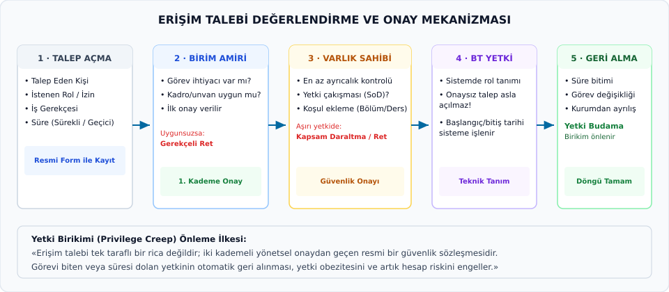

## Görev: Kuzey Üniversitesi ÖBS'de gelen erişim taleplerini değerlendirmek

- **Vaka bağlamı:** Kuzey Üniversitesi Bilgisayar Programcılığı ÖBS işlemlerinde rol ve yetki sınırları tanımlıdır; çalışanlardan, akademisyenlerden ve teknik birimlerden yeni yetki talepleri gelmektedir.
- **İncelenecek veriler:**
  1. Veri sözlüğündeki üç bilgi kaynağı (`ogrenci-iletisim`, `ders-notu`, `yetki-yonetimi`) ve beş iş rolü
  2. Kurumun beş temel karar ilkesi ve çözümlü `T-01` rehber talep kaydı
- **Yapılacak çalışma ve çıktı:** Beş bağımsız talep kartını (`T-02`, `T-03`, `T-04`, `T-05`, `T-06`) kurumsal kurallarla sınayarak karar, gerekçe, iş onaylayıcısı, teknik uygulayıcı ve tutulacak kayıt alanlarını üretmek.
- **Temel ilke:** Tüm kararları teknik kolaylığa veya kişisel ricalara değil, belgelenmiş kurallara ve bilgi güvenliği yönetimi ilkelerine dayandırmak.

::: {.notes}
Uygulama çalışmasında bir bilgi güvenliği yöneticisinin günlük işleyişte en sık yürüttüğü operasyonel görevi üstleniyoruz: Öğrenci Bilgi Sistemi'ne (ÖBS) gelen yeni erişim taleplerini kurumsal kurallarla değerlendirmek ve görevlerin ayrılığı ilkesini işletmek.

Önceki derste rol-izin matrisini kurarak hangi rolün hangi kaynağa erişebileceğini tanımlamıştık; ancak yaşayan bir kurumda sabit matris tek başına yeterli olmaz. Günlük operasyonda "veritabanında yavaşlık var, tüm notları göreyim", "meslektaşım izinli, onun ders notlarını ben gireyim", "hazırladığım not düzeltmesini hemen kendim onaylayayım" ya da "birimim değişti ama eski ekranlarım açık kalsın" gibi talepler ortaya çıkar. Güvenlik yönetimi bu talepler karşısında kişisel güvene veya pratik kolaylığa göre değil, yazılı ilkeler ve onay zincirine göre hareket eder.

Çalışma boyunca önce taleplerin geçtiği onay akışını, veri sözlüğündeki bilgi kaynaklarını, beş kurumsal rolü ve beş temel karar ilkesini inceleyeceğiz. Ardından çözümlü `T-01` rehber kaydı üzerinden altı zorunlu kayıt alanının nasıl doldurulduğunu görecek ve aynı yöntemi beş bağımsız olay kartına uygulayacağız. Bir sonraki slaytta bu taleplerin kurum içinde hangi aktörler üzerinden değerlendirildiğini ele alıyoruz.
:::

---

## Operasyonel bağlam: talepler nereden gelir, nasıl değerlendirilir?

Canlı bir organizasyonda erişim talepleri rastgele e-postalarla veya sözlü ricalarla karşılanamaz. Her talebin belirli bir süreçten geçmesi gerekir:

- **Talep sahibi:** Bir iş ihtiyacı nedeniyle sisteme erişim veya yetki artışı isteyen kullanıcı.
- **İş ve süreç sahibi (onay makamı):** Erişilmek istenen bilginin kurumsal sorumluluğunu taşıyan yönetici (Öğrenci İşleri Müdürü, Bölüm Başkanı).
- **Teknik uygulayıcı:** Onaylanmış talebi sisteme tanımlayan BT Yetki Yöneticisi.
- **Güvenlik denetimi:** Talebin kurumsal politikalara, görev ayrılığına ve en az ayrıcalık ilkesine uygunluğunu sınayan mekanizma.

**Temel kural:** Bir talep teknik olarak uygulanabilir olsa dahi, iş gerekçesi ve uygun onay zinciri yoksa sisteme işlenemez.

::: {.notes}
Erişim yönetiminde en temel yönetim ilkesi, yetkiyi talep eden kişi, iş ihtiyacını onaylayan süreç sahibi ve kararı sisteme işleyen teknik uygulayıcı rollerinin birbirinden ayrılmasıdır. Canlı bir kurumda telefonla, koridor sohbetiyle veya onaysız e-postayla yetki açılması, hesap verebilirlik zincirini baştan koparır ve yetkisiz erişim riskini kalıcı hâle getirir.

Burada dikkat edilmesi gereken en kritik ayrım BT biriminin konumudur. BT Yetki Yöneticisi sistemde hesap açabilen, rol atayabilen ve teknik altyapıyı yöneten birimdir; ancak kurumda işlenen verilerin sahibi değildir. Öğrenci iletişim bilgilerinin kurumsal sorumluluğu Öğrenci İşleri Müdüründe, ders ve sınav notlarının sorumluluğu ise ilgili Bölüm Başkanındadır.

Örneğin bir öğretim elemanının belirli bir derse not giriş yetkisi istemesi durumunda, teknik olarak bu yetkiyi tanımlamak birkaç saniyelik bir işlemdir. Buna karşın BT birimi bu talebi kendi kararıyla karşılayamaz; önce akademik sürecin sahibi olan Bölüm Başkanının iş ihtiyacını doğrulaması ve yazılı onay vermesi gerekir. BT yalnızca onaylanmış bu kararı sisteme uygular.

Uygulamada sık yapılan hata, teknik yetkiye sahip olan BT birimini aynı zamanda karar ve onay makamı gibi görmektir. Bu sınır aşılırsa teknik birim tüm kurumun kontrolsüz karar vericisi hâline gelir. Sonraki slayttaki akış şemasında, bu aktörlerin talep açılışından yetkinin geri alınmasına kadar nasıl bir döngü içinde çalıştığını adım adım inceleyeceğiz.
:::

---

## Talep değerlendirme ve onay akış şeması

{width="100%" fig-align="center" fig-alt="Erişim talebi değerlendirme, iki kademeli onay ve yetki geri alma akışı"}

::: {.notes}
Şemayı soldan sağa beş adım olarak okuyun: talep açma, birim amiri, varlık sahibi, BT yetki, geri alma. İlk dört adım bir erişim hakkının nasıl verildiğini, beşinci adım nasıl geri alındığını gösterir. Akış bir döngüdür: geri alma adımı verilmiş hakkı kapatarak zinciri tamamlar.

Birinci adımda talep eden kişi resmi bir formla üç şeyi belirtir: istenen rol ya da izin, iş gerekçesi ve süre (sürekli ya da geçici). Onaysız talep işleme alınmaz; talep ancak resmi formla kayıt altına girerse zincir başlar. İkinci adımda birim amiri görev ihtiyacının olup olmadığına ve kadro ya da unvanın uygun olup olmadığına bakar. Uygun değilse talebi gerekçeli reddeder; uygunsa ilk onayı verir ve başlangıç ile bitiş tarihini belirler.

Üçüncü adım şemanın en kritik halkasıdır. Varlık sahibi en az ayrıcalık kontrolünü yapar ve yetki çakışması olup olmadığını (görev ayrılığı) sorar. Talep aşırı yetki istiyorsa kapsam daraltır ya da reddeder. Bu adımın sonunda güvenlik onayı verilir. Birim amirinin ve varlık sahibinin onayı birlikte iki kademeli onayı oluşturur: talep, bir ricadan fazlasıdır; iki ayrı yönetsel kontrolden geçen resmi bir karardır.

Dördüncü adımda BT, onaylanmış kararı sisteme işler: rol tanımını yapar, koşul ekler (bölüm, ders sınırı), tarihleri sisteme girer. BT burada karar vermez, uygular; onaysız talebi hiçbir koşulda işlemez. Beşinci adım geri almadır ve çoğu zaman unutulur: süre dolduğunda, görev değiştiğinde ya da kişi kurumdan ayrıldığında yetki budanır. Şemanın altındaki ilkenin söylediği budur: görevi biten ya da süresi dolan yetki geri alınmazsa yetki birikir ve artık hesap riski doğar.

Bağımsız taleplerinizi değerlendirirken şemadaki her adımı bir soruya çevirin: iş gerekçesi var mı, amir onayladı mı, varlık sahibi mi onaylamalı, çakışma var mı, BT onaysız bir şeyi mi işleyecek, geri alma tarihi yazılı mı? Cevapsız kalan her soru, kararınızda "ek bilgi gerekli" demenin gerekçesidir.
:::

---

## Veri sözlüğü: bilgi kaynakları ve risk alanları

Kuzey Üniversitesi ÖBS'de yönetilen ve erişim taleplerine konu olan üç bilgi kaynağı:

| Kısa ad | Bilgi kaynağı | Kapsam ve temel risk alanı |
|---|---|---|
| `ogrenci-iletisim` (K-1) | Öğrenci iletişim kayıtları | Program öğrencilerinin ev adresi, telefon numarası ve kişisel e-posta adresleri. Kişisel veri gizliliği esastır. |
| `ders-notu` (K-2) | Ders başarı ve not kayıtları | Ara sınav, final, harf notları ve not düzeltme işlemleri. Veri bütünlüğü ve görev ayrılığı esastır. |
| `yetki-yonetimi` (K-3) | Kullanıcı hesapları ve izinler | Kullanıcı hesapları, role atamalar ve yetki tabloları. Yetkilendirme bütünlüğü ve hesap verebilirlik esastır. |

::: {.notes}
Bir erişim talebini değerlendirmenin ilk koşulu, talebin ÖBS içerisindeki hangi bilgi kaynağına yöneldiğini ve o kaynağın hangi güvenlik önceliğini taşıdığını doğru saptamaktır. Sistemdeki her veri tablosu aynı nitelikte değildir; bu nedenle her kaynağın korunmasında öne çıkan temel güvenlik boyutu ve onay makamı farklılaşır.

Tablodaki üç kaynağı karşılaştırdığımızda risk odaklarının net biçimde ayrıldığını görüyoruz. `ogrenci-iletisim` kaynağı öğrencilerin ev adresi, telefon ve kişisel e-posta bilgilerini barındırdığı için en büyük tehdit yetkisiz görüntüleme, yani gizlilik ihlalidir. `ders-notu` kaynağında ise ara sınav, final ve harf notları tutulduğundan öncelik verinin doğruluğunu korumak, yetkisiz veya tek taraflı not değiştirmeyi (bütünlük ihlalini) önlemektir. `yetki-yonetimi` kaynağı ise tüm hesap ve rol atamalarının tutulduğu merkezdir; burada yapılacak kontrolsüz bir değişiklik diğer tüm kaynakların koruma kalkanını devre dışı bırakır.

Çalışmanızda sık düşülen yanılgılardan biri, "yalnızca okuma izni" istendiğinde riskin ortadan kalktığını varsaymaktır; oysa kişisel iletişim verilerinde veya tüm programların not kayıtlarında yetkisiz okuma doğrudan gizlilik ve kapsam ihlali doğurur. Hangi kaynağın etkilendiğini belirledikten sonra, bir sonraki slaytta bu kaynaklar üzerinde hangi kurumsal rollerin ne kadar sorumluluk taşıdığını inceleyeceğiz.
:::

---

## Veri sözlüğü: kurumsal roller ve sorumluluk sınırları

Taleplerde adı geçen ve karar zincirinde yer alan aktörler:

| Kısa ad | Rol adı | Kurumsal görev tanımı ve sınırları |
|---|---|---|
| `ogrenci-isleri` (Öİ) | Öğrenci İşleri Uzmanı | Sorumlu programın K-1 kayıtları; kesin K-2 notlarını yalnızca okur |
| `ogretim-elemani` (ÖE) | Öğretim Elemanı | Görevli olduğu dersin K-2 not girişi/düzeltmesi; K-1'e erişimi yok |
| `bolum-baskani` (BB) | Bölüm Başkanı | Programdaki derslerin K-2 not denetimi ve not düzeltme onayı |
| `bt-yoneticisi` (BT) | BT Yetki Yöneticisi | Onaylı yetkileri K-3'e uygular; K-1 ve K-2 verisine içerik erişimi yok |
| `dekanlik-mudurluk` (DM) | Dekanlık / Müdürlük | Birim yöneticisinin bizzat taraf olduğu işlemlerde bağımsız üst onay |

::: {.notes}
Kurumsal erişim denetiminde yetkiler kişilerin isimlerine veya kıdemlerine değil, yürüttükleri kurumsal rollere tanımlanır. Tablodaki her rol tanımı iki bilgiyi aynı anda verir: rolün görevini yapabilmesi için gereken meşru erişim alanı ve rolün kesin olarak dışında kalması gereken veri sınırı.

Operasyonel rollere baktığımızda `ogrenci-isleri` rolü yalnızca sorumlu olduğu programın öğrenci iletişim kayıtlarını yönetir ve kesinleşmiş ders notlarını değiştirmeden okur; buna karşılık `ogretim-elemani` rolü yalnız resmi olarak görevlendirildiği dersin notlarını girer veya düzeltir, ancak öğrencilerin kişisel iletişim kayıtlarına erişemez. Teknik tarafta yer alan `bt-yoneticisi` ise yalnızca onaylanmış yetki kararlarını `yetki-yonetimi` kaynağına işler; ne öğrenci iletişim bilgilerini ne de ders notu içeriklerini görme yetkisine sahiptir.

Yönetsel rollerde ise `bolum-baskani` programdaki derslerin not denetimini ve not düzeltme onaylarını yürütür. Ancak bir akademisyen aynı anda hem Bölüm Başkanı unvanını taşıyabilir hem de bir derste öğretim elemanı olarak görev yapabilir; kendi yürüttüğü derste bir not düzeltmesi hazırladığında kendi işlemini onaylayamayacağı için tabloya bağımsız üst onay makamı olarak `dekanlik-mudurluk` rolü eklenmiştir. İzleyen iki slaytta bu rol sınırlarının beş bağlayıcı kurumsal karar ilkesine nasıl dönüştüğünü göreceğiz.
:::

---

## Kurumsal karar ilkeleri (1–3)

Kuzey Üniversitesi Yönetim Kurulu'nun onayladığı temel kurallar:

1. **İş ihtiyacı ve kapsam sınırı:** Her erişim izni belgelenmiş bir iş görevine ve ilgili program/ders sınırına bağlıdır. "İleride gerekebilir" veya "güvenilir personel" gerekçesiyle kapsam dışı izin verilemez.
2. **Onay ve uygulama ayrılığı:**
   - K-1 erişim kararını **Öğrenci İşleri Müdürü** onaylar.
   - K-2 erişim kararını ilgili **Bölüm Başkanı** onaylar.
   - BT Yetki Yöneticisi onaylı kararı K-3'e uygular. **Teknik uygulama iş gerekçesi onayı değildir.**
3. **Görevlerin ayrılığı (hazırlayan ≠ onaylayan):** K-2 not düzeltmesini aynı işlemde hazırlayan kişi onaylayamaz. Bir çalışan hazırladığı işlemde onay makamı olamaz; çıkar çatışmasını önlemek üzere bağımsız bir üst onay makamı atanır.

::: {.notes}
Yönetim Kurulu tarafından onaylanan ilk üç kural, bir erişim talebinin kabul edilebilmesi için geçmesi gereken temel güvenlik süzgecini oluşturur. Her talep sırasıyla "belgelenmiş iş ihtiyacı var mı?", "doğru veri sahibi onayladı mı?" ve "hazırlayan ile onaylayan birbirinden ayrı mı?" sorularıyla sınanır.

Birinci ilke en az ayrıcalık kuralının kurumsal karşılığıdır: bir kullanıcıya yalnızca resmi görev yazısında belirtilen program veya ders kapsamında yetki verilir. Bir çalışanın kurumda uzun süredir çalışması, güvenilir olması veya meslektaşına iyi niyetle yardım etmek istemesi resmi görevlendirme yerine geçmez. İkinci ilke ise karar otoritesi ile teknik işlemi ayırır; öğrenci iletişim verisi için Öğrenci İşleri Müdürü, ders notu verisi için ilgili Bölüm Başkanı onay vermeden BT Yetki Yöneticisi sistemde hiçbir yetki tanımlayamaz.

Üçüncü ilke iç kontrol sisteminin omurgası olan görevlerin ayrılığıdır. Kritik bir işlem olan not düzeltmesinde işlemi başlatan (hazırlayan) ile kontrol edip yürürlüğe sokan (onaylayan) aynı kişi olamaz. Eğer işlemi hazırlayan kişi aynı zamanda normal şartlarda onay makamı olan Bölüm Başkanı ise, çıkar çatışmasını önlemek için onay yetkisi bir üst bağımsız makama (Dekanlık / Müdürlük) devredilir. Bu mekanizma hem veri bütünlüğünü korur hem de yöneticiyi tek taraflı işlem şüphesinden kurtarır; sonraki slaytta ise zaman boyutunu ve teknik personel sınırlarını düzenleyen diğer iki ilkeyi inceleyeceğiz.
:::

---

## Kurumsal karar ilkeleri (4–5)

Kuzey Üniversitesi Yönetim Kurulu'nun onayladığı tamamlayıcı kurallar:

4. **Rol değişikliği ve geçici erişim:**
   - Görev veya birim değişikliğinde eski göreve ait tüm haklar **aynı gün derhal kaldırılır**.
   - Geçici erişim taleplerinde resmi görevlendirme yazısı, erişim kapsamı, **başlangıç ve bitiş zamanı** ile iş sahibi onayı zorunludur. Süre bitiminde yetki otomatik sonlandırılır.
5. **Teknik yetki veri yetkisi değildir:**
   - BT personeline akademik kayıtları (`ders-notu`) veya kişisel verileri (`ogrenci-iletisim`) okuma izni sırf teknik yetkisi bulunduğu için verilemez.
   - Teknik arıza veya performans incelemesi için istisnai erişim gerekiyorsa; kapsam, süre ve iş sahibi onayı açıkça belgelendirilir; anonimleştirilmiş veya test verisi tercih edilir.

::: {.notes}
Dördüncü ve beşinci kurallar, başlangıçta doğru verilmiş yetkilerin zaman içinde veya teknik bakım bahanesiyle kontrolsüz genişlemesini engeller. Kurumlarda en sık karşılaşılan güvenlik açıkları, yeni işe başlayanlardan çok görev yeri değişen personelin unutulan yetkilerinden ve teknik personelin sınırlandırılmamış veri erişiminden kaynaklanır.

Dördüncü kural iki ayrı yaşam döngüsü durumunu düzenler. İlk olarak, bir çalışan kurumdan ayrılmasa bile kurum içinde başka bir birime (örneğin Öğrenci İşleri'nden Strateji ve Finans birimine) geçtiğinde eski görevine ait ÖBS yetkileri aynı gün derhal kaldırılmalıdır; aksi hâlde "yetki birikmesi" oluşur. İkinci olarak, misafir öğretim elemanı gibi geçici görevlendirmelerde resmi görevlendirme yazısı, ders kapsamı ve iş sahibi onayının yanında erişimin başlangıç ve bitiş tarihleri açıkça tanımlanmalı, süre dolduğunda yetki otomatik olarak kapanmalıdır.

Beşinci kural ise teknik altyapı yöneticiliği ile veri erişim hakkı arasındaki sınırı çizer. Veritabanı veya sistem görevlisinin performans sorununu araştırmak istemesi meşru bir teknik görevdir; ancak bu görev tüm akademik programların gerçek ders notu kayıtlarını onaysız ve sınırsız görme hakkı vermez. Teknik incelemelerde öncelikle test verisi, anonimleştirilmiş veri veya sistem düzeyi performans metrikleri kullanılmalı; canlı veriye istisnai erişim zorunluysa hangi tablonun hangi süreyle inceleneceği belgelenip veri sahibinin (ilgili Bölüm Başkanlarının) yazılı onayı alınmalıdır. Sonraki slaytta bu beş kuralın talep değerlendirme kaydına nasıl işlendiğini göreceğiz.
:::

---

## Bir erişim talebi kaydında bulunması zorunlu alanlar

Kurumsal bir erişim talebi değerlendirilirken şu altı alan eksiksiz doldurulmalıdır:

1. **Talep kodu ve konusu:** İncelenen talebin kimliği ve talep edilen erişimin açık tanımı.
2. **Karar:** Talebin akıbeti (`Kabul`, `Ret` veya `Ek Bilgi ve Onay Gerekli`).
3. **Gerekçe ve dayanak kural:** Kararın hangi kurumsal kurala (Kural 1–5) dayandığının somut açıklaması.
4. **İş onaylayıcısı:** Talebin içeriğini ve iş ihtiyacını onaylayan veya reddeden süreç yöneticisi.
5. **Teknik uygulayıcı:** Onaylı kararı sisteme işleyecek veya erişimi engelleyecek teknik rol.
6. **Tutulacak kayıt ve kanıt:** İşlemin hesap verebilirlik zincirini kuran resmi belge ve sistem logları.

::: {.notes}
Bilgi güvenliği yönetiminde bir erişim talebini değerlendirmek yalnızca "uygundur" veya "uygun değildir" sonucu üretmekten ibaret değildir. Verilen her kararın geriye dönük bir denetimde savunulabilir olması için kararın kendisi kadar dayandığı kural, kararı veren makam, işlemi uygulayan teknik rol ve üretilen kanıt belgeleri de kayıt altına alınmalıdır.

Bu altı alan kendi içinde birbirini denetleyen bir bütün oluşturur. Karar alanı talebin sonucunu gösterirken, gerekçe alanı bu sonucu kişisel kanaatten çıkarıp kurumun beş temel karar ilkesinden ilgili olanlara bağlar. İş onaylayıcısı ile teknik uygulayıcı alanlarının ayrı satırlarda yer alması, form üzerinde veri sahibi ile BT biriminin birbirine karıştırılmasını önler. Tutulacak kayıt ve kanıt alanı ise hem idari belgeleri (görevlendirme yazısı, imzalı onay formu) hem de teknik izleri (kullanıcı açma, rol atama veya yetki kaldırma günlükleri) bir araya getirir.

Bağımsız çalışma kartlarını çözerken her talep için bu altı başlığı eksiksiz kurmanız gerekir. Şimdi izleyen iki slaytta, yeni göreve başlayan bir personelin erişim talebini konu alan `T-01` rehber örneği üzerinde bu alanların nasıl doldurulduğunu adım adım inceleyelim.
:::

---

## Rehber çözümlü örnek: T-01 yeni personel erişim talebi

Sınıfla birlikte incelenecek rehber olay kartı:

> **Olay Kartı T-01:**
> Elif Hanım, Bilgisayar Programcılığı programında yeni Öğrenci İşleri Uzmanı olarak göreve başlamıştır. Resmi atama yazısı bulunmaktadır ve Öğrenci İşleri Müdürü tarafından imzalanmış "ÖBS K-1 Öğrenci İletişim Kayıtları Erişim Formu" mevcuttur. Elif Hanım'a ÖBS üzerinde henüz bir kullanıcı hesabı ve yetki tanımlanmamıştır.

**İncelenecek sorular:**

- Talep edilen erişim nedir?
- İş ihtiyacı ve kapsam belgelenmiş midir?
- Onay zinciri tamamlanmış mıdır?
- Karar ne olmalıdır ve hangi kayıtlar tutulmalıdır?

::: {.notes}
`T-01` rehber olay kartı, kurumsal bir erişim talebinin eksiksiz belgelendirildiği standart durumu temsil eder. Olay metnini slayttaki dört soru eşliğinde okuduğumuzda, onay akış şemasındaki ilk üç halkada aranan tüm koşulların sisteme işlem yapılmadan önce karşılandığını görüyoruz.

Önce talep edilen erişimi ve iş ihtiyacını kontrol edelim: Elif Hanım Bilgisayar Programcılığı programında Öğrenci İşleri Uzmanı olarak atanmıştır ve görevi gereği program öğrencilerinin `ogrenci-iletisim` kayıtlarını görüntüleme ve güncelleme yetkisine ihtiyaç duymaktadır. Resmi atama yazısının bulunması ve talebin yalnızca sorumlu olduğu programla sınırlı tutulması Kural 1'deki iş ihtiyacı ve kapsam sınırı şartını karşılar.

İkinci olarak onay zincirine baktığımızda, `ogrenci-iletisim` kaynağının kurumsal sahibi olan Öğrenci İşleri Müdürü tarafından imzalanmış erişim formunun mevcut olduğunu görüyoruz; böylece Kural 2'deki veri sahibi onayı da tamamlanmıştır. Henüz hesap açılmamış olması, BT biriminin onaysız işlem yapmadığını ve sürecin doğru sırayla ilerlediğini gösterir; bir sonraki slaytta bu tespitlerin değerlendirme tablosuna nasıl yazıldığını inceleyeceğiz.
:::

---

## Rehber çözümlü örnek: T-01 karar ve kayıt analizi

T-01 talebinin kurumsal değerlendirme tablosu:

| Alan | T-01 Çözümlü Değerlendirme Kaydı |
|---|---|
| **Talep kodu** | `T-01` (Elif — Yeni Öİ Uzmanı erişim talebi) |
| **Talep edilen erişim** | Program öğrencileri `ogrenci-iletisim` (K-1) Oku / Güncelle yetkisi |
| **Karar** | **Kabul** |
| **Gerekçe ve dayanak** | Kural 1 ve 2: Atama yazısıyla iş ihtiyacı kanıtlı; Öİ Müdürü yazılı onayı tam; kapsam programla sınırlı |
| **İş onaylayıcısı** | Öğrenci İşleri Müdürü (veri ve süreç sahibi) |
| **Teknik uygulayıcı** | BT Yetki Yöneticisi (onaylı kararı K-3 üzerinde kişiye özgü hesaba tanımlar) |
| **Kayıt ve kanıt** | Atama yazısı, imzalı form, K-3 kullanıcı oluşturma ve rol atama logu |

::: {.notes}
Çözümlü tabloda görüldüğü üzere, `T-01` talebi için karar doğrudan "Kabul" olarak verilmiştir; çünkü hem görev ihtiyacını kanıtlayan resmi atama yazısı hem de ilgili bilgi kaynağının sahibinden alınmış yazılı onay tamdır. Gerekçe satırında yalnızca "belgeleri tamdır" denmemiş, kararın Kural 1 (iş ihtiyacı ve program kapsam sınırı) ve Kural 2 (veri sahibi onayı) ile nasıl örtüştüğü açıkça yazılmıştır.

İş onaylayıcısı ve teknik uygulayıcı satırlarının ayrımına özellikle dikkat edin: erişim hakkının verilmesine Öğrenci İşleri Müdürü karar vermiş, BT Yetki Yöneticisi ise bu onaylı kararı `yetki-yonetimi` üzerinde Elif Hanım'ın kişiye özgü hesabına tanımlayan teknik uygulayıcı olarak kaydedilmiştir. Böylece teknik uygulama ile iş onayı birbirine karıştırılmamıştır.

Son satırdaki kayıt ve kanıt alanı, denetim zincirinin iki kanadını birleştirir: idari kanıt olarak resmi atama yazısı ve imzalı erişim formu arşivlenir; teknik kanıt olarak ise sistemde hesabın açıldığı ve rolün atandığı günlük (log) kayıtları tutulur. İleride yapılacak bir iç denetimde "bu hesabı kim, hangi gerekçeyle onayladı ve kim açtı?" sorusu bu kayıtlarla eksiksiz yanıtlanır; şimdi aynı analiz disiplinini beş bağımsız olay kartında uygulayacaksınız.
:::

---

## Bağımsız çalışma verisi: Olay kartları T-02 ve T-03

Aşağıdaki iki talebi kurumsal kurallarla sınayacaksınız:

> **Olay Kartı T-02:**
> BT sistem görevlisi Murat Bey, ÖBS veritabanında nedeni henüz belirlenemeyen bir performans yavaşlığı olduğunu bildirmiştir. Sorunun kaynağını araştırmak gerekçesiyle, tüm akademik programlardaki öğrencilerin bütün `ders-notu` (K-2) kayıtlarını ve geçmiş not hareketlerini doğrudan görüntüleme yetkisi talep etmektedir. Talep yazısında hangi tablonun hangi teknik amaçla inceleneceği belirtilmemiştir ve ilgili Bölüm Başkanlarının onayı bulunmamaktadır.

> **Olay Kartı T-03:**
> Öğretim elemanı Selin Hanım, güz yarıyılında yalnızca BGT201 dersini yürütmekle resmi olarak görevlendirilmiştir. Selin Hanım, meslektaşı izinli olduğu için onun yürüttüğü BLP1003 dersine ait sınav notlarını sisteme girmek ve değiştirmek istemektedir. Selin Hanım'ın BLP1003 dersi için resmi bir görevlendirme yazısı veya Bölüm Başkanı onay kaydı yoktur.

::: {.notes}
İlk iki bağımsız olay kartını değerlendirirken, her senaryoda önce erişilmek istenen bilgi kaynağını ve talep sahibinin kurumsal rolünü veri sözlüğü üzerinden netleştirin. Ardından olay metnindeki bilgileri kurumun beş temel karar ilkesiyle karşılaştırarak altı zorunlu kayıt alanını `T-01` rehber örneğindeki biçimle doldurun.

`T-02` kartında teknik bir inceleme gerekçesiyle talep edilen veri erişiminin kapsamını, teknik işletim görevi ile veri sahipliği arasındaki sınırı ve onay zincirinin durumunu kurumsal ilkeler çerçevesinde tartın. `T-03` kartında ise akademik personelin resmi ders görevlendirme sınırını, meslektaşlar arası fiili yardımlaşma talebinin kurumsal yetki doğurup doğurmayacağını ve onay otoritesinin süreçteki rolünü sorgulayın.
:::

---

## Bağımsız çalışma verisi: Olay kartları T-04 ve T-05

Aşağıdaki iki talebi kurumsal kurallarla sınayacaksınız:

> **Olay Kartı T-04:**
> Bilgisayar Programcılığı Bölüm Başkanı Can Bey, öğretim elemanı olarak bizzat yürüttüğü BLP1001 dersinde bir öğrencinin harf notunun sehven yanlış hesaplandığını fark etmiştir. Can Bey, hazırladığı not düzeltme formunu Bölüm Başkanı sıfatıyla bizzat kendisi onaylayarak BT biriminden notun ÖBS'de derhal güncellenmesini talep etmektedir.

> **Olay Kartı T-05:**
> Öğrenci İşleri Uzmanı Deniz Bey, 10 Kasım Pazartesi günü saat 09.00 itibarıyla resmi yazıyla Strateji ve Finans Dairesi'ne atanmış ve yeni görevine başlamıştır. 10 Kasım saat 11.00'de yapılan rutin kontrolde, Deniz Bey'in ÖBS üzerindeki `ogrenci-isleri` rolünün ve K-1 erişim yetkilerinin hâlâ aktif olduğu ve sistemde oturum açabildiği tespit edilmiştir.

::: {.notes}
`T-04` ve `T-05` olay kartlarında, kurumsal hiyerarşide birden fazla rol taşıma durumu ile kurum içi görev değişikliği süreçlerinin erişim yönetimine etkisini inceleyeceksiniz. Çalışmanızda yalnızca karar türünü seçmekle yetinmeyip, kararın dayandığı kurumsal ilkeyi, süreçteki onay ve uygulama rollerini ve denetim izi için tutulması gereken kayıtları eksiksiz belirtin.

`T-04` senaryosunda işlemi hazırlayan rol ile işlemi onaylayan rolün aynı kişide birleşmesi durumunu görevlerin ayrılığı ilkesi ve kurumsal rol tablosundaki sorumluluk sınırları açısından değerlendirin. `T-05` senaryosunda ise kurum içinde başka bir birime atanan personelin mevcut erişim haklarının durumunu, olay metnindeki gün ve saat bilgisini ve rol değişikliği kurallarını dikkate alarak hangi işlemin yürütülmesi gerektiğini analiz edin.
:::

---

## Bağımsız çalışma verisi: Olay kartı T-06

Son bağımsız çalışma kartınız:

> **Olay Kartı T-06:**
> Misafir öğretim elemanı Arda Bey, 11–13 Kasım tarihleri arasında BLP1003 dersinin blok sınav değerlendirmesini yürütmek üzere Rektörlük onayıyla geçici olarak görevlendirilmiştir. Resmi görevlendirme yazısı ve Bölüm Başkanı'nın imzalı onay formu mevcuttur. Arda Bey, yalnızca bu üç günlük süre boyunca BLP1003 dersinin `ders-notu` (K-2) kayıtlarına not girişi yapabilmek için geçici ÖBS yetkisi talep etmektedir.

**Düşünme noktaları:**

- Meşru görevlendirme ve iş onayı var mıdır?
- Talep edilen yetki zaman ve kapsam açısından sınırlı mıdır?
- Karar kabul edilecekse hangi şartla tanımlanmalı ve hangi tarihte kaldırılmalıdır?

::: {.notes}
Son bağımsız olay kartı olan `T-06`, süreli ve geçici görevlendirmelerde erişim yaşam döngüsünün nasıl yönetileceğini ele alır. Bu kartı incelerken slayttaki üç düşünme noktasını kurumsal karar ilkeleriyle birlikte okuyarak talebin resmi dayanağını, ders kapsamını ve mevcut onay belgelerini kontrol edin.

Değerlendirme tablonuzu oluştururken talep edilen yetkinin hangi zaman aralığını kapsadığını, sisteme tanımlanırken hangi sınırların girilmesi gerektiğini ve görev süresi tamamlandığında erişim hakkının yaşam döngüsü açısından nasıl sonlandırılacağını altı zorunlu kayıt alanı üzerinden yapılandırın.
:::

---

## Bağımsız görev: talep değerlendirme şablonu

| Alan | Öğrenci Bağımsız Değerlendirme Çıktısı |
|---|---|
| **Talep kodu ve konusu** | İncelenen talep kodu (`T-02` .. `T-06`) ve kısa tanımı |
| **Karar** | `Kabul` / `Ret` / `Ek Bilgi-Onay Gerekli` / `Yetki Kaldırma` |
| **Gerekçe ve dayanak** | Kurumsal karar ilkelerinden (Kural 1–5) dayanak ve gerekçe |
| **İş onaylayıcısı** | Kararı vermesi gereken yetkili makam |
| **Teknik uygulayıcı** | Kararı teknik olarak işleyecek / yetkiyi kaldıracak rol |
| **Kayıt ve kanıt** | Hesap verebilirlik zincirini koruyacak resmi kayıt ve log |

::: {.notes}
Bağımsız çalışmanızda `T-02`, `T-03`, `T-04`, `T-05` ve `T-06` olay kartlarının her biri için bu değerlendirme şablonundaki altı alanı eksiksiz doldurmanız beklenmektedir. Tabloyu hazırlarken önce olay kartındaki bilgi kaynağını ve talep sahibinin rolünü veri sözlüğüyle eşleştirin, ardından karar satırında senaryoya uygun hüküm türünü seçin.

Tek kelimelik karar ifadeleri kurumsal denetim için yeterli değildir; gerekçe alanında kararınızın hangi kurumsal ilkeye (Kural 1–5) dayandığını olay metnindeki verilerle ilişkilendirerek açıklayın. İş onaylayıcısı ile teknik uygulayıcı rollerini birbirine karıştırmadan ayrı ayrı yazın ve son satırda hem idari onay belgelerini hem de sistem üzerinde tutulacak teknik kayıtları belirtin.
:::

---

## Başarı ölçütleri ve değerlendirme rubriği

Çalışmanız şu dört ölçüte göre değerlendirilecektir:

1. **Kurumsal kurala dayandırma (%30):** Verilen kararın gerekçesi kurumun 5 temel karar ilkesiyle (iş ihtiyacı, onay ayrılığı, görev ayrılığı, hak kaldırma/geçicilik, teknik yetki sınırı) açıkça eşleştirilmiş mi?
2. **Görevler ayrılığına uygunluk (%25):** Hazırlayan, onaylayan ve uygulayan rolleri doğru ayrılmış mı? Kendi işlemini onaylama hatası engellenmiş mi?
3. **Rol ve onay otoritesinin doğruluğu (%25):** İş onaylayıcısı (veri sahibi) ile teknik uygulayıcı (BT) birbirine karıştırılmadan doğru atanmış mı?
4. **Hesap verebilirlik ve kanıt bütünlüğü (%20):** Kararın ardından tutulması gereken resmi idari belgeler ve teknik sistem logları eksiksiz listelenmiş mi?

::: {.notes}
Sıralanan dört değerlendirme ölçütü, kurumsal bir bilgi güvenliği denetiminde erişim yönetimi süreçlerinin sağlamlığını sınarken kullanılan temel denetim boyutlarına karşılık gelir. Beş bağımsız talep kartı için hazırladığınız tabloları teslim etmeden önce her satırı bu dört başlık üzerinden gözden geçirerek öz denetim yapabilirsiniz.

Öz denetim sırasında özellikle gerekçelerinizin kişisel yorum yerine beş kurumsal ilkeye dayanıp dayanmadığını, işlemi hazırlayan ile onaylayan makamların ayrılıp ayrılmadığını ve veri sahibi onayı ile teknik uygulama adımının doğru eşleştirilip eşleştirilmediğini kontrol edin. Son adımda her kararın hem idari belge hem de sistem kaydıyla kanıtlanabilir olduğundan emin olun; bir sonraki slaytta bu kayıtların on ikinci haftadaki izleme ve denetim süreçlerine nasıl devredildiğini göreceğiz.
:::

---

## Konu hattı ve H12'ye devir: yetkiden izleme ve kontrole

Erişim yönetimi tek bir kararla bitmez; yaşayan bir güvenlik döngüsüdür:

```text
H11: Kimlik saptama → Rol ve model → Yetki matrisi → Talep kararları
                                                             │
  ┌──────────────────────────────────────────────────────────┘
  ▼
H12: Güçlü parola ve kimlik doğrulama politikaları
  → Yetkinin kötüye kullanımını önleme
  → İşlem ve erişim loglarının (günlük) toplanması
  → Düzenli erişim gözden geçirme (access review) kontrolleri
```

Onaylanan yetkiler, sistemde kimlik doğrulama politikalarıyla korunacak; kullanımları ise günlük kayıtlarıyla denetlenecektir.

::: {.notes}
Rol-izin matrisinin kurulması ve gelen erişim taleplerinin kurumsal ilkelerle karara bağlanması, yetkilendirme tasarımının tamamlandığını gösterir; ancak erişim güvenliği yalnızca doğru yetki kararı vermekle bitmez. Meşru bir iş gerekçesiyle ve doğru onay zinciriyle tanımlanan bir yetki bile, hesabın parolası zayıfsa veya o yetkiyle yapılan işlemler izlenmiyorsa kurumu koruyamaz.

Şemadaki akışı yukarıdan aşağıya okuduğumuzda on birinci haftada kimlik saptamadan başlayarak rol modelini, yetki matrisini ve talep değerlendirme kararlarını tamamladığımızı görüyoruz. Bugün oluşturduğumuz onaylı yetki kararları ve kayıt alanları, doğrudan on ikinci haftanın çalışma girdisini oluşturur; odak noktamız "kime hangi yetki verilmeli?" sorusundan "verilen yetki nasıl korunur ve nasıl denetlenir?" sorusuna geçer.

On ikinci haftada ilk olarak güçlü parola ve kimlik doğrulama politikalarıyla (örneğin ardışık başarısız parola denemelerinde hesabın kilitlenmesi ve alarm üretilmesi) yetkili hesapların ele geçirilmesini önlemeyi ele alacağız. Ardından işlem ve erişim günlüklerinin (logların) toplanması ile düzenli erişim gözden geçirme kontrolleri sayesinde, görev yeri değişen veya süresi dolan hesapların gerçekten kapatılıp kapatılmadığını ve yetkilerin kapsam dışına çıkıp çıkmadığını denetleyeceğiz.

Kurumlarda sık yapılan hata, imzalı erişim formu arşivlendiğinde güvenlik sürecinin bittiğini düşünmektir; oysa kimlik doğrulama ve günlük izleme olmadan yetkilendirme tek başına kör kalır. Bu uygulamada her talep kartının son satırına yazdığınız sistem logları ve kanıt belgeleri, önümüzdeki hafta kuracağımız izleme ve kontrol mekanizmalarının arayacağı temel denetim izleridir.
:::
