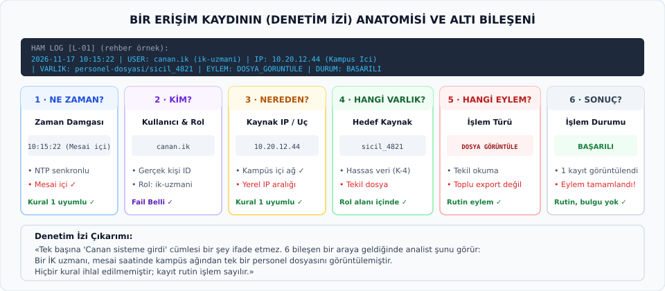

## Görev: Kuzey Üniversitesi ÖBS'de erişim kayıtlarını denetlemek

- **Amaç:** Kuzey Üniversitesi ÖBS erişim günlüklerini (log) kurumsal ölçütlerle karşılaştırarak yetki aşımı ve ihlalleri tespit etmek.
- **Kapsam ve Kurallar:** Yeni kritik bilgi varlığını (`personel-dosyasi` K-4), ilgili aktörleri ve beş kurumsal kayıt/izleme kuralını incelemek.
- **Rehber Örnek:** Çözümlü rehber erişim kaydını (`L-01`) ve altı alanlı analiz yöntemini gözden geçirmek.
- **Bağımsız Analiz Verisi:** Beş bağımsız olay kaydını (`L-02`, `L-03`, `L-04`, `L-05`, `L-06`) kurumsal kurallarla tek tek sınamak.
- **Beklenen Çıktı:** Her kayıt için aktör, zaman, konum, hedef, eylem, durum, ihlal edilen kural ve güvenlik hükmünü eksiksiz üretmek.
- **Sonraki Adıma Girdi:** Elde edilen analizleri, bir sonraki uygulama saatinde üst yönetime sunulacak resmi denetim tutanağı ve gözden geçirme bulgularına temel yapmak.

::: {.notes}
Kuzey Üniversitesi Öğrenci Bilgi Sistemi (ÖBS) üzerinde rol, varlık ve erişim sınırları önceki haftada belirlenmiş ve uygulamaya alınmıştır. Ancak sistemde kuralların gerçekten işletilip işletilmediğini, yetkilerin aşılıp aşılmadığını veya hesapların ele geçirilip geçirilmediğini anlamanın tek yolu, tutulan erişim günlüklerini (log) kurumsal ölçütlerle karşılaştırmaktır. Bir sistemde kütük tutulması tek başına pasif bir işlemdir; asıl güvenlik güvencesi bu kayıtların düzenli olarak incelenmesi ve izlenmesiyle (monitoring) sağlanır.

Uygulama boyunca bir bilgi güvenliği denetçisi bakış açısıyla ÖBS sunucusundan alınan ham erişim kayıtlarını inceleyeceğiz. Önce yeni kritik bilgi varlığını, kurumsal aktörleri ve beş temel izleme kuralını tanıyacak; ardından rehber olay kaydı (`L-01`) üzerinden altı alanlı çözümleme yöntemini adım adım göreceğiz. Hangi işlemin meşru bir iş akışı, hangisinin kural ihlali, hangisinin ise ele geçirilmiş hesap veya iç tehdit göstergesi olduğunu bu kurallar çerçevesinde ayrıştıracağız.

Çalışmanızda beş bağımsız olay kaydını (`L-02`..`L-06`) aynı sistematikle sınarken yalnızca işlemin sonucuna değil, işlemi yapan aktörün rolüne, bağlandığı zamana, ağ konumuna ve hedeflediği veri hacmine birlikte dikkat edin. Bu saatte üreteceğiniz kayıt analizleri, bir sonraki uygulama saatinde üst yönetime sunulacak resmi denetim tutanağının ve gözden geçirme bulgularının temel girdisi olacaktır.
:::

---

## H11 Kararlarının sonucu: Matristen denetim izine

Önceki haftada Kuzey Üniversitesi ÖBS için alınan temel kararlar ve sınırlar:

- **Yetki iş ihtiyacına bağlıdır:** Personel unvanına veya kıdemine göre değil; resmi görev tanımına ve sorumlu olduğu birim/ders sınırına göre yetkilendirilir.
- **Teknik yetki veri yetkisi değildir:** BT sistem personeli altyapıyı yönetir; kurumsal veri içeriklerini (`ders-notu`, `personel-dosyasi`) doğrudan görüntüleme hakkı yoktur.
- **Görevlerin ayrılığı esastır:** Süreci hazırlayan ile onaylayan ayrı kişilerdir; çıkar çatışması oluşturacak tek taraflı yetkiler engellenmiştir.
- **Yaşam döngüsü zorunludur:** Görevden ayrılan veya birim değiştiren personelin yetkileri derhal sonlandırılır.
- **Denetim izi (audit trail) şarttır:** Kuralların kağıt üzerinde veya veritabanı ayarlarında kalmadığını doğrulamak için erişim kayıtları düzenli taranır.

::: {.notes}
Erişim kontrol matrisini kurmak, kimin hangi varlığa hangi koşulda erişebileceğini kağıt üzerinde ve sistem ayarlarında tanımlamaktır. Ancak bilgi güvenliği yönetimi kuralları tanımlayıp kenara çekilemez; canlı bir kurumda kurallar çiğnenebilir, parolalar paylaşılabilir, sistem yöneticileri yetkilerini aşarak gizli dosyalara bakabilir veya ayrılan bir personelin hesabı unutulup açık bırakılabilir.

PUKÖ döngüsünün "Kontrol Et" aşaması tam bu noktada devreye girer. Sistemde tutulan erişim kayıtları (denetim izi / audit trail), tasarlanan yetki matrisinin gerçek hayatta nasıl işlediğini gösteren somut kanıttır. Süreci hazırlayan ile onaylayanın ayrılması, teknik yöneticinin veri içeriğinden uzak tutulması ve ayrılan personelin erişiminin derhal kesilmesi gibi ilkeler ancak kayıtların düzenli taranmasıyla doğrulanabilir.

Örneğin bir sistem görevlisinin sunucu bakım yetkisine sahip olması teknik bir gerekliliktir; fakat bu teknik imkan personel maaş tablosunu ya da ders notlarını okumak için kullanıldığında matrisin çizdiği sınır aşılmış olur. Önleyici teknik kısıtlamaların atlandığı veya henüz devreye girmediği durumlarda ihlali görünür kılan tek mekanizma denetim izidir.

Dolayısıyla bu saatte yetki matrisini baştan kurgulamak yerine, önceki hafta belirlenen dört temel ilkeyi ham log satırlarını değerlendirmek için birer denetim ölçütü olarak kullanacağız. Bir sonraki slaytta bu ölçütleri uygulayacağımız yeni kritik bilgi varlığını tanıyacağız.
:::

---

## Yeni bilgi varlığı: `personel-dosyasi` (K-4)

Kuzey Üniversitesi ÖBS'de yönetilen ve bu haftaki incelememizin odağında yer alan kritik varlık:

| Varlık Kısa Adı | Varlık Adı ve Kapsamı | Temel Güvenlik Önceliği ve Risk Alanı |
|---|---|---|
| `personel-dosyasi` (K-4) | **Personel Özlük ve Maaş Dosyaları:** Kuzey Üniversitesi akademik ve idari personelinin T.C. kimlik numaraları, ev adresleri, maaş ve bordro dökümleri, sağlık kurulu raporları, yıllık izin hareketleri ve gizli disiplin soruşturması kayıtları. | **Yüksek Gizlilik:** Bilgilerin yetkisiz kişilerin eline geçmesi kurum personeli için ciddi mahremiyet ve itibar kaybı doğurur; yüksek gizlilik gerektiren kişisel veri niteliğindedir. |

Varlık üzerindeki temel eylemler:
- `Dosya_Goruntule`: Münferit bir personelin özlük kartını ekranda okuma.
- `Tablo_Oku`: Birim veya bölüm düzeyindeki bordro/özlük tablosunu sorgulama.
- `Toplu_Bordro_Indir`: Çok sayıda personelin bordro ve özlük verilerini dosya (Excel/CSV/PDF) olarak yerel cihaza indirme (export).

::: {.notes}
Önceki uygulamalarda incelenen öğrenci iletişim bilgileri ve ders başarı notlarının ardından, bu hafta kurumun en hassas idari varlıklarından biri olan personel özlük ve maaş dosyalarını (`personel-dosyasi`) ele alıyoruz. Personel dosyası yalnızca isim ve soyisimden ibaret değildir; çalışanların T.C. kimlik numaraları, ev adresleri, maaş ve bordro dökümleri, sağlık kurulu raporları, yıllık izin hareketleri ve gizli disiplin soruşturması kayıtları gibi en mahrem kişisel verilerini barındırır.

Bu nitelikteki verilerin yetkisiz kişilerce görüntülenmesi veya kurum dışına sızdırılması, çalışanlar ve kurum açısından ağır mahremiyet ve itibar kaybı doğurur. Hukuki nitelendirme ve resmi bildirim süreçleri ayrı bir konudur ve bu derste ele alınmaz; ancak yüksek gizlilik gerektiren bu varlığa yönelik her erişim işleminin kayıt altına alınması ve en yüksek titizlikle izlenmesi zorunludur.

Kayıtları incelerken varlık üzerinde gerçekleştirilen üç temel eylem türünü birbirinden dikkatle ayırmanız gerekir. Münferit bir personelin özlük kartını ekranda okumak (`Dosya_Goruntule`) ile birim düzeyindeki bordro tablosunu sorgulamak (`Tablo_Oku`) veya çok sayıda personelin verisini dosya olarak yerel cihaza indirmek (`Toplu_Bordro_Indir`) aynı risk düzeyinde değildir; sonraki slaytlarda göreceğimiz aktör yetkileri ve kurumsal kurallar bu eylem farkları üzerine kurulmuştur.
:::

---

## Veri sözlüğü: İdari aktörler ve yetki sınırları (1/2)

Personel dosyasıyla ilişkili kurumsal idari ve denetim aktörleri:

| Kısa Kod | Kurumsal Rol | Meşru Görev Tanımı ve Erişim Sınırları |
|---|---|---|
| `ik-uzmani` (İK) | İnsan Kaynakları Uzmanı (Canan Demir) | Mesai içinde (08.30–17.30) kampüs ağından münferit dosya inceleme/güncelleme |
| `ik-yoneticisi` (İKY) | İK Daire Başkanı | Birim iş sahibi; olağanüstü talepleri onaylar, aylık tutanakları imzalar |
| `rektorluk-denetci` (İT) | İç Denetçi / Hukuk Müşavirliği | Resmi soruşturma/tetkik kapsamında onaylı kanıt ve log raporlarını inceleme |

::: {.notes}
Personel dosyaları üzerinde işlem yapma veya denetim yürütme yetkisi bulunan idari aktörlerin sınırları görev tanımlarıyla kesin olarak çizilmiştir. İnsan Kaynakları Uzmanı Canan Demir (`ik-uzmani`) verinin doğrudan kullanıcısıdır; ancak yetkisi hafta içi 08.30–17.30 mesai saatleri içinde ve kampüs ağından yalnızca görev gereği ihtiyaç duyduğu tekil personelin dosyasını incelemek veya güncellemekle sınırlıdır. Tüm üniversitenin maaş listesini tek seferde bilgisayarına indiremez.

İnsan Kaynakları Daire Başkanı (`ik-yoneticisi`) varlığın birim düzeyindeki iş sahibidir. Günlük operasyonel işlemleri yürütmek yerine, mesai dışı ya da kampüs dışı erişim gibi olağanüstü talepleri önceden yazılı olarak onaylar ve aylık gözden geçirme tutanaklarını imzalar. Böylece işlemi hazırlayan ve yürüten uzman ile bunu onaylayan ve denetleyen yönetici birbirinden ayrılmış olur.

İç Denetçi ve Hukuk Müşavirliği (`rektorluk-denetci`) ise rutin personel işlemlerine katılmaz; yalnızca resmi bir soruşturma veya tetkik kapsamında onaylı kanıtları ve log raporlarını inceler. Bir sonraki slaytta, bu idari rollerin karşısında yer alan teknik ve akademik aktörlerin neden personel dosyası içeriğinden tamamen yalıtıldığını göreceğiz.
:::

---

## Veri sözlüğü: Teknik ve akademik aktörler (2/2)

Personel dosyası modülünde görev sınırları çizilen diğer aktörler:

| Kısa Kod | Kurumsal Rol | Meşru Görev Tanımı ve Erişim Sınırları |
|---|---|---|
| `bt-yoneticisi` (BT) | BT Sistem Görevlisi (Murat Bey) | Altyapı ve log yönetimi; personel dosyası içeriğini görme yetkisi kesinlikle yoktur |
| `ogretim-elemani` (ÖE) | Öğretim Elemanı (Selin Kaya) | Kendi dersinin not işlemleri; personel özlük modülüne hiçbir erişim hakkı yoktur |

::: {.notes}
Personel dosyası modülünde en kritik güvenlik sınırı, teknik altyapı yetkisi ile veri içeriği yetkisinin birbirinden ayrılmasıdır. BT Sistem Görevlisi Murat Bey (`bt-yoneticisi`), sunucu ve veritabanı altyapısını yönetmek üzere sistem yöneticisi ayrıcalıklarına sahip olabilir; teknik olarak tabloları açabilecek araçları bulunabilir. Ancak "teknik yetki veri yetkisi değildir" ilkesi gereği Murat Bey'in personel maaşlarını, sağlık raporlarını veya özlük dosyası içeriğini okuması açık bir yetki ihlalidir.

Öğretim Elemanı Selin Kaya (`ogretim-elemani`) açısından görev sınırı daha da belirgindir: akademik personelin ÖBS üzerindeki meşru yetki alanı yalnızca kendi yürüttüğü derslerin not ve öğrenci işlemlerini kapsar. Bir öğretim elemanının personel özlük modülüyle hiçbir resmi görev bağı ve erişim hakkı yoktur.

Erişim kayıtlarını analiz ederken sık düşülen yanılgı, kampüs içinden veya sistem odasından yapılan her bağlantıyı olağan saymaktır. Oysa teknik yöneticinin veritabanı üzerinden maaş tablosunu sorgulaması ya da bir öğretim elemanının özlük dosyası açmaya çalışması, görev ayrılığı ve en az ayrıcalık ilkelerinin doğrudan çiğnenmesidir. Şimdi bu rol sınırlarını somut denetim ölçütlerine dönüştüren beş kurumsal kuralı inceleyelim.
:::

---

## Kurumsal kayıt ve erişim kuralları (Kural 1–3)

Kuzey Üniversitesi Yönetim Kurulu tarafından onaylanmış ve ÖBS izleme mekanizmasında geçerli olan kurallar:

1. **Kural 1 — Mesai ve Konum Kuralı:**  
   Personel dosyalarına (`personel-dosyasi`) erişim, kural olarak **hafta içi 08.30–17.30 mesai saatleri arasında** ve **kampüs içi yerel ağdan (10.20.x.x)** yapılır. Mesai dışı, hafta sonu veya kurum dışı genel internet IP'lerinden yapılan erişimler, İKY tarafından önceden yazılı olarak onaylanmamışsa doğrudan şüpheli işlem kabul edilir.

2. **Kural 2 — Tekil Erişim ve Toplu İndirme Yasağı:**  
   İK uzmanları iş görevi gereği münferit personel dosyalarını görüntüleyebilir. Tek oturumda veya kısa sürede **5'ten fazla personelin özlük/bordro dosyasının indirilmesi / dışa aktarılması (export)** kesinlikle yasaktır ve doğrudan kritik güvenlik alarmı üretir.

3. **Kural 3 — Başarısız Giriş ve Hesap Kilitleme:**  
   Herhangi bir kullanıcı hesabına ardışık **3 başarısız parola denemesi** yapıldığında hesap otomatik olarak 30 dakika süreyle kilitlenmeli ve BT güvenlik günlüğüne alarm düşmelidir.

::: {.notes}
Yönetim Kurulu tarafından onaylanan bu kurallar, izleme ve kayıt analizi yaparken başvuracağımız temel referans noktalarıdır (baseline). Kural 1, yetkili kullanıcılar için dahi erişimi zaman (hafta içi 08.30–17.30) ve ağ konumu (`10.20.x.x` kampüs içi yerel ağ) ile sınırlandırır. İK Daire Başkanı (İKY) tarafından önceden verilmiş yazılı bir onay bulunmadıkça, mesai saatleri dışında, hafta sonunda veya kurum dışı genel internet IP adreslerinden yapılan erişimler doğrudan şüpheli işlem kabul edilir.

Kural 2, meşru tekil işlem ile veri sızıntısı arasındaki hacim sınırını koyar. Bir İK uzmanının görev gereği münferit bir personelin dosyasına bakması olağandır; ancak tek oturumda veya kısa sürede 5'ten fazla personelin özlük ya da bordro dosyasının dışa aktarılması (`export`), toplu veri sızıntısı riski doğurduğu için kesinlikle yasaktır ve doğrudan kritik güvenlik alarmı üretir.

Kural 3 ise parola güvenliğini ve kaba kuvvet (brute-force) saldırılarını durduran temel teknik mekanizmadır. Ardışık 3 başarısız parola denemesinde hesabın 30 dakika süreyle otomatik kilitlenmesi ve BT güvenlik günlüğüne alarm düşmesi gerekir; kayıtlarda 3'ü aşan ardışık denemelerin kilitlenme olmadan devam ettiğini görmek, hem bir saldırı girişimini hem de teknik kilitleme kontrolünün devreye girmediğini gösterir. Bir sonraki slaytta yaşam döngüsü ve içerik gizliliğine ilişkin tamamlayıcı kuralları ele alacağız.
:::

---

## Kurumsal kayıt ve erişim kuralları (Kural 4–5)

Kuzey Üniversitesi Yönetim Kurulu tarafından onaylanmış tamamlayıcı kurallar:

4. **Kural 4 — Ayrılan Personel Hesabının Kapatılması:**  
   Üniversiteden ilişiği kesilen, emekli olan veya başka kuruma nakil olan personelin ÖBS hesabı, ayrılış günü **en geç saat 17.30 itibarıyla** kapatılır / pasife alınır. Ayrılmış bir personelin kullanıcı hesabıyla yapılan her türlü oturum açma veya erişim denemesi doğrudan güvenlik ihlali girişimidir.

5. **Kural 5 — Görev Ayrılığı ve İçerik Gizliliği:**  
   BT sistem yöneticileri (`bt-yoneticisi`), öğretim elemanları (`ogretim-elemani`) ve yetkisiz idari personel, personel özlük ve maaş içeriğini (`personel-dosyasi`) **asla görüntüleyemez**.  
   BT personeli yalnızca sistem ve veri tabanı altyapısının işletiminden sorumludur; veri içeriğine yapılan her türlü erişim, H11 rol-izin matrisinin ve görev ayrılığı ilkesinin ağır ihlalidir.

::: {.notes}
Kural 4, kimlik yaşam döngüsü yönetiminin (identity lifecycle) ayrılış aşamasını güvence altına alır. Üniversiteden ilişiği kesilen, emekli olan veya nakil giden personelin ÖBS hesabı ayrılış günü en geç saat 17.30 itibarıyla kapatılmalı ya da pasife alınmalıdır. Ayrılmış bir personelin hesabıyla oturum açma denemesi yapılması, yalnızca bir ihlal girişimini değil, aynı zamanda hesap kapatma prosedüründeki yönetsel zafiyeti de ortaya koyar.

Kural 5, görev ayrılığı ve en az ayrıcalık (least privilege) ilkelerinin personel dosyaları üzerindeki somut karşılığıdır. BT sistem yöneticileri (`bt-yoneticisi`), öğretim elemanları (`ogretim-elemani`) ve yetkisiz idari personel özlük ve maaş içeriklerini hiçbir koşulda görüntüleyemez. BT personeli yalnızca altyapının işletiminden sorumludur; veri içeriğine yönelik her erişim kurumsal rol-izin matrisinin ağır ihlalidir.

Kayıtları değerlendirirken işlemin teknik sonucu ile kurumsal meşruiyetini birbirinden ayırmak gerekir. Teknik yöneticinin sistem ayrıcalığını kullanarak maaş tablosunu okuması sistem tarafından engellenmemiş olsa bile Kural 5'i ihlal eder; yetkisiz bir kullanıcının erişim talebinin sistemce reddedilmiş olması da ihlal girişimini ortadan kaldırmaz. Bir sonraki slaytta bu beş kuralı ham log satırları üzerinde nasıl sınayacağımızı göreceğiz.
:::

---

## Denetim izinin (log) anatomisi ve analiz yöntemi

ÖBS sunucusundan elde edilen her ham kayıt satırı şu altı temel alanı içerir:

$$\text{Zaman Damgası} \;|\; \text{Kullanıcı} \;|\; \text{Kaynak IP} \;|\; \text{Hedef Varlık} \;|\; \text{Eylem} \;|\; \text{Sonuç}$$

Kayıt incelenirken yanıtlanacak temel sorular:

1. **Kim işlem yapıyor?** Kullanıcının rolü nedir, meşru iş görevi bu varlıkla örtüşüyor mu?
2. **Ne zaman ve nereden bağlanıyor?** Mesai saatleri içinde mi, kampüs içi güvenli ağdan mı yoksa harici/şüpheli IP'den mi?
3. **Hangi varlığa ne yapıyor?** Tekil bir dosya mı inceleniyor, toplu veri mi çekiliyor yoksa sisteme giriş mi deneniyor?
4. **İşlem sonucu nedir?** İşlem başarılı mı gerçekleşti, sistem tarafından engellendi mi yoksa güvenlik kuralı çalışmadı mı?
5. **Hangi kural ihlal edildi ve güvenlik hükmü nedir?** İşlem Normal mi, Şüpheli mi yoksa Kritik İhlal mi?

::: {.notes}
Ham log satırları ilk bakışta karmaşık ve kuru metinler gibi görünebilir; ancak her satır altı temel alana ayrıştırıldığında olayın güvenlik öyküsü netleşir. Zaman damgası, kullanıcı, kaynak IP, hedef varlık, eylem ve sonuç alanları bir araya gelerek kimlik doğrulama ve veri erişim sürecinin denetlenebilir izini oluşturur.

Analiz sırasında bu altı alanı beş soru üzerinden kurumsal kurallarla eşleştiririz. Zaman damgası ve kaynak IP adresi kampüs içi ağı (`10.20.x.x`) genel internetten veya yurtdışı IP bloklarından ayırarak Kural 1'i test etme imkanı verir. Kullanıcı, hedef varlık ve eylem alanları ise kullanıcının rol sınırını, yaşam döngüsü durumunu ve veri hacmi sınırını (Kural 2, Kural 4 ve Kural 5) aşıp aşmadığını gösterir.

Sonuç alanı ise sistemin güvenlik mekanizmasının (örneğin Kural 3 kapsamındaki hesap kilitleme veya `403` yetkisiz erişim engeli) devreye girip girmediğini ortaya koyar. Bir sonraki slaytta yer alan şema üzerinde bu altı bileşenin rehber kayıt satırında nasıl okunduğunu inceleyelim.
:::

---

## Erişim kaydı anatomisi ve denetim izi şeması

{width="100%" fig-align="center" fig-alt="Bir erişim kaydının altı temel bileşeni: Zaman, kullanıcı, kaynak IP, hedef varlık, eylem ve sonuç"}

::: {.notes}
Şemanın üstündeki koyu kutu rehber ham log satırıdır (`L-01`): tek satırda bütün olay yazılıdır, ama okunması için parçalara ayrılması gerekir. Altındaki altı kutuyu soldan sağa okuyun: ne zaman, kim, nereden, hangi varlık, hangi eylem, sonuç. Her kutu bir sorunun cevabıdır ve her biri farklı bir kuralı sınamak için kullanılır.

Satırı kutularla eşleştirin. Zaman 10.15.22, yani mesai içi ve zaman damgası ortak kaynakla (NTP) senkronludur. Kullanıcı `canan.ik`, rolü `ik-uzmani`; gerçek bir kişiye bağlanabildiği için fail belli. Kaynak IP 10.20.12.44, kampüs içi aralıkta. Varlık `personel-dosyasi/sicil_4821`, yani hassas veri ama tekil bir dosya. Eylem dosya görüntüleme: tekil okuma, toplu dışa aktarma değil. Sonuç başarılı, bir kayıt görüntülenmiş.

Kutuların hangi kuralı sınadığını da birlikte görün. Zaman ve kaynak IP Kural 1'i (mesai ve kampüs ağı) sınar. Eylem ve etkilenen kayıt sayısı Kural 2'yi (toplu indirme yasağı) sınar. Sonuç ve tekrar sayısı Kural 3'ü (hatalı giriş ve kilit), kullanıcının durumu Kural 4'ü (ayrılan personel), kullanıcı ile varlığın birlikte okunması Kural 5'i (içerik gizliliği) sınar. Tek bir kutu çoğu zaman bir şey söylemez; asıl anlam kutuların birlikte okunmasından çıkar.

Şemanın altındaki çıkarım bu yüzden önemlidir: "Canan sisteme girdi" cümlesi tek başına bir şey ifade etmez. Altı bileşen birlikte okununca analist şunu görür: bir İK uzmanı mesai saatinde kampüs ağından tek bir personel dosyasını görüntülemiştir ve hiçbir kural ihlal edilmemiştir. Bu kayıt rutin işlemdir ve bulgu üretmez. Rehber örneği özellikle normal bir kayıttan seçtik: önce normalin neye benzediğini görmeden sapmayı fark edemezsiniz.

Bağımsız çalışmada aynı altı kutuyu `L-02`'den `L-06`'ya kadar her kayıt için dolduracaksınız. Sık yapılan hata yalnız kullanıcıya ve sonuca bakmaktır; başarılı bir sonuç tek başına masumiyet kanıtı değildir. Her kutuya ayrı bakın, hangi kuralla çeliştiğini yazın ve sapmayı kutudaki somut değere bağlayın.
:::

---

## Rehber çözümlü örnek: Olay L-01

Sınıfla birlikte incelenecek rehber ham log satırı:

```text
2026-11-17 10:15:22 | user: canan.ik (İK Uzmanı) | ip: 10.20.12.44 (Kampüs İçi) | 
target: personel-dosyasi/sicil_4821 | action: Dosya_Goruntule | result: BASARILI
```

**Adım adım alan çözümlemesi:**

- **Kullanıcı ve Rol:** `canan.ik` $\rightarrow$ Canan Demir, meşru İnsan Kaynakları Uzmanı.
- **Zaman Damgası:** `2026-11-17 10:15:22` $\rightarrow$ Salı günü, saat 10.15 (Hafta içi resmi mesai saatleri içinde).
- **Kaynak Konum:** `10.20.12.44` $\rightarrow$ Kampüs içi İnsan Kaynakları Daire Başkanlığı yerel ağı.
- **Hedef Varlık ve Eylem:** `personel-dosyasi/sicil_4821` $\rightarrow$ Münferit bir personelin özlük kaydı ekranda görüntülenmiş (`Dosya_Goruntule`).
- **İşlem Durumu:** `BASARILI`.

::: {.notes}
Rehber olarak incelediğimiz `L-01` olayı, kurumsal sistemde gerçekleşen ideal ve rutin bir iş akışını temsil eder. Kayıtlardaki sapmaları ve kural ihlallerini doğru teşhis edebilmek için önce kurallara tam uyumlu bir işlemin log satırında nasıl göründüğünü adım adım doğrulamamız gerekir.

Alan çözümlemesine kullanıcının kimliğiyle başlıyoruz: `canan.ik` kullanıcısı İK Uzmanı Canan Demir'dir, yani personel dosyaları üzerinde görev gereği çalışma yetkisine sahip meşru roldür. İşlemin yapıldığı zaman hafta içi resmi mesai saatidir (Salı, 10.15) ve bağlanılan IP adresi kampüs içi İK yerel ağıdır (`10.20.12.44`). Böylece Kural 1'in mesai ve konum şartları ile Kural 5'in rol sınırı eksiksiz karşılanmıştır.

Hedef varlık ve eylem alanlarında ise toplu bir veri çekimi değil, yalnızca münferit bir personel kaydının (`sicil_4821`) ekranda görüntülenmesi (`Dosya_Goruntule`) yer alır. Sonuç `BASARILI` olarak kaydedilmiştir ve tüm parametreler Kural 1 ile Kural 2 şartlarıyla tam uyumludur. Sonraki slaytta bu teknik çözümlemenin kurumsal hüküm tablosuna nasıl döküldüğünü görelim.
:::

---

## Rehber çözüm tablosu: L-01 kurumsal değerlendirmesi

L-01 kaydının resmi kayıt değerlendirme formatına dönüştürülmüş hali:

| Alan | L-01 Rehber Çözüm Kaydı |
|---|---|
| **Olay Kodu** | `L-01` |
| **Kullanıcı / Rol** | `canan.ik` / İnsan Kaynakları Uzmanı |
| **Zaman ve Konum** | 2026-11-17 10:15:22 / `10.20.12.44` (Kampüs İçi İK Ağı) |
| **Hedef ve Eylem** | `personel-dosyasi/sicil_4821` / `Dosya_Goruntule` |
| **İşlem Sonucu** | `BASARILI` |
| **Sınanan Kurallar** | Kural 1 (Mesai/Konum) ve Kural 2 (Tekil Erişim) tam uyumlu |
| **Güvenlik Hükmü** | **Normal İşlem (Rutin Meşru Görev)** |
| **Yönetsel Gerekçe** | Yetkili personel mesai içinde kurum içi ağdan tekil dosya incelemiştir |

::: {.notes}
Ham log satırındaki altı teknik alanı ayrıştırdıktan sonra, ulaştığımız bulguları resmi denetim kaydına girebilecek standart bir değerlendirme tablosuna dönüştürüyoruz. Tablonun ilk beş satırı kayıttaki somut olguları özetlerken, son üç satır sınanan kurumsal kuralları, güvenlik hükmünü ve yönetsel gerekçeyi kayıt altına alır.

`L-01` değerlendirmesinde yetkili personel, resmi mesai saatleri içinde, kurum içi güvenli ağdan ve görev tanımına uygun olarak tekil bir özlük dosyasını incelemiştir. Hangi kuralların sınandığını (Kural 1 ve Kural 2) ve işlemin neden **Normal İşlem (Rutin Meşru Görev)** sayıldığını açıkça yazmamız, verilen kararın keyfi değil kurumsal kurallara dayalı olduğunu kanıtlar ve ek bir güvenlik incelemesi gerekmediğini belgeler.

Şimdi geçeceğimiz bağımsız çalışma slaytlarında yer alan `L-02`..`L-06` olaylarını da aynı tablo disipliniyle değerlendireceksiniz. Her olayda hükmünüzü kayıttaki somut alan değerlerine ve ilgili kurumsal kurala dayandırmaya dikkat edin.
:::

---

## Bağımsız çalışma verisi: Olaylar L-02 ve L-03

Aşağıdaki iki ham log kaydını kurumsal kurallarla sınayacaksınız:

```text
Olay L-02:
2026-11-15 02:45:10 (Pazar) | user: canan.ik | ip: 88.245.12.8 (Genel İnternet) | 
target: personel-dosyasi/toplu_export | action: Toplu_Bordro_Indir (85 personel) | 
result: BASARILI
```

```text
Olay L-03:
2026-11-16 09:20:00 - 09:22:15 | user: murat.bt (BT Sistem Görevlisi) | 
ip: 10.20.1.5 (BT Sistem Odası) | target: personel-dosyasi/maas_tablosu | 
action: Tablo_Oku | result: BASARILI
```

**Düşünme noktaları:**
- L-02'de kullanıcının yetkili rol olması (`ik-uzmani`), işlemin pazar gecesi genel internetten yapılmasını ve 85 personel bordrosunun indirilmesini meşru kılar mı?
- L-03'te Murat Bey'in BT sistem odasından bağlanması ve sistem yetkisine sahip olması, maaş tablosunun içeriğini okuma hakkı verir mi?
- L-03'teki eylem, görev ayrılığı ve en az ayrıcalık ilkeleri açısından nasıl değerlendirilmelidir?

::: {.notes}
İlk iki bağımsız olay kaydını (`L-02` ve `L-03`) incelerken hem kullanıcıların yetki sınırlarına hem de işlemin gerçekleştiği bağlama (zaman, ağ konumu ve veri hacmi) birlikte bakın. `L-02` kaydında yalnızca kullanıcının unvanına veya tanımlı rolüne odaklanmayıp; işlem zamanını, bağlantı yapılan ağ adresini ve dışa aktarılan kayıt miktarını kurumsal kurallarla tek tek karşılaştırın.

`L-03` kaydında ise teknik sistem personeli olmanın ve sistem odasından bağlanmanın veri içeriğini görme hakkı doğurup doğurmadığını sorgulayın. Görevlerin ayrılığı ve en az ayrıcalık ilkelerini dikkate alarak, her iki olay için hangi kurumsal kuralların çiğnendiğini ve uygun güvenlik hükmünü kendi analizinizle belirleyin.
:::

---

## Bağımsız çalışma verisi: Olaylar L-04 ve L-05

Aşağıdaki iki oturum açma (`obs_login`) kaydını kurumsal kurallarla sınayacaksınız:

```text
Olay L-04:
2026-11-16 11:30:12 | user: ahmet.ayrilan (Eski İK Şefi - 10 Kasım'da ayrıldı) | 
ip: 10.20.12.18 | target: obs_login | action: Oturum_Acma | 
result: BASARISIZ (Hatali Parola)
```

```text
Olay L-05:
2026-11-16 23:14:02 - 23:14:48 | user: canan.ik | ip: 178.62.201.90 (Yurtdışı IP) | 
target: obs_login | action: Oturum_Acma | 
result: BASARISIZ (7 ardisik deneme, kilitlenme yok)
```

**Düşünme noktaları:**
- L-04'te kurumdan 6 gün önce ayrılan Ahmet Bey'in hesabının hâlâ `obs_login` ekranında denenmesi hangi yönetsel süreci sorgulatır?
- L-04'te parolanın yanlış girilmiş olması (`BASARISIZ`) güvenlik riskini ortadan kaldırır mı?
- L-05'te gece yarısı yabancı bir IP'den `canan.ik` hesabına 46 saniyede 7 kez hatalı parola girilmesi neyi gösterir?
- L-05'teki denemeler karşısında kurumsal hesap kilitleme kuralı işletilmiş midir?

::: {.notes}
`L-04` ve `L-05` vakaları, kimlik doğrulama ve oturum açma (`obs_login`) aşamasındaki yönetsel ve teknik kontrolleri sınamanızı amaçlar. `L-04` kaydında yalnızca giriş sonucunun başarısız olmasına odaklanmayın; personelin kurumdaki mevcut statüsünü ve kimlik yaşam döngüsü kurallarını dikkate alarak bir hesabın ayrılış sonrasında hâlâ denenebilir durumda olmasının ne anlama geldiğini sorgulayın.

`L-05` kaydında ise saniyeler içinde gerçekleşen ardışık başarısız parola denemelerinin oluşturduğu örüntüyü, bağlantı zamanını ve kaynak IP adresini birlikte okuyun. Kurumsal parola ve hesap kilitleme kuralında tanımlanan teknik koruma mekanizmasının nasıl tepki vermesi gerektiğini kayıttaki sonuç alanıyla karşılaştırarak hükmünüzü oluşturun.
:::

---

## Bağımsız çalışma verisi: Olay L-06

Son bağımsız çalışma kaydınız:

```text
Olay L-06:
2026-11-17 14:00:30 | user: selin.kaya (Öğretim Elemanı) | ip: 10.20.4.15 | 
target: personel-dosyasi/sicil_1002 | action: Dosya_Oku | 
result: ENGELENDI (403 Yetkisiz Erişim)
```

**Düşünme noktaları:**
- Selin Hanım'ın meşru görevi nedir ve bu görev personel dosyası incelemeyi kapsar mı?
- Sistemin `403 Yetkisiz Erişim` vererek erişimi engellemiş olması bu işlemi "önemsiz" kılar mı?
- Bir öğretim elemanının meslektaşının özlük dosyasını açmaya çalışması yönetsel açıdan nasıl değerlendirilmelidir?

::: {.notes}
`L-06` vakasında önleyici erişim engellemesi ile denetim izi takibi arasındaki ilişkiyi pratik bir kayıt üzerinde değerlendireceksiniz. Sistemin erişim talebine `403 Yetkisiz Erişim` yanıtı vererek veriyi korumuş olmasının, yönetsel ve denetimsel açıdan olayı önemsiz kılıp kılmayacağını kurumsal kurallar çerçevesinde sorgulayın.

Çalışmanızda işlemi yapan personelin veri sözlüğündeki kurumsal rolü ile talep ettiği varlığın niteliğini karşılaştırın. Altı temel alanı ayrıştırarak bu eylemin hangi kural kapsamında değerlendirilmesi gerektiğini ve doğurduğu güvenlik hükmünü bağımsız muhakemenizle tabloya işleyin.
:::

---

## Bağımsız görev yönergesi ve analiz şablonu

| İncelenecek Alan | Doldurulacak İçerik ve Açıklama |
|---|---|
| **Olay Kodu ve Aktör** | Olay kodu (`L-02`..`L-06`), kullanıcı adı ve rolü |
| **Zaman ve Konum** | Tarih, saat ve kaynak IP (Mesai/kampüs içi veya dışı) |
| **Hedef ve Eylem** | Erişilen modül/varlık ve yapılmak istenen işlem türü |
| **İşlem Sonucu** | Sistemin yanıtı (`BASARILI`, `BASARISIZ`, `ENGELENDI`) |
| **İhlal Edilen Kural** | Çiğnenen veya zorlanan kurumsal kural (Kural 1–5) |
| **Güvenlik Hükmü** | Kesin nitelik (`Normal İşlem`, `Şüpheli Erişim`, `Kritik İhlal`) |
| **Yönetsel Gerekçe** | Olayın anlamı, doğurduğu risk ve kurumsal gerekçesi |

::: {.notes}
Bağımsız çalışmanızda beş olayı (`L-02`..`L-06`) inceleyerek bu şablondaki yedi alanı her olay için eksiksiz doldurmanız beklenmektedir. Rehber çözümlü `L-01` örneğinde gördüğünüz analitik disiplini uygulayarak, önce ham kayıttaki altı bileşeni ilgili satırlara yerleştirin ve ardından kurumsal kurallarla eşleştirin.

"İhlal Edilen Kural" alanına yalnızca kural numarası yazmak yerine ilgili kurumsal kuralın adını ve kapsamını da belirtin. "Güvenlik Hükmü" ve "Yönetsel Gerekçe" alanlarında tek kelimelik soyut ifadelerden kaçınarak, kayıttaki somut sapmanın kurum açısından hangi güvenlik riskini doğurduğunu açık gerekçelerle ifade edin.
:::

---

## Görünür başarı ölçütleri

Çalışmanız aşağıdaki beş nesnel ölçüt üzerinden değerlendirilecektir:

1. **Altı Alanın Eksiksizliği:** Beş olayın her biri için aktör, zaman, konum, hedef, eylem ve sonuç alanları tam ve doğru çözümlenmelidir.
2. **Kural Eşleştirmesi:** Her olay, Kuzey Üniversitesi'nin 5 kurumsal kayıt kuralı ve H11 görev ayrılığı ilkeleriyle doğru biçimde ilişkilendirilmelidir.
3. **Teknik İzin ve Yetki Ayrımı:** Teknik izin ile meşru iş yetkisi farkı ve engellenen işlemlerdeki güvenlik riskinin sürüp sürmediği doğru gerekçelendirilmelidir.
4. **Güvenlik Hükmü ve Gerekçe:** Her olay için ilgili kural belirlenmeli; güvenlik hükmü (`Normal İşlem` / `Şüpheli Erişim` / `Kritik İhlal`) yönetsel gerekçesiyle yazılmalıdır.
5. **Gözden Geçirme Hazırlığı:** İnceleme sonuçları, bir sonraki saatte resmi denetim tutanağına aktarılabilecek netlikte ve kanıt diliyle ifade edilmelidir.

::: {.notes}
Analiz tablonuzu tamamladıktan sonra yanıtlarınızı bu beş nesnel ölçüt üzerinden kontrol edin. Her olay için altı temel alanın eksiksiz çözümlenmesi ve Kuzey Üniversitesi'nin beş kayıt kuralıyla doğru eşleştirilmesi, denetim bulgusunun geçerliliği için temel şarttır.

Özellikle üçüncü ve dördüncü ölçütlerdeki kavrayış kritiktir: sistemin bir işleme teknik düzeyde izin vermiş olması o işlemin meşru iş yetkisi kapsamında olduğunu göstermez; benzer biçimde sistemin erişimi teknik olarak engellemiş olması da arka plandaki güvenlik riskinin kendiliğinden sona erdiği anlamına gelmez. Hükümlerinizi ve yönetsel gerekçelerinizi bu ayrımı gözeterek kurmanız, sonraki saatte yazacağımız resmi tutanağın omurgasını oluşturacaktır.
:::

---

## Gelecek saate devir: Kayıttan denetim tutanağına

Bu saatte elde ettiğiniz kayıt analizleri sonraki saatte şu ürünlere dönüşecektir:

- **Gözden Geçirme Bulguları (Review Findings):**  
  Taranan loglardan tespit edilen şüpheli durumlar resmi bulgu kodlarıyla (`B-01` .. `B-04`) belgelenecektir.
- **Acil Aksiyon ve İyileştirme Planı:**  
  İhlal tespit edilen hesaplar (dondurma, oturum sonlandırma, kilit mekanizması onarımı) için yönetsel kararlar belirlenecektir.
- **Resmi Denetim Tutanağı:**  
  İnsan Kaynakları Daire Başkanı (İKY) ve BT Güvenlik Yöneticisi tarafından imzalanacak resmi aylık gözden geçirme tutanağı üretilecektir.

**Hazırlık:** Ürettiğiniz bağımsız analiz tablolarını elinizde hazır tutunuz; bir sonraki saatte doğrudan bu veriler üzerinden bulgu yazımına başlayacağız.

::: {.notes}
Bu ders saatinde Kuzey Üniversitesi ÖBS personel dosyası erişim kayıtlarını altı temel bileşenine ayırarak adım adım çözümledik. Bir denetçinin ham log satırlarını kurumsal kurallarla karşılaştırarak yetki aşımını, süreç ihmallerini ve olası saldırı girişimlerini nasıl görünür kıldığını inceledik.

Denetim süreci yalnızca kayıttaki sapmayı fark etmekle bitmez; tespit edilen durumların resmi bulguya ve düzeltici aksiyona dönüştürülmesi gerekir. Önümüzdeki uygulama saatinde, bu derste ürettiğiniz kayıt analizlerini üst yönetimin ve iç denetimin masasına konulacak resmi "Erişim Kayıtları Aylık Gözden Geçirme Tutanağı"na dönüştüreceğiz.

İkinci saatte, incelenen olaylardan tespit edilen kural ihlallerini resmi bulgu kodlarıyla (`B-01` .. `B-04`) belgeleyecek; hesap dondurma, oturum sonlandırma ve kilit mekanizması onarımı gibi yönetim aksiyonlarını belirleyerek İnsan Kaynakları Daire Başkanı (İKY) ile BT Güvenlik Yöneticisinin imzasına sunulacak tutanağı tamamlayacağız. Ürettiğiniz bağımsız analiz tablolarını sonraki oturum için hazır bulundurun.
:::
