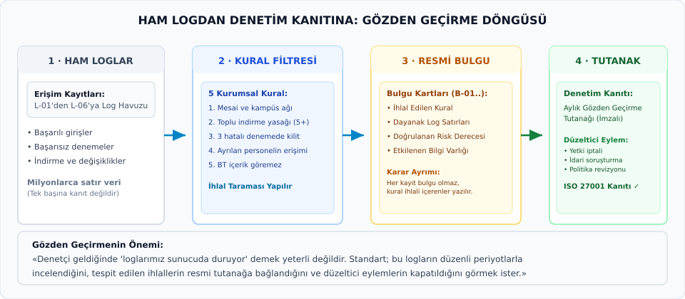

## Görev: Kuzey Üniversitesi ÖBS erişim kayıtlarını gözden geçirmek ve denetim kanıtı üretmek

- **Kapsam ve Veri:** Kuzey Üniversitesi Öğrenci Bilgi Sistemi (ÖBS) Personel Modülü (`personel-dosyasi`) erişim kütükleri ve beş kurumsal güvenlik kuralı.
- **Yönetsel Şart:** Arşivlenen kayıtların kurumsal ölçütlerle düzenli karşılaştırılması ve anormalliklerin resmi bulgulara dönüştürülmesi.
- **Beklenen Çıktı:** Resmi **Gözden Geçirme Bulguları** (`B-02`, `B-03`, `B-04`) ve imzalı **Aylık Erişim Gözden Geçirme Tutanağı**.

**Göreviniz:**

1. Kurumun beş temel kayıt/izleme kuralını ve çözümlü `B-01` rehber bulgusunu inceleyin.
2. ÖBS Personel Modülü (`personel-dosyasi`) için filtrelenmiş kritik erişim kayıtlarını (`L-02` .. `L-06`) kurumsal kurallarla sınayın.
3. Kural dışılık ve güvenlik riski barındıran olaylar için resmi **Gözden Geçirme Bulguları** (`B-02`, `B-03`, `B-04`) üretin; hangi kaydın neden açık bulguya dönüştürülmediğini gerekçelendirin.
4. Elde edilen bulguları ve yönetsel aksiyonları kurumsal **Aylık Erişim Gözden Geçirme Tutanağı** şablonuna işleyerek denetim kanıtını tamamlayın.

::: {.notes}
Kuzey Üniversitesi Öğrenci Bilgi Sistemi'nde (ÖBS) kritik personel ve öğrenci kayıtlarına erişim hareketleri merkezi kütük sunucusunda arşivlenmektedir. Ancak kayıtların disklerde birikmesi, kurumun bilgi güvenliği yönetimini sağladığı anlamına gelmez; önceki teorik saatlerimizde gördüğümüz gibi kayıt tutma pasif bir arşivleme, izleme ve gözden geçirme ise aktif bir inceleme sürecidir. Yönetimin ve denetçilerin temel şartı, bu kayıtların kurumsal ölçütlerle düzenli olarak karşılaştırılması, anormalliklerin resmi bulgulara dönüştürülmesi ve imzalı bir denetim kanıtıyla belgelenmesidir.

Bu uygulama dersinde bir bilgi güvenliği yöneticisinin ve iç denetçinin temel rutinlerinden birini yürüteceksiniz. Masamızda Kuzey Üniversitesi ÖBS Personel Özlük Modülü'ne (`personel-dosyasi`) ait filtrelenmiş erişim kayıtları (`L-01`–`L-06`), beş kurumsal güvenlik kuralı, çözümlü `B-01` rehber bulgusu ve resmi tutanak şablonumuz bulunuyor.

Toplanan verilerin havada kalmaması için ISO 27001'in beklediği yönetsel kanıt zincirini adım adım kuracağız. Önce bu incelemenin H11'de kurduğumuz rol-izin matrisi ve görev ayrılığı kararlarıyla nasıl birleştiğini netleştirelim.
:::

---

## Önceki kararlar ve operasyonel zemin: H11 matrisinden H12 izleme sürecine

Hafta 11'de Kuzey Üniversitesi ÖBS için kurduğumuz rol-izin matrisi ve görev ayrılığı kararları bu incelemenin meşruiyet zeminini oluşturur:

- **Tanımlı Roller:** Öğrenci İşleri (`ogrenci-isleri`), Öğretim Elemanı (`ogretim-elemani`), Bölüm Başkanı (`bolum-baskani`), BT Yetki Yöneticisi (`bt-yoneticisi`) ve Dekanlık/Müdürlük (`dekanlik-mudurluk`).
- **En Az Ayrıcalık Kuralı:** Hiçbir kullanıcıya tanımlı iş görevi dışında genel veya sınırsız yetki tanınmamıştır.
- **Görev Ayrılığı İlkesi:** Teknik altyapıyı yöneten BT personeli, kurumsal verilerin (not, özlük, iletişim) içerik okuyucusu veya iş onaylayıcısı olamaz.
- **H12'deki Devir:** Onaylanan yetkiler kalıcı ve denetimsiz değildir; yetkinin fiilen nasıl kullanıldığı ve sınır aşımı H12 erişim kayıtlarıyla anlaşılır.

*Hatırlatma: Bu saatte matrisi baştan kurgulamayacak; H11'de belirlenmiş yetki sınırlarını ihlal eden hareketleri log kayıtları üzerinden teşhis edeceğiz.*

::: {.notes}
H11'de kurguladığımız rol-izin matrisi, kimin hangi bilgi varlığına hangi sınırlar içinde erişebileceğini kağıt üzerinde ve sistem ayarlarında belirlemişti. Ancak bilgi güvenliği yönetimi "matrisi kurduk, işimiz bitti" diyemez; onaylanan yetkilerin kalıcı ve denetimsiz bırakılması, kağıt üzerindeki kuralların sahada delinmesine yol açar.

Canlı işletimde çalışanlar tanımlı yetkilerini iş amacı dışında kullanabilir, parolalarını çaldırabilir veya teknik altyapıyı yöneten `bt-yoneticisi` rolündeki personel teknik imkanlarını kullanarak merak ettiği maaş listelerine bakabilir. H12'deki gözden geçirme süreci, H11'de alınan en az ayrıcalık ve görev ayrılığı kararlarının sahada fiilen işleyip işlemediğini teyit ettiğimiz kontrol aşamasıdır (PUKÖ döngüsünün "Kontrol Et" adımı).

Çalışmanızda sık yapılan bir hatadan kaçınmalısınız: erişim kaydı incelemesi yetki matrisini sıfırdan değiştirmek değildir. Burada matrisi baştan kurgulamıyoruz; H11'de çizilen yetki sınırlarını ölçü alarak bu sınırları ihlal eden hareketleri kütük kayıtları üzerinden teşhis ediyoruz. Şimdi bu inceleme sürecinin kurumsal tanımına ve ürettiği denetim kanıtının işlevlerine bakalım.
:::

---

## Gözden geçirme (Review) nedir ve denetim kanıtı neden üretilir?

**Erişim Gözden Geçirmesi (Access Review)**, tutulan erişim kütüklerinin ve mevcut kullanıcı yetkilerinin; yetki matrisi, bilgi güvenliği politikaları ve olağandışılık ölçütleri çerçevesinde periyodik ve bağımsız olarak incelenmesi, doğrulanması ve sapmaların kayıt altına alınması sürecidir.

Gözden geçirme sürecinin ürettiği **Denetim Kanıtının (Audit Trail / Evidence)** üç temel işlevi:

1. **Hesap verebilirlik güvencesi:** Sistemde yapılan işlemlerin kim tarafından, ne zaman ve hangi yetkiyle yapıldığının tarafsız ve inkar edilemez şekilde kanıtlanması.
2. **Yönetsel ve yasal uygunluk:** İç denetimlerde, bağımsız ISO 27001 tetkiklerinde veya yasal soruşturmalarda (KVKK vb.) yönetimin güvenlik kontrollerini işlettiğini ispatlayan resmi belge olması.
3. **Sürekli iyileştirme (PUKÖ):** Tespit edilen kural dışılıkların sadece cezalandırma değil; sistem açıklarını kapatma, parola politikalarını sıkılaştırma veya eğitim verme kararlarına girdi sağlaması.

::: {.notes}
Güvenlik yönetiminde üst yönetime veya denetçiye gidip "sistemlerimiz güvenli, ben loglara baktım ve sorun görmedim" diyemezsiniz. İç denetçi ya da bağımsız tetkikçi kuruma geldiğinde kütüklere bakılmış olmasını değil, bu incelemenin hangi ölçütlerle, kim tarafından ve hangi tarihte yapıldığını belgeleyen resmi kanıtı ister.

Gözden geçirme tutanağı, üzerinde yer alan tarih, kapsam ve sorumlu imzalarıyla birlikte hukuki ve kurumsal bir kanıttır. Bu belge sayesinde kurumda yetkilerin başıboş bırakılmadığı ispatlanır; olası bir veri sızıntısında olayın kurumsal bir kontrol ihmalinden mi yoksa münferit bir suistimalden mi kaynaklandığı somut kayıtlara dayanarak aydınlatılır.

Üretilen denetim kanıtının amacı yalnızca geçmişteki ihlali belgelendirip sorumluyu cezalandırmak değildir. Yakalanan her sapma, çalışmayan teknik kısıtlamaları veya süreç açıklarını görünür kılarak yönetim sistemini yaşayan bir PUKÖ döngüsüne dönüştürür. Bir sonraki şemada ham log satırlarından imzalı tutanağa uzanan bu döngünün dört durağını bir arada göreceğiz.
:::

---

## Erişim gözden geçirme ve denetim döngüsü

{width="100%" fig-align="center" fig-alt="Erişim gözden geçirme ve denetim kanıtı üretim döngüsü: Ham logdan resmi tutanağa"}

::: {.notes}
Şemayı soldan sağa dört durak olarak okuyun: ham loglar, kural filtresi, resmi bulgu, tutanak. Soldaki durakta milyonlarca satır vardır ve bu veri tek başına kanıt değildir; başarılı girişler, başarısız denemeler, indirmeler ve değişiklikler birbirine karışmıştır. Bu derste bu havuzdan çıkarılmış altı kritik olay (`L-01`–`L-06`) üzerinde çalışıyorsunuz.

İkinci durak kural filtresidir. Beş kurumsal kural, havuzu anlamlı bir listeye indirger: Kural 1 mesai ve kampüs ağı, Kural 2 toplu indirme yasağı (beşten fazla dosya), Kural 3 üç hatalı denemede hesap kilidi, Kural 4 ayrılan personelin hesabı, Kural 5 BT'nin içerik görememesi. Filtre bir ihlal taramasıdır: kayıtlar kurallarla karşılaştırılır ve yalnızca kuralı delenler ilerler. Kaydı "bana şüpheli geldi" diye değil, hangi kurala aykırı olduğunu söyleyerek ayırırsınız.

Üçüncü durakta kayıt bir bulguya dönüşür. Bulgu kartı ihlal edilen kuralı, dayanak log satırlarını, doğrulanan risk derecesini ve etkilenen bilgi varlığını taşır; önem sınıfı (majör, minör ya da gözlem) risk alanının yanında yazılır. Şemadaki karar ayrımı kutusu önemli bir sınırı koyar: her kayıt bulgu olmaz. Sistemin başarıyla engellediği ve ısrarlı bir örüntüye dönüşmeyen kayıt, izleme istatistiği olarak raporda yer alır ama açık bulgu açılmaz.

Dördüncü durak tutanaktır. Aylık gözden geçirme tutanağı imzalanır ve ISO 27001 bakımından bir kanıt oluşturur. Tutanağın yanında düzeltici eylemler vardır: yetki iptali, idari soruşturma, politika revizyonu. İncelenen kaydın kendi hareketi olan bir rol, o kaydın incelemesini yapmaz; bu durumda ilgili satır bağımsız denetçiye iletilir ve tutanakta yazılır.

Şemanın altındaki not, denetim açısından asıl soruyu sorar: "loglarımız sunucuda duruyor" demek yeterli değildir. Standart, logların düzenli aralıklarla incelendiğini, ihlallerin resmi tutanağa bağlandığını ve düzeltici eylemlerin kapatıldığını görmek ister. Bağımsız çalışmada bu dört durağı sırayla yürütün; hangi durakta kayıt olmadığını söyleyemiyorsanız o durak eksiktir.
:::

---

## Veri sözlüğü: Bilgi varlığı ve ilgili aktörler

Kuzey Üniversitesi ÖBS ortamında bu incelemeye konu olan bilgi varlığı ve sorumluluk taşıyan aktörler:

| Kısa Ad | Tanım ve Kurumsal Rol | Görev ve Güvenlik Sınırı |
|---|---|---|
| `personel-dosyasi` (K-4) | Personel Özlük ve Bordro Modülü | Kimlik, maaş, sağlık ve disiplin verilerini tutan çok gizli varlık |
| `ik-uzmani` (İK) | İnsan Kaynakları Uzmanı (Canan Demir) | Mesai içinde yerel ağdan münferit dosya inceleme/güncelleme |
| `ik-yoneticisi` (İKY) | İK Daire Başkanı (Kemal Vural) | Varlığın iş sahibi; yetki taleplerini ve tutanakları onaylar |
| `bt-yoneticisi` (BT) | BT Güvenlik Yöneticisi (Murat Bey) | Altyapı ve log işletimi; veri içeriğini okuma yetkisi yoktur |
| `rektorluk-denetci` (İT) | İç Denetçi / Hukuk Müşavirliği | Denetim kanıtlarını bağımsız olarak inceleyen üst otorite |

::: {.notes}
İncelememizin merkezindeki `personel-dosyasi` varlığı; çalışanların T.C. kimlik numaralarını, maaş bilgilerini, sağlık raporlarını ve disiplin kayıtlarını barındıran yüksek gizlilik dereceli kritik bir bilgi varlığıdır. Bu varlık üzerindeki operasyonel işlemler ve sorumluluklar tanımlı sınırlarla birbirinden ayrılmıştır: Canan Demir (`ik-uzmani`) işi fiilen yürüten kullanıcıdır ancak yetkisi mesai içinde yerel ağdan tekil dosya inceleme ve güncellemeyle sınırlıdır; Kemal Vural (`ik-yoneticisi`) ise verinin kurumsal iş sahibi olarak yetki taleplerini ve gözden geçirme tutanaklarını onaylar.

Görev ayrılığı ilkesi uyarınca teknik altyapı yönetimi ile içerik okuma yetkisi kesin olarak ayrılmıştır. Murat Bey (`bt-yoneticisi`) kütük sunucusunu ve sistem altyapısını işletir fakat personel özlük dosyalarını veya maaş tablolarını görüntüleme hakkı yoktur; `rektorluk-denetci` ise hem iş sahibinin hem de teknik yöneticinin işlemlerini ve ürettikleri denetim kanıtlarını bağımsız olarak denetleyen üst otoritedir.
:::

---

## Gözden geçirmeyi kim yapar? Denetçi kendi işini denetlemez

Gözden geçirme, **işi yapandan bağımsız** biri tarafından yapıldığında kanıt değeri taşır:

| Gözden geçirilen iş | Kendi işini inceleyemeyecek olan | Bağımsız inceleyen |
|---|---|---|
| İKY'nin verdiği istisnai (mesai dışı, harici IP) erişim onayları | İK yöneticisi (`ik-yoneticisi`) | İç denetçi (`rektorluk-denetci`) |
| BT yöneticisinin kendi hesabının hareketleri | BT yöneticisi (`bt-yoneticisi`) | İç denetçi (`rektorluk-denetci`) |

> Aynı kişi hem işi yapıp hem denetlerse inceleme, kanıt değil beyan olur.

::: {.notes}
Görevlerin ayrılığını H11'de hazırlayan ve onaylayan için görmüştük. Aynı ilke gözden geçirmeye de uygulanır: kendi işini kendisi inceleyen kişi, eksiklik bulsa da bulmasa da tarafsız sayılmaz. İncelemenin inandırıcılığı, inceleyenin işi yapandan ayrı olmasına bağlıdır.

Tabloda iki durum var. İK yöneticisi, kendi verdiği istisna onaylarının uygun olup olmadığına karar veremez; bu onayları ayrı biri inceler. BT yöneticisi log işletimini yürütür ama kendi hesabının hareketleri de loglardadır; o satırları kendisi okuyup "sorun yok" demesi yeterli kanıt değildir. Bu dersteki veri paketinde BT yöneticisine ait bir kayıt vardır. Aylık tutanakta o kaydın incelemesini kimin yaptığına ayrıca dikkat edin.

Küçük kurumlarda bağımsız bir denetçi bulunmayabilir. O zaman bile ilke korunur: inceleme, işi yapmayan başka bir kişiye ya da dış bir hizmete verilir. Büyük kurumlarda bu görev iç denetçidedir.

Bağımsız inceleyenin tarafsız kalabilmesi için kişisel kanaatlerle değil, herkes için önceden yazılmış kurumsal ölçütlerle hareket etmesi gerekir. Bir sonraki slaytta yer alan beş güvenlik kuralı, hem rutin gözden geçirmede hem de bağımsız denetimde kullanılan ortak terazi işlevini görür.
:::

---

## Kurumsal ölçütler: Gözden geçirmede kullanılan beş güvenlik kuralı

Kuzey Üniversitesi Bilgi Güvenliği Yönergesi uyarınca `personel-dosyasi` erişimlerinde uygulanan beş kesin kural:

1. **Kural 1 (Mesai ve Konum Kuralı):** Personel dosyalarına erişim hafta içi 08.30–17.30 mesai saatlerinde ve kampüs içi yerel ağdan (`10.20.x.x`) yapılır. Mesai dışı veya harici IP erişimi İKY yazılı onayına bağlıdır.
2. **Kural 2 (Tekil Erişim ve Toplu İndirme Yasağı):** İK uzmanları görevleri gereği münferit dosyaları açabilir. Tek seferde 5'ten fazla personelin bordro/özlük dosyasının indirilmesi / dışa aktarılması kesinlikle yasaktır ve doğrudan alarmdır.
3. **Kural 3 (Başarısız Giriş ve Hesap Kilitleme):** Bir hesaba ardışık 3 başarısız parola denemesi yapıldığında hesap 30 dakika kilitlenmeli ve BT güvenlik alarmı üretilmelidir.
4. **Kural 4 (Ayrılan Personel Hesabı):** Kurumdan ayrılan personelin hesabı ayrılış günü 17.30 itibarıyla kapatılır; bu hesaplarla oturum denemesi doğrudan ihlal girişimidir.
5. **Kural 5 (Görev Ayrılığı ve İçerik Gizliliği):** BT yöneticileri ve diğer unvanlar personel dosyası içeriğini asla görüntüleyemez; teknik personelin içerik okuması yetki aşımıdır.

::: {.notes}
Erişim kayıtlarını inceleyen bir güvenlik analisti veya denetçi, kişisel hislerine dayanarak "bence bu hareket şüpheli" diyemez; her tespitin yazılı bir kurumsal politikaya dayanması zorunludur. Kuzey Üniversitesi Bilgi Güvenliği Yönergesi'ndeki bu beş kural, soyut güvenlik ilkelerini kütük satırlarında doğrudan sınanabilir somut eşiklere (saat aralığı, IP bloğu, dosya adedi, hatalı deneme sayısı ve rol sınırı) dönüştürür.

Kuralların her biri farklı bir risk alanını kontrol altına alır. Kural 1 ve Kural 2, meşru İK uzmanının dahi çalışma zamanını, ağ konumunu ve tek seferde çekebileceği veri hacmini sınırlandırarak içeriden veri sızdırılmasını veya ele geçirilmiş hesapla toplu dışa aktarımı engeller; mesai dışı ya da harici IP erişimi yalnızca önceden alınmış yazılı İKY onayı varsa meşrudur. Kural 3 kaba kuvvet parola saldırılarına karşı otomatik kilitlemeyi, Kural 4 işten ayrılan personelin hesap yaşam döngüsünü, Kural 5 ise teknik sistem yöneticilerinin (`bt-yoneticisi`) veri içeriğinden uzak tutulmasını güvenceye alır.

Tek bir erişim olayı yalnızca bir kuralı çiğneyebileceği gibi aynı anda birden fazla kuralı da delebilir; örneğin mesai dışında harici bir ağdan yapılan toplu indirme hem Kural 1'i hem Kural 2'yi ihlal eder. Bir sonraki slaytta yer alan altı kritik erişim kaydını incelerken her satırı bu beş kuralın süzgecinden geçireceğiz.
:::

---

## İncelenen olaylar: L-01'den L-06'ya kritik erişim kayıtları havuzu

Kasım 2026 döneminde ÖBS log havuzundan (1.500.000 kayıt) kural tabanlı filtrelerle çekilen 6 kritik olay:

- **`L-01`:** `2026-11-17 10:15:22` | Kullanıcı: `canan.ik` | IP: `10.20.12.44` (Kampüs) | Hedef: `personel-dosyasi/sicil_4821` | Eylem: `Dosya_Goruntule` | Sonuç: `BASARILI`
- **`L-02`:** `2026-11-15 02:45:10` (Pazar) | Kullanıcı: `canan.ik` | IP: `88.245.12.8` (Genel İnternet) | Hedef: `personel-dosyasi/toplu_export` | Eylem: `Toplu_Bordro_Indir (85 personel)` | Sonuç: `BASARILI`
- **`L-03`:** `2026-11-16 09:20:00` | Kullanıcı: `murat.bt` | IP: `10.20.1.5` (Sistem Odası) | Hedef: `personel-dosyasi/maas_tablosu` | Eylem: `Tablo_Oku` | Sonuç: `BASARILI`
- **`L-04`:** `2026-11-16 11:30:12` | Kullanıcı: `ahmet.ayrilan` (10 Kasım'da ayrıldı) | IP: `10.20.12.18` | Hedef: `obs_login` | Eylem: `Oturum_Acma` | Sonuç: `BASARISIZ (Hatali Parola)`
- **`L-05`:** `2026-11-16 23:14:02 - 23:14:48` | Kullanıcı: `canan.ik` | IP: `178.62.201.90` (Yurtdışı IP) | Hedef: `obs_login` | Eylem: `Oturum_Acma` | Sonuç: `BASARISIZ (7 ardisik deneme, kilitlenme yok)`
- **`L-06`:** `2026-11-17 14:00:30` | Kullanıcı: `selin.kaya` (Öğretim Elemanı) | IP: `10.20.4.15` | Hedef: `personel-dosyasi/sicil_1002` | Eylem: `Dosya_Oku` | Sonuç: `ENGELENDI (403 Yetkisiz Erisim)`

::: {.notes}
Kasım 2026 dönemine ait 1.500.000 satırlık kütük havuzundan kural tabanlı filtrelerle süzülen bu altı kayıt, gözden geçirme çalışmamızın veri paketini oluşturur. İlk satır olan `L-01`, önceki saatte incelediğimiz normal operasyonel akışı gösteren kontrol ve kıyaslama noktamızdır: yetkili İK uzmanı mesai saatleri içinde, kampüs yerel ağından yalnızca tek bir personel dosyasını görüntülemiştir.

İzleyen `L-02`–`L-06` satırlarını sınarken her kaydı altı temel alanına ayırarak okumalısınız: zaman damgası, kullanıcı hesabı ve kurumsal rolü, kaynak IP adresi, hedef veri alanı, gerçekleştirilen eylem ve sistemin ürettiği sonuç (`BASARILI`, `BASARISIZ` veya `ENGELENDI`). Bir sonraki slaytta bu ham kütük verilerinin hangi zorunlu bileşenlerle resmi denetim bulgusuna dönüştürüldüğünü göreceğiz.
:::

---

## Bir denetim bulgusunun anatomisi: Ham logdan resmi bulguya

Ham log satırı teknik bir ifadedir; denetim bulgusu ise yönetsel bir karar belgesidir. Resmi bir **Gözden Geçirme Bulgusu** şu yedi zorunlu bileşeni taşımalıdır:

1. **Bulgu Kodu:** Takip edilebilir tekil kimlik (`B-01`, `B-02` vb.).
2. **İncelenen Kayıt ve Kanıt Referansı:** Ham log satırı, zaman damgası, kaynak IP ve eylem kodu.
3. **İlgili Hesap ve Rol:** Eyleme karışan hesap adı ve kurumsal pozisyonu.
4. **Tespit Edilen Olay:** Gerçekleşen durumun teknik ve operasyonel özeti.
5. **İhlal Edilen Kural ve Ölçüt:** Çiğnenen kurumsal politika maddesi (Kural 1–5).
6. **Güvenlik Riski, Etkisi ve Önem Sınıfı:** Olayın gizlilik, bütünlük veya erişilebilirlik açısından kuruma doğurduğu tehdit düzeyi ve bulgunun sınıfı (majör uygunsuzluk, minör uygunsuzluk, gözlem).
7. **Önerilen Acil Eylem ve İyileştirme:** Durumu kontrol altına almak ve tekrarlanmasını önlemek için atılacak yönetsel/teknik adımlar ve sorumlu aktörler.

::: {.notes}
Teknik kütük satırı yalnızca sistemde ne gerçekleştiğini kaydeder; oysa yöneticiler ve denetçiler olayın kurumsal anlamını, doğurduğu riski ve alınacak önlemi görmek ister. Bu nedenle bir bulgu yazarken yalnızca "bu log kaydı hatalıdır" demek yeterli değildir; yedi zorunlu bileşenin tamamı eksiksiz doldurulduğunda ham veri yönetsel bir karar belgesine dönüşür.

Bulgu kartındaki ilk dört bileşen (bulgu kodu, kanıt referansı, ilgili hesap/rol ve tespit edilen olay) maddi vakayı tartışmaya yer bırakmayacak biçimde sabitler. Beşinci ve altıncı bileşenler ise teknik olayı kurumsal bağlama oturtur: "İhlal Edilen Kural" alanı hükmün meşruiyet dayanağını (Kural 1–5) gösterirken, "Güvenlik Riski, Etkisi ve Önem Sınıfı" alanı olayın gizlilik, bütünlük veya erişilebilirlik üzerindeki ciddiyetini ve uygunsuzluk derecesini belirler.

Uygulamada sık yapılan hata, bulgu kartını yalnızca geçmişteki ihlali anlatan bir durum tespiti gibi yazıp yedinci bileşeni belirsiz bırakmaktır. Oysa önerilen acil eylem ve iyileştirme adımları, sorumlu aktörlerle eşleştirilerek kurumun PUKÖ döngüsü içinde nasıl refleks vereceğini tanımlar. Şimdi bu yedi bileşenin çözümlü `B-01` rehber bulgusu üzerinde nasıl kurulduğunu inceleyelim.
:::

---

## Rehber bulgu B-01: Pazar gecesi toplu veri indirme olayı (1/2)

`L-02` numaralı ham erişim kaydının resmi bulguya dönüştürülmesi:

| Bulgu Bileşeni | B-01 Rehber Bulgu Analizi |
|---|---|
| **Bulgu Kodu** | `B-01` |
| **İncelenen Kayıt ve Kanıt** | `L-02` (`2026-11-15 02:45:10`, IP: `88.245.12.8`, Hedef: `personel-dosyasi/toplu_export`, Eylem: `Toplu_Bordro_Indir`, Hacim: 85 personel kaydı). |
| **İlgili Hesap ve Rol** | `canan.ik` / İnsan Kaynakları Uzmanı |
| **Tespit Edilen Olay** | Pazar günü sabaha karşı 02.45'te, kurum dışı genel internet IP adresinden yetkili İK uzmanı hesabıyla oturum açılmış ve tek bir oturumda 85 personelin maaş ve bordro verileri topluca dışa aktarılmıştır. |

. . .

*Değerlendirme:* Kullanıcının meşru rolü İK uzmanıdır; ancak yapılan işlem tanımlı görev sınırlarını hem zaman, hem konum hem de veri hacmi açısından çiğnemiştir.

::: {.notes}
Rehber bulgu `B-01`'in ilk bölümünde somut olguyu ve teknik kanıtı sabitliyoruz. Dayanağımız olan `L-02` kaydındaki zaman damgası (`2026-11-15 02:45:10`), harici IP adresi (`88.245.12.8`), hedef modül ve işlem hacmi (85 personel kaydı) açıkça yazılarak olayın maddi çerçevesi netleştirilmiştir.

Burada dikkat edilmesi gereken nokta, işlemi gerçekleştiren `canan.ik` hesabının normalde `personel-dosyasi` varlığı üzerinde çalışma yetkisi bulunan meşru bir İK uzmanına ait olmasıdır. Ancak hesabın yetkili bir role ait olması yapılan işlemi meşru kılmaz; pazar gecesi 02.45'te genel internet bağlantısı üzerinden 85 personelin bordrosunun topluca indirilmesi, tanımlı rutin iş akışına hem zaman hem konum hem de veri hacmi bakımından tamamen aykırıdır. Şimdi bu olgunun kurumsal kural ihlalini ve risk hükmünü görelim.
:::

---

## Rehber bulgu B-01: Kurumsal kural ihlali, risk ve acil eylem (2/2)

| Bulgu Bileşeni | B-01 Rehber Bulgu Hükmü ve Aksiyonu |
|---|---|
| **İhlal Edilen Kural** | Kural 1 (Mesai/Konum) ve Kural 2 (Toplu İndirme Yasağı) |
| **Güvenlik Riski ve Önem Sınıfı** | **Kritik Risk** — 85 personelin maaş/özlük verisi sızdırılmıştır (iç tehdit veya hesap ele geçirme). **Majör uygunsuzluk:** iki kural birlikte delinmiş, veri kurum dışına çıkmıştır |
| **Önerilen Acil Eylem** | 1. Hesabı dondur; 2. Cihazı izole et; 3. 5 kayıt sınırını sisteme ekle; 4. Rektörlüğe raporla |
| **Sorumlu Aktörler** | İK Daire Başkanı (İdari İnceleme) ve BT Güvenlik Yöneticisi (Teknik Tedbir) |

::: {.notes}
Rehber bulgunun ikinci kısmı yönetsel hükmü ve düzeltici aksiyonları içerir. Olayda önceden alınmış yazılı bir İKY onayı bulunmaksızın hem Kural 1 (Mesai ve Konum Kuralı) hem de Kural 2 (Tekil Erişim ve Toplu İndirme Yasağı) birlikte çiğnenmiştir. Kurumun en hassas kişisel verileri (maaş, T.C. kimlik, bordro) fiilen kurum dışına sızdırıldığı için güvenlik riski "Çok Yüksek / Kritik Risk" düzeyindedir ve olay ya içeriden bir veri çalma girişimine (iç tehdit) ya da dış saldırganın parolayı ele geçirip veriyi indirmesine (hesap ele geçirme) işaret eder; iki kuralın birlikte delinmesi ve ciddi zararın gerçekleşmesi nedeniyle bulgu **majör uygunsuzluk** sayılır.

Majör uygunsuzluk karşısında önerilen eylem adımları hem anlık müdahaleyi hem de kalıcı teknik kontrolü birleştirir: (1) `canan.ik` hesabı derhal dondurulmalı ve açık tüm oturumları sonlandırılmalıdır; (2) ilgili personelin kurumsal cihazı adli inceleme için izole edilmeli ve İKY başkanlığında resmi soruşturma açılmalıdır; (3) yazılımda 5 kaydı aşan indirmeleri engelleyen sert eşik kuralı devreye alınmalıdır; (4) olay Olay Yönetimi Ekibine ve Rektörlüğe raporlanmalıdır. Görev ayrılığı gereği idari soruşturma sorumluluğu İK Daire Başkanında (İKY), hesap dondurma ve teknik inceleme sorumluluğu ise BT Güvenlik Yöneticisindedir (BT).
:::

---

## Karar ayrımı: Hangi kayıt resmi bulguya dönüşür, hangisi dönüşmez?

Gözden geçirme sürecinde güvenlik analistinin en kritik kararı: **"Hangi olay için resmi bulgu açılmalı, hangi olay rutin koruma kaydı olarak izlenmelidir?"**

- **Açık Bulguya Dönüşen Durumlar:**
  - Kurumsal güvenlik kurallarının doğrudan çiğnendiği,
  - Yetki matrisinin delindiği veya görev ayrılığının ihlal edildiği,
  - Sistem güvenlik mekanizmalarının çalışmadığı veya yönetsel ihmalin bulunduğu durumlar.
- **Rutin Koruma Olarak İzlenen Durumlar:**
  - Sistemin teknik koruma mekanizmasının kuralı başarıyla işlettiği ve yetkisiz erişimi engellediği,
  - Yetkisiz kullanıcının veriye hiçbir şekilde ulaşamadığı ve ısrarlı bir örüntüye dönüşmeyen durumlar.
  - *Yönetsel Değerlendirme:* Engellenen olaylar ayrı bir açık bulguya dönüştürülmeyebilir; ancak izleme özeti ve denetim istatistiği olarak raporda kayıt altına alınır.

::: {.notes}
Gözden geçirme sürecinde olay havuzunu inceleyen bir analistin en kritik görevi, hangi kayıt için resmi bulgu kartı açılacağını ve hangi kaydın rutin koruma istatistiği olarak izleneceğini nesnel ölçütlerle ayırmaktır. Kütük filtresine takılan her olağandışı veya başarısız hareket doğrudan bir kriz ya da açık bulgu anlamına gelmez; kararın temel dayanağı kurumsal kuralların delinip delinmediği ve teknik savunmanın görevini yapıp yapmadığıdır.

Bir erişim kaydında kurumsal güvenlik kuralları fiilen çiğnenmişse, yetki matrisi ya da görev ayrılığı sınırı aşılmışsa veya devreye girmesi gereken bir güvenlik mekanizması çalışmamışsa o olay mutlaka açık bulguya dönüştürülür. Burada işlemin başarıyla sonuçlanmış olması şart değildir: yönetsel bir ihmal sonucu kapatılması gereken bir hesabın açık bırakılması veya kilitlenmesi gereken bir hesabın kilitlenmemesi, saldırgan içeri giremese bile kontrol mekanizmasının arızalandığını kanıtladığı için resmi bulgu gerektirir.

Buna karşılık yetkisiz bir kullanıcı erişim denemesinde bulunduğunda sistemin teknik koruma mekanizması kuralı başarıyla işletip erişimi anında durdurmuşsa, kullanıcı veriye hiçbir şekilde ulaşamamışsa ve hareket ısrarlı bir saldırı örüntüsüne dönüşmemişse veri gizliliği ve bütünlüğü korunmuş demektir. Sistem tasarlandığı gibi çalıştığı için bu tür tekil engellemeler açık bulguya dönüştürülmez.

Çalışmanızda sık yapılan iki yanılgıdan kaçının: birincisi, kütükte "başarısız" ya da "engellendi" ifadesini görünce kontrol arızası barındıran olaylarla başarılı engellemeleri aynı kefeye koymaktır; ikincisi ise açık bulgu açılmayan engellenmiş kayıtları tutanaktan tamamen silmektir. Engellenen tekil olaylar açık bulgu olmasa da, teknik savunmanın çalıştığını gösteren izleme özeti ve denetim istatistiği olarak tutanakta kayıt altına alınır. Açık bulguya dönüşen olayların kendi içinde nasıl derecelendirildiğini ise bir sonraki slaytta ele alıyoruz.
:::

---

## Bulgunun önemi: Majör, minör, gözlem

Resmi bulgu açılınca **önem sınıfı** da belirlenir:

| Sınıf | Anlamı | Örnek |
|---|---|---|
| **Majör uygunsuzluk** | Bir kural ya da kontrol hiç işlemiyor veya sistemli biçimde çiğneniyor; ciddi risk doğuyor | Roller ve görevler hiç dağıtılmamış; `B-01`: iki kural birlikte delinmiş, veri kurum dışına çıkmış |
| **Minör uygunsuzluk** | Kural genel olarak işliyor; tekil bir eksik var, ciddi risk doğurmuyor | Bakım kayıtlarının bazı satırları eksik |
| **Gözlem** | Kural çiğnenmemiş; ileride sorun doğurabilecek ya da iyileştirilebilecek nokta | Haftalık gözden geçirme raporunun şablonu yok |

> Sınıfı belirleyen iki soru: **Sistemli mi, tekil mi? Ciddi bir risk doğuruyor mu?**

::: {.notes}
Önceki slaytta bir kaydın bulguya dönüşüp dönüşmeyeceğine karar verdik. Bu slaytta bulgu açılınca ne kadar ağır olduğuna karar veriyoruz. İkisi ayrı sorulardır.

Majör uygunsuzlukta kontrol ya hiç çalışmıyor ya da sistemli biçimde atlanıyor ve sonuçta ciddi risk doğuyor. Minör uygunsuzlukta kural genel olarak çalışıyor, ama tekil bir eksik var ve ciddi bir risk doğurmuyor. Gözlem uygunsuzluk değildir: kural çiğnenmemiştir, ama denetçi bir riski ya da iyileştirme fırsatını görmüştür.

Aynı olay duruma göre farklı sınıfa girebilir. Tek bir hesabın ayrılış gününden birkaç gün sonra kapatılması minör olabilir; ayrılan hesapların sistemli olarak açık kalması ise majördür. Bu yüzden sınıf yazılırken "sistemli mi tekil mi" ve "risk ne kadar ciddi" soruları gerekçe olarak yazılır.

Sınıf, düzeltici faaliyetin aciliyetini de belirler: majör uygunsuzluk önceliklidir, minör planlı kapatılır, gözlem izlenir ve değerlendirilir. Çalışmanızda her bulgu için önem sınıfını gerekçesiyle yazın.
:::

---

## Soru listesi: Aynı incelemeyi her seferinde aynı biçimde yapmak

İnceleme, kuralları soruya çeviren bir listeyle yürütülür. Her soru bir kurala bağlanır; "Hayır" yanıtı bir bulgu adayıdır:

| Soru | Kural | Uygun mu? | Sınıf (Hayırsa) |
|---|---|---|---|
| Mesai dışı veya harici IP erişimlerinin hepsinde İKY yazılı onayı var mı? | Kural 1 | | |
| Her kullanıcıda tek seferde indirilen dosya sayısı 5 veya daha az mı? | Kural 2 | | |
| 3 ardışık başarısız denemeden sonra hesap kilitlendi mi? | Kural 3 | | |
| Ayrılan her personelin hesabı ayrılış günü kapatıldı mı? | Kural 4 | | |
| Teknik personel hiçbir kayıtta dosya içeriğini görüntülemedi mi? | Kural 5 | | |

::: {.notes}
Soru listesi, incelemeyi kişiden bağımsız ve tekrarlanabilir kılar: aynı soruları iki farklı kişi sorarsa aynı kayıtlara bakar. Her sorunun yanında kural numarası vardır; cevabın dayanağı log satırıdır, yorum değildir.

Listeyi bu veri paketinde aşağıdaki gibi kullanırsınız: önce soruyu okur, ilgili log satırlarına bakar, "Evet" ya da "Hayır" yazarsınız. "Hayır" olan her satır bir bulgu adayıdır; hepsi bulguya dönüşmez, çünkü az önceki karar ayrımı hâlâ geçerlidir. Bulguya dönüşenlerin önem sınıfını da son sütuna yazarsınız.

1.500.000 kaydı tek tek okumak mümkün değildir. Gerçek gözden geçirmelerde kayıtlar filtrelerle ve örneklemle daraltılır; bu derste de altı kritik olay filtreyle çıkarılmıştır. Listeyi bağımsız görevde yardımcı araç olarak kullanabilirsiniz.
:::

---

## Bağımsız görev 1: B-02, B-03 ve B-04 bulgularını üretmek

- **İncelenecek Veri:** Önceki saatte incelediğiniz `L-03`, `L-04`, `L-05` ve `L-06` olay kayıtları ile beş kurumsal güvenlik kuralı.
- **Beklenen Çıktı:** Resmi bulguya dönüşmesi gereken üç olay için rehber `B-01` formatında `B-02`, `B-03` ve `B-04` bulguları.
- **Seçim ve Ayrım Soruları:**
  - `L-03` .. `L-06` olaylarından hangileri kurumsal kural ihlali, yetki aşımı veya mekanizma arızası nedeniyle açık bulguya dönüşmelidir?
  - Hangisi rutin koruma kaydı olarak izlenmeli, açık bulgu açılmamalıdır? Gerekçeniz nedir?
  - Her bulgunun önem sınıfı (majör uygunsuzluk, minör uygunsuzluk) nedir? Gerekçeniz sistemli/tekil ve risk ciddiyeti sorularına dayanmalıdır.
  - Sistem yönetimi yetkisine sahip olmak veri içeriğine erişim hakkı tanır mı? İhlal edilen kurumsal kural ve gizlilik riski nedir?
  - Ayrılan personelin hesabının halen aktif olmasının doğurduğu yönetsel risk ve ihlal edilen kural nedir?
  - Ardışık başarısız parola denemelerinin gösterdiği tehdit türü ve güvenlik mekanizmasındaki aksaklık nedir?

::: {.notes}
Bağımsız çalışmanın ilk etabında `L-03`, `L-04`, `L-05` ve `L-06` olay kayıtlarını kurumsal karar ölçütleriyle değerlendirerek hangi üç olayın resmi bulguya (`B-02`, `B-03`, `B-04`) dönüştürüleceğini ve hangi olayın neden ayrı bir açık bulgu yapılmayacağını belirlemeniz beklenmektedir. Açık bulguya dönüştürülmeyen kayıt için de kurumsal kurallara ve teknik savunmanın çalışma durumuna dayanan net bir ayrım gerekçesi yazmalısınız.

Seçtiğiniz üç olayın her biri için rehber `B-01` formatındaki yedi zorunlu bileşeni (Bulgu Kodu, İncelenen Kayıt ve Kanıt, İlgili Hesap ve Rol, Tespit Edilen Olay, İhlal Edilen Kural, Güvenlik Riski ve Önem Sınıfı, Önerilen Acil Eylem ve Sorumlu Aktörler) bağımsız olarak doldurun. Önem sınıfını belirlerken olayın sistemli mi yoksa tekil mi olduğunu ve doğurduğu riskin ciddiyetini gerekçelendirmeye dikkat edin.
:::

---

## Bağımsız görev 2: Aylık erişim gözden geçirme tutanağı (Denetim Kanıtı)

Ürettiğiniz bulguları kurumsal denetim kanıtına dönüştürmek üzere aşağıdaki tutanağı doldurunuz:

```
KUZEY ÜNİVERSİTESİ BİLGİ GÜVENLİĞİ YÖNETİM SİSTEMİ
AYLIK ERİŞİM KAYITLARI GÖZDEN GEÇİRME TUTANAĞI

İnceleme Dönemi: Kasım 2026                 Tutanak Tarihi: 17 Kasım 2026
İncelenen Bilgi Varlığı: ÖBS Personel Özlük Modülü (personel-dosyasi)
İncelenen Toplam Kayıt Sayısı: 1.500.000    Filtrelenen Kritik Olay: 6

1. TESPİT EDİLEN BULGULAR VE İNCELENEN OLAYLAR TABLOSU
[B-01, B-02, B-03, B-04 bulgu özetleri ve L-06 koruma durumunu işleyiniz]

2. YÖNETİM VE DÜZELTİCİ EYLEM KARARLARI ÖZETİ
[Tespit edilen bulgular doğrultusunda alınacak yönetsel ve teknik kararları özetleyiniz]

3. BAĞIMSIZ İNCELEMEYE İLETİLEN KAYITLAR
[Kendi hareketi incelenen rolün kaydı varsa, hangi bulgunun hangi bağımsız denetçiye iletildiğini yazınız]

4. DENETİM KANITI ONAY VE İMZA BLOĞU
İş ve Süreç Sahibi (İKY): [Ad, Unvan, İmza, Tarih]
Teknik Sistem ve Güvenlik Sorumlusu (BT): [Ad, Unvan, İmza, Tarih]
```

::: {.notes}
İkinci bağımsız görevde, ürettiğiniz bulguları ve rutin koruma değerlendirmenizi resmi **Aylık Erişim Kayıtları Gözden Geçirme Tutanağı** şablonunda birleştirerek denetim kanıtını tamamlayacaksınız. Bu tutanak, ISO 27001 Madde 9.1 ve Ek A 8.16 gereksinimlerini karşılayan somut bir yönetim kanıtıdır; birinci bölümde `B-01`–`B-04` bulgu özetleri ile açık bulguya dönüştürülmeyen kaydın koruma durumu yer alırken, ikinci bölümde tespit edilen uygunsuzlukları kapatacak yönetsel ve teknik düzeltici eylem kararları özetlenir.

Tutanağın üçüncü ve dördüncü bölümlerini kurgularken görev ayrılığı ve bağımsız inceleme ilkelerini eksiksiz uygulamalısınız. İncelenen kayıtlar arasında kendi hareketi denetlenen bir rol varsa, ilgili bulgunun hangi bağımsız denetçiye iletildiğini üçüncü bölümde açıkça belirtin; onay ve imza bloğunda ise iş ve süreç sahibi (İKY) ile teknik sistem ve güvenlik sorumlusunun (BT) görev ve imza yetkilerini kurumsal sorumluluk sınırlarına uygun biçimde ayırın.
:::

---

## Görünür başarı ölçütleri: Bir denetim kanıtı nasıl değerlendirilir?

Hazırladığınız çalışma şu üç temel ölçüt üzerinden değerlendirilecektir:

1. **Kurumsal Kural ve Kanıt Uyumu:**
   - Her bulgu afaki yorumlara değil; bu dersteki beş kurumsal güvenlik kuralına ve logdaki somut kanıt alanlarına (zaman, IP, kullanıcı, eylem, sonuç) açıkça dayandırılmalıdır.
2. **Kanıt Dayanağı ve Ayrım Gerekçesi:**
   - Oluşturulan her bulguda somut log kanıtı, ihlal edilen kural, güvenlik riski, önem sınıfı ve önerilen eylem eksiksiz yer almalıdır.
   - Olay havuzunda yer alıp açık bulguya dönüştürülmeyen kaydın gerekçesi kurumsal karar ölçütleriyle açıklanmalıdır.
3. **Tutanağın Bütünlüğü ve Rol Sorumluluğu:**
   - Tutanakta iş süreç sahibi (`ik-yoneticisi`) ile teknik uygulayıcı (`bt-yoneticisi`) yetki ve onay alanları doğru ayrılmalı, somut düzeltici eylemler eksiksiz yazılmalıdır.
   - Kendi hareketi incelenen rol o kaydın incelemesini yapmaz; bu satırın bağımsız denetçiye iletildiği tutanakta yazılmalıdır.

::: {.notes}
Çalışmanızı tamamlarken bu üç temel ölçütü bir öz kontrol listesi olarak kullanın. Ürettiğiniz her bulgunun kişisel yorumlara değil, doğrudan beş kurumsal güvenlik kuralına ve kütük satırındaki somut kanıt alanlarına (zaman damgası, kaynak IP, kullanıcı, eylem ve sonuç) dayandığını; açık bulguların önem sınıflarının ve açık bulguya dönüştürülmeyen kaydın ayrım gerekçesinin eksiksiz yazıldığını doğrulayın.

Tutanak bölümünde ise idari sorumluluk ile teknik sorumluluğun doğru ayrılıp ayrılmadığını kontrol edin. İş süreç sahibi (`ik-yoneticisi`) ile teknik sistem sorumlusunun (`bt-yoneticisi`) onay alanlarının birbirine karışmadığından, düzeltici eylemlerin somut olarak yazıldığından ve kendi hareketi incelenen role ait kaydın bağımsız denetçiye (`rektorluk-denetci`) iletildiğinin tutanakta yer aldığından emin olun.
:::

---

## Ders özeti: Kanıttan düzeltici eyleme

- **Kayıt tutmak geçmişi belgeler; gözden geçirme tutanağı ise yönetime hesap verir.**
- Bir erişim kütüğü incelemesinde somut kanıt (log satırı), ihlal edilen kurumsal kural ve risk analizi bir araya gelmeden denetim bulgusu oluşmaz.
- Sistemlerin başarıyla engellediği rutin işlemler izleme istatistiğinde tutulurken; kuralları delen, yetkiyi kötüye kullanan veya koruma açığı yaratan olaylar resmi bulguya dönüştürülür.
- İmzalı gözden geçirme tutanağı, ISO 27001 PUKÖ döngüsünün "Kontrol Et" aşamasını tamamlar ve "Önlem Al" eylemlerini tetikler.
- **Açık kalan soru:** `B-01` bulgusunda sızan 85 personel verisinin hukuki niteliği ve bildirim yükümlülükleri, kişisel veri ve yasal yükümlülükler konusunun başlangıç vakasıdır.

::: {.notes}
Ham kütük satırlarından imzalı tutanağa uzanan bu uygulama, bilgi güvenliğinin yalnızca teknik altyapı kurmaktan ibaret olmadığını, düzenli gözden geçirme ve resmi kanıtlarla yönetilen bir disiplin olduğunu ortaya koymaktadır. Sunucularda biriken kayıtlar ancak kurumsal kurallarla sınandığında, risk analiziyle birleştirildiğinde ve bağımsız gözlerle incelendiğinde yönetsel anlam kazanır.

Gözden geçirme sürecinde sistemlerin başarıyla durdurduğu tekil girişimler rutin koruma istatistiği olarak kaydedilirken, kuralları delen veya güvenlik mekanizmasındaki aksaklığı ortaya çıkaran olaylar önem sınıflarıyla resmi bulguya dönüştürülür. İmzalı gözden geçirme tutanağı, ISO 27001 PUKÖ döngüsünün "Kontrol Et" aşamasını tamamlayarak hem teknik kısıtlamaları hem de idari tedbirleri içeren "Önlem Al" adımlarını resmen başlatır.

Burada tespit ettiğimiz en ağır bulgu olan `B-01` (85 personelin maaş ve kimlik verilerinin gece yarısı kurum dışına aktarılması), bu dersin kapsam sınırını da gösterir: gözden geçirme olayı belgeler ve düzeltici eylemi başlatır; sızdırılan verinin hukuki niteliği, kişisel veri sorumlulukları ve resmi bildirim yükümlülükleri ise kişisel veri ve yasal yükümlülükler konusunun doğal başlangıç vakasıdır ve bu derste ele alınmaz.
:::
