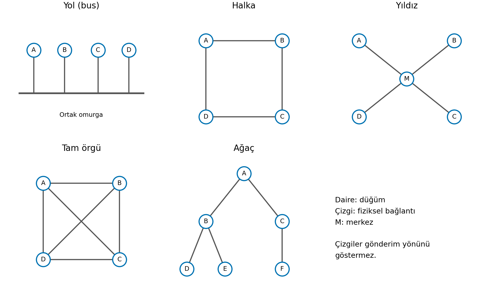

# Genel Özet: Veri İletişimi ve Ağ Yapıları

İki bilgisayar arasında kablo olması, bu bilgisayarların birbirini anlayabildiğini gösterir mi? Kablo sinyali taşıyabilir; anlamlı bir iletişim için iki tarafın da gelen mesajı aynı kurallarla yorumlaması gerekir. Bağlantının hangi ortamdan geçtiği, kimlerin hangi rolü üstlendiği ve cihazların nasıl bağlandığı da iletişimin farklı özelliklerini belirler.

1. **Protokol ve ağ:** Cihazlar hangi ortak kurallarla, hangi ihtiyaç için haberleşir?
2. **Veri, bit ve sinyal:** İletilmek istenen içerik fiziksel ortamda nasıl taşınır?
3. **İletim biçimleri:** Veri hangi yönde, hangi düzenle gönderilebilir?
4. **Ağdaki roller ve kapsam:** Kim hizmet ister, kim sunar; ağ ne kadar bir alana yayılır?
5. **Bağlantı ve hedefleme:** İletişim yolunu kimler paylaşır, mesaj kimlere yönelir?
6. **Topoloji:** Bağlantılar nasıl düzenlenir ve bir arıza kimleri etkiler?

## 1. Protokol ve bilgisayar ağı

### 1.1 Protokol

::: {.callout-important appearance="simple"}
## Tanım
**Protokol**, iletişim kuran tarafların mesajları oluştururken, gönderirken ve yorumlarken uyduğu ortak kurallar bütünüdür.
:::

Uzaktaki bir tepede yakılan ateşi gördüğünü düşün. Ateş görünür durumdadır, ama ne anlama geldiği kendiliğinden belli olmaz. Yardım mı isteniyor, tehlikenin geçtiği mi bildiriliyor? İletişimin kurulabilmesi için işareti gönderen ile gören kişinin önceden aynı anlam üzerinde anlaşmış olması gerekir.

Bilgisayarlarda da fiziksel bağlantı sinyali taşır; tarafların mesajın başlangıcını, sonunu ve anlamını bilmesi ortak kurallara bağlıdır. Bir cihazın gönderdiği mesaj, karşı tarafta beklenen biçimde yorumlanamıyorsa kablo sağlam olsa bile amaçlanan haberleşme gerçekleşmez.

Bir telsiz konuşmasında önce çağrılanın, sonra konuşanın adının söylendiğini ve “tamam” sözcüğünün konuşma sırasını karşı tarafa verdiğini düşün. Burada mesajın nasıl kurulacağı, ne anlama geldiği ve karşı tarafın ne zaman konuşacağı birlikte belirlenmiştir. Protokoller de iletişimin bu yönlerini düzenler.

### 1.2 Veri iletişiminin bileşenleri

Bir dosyanın bilgisayardan başka bir bilgisayara gönderilmesinde beş temel bileşen ayırt edilebilir:

| Bileşen | Anlamı | Dosya aktarımındaki karşılığı |
|---|---|---|
| Mesaj | İletilmek istenen veri | Dosyanın içeriği |
| Gönderici | Veriyi gönderen taraf | Dosyayı gönderen bilgisayar |
| Alıcı | Veriyi alan taraf | Dosyayı alan bilgisayar |
| İletim ortamı | Sinyalin geçtiği fiziksel yol | Bakır kablo, fiber veya kablosuz ortam |
| Protokol | Tarafların uyduğu kurallar | Dosya aktarımının mesaj düzeni ve karşılıklı davranışları |

Gönderici ve alıcı, iletişimin o anındaki rollerdir. Dosyayı alan bilgisayar bir yanıt gönderdiğinde, bu yanıtın göndericisi olur. Aynı cihazın veri alabilmesi ve gönderebilmesi, iki rolün tek bir cihaza kalıcı olarak bağlanmadığını gösterir.

### 1.3 Bilgisayar ağı ve paylaşım ihtiyacı

::: {.callout-important appearance="simple"}
## Tanım
**Bilgisayar ağı**, iletişim kurabilen cihazların kablolu veya kablosuz yollarla bağlanarak ortak kurallara göre veri alışverişi yaptığı yapıdır.
:::

Ağdaki cihazlar bilgisayar, telefon, yazıcı, kamera veya sensör olabilir. Bir bilgisayar kendi başına dosya işleyebilir; fakat başka bir bilgisayardaki dosyaya ulaşmak, ortak yazıcıyı kullanmak veya uzaktaki bir hizmetten yararlanmak için iletişim gerekir.

Ağların gelişmesindeki temel ihtiyaçlardan biri, farklı yerlerde bulunan veri ve hesaplama kaynaklarının paylaşılmasıdır. ARPANET de uzak bilgisayarlar arasında bu paylaşımı sağlayan erken örneklerden biridir. Bir araştırmacının uzaktaki veriyi kullanabilmesi için fiziksel bir taşıma ortamının kendisine gönderilmesini beklemek yerine bilgisayarlar arasında haberleşme kurulabilmiştir.

| Kullanım amacı | Örnek |
|---|---|
| Kaynak paylaşımı | Bir laboratuvardaki bilgisayarların ortak yazıcıyı kullanması |
| Veri paylaşımı | Bir dosyanın başka bir bilgisayara aktarılması |
| İletişim | Sesli görüşme veya mesajlaşma |
| Uzak kaynaklara erişim | Başka bir yerdeki hesaplama hizmetinden yararlanma |

Bu amaçlar aynı işlemde birlikte bulunabilir. Uzaktaki bir bilgisayara hesaplama yaptırıp sonucunu almak hem uzak kaynağı kullanmayı hem veri alışverişini içerir.

Kaynak paylaşımı ile veri paylaşımını ayırmak için ortak kullanılan şeye bakabilirsin. Bir yazıcıdan çıktı almak, cihazın sunduğu işlevden yararlanmaktır. Bir dosyayı almak ise dosyanın içeriğine erişmektir. Uzaktaki bir bilgisayarda hesaplama yaptırırken o bilgisayarın işlem yapabilme yeteneğini kullanırsın; sonuç dosyası sana geldiğinde veri de paylaşılmış olur. Böylece aynı işlemin hangi kısmının hangi ihtiyacı karşıladığı açıklanabilir.

## 2. Veri, bit, sinyal ve iletim ortamı

### 2.1 İçerikten fiziksel sinyale

::: {.callout-important appearance="simple"}
## Tanım
**Veri**, iletilmek istenen içeriktir. **Bit**, sayısal temsilde 0 veya 1 değerini alabilen temel birimdir. **Sinyal**, bu bilgiyi fiziksel ortamda taşıyan değişimdir.
:::

Bir metin, ses kaydı ve fotoğraf insana farklı görünür. Bilgisayar bu içerikleri belirli kurallara göre sayısal değerlerle, bu değerleri de bit örüntüleriyle temsil eder. Bitlerin ne anlama geldiği kullanılan gösterim kuralına bağlıdır.

Örneğin **A** harfi ASCII gösteriminde **65** sayısına karşılık gelir; bu değer sekiz bit ile **01000001** olarak gösterilebilir. Harfi başka bir bilgisayara gönderirken kablonun içinde küçük bir “A” harfi ilerlemez. Gönderici bu bit örüntüsüne uygun fiziksel sinyal üretir; alıcı sinyali okuyarak bit örüntüsünü elde eder ve kullanılan gösterimle yorumlar.

```text
A harfi → 65 → 01000001 → fiziksel sinyal → 01000001 → 65 → A harfi
```

**Okuma:** Solda içerik sayısal biçime dönüştürülür. Ortadaki fiziksel sinyal, seçilen ortama bağlıdır. Sağda alıcı aynı gösterim kuralıyla içeriği yeniden yorumlar.

Bu örnekten her karakterin sekiz bit olduğu sonucu çıkmaz. Buradaki ilişki, anlamlı bir içeriğin bitlerle temsil edilmesi ve bu bit bilgisinin fiziksel sinyalle taşınmasıdır.

Alıcı açısından iki ayrı iş vardır: fiziksel değişimi okuyarak bitleri elde etmek ve bu bitlerin neyi temsil ettiğini yorumlamak. `01000001` örüntüsünü doğru almak, onun mutlaka bir harf olduğunu kendiliğinden söylemez. Örüntü bir metin gösteriminin parçası olarak yorumlanıyorsa A harfi elde edilir. İçeriğin nasıl temsil edildiği bilgisi de bu yüzden gereklidir.

Benzer biçimde 0 ve 1, belirli fiziksel durumların adları değildir. Basit bir sistemde iki ayırt edilebilir durum bu değerlerle eşlenebilir; hangi durumun 0, hangisinin 1 sayılacağını kullanılan kural belirler. Bakırda, fiberde ve kablosuz ortamda aynı bit bilgisinin taşınabilmesi, bitin belirli bir kabloya veya sinyal türüne bağlı olmamasından gelir.

### 2.2 Aynı veri, farklı ortamlar

::: {.callout-important appearance="simple"}
## Tanım
**İletim ortamı**, gönderici ile alıcı arasında sinyalin izlediği fiziksel yoldur.
:::

Bakır kabloda elektriksel değişimler, fiber optikte ışık, kablosuz iletişimde elektromanyetik dalgalar kullanılır. Aynı bit dizisi bu ortamların her biriyle taşınabilir. İçerik aynı kalırken onu taşıyan fiziksel sinyalin biçimi değişir.

| Ortam | Sinyalin taşınması | Seçimde öne çıkan özellik |
|---|---|---|
| Çift bükümlü bakır | Bakır iletken çiftlerinde elektriksel sinyal | Kısa yerel bağlantılarda pratik kurulum ve maliyet |
| Koaksiyel | Merkez iletken ve onu çevreleyen dış iletken yapısı | Mevcut kablo TV/internet altyapısından yararlanma |
| Fiber optik | Optik lif boyunca ışık | Uzun mesafe, yüksek kapasite ve elektromanyetik girişime dayanıklılık |
| Kablosuz | Fiziksel kablo olmadan elektromanyetik dalgalar | Kablo döşemeden bağlantı kurabilme |

Çift bükümlü bakırda tellerin bükülmesi, girişimin etkisini azaltmaya yardımcı olur. UTP ek metal ekran içermez; STP ek ekranlama içerir. Ekranlama seçimi ortamın girişim koşulları ve kurulumu ile birlikte değerlendirilir.

Fiberde bilgi ışıkla taşındığından dış elektromanyetik girişim, bakırdaki elektriksel sinyalde olduğu gibi etkili olmaz. Buna karşılık döşeme, bağlantı bileşenleri ve uçların hazırlanması farklı kurulum ihtiyaçları doğurur. Bu yüzden ortam seçimi yalnız “hangisi hızlı?” sorusuyla yapılamaz.

### 2.3 Hangi ortam, hangi ihtiyaç için?

Aynı laboratuvardaki kısa bağlantılarda çift bükümlü bakır uygun bir adaydır. İki bina arasında uzun bir hat kurulacak ve güzergâhta yoğun elektromanyetik girişim bulunacaksa fiber güçlü bir aday olur. Mevcut kablo TV hattı üzerinden hizmet alınacaksa altyapının koaksiyel yapısı belirleyicidir.

Karar verirken **mesafe, girişim, gereken veri taşıma kapasitesi, maliyet ve kurulum koşulları** birlikte ele alınır. Bir kablonun adını bilmek, bağlantının gerçek hızını tek başına belirlemez; kullanılacak donanım ve bağlantı koşulları da önemlidir.

Bu kararın gerekçesini “fiber daha iyi” diyerek açıklayamayız. Binalar arasındaki örnekte ihtiyaç, uzun mesafede ve girişimli bir güzergâhta iletişim kurmaktır; fiberin özellikleri bu iki koşulla ilişkilendirilir. Laboratuvar örneğinde ise kısa mesafe ve pratik kurulum öne çıkar. Daha pahalı bir ortamın sağlayabileceği ek imkânlar her bağlantıda gerekli olmayabilir.

**Veri taşıma kapasitesi**, bağlantının birim zamanda taşıyabileceği veri miktarıyla ilgilidir. Kurulacak bağlantıdan beklenen kapasite yükseldikçe ortamla birlikte kullanılacak bileşenlerin de buna uygun olması gerekir. Mesafe, kapasite ve maliyeti birlikte belirtmek, bir ortam seçimini gerekçelendirmiş olur.

## 3. İletim biçimleri

### 3.1 Yön ve eşzamanlılık

::: {.callout-important appearance="simple"}
## Tanım
**Simplex**, tanımlanan kanalda tek yönlü iletimdir. **Half-duplex**, iki yönde fakat sırayla iletimdir. **Full-duplex**, iki yönde aynı anda iletim yapılabilmesidir.
:::

Bu ayrımı yapmak için önce “İki taraf da gönderebilir mi?” diye sor. Cevap hayırsa kanal simplex'tir. İki taraf da gönderebiliyorsa ikinci soru, aynı anda gönderip gönderemeyecekleridir.

Tek yönlü bir yayın akışında alıcı aynı kanal üzerinden cevap göndermez. Bas-konuş telsizde iki taraf da konuşabilir, fakat biri konuşurken diğeri dinler. İki yönlü telefon görüşmesinde ise iki tarafın sesi aynı anda taşınabilir.

| Biçim | A’dan B’ye | B’den A’ya | Aynı anda iki yön | Örnek |
|---|---|---|---|---|
| Simplex | Var | Yok | Yok | Tek yönlü yayın kanalı |
| Half-duplex | Var | Var | Yok | Bas-konuş telsiz |
| Full-duplex | Var | Var | Var | İki yönlü telefon görüşmesi |

Bir telefon görüşmesinde nezaket gereği sırayla konuşmak, bağlantıyı half-duplex yapmaz. Kanal iki yönü aynı anda taşıyabilecek durumdadır; konuşanların o anda nasıl davrandığı farklı bir konudur.

Half-duplex'te sıra değiştiğinde aynı kanalın yönü de değişebilir: önce A gönderir ve B alır, ardından B gönderir ve A alır. Bu nedenle half-duplex'e “tek yönlü” demek eksiktir; iki yön vardır, fakat aynı anda kullanılamaz. Simplex'te ise incelenen kanal üzerinden ters yönde gönderim imkânı yoktur.

Sınıflandırırken hangi kanala baktığını da açık tutmalısın. Bir yayın alıcısının başka bir bağlantı üzerinden geri bildirim gönderebilmesi, yayın kanalını iki yönlü yapmaz. İncelenen kanalın özelliği ile cihazın toplam haberleşme imkânları ayrı değerlendirilir.

::: {.callout-note}
## Sık yapılan hata
Bir uygulamanın önce istek gönderip sonra yanıt beklemesi, bağlantının half-duplex olduğunu göstermez. Sınıflandırma, kanalın iki yönde aynı anda veri taşıyabilme özelliğine dayanır.
:::

### 3.2 Seri ve paralel iletim

::: {.callout-important appearance="simple"}
## Tanım
**Seri iletimde** bitler bir iletim yolu üzerinde art arda gönderilir. **Paralel iletimde** birden fazla bit, birden fazla hat üzerinden aynı zaman aralığında gönderilir.
:::

Paralel iletim ilk bakışta daha hızlı görünür: aynı anda birden fazla bit taşınmaktadır. Fakat alıcının bu hatlardaki bitleri aynı gruba ait olarak doğru anda okuyabilmesi gerekir. Hatlar arasında gecikme farkı oluşursa birlikte gönderilen bitler aynı anda ulaşmayabilir. Hatların birbirini elektriksel olarak etkilemesi de sinyalin doğru okunmasını güçleştirebilir.

Bu sorunlar mesafe ve hız arttıkça önem kazanır. Paralel yapıda daha çok hat bulunması, tek başına daha yüksek kullanılabilir hız sağlamaz. Seri yapıda bitler art arda gönderilirken gönderim hızı yüksek tutulabilir; paralel hatlar arasındaki zamanlama uyumunu sağlama yükü de azalır.

Bitlerin gruplar hâlinde gönderildiği bir paralel bağlantıyı düşün. Alıcı bütün hatlara aynı anda bakarak bir grubu okuyacak. Bir hat diğerlerinden geç ulaşırsa, okuma anında bazı hatlarda yeni grubun, geç kalan hatta ise önceki grubun değeri bulunabilir. Sorun, alıcının aynı gruba ait olmayan değerleri birlikte okumasıdır. Küçük gecikme farkları sistemin izin verdiği aralıkta kalabilir; bu aralık aşıldığında doğru okuma güçleşir.

Hız yükseldiğinde bir bit grubu için ayrılan süre kısalır. Daha önce önemsiz kalan gecikme farkı, bu kısa sürenin büyük bir bölümünü kaplayabilir. Seri aktarımda ise aynı yoldaki bitlerin sırası izlenir; birden fazla paralel hattın aynı gruba yetişmesini sağlama problemi azalır. Seri bağlantının da sinyalin doğru okunmasını sağlayacak zamanlama düzenine ihtiyacı vardır.

| Özellik | Seri | Paralel |
|---|---|---|
| Bitlerin gönderilişi | Art arda | Birden fazla hatta birlikte |
| Hatlar arası eşzamanlılık | Paraleldeki ortak okuma düzenini gerektirmez | Birlikte gelen bitlerin zamanlaması önemlidir |
| Temel karşılaştırma | Art arda gönderim mutlaka yavaş demek değildir | Birlikte gönderim mutlaka hızlı demek değildir |

Seri–paralel ayrımı, simplex–duplex ayrımından farklıdır. İlki bitlerin aktarım düzenini, ikincisi iletişimin yönlerini ve eşzamanlılığını anlatır. “Seri” sözcüğü bağlantının tek yönlü olduğunu söylemez.

## 4. Ağdaki uçlar, roller ve coğrafi kapsam

### 4.1 Düğüm ve uç sistem

::: {.callout-important appearance="simple"}
## Tanım
**Düğüm**, ağdaki bir bağlantı veya işlem noktasıdır. **Uç sistem (host)**, iletişimin başladığı ya da sonlandığı sistemdir. **Bağlantı**, düğümler arasındaki iletişim yoludur.
:::

Bir bilgisayar dosya gönderirken, başka bir bilgisayar bu dosyayı alabilir. İkisi iletişimin uçlarıdır. Aralarında veriyi aktaran bir ağ cihazı da düğümdür, fakat bu dosya alışverişinin son alıcısı değildir. Düğüm sözcüğü hem uçları hem aradaki bağlantı ve işlem noktalarını kapsar.

### 4.2 İstemci ve sunucu

::: {.callout-important appearance="simple"}
## Tanım
**İstemci**, belirli bir hizmeti isteyen taraftır. **Sunucu**, bu hizmeti sağlayan taraftır. Bu adlar, bir hizmet ilişkisindeki rolleri belirtir.
:::

Bir bilgisayar web hizmetinden içerik istediğinde istemci rolündedir. Aynı bilgisayar başka bir cihaza dosya sağlıyorsa o ilişkide sunucudur. Dolayısıyla cihazın boyutu, kasası veya masada durması onun bütün iletişimlerdeki rolünü belirlemez.

Örneğin bir bilgisayarın hem web içeriği istediğini hem dosya paylaştığını düşün:

| Hizmet ilişkisi | Bilgisayarın yaptığı iş | Rolü |
|---|---|---|
| Web hizmetiyle iletişim | İçerik istiyor | İstemci |
| Dosya isteyen başka cihazla iletişim | Dosyayı sağlıyor | Sunucu |

İki rol aynı anda da üstlenilebilir. Rolü belirlemek için **“Bu ilişkide kim hizmet istiyor, kim sağlıyor?”** sorusu sorulur.

Gönderici ile sunucu da aynı kavram değildir. İstemci bir istek gönderirken mesajın göndericisidir. Sunucu bu isteği alır, ardından yanıtın göndericisi olur. İstemci ve sunucu rolleri, bir mesajın hangi yönde ilerlediğinden daha geniş olan hizmet ilişkisine aittir.

Dosya isteyen A bilgisayarı ile dosyayı sağlayan B bilgisayarını iki mesaj boyunca izleyelim:

| Mesaj | Gönderici | Alıcı | Hizmet ilişkisindeki roller |
|---|---|---|---|
| A, B’den dosya istiyor | A | B | A istemci, B sunucu |
| B, istenen dosyayı A’ya gönderiyor | B | A | A istemci, B sunucu |

Mesajın yönü değiştiğinde gönderici ve alıcı yer değiştirir; hizmet isteyen ve sağlayan taraf aynı kalır. B ayrıca A’nın sunduğu başka bir hizmeti isterse bu yeni ilişkide B istemci, A sunucu olabilir. Rol değişimini açıklarken hangi hizmet ilişkisini değerlendirdiğin belirtilmelidir.

### 4.3 Eşler arası model

::: {.callout-important appearance="simple"}
## Tanım
**Eşler arası modelde (peer-to-peer, P2P)** uçlar hem hizmet kullanabilir hem başka uçlara hizmet sağlayabilir.
:::

Bir dosyanın parçalarını paylaşan bilgisayarları düşün. Bir bilgisayar elindeki parçayı başka birine gönderirken kendisinde eksik olan parçayı üçüncü bir bilgisayardan isteyebilir. Hizmet sunma işi tek bir sabit uca toplanmamıştır.

Eşler arası model, uçların hizmet ilişkisidir. Kabloların hangi biçimde döşendiğini söylemez. Eşler arası çalışan uçlar, merkezi bir bağlantı noktası çevresinde de bağlanmış olabilir.

Bir bilgisayarın farklı uygulamalarda hem istemci hem sunucu olması, bütün hizmetlerinin eşler arası yürüdüğü anlamına gelmez. Web içeriği istemek ile başka bir cihaza dosya sunmak iki ayrı hizmet ilişkisi olabilir. Eşler arası paylaşımda ise aynı hizmete katılan uçların birbirlerine kaynak sağlaması söz konusudur. Örneğin dosya parçalarını karşılıklı paylaşan uçlar, aynı paylaşım düzeninde hem istekte bulunur hem istek karşılar.

### 4.4 PAN, LAN, MAN ve WAN

Ağın coğrafi kapsamı, cihazların hangi ölçekte bir alana yayıldığını belirtir.

| Ağ türü | Kapsam | Örnek |
|---|---|---|
| PAN — Kişisel alan ağı | Bir kişinin yakın çevresi | Telefon, saat ve kulaklık bağlantıları |
| LAN — Yerel alan ağı | Ev, laboratuvar veya bina gibi sınırlı alan | Laboratuvar bilgisayarlarının ağı |
| MAN — Metropol alan ağı | Şehir ölçeği | Aynı şehirdeki kurumsal yerleşkelerin bağlantısı |
| WAN — Geniş alan ağı | Şehirler veya ülkeler arası | Farklı şehirlerdeki kurum şubelerinin bağlantısı |

Bu adlar kesin kilometre eşikleri olarak kullanılmaz. Sınıflandırmada ağın yerel, şehir ölçeğinde veya geniş coğrafyaya yayılmış oluşu esas alınır. İnternet, farklı ölçeklerdeki çok sayıda ağın birbirine bağlandığı bir ağlar ağıdır.

Bir ağın LAN olması, o ağdaki bütün uçların istemci veya sunucu olduğunu söylemez. Kapsam ile hizmet ilişkisi farklı sorulara cevap verir.

Bir kurumun her şubesindeki bilgisayarlar yerel ağlarda bulunabilir; farklı şehirlerdeki şubeler arasındaki bağlantı ise geniş alan ölçeğindedir. Burada aynı sisteme farklı ölçekte bakılmaktadır. “Şubenin içindeki ağ” ile “şubeler arasındaki ağ” ifadelerinin hangi bağlantıları kapsadığına dikkat etmek gerekir. Kurumun tek bir kuruma ait olması, bütün bağlantılarının LAN olduğu anlamına gelmez.

## 5. Bağlantı biçimi ve mesajın hedefi

### 5.1 Noktadan noktaya ve paylaşılan bağlantı

::: {.callout-important appearance="simple"}
## Tanım
**Noktadan noktaya bağlantı**, iki belirli ucu birleştiren bağlantıdır. **Paylaşılan bağlantıda** birden fazla uç aynı iletişim ortamını veya ortak kapasiteyi kullanır.
:::

İki uç arasında onlara ayrılmış bir bağlantı bulunabilir. Başka bir düzende ise birden çok uç ortak bir iletişim yoluna katılır. Ortak ortamda gönderimlerin nasıl düzenleneceği önem kazanır; birden fazla gönderimin birbirini bozmasını önleyen kurallar gerekir.

İngilizce *point-to-point* ve *peer-to-peer* ifadeleri benzer görünse de iki ayrı özelliktir. Noktadan noktaya, bağlantının uçlarını; eşler arası ise hizmet sunma ve kullanma ilişkisini anlatır. Bir dosya sunucusuyla istemcisi arasında noktadan noktaya bağlantı bulunması, bu ilişkiyi eşler arası yapmaz.

Bu ayrımda tek bağlantıyla bütün ağı da karıştırmamak gerekir. Çok sayıda cihazın bulunduğu bir ağ, ayrı ayrı noktadan noktaya bağlantılardan oluşabilir. Ağdaki toplam cihaz sayısının fazla olması, her bağlantının paylaşılan olduğu anlamına gelmez. Bir bağlantıyı sınıflandırmak için o bağlantıya hangi uçların katıldığına bakılır.

### 5.2 Unicast, broadcast ve multicast

::: {.callout-important appearance="simple"}
## Tanım
**Unicast**, tek hedefe; **broadcast**, tanımlı yayın kapsamındaki bütün uçlara; **multicast**, belirli bir alıcı grubuna yönelik iletişimdir.
:::

Bir dosya sunucusunun dosyayı isteyen tek bilgisayara gönderdiği yanıt unicast'tir. Yerel ağdaki bütün uçlara yönelik bir keşif mesajı broadcast'tir. Bir video akışının ilgili alıcı grubuna gönderilmesi multicast örneğidir.

Broadcast içindeki “bütün” sözcüğü, dünyanın bütün cihazlarını kapsamaz. Mesajın yöneltildiği tanımlı bir yayın alanı vardır. Multicast'te ise hedef, bu alanın tamamı yerine belirli bir gruptur.

| Soru | İncelenen özellik |
|---|---|
| Kim hizmet istiyor, kim sunuyor? | İstemci–sunucu veya eşler arası ilişki |
| İletişim yolunu hangi uçlar kullanıyor? | Noktadan noktaya veya paylaşılan bağlantı |
| Bu mesaj kimlere yönelik? | Unicast, broadcast veya multicast |

Birden çok istemciye hizmet veren sunucu, her birine ayrı unicast mesaj gönderebilir. Alıcı sayısının zaman içinde çok olması, mesajların broadcast olduğu anlamına gelmez. Sınıflandırma yapılırken tek bir mesajın hedefi incelenir.

Bir video akışını bir grup izleyiciye ulaştırmak da tek başına multicast kullanıldığını kanıtlamaz. Sunucu her izleyiciye ayrı unicast akışı gönderebilir veya ilgili alıcı grubuna yönelik multicast kullanabilir. İki durumda da insanlar aynı videoyu izler; değişen, ağdaki mesajların hedeflenme biçimidir. **Multicast'i belirleyen, aynı içeriğin çok kişiye ulaşması değil, iletimin bir alıcı grubuna yönelmesidir.**

::: {.callout-note}
## Sık yapılan hata
Bir mesajın fiziksel ortamda birden fazla noktaya ulaşabilmesi, bütün bu noktaların mesajın hedefi olduğunu göstermez. Hedefleme ile sinyalin yayılması ayrı özelliklerdir.
:::

## 6. Topolojiler

### 6.1 Topoloji nedir?

::: {.callout-important appearance="simple"}
## Tanım
**Ağ topolojisi**, düğümler ve bağlantıların oluşturduğu düzendir. **Fiziksel topoloji** gerçek bağlantı düzenini; **mantıksal topoloji** bağlantıların iletişim sırasında nasıl kullanıldığını gösterir.
:::

Bir kabloyu takip ederek hangi düğüme ulaştığını görmek fiziksel düzeni anlamanı sağlar. Verinin bu bağlantılar üzerinden hangi sırayla veya hangi paylaşım biçimiyle ilerlediği ise mantıksal düzenle ilgilidir.



**Okuma:** Yol düzeninde düğümler ortak omurgaya bağlanır. Halkada bağlantılar kapalı bir çevrim oluşturur. Yıldızda bütün uçlar merkeze bağlıdır. Gösterilen tam örgüde her düğüm diğerleriyle doğrudan bağlantılıdır. Ağaçta üst ve alt düzeyler vardır. Çizgiler gönderim yönünü göstermez.

### 6.2 Yol (bus)

Yol topolojisinde düğümler ortak bir omurgaya bağlanır. Ortak hat, çok sayıda uç için ayrı ayrı merkeze giden bağlantılar kurma ihtiyacını azaltır. Bunun karşılığında uçlar aynı omurgaya bağımlı olur.

Paylaşılan ortamda aynı anda yapılan gönderimler birbirini bozabilir; buna **çakışma** denir. Omurgadaki bir kopma da birden fazla düğümün iletişimini etkileyebilir. Bu yapıyı değerlendirirken ortak hattın hem paylaşım hem arıza bakımından ortak bağımlılık oluşturduğu görülmelidir.

Şekilde A ve D birbirleriyle haberleşirken B ve C de aynı omurgaya bağlıdır. A–D iletişimi için kullanılan ortak yol, diğer uçların kullanımından bütünüyle bağımsız değildir. Bir düğüm daha eklenmesi, bağımsız bir omurga eklemez; aynı hattı kullananların sayısını artırır. Bu yüzden düğüm eklemenin fiziksel kolaylığı ile ortak ortamı kullanmanın yükü birlikte düşünülür.

### 6.3 Halka (ring)

Halka topolojisinde her düğüm iki komşusuna bağlanır ve kapalı bir yol oluşur. Bir düğümün bütün diğer düğümlere ayrı ayrı bağlanması gerekmez; komşular arasındaki bağlantılar halkayı tamamlar.

İletişimin kesintisiz bir dolaşım yoluna dayandığı basit bir halkada, tek bağlantının kopması bu dolaşımı kesebilir. Yedekli düzenler arızanın etkisini azaltabilir, fakat ek bağlantı ve yönetim gerektirir. Dolayısıyla “halka” çizimini görmek, tek başına arızaya dayanıklılık garantisi vermez.

Şekilde dolaşımın A → B → C → D → A sırasıyla yapıldığını varsayalım. B–C bağlantısı koptuğunda bu sıra kesilir. Çizimde düğümleri başka yönden birleştiren çizgiler bulunması, kullanılan iletişim düzeninin otomatik olarak ters yönde çalışacağını göstermez. Fiziksel bir yol bulunması ile sistemin o yolu kullanabilmesi ayrı koşullardır.

### 6.4 Yıldız (star)

Yıldız topolojisinde her uç merkezi bir noktaya ayrı bağlantıyla ulaşır. Dört uçlu bir yıldızda bir uç kablosu koparsa diğer üç ucun merkezle bağlantısı korunur. Arızanın hangi uç bağlantısında olduğunu ayırmak ve yeni uçları merkeze bağlamak kolaylaşır.

Buna karşılık merkez ortak bağımlılık noktasıdır. Merkez bütünüyle çalışamaz hâle gelirse uçların birbirleriyle iletişimi etkilenir. Genişleme de merkezin bağlantı kapasitesine bağlıdır. Yıldızın avantajı olan ayrı uç bağlantıları, merkezde toplanan bağımlılığı ortadan kaldırmaz.

Şekilde A ile B arasındaki yol A–M–B'dir. A–M kablosu koparsa A'nın bütün iletişimi etkilenir; fakat B–M–C ve B–M–D yolları varlığını korur. M arızalandığında ise sağlam uç kabloları tek başına işe yaramaz, çünkü bütün uçlar arasında geçiş sağlayan ortak nokta kaybedilmiştir. “Bir kablo arızası yerel kalır” ifadesi, “ağdaki her arıza yerel kalır” diye genişletilemez.

### 6.5 Örgü (mesh)

Örgü topolojisinde düğümler arasında alternatif bağlantı yolları bulunur. **Tam örgüde** her düğüm diğer bütün düğümlere doğrudan bağlıdır. **Kısmi örgüde** yalnız bazı düğümler arasında ek bağlantılar vardır.

Bir bağlantı koptuğunda başka bir yol bulunması, iletişimin sürdürülmesine imkân verebilir. Bunun gerçekleşmesi için ağın o yolu kullanabilmesi de gerekir. Alternatif bağlantı kurmanın bedeli, daha fazla kablo, bağlantı noktası ve yönetim yüküdür. Bu nedenle bütün uçları birbirine doğrudan bağlamak her ağ için uygun bir çözüm olmaz.

Şekilde A–B bağlantısı koptuğunda A–C–B veya A–D–B üzerinden fiziksel yol hâlâ vardır. Bu, yıldızdaki tek A–M bağlantısının kopmasından farklıdır: A diğer düğümlerden bütünüyle ayrılmamıştır. Ancak alternatif yolun bulunması, kullanılmasını destekleyen iletişim düzeniyle birlikte anlam kazanır.

Tam örgüye yeni bir düğüm eklemek için bu düğümün mevcut düğümlerin her biriyle bağlantısı kurulmalıdır. Yıldızda yeni bir uç için merkeze tek bağlantı eklenirken tam örgüde eklenen bağlantı sayısı mevcut düğüm sayısına bağlıdır. Dayanıklılık kazancı ile kurulum yükü arasındaki fark buradan doğar.

### 6.6 Ağaç (tree)

Ağaç topolojisi, bağlantıları hiyerarşik dallar hâlinde düzenler. Alt düzeydeki düğümler kendi gruplarında toplanır; bu gruplar üst düzey bağlantılarla birleşir. Ağın bölümler hâlinde düzenlenmesi ve dal eklenerek genişletilmesi kolaylaşır.

Bir dalı üst seviyeye bağlayan bağlantı koparsa o dal ağın geri kalanından ayrılabilir. Dalın kendi içindeki sağlam bağlantılar üzerinden iletişim sürmesi mümkün olabilir. Arızanın etkisini belirleyen, yalnız “ağaç” adı değil, kopmanın hiyerarşinin hangi noktasında olduğudur.

Şekilde D ve E, B üzerinden üstteki A'ya bağlanır. A–B bağlantısı koparsa D ve E'nin A, C ve F'ye yolu kesilir. B çalışmaya devam ettiği sürece D–B–E yolu sağlamdır. Buna karşılık B düğümünün kendisi arızalanırsa D ile E arasındaki yol da kaybedilir. Bir bağlantının kopması ile o bağlantının ulaştığı ortak düğümün arızalanması aynı sonuç olmak zorunda değildir.

### 6.7 Avantaj, maliyet ve arıza birlikte değerlendirilir

| Topoloji | Sağladığı kolaylık | Temel sınırlama veya bağımlılık |
|---|---|---|
| Yol | Ortak omurga üzerinde bağlantı kurma | Ortak ortam ve omurgadaki arızalar |
| Halka | Komşu bağlantılarıyla kapalı yol oluşturma | Basit dolaşım düzeninde halka sürekliliği |
| Yıldız | Uç bağlantılarını ayrı yönetme; uç arızasını sınırlama | Merkez ve merkezin kapasitesi |
| Örgü | Alternatif yollar oluşturma | Bağlantı maliyeti ve karmaşıklık |
| Ağaç | Bölümler hâlinde düzenleme ve genişleme | Üst bağlantıların alt dallar için ortak olması |

Bir laboratuvarda bir uç kablosundaki arızanın diğer uçları etkilememesi isteniyorsa yıldız bu ihtiyacı karşılayan bir adaydır. “Merkez arızalanırsa da iletişim sürsün” koşulu eklenirse yalnız yıldız çizimine bakmak yetmez; ortak bağımlılığı azaltacak bir düzen gerekir. Bağlantı kopmalarına alternatif yollar sunan örgü ise daha fazla bağlantı maliyetini kabul etmeyi gerektirir.

### 6.8 Aynı fiziksel düzen, farklı iletişim davranışı

A, B, C ve D uçlarının merkeze ayrı kablolarla bağlı olduğunu düşün. Fiziksel düzen her iki durumda da yıldız olsun:

| Merkezin davranışı | Fiziksel düzen | İletişimin mantıksal davranışı |
|---|---|---|
| A’dan gelen sinyali diğer bütün uç bağlantılarına aktarıyor | Yıldız | Ortak, paylaşılan yol gibi davranır |
| Uygun hedefe ait bağlantıyı seçerek iletiyor | Yıldız | Ayrı noktadan noktaya bağlantıları kullanır |

Kabloları gösteren çizim aynı kalırken iletişimin davranışı değişmiştir. Bu nedenle yalnız yıldız çizimine bakıp “herkes aynı iletimi alır” veya “her uç bağımsız iletişim kurar” denemez. Mantıksal düzeni söylemek için bağlantıların nasıl kullanıldığı da bilinmelidir.

A'nın yalnız B'ye yönelik bir mesaj gönderdiğini düşün. Birinci düzende merkez bu sinyali C ve D'nin bağlantılarına da aktarır. Sinyalin onlara ulaşması, mesajın hedefini değiştirmez; hedef hâlâ B'dir. İkinci düzende merkez B'ye ait bağlantıyı seçebilir. Böylece **fiziksel düzen**, **mantıksal iletim davranışı** ve **mesajın hedefi**, aynı olayda ayrı ayrı belirlenebilir.

## Dikkat edilmesi gereken noktalar

- **Veri, bit ve sinyal farklı kavramlardır:** İçerik bitlerle temsil edilir, fiziksel ortamda sinyalle taşınır.
- **İstek–yanıt sırası duplex türünü belirlemez:** Kanalın iki yönde aynı anda iletim yapabilmesi esas alınır.
- **Paralel iletim koşulsuz hız üstünlüğü sağlamaz:** Hatlar arası zamanlama ve etkileşim de sonucu belirler.
- **İstemci ve sunucu bir hizmet ilişkisindeki rollerdir:** Aynı bilgisayar farklı ilişkilerde iki rolü de üstlenebilir.
- **Eşler arası model, noktadan noktaya bağlantı ve unicast hedefleme ayrı özelliklerdir.**
- **Topolojinin şekli arıza etkisinin tamamını söylemez:** Kopan bağlantının yeri, ortak bağımlılık ve kullanılabilir alternatifler birlikte değerlendirilir.
- **Fiziksel yıldız, tek bir mantıksal davranışı zorunlu kılmaz.**

## Kontrol soruları

### 1. Protokol, ağ ve veri

1. İki bilgisayar sağlam bir kabloyla bağlanmış, fakat biri diğerinin mesajını yorumlayamıyor. Fiziksel bağlantının neden yeterli olmadığını açıkla.
2. Bir bilgisayar başka bir bilgisayara dosya gönderiyor. İletişimin beş bileşenini bu örneğe yerleştir.
3. Ortak yazıcı kullanımı, dosya aktarımı ve uzaktaki bir bilgisayara hesaplama yaptırma hangi ağ ihtiyaçlarını karşılar?
4. A harfi, 01000001 örüntüsü ve bakırdaki elektriksel değişim arasından hangisi içerik, hangisi bit gösterimi, hangisi sinyaldir?
5. Aynı dosya önce bakır kablo, sonra fiber bağlantı üzerinden taşınıyor. Dosya aynı kalırken hangi fiziksel özellik değişir?
6. Kısa laboratuvar bağlantısı, yoğun girişimli uzun bina bağlantısı ve mevcut kablo TV altyapısı için hangi kablolu ortamlar uygun adaydır? Birer gerekçe ver.

7. Bir öğrenci “Ağ yalnız bilgisayarları bağlar; ağ yazıcısı ve sensör bu tanımın dışındadır” diyor. Ağ tanımına dayanarak bu yorumu değerlendir.
8. İki bina arasında hat kurulacak. Bir öğrenci yalnız kablonun fiyatını karşılaştırarak seçim yapıyor. Kararı gerekçelendirmek için hangi bilgilere daha ihtiyaç vardır?

::: {.callout-note collapse="true" title="Cevaplar — Protokol, ağ ve veri"}
1. Kablo sinyali taşıyabilir. Tarafların mesajın biçimi ve anlamı üzerinde ortak kurallara uyması gerekir; bu kurallar olmadan amaçlanan haberleşme gerçekleşmez.
2. Mesaj dosya içeriği, gönderici dosyayı gönderen bilgisayar, alıcı dosyayı alan bilgisayar, ortam kullanılan kablolu veya kablosuz yol, protokol aktarım sırasında uyulan kurallardır.
3. Yazıcı kaynak paylaşımı, dosya aktarımı veri paylaşımı, uzakta hesaplama yaptırma uzak kaynağa erişim ve hesaplama kaynağı paylaşımıdır. Son örnek birden fazla amaca karşılık gelir.
4. A harfi içerik; 01000001 onun bu örnekteki bit gösterimi; elektriksel değişim fiziksel sinyaldir.
5. Bakırdaki elektriksel sinyalin yerini fiberde ışıkla taşınan sinyal alır. İçeriği temsil eden bit bilgisi korunabilir.
6. Kısa laboratuvar bağlantısında pratik kurulum için çift bükümlü bakır; uzun ve girişimli bina bağlantısında elektromanyetik girişimden etkilenmeyen fiber; mevcut kablo TV hattında altyapıya uygun koaksiyel adaydır. Son seçim kapasite ve maliyetle birlikte yapılır.
7. Ağ tanımı, ortak kurallarla veri alışverişi yapan cihazları kapsar. Yazıcı hizmet sunabilir, sensör ölçüm gönderebilir; ikisi de bu iletişime katılabilir. Cihazın kişisel bilgisayar olması şart değildir.
8. Hat uzunluğu, elektromanyetik girişim, gereken veri taşıma kapasitesi, mevcut altyapı ve kurulum koşulları bilinmelidir. Bileşen ve kurulum maliyetleri de kablo fiyatıyla birlikte değerlendirilmelidir.
:::

### 2. İletim biçimleri ve roller

1. Tek yönlü yayın kanalı, bas-konuş telsiz ve iki yönlü telefon görüşmesini yön ve eşzamanlılık bakımından sınıflandır.
2. İki taraf aynı anda gönderip alabilen bir bağlantıda önce istek, sonra yanıt gönderiyor. Bağlantının half-duplex olduğu söylenebilir mi?
3. Paralel iletimin her durumda daha hızlı olacağı neden söylenemez?
4. Bir bilgisayar web hizmetinden içerik isterken başka bir bilgisayara dosya sunuyor. İki ilişkideki rollerini belirle.
5. İstemci istek gönderirken “gönderici olduğuna göre sunucudur” deniyor. Bu yorum neden yanlıştır?
6. Birbirlerine eksik dosya parçalarını sağlayan uçlar hangi hizmet modeliyle çalışır? Bu bilgi kabloların nasıl döşendiğini gösterir mi?
7. Kişinin telefon–saat bağlantısı, laboratuvar ağı, aynı şehirdeki kurumsal yerleşkelerin ağı ve farklı şehirlerdeki şube bağlantılarını kapsamına göre sınıflandır.

8. A, B’den dosya istiyor; B dosyayı gönderiyor. Her iki mesaj için gönderici ve alıcıyı belirt. Mesajın yönü değiştiğinde istemci–sunucu rolleri neden değişmiyor?

::: {.callout-note collapse="true" title="Cevaplar — İletim biçimleri ve roller"}
1. Tek yönlü yayın simplex; iki yönde sırayla çalışan bas-konuş telsiz half-duplex; iki yönde aynı anda ses taşıyabilen telefon görüşmesi full-duplex'tir.
2. Hayır. Mesajlaşmanın o andaki sırası, kanalın eşzamanlı iki yön yeteneğini değiştirmez; verilen bağlantı full-duplex'tir.
3. Paralel hatlardaki gecikme farkı ve elektriksel etkileşim, birlikte gönderilen bitlerin doğru okunmasını güçleştirebilir. Sonuç, hat sayısının yanında hız ve mesafe koşullarına da bağlıdır.
4. Web hizmeti ilişkisinde istemci; dosya isteyen bilgisayarla ilişkisinde sunucudur.
5. Gönderici, o mesajı yollayan taraftır. İstemci ise hizmet isteyen taraftır. İstek mesajını göndermek istemciyi sunucu yapmaz.
6. Eşler arası model. Model, hizmet sunma ve kullanma ilişkisini gösterir; fiziksel kablolama düzeni ayrıca bilinmelidir.
7. Sırasıyla PAN, LAN, MAN ve WAN.
8. İstekte gönderici A, alıcı B; dosya yanıtında gönderici B, alıcı A’dır. Her iki mesaj boyunca hizmeti isteyen A istemci, sağlayan B sunucudur. Gönderici/alıcı mesajın yönüyle, istemci/sunucu hizmet ilişkisiyle belirlenir.
:::

### 3. Bağlantı ve hedefleme

1. İki belirli uca ayrılmış bağlantı ile birden çok ucun ortak kapasiteyi kullandığı bağlantıyı adlandır.
2. Bir sunucu üç istemcisinin her birine ayrı yanıt gönderiyor. Her yanıtın tek hedefi varsa bu mesajlar unicast mi, broadcast mi?
3. Yerel yayın kapsamındaki bütün uçlara gönderilen keşif mesajı ile belirli bir video izleyici grubuna gönderilen akışı karşılaştır.
4. İki uç arasında noktadan noktaya bağlantı bulunduğunda hizmet ilişkisinin de eşler arası olduğu kesin midir?

5. Aynı videoyu izleyen bir grup kullanıcı için sunucu her kullanıcıya ayrı, tek hedefli bir akış gönderiyor. Bu dağıtımın multicast olduğunu söyleyebilir miyiz? Gerekçelendir.

::: {.callout-note collapse="true" title="Cevaplar — Bağlantı ve hedefleme"}
1. İlki noktadan noktaya, ikincisi paylaşılan bağlantıdır.
2. Her mesaj unicast'tir. Sunucunun toplamda birden fazla istemciye hizmet vermesi, tek tek mesajların hedefini değiştirmez.
3. İlki broadcast, ikincisi multicast'tir. Broadcast tanımlı yayın kapsamının tamamını, multicast belirli bir grubu hedefler.
4. Hayır. Noktadan noktaya bağlantı iki belirli ucu birleştirir. Bu uçlar istemci–sunucu ilişkisiyle de çalışabilir; hizmet modelini bağlantı biçiminden çıkaramayız.
5. Hayır. Verilen durumda her akış tek bir hedefe yöneldiği için ayrı unicast akışları vardır. Multicast olması için iletimin alıcı grubuna yönelmesi gerekir; içeriğin aynı olması yeterli değildir.
:::

### 4. Topolojiler

1. Bütün uçların ortak omurgaya bağlandığı, her düğümün iki komşusuyla kapalı çevrim kurduğu ve bütün uçların merkeze ayrı ayrı bağlandığı düzenleri adlandır.
2. Şekildeki tam örgü ile ağaç düzenini ayıran bağlantı özellikleri nelerdir?
3. Dört uçlu yıldızda bir uç kablosu koparsa ne olur? Merkez bütünüyle arızalanırsa sonuç nasıl değişir?
4. Bir bağlantı koptuğunda başka bir yol bulunması isteniyor. Örgünün sağladığı avantaj ve karşılığındaki maliyet nedir?
5. Bir ağaçta bir dalın üst seviyeye bağlantısı kopuyor; dal içindeki cihazlar ve bağlantılar sağlam. Dalın içindeki ve ağın geri kalanıyla olan iletişimi ayrı değerlendir.
6. A, B, C ve D merkeze ayrı kablolarla bağlı. Merkez A’dan gelen sinyali diğer bütün uç bağlantılarına aktarıyor. Fiziksel topoloji ile mantıksal davranış nedir?
7. Aynı kablolama korunuyor, merkez artık uygun hedefe ait bağlantıyı seçerek iletiyor. Fiziksel ve mantıksal değerlendirme nasıl değişir?
8. Bir laboratuvarda bir uç kablosundaki arızanın diğer uçları etkilememesi ve yeni uçların kolay eklenmesi isteniyor. Yıldız bu ihtiyaçlara nasıl cevap verir; hangi ortak bağımlılık kalır?

9. Şekildeki ağaçta önce A–B bağlantısının, sonra ayrı bir durumda B düğümünün arızalandığını düşün. D ile E arasındaki iletişim açısından bu iki durumu karşılaştır.
10. Fiziksel yıldızda A, B’ye yönelik mesaj gönderiyor; merkez sinyali C ve D’ye de aktarıyor. Fiziksel topolojiyi, mantıksal davranışı ve hedefleme biçimini ayrı ayrı belirt.

::: {.callout-note collapse="true" title="Cevaplar — Topolojiler"}
1. Sırasıyla yol, halka ve yıldız.
2. Tam örgüde her düğüm diğer bütün düğümlere doğrudan bağlıdır. Ağaçta bağlantılar üst–alt düzeyler ve dallar oluşturur.
3. Uç kablosu koparsa o uç ayrılır, diğer üç ucun merkezle bağlantısı korunur. Merkez bütünüyle arızalanırsa uçların bu merkez üzerinden birbirleriyle iletişimi kesilir.
4. Uygun bir alternatif yol kullanılabiliyorsa iletişim sürdürülebilir. Bunun karşılığında daha fazla bağlantı, bağlantı noktası ve yönetim gerekir.
5. Dal ağın geri kalanından ayrılır. Sağlam iç bağlantılar üzerinden dal içindeki iletişim sürebilir; üst bağlantının kopması bütün iç bağlantıların da koptuğu anlamına gelmez.
6. Fiziksel topoloji yıldızdır. Mantıksal davranış ortak, paylaşılan yol gibidir.
7. Fiziksel topoloji yıldız olarak kalır. Mantıksal davranış ayrı noktadan noktaya bağlantıların seçilerek kullanılmasıdır.
8. Her uç ayrı kabloyla merkeze bağlı olduğundan uç kablosu arızası o uçta sınırlanır; kapasite varsa yeni uç merkeze bağlanabilir. Merkezin çalışması ve kapasitesi ortak bağımlılık olarak kalır.
9. A–B bağlantısı koptuğunda D–B–E yolu sağlamdır; B çalışıyorsa D ve E aralarında haberleşebilir. B arızalandığında bu ortak geçiş noktası da kaybedilir ve D–E iletişimi kesilir.
10. Fiziksel topoloji yıldız, mantıksal davranış paylaşılan yol, mesajın hedefleme biçimi unicast’tir. B’ye yönelik mesajın sinyalinin C ve D’ye de aktarılması, onu broadcast yapmaz.
:::
