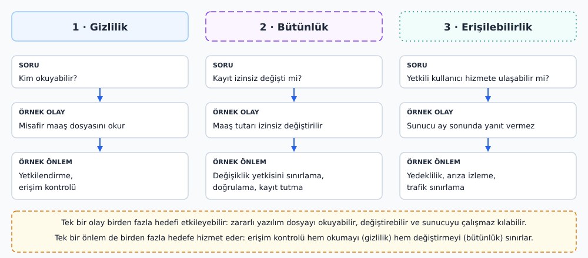
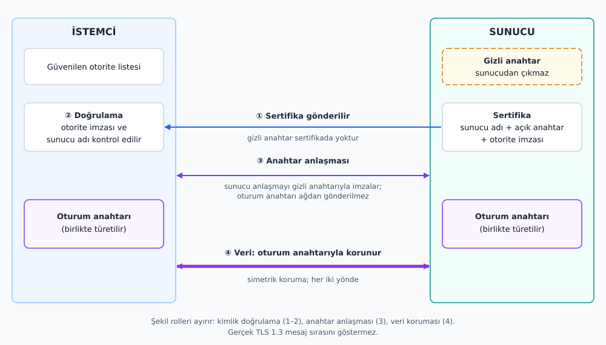
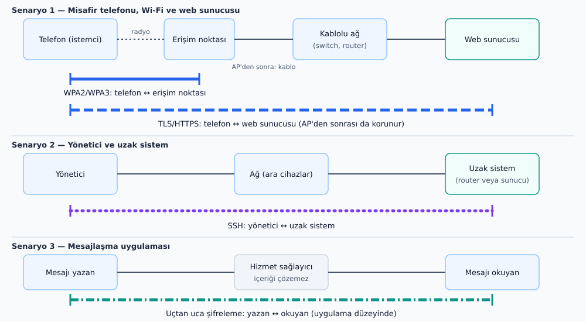
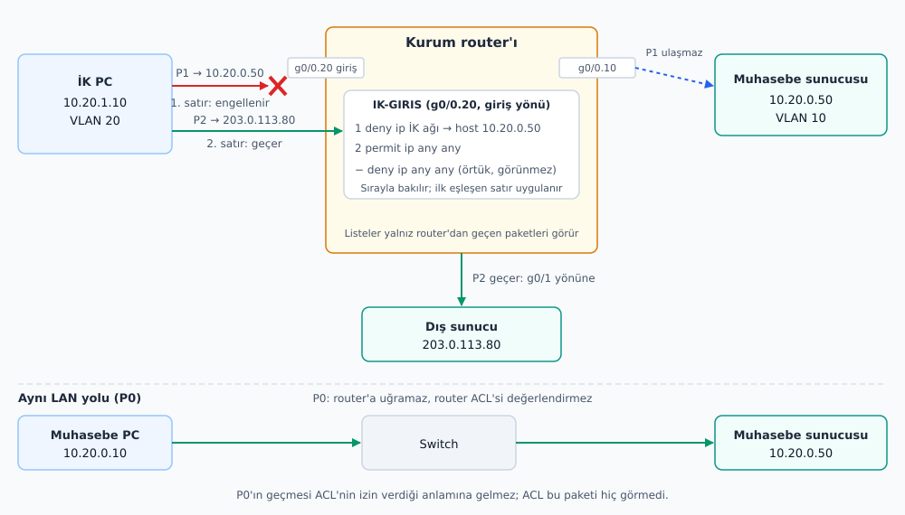

## Ağ çalışıyor, ama istediğimiz gibi mi çalışıyor?

Kurumun ağında yönlendirme var, internet erişimi var. Muhasebe çalışanı muhasebe sunucusuna bağlanabiliyor. Misafir Wi-Fi kullanıcısı da muhasebe sunucusuna bağlanabiliyor.

- İletişimin **çalışması**
- İletişimin **olması gereken** biçimde çalışması

Bu ikisi aynı soru değildir.

::: {.notes}
Bir ağ yöneticisinin sabah ilk işi pingleri kontrol etmektir; her şey yanıt veriyorsa ağ "çalışıyor" sayılır. Güvenlik sorusu burada başlar: yanıt verenlerin hangisinin yanıt vermesi gerekiyordu? Hangi iletişimin çalışması gerektiğine karar vermeden ağı güvenli ya da güvensiz diye değerlendiremeyiz.

Ana sahne, muhasebe sunucusuna kimlerin ulaşabildiğidir. Misafirin o sunucuya ulaşabilmesi bir sorundur ve çözümün iki ayrı yüzü vardır: yolda taşınan veriyi korumak ve kaynağa erişimi sınırlamak.
:::

---

## Neyi koruyoruz?

- **Gizlilik:** bilgi yetkisiz taraflara açıklanmaz
- **Bütünlük:** bilgi ve sistemler yetkisiz ya da istenmeyen değişikliğe uğramaz
- **Erişilebilirlik:** yetkili kullanıcı ihtiyaç duyduğunda hizmeti kullanabilir

Bu üç hedef kısaca **CIA** üçlüsü olarak anılır.

::: {.notes}
Üç hedefi muhasebe sunucusuna bağlayalım. Gizlilik: maaş listesini yalnız yetkililer okuyabilmeli. Bütünlük: bir maaş tutarı izinsiz değişmemeli, değiştiyse bunun fark edilmesi gerekir. Erişilebilirlik: ay sonunda muhasebe çalışanı sistemi açmak istediğinde sunucu cevap vermeli.

Üç hedefin her biri farklı bir önlem gerektirir; şekil her hedefi bir soru, bir olay ve bir önlemle eşler.
:::

---

## Olay → etkilenen hedef → önlem

| Olay | Öncelikle etkilenen hedef | Örnek önlem |
| --- | --- | --- |
| Misafirin maaş dosyasını okuması | Gizlilik | Yetkilendirme ve erişim kontrolü |
| Maaş kaydının izinsiz değiştirilmesi | Bütünlük | Değişiklik yetkisini sınırlama, doğrulama, kayıt tutma |
| Sunucunun hizmet verememesi | Erişilebilirlik | Yedeklilik, arıza izleme, aşırı trafiği sınırlama |

::: {.notes}
Tek olay birden fazla hedefi etkileyebilir. Zararlı yazılım dosyaları hem okuyup dışarı gönderebilir (gizlilik), hem değiştirebilir (bütünlük), hem de sunucuyu çalışmaz hale getirebilir (erişilebilirlik). Hedefi adlandırmanın faydası, hangi önlemin hangi soruya cevap verdiğini görmemizdir: erişim kontrolü bu okuma olayında gizliliğe, değişiklik yetkisini sınırlayan yetki sınırı ise bütünlüğe cevap verir; yedeklilik erişilebilirliğe örnektir. Bir önlem birden fazla hedefe hizmet edebilir.
:::

---

## Tehdit ve güven sınırı

- **Tehdit:** korunacak varlığa zarar verebilecek olay veya etken
- **Güven sınırı:** farklı güven ve yetki varsayımlarıyla ele alınan tarafları ayıran çizgi

| Kaynak | Hedef | Yol | Paket router'dan geçer mi? |
| --- | --- | --- | --- |
| İK ağı | Muhasebe sunucusu | İK ağı → router → sunucu | Evet |
| Misafir WLAN | Muhasebe sunucusu | Misafir ağı → router → sunucu | Evet |
| Muhasebe PC | Muhasebe sunucusu | Aynı LAN, yalnız switch üzerinden | Hayır |

Ayrı VLAN veya alt ağ, erişimi kendiliğinden kısıtlamaz: router farklı alt ağlar arasındaki paketi varsayılan olarak yönlendirir; engellemek için kural gerekir. Router'dan geçmeyen trafiği router kuralları görmez.

::: {.notes}
Kurumun içinde de bütün istemciler aynı güvene sahip değildir. Muhasebe PC'si ve misafir telefonu aynı switch üzerinde farklı VLAN'larda olabilir; biri maaş verisini kullanma yetkisine sahipken diğerinin böyle bir yetkisi yoktur. Güven sınırı, bu farkı ağ üzerinde nerede kuracağımızı sorar.

VLAN yayın alanını ayırır. Ayrı IP alt ağı ayrı gateway demektir. İkisi de erişim iznini kendiliğinden uygulamaz. Router, farklı alt ağlar arasında paketi varsayılan olarak yönlendirir; engellemek için bir kural gerekir.
:::

---

## Hedef politika

| İstek kaynağı | Muhasebe sunucusu | İnternet |
| --- | --- | --- |
| Muhasebe ağı | İzin | İzin |
| İnsan kaynakları ağı | Engel | İzin |
| Misafir Wi-Fi ağı | Engel | İzin |

Bu tablo **olması gereken** davranışı yazar. Kurallar uygulanana kadar ağ böyle davranmaz.

::: {.notes}
Tabloyu iş ihtiyacından okuyun: muhasebe kendi sunucusunu kullanır, İK ve misafirin sunucuya işi yoktur; internet ise herkese lazım. Bu bir politikadır, yani karardır; bu kararın ağın hangi noktasında, hangi mekanizmayla uygulanacağı ayrı bir sorudur.

Politikanın uygulanmadığı bir ağda İK PC'si muhasebe sunucusuna bağlanabilir; ağ çalışıyordur ama politika uygulanmıyordur.
:::

---

## Yolda taşınan veriyi nasıl koruruz?

Muhasebe çalışanı, `10.20.0.10` adresinden sunucu `10.20.0.50` adresine maaş bilgisini gönderiyor. İkisi de `10.20.0.0/24` içinde olduğu için paket switch üzerinden gider.

- Yolda bir cihaz paketi okuyabilir ya da değiştirebilir
- **Şifreleme:** içeriği bir anahtarla, anahtarı bilmeyen birinin anlayamayacağı hale getirme işlemi; amaç yalnız alıcının çözebilmesidir

::: {.notes}
11. haftada Wireshark'ta HTTP isteğinin içeriğini düz metin olarak gördüğünüzü hatırlayın. Yolda paketi gören biri, o içeriği olduğu gibi okur. Muhasebe PC'sinden sunucuya giden HTTP switch üzerinde okunabilir. Aynı içerik temsili dış sunucu `203.0.113.80` adresine gitseydi paket router ve ISS hattından da geçerdi; orada da düz metin okunurdu. `203.0.113.0/24` dokümantasyon bloğudur, gerçek internet hedefi değildir. Çare, içeriği bir anahtarla dönüştürmek ve çözme yeteneğini yalnız alıcıya vermektir.

Önce en basit biçimi düşünelim: gönderen ve alıcı aynı gizli anahtarı kullanıyor. Bu yönteme simetrik şifreleme denir. Aynı anahtarı bilen taraflar veriyi dönüştürüp çözebilir; yolda anahtarı bilmeyen biri çıktıyı anlamlandıramaz. Simetrik yöntemler büyük veriyi hızlı işler, bu yüzden güvenli iletişimde asıl veri akışını bunlar taşır.
:::

---

## Simetrik şifrelemenin çözemediği soru

**Simetrik şifreleme**, gönderenin de alıcının da aynı gizli anahtarı kullandığı yöntemdir. Bu yöntemde her iki tarafta aynı gizli anahtar gerekir.

**Anahtarı karşı tarafa nasıl ulaştırırız?**

- Anahtarı aynı ağdan açıkça gönderirsek, yolda gören de anahtarı öğrenir
- İnternette önceden tanışmamış her istemci–sunucu çifti için ortak anahtarı önceden dağıtmak ölçeklenmez

::: {.notes}
Bu, güvenli iletişimin asıl düğümü. Veriyi şifrelemek kolay; asıl sorun şifreyi çözecek anahtarın iki tarafın elinde bulunmasını, yolda bir üçüncü tarafa geçmeden sağlamak. İnternette tanımadığınız bir sunucuyla da böyle ortak sır üretmek zorundasınız. Daha önce hiç karşılaşmadığınız bir bankanın sitesi için önceden dağıtılmış bir anahtarınız olamaz.

Çözümde iki ayrı ihtiyaç var ve birbirine karıştırmamak gerekir: ortak sırrın güvenli kurulması ve karşıdaki tarafın gerçekten iddia ettiği sunucu olduğunun doğrulanması.
:::

---

## Asimetrik anahtar çifti: hangi tarafta hangi anahtar?

| Anahtar | Kimde bulunur | Rolü |
| --- | --- | --- |
| Açık anahtar | Sunucu herkese verir | İstemci bununla sunucunun anlaşma imzasını doğrular; oturum verisini bu çift taşımaz |
| Gizli anahtar | Yalnız sunucuda kalır | Sunucu anlaşmayı (iki tarafın ortak oturum anahtarını türetmesi) bununla imzalar; paylaşılmaz |

**Asimetrik anahtar çifti:** birbiriyle ilişkili iki anahtar; biri açık dağıtılır, diğeri gizli tutulur. Açık anahtardan gizli anahtar pratikte hesaplanamaz.

**Dijital imza:** gizli anahtarla üretilen ve ilgili açık anahtarla doğrulanan bir değerdir; verinin o anahtarın sahibinden geldiğini ve değişmediğini gösterir. Bu tablo yalnız bu TLS düzenindeki sunucu çiftini anlatır.

::: {.notes}
Önemli olan tarafların elinde ne bulunduğudur. Sunucu bir anahtar çifti üretir. Açık anahtarı serbestçe dağıtır; gizli anahtarı hiç yerinden çıkarmaz. İstemcinin elinde yalnız açık anahtar olur.

Açık anahtarı görmek gizli anahtarı vermez. Gizli anahtar sunucuda kalır ve sunucunun imzası için kullanılır. Gelen açık anahtarın gerçekten o sunucuya ait olup olmadığı ayrı sorudur.
:::

---

## Gelen açık anahtar gerçekten sunucunun mu?

Yoldaki bir saldırgan kendi açık anahtarını sunucununmuş gibi gönderebilir.

**Sertifika:** sunucu adını ve açık anahtarını birbirine bağlayan, istemcinin güvendiği bir **sertifika otoritesinin** imzaladığı belge.

İstemci, otoritenin imzasını kendi güvendiği otorite listesiyle doğrular.

Sertifikada yalnız açık anahtar bulunur; gizli anahtar sunucudan çıkmaz.

::: {.notes}
Kiminle konuştuğunu bilmeyen şifreleme, ortadaki saldırgana şifreli konuşmak anlamına gelebilir: istemci saldırgana şifreli bağlanır, saldırgan da sunucuya ayrı bağlanır, ikisinin arasında içerik düz okunur. Bu yüzden kimlik doğrulama, şifrelemeden ayrı ama ona bağlı bir adımdır.

Sertifika bu doğrulamayı sağlar. "Bu açık anahtar bu alan adına aittir" cümlesini bir otorite imzalamıştır. Sertifikada açık anahtar vardır; sunucunun gizli anahtarı bu belgede yer almaz. İstemci işletim sistemi veya tarayıcıdaki güvenilen otorite listesine bakarak imzayı doğrular. Sertifikadaki ad bağlandığınız adla uyuşmuyorsa ya da imza doğrulanamıyorsa tarayıcı uyarı verir. SSH'de yaygın model, sertifika otoritesine dayanmadan sunucunun açık anahtar parmak izini ilk bağlantıda kullanıcıya göstermektir; kullanıcı doğrularsa parmak izi kaydedilir ve sonraki bağlantılarda aynı anahtarla karşılaştırılır.
:::

---

## İmza ve şifreleme aynı iş değildir

| | Şifreleme | Dijital imza |
| --- | --- | --- |
| Amaç | İçeriği yetkisiz kişilerden gizlemek | Verinin kimden geldiğini ve değişmediğini doğrulamak |
| Anahtarlar | Simetrik modelde iki taraf aynı gizli anahtarı kullanır | Gizli anahtarla imzalanır, açık anahtarla doğrulanır |
| İçerik gizli mi? | Evet (yetkisiz kişi okuyamaz) | Hayır. İmza gizlemez; doğrulayacak taraf içeriği görür |

::: {.notes}
Sertifikadaki imza içeriği saklamaz. Sertifika herkese açık bir belgedir; imza yalnız onu otoritenin ürettiğini ve sonradan değiştirilmediğini gösterir. Gizlilik ve kimlik doğrulama iki ayrı ihtiyaçtır. İmza, şifrelemenin bir türü olarak değil, ayrı bir işlem olarak ele alınır. Ayrım şudur: şifrelemenin amacı gizlilik, imzanın amacı kaynak ve bütünlük doğrulamasıdır. Şifreleme içeriği gizler; kaynak ve hedef IP adresleri paket başlığında kalır.
:::

---

## TLS bağlantısı nasıl kurulur?

1. Kimlik doğrulama (şekilde ① ve ②): sunucu sertifikasını gönderir; istemci otorite imzasını ve sunucu adını doğrular
2. Güvenli ortak anahtar kurma (③): sunucu anlaşmayı gizli anahtarıyla imzalar, iki taraf oturum anahtarını birlikte türetir
3. Simetrik veri koruması (④): veri oturum anahtarıyla taşınır

Bu anlatılan sertifika ve anahtar anlaşması düzeninde ortak anahtar ağdan gönderilmez; iki taraf birlikte üretir.

Şekil üç işin rolünü ayırır; gerçek TLS mesajlarının tam sırası ve içeriği değildir.

::: {.notes}
Sıra problemin sırasıdır. Önce istemci karşısındakinin kim olduğunu doğrular. Sonra iki taraf, yoldaki gözlemcinin bütün mesajları görse de türetemeyeceği ortak bir oturum anahtarı üzerinde anlaşır. Sunucu bu anlaşma sürecini gizli anahtarıyla imzalar; böylece istemci oturum anahtarının sertifikadaki sunucuyla kurulduğunu bilir. Gerçek TLS 1.3'te sertifika ve anahtar anlaşması mesajları iç içe ilerler; şekil sırayı değil rolleri ayırır.

TLS 1.3'te oturum anahtarı, sunucunun açık anahtarıyla şifrelenip gönderilen bir sayı değildir; iki tarafın birlikte ürettiği bir değerdir. Sunucunun gizli anahtarı anlaşmayı imzalar. Veri, bu oturum anahtarıyla taşınır.
:::

---

## Veri, oturum anahtarıyla korunur

- Asıl iletişim (HTTP içeriği) **simetrik oturum anahtarıyla** taşınır
- TLS 1.3 gibi modern sürümler, oturum anahtarıyla taşınan verinin yolda değiştirildiğini de **fark eder**; gizlilik tek başına bütünlük demek değildir, ikisi birlikte sağlanır
- Oturum bittiğinde anahtar atılır; yeni bağlantı yeni anahtarla kurulur

::: {.notes}
Simetrik şifreleme hızlıdır, bu yüzden büyük veri akışı için uygundur. İlk problemimiz buydu: ortak anahtarı güvenle edinmek. Artık anahtar elimizde; iletişimin kendisi bu anahtarla korunuyor. TLS'in kayıt koruması yalnız gizlilik değil, verinin yolda değiştirildiğini fark etmeyi de sağlar; yani bütünlük hedefine de hizmet eder. Gizlilik tek başına bütünlük anlamına gelmez; ikisini birlikte sağlayan yöntemler bu yüzden kullanılır.

Bağlantıya özel anahtar kullanmanın bir yararı daha var: bir oturumun anahtarı ele geçse bile diğer oturumlar o anahtarla çözülemez.
:::

---

## HTTPS, SSH, WPA2, uçtan uca: korunan hat farklı

| Mekanizma | Korunan hat / uçlar | Örnek |
| --- | --- | --- |
| **WPA2/WPA3** | İstemci ↔ kablosuz erişim noktası | Misafir telefonu ↔ AP |
| **TLS/HTTPS** | İstemci ↔ hizmet | Tarayıcı ↔ web sunucusu |
| **SSH** | İstemci ↔ uzak sistem | Yönetici ↔ router/sunucu |
| **Uçtan uca şifreleme** | Mesajı yazan ↔ okuyan (uygulama düzeyinde) | Mesajlaşma uygulaması |

- WPA2/WPA3 koruması AP'de biter; AP'den sonra içerik HTTP ise yol boyunca okunur, HTTPS ise TLS kaydı olarak korunur

::: {.notes}
Hat farkı önemlidir. Misafir Wi-Fi'ına WPA2 ile bağlandığınızda telefonunuz ile AP arasındaki radyo bağlantısı korunur. AP'den sonra WPA koruması kalkar; hizmet HTTP ise içerik yol boyunca okunabilir, HTTPS ise içerik kabloda da TLS kaydı olarak şifreli kalır. HTTPS ise tarayıcı ile web sunucusu arasındaki iletişimi korur; Wi-Fi'a bağlı olsanız da olmasanız da.

11. haftada WhatsApp Web ile HTTP/HTTPS gözlemlerinizdeki farkı bu tabloyla okuyabilirsiniz. Uçtan uca şifreleme, ileti içeriğinin hizmet sağlayıcıda da çözülmemesini hedefleyen uygulama düzeyindeki yöntemdir.

Sunucuların düz HTTP verdiği bir ağda WPA2 yalnız radyo hattını korur; HTTP içeriği AP'den sonra kablolu ağda düz taşınır. Aynı yolda HTTPS kullanılsaydı içerik, istemci ile web sunucusu arasında baştan sona korunurdu.
:::

---

## Erişimi kim denetler? ACL ve güvenlik duvarı

**ACL:** trafik özelliklerini **izin/engel** kararlarıyla eşleyen sıralı kurallar listesi.

- Kaynak/hedef IP, protokol, TCP/UDP portu
- Kurallar yukarıdan aşağı sınanır; **ilk eşleşen** kural uygulanır
- Hiçbir kurala uymayan paket listenin sonundaki **örtük engele** takılır
- Klasik IP ACL her paketi ayrı değerlendirir; bağlantı durumu tutmaz (durumsuz)
- Bu örtük engel, arayüze bağlanan ve paket filtreleyen IP ACL içindir; NAT'ta çevrilecek kaynakları seçen listedeki `deny` paketi düşürmez, yalnız o kaynağı çeviri dışında bırakır
- Bazı güvenlik duvarları bağlantı durumunu da izler; her güvenlik duvarı bir ACL listesinden ibaret değildir

::: {.notes}
Şifreleme veriyi okunmaz yapar; erişimi engellemez. Misafir muhasebe sunucusuna HTTPS ile bağlanırsa bağlantı şifreli olur ama misafir yine de sunucuya bağlanmıştır. Erişim kararı, trafiğin geçip geçmeyeceğini belirleyen ayrı bir mekanizmadır: ACL ya da güvenlik duvarı.

Klasik IP ACL paketin başlığına bakar ve bağlantı durumunu izlemez. Güvenlik duvarlarının bir kısmı buna ek olarak bağlantı durumunu da izler; her güvenlik duvarı bir ACL listesinden ibaret değildir. ACL'ler numaralı ya da adlandırılmış olabilir; buradaki örneklerde Cisco IOS biçiminde adlandırılmış genişletilmiş ACL kullanılır. Ayrıca NAT'ın çevrilecek kaynakları seçmek için kullandığı ACL'deki `deny`, paketi düşürmek anlamına gelmez; yalnız o kaynağı çeviri dışında bırakır, paket filtreleme `deny`'sinden farklı bir iştir. Bu listedeki gibi genişletilmiş bir IP ACL'sinin sonunda görünmeyen bir `deny ip any any` vardır.
:::

---

## İK ağının giriş listesi

| Sıra | Koşul | Karar |
| --- | --- | --- |
| 1 | Kaynak `10.20.1.0/24`, hedef `10.20.0.50`, tüm IP | **Engelle** |
| 2 | Diğer bütün IP trafiği | **İzin ver** |
| (gizli) | Hiçbiri | Engelle |

Ağ: Muhasebe `10.20.0.0/24` (`g0/0.10`), İK `10.20.1.0/24` (`g0/0.20`), Misafir `10.20.2.0/24` (`g0/0.30`). Bu liste İK arayüzü `g0/0.20`'nin girişine bağlanır.

Misafir listesi (`MISAFIR-GIRIS`, `g0/0.30` girişi) aynı yapıdadır: kaynak `10.20.2.0/24`, hedef `10.20.0.50`, tüm IP **engelle**; sonra diğer IP trafiği **izin ver**.

::: {.notes}
Bu liste İK arayüzünün girişine bağlanır. Misafir listesi aynı yapıdadır: kaynak `10.20.2.0/24`, hedef `10.20.0.50`, tüm IP engellenir; ardından diğer IP trafiğine izin verilir. Üç paketi sınayalım.

- İK PC'si `10.20.1.10`'dan muhasebe sunucusu `10.20.0.50`'ye giden paket: 1. kural eşleşir, engellenir, 2. kural hiç bakılmaz.
- İK PC'sinden muhasebe ağındaki başka bir adrese (`10.20.0.51`) giden paket: 1. kural hedef `host 10.20.0.50` olmadığı için eşleşmez; 2. kural eşleşir, izin verilir.
- İK PC'sinden misafir ağındaki bir cihaza giden paket: 1. kural eşleşmez, 2. kural geçirir.

Son madde önemlidir: bu liste yalnız muhasebe sunucusunu korur. İK ile misafir arasındaki trafiği engellemez. Politika tablosunda yazılmayan şey ACL'de de yoktur.
:::

---

## Sıra sonucu değiştirir

İki satırın yerini değiştirelim:

| Sıra | Koşul | Karar |
| --- | --- | --- |
| 1 | Diğer bütün IP trafiği | İzin ver |
| 2 | Kaynak `10.20.1.0/24`, hedef `10.20.0.50`, tüm IP | Engelle |

İK'dan muhasebe sunucusuna giden paket artık ne olur?

. . .

1. satır eşleşir → **izin verilir**; engelleyen satır hiç değerlendirilmez.

::: {.notes}
İlk eşleşme ilkesinin sonucu bu: genel izni başa koyarsanız altındaki bütün engel kuralları ölü kural olur. Genel kurallar sona, özel kurallar başa yazılır.

Örtük engelin uygulaması da bu ilkeyle bağlantılıdır. Yalnız `deny` satırı içeren bir liste yazarsanız, ilgili arayüzden geçmesi gereken ve o satırlarla eşleşmeyen her paket örtük engele takılır. Muhasebe sunucusunu engelleyip diğer trafiği geçirmek istiyorsanız ikinci satıra `permit ip any any` yazmanız bunun içindir.
:::

---

## Kural hangi arayüzde, hangi yönde?

- "İK'dan gelen trafik" için doğal nokta: İK arayüzünün **giriş** yönü
- Yönler router'ın arayüzüne göre okunur: arayüze **giren** paket `in`, arayüzden **çıkan** paket `out`
- Yalnız ACL yazmak yetmez; arayüze bağlanması gerekir

::: {.notes}
Aynı kural farklı noktada farklı etki yapar. Kaynağa en yakın girişte kesmek, paket router'ın içinden geçmeden önce kararı verir; kaynak ağa özel liste yazmak da daha okunur olur. Muhasebe sunucusunun arayüzüne `out` yönünde yazılan bir liste ise o arayüzden çıkan her paketi sınar ve kaynak bakımından farklı gruplar için ayrı kural karmaşası yaratabilir.

Şekildeki alt yol önemlidir: Muhasebe PC'si `10.20.0.10` ve sunucu `10.20.0.50`, `10.20.0.0/24` içinde aynı LAN'dadır. Aralarındaki paket switch üzerinden gider, router'a uğramaz; router'daki ACL o trafiği görmez. Aynı LAN'daki iki cihaz arasındaki erişimi sunucunun kendi yetkilendirmesi ya da başka bir mekanizma denetler.
:::

---

## Politikayı pakete çevirelim

`IK-GIRIS` ve `MISAFIR-GIRIS` listeleri yukarıda anlatılan biçimde yazılıp ilgili arayüzlerin girişine bağlandığında bu paketler ne olur? Ping (ICMP) ve HTTP ayrı hizmetlerdir; birinin geçmesi diğerinin geçeceğini göstermez.

| Paket | Kaynak → hedef | Hizmet |
| --- | --- | --- |
| 1 | Muhasebe PC `10.20.0.10` → sunucu `10.20.0.50` | HTTP |
| 2 | İK PC `10.20.1.10` → sunucu `10.20.0.50` | HTTP |
| 3 | Misafir `10.20.2.100` → sunucu `10.20.0.50` | ping |
| 4 | İK PC → temsili dış sunucu `203.0.113.80` | HTTP |
| 5 | Misafir → temsili dış sunucu `203.0.113.80` | ping |

. . .

1. **Geçer.** Aynı LAN, router'a uğramaz; bu iki liste bu yolu görmez
2. **Engellenir.** İK listesi 1. kural
3–5. paketleri aynı yöntemle siz değerlendirin: hangi liste, hangi kural, hangi karar?

::: {.notes}
İlk iki paket çözümlü örnektir; 3–5. paketleri aynı yöntemle kendiniz değerlendirin. 1. paketteki "geçer" cevabı ACL'nin izin verdiği anlamına gelmiyor; ACL o paketi hiç görmedi. Yine de politika tablosunda muhasebe için "izin" yazdığı için sonuç beklenen sonuçla örtüşüyor.

Ping'in başarısı yalnız ICMP'nin geçtiğini gösterir. HTTP'nin geçtiğini söylemek için HTTP'yi, yani TCP/80'i sınamak gerekir. Kuralımız `ip` ile tüm IP trafiğini kapsıyor; başka bir kural yalnız bir porta özel olsaydı ICMP ve HTTP farklı sonuç verebilirdi. Bu yüzden her kaynak–hedef çifti ICMP ve HTTP ile ayrı ayrı ölçülmelidir.

Engellemeden sonra dış erişim de kesildiyse hangi kuralın eşleştiğine ve genel izin satırının bulunup bulunmadığına bakın. Açık engel satırı ile açık izin satırının sayaçları ayrı artar. Örtük engele düşen paket bu satırlarda bir sayaç olarak görünmez.
:::

---

## Hangi soru, hangi mekanizma?

| Soru | Mekanizma |
| --- | --- |
| Bu paket nereye gidecek? | Yönlendirme |
| Çıkışta hangi adres/port görünecek? | NAT/PAT |
| Bu kaynak bu hedefe ulaşabilir mi? | ACL / güvenlik duvarı |
| Yoldaki cihaz içeriği okuyabilir mi? | TLS/HTTPS, SSH, WPA2/WPA3 (korunan hat farklı) |
| Karşımdaki gerçekten o sunucu mu? | Sertifika / sunucu anahtarı doğrulaması |

::: {.notes}
Ağda bir sorun çıktığında ilk iş, hangi sorunun yaşandığını adlandırmaktır. İK PC'si muhasebe sunucusuna bağlanabiliyorsa bu bir erişim kontrolü sorusudur; bağlantı sırasında içeriğin okunabilmesi bir şifreleme sorusudur. İç hedefe yanıt yoksa rota ve ACL ayrı sorulur; gidiş ile dönüş aynı sonuca varmak zorunda değildir. İnternet hedefinde ayrıca PAT eşlemesine bakılır. İK'dan muhasebe sunucusuna giden iç pakette PAT yoktur. Beş soru, beş ayrı yerde cevaplanır. Bir sorunu ararken bu soruları sırayla sormak, hangi mekanizmaya bakılacağını belirler.
:::
