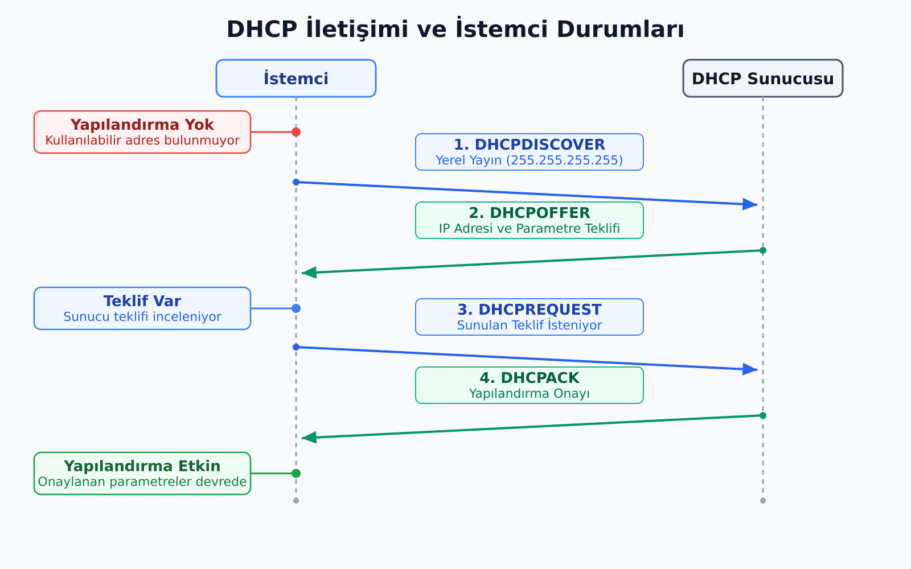
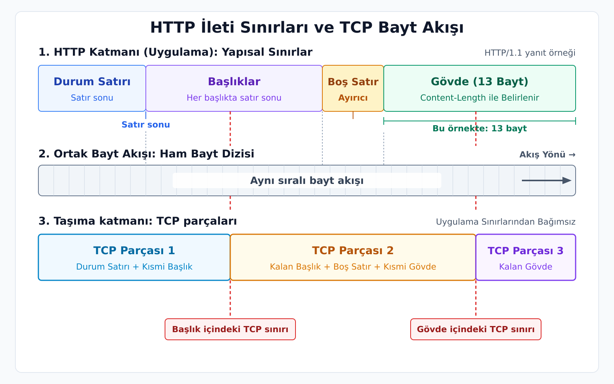
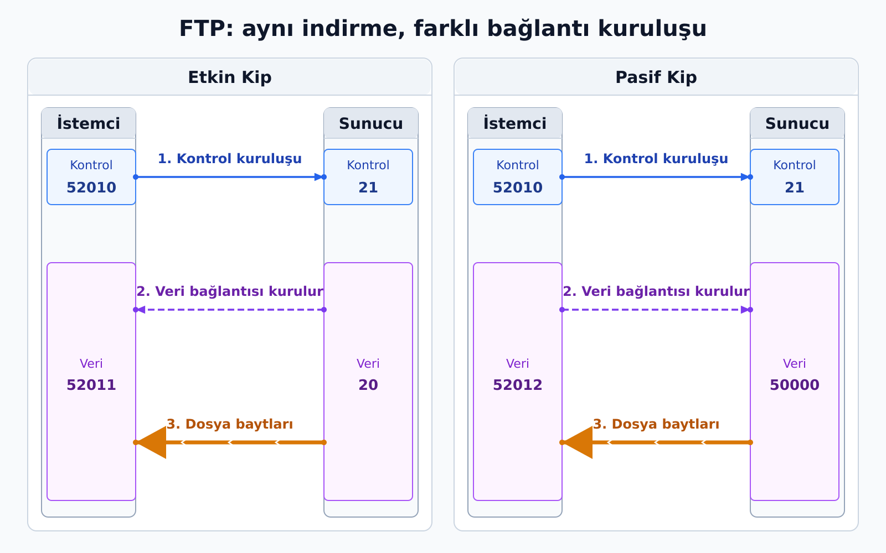
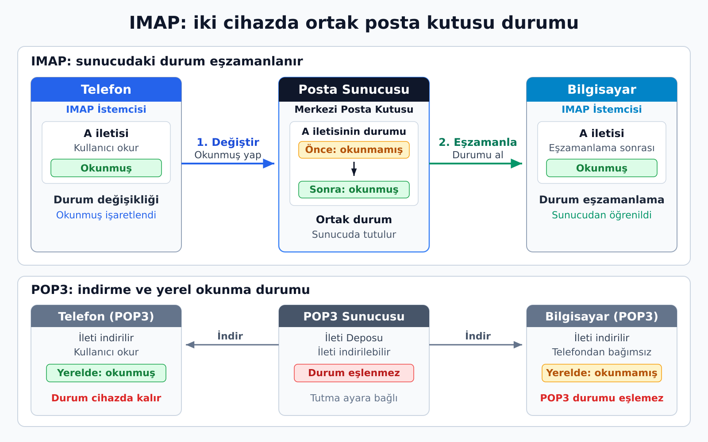
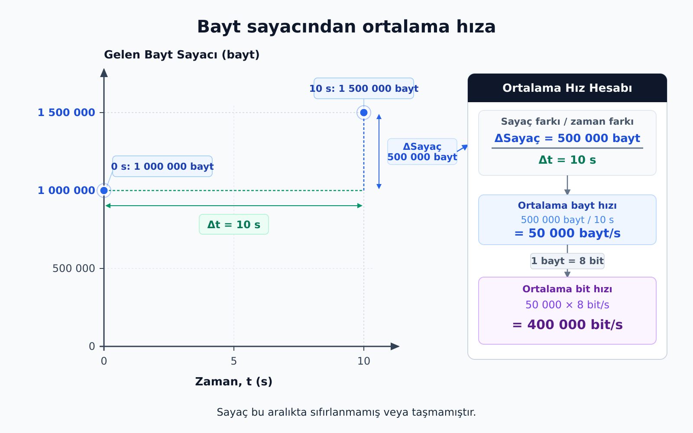
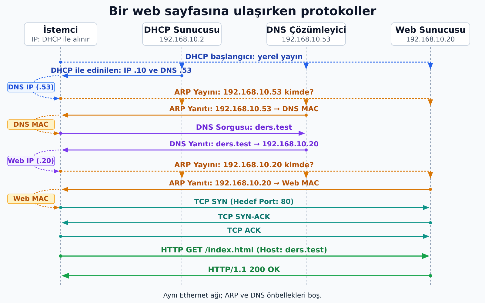

<!--
Sunum taslağı. Dayanak: draft/taslaklar/bilgisayar-aglari-hafta-05-06/n4-ag-hizmetleri-ve-uygulama-protokolleri.md (id: cn5-6-n4, status: sunuma-kaynak-not, 16 Ekim 2026).
Üretim kuralları: _notes/cn_5-6/sunum-ajanina-yonerge.md.
Notes blokları öğrencinin sonradan çalışacağı konu anlatımıdır; sunucu yönlendirmesi içermez.
Bütünleştirme adresleri: DHCP .2, DNS .53, web .20, istemci .10. Adresler, HTTP gövdesi ve SNMP sayaç değerleri öğretim örneğidir.
Çizimler metin çizimidir; yakalanmış paket kaydı veya uygulama çıktısı değildir. Bölümler: ağa hazırlanma, web, dosya, e-posta, uzaktan erişim ve yönetim.
-->

## Taşıma hizmeti baytları getirdi; uygulama ne yapacak?

- Tarayıcı "bana şu sayfayı ver" diyecek
- Sunucu "bulamadım" ya da "hazır" diyecek

**Uygulama protokolü**, iki uygulama için şunları tanımlar:

- **Ne** isteyecekleri
- **Hangi biçimde** isteyecekleri
- **Nasıl** yanıtlayacakları

```text
Ağa hazırlanma → Web → Dosya → E-posta → Uzaktan erişim ve yönetim
```

::: {.notes}
Taşıma katmanı veriyi doğru uygulamaya ulaştırır; ama uygulamanın kendisine ulaşan baytlarla ne yapacağını belirlemez. Bir tarayıcının sunucudan sayfa istemesi, sunucunun "bulamadım" ya da "hazır" yanıtı vermesi **uygulama protokolleri** ile tanımlanır. Her uygulama protokolü, iki uygulamanın birbirinden ne isteyeceğini, hangi biçimde isteyeceğini ve nasıl yanıtlayacağını belirler.

Bir bilgisayarın ağa katılmasıyla ağdaki bir işi tamamlaması arasında birkaç farklı hizmet devreye girer. Bilgisayar önce ayarlarını edinir ve gerektiğinde bir ismin adresini sorar; sonra web sayfası ister, dosya aktarır ya da e-posta gönderir. Ağ yöneticisi de cihazlara uzaktan erişmek ve durumlarını izlemek ister. Hizmetler beş grupta okunur: ağa hazırlanma, web, dosya aktarımı, e-posta, uzaktan erişim ve yönetim.

Ön bilgi olarak N1–N3 kullanılır. Adres ve paket akışları hazır bir yerel ağda geçer; ağ geçidi veya alt ağ hesabı yapılmaz. Gruplara aynı ayrıntı düzeyi verilmez: DHCP/DNS ve HTTP/HTTPS mekanizması daha ayrıntılı, dosya, e-posta ve yönetim grupları seçilmiş bir akışla işlenir. Kısa işlenen protokoller de açık bir tanım ve temel işleyiş içerir.
:::

---

## DHCP: ayarları edinmek

Ağa yeni katılan bilgisayarın henüz kullanılabilir yapılandırması yok.

| DHCP'nin verdiği | Görevi |
|---|---|
| IPv4 adresi | Arayüzü adresler |
| Alt ağ maskesi | Hedefin aynı alt ağda olup olmadığını değerlendirmeye yarar |
| Varsayılan ağ geçidi | Başka ağdaki hedefe giderken çıkış yolu |
| DNS sunucusu adresi | İsim sorularının gönderileceği yer |
| Kiralama süresi | Adresin ne kadar süre kullanılabileceği |

::: {.notes}
Otomatik adres almaya ayarlanmış bir bilgisayar ağa yeni katıldığında kullanılabilir bir IPv4 yapılandırması yoktur: kendi IP adresi, kullanacağı DNS sunucusu ve ağın dışına çıkarken gideceği cihaz bilinmez. Bu ayarları elle yazmak küçük bir ağda mümkündür, yüzlerce cihazda hataya açıktır. **DHCP** (Dynamic Host Configuration Protocol) bu ayarları otomatik dağıtır.

Verilen bilgiler birbirinin yerine geçmez. IP adresi arayüzü adresler. **Alt ağ maskesi**, IP adresinin ağ kısmını belirlemeye ve hedefin aynı alt ağda olup olmadığını değerlendirmeye yarar. **Varsayılan ağ geçidi**, başka bir ağdaki hedefe giderken kullanılabilecek çıkış yolunu gösterir. **DNS sunucusu adresi**, isim sorularının kime gönderileceğini belirtir. Bu değerlerin sayısal hesabı sonraki adresleme konusunda yapılır; burada görevleri tanınır.

Değerleri okuyabilmek, ağ ayar ekranlarındaki kutuları anlamlandırır. Örneğin `192.168.10.53` DNS alanında yazıyorsa bu, ad sorgusunun gönderileceği yerdir; bilgisayarın kendi adresi buraya yazılmaz. Aynı sayı yanlış alana yazıldığında doğru görünen bir IP adresi yanlış göreve atanmış olur.
:::

---

## Adresi olmayan istemci sunucuyu nasıl bulur?

```text
Kaynak IPv4: 0.0.0.0       Hedef IPv4: 255.255.255.255
Kaynak UDP portu: 68       Hedef UDP portu: 67
Ethernet hedefi: FF:FF:FF:FF:FF:FF
```

İstemci aynı yerel ağdaki DHCP sunucusunu aramak için **herkese seslenir**.

::: {.notes}
Burada çözülmesi gereken problem şudur: henüz IP adresi olmayan bir istemci DHCP sunucusuna nasıl ulaşır? İstemci kaynak adres olarak 0.0.0.0, hedef olarak yayın adresi 255.255.255.255 kullanır; Ethernet hedefi de broadcast'tir. UDP portları istemci için 68, sunucu için 67'dir. İstemci, aynı yerel ağdaki DHCP sunucusunu aramak için herkese seslenir.

Bu, N2'deki ARP isteğiyle aynı fikre dayanır: hedef bilinmediğinde yerel yayın alanına seslenmek. DHCP başlangıcında sunucunun MAC adresinin önceden bilinmesi gerekmez, çünkü ilk mesaj broadcast gider.
:::

---

## DHCP: dört mesaj (DORA)

{height="740" fig-align="center" fig-alt="DHCP Discover, Offer, Request ve ACK mesajları; istemcinin yapılandırmasız durumdan teklife ve onaylanan yapılandırmanın kullanımına geçmesi"}

::: {.notes}
Normal başarılı DHCP akışı dört mesajdan oluşur ve baş harflerinden **DORA** diye anılır: Discover, Offer, Request, Acknowledge. İstemci DISCOVER ile sunucu arar; sunucu OFFER ile bir yapılandırma teklif eder; istemci REQUEST ile bu teklifi ister; sunucu ACK ile kiralamayı onaylar.

OFFER yalnız tekliftir; istemciye adres verilmiş sayılmaz. Birden fazla DHCP sunucusu varsa birden fazla teklif gelebilir ve istemci REQUEST ile birini seçer. ACK'ten sonra istemci yapılandırmayı kullanmaya başlar. Teklif ile kiralamanın onayı bu yüzden iki ayrı mesajdır.

Şemadaki oklar uygulama mesajlarının yönünü gösterir; her mesajın unicast taşındığı sonucu çıkmaz. Başlangıç durumunda istemcinin henüz adresi olmadığı için yanıtın iletilme biçimi değişebilir. Şema normal akışı gösterir; hata ve ret durumlarını kapsamaz. Örnekte sunucu ile istemci aynı yerel ağdadır.

Adres bir **kiralamadır**: kalıcı olarak cihazın değildir. Dizüstü bilgisayar ağa katıldığında bir adres alır; ağda kalıyorsa süre bitmeden kiralamayı yenilemeye çalışır. Yenilemenin her zaman dört mesajı baştan tekrarlaması gerekmez. Sunucu hangi adresin hangi istemciye hangi süreyle ayrıldığını izler. Aynı ağda iki cihaza aynı adresin gelişigüzel verilmesi yerine dağıtımın merkezi olarak yönetilmesi, DHCP'nin çözdüğü asıl işlerden biridir. DHCP sunucusu web sayfalarını ya da alan adlarının adreslerini dağıtmaz; istemcinin aldığı DNS sunucusu adresi, bir sonraki adımda soru soracağı hizmetin adresidir.
:::

---

## DNS: isimden adrese

```text
ders.test → 192.168.10.20      (laboratuvar kaydı)

İstemci ── ad sorgusu ──> DNS çözümleyici (192.168.10.53)
İstemci <── adres yanıtı ─ DNS çözümleyici
```

Sorgu **çözümleyiciye** gider. Yanıt, **web sunucusunun** adresidir.

::: {.notes}
Kullanıcı `ders.test` gibi bir ad yazar; bağlantı kurmak için ise IP adresi gerekir. **DNS** (Domain Name System), alan adlarıyla ilgili kayıtları dağıtık bir yapıda sorgulamayı sağlar. Burada ilk iş, bir adın IPv4 adresini öğrenmektir. `ders.test` yerel bir örnek addır; genel İnternet'te bir site iddiası taşımaz.

Sorgunun gittiği cihaz ile yanıtın gösterdiği cihaz farklıdır. İstemci sorguyu DHCP'den öğrendiği **çözümleyiciye** gönderir. Çözümleyici adın karşılığını biliyorsa (önbelleğinde ya da kendi kaydında) doğrudan cevaplar. Bilmiyorsa dağıtık yapıdaki ad sunucularına (kök, üst düzey alan, yetkili sunucu) başvurup cevabı bulur; bu zinciri çözümleyici yürütür. İstemci yalnız sorar ve cevabı alır. Yanıt ise **web sunucusunun** adresini taşır. Örnekteki laboratuvar sunucusu kaydı zaten bildiği için dış sunuculara hiç gidilmez.
:::

---

## DNS: önbellek, kayıt türleri, taşıma

- Yanıt **önbelleğe** alınır ve kaydın **TTL**'si boyunca yeniden sorulmaz.
- **A kaydı:** ad → IPv4 adresi (bir ad için birden fazla adres dönebilir).
- **MX kaydı:** alan adına gelen postayı hangi sunucu kabul eder.
- Port 53; kısa sorgular UDP üzerinden yapılabilir, TCP desteği de gereklidir.

DNS TTL'si ≠ IP paketindeki TTL alanı.

::: {.notes}
Bulunan yanıt **önbelleğe** alınır ve kaydın yaşam süresi (TTL) boyunca yeniden sorulmadan kullanılır. Bir adın adresinin sonsuza kadar değişmeyeceği varsayılmaz. Önbelleğin iki sonucu vardır: aynı adı tekrar tekrar sorarken her seferinde bütün çözümleme zincirini çalıştırmak gerekmez; buna karşılık sunucunun adresi değiştiğinde eski yanıt, geçerlilik süresi içinde bazı önbelleklerde kalabilir. Buradaki TTL, DNS kaydının önbellekte geçerli kalma süresidir; IP paketinin ağda dolaşmasını sınırlayan TTL alanı farklı bir iş yapar.

DNS'nin cevabı her zaman tek bir IP adresinden ibaret değildir. **A kaydı** bir adı IPv4 adresiyle ilişkilendirir; bir ad için birden fazla adres de dönebilir. **MX kaydı** ise bir alan adına gelen postayı hangi posta sunucusunun kabul ettiğini belirtir (e-posta bölümünde tekrar görülecek). Aynı alan adı web ve e-posta için farklı sunucular kullanabilir.

İki ayrım daha önemlidir. DNS yanıtı, web sayfasını sunan sunucunun adresidir; DNS'nin yanıt vermesi HTTP hizmetinin hazır olduğunu göstermez. DNS port 53'ü kullanır ve kısa sorgular UDP üzerinden yapılabilir; TCP desteği de gereklidir. Adla erişim başarısızken doğrudan IP adresiyle aynı hizmete ulaşılabiliyorsa sorunun isim çözümlemesinde olabileceği düşünülür; bu gözlem tek başına kesin teşhis değildir.
:::

---

## Adres ile yol ayrı iş

`http://ders.test/index.html`

| Parça | Görev |
|---|---|
| `ders.test` | **DNS** ile adrese çevrilir |
| `/index.html` | Sunucuya **hangi kaynağın** istendiğini söyler |

::: {.notes}
Bir web adresinin iki parçası farklı görev yapar. Alan adı kısmı (`ders.test`) DNS ile IP adresine çevrilir. Yol kısmı (`/index.html`) ise sunucuya hangi kaynağın istendiğini söyler. Adres bulunduktan sonra tarayıcının sunucudan ne isteyeceğini ve sunucunun nasıl yanıt vereceğini **HTTP** belirler. Örneklerde HTTP/1.1'in TCP üzerinde kullanıldığı varsayılır.
:::

---

## HTTP isteği

```http
GET /index.html HTTP/1.1
Host: ders.test

```

- `GET`: istenen işlem
- `/index.html`: kaynağın yolu
- `HTTP/1.1`: sürüm
- `Host`: hedef hizmetin adı
- **Boş satır:** başlık bölümü bitti

::: {.notes}
**HTTP** (Hypertext Transfer Protocol), isteğin ve yanıtın biçimini tanımlar. En yalın bir istek (GET, Host ve boş satır) küçüktür, ama her satırın görevi belirlidir. `GET` istenen işlemi, `/index.html` kaynağın yolunu, `HTTP/1.1` sürümü bildirir. `Host` başlığı hedef hizmetin adını söyler. Sunucu hangi kaynağın istendiğini bu yapıyı okuyarak anlar.

Başlıklardan sonra gelen **boş satır**, başlık bölümünün bittiğini gösterir; bu ayırıcı olmadan sunucu isteğin tamamlandığını anlayamaz. HTTP mesajı TCP bayt akışı üzerinde geldiği için mesajın nerede bittiğini HTTP'nin bu kuralları belirler.
:::

---

## HTTP yanıtı

```http
HTTP/1.1 200 OK
Content-Type: text/html
Content-Length: 13

<h1>Ders</h1>
```

- İlk satır: **durum satırı** (sürüm, durum kodu, açıklama)
- Başlıklar yanıtın özelliklerini bildirir
- **Boş satırdan sonra gövde**
- Gövde `<h1>Ders</h1>` = 4 + 4 + 5 = **13 bayt**

::: {.notes}
Yanıtın ilk satırı **durum satırıdır**: sürümü, durum kodunu ve kısa açıklamayı taşır. Sonra gelen başlıklar yanıtın özelliklerini bildirir. Boş satırdan sonra **gövde** başlar.

Örnekte gövde `<h1>Ders</h1>` metnidir. Gövdenin sonunda ek bir satır sonu baytı olmadığı kabul edilirse ASCII ile 13 bayttır: `<h1>` 4, `Ders` 4 ve `</h1>` 5 bayt. `Content-Length` bu sayıyı bildirir. Yanıt örnek olarak kurulmuştur.

Bu örnek, N3'teki bayt akışı ayrımını tamamlar. TCP sunucuya sıralı baytlar verir; HTTP ayrıştırıcısı bu baytlardan istek satırını, başlıkları ve varsa gövdeyi ayırır. Bir TCP segmentinin bittiği yerin HTTP mesajının bittiği yer olması gerekmez; mesajın sınırı HTTP kurallarından bulunur.
:::

---

## HTTP mesajı ve TCP parçaları

{height="740" fig-align="center" fig-alt="Aynı sıralı bayt akışında HTTP durum satırı, başlıklar, boş satır ve 13 baytlık gövde; TCP parçalarının sınırları başlıkların ve gövdenin içinde kalabilir"}

::: {.notes}
HTTP/1.1 yanıtındaki durum satırı, başlıklar ve gövde uygulama protokolünün kurallarıyla ayrılır. Başlıkları bitiren boş satır gövdenin başlangıcını gösterir; bu örnekte Content-Length gövdenin 13 bayt olduğunu bildirir.

TCP aynı veriyi sıralı bayt akışı olarak taşır. Bir TCP parçasının başlıkların ortasında veya gövdenin içinde bitmesi mümkündür. Bu nedenle HTTP mesajının sınırı TCP parçasının sonundan çıkarılmaz; alıcı HTTP kurallarıyla mesajı ayrıştırır.
:::

---

## Yöntemler ve durum kodları

| Yöntem | Genel anlamı |
|---|---|
| GET | Kaynağın temsilini al |
| POST | Veriyi kaynağa işlenmek üzere gönder |
| PUT | Kaynağı oluştur veya değiştir |
| DELETE | Kaynağı kaldırma isteği |

| Kod ailesi | Anlam |
|---|---|
| 1xx | Bilgilendirme |
| 2xx | Başarı (200 OK) |
| 3xx | Yönlendirme |
| 4xx | İstemci isteğiyle ilgili durum (404 bulunamadı) |
| 5xx | Sunucu hatası |

::: {.notes}
İstek yöntemi, istenen işlemin türünü belirler. GET, POST, PUT ve DELETE HTTP'nin tüm yöntemleri değildir ve sunucu her yönteme izin vermek zorunda değildir. Durum kodları ise ailelere ayrılır: kod ailesi ilk sınıflandırmayı, kodun tamamı daha belirli bir durumu anlatır.

Aynı sunucu adresine giden her istek aynı işi yapmaz. Bir ders kayıt sisteminde `GET /dersler` listeyi ister; `POST /kayitlar` ise gövdede gönderilen bilgilerle yeni bir kayıt işlemi talep edebilir. Yol hangi kaynakla, yöntem o kaynak üzerinde hangi işlemle ilgilenildiğini belirtir. İşlemin nasıl uygulanacağını sunucudaki yazılım belirler.
:::

---

## 404 aldım: bağlantı kurulamadı mı?

```text
Ethernet / IP   ✔  paket ulaştı
TCP             ✔  bağlantı kuruldu
HTTP            ✔  yanıt alındı: 404
Kaynak          ✘  istenen kaynak sağlanmadı
```

404, iletişimin kurulamadığını söylemez.

::: {.notes}
404 yanıtı alındığında ağ, TCP ve HTTP çalışmış, bir HTTP yanıtı alınmıştır. Yalnız istenen kaynak sağlanmamıştır. Bu ayrım, sorunun hangi katmanda aranacağını belirler: bağlantı kurulamıyorsa ağ ve taşıma katmanlarına, 404 alınıyorsa sunucudaki kaynağa ya da isteğin yoluna bakılır.

HTTP'nin **durumsuz** olduğu sık söylenir; yani bir isteğin önceki isteği otomatik olarak hatırlaması beklenmez. Web uygulamaları yine de kullanıcıyı tanıyabilir: uygulama bir oturum tanımlayıcısını isteklerle ilişkilendirip durumu kendi tarafında saklayabilir; çerezler bunu sağlayan mekanizmalardan biridir. TCP bağlantısının varlığı kullanıcının oturum açtığını göstermez.
:::

---

## HTTPS: TLS ile koruma

```text
HTTP verisi → TLS koruması → TCP → IP
```

| TLS'nin işi | Anlamı |
|---|---|
| Gizlilik | Başkası okuyamaz |
| Bütünlük | Değişirse fark edilir |
| Sunucu kimliği | Sertifika ile gerçekten `ders.test` ile mi konuşuluyor |

HTTPS = TLS ile korunan HTTP. Yaygın port: **443**.

::: {.notes}
Önceki örneklerdeki HTTP mesajları açık metindir. Trafiği gözleyebilen biri istekleri okuyabilir; iletişim yoluna müdahale edebilen biri mesajları değiştirmeye de çalışabilir. TCP'nin sıralı ve güvenilir teslimi bu durumu değiştirmez: güvenilir teslim gizlilik sağlamaz. Bu boşluğu **TLS** (Transport Layer Security) doldurur: HTTP mesajı TCP'ye verilmeden önce TLS ile korunur. **HTTPS**, HTTP'nin TLS ile korunmuş hâlidir ve yaygın portu 443'tür.

TLS üç iş görür: iletişimin gizliliğini (başkası okuyamaz), bütünlüğünü (değiştirilirse fark edilir) ve sunucu kimliğinin doğrulanmasını (sertifika aracılığıyla, gerçekten `ders.test` ile konuşulduğunu kontrol etmek) sağlar. Doğrulamanın değeri doğru yapılmasına bağlıdır: tarayıcının sertifika uyarısını geçmek mekanizmanın amacını ortadan kaldırır.

TLS, SSL'den gelişen ardıl protokoldür; ikisi aynı protokolün iki adı gibi kullanılmamalıdır. HTTPS içeriğin doğruluğunu garanti etmez; iletişimin korunduğunu söyler. Son olarak şema HTTP/1.1'in TCP üzerindeki HTTPS örneğidir; HTTP/3 QUIC kullanır, yani her HTTPS iletişimi aynı TCP yığınına oturmaz.
:::

---

## FTP: iki bağlantı

```text
Kontrol kanalı: İstemci ⇄ Sunucu:21     komutlar ve yanıtlar
Veri kanalı:    İstemci ⇄ Sunucu        dosya veya dizin listesi
```

- **Kontrol:** oturum boyunca açık; `RETR rapor.pdf` gibi komutlar, yanıt kodları.
- **Veri:** dosya baytları ya da dizin listesi; aktarım sırasında açılıp kapanır.

::: {.notes}
**FTP** (File Transfer Protocol), uzak bir sunucudaki dosyaları listeleme, indirme ve yükleme gibi işleri istemci–sunucu düzeninde yürütür. Web örneğinden farklı bir tasarımı vardır: komutlarla dosya içeriği ayrı TCP bağlantılarından taşınır.

**Kontrol bağlantısı** oturum boyunca açık kalabilir. İstemci bu bağlantıda kullanıcı bilgilerini ve `RETR rapor.pdf` gibi komutları gönderir; sunucu yanıt kodları döndürür. **Veri bağlantısı** dosyanın baytlarını ya da bir dizin listesini taşır. Birden fazla dosya aktarılırken aynı kontrol bağlantısı kullanılabilir, veri bağlantıları ise aktarım sırasında açılıp kapanır.

İstemci `RETR rapor.pdf` komutunu verdiğinde sunucu dosyayı veri kanalından gönderir ve aktarımın sonucunu kontrol kanalından bildirir. Bu ayrım sayesinde dosyanın içindeki bir bayt dizisi komut sanılmaz ve aktarım sürerken kontrol mesajları için ayrı bir yol bulunur.
:::

---

## Veri bağlantısını kim başlatıyor?

{height="740" fig-align="center" fig-alt="Etkin FTP veri bağlantısını sunucu, pasif FTP veri bağlantısını istemci başlatır; aynı dosya indirmesinde baytlar iki kipte de sunucudan istemciye gider"}

::: {.notes}
Etkin ve pasif kip arasındaki ayrım, dosyanın indirilmesi ya da yüklenmesi değildir. Ayrım, **veri için TCP bağlantısını kimin başlattığıdır**. Etkin kipte istemci hangi portta beklediğini kontrol kanalından bildirir ve sunucu veri bağlantısını oraya kurar. Pasif kipte sunucu bir veri portu bildirir ve istemci bu porta bağlanır. Örnekteki port numaraları örnek değerlerdir; oklar bağlantı kuruluşunu gösterir.

Bağlantı kurulduktan sonra dosya baytlarının yönü ayrıca belirlenir: indirmede dosya baytları sunucudan istemciye, yüklemede istemciden sunucuya gider. Bağlantıyı başlatan ok ile verinin yönü farklı bilgilerdir; "20 numaralı port dosya indirme portudur" gibi bir kural çıkarılamaz. [RFC 959, veri bağlantıları](https://www.rfc-editor.org/rfc/rfc959.html#section-3.2).

FTP'de dosyanın nasıl temsil edildiği de önemlidir. Yaygın ASCII aktarımı metin gösterimine, binary/image aktarımı baytların korunmasına yöneliktir. PDF ya da resim aktarırken baytların metin satır sonu dönüşümlerinden etkilenmemesi gerekir. Bu seçim, etkin/pasif bağlantı seçiminden ayrı bir ayardır.
:::

---

## FTPS ve SFTP: adı benzer, yapısı farklı

| Protokol | Koruma ve bağlantı düzeni |
|---|---|
| FTP | Parola ve dosya içeriği **açık** taşınır |
| FTPS | FTP'ye **TLS** ekler; kontrol/veri bağlantısı ayrımı sürer |
| SFTP | **SSH** üzerinde dosya işlemleri yapan ayrı bir protokol; FTP komutlarını ve iki bağlantıyı kullanmaz |

::: {.notes}
Klasik FTP'de parola ve dosya içeriği açık taşınır. Koruma eklemek için kullanılan iki çözümün adı benzer, yapıları farklıdır.

**FTPS**, FTP'ye TLS ekler; kontrol ve veri bağlantısı ayrımı sürer. Kontrol kanalının ve veri kanalının korunması ayrı kararlardır; dosya içeriğinin gizliliği için veri bağlantısının da korunması gerekir. **SFTP** ise SSH kanalı üzerinde dosya açma, okuma ve yazma gibi istekler gönderen ayrı bir protokoldür; FTP komut ve iki bağlantı düzenini kullanmaz. Yaygın kullanımda SSH'nin 22 numaralı TCP portundan kurulan bağlantıyı kullanır.

İki protokol aynı dosyayı taşıyabilir, ama istemci ile sunucunun konuşacağı kurallar farklıdır. FTPS ile SFTP farklı yapılardır. [RFC 4217, kontrol ve veri bağlantılarının korunması](https://www.rfc-editor.org/rfc/rfc4217.html#section-3).
:::

---

## E-posta: üç ayrı iş

```text
Gönderen istemci ──SMTP──> Gönderenin posta sunucusu ──SMTP──> Alıcının posta sunucusu
                                                                     │
                                                              alıcının posta kutusu
                                                                     │
Alıcı istemci <──────────── POP3 veya IMAP ─────────────────────────┘
```

1. Sunucuya **teslim** (SMTP)
2. Sunucular arasında **aktarım** (SMTP)
3. Posta kutusuna **erişim** (POP3 / IMAP)

::: {.notes}
E-posta gönderirken alıcının bilgisayarının açık olmasını beklemeyiz. Alıcının posta kutusu bir sunucuda durur; ileti oraya ulaşır ve alıcı daha sonra kendi cihazından erişir. Mektubun postaneye bırakılması, postaneler arasında taşınması ve kutudan alınması gibi, burada da üç ayrı iş vardır: iletinin sunucuya teslimi, sunucular arasında aktarımı ve posta kutusuna erişim.

Şemada iki kullanıcı istemcisi ve iki sunucu bulunur, rolleri farklıdır. **SMTP** (Simple Mail Transfer Protocol) postayı göndermek ve sunucular arasında aktarmak için kullanılır; posta iterek ilerler. SMTP mesajı alıcının kutusundan istemciye indirmez. İstemcinin kendi kutusuna erişmesi için **POP3** ya da **IMAP** kullanılır.
:::

---

## SMTP: mesajı teslim etmek

- Gönderici kendini tanıtır
- Gönderici ve alıcı adreslerini bildirir
- İçeriği iletir
- Karşıdaki sunucu her aşamaya yanıt verir.
- Alıcının alan adı için **MX kaydı** ile sunucu bulunur.
- Sunucular arası aktarım: TCP **25**
- Kullanıcının iletiyi gönderim hizmetine sunması: **587**

SMTP onayı = sunucunun sorumluluğu aldığı; alıcının okuduğu **değil**.

::: {.notes}
SMTP'de gönderici taraf kendisini tanıtır, gönderici ve alıcı adreslerini bildirir, ardından mesaj içeriğini iletir. Karşıdaki sunucu her aşamaya yanıt verir. Sunucunun mesajı kabul etmesi, bir sonraki teslim işinin sorumluluğunu aldığını gösterir; alıcının mesajı okuduğunu göstermez.

Gönderenin posta sunucusu, alıcının alan adı için DNS'ten MX kaydını sorgulayarak ilgili posta sunucusunu bulabilir. Karşı sunucuya o anda ulaşılamıyorsa, geçici teslim sorunlarında ileti kuyrukta tutulup yeniden denenebilir. Kullanıcının bilgisayarı kapalıyken de sunucular arasındaki aktarım sürebilir. E-postanın iki kullanıcının bilgisayarı arasında kurulmuş tek bir bağlantıya ihtiyaç duymaması böyle sağlanır.

Sunucular arası SMTP aktarımında tipik hedef TCP portu 25'tir. Kullanıcı istemcisinin iletiyi kendi gönderim hizmetine sunması ayrı bir roldür ve bu iş için 587 numaralı port tanımlanmıştır. Portların farklı olması, kullanıcıdan teslim almanın ile sunucular arası aktarımın aynı hizmet bağlamı olmadığını gösterir. [RFC 6409, ileti sunma hizmeti](https://www.rfc-editor.org/rfc/rfc6409.html#section-3.1).
:::

---

## POP3 ve IMAP: posta kutusuna erişmek

{height="740" fig-align="center" fig-alt="IMAP ile telefonda okunmuş işaretlenen ileti durumu sunucuda tutulur ve bilgisayarla eşzamanlanır; POP3 indirmesinde okunma durumu yereldir"}

::: {.notes}
POP3 istemcisi kutuya bağlanır, yetkisini doğrular, mesajları listeler ve seçilen mesajları indirir. Mesajların sunucuda tutulması ya da silinmesi kullanım ayarına bağlıdır. IMAP'te istemci, sunucudaki posta kutusu, klasörler ve ileti durumları üzerinde çalışır; iletileri önbelleğe alabilir, ama asıl fark kutu durumunun sunucuyla birlikte yönetilmesidir.

Bu tercih günlük hayatta hissedilir. Aynı hesap telefonda ve bilgisayarda kullanılıyorsa, bir iletiyi okunmuş işaretlemenin diğer cihazda da okunmuş görünmesini IMAP sağlar, çünkü durum sunucuda tutulur. POP3'ün klasik kullanımında posta bilgisayara indirilir ve diğer cihaz bu değişikliği bilmeyebilir. Çok cihazlı kullanımın nasıl eşzamanlandığı sorulduğunda, IMAP'in sunucuda tutulan durum modeline bakılır.

Tarayıcıdan e-posta okumak bu ayrımı bozmaz. Tarayıcı web posta uygulamasıyla HTTP/HTTPS üzerinden konuşur; posta sunucuları arasındaki aktarım yine SMTP ile yapılabilir. Ekranda "e-posta" görülmesi, o ekrana ulaşan bağlantıların SMTP olduğunu göstermez.

Pratik bir sonuç: bir iletiyi gönderemeyen ama eski iletileri okuyabilen kullanıcıda, gönderim hizmeti ile kutuya erişim hizmeti ayrı sınanabilir. Sorun tek bir "e-posta protokolü" başlığı altında kaybolmaz.
:::

---

## Uzak oturum: Telnet ve SSH

| | Telnet | SSH |
|---|---|---|
| Port | TCP 23 | TCP 22 |
| Oturum verisi | Parola dahil **şifresiz** | Korunan kanal |

SSH, SFTP gibi başka kanalları da taşıyabilir.

::: {.notes}
Sunucu başka bir odada, başka bir binada ya da başka bir şehirde olabilir. Yapılandırmasını görmek için her seferinde yanına gitmek yerine uzak bir oturum açılır: klavyeden yazılan komut uzak cihazda çalışır, sonucu yerel terminale döner.

Klasik **Telnet** bu terminal iletişimini sağlar ve tipik olarak TCP 23'ü kullanır. Temel kullanımında komutlar ve parola dahil oturum verileri şifrelenmez. **SSH** (Secure Shell) ise uzak erişim için korunan bir kanal kurar; yaygın hedef portu TCP 22'dir.

SSH, "Telnet'in şifreli hâli" olarak başlayan ihtiyaca cevap verir ve bunun ötesinde genel bir kanal hizmeti sunar: kanallar terminalle sınırlı değildir, SFTP de bu korunan bağlantı üzerinde çalışabilir.
:::

---

## SSH'de iki ayrı soru

1. **Hangi sunucuyla konuşuyorum?** → anahtar alışverişi, sunucu kimliğinin denetimi
2. **Bu sunucuya hangi kullanıcı olarak girebilirim?** → parola veya açık anahtar ile kullanıcı doğrulaması
3. Oturum ya da komut kanalı açılır.

Birinci soru sunucuyu, ikinci soru kullanıcıyı doğrular.

::: {.notes}
Bir SSH oturumu üç iş olarak okunabilir. Birincisi, istemci sunucuya bağlanır; anahtar alışverişi ve sunucu kimliğinin denetimiyle korunan kanal kurulur. İkincisi, sunucu bağlanan kullanıcının yetkisini parola ya da açık anahtar gibi bir yöntemle doğrular. Üçüncüsü, istenen oturum ya da komut kanalı açılır ve komutlar ile çıktılar bu kanal üzerinden taşınır.

İlk işte "hangi sunucuyla konuşuyorum?", ikincisinde "bu sunucuya hangi kullanıcı olarak girebilirim?" soruları cevaplanır. Bunlar farklı doğrulamalardır ve biri diğerinin yerini tutmaz. İstemci ilk bağlantıda sunucu anahtarının parmak izini gösteriyorsa, doğru cihazı tanıma sorumluluğu da görünür hâle gelmiştir. Sonraki bağlantıda anahtarın değişmesi, incelenmesi gereken bir değişikliktir. Yanlış sunucuya girildiğinde doğru kullanıcı parolası kimseyi korumaz. [RFC 4251, SSH mimarisi](https://www.rfc-editor.org/rfc/rfc4251.html#section-1).
:::

---

## SNMP: sorgu ve bildirim

```text
Yönetici ── "arayüz 3'ün gelen bayt sayısı nedir?" ──> Ajan (switch)
Yönetici <── "984 312 bayt" ──────────────────────────  Ajan

Ajan ── bildirim (trap): "bağlantı koptu" ──> Yönetici
```

- **Sorgu** yöneticiden başlar; **bildirim** ajandan başlar.
- Sorgu → ajanın UDP **161**'ine; trap → yöneticinin UDP **162**'sine.

::: {.notes}
Ağdaki yüzlerce cihazı tek tek açıp bakmak mümkün değildir. **SNMP** (Simple Network Management Protocol), bir yöneticinin merkezi bir yerden cihazların durumunu sorabilmesi için kullanılır. Örneğin bir switch'in belirli bir arayüzündeki trafik miktarı, çalışma süresi ya da sıcaklık bilgisi sorgulanabilir.

Cihazdaki **ajan**, yönetilebilir değerleri erişilebilir kılar; **yönetici** yazılım bu değerleri sorgular ve sonuçları izler. GET ile bir değer okunabilir, izin verilen nesneler SET ile değiştirilebilir. Olay olduğunda gönderilen **trap** bildirimi ise yöneticinin yeni bir sorgu göndermesini beklemez. UDP üzerinde taşınan trap için teslim onayı beklenmez; düzenli sorgulama ile olay bildirimi bu yüzden birbirini tamamlayabilir. Sorgu ile bildirimin başlangıç noktaları farklıdır: sorguyu yönetici, bildirimi ajan başlatır.

Yaygın UDP kullanımında sorgu ajanın 161 numaralı portuna gider; yanıt yöneticinin sorguyu gönderdiği porta döner. Trap bildirimi yöneticinin 162 numaralı portuna gönderilir. UDP üzerindeki bu alışveriş için TCP'deki gibi bir bağlantı kuruluşu yoktur.

Yöneticinin "sıcaklık" ya da "gelen bayt sayısı" dediğinde hangi veriyi kastettiğini cihazın da anlaması gerekir. **MIB**, yönetilen nesnelerin tanımlarını ve türlerini düzenler; **OID** ise nesneyi bu yapıda tanımlayan kimliktir. Farklı cihazlardan alınan değerler adlandırılmış ve yorumlanabilir bilgiler olur.
:::

---

## Sayaçtan hıza

{height="740" fig-align="center" fig-alt="Sayaç 10 saniyede 1 milyon bayttan 1,5 milyon bayta yükselir; ortalama hız 50 bin bayt/s, yani 400 bin bit/s olur"}

::: {.notes}
Bir arayüzün gelen bayt sayacı ilk okumada 1.000.000, 10 saniye sonra 1.500.000 olsun. Sayaç bu arada sıfırlanmamış ya da taşmamışsa arada 500.000 bayt alınmıştır. Ortalama hız `500.000 / 10 = 50.000 bayt/s`, yani `400.000 bit/s` olur (1 bayt = 8 bit).

Tek bir sayaç değeri trafik hızı değildir; sayaç yalnız o ana kadar biriken miktarı gösterir. Yönetim yazılımı iki ölçümü ve aralarındaki zamanı birleştirerek hız bilgisini üretir.

SNMPv3 kimlik doğrulama ve gizlilik için güvenlik düzeyleri sunar; korumanın sağlanması seçilen yapılandırmaya bağlıdır. Yalnız "v3 kullanılıyor" bilgisi, her mesajın şifreli olduğunu söylemeye yetmez. [RFC 3414, güvenlik modeli](https://www.rfc-editor.org/rfc/rfc3414.html#section-11.3).

SSH ile bir cihazda komut çalıştırmak ve SNMP ile bir sayacı okumak farklı yönetim işleridir. SSH bir insanın oturumunu ya da uzaktan komutunu taşıyabilir; SNMP tanımlı nesneler üzerinden düzenli ölçüm ve otomasyona elverişli bir iletişim kurar.
:::

---

## Bir sayfanın açılması: hepsini birleştirelim

{height="740" fig-align="center" fig-alt="Aynı Ethernet ağında DHCP ile ayarların edinilmesi, DNS ve web sunucuları için ARP, DNS sorgusu, TCP kuruluşu ve HTTP isteği–yanıtı; her adımın ürettiği bilginin sonraki adımda kullanılması"}

::: {.notes}
Bu akış, tek bir web örneğinde protokollerin birbirine nasıl yaslandığını gösterir. Yeni açılmış bir istemci vardır; ağda hazır bir DHCP sunucusu (192.168.10.2), bir DNS sunucusu (192.168.10.53) ve bir web sunucusu (192.168.10.20) bulunur. DHCP istemciye 192.168.10.10 adresini verir. Bütün cihazlar aynı Ethernet ağındadır ve önbellekler boştur. Ayrı hizmetler aynı cihazda da çalışabilir; örnekte gözlenebilirlik için ayrı gösterilmiştir.

Her adım bir öncekinin ürettiği bilgiyi kullanır. DHCP, DNS sunucusunun adresini sağlar. ARP bu adresin yerel MAC adresini bulur; böylece DNS sorgusu bir çerçeveye konabilir. DNS web sunucusunun IP adresini üretir. ARP bu kez web sunucusunun MAC adresini bulur. TCP bağlantıyı kurar ve HTTP isteği o bağlantıdan gider.

Bu sıra değişmez bir kural değildir: önbellekler doluysa bazı adımlar atlanır, HTTPS kullanılıyorsa HTTP'den önce TLS kuruluşu da gerekir. Bütün uygulama protokollerinin web akışına benzemesi de gerekmez: FTP iki bağlantıya, e-posta gönderim, sunucular arası aktarım ve kutuya erişim ayrımına, SNMP ise sorgu–yanıt ve bildirime dayanır.
:::

---

## Kim neyi tamamladı?

| Protokol | Bu örnekte tamamladığı iş |
|---|---|
| DHCP | İstemci yapılandırması |
| DNS | Ad → adres |
| ARP | Yerel IPv4 → MAC eşleşmesi |
| IP | Ağ düzeyinde adresleme ve paket iletimi |
| TCP | Uygulama uçları arasında sıralı bayt akışı |
| HTTP | Web isteğinin ve yanıtının anlamı |
| TLS (HTTPS ise) | İletişimin korunması |

Üç ayrı "onay":

- TCP **ACK**: bayt alımı
- HTTP **200**: uygulama yanıtı
- DHCP **ACK**: kiralama onayı

::: {.notes}
Aynı örnekte farklı bilgiler birbirini tamamlar: DHCP soru sorulacak DNS sunucusunu, DNS web sunucusunun IP adresini, ARP yerel teslim için MAC adresini sağlar. Bu sırayla her protokol kendi işini yapar ve başka bir protokolün yerine geçmez.

"Onay" sözcüğü üç farklı yerde geçer ve her biri farklı bir şeyin onayıdır. TCP'nin ACK'i bayt akışındaki alımı ilgilendirir. HTTP 200, uygulama protokolünün yanıtıdır. DHCP'deki ACK ise bir kiralamanın onayıdır. Üçünü karıştırmamak için önce hangi katmanın hangi şeyi onayladığı sorulmalıdır.
:::

---

## Kendinizi sınayın

- Ping çalışıyor ama tarayıcı 404 alıyor. Hangi aşamalar başarılı, hangisi sağlanamadı?
- DNS yanıt verdi. Web sunucusunun çalıştığı kesin mi?
- Bir sunucu `Ack=1100` gönderdi. 1100 segment mi alındı?
- SFTP ile FTPS aynı şey mi?
- Sunucuyu uzaktan yönetmek için neden Telnet yerine SSH?
- Telefonda okunan e-posta bilgisayarda da okunmuş görünüyor. Hangi protokol bunu sağlıyor olabilir?

::: {.notes}
**404 sorusu:** HTTP sunucusundan bir yanıt alınmıştır; yani erişim sağlanmış, istenen kaynak bulunamamıştır. Ağ, TCP ve HTTP aşamaları çalışmıştır.

**DNS sorusu:** DNS yanıtı yalnız adla ilgili bilgiyi sağlar, web hizmetinin hazır olduğunu kanıtlamaz. Bu iki soruda önce gözlemin hangi hizmet hakkında bilgi verdiği belirlenmelidir.

**Ack=1100 sorusu:** `Ack=1100`, kesintisiz alınan baytlardan sonra beklenen sıra konumudur; segment sayısı değildir.

**FTPS ve SFTP:** FTPS, FTP'ye TLS koruması ekler; SFTP ise SSH üzerinde çalışan ayrı bir dosya protokolüdür. İkisi aynı yapının iki adı değildir.

**SSH ve Telnet:** SSH'nin Telnet karşısındaki temel yararı, uzak oturumun gizliliğini ve bütünlüğünü koruması, sunucu ve kullanıcı doğrulamasını sağlamasıdır.

**E-posta sorusu:** IMAP sunucudaki okunma durumunu eşzamanlayabilir; ancak yalnız bu ekran gözleminden kullanılan protokolün kesinlikle IMAP olduğu çıkarılamaz. Web posta ya da başka eşzamanlama hizmetleri de aynı sonucu verebilir.
:::
