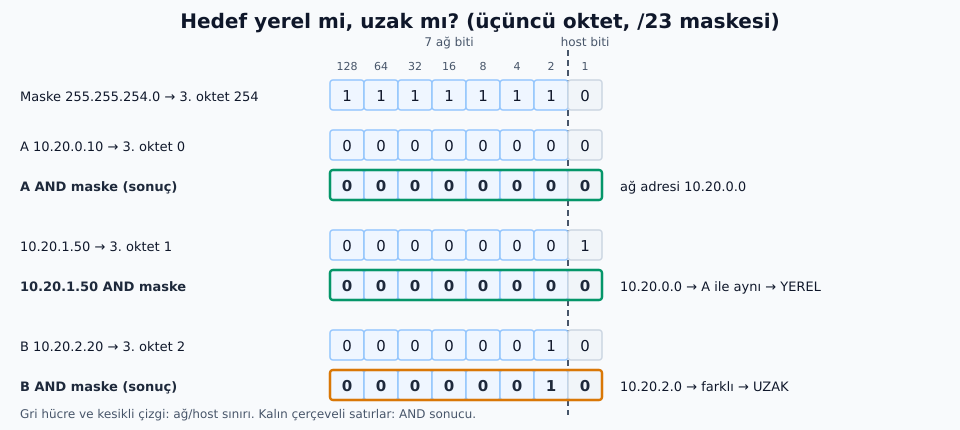
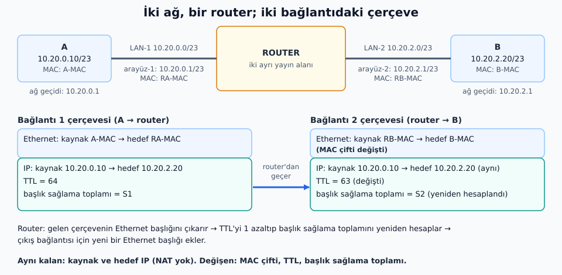

## Aynı kurum, iki ağ, tek paket

**A:** `10.20.0.10/23` → **B:** `10.20.2.20/23`

İkisinin arasında bir router var. A, B'nin IP adresini biliyor.

İlk Ethernet çerçevesi kime teslim edilmeli?

::: {.notes}
Hedef IP adresi elimizde; fakat Ethernet çerçevesi IP adresiyle değil MAC adresiyle teslim edilir. Soru tam bu noktada ortaya çıkıyor: A çerçevenin hedef MAC alanına hangi cihazın adresini yazacak? B'nin MAC adresini mi, başka birinin mi?

İki bilgiyi birleştirerek cevabı kuracağız. Birincisi, IP adresi ile maskeye bit düzeyinde AND uygulayarak bir adresin hangi ağda olduğunu bulmak. İkincisi, ARP'nin yalnızca aynı Ethernet ağındaki bir IP adresinin MAC karşılığını sorduğu. Aynı iki adresi (A ve B) baştan sona kullanacağız.
:::

---

## Önce karar: hedef yerel mi, uzak mı?

**Ağ üyeliği kararı:** bir bilgisayar, hedef adresin kendi ağında olup olmadığını kendi maskesiyle anlar. Kendi adresine ve hedef adrese aynı maskeyi bit düzeyinde AND ile uygular; iki ağ adresi aynıysa hedef **yerel**, farklıysa **uzak**tır.

**Neden gerekli?** Yerel hedefe çerçeve doğrudan gönderilir; uzak hedef için bu mümkün değildir. Bilgisayarın her pakette hangi yolu seçeceğini bu karar belirler.

`/23` maskesi `255.255.254.0` demektir. İlk iki oktetin maskesi 255, dördüncü oktetin maskesi 0'dır; bu iki oktet sonucu değiştirmez. Karar **üçüncü oktetin** bitlerinde verilir: 254 değerinde ilk yedi bit ağa, **en düşük bit (değeri 1) hosta** aittir.

*Şekilde üç adresin üçüncü oktetine aynı maske uygulanıyor; kalın çerçeveli satırlar AND sonucudur.*

| Adres | Üçüncü oktet | AND sonrası ağ adresi | Karar (A'dan bakınca) |
| --- | --- | --- | --- |
| A `10.20.0.10` | 0 | `10.20.0.0` | kendisi |
| `10.20.1.50` | 1 | `10.20.0.0` | **yerel** (host biti 1, ağ biti aynı) |
| B `10.20.2.20` | 2 | `10.20.2.0` | **uzak** (ağ bitlerinden biri farklı) |

::: {.notes}
`/23` ağında `10.20.0.0` ile `10.20.1.255` arası tek bir ağdır. Üçüncü oktetteki en düşük bit host bitidir; bu yüzden 0 ve 1 değerleri aynı ağa düşer. 2 değerinde ise ağ bitlerinden biri değişir ve ağ adresi `10.20.2.0` olur. `10.20.2.20` bu yüzden A'nın aralığının dışında kalır.

Çözülmüş örnek: `10.20.1.50` hedefi. Maske uygulandığında A ile aynı ağ adresi çıkıyor; A bu hedef için doğrudan ARP yapar, gateway'e ihtiyaç yoktur. Yalnız son oktete bakarak karar vermek burada yanlış sonuç verirdi.

Dördüncü oktetler farklı olsa da maskenin dördüncü okteti 0 olduğu için ağ adresini onlar belirlemez.

Her bilgisayar bu karşılaştırmayı, gönderdiği her paket için kendi maskesiyle yapar. Sonuç iki kola ayrılır: hedef yerelse hedefin MAC adresi öğrenilir; hedef uzaksa paket başka birine verilmelidir.

Kaynak: ağ öneki ve maske gösterimi için RFC 4632.
:::

---

## Neden B için ARP sorulamaz?

A `10.20.2.20` için ARP isteği gönderse:

- ARP isteği bir **yayın**dır; hedef MAC alanı `ff:ff:ff:ff:ff:ff`.
- Yayın yalnız A'nın bulunduğu Ethernet ağında dolaşır, router'dan öteye geçmez.
- B bu isteği hiç duymaz.

A'nın aynı ağda bulunan, B'ye ulaşabilen bir yardımcıya ihtiyacı var.

::: {.notes}
Router'ın bir arayüzüne gelen yayını diğer arayüzüne aktarmamasının nedeni basit: aksi hâlde iki ayrı ağ tek yayın alanına dönüşürdü ve ağlara bölmenin anlamı kalmazdı. Çözüm, A'nın B'yi doğrudan araması değil, B'ye giden yolu bilen bir cihaza paketi teslim etmesidir.

Bu yardımcı A ile aynı Ethernet ağında olmalı, çünkü A ona ancak Ethernet çerçevesiyle ulaşabilir. Aynı zamanda B'nin ağına da bağlı olmalı. İki ağa birden arayüzü olan cihaz router'dır.
:::

---

## Varsayılan ağ geçidi

**Varsayılan ağ geçidi (default gateway):** bir uç cihazın, kendi ağının dışındaki hedefler için paketi teslim ettiği, **kendi ağındaki** router arayüzünün IP adresidir.

**Neden gerekli?** Uç cihaz uzak hedefe doğrudan çerçeve gönderemez; çerçeveyi ancak aynı bağlantıdaki bir cihaza verebilir. Bu cihaz paketi taşımayı üstlenen router'dır.

**Mekanizma:** uç cihaz, hedef uzaksa ARP ile ağ geçidinin MAC adresini öğrenir ve çerçeveyi ona gönderir. Bu yüzden ağ geçidi adresi cihazın kendi ağının içinde olmak zorundadır; `10.20.0.1`, `10.20.0.0/23` içindedir.

Router iki ayrı Ethernet ağına bağlıdır: LAN-1 (`10.20.0.0/23`) arayüz-1'e, LAN-2 (`10.20.2.0/23`) arayüz-2'ye.

- A'nın ağ geçidi: `10.20.0.1` (router'ın **arayüz-1** adresi)
- B'nin ağ geçidi: `10.20.2.1` (router'ın **arayüz-2** adresi)

::: {.notes}
Router'ın iki arayüzünün iki ayrı IPv4 adresi var. Ağ geçidi, router'ın tek bir evrensel adresi değildir; hangi ağın bilgisayarına bakıyorsak o ağa bağlı arayüzün adresidir. A için `10.20.0.1`, B için `10.20.2.1`.

Ağ geçidi adresi bilgisayarın kendi ağının içinde olmalıdır, çünkü A ona doğrudan Ethernet çerçevesi göndermek zorundadır. Kendi ağının dışında bir ağ geçidi yazılırsa, o adrese bile doğrudan ulaşamayacağı için yapılandırma işe yaramaz.
:::

---

## A, ağ geçidinin MAC adresini öğrenir

A'nın ARP önbelleğinde `10.20.0.1` yoksa:

1. A yayın gönderir: "`10.20.0.1` kimde?"
2. Router arayüz-1 yanıtlar: "Bende, MAC adresim `RA-MAC`."
3. A bu kaydı önbelleğine yazar.

*MAC adresleri sembolik etiketlerle yazılmıştır: `A-MAC`, `RA-MAC`, `RB-MAC`, `B-MAC`.*

::: {.notes}
Sorduğumuz şey B'nin değil ağ geçidinin MAC adresi. ARP burada her zamanki işini yapıyor, tek fark kimi aradığı: uzak hedefin kendisini değil, uzak hedefe giden yoldaki ilk cihazı.

Etiketlerin anlamı: `RA-MAC` router'ın A tarafındaki arayüzünün (arayüz-1), `RB-MAC` B tarafındaki arayüzünün (arayüz-2) MAC adresidir. Gerçek MAC adresleri onaltılık sayılardır; etiketler tabloları okunur tutmak için seçildi.
:::

---

## İlk çerçeve: IP hedefi B, çerçeve hedefi router

**TTL (Time To Live):** IP başlığındaki, paketin ömrünü sınırlayan sayaçtır. **Neden var?** Hatalı yönlendirilmiş bir paket ağda sonsuza dek dolaşmasın. **Mekanizma:** her router paketi iletmeden önce TTL'yi 1 azaltır; değer sıfıra inerse paketi düşürür (RFC 1812). Örnekte A başlangıç değerini 64 yazmıştır.

A → router bağlantısı:

| Katman | Alan | Değer |
| --- | --- | --- |
| Ethernet | Kaynak MAC | `A-MAC` |
| Ethernet | Hedef MAC | `RA-MAC` |
| IP | Kaynak IP | `10.20.0.10` |
| IP | Hedef IP | `10.20.2.20` |
| IP | TTL | 64 |

**Hedef IP adresine ağ geçidinin adresini yazsak ne olurdu?**

. . .

Paket B yerine router'ın kendisine gönderilmiş olurdu; router'ın işi paketi taşımaktır, paketin alıcısı olmak değil.

::: {.notes}
Tablonun iki bölümünü ayrı okumak gerekiyor. Ethernet bölümü yalnızca bu bağlantı, yani A ile router arasındaki hat için geçerli: çerçevenin bir sonraki alıcısı router. IP bölümü ise paketin gerçek yolculuğunu anlatıyor: kaynak A, hedef B.

İkisinin farklı kişilere işaret etmesi çelişki değil; iki ayrı soruya cevap veriyorlar. MAC alanı "bu bağlantıda kim alacak?" sorusunu, IP hedef alanı "paket en sonunda kime gidecek?" sorusunu cevaplıyor.

TTL (Time To Live) başlangıç değeri işletim sistemine göre değişir; örnekte 64 aldık.
:::

---

## Router paketi alır ve ikinci bağlantıya geçirir

1. Çerçevenin hedef MAC'i kendisine ait: çerçeveyi alır, Ethernet başlığını çıkarır.
2. IP hedefine bakar: `10.20.2.20`, arayüz-2'nin ağında (`10.20.2.0/23`).
3. **TTL'yi 1 azaltır:** 64 → 63. IP başlığı değiştiği için **başlık sağlama toplamını** yeniden hesaplar.
4. B'nin MAC'ini bilmiyorsa LAN-2'de ARP yapar: "`10.20.2.20` kimde?" → `B-MAC`.
5. IP paketini yeni bir Ethernet çerçevesine koyar ve arayüz-2'den gönderir.

**Başlık sağlama toplamı (header checksum):** IP başlığındaki alanlardan hesaplanan, başlığın bozulup bozulmadığını denetlemeye yarayan küçük bir değerdir.

- **Neden var?** Bozulmuş bir başlıkla paket yanlış yöne gitmesin.
- **Mekanizma:** başlıktaki herhangi bir alan değişirse bu değer de değişir. Router TTL'yi azaltınca sağlama toplamını yeniden hesaplar. TTL sıfıra inerse router paketi düşürür ve çoğunlukla kaynağa ICMP zaman aşımı mesajı yollar.

::: {.notes}
Router'ın yaptığı işin sırası önemli: önce Katman 2 zarfı açılıyor, sonra IP başlığına bakılıyor, sonra yeni bir zarf hazırlanıyor. Eski çerçeve ikinci bağlantıya taşınmıyor; çünkü o çerçevenin MAC adresleri yalnız A–router bağlantısında anlamlıydı.

TTL'nin azalması IP başlığındaki bir alanın değişmesi demek. Başlık sağlama toplamı başlığın içeriğinden hesaplandığı için o da yeniden hesaplanır. Yani adres dönüşümü olmasa bile IP başlığı uçtan uca bit bit aynı kalmaz; kaynak ve hedef IP adresleri aynı kalır.

Router, LAN-2'de B için ARP yapıyor. Bu istek A'nın Ethernet ağına geçmez. Başta sorduğumuz sorunun cevabı da bu: B'nin MAC adresi A'nın hiç bilmesi gerekmeyen bir bilgi.
:::

---

## İki bağlantı, iki çerçeve

| Alan | A → router (LAN-1) | Router → B (LAN-2) |
| --- | --- | --- |
| Kaynak MAC | `A-MAC` | `RB-MAC` |
| Hedef MAC | `RA-MAC` | `B-MAC` |
| Kaynak IP | `10.20.0.10` | `10.20.0.10` |
| Hedef IP | `10.20.2.20` | `10.20.2.20` |
| TTL | 64 | 63 |
| Başlık sağlama toplamı | S1 | S2 (yeniden hesaplandı) |

*Şekilde iki çerçeve yan yana: iki IP adresi sabit, MAC çiftleri değişiyor.*

**Bu örnekte adres dönüşümü (NAT) yoktur; bu yüzden IP adresleri uçtan uca aynı kalır. MAC adresleri her Ethernet bağlantısında değişir.**

Her internet bağlantısı Ethernet değildir. Başka bağlantı teknolojilerinde Katman 2 başlığı o teknolojiye göre farklıdır; değişmeyen kural, her bağlantının kendi Katman 2 başlığını taşımasıdır.

::: {.notes}
Bu tablo sonucun özeti. İki sütunu yan yana okuyunca üç şey görünüyor: MAC çiftleri tamamen değişmiş, kaynak ve hedef IP aynı, TTL bir azalmış (sağlama toplamı da ona uyarlanmış).

NAT yapan cihazlarda IP adresleri de değişebilir; bu örnekte NAT olmadığı için kaynak IP, B'ye ulaşan pakette de `10.20.0.10`.

Tablodaki iki çerçeve Ethernet bağlantıları için yazıldı. Bir paketin yolundaki her bağlantının Ethernet olması gerekmez; her bağlantı kendi Katman 2 çerçevelemesini kullanır.
:::

---

## Dönüş yolu

B, `10.20.0.10` adresine yanıt verirken aynı soruyu sorar:

- B'nin ağı `10.20.2.0/23`; `10.20.0.10` bu ağın dışında → uzak.
- Yanıt, B'nin ağ geçidine, `10.20.2.1`'e (`RB-MAC`) teslim edilir.
- Router, arayüz-1 üzerinden A'ya iletir.

::: {.notes}
Dönüşte A ile B'nin rolleri yer değiştiriyor, mantık aynı: karşılaştırma, ağ geçidi, ARP, çerçeve. B'nin kendi ağ geçidini doğru bilmesi gerekiyor; gidiş çalışıp dönüş bozulabilir. Yanlış ağ geçidi sorunu B tarafında da aynı biçimde ortaya çıkabilir.
:::

---

## Yerel çalışıyor, uzak çalışmıyor: yanlış ağ geçidi

A'nın ağ geçidi ayarı `10.20.0.99` yazılmış; bu adreste router yok.

- `10.20.0.20` hedefi için A doğrudan ARP yapar → **çalışır.**
- `10.20.2.20` hedefi için A, `10.20.0.99`'un MAC'ini arar → yanıt yok → **çalışmaz.**

**Teşhis sırası:** önce kendi ağ geçidine ping → sonra uzak hedefe ping.

Ping sonuçları belirtidir; nedeni tek başına kesinleştirmez:

- Ağ geçidine ping başarısızsa: A'nın adresi, maskesi ve ağ geçidi ayarı ya da router'ın yerel arayüzü şüphelidir.
- Ağ geçidine ping başarılı, uzak hedefe başarısızsa: router'ın uzak ağa iletimi, dönüş yolu ya da hedef taraf şüphelidir.

Kesin teşhis için A'da adres, maske ve ağ geçidi; router'da arayüz durumu ve rota tablosu kontrol edilir.

::: {.notes}
Yerel ping'in çalışması ağ geçidinin doğru olduğunu göstermez, çünkü yerel trafik ağ geçidine hiç uğramaz. Bu yüzden ilk deney ağ geçidinin kendisine yapılmalı: ağ geçidine ping gidiyorsa ilk atlama sağlam; gitmiyorsa sorun A'nın yapılandırmasında ya da router arayüzünde.

Ağ geçidine ping gidip uzak hedefe gitmiyorsa ilk atlama sağlamdır; sorun router'ın uzak ağa iletiminde ya da yolun ilerisinde aranır.

Arayüz-1 kapalıysa aynı LAN'daki bilgisayarlar birbirine yanıt verebilir, `10.20.0.1` vermez. Arayüz-2 kapalıysa `10.20.0.1` yanıt verir, fakat B'ye gidiş de dönüş de olmaz. Kapalı arayüz tek yönlü ping başarısı üretmez.
:::

---

## Etkinlik: ARP ile kimi arayacağız?

A (`10.20.0.10/23`, ağ geçidi `10.20.0.1`) için dört adımı uygulayın: (1) hedefin ağ adresini bulun, (2) yerel mi uzak mı karar verin, (3) ARP ile aranacak IP'yi yazın, (4) çerçevenin hedef MAC'inin kime ait olduğunu yazın.

| Hedef | Hedefin ağ adresi (maske AND) | Yerel / uzak | ARP ile aranan IP | Çerçevenin hedef MAC'i kimin? |
| --- | --- | --- | --- | --- |
| `10.20.1.200` | | | | |
| `10.20.3.7` | | | | |
| `10.20.4.10` | | | | |

::: {.notes}
Yöntem: önce hedefin üçüncü oktetini A'nın ağ aralığıyla karşılaştırın. A'nın ağı `10.20.0.0` – `10.20.1.255` arasıdır. Yerel hedefte ARP hedefin kendisini, uzak hedefte ağ geçidini arar.

Dikkat edilecek nokta: üçüncü oktetin 1 olması hedefi uzak yapmaz; `/23` ağı üçüncü oktet 0 ve 1'i birlikte kapsar.
:::

---

## A'nın işi biter, router'ın seçimi başlar

A, paketi ağ geçidine teslim etti; uç cihaz için karar iki seçenekliydi: **yerelse hedefe, uzaksa ağ geçidine.**

Router'ın durumu farklı. Paketin hedefi `10.20.2.20` olduğunda router'ın arayüz-2 ağı hedefi doğrudan kapsıyordu. Hedef `10.20.4.10` ya da internetteki bir sunucu olsaydı, router'a doğrudan bağlı hiçbir ağda bulunmayacaktı.

**Router bu durumda paketi hangi arayüzden, hangi komşuya gönderir? Bu kararı neye bakarak verir?**

::: {.notes}
Uç cihazın kararı iki seçenekle bitiyor. Router'ın elinde ise çok sayıda ağ ve çok sayıda olası komşu olabilir. Bu seçimi router'ın kendi yönlendirme tablosu ve hedef IP adresi belirler.
:::

