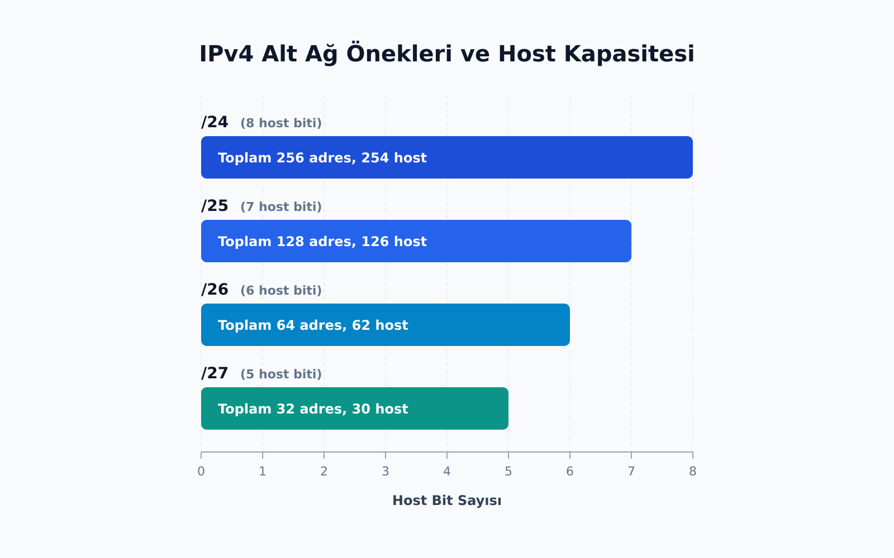
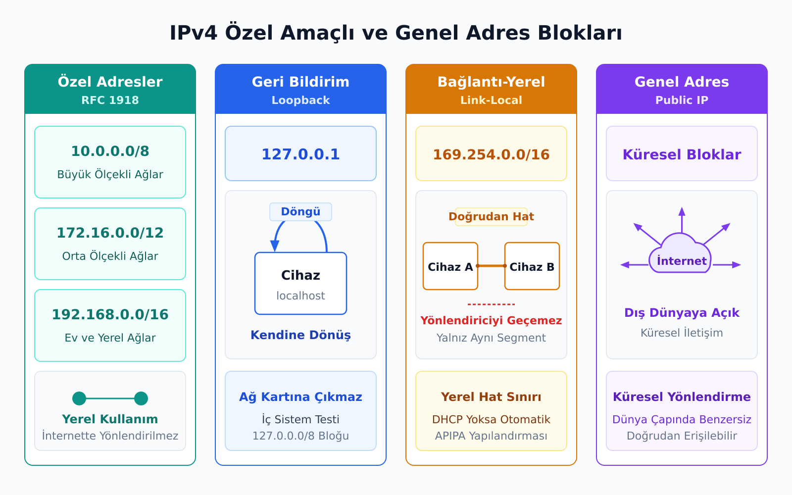

## Bugünün Temel Sorusu

> `192.168.10.32/27` bloğundaki hangi adreslerin özel bir görevi var, hangileri normal hostlara atanabilir ve bu blok kaç cihazı destekler?

`192.168.10.37/27` adresinin ağ adresi `192.168.10.32` olur. Elimizde belirlenmiş bir blok varken, **o bloğun içi** nasıl paylaşılır?

::: {.notes}
`192.168.10.37/27` adresinde maske ilk 27 biti korur, 5 host bitini sıfırlar ve `192.168.10.32` ağ adresini verir. `192.168.10.32/27` bloğunda bu 5 host biti farklı değerler alarak toplam 32 adres oluşturur. Bloğun ilk ve son adresinin görevleri, cihazlara atanabilen aralığın sınırlarını belirler.
:::

---

## Bir Ağdaki Kritik Adresler

Bir IP bloğunda her adres bilgisayarlara verilemez. Her alt ağda iki özel adres ayrılmıştır:

1. **Ağ Adresi (Network Address):** Host bitlerinin tamamı **0** olan adrestir. Ağın kendisini temsil eder (Örn: `192.168.1.0`). Hiçbir cihaza atanamaz.
2. **Yayın Adresi (Broadcast Address):** Host bitlerinin tamamı **1** olan adrestir. O ağdaki tüm cihazlara aynı anda seslenmek için kullanılır (Örn: `192.168.1.255`). Hiçbir cihaza atanamaz.
3. **Kullanılabilir Host Aralığı (Usable Host Range):** Ağ Adresi + 1 ile Yayın Adresi - 1 arasındaki adreslerdir (Örn: `192.168.1.1` – `192.168.1.254`).

$$
\text{Toplam Adres Sayısı} = 2^h \qquad\text{ve}\qquad \text{Kullanılabilir Host Sayısı} = 2^h - 2
$$
*(Burada $h$, host bitlerinin sayısıdır).*

::: {.notes}
Formüldeki $-2$ ifadesi daima bu iki adresi temsil eder: biri Ağ Adresi, diğeri Broadcast Adresi. Eğer bir alt ağda 8 host biti varsa, toplam $2^8 = 256$ adres vardır; ancak cihazlara atanabilecek kullanılabilir adres sayısı $256 - 2 = 254$'tür.

Bu iki adresin "hiçbir cihaza atanamaz" olmasının pratik sonucu şudur: bir yöneticinin `192.168.1.0` veya `192.168.1.255` adresini bir PC'ye elle yazmaya çalışması işletim sistemi veya ağ cihazı tarafından reddedilir ya da beklenmedik davranışa yol açar. Bu, DHCP sunucularının adres havuzunu ayarlarken neden otomatik olarak bu iki sınır adresi dışarıda bıraktığını açıklar.
:::

---

## Etkileşimli: Bir Blokta Hangi Adres Hangi Görevi Taşır?

::: {.notes}
Üç sekme sırayla incelenir: (1) blok sınırları — yalnız ilk ve son adres vurgulanır; (2) ağ adresi ve kullanılabilir aralık — ağ adresi sabit kalır, aradaki adresler yeşille işaretlenir; (3) yayın adresi — son adres ayrıca kırmızıyla vurgulanır. Her sekmeye istenildiği an geri dönülebilir.

Bu, önceki slaytın formülünü (`2^h` toplam, `2^h-2` kullanılabilir) aynı örnek üzerinde somutlaştırır: 32 adreslik blokta 30'u kullanılabilir, 2'si (ağ + yayın) ayrılmıştır.
:::

---

## Kaç Cihaz Sığar? Host Bitine Göre Kapasite

{width="100%" fig-align="center" fig-alt="24, 25, 26 ve 27 prefix uzunluklarının host bit sayısına göre toplam ve kullanılabilir host kapasitelerinin çubuk grafikle karşılaştırılması"}

Host biti sayısı ($h$) arttıkça kullanılabilir adres sayısı katlanarak büyür:

| Host Biti ($h$) | Toplam Adres ($2^h$) | Kullanılabilir Host ($2^h-2$) |
|:---:|---:|---:|
| 2 | 4 | 2 |
| 4 | 16 | 14 |
| 6 | 64 | 62 |
| 8 | 256 | 254 |

::: {.notes}
Host bit sayısı, 8'in katlarıyla sınırlı değildir. Örneğin `/27` için $h=32-27=5$ olur; toplam $2^5=32$ adresin 30'u olağan host adreslemesinde kullanılabilir.

Host biti bir arttığında **toplam adres sayısı iki katına** çıkar, bir azaldığında yarıya iner. Kullanılabilir host sayısında ise her bloktan iki adres çıkarılır: 4 host biti 14 kullanılabilir adres verirken, 5 host biti 30 kullanılabilir adres verir. Dolayısıyla kullanılabilir sayı tam iki katına çıkmaz; iki katına çıkan toplam adres sayısıdır.
:::

---

## İstisna: `/31` ve `/32` Olağan Formüle Uymaz

Yukarıdaki $2^h-2$ formülü **iki özel durumda** doğrudan uygulanmaz:

- **`/31`** ($h=1$): Toplam 2 adres. Formül "$2-2=0$ kullanılabilir host" derdi — ama bu yanıltıcıdır. İki router'ı **doğrudan** bağlayan noktadan noktaya hatlarda tanımlı bir istisnadır; ağ/yayın ayrımı yapılmaz, **iki adresin ikisi de** kullanılır.
- **`/32`** ($h=0$): Tek bir adresin kendisi. "Alt ağ" değil, **tek host**'u (ör. bir loopback arayüzünü) işaret eder.

::: {.notes}
Kullanılabilir host sayısı için $2^h-2$ hesabı, ağ ve yayın adresinin ayrı tutulduğu olağan IPv4 alt ağları için geçerlidir. `/31` noktadan noktaya bağlantılar ve `/32` tek adres gösterimi bu kabule uymaz.

`/31`'in mantığı şudur: bir noktadan noktaya hatta zaten yalnız iki cihaz vardır (Router A, Router B), aralarında "yayın" yapılacak üçüncü bir cihaz yoktur. Bu yüzden IETF (RFC 3021), bu özel durumda ağ/yayın ayrımını atlayıp iki adresi de kullanılabilir host saymayı standart hâline getirmiştir. `/27` bloğunda ise ağ ve yayın adresi ayrılır; toplam 32 adresin 30'u hostlara atanabilir.

`/32` ise farklı bir mantıkla çalışır: 32 bitin tamamı "ağ" sayılır, host bölümü yoktur (h=0). Pratikte bir yönlendirme tablosunda tek bir hedef host'u göstermek veya bir cihazın loopback arayüzünü (`127.0.0.1/32` gibi) tanımlamak için kullanılır — "32 kullanılabilir adresli küçük bir alt ağ" değil, "bu tek adresin kendisi" anlamına gelir.
:::

---

## Özel IPv4 Blokları (RFC 1918 Private IP)

İnternet'te IPv4 adreslerinin tükenmesini önlemek için belirli bloklar yerel ağlar için "Özel (Private)" olarak ayrılmıştır.

| Sınıf | Özel IP Aralığı | Varsayılan Maske | Prefix |
|---|---|---|---|
| **A Sınıfı** | `10.0.0.0` — `10.255.255.255` | `255.0.0.0` | `/8` |
| **B Sınıfı** | `172.16.0.0` — `172.31.255.255` | `255.240.0.0` | `/12` |
| **C Sınıfı** | `192.168.0.0` — `192.168.255.255` | `255.255.0.0` | `/16` |

- **Özellikleri:** Bu adresler İnternet omurgasında yönlendirilmez (Non-Routable).
- Dünyadaki milyonlarca ev ve şirket aynı anda `192.168.1.X` bloğunu ücretsiz ve çakışma yaşamadan kullanabilir.
- İnternete çıkarken bu özel adresler genel (public) bir IP'ye dönüştürülür (**NAT**).

::: {.notes}
Evdeki modeminizin arkasındaki bilgisayarınızın IP'si büyük ihtimalle `192.168.1.X` veya `10.0.0.X`'tir. Komşunuzun evindeki bilgisayarın IP'si de aynıdır. Bu bir çakışma yaratmaz çünkü bu adresler yerel ağın içinde yaşar; dış dünyaya çıkarken modemin genel IP'si kullanılır.

"Yönlendirilmez (non-routable)" ifadesi yanlış anlaşılabilir: bu adresler **kendi yerel ağınızda** normal şekilde yönlendirilir (ev ağınızdaki birden fazla switch/router arasında sorunsuz çalışır). Yönlendirilemeyen durum yalnız **genel İnternet omurgasıdır** — bir İnternet servis sağlayıcısının router'ı, kaynağı `192.168.X.X` olan bir paketi asla doğrudan taşımaz; böyle bir paket NAT'tan geçmeden omurgaya çıkarsa düşürülür. NAT (Network Address Translation), bu kullanımda özel kaynak adresinin yerine genel bir adresin kullanılmasını sağlar.

Üç blok da (10.X, 172.16.X, 192.168.X) rastgele seçilmemiştir — sırasıyla A, B ve C sınıflarından (adresin ilk bitleriyle belirlenen tarihsel sınıflar) birer temsilci bloktur. Kurum büyüklüğüne göre uygun özel blok seçilir: çok büyük bir kurum `10.X` (16 milyonun üzerinde adres), orta ölçekli `172.16-31.X`, küçük bir ev/ofis ağı genellikle `192.168.X.X` kullanır.
:::

---

## Diğer Özel Amaçlı IPv4 Adresleri

{width="100%" fig-align="center" fig-alt="RFC 1918 özel adres blokları, loopback, link-local ve genel adres kategorilerinin yan yana şeması"}

- **Loopback (Geri Döngü - `127.0.0.1`):** Cihazın kendi TCP/IP protokol yığınını test etmek için kullanılır. Paket ağ kartından dışarı çıkmaz; işletim sisteminin içinde geri döner (`ping 127.0.0.1` çalışıyorsa TCP/IP yığını sağlamdır).
- **APIPA (Automatic Private IP Addressing - `169.254.0.0/16`):** Bir bilgisayar DHCP'den IP alamazsa (sunucu çöktüyse veya kablo takılı ama bağlantı yoksa), işletim sistemi cihaza geçici olarak `169.254.X.X` aralığından bir adres atar.
  - *Teşhis İpucu:* Bir bilgisayarda `169.254.X.X` görüyorsanız, ilk kontrol edeceğiniz şey DHCP sunucudur!

::: {.notes}
Ağ destek uzmanlarının ilk baktığı şeylerden biri APIPA adresidir. Kullanıcı "ağa bağlanamıyorum" dediğinde `ipconfig` çıktısında 169.254 görüyorsanız, switch'e bağlı olsa bile cihazın DHCP sunucusuna erişemediği hemen teşhis edilir.

Loopback aralığı aslında tüm `127.0.0.0/8` bloğunu kapsar (`127.0.0.1`'den `127.255.255.254`'e kadar); kullanım alışkanlığı neredeyse her zaman yalnızca `127.0.0.1`'i kullanmaktır. Loopback testinin mantığı şudur: `ping 127.0.0.1` başarısız oluyorsa sorunun kaynağı **bilgisayarın kendi işletim sistemindeki TCP/IP yazılım yığınıdır** — paket hiçbir zaman fiziksel ağ kartına çıkmadığı için ağ kartı, kablo veya uzak sunucu bu başarısızlıktan sorumlu tutulamaz.

APIPA'nın iki önemli sınırı var. Birincisi, bu adresler yalnızca **aynı fiziksel/yerel bağlantıdaki** diğer APIPA cihazlarıyla iletişim kurabilir; İnternet'e veya farklı bir alt ağa asla çıkamaz. İkincisi, DHCP sorununu kendisi çözmez — cihazın en azından yerel ağdaki benzer durumdaki diğer cihazlarla iletişim kurabilmesini sağlayan geçici bir **belirtidir**, teknisyen için "DHCP'ye bak" uyarısı işlevi görür.
:::

---

## Bütünleşik Hesap: `172.16.45.130/26`

Her hesap adımını bu adres için **bağımsız olarak** tekrarlayın:

| Adım | Hesap | Sonuç |
|---|---|---|
| Maske | h=6 → $2^6$=64 toplam adres | `255.255.255.192` |
| Ağ adresi | 130=`10000010`, AND `11000000` = `10000000` | `172.16.45.128` |
| Yayın adresi | 128 + (64−1) = 191 | `172.16.45.191` |
| Kullanılabilir aralık | 128+1 … 191−1 | `172.16.45.129`–`172.16.45.190` |
| Kullanılabilir host | $2^6-2$ | 62 |
| Adres türü | `172.16.0.0/12` bloğu içinde | RFC 1918 özel adres |

::: {.notes}
`/26` öneki, ilk 26 bitin ağ kısmı ve kalan 6 bitin host kısmı olduğunu belirtir. Maske, ağ/yayın adresleri, kullanılabilir aralık ve adres türünü hesaplayıp sonuçlarınızı tablodaki değerlerle karşılaştırın.

Her satır bir öncekinin sonucuna dayanır: maske host bitini (h=6) verir; host biti toplam adresi ($2^6=64$) ve kullanılabilir sayıyı ($2^6-2=62$) verir; ağ adresi AND işleminden çıkar (130'un ikilik karşılığı `10000010`, maskenin son okteti `192`=`11000000`, AND sonucu `10000000`=128); yayın adresi ağ adresine blok büyüklüğü (64) eklenip 1 çıkararak bulunur (128+63=191); kullanılabilir aralık bu ikisinin arasıdır; adres türü ise `172.16.0.0/12` RFC 1918 bloğuna düştüğü için özeldir.

`192.168.10.32/27` bloğundaki 5 host bitine karşılık, bu `/26` bloğu 6 host biti içerir. Her iki örnekte de ağ/host sınırı dördüncü oktetin içindedir; `/26` bloğu 64, `/27` bloğu 32 toplam adres taşır.
:::

---

## Ağ Bloğunun Sınırları ve Kullanılabilir Adresler

`192.168.10.32/27` bloğu 32 adres içerir:

- Ağ adresi: `192.168.10.32`
- Yayın adresi: `192.168.10.63`
- Kullanılabilir host aralığı: `192.168.10.33`–`192.168.10.62`
- Kullanılabilir host sayısı: 30
- Adres türü: RFC 1918 özel adres

::: {.notes}
Host bitlerinin tamamı 0 olduğunda ağ adresi, tamamı 1 olduğunda yayın adresi elde edilir. `/27` için 5 host biti vardır: $2^5=32$ toplam adresten ağ ve yayın adresleri çıkarıldığında 30 kullanılabilir adres kalır. Bir adresin RFC 1918 özel adres bloğunda bulunması, o alt ağdaki görevinden ayrı bir özelliktir: `192.168.10.32` özel bir adres bloğundadır ve `/27` maskesi altında ağ adresidir; `192.168.10.37` ise aynı blokta bir hosta atanabilir.
:::
