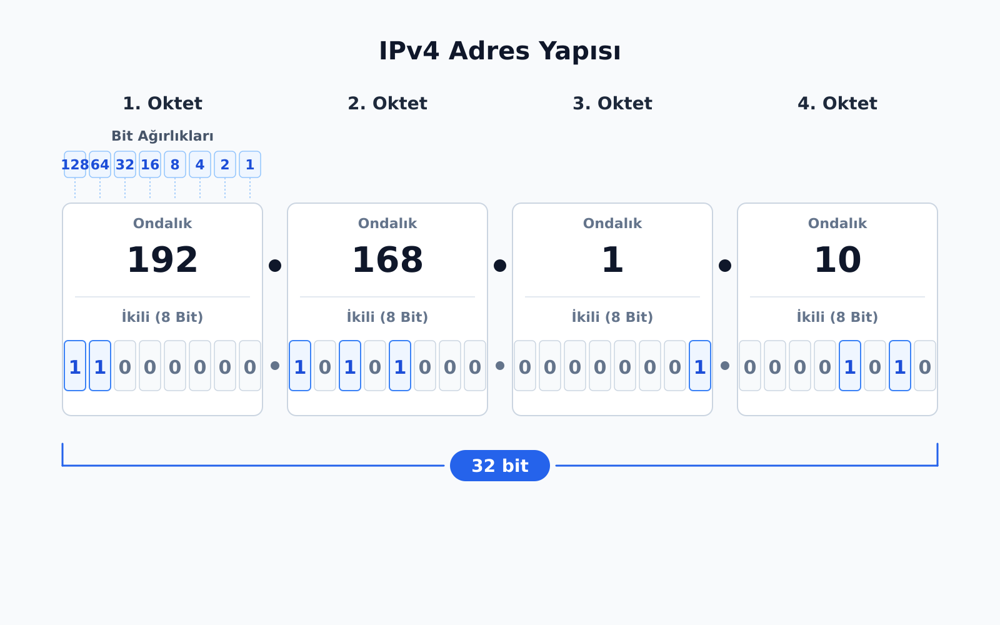
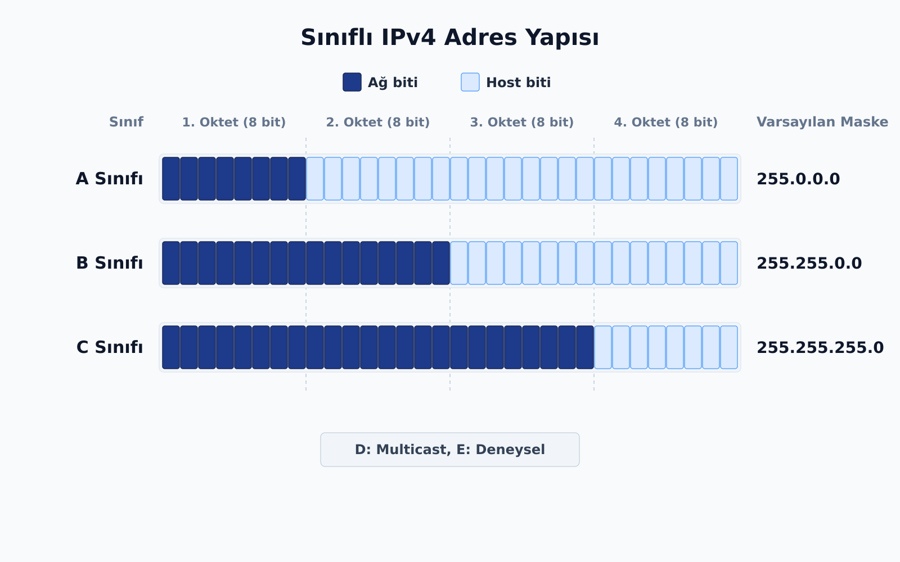

## Bugünün Temel Sorusu

> Her ağ kartının fabrikada basılmış benzersiz bir 48-bit MAC adresi varken, İnternet neden bu adreslerle doğrudan çalışamaz? Neden ayrıca 32-bitlik bir IP adresine ve alt ağ maskesine ihtiyaç duyarız?

- MAC düz (flat) bir adresken, IP adresi nasıl hiyerarşi sağlar?
- Bir bilgisayar kendi IP adresine ve alt ağ maskesine bakarak hangi ağda olduğunu nasıl hesaplar?
- Ağ adresi ve yayın (broadcast) adresi neden bir bilgisayara statik olarak atanamaz?

::: {.notes}
Bir paketin dünya üzerindeki milyarlarca cihaz arasından hedefi bulabilmesi, posta sistemindeki şehir/ilçe/sokak hiyerarşisine benzer mantıksal bir adresleme mimarisi gerektirir. IP adresi bu hiyerarşiyi sağlar; alt ağ maskesi ise adresin ağ kısmıyla host kısmını ayırır. Cihaz, kendi adresiyle hedef adresi bu maskeyle değerlendirerek hedefin aynı yerel ağda olup olmadığına karar verir.
:::

---

## Neden Mantıksal Adresleme (IP)?

MAC adresi bir insanın T.C. Kimlik Numarası gibidir; cihazı tekil olarak tanımlar ancak **nerede olduğunu söylemez**.

- **MAC Adresinin Sınırı:** Dünyadaki tüm yönlendiriciler (router) her ağ kartının MAC adresini tutmaya kalksaydı, milyarlarca satırlık devasa ve aranamaz tablolar oluşurdu.
- **IP Adresinin Gücü:** IP adresi posta adresi gibidir:
  - Ülke / Şehir / İlçe $\rightarrow$ **Ağ Kısmı (Network ID)**
  - Bina / Kapı Numarası $\rightarrow$ **Host Kısmı (Host ID)**

> Bir paket Amerika'dan yola çıktığında yönlendiriciler paket Türkiye sınırına gelene kadar sadece "Türkiye" ağına bakar; alıcının tam olarak hangi bilgisayar olduğunu bilmeleri gerekmez!

::: {.notes}
Hiyerarşik adresleme, İnternet'in küresel ölçekte çalışabilmesinin tek nedenidir. Yönlendiriciler tek tek bilgisayarları değil, ağ bloklarını (Network ID) yönlendirir.

Somut bir sayı vermek gerekirse: dünyada aktif olarak çalışan ağ kartı sayısı milyarları bulur. Eğer her router, her ağ kartının MAC adresini ayrı ayrı bilmek zorunda olsaydı, bu tablo hem saklanamaz hem de her paket için taranamaz büyüklükte olurdu. İnternet omurgasındaki bir router gerçekte yalnızca birkaç yüz bin "ağ bloğu" satırı tutar — her satır potansiyel olarak binlerce cihazı temsil eder. Bu, posta sisteminde bir dağıtım merkezinin her ev sakininin adını değil, yalnızca "bu posta kodu şu yöne gider" bilgisini tutmasına benzer.

MAC adresi değişmez (fabrikada yakılmıştır), IP adresi ise **cihazın bağlı olduğu yere göre değişir**. Aynı dizüstü bilgisayar evde `192.168.1.X`, okulda `10.50.X.X` alabilir — MAC'i her yerde aynı kalır ama IP'si gittiği ağa göre değişir. Bu benzetmede MAC **kimlik**, IP **konum**dur.
:::

---

## IPv4 Adresinin Anatomisi

{width="100%" fig-align="center" fig-alt="192.168.1.10 adresinin dört oktetinin ondalık ve ikili karşılığı, bit ağırlıkları ve toplam 32 bit etiketi"}

IPv4 adresi toplam **32 bit** uzunluğundadır. İnsanların okuyabilmesi için her biri 8 bitten oluşan 4 gruba (**Oktet**) ayrılır ve noktalı ondalık (Dotted-Decimal) biçimde yazılır. Yukarıdaki görsel, `192.168.1.10` adresinin dört oktetini ondalık ve ikili karşılıklarıyla birlikte gösterir: her oktet 8 bittir, toplamda $4 \times 8 = 32$ bit.

Her oktet ikili tabanda en az $00000000_2$ ($0$), en fazla $11111111_2$ ($255$) değerini alabilir.
Dolayısıyla bir IPv4 adresindeki sayılar $0$ ile $255$ arasında olmak zorundadır.

::: {.notes}
`192.168.1.256` geçersiz bir adrestir. 8 bitin alabileceği maksimum değer $2^8 - 1 = 255$'tir; 256 diye bir oktet değeri matematiksel olarak var olamaz.

`172.16.300.1` de geçersizdir: 300, 255'i aşar. `10.0.0.0` ise noktalı ondalık yazım açısından geçerlidir; her oktet 0 olabilir. Bir adresin yazımının geçerli olması, o adresin belirli bir maskeyle bir hosta atanabileceği anlamına gelmez.

Toplamda bir IPv4 adresinin alabileceği teorik değer sayısı $2^{32}$, yaklaşık 4,3 milyardır. Bu sonlu adres uzayının tükenmesi (IPv4 exhaustion), adreslerin verimli kullanılmasını gerektiren tarihsel bir sorun olmuştur.
:::

---

## İkili ve Ondalık Dönüşümü (Sihirli Tablo)

Bir okteti ikili tabandan ondalığa çevirirken 2'nin kuvvetleri kullanılır:

| Pozisyon Değeri | $2^7$ | $2^6$ | $2^5$ | $2^4$ | $2^3$ | $2^2$ | $2^1$ | $2^0$ | Toplam |
|---|:---:|:---:|:---:|:---:|:---:|:---:|:---:|:---:|:---:|
| **Ağırlık** | **128** | **64** | **32** | **16** | **8** | **4** | **2** | **1** | — |
| **Örnek 1:** `11000000` | 128 | 64 | 0 | 0 | 0 | 0 | 0 | 0 | **192** |
| **Örnek 2:** `10101000` | 128 | 0 | 32 | 0 | 8 | 0 | 0 | 0 | **168** |
| **Örnek 3:** `00001010` | 0 | 0 | 0 | 0 | 8 | 0 | 2 | 0 | **10** |

::: {.notes}
Bu 8 sütunlu tablo ($128, 64, 32, 16, 8, 4, 2, 1$), ağ hesaplamalarının temelidir.

Dönüşüm iki yönde de çalışır. Ondalıktan ikiliye giderken "açgözlü" (greedy) yöntem kullanılır: en büyük ağırlıktan başlanır, sayı o ağırlıktan büyük veya eşitse 1 yazılıp çıkarılır, değilse 0 yazılıp bir sonraki ağırlığa geçilir. Örneğin 37'yi çevirelim: 128 ve 64'ten küçük → 0,0. 32'den büyük → 1, kalan 5. 16 ve 8'den küçük → 0,0. 4'ten büyük → 1, kalan 1. 2'den küçük → 0. 1'e eşit → 1. Sonuç: `00100101`. Yani `192.168.10.37` adresinin son okteti ikili biçimde `00100101` olarak yazılır.

İkiliden ondalığa dönüşte ise yalnızca 1 olan sütunların ağırlıkları toplanır; 0 olan sütunlar hiç hesaba katılmaz. Ondalıktan ikiliye dönüşte ağırlıklar sırayla denenir; ikiliden ondalığa dönüşte ise 1 bitlerinin ağırlıkları toplanır.
:::

---

## Sınıflı Adresleme (Classful Addressing)

{width="100%" fig-align="center" fig-alt="A, B ve C sınıflarının 32 bitlik şeritlerinde ağ biti ve host biti oranlarının karşılaştırması, varsayılan maskelerle birlikte"}

IPv4'ün ilk yıllarında adresler **sınıflı (classful)** bir yapıyla dağıtıldı: adresin ilk bitleri, ağ ve host kısmının sabit uzunluğunu belirliyordu.

| Sınıf | İlk Bit(ler) | İlk Oktet Aralığı | Ağ Biti | Host Biti | Varsayılan Maske | Kullanım |
|---|:---:|:---:|---:|---:|---|---|
| **A** | 0 | 1–126 | 8 | 24 | 255.0.0.0 | Çok büyük ağlar (tarihsel) |
| **B** | 10 | 128–191 | 16 | 16 | 255.255.0.0 | Orta büyüklükte ağlar |
| **C** | 110 | 192–223 | 24 | 8 | 255.255.255.0 | Küçük ağlar |
| **D** | 1110 | 224–239 | — | — | — | Multicast (grup yayını) |
| **E** | 1111 | 240–255 | — | — | — | Deneysel, ayrılmış |

Her sınıfın **sabit** bir ağ/host bit ayrımı ve varsayılan maskesi vardı; kurum büyüklüğü ne olursa olsun bu sınırlar değişmezdi.

::: {.notes}
D ve E sınıfları olağan host adreslemesi için kullanılmaz: D grup yayınına (multicast), E deneysel amaçlara ayrılmıştır. Sınıflı adreslemede ağ/host sınırı, adresin ait olduğu sınıfın sabit bit uzunluğuyla belirlenirdi.

İlk oktet aralığından sınıf tahmini pratik bir beceridir: `10.x.x.x` A sınıfıdır (10, 1-126 aralığında), `172.16.x.x` B sınıfıdır (172, 128-191 aralığında), `192.168.x.x` C sınıfıdır (192, 192-223 aralığında). Üç RFC 1918 özel adres bloğu (`10.X`, `172.16.X`, `192.168.X`) aslında bu üç sınıftan birer örnek seçilerek belirlenmiştir — tesadüf değildir, tarihsel mirasın bir izidir.

Sınıf sınırları ikili düzeyde adresin ilk birkaç bitine kodlanmıştır: A sınıfı ilk bit her zaman 0, B sınıfı ilk iki bit her zaman `10`, C sınıfı ilk üç bit her zaman `110`'dur. Bir cihaz adresin ilk bitlerine bakarak hangi sınıfta olduğunu ve dolayısıyla varsayılan maskesini anlardı — bu, CIDR öncesi dönemde maskenin adresle birlikte ayrıca belirtilmesine bile gerek bırakmayan bir tasarımdı.
:::

---

## Sınıflı Adreslemenin Sınırı

Sabit sınıf sınırları, kurumun **gerçek** ihtiyacıyla uyuşmayabilir.

> 300 bilgisayarlık bir şirket düşünün: C sınıfının 254 kullanılabilir hostu yetmez. Çözüm B sınıfına geçmektir — ama B sınıfı 65.534 host destekler. Adreslerin büyük kısmı hiç kullanılmadan boşa gider.

Bu uyumsuzluk, sınıflı adreslemenin terk edilmesinin başlıca nedenidir. Günümüzde ağ/host ayrımı sınıfla değil, **alt ağ maskesiyle** belirlenir.

::: {.notes}
Sınıflı adreslemenin sabit ağ/host sınırları yerine, sınıfsız (classless) adreslemede maske farklı uzunluklarda bir ağ kısmı belirleyebilir. Böylece adres bloğunun büyüklüğü sabit A/B/C sınıflarına bağlı kalmaz.

Sayılarla düşünelim: 300 bilgisayarlık şirket B sınıfına geçtiğinde $65.534 - 300 = 65.234$ adres hiçbir zaman kullanılmadan "rezerve" kalır. Dünya genelinde binlerce orta ölçekli kurum aynı sorunu yaşadığında, teorik olarak $2^{32}\approx 4{,}3$ milyar olan adres havuzu, gerçek kullanım oranının çok altında hızla tükenmeye başlar. Bu, 1990'ların başında "IPv4 adresleri bitiyor" alarmının asıl teknik nedenidir ve daha esnek büyüklükte adres bloklarına duyulan ihtiyacı gösterir.

Küçük ölçekte de sorun ters yönde yaşanır: 10 bilgisayarlık bir ofis C sınıfı alsa bile 254 adresten yalnızca 10'u kullanılır, 244'ü boşa gider. Sabit sınıflar hem küçük hem büyük kurumlar için aynı anda israf yaratabilir — sorun yalnız "büyük kurumlar" değil, **esnekliğin kendisinin olmayışıdır**.
:::

---

## Ağ ve Host: Neden Ayırmamız Gerekiyor?

Bir IP adresi tek başına **nerede** olduğumuzu söylemez; posta adresi gibi iki katmanlı okunmalıdır:

- **Ağ Kısmı:** Hangi mahalledeyiz? (Şehir/ilçe → yönlendiriciler yalnız buna bakar)
- **Host Kısmı:** Mahallede hangi ev? (Kapı numarası → yalnız son teslimde önemlidir)

Sınıflı adreslemede bu ayrım sabitti; **alt ağ maskesi**, ağ ve host sınırını **esnek** biçimde belirler.

::: {.notes}
**Adresin kendisi değil, yanında kullanılan maske** ağ/host sınırını belirler. Aynı IP adresi, farklı maskelerle farklı ağ bloklarına ait olabilir.

Posta benzetmesinde bir mektupta yalnızca "İstanbul, Kadıköy" yazması kapıya kadar teslim için yeterli değildir; ancak dağıtım merkezinin ilk yön kararı için bu bilgi kullanılabilir. Ağ bitleri bu ilk kararı destekler; host bitleri ise hedef ağın içindeki adresi ayırt eder.
:::

---

## Alt Ağ Maskesi (Subnet Mask) ve Mantıksal AND İşlemi

Bir IP adresinin tek başına hangi kısmının "Ağ" (Network), hangi kısmının "Host" olduğunu bilemeyiz. Bunu belirleyen anahtar **Alt Ağ Maskesi (Subnet Mask)**'dir.

- Maskede bit değeri **1** olan kısımlar $\rightarrow$ **Ağ Kısmı (Network)**
- Maskede bit değeri **0** olan kısımlar $\rightarrow$ **Host Kısmı (Host)**

Cihaz kendi ağ adresini bulmak için IP adresi ile Maskeyi **bit düzeyinde mantıksal VE (AND)** işlemine sokar:

| | Oktet 1 | Oktet 2 | Oktet 3 | Oktet 4 |
|---|:---:|:---:|:---:|:---:|
| IP Adresi (`192.168.1.10`) | `11000000` | `10101000` | `00000001` | `00001010` |
| Maske (`255.255.255.0`) | `11111111` | `11111111` | `11111111` | `00000000` |
| **AND → Ağ Adresi (`192.168.1.0`)** | `11000000` | `10101000` | `00000001` | `00000000` |

> **Kural:** $1 \land 1 = 1$, diğer tüm durumlarda sonuç $0$'dır!

Ağ bitlerinin sayısını kısaca belirtmek için **CIDR / prefix gösterimi** kullanılır: `/n`, maskenin soldan başlayan `n` adet `1` bitiyle bittiğini, dolayısıyla ilk `n` bitin ağ kısmı olduğunu gösterir (`255.255.255.0` tam 24 bit `1` olduğu için `/24`'tür). Host bit sayısı buradan çıkar: $h = 32 - n$. Örneğin `/24`, `/25`, `/26` ve `/27`, sırasıyla 8, 7, 6 ve 5 host biti bırakır.

::: {.notes}
AND işlemi bilgisayar donanımı için en hızlı mantıksal kapı işlemidir. Cihaz, hedef IP adresi ile kendi alt ağ maskesini AND'ler. Çıkan sonuç kendi ağ adresiyle aynıysa "Hedef benimle aynı yerel ağda, switch üzerinden doğrudan konuşabilirim" der. Sonuç farklıysa "Hedef uzak ağda, paketi router'a göndermeliyim" kararını verir.

Bu örnekte maske (`255.255.255.0`) oktet sınırında durduğu için AND işlemi görsel olarak kolaydır: son oktet basitçe sıfırlanır. Ama her zaman böyle olmaz. `255.255.255.0` dışında bir maske — örneğin `255.255.255.224` — oktet sınırında durmaz ve son oktedin bit bit AND'lenmesini gerektirir. Bunu hemen görelim: `192.168.10.37` adresini bu maskeyle AND'leyelim. 37 ikilik düzende `00100101`'dir (32 + 4 + 1 = 37). Maskenin son okteti `224` = `11100000`. Bit bit AND: `00100101 AND 11100000 = 00100000` = 32. Yani ağ adresi `192.168.10.0` değil, **`192.168.10.32`**'dir!

"son okteti her zaman sıfırlarım" kısayolu yalnız maske oktet sınırında bittiğinde (`/8`, `/16`, `/24` gibi) geçerlidir. Maske oktet ortasında bitiyorsa (`/25`–`/31`) bit düzeyinde AND zorunludur.
:::

---

## Etkileşimli: Prefix Değişince Ağ Adresi Nasıl Değişir?

::: {.notes}
Bu animasyonda IP adresi (`192.168.10.37`) sabit tutulurken prefix düğmeleri (/24, /25, /26, /27) arasında geçiş yapılır. Her tıklamada 32 bitlik şeritte ağ/host sınırı kırmızı çizgiyle kayar, maske ve hesaplanan ağ adresi anında güncellenir.

/24, /25 ve /26 için ağ adresi değişmeden `192.168.10.0` kalır (çünkü 37'nin ilgili bitleri 0'dır), ama /27'ye geçildiğinde aniden `192.168.10.32`'ye sıçrar. Maskenin değişmesi ağ adresinin mutlaka değişmesi anlamına gelmez; değişim, yalnızca sınır adresin 1 olan bir bitinin üzerinden geçtiğinde olur.
:::

---

## Etkileşimli: AND İşlemini Oktet Oktet İzleyelim

::: {.notes}
IP ve maske satırları baştan itibaren tam görünür. Yalnız en alttaki **AND (sonuç)** satırı boştur; "İleri" düğmesiyle dört oktet sırayla hesaplanıp açılır. Sırası gelen oktet IP ve maske satırlarında turuncu çerçeveyle vurgulanır, böylece hangi sütunun hesaplandığı netleşir. İlk üç oktette maske tamamen 1 olduğundan sonuç IP ile aynı çıkar; dördüncü oktette maske `11100000` olduğundan yalnız ilk 3 bit korunur, kalan 5 bit sıfırlanır. Son adımda özet satırı ağ adresini (`192.168.10.32`) gösterir.

"Geri" ve "Sıfırla" ile adımlar tekrar gözden geçirilebilir; adımları kendi hızınızda izleyebilirsiniz, otomatik oynatma yoktur. "🎲 Rastgele örnek" düğmesi yeni bir IP ve maskeyi (prefix her zaman 25-30 arasından seçilir; ağ/host sınırı son oktedin içinde kalır) ekranda anında gösterir ve AND satırını sıfırlar — öğrenciler kendi ürettikleri örnek üzerinde adım adım pratik yapabilir.
:::

---

## AND Sonucu Ne Anlatır? Aynı Ağ mı, Farklı Ağ mı?

Bir cihaz, **kendi** IP+maske AND sonucunu, **hedefin** IP+maske AND sonucuyla karşılaştırır:

| | Kaynak | Hedef A | Hedef B |
|---|---|---|---|
| IP | 192.168.1.10 | 192.168.1.50 | 192.168.2.5 |
| Maske | /24 | /24 | /24 |
| AND Sonucu | 192.168.1.0 | 192.168.1.0 | 192.168.2.0 |
| Karar | — | **Aynı ağ** → switch | **Farklı ağ** → router |

::: {.notes}
Kaynak cihaz `192.168.1.10/24`, kendi ağ adresini (`192.168.1.0`) zaten bilir — her paket gönderiminde yeniden hesaplamaz, bunu arayüz yapılandırmasında saklar. Hedefe paket göndermeden önce **hedefin IP'sini kendi maskesiyle** AND'ler. Hedef A (`192.168.1.50`) için sonuç kendi ağ adresiyle aynı çıkar → hedef aynı yerel ağdadır, çerçeve doğrudan switch üzerinden gönderilebilir. Hedef B (`192.168.2.5`) için sonuç farklıdır → hedef uzak bir ağdadır, paket yerel ağ geçidine (router'a) yönlendirilmelidir.

Aynı ağda olma kararı, kaynak ve hedef IP adreslerine **kaynağın maskesi** uygulanarak elde edilen iki AND sonucunun karşılaştırılmasına dayanır.

**Karar etkinliği:** Kaynak `192.168.10.37/27` (ağ adresi `192.168.10.32`) iken üç hedef düşünelim: `192.168.10.50`, `192.168.10.35`, `192.168.10.70`. Hedeflerin aynı ağda olup olmadığını tahmin edin, ardından AND işlemiyle doğrulayın. Sonuç: `.50` ve `.35` aynı ağda (AND sonucu `192.168.10.32`), `.70` farklı ağdadır (AND sonucu `192.168.10.64`).
:::

---

## IPv4 Adresi, Maske ve Ağ Üyeliği

Ağ üyeliğini belirleyen temel ilişkiler:
- IPv4'ün 32 bit/4 oktet yapısı ve ikili-ondalık dönüşüm,
- Sınıflı adresleme (A/B/C/D/E) ve sabit sınıfların yarattığı israf,
- Alt ağ maskesi ve prefix uzunluğu ilişkisi,
- AND işlemiyle ağ adresinin bulunması (oktet sınırında ve sınırında olmayan maskelerle),
- Kaynak ve hedefin ağ adreslerini karşılaştırarak aynı/farklı ağ kararı.

::: {.notes}
`192.168.10.37/27` için maske `255.255.255.224`, ağ adresi `192.168.10.32`'dir. Kaynak cihaz, hedef adresi de bu maskeyle AND işlemine sokar. Sonucun `192.168.10.32` olması aynı yerel ağı, farklı olması uzak bir ağı gösterir. Ağ adresi yalnız son okteti sıfırlayarak bulunamaz; hangi bitlerin korunacağını maske belirler.
:::
