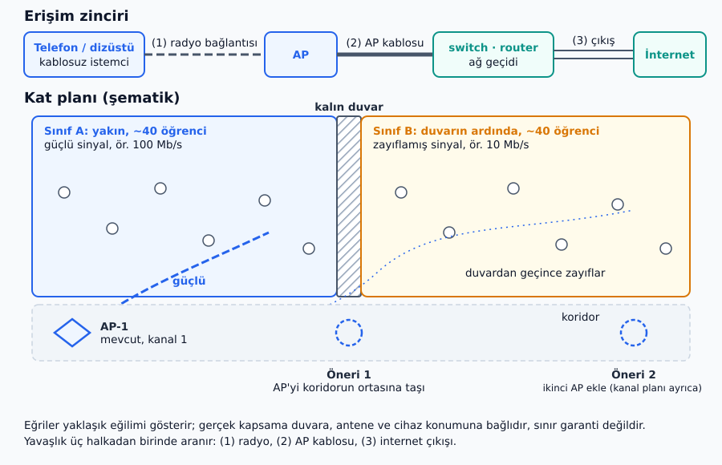
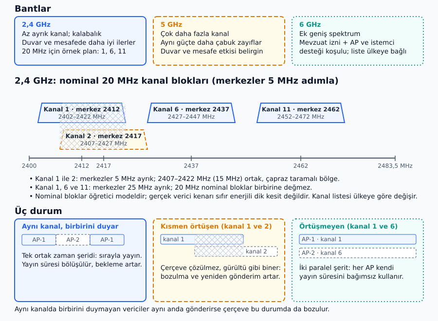
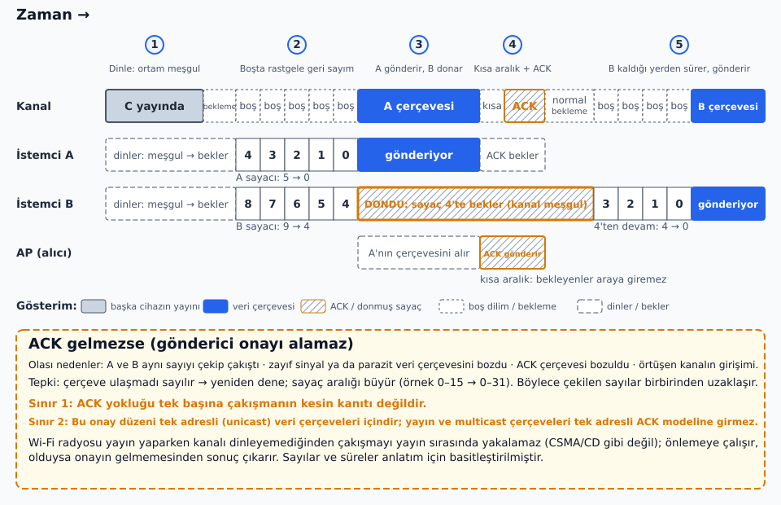

## Aynı abonelik, farklı deneyim

Üniversite katında herkes aynı internet hattını kullanıyor. Koridordaki öğrenci video izliyor; sınıfın köşesindeki öğrenci bir dosyayı indirirken zorlanıyor.

**Fark, zincirin hangi halkasında oluşuyor?**

**WLAN** (kablosuz yerel ağ), cihazların yerel ağa kablo yerine radyo bağlantısıyla katıldığı ağdır. **AP** (erişim noktası), bu radyo bağlantısını kablolu dağıtım ağına (switch ve router) bağlayan cihazdır.

. . .

(2) ve (3) numaralı halkalar 10. haftada izlediğimiz kablolu yoldur: switch, varsayılan ağ geçidi, internet. Bu halkalar bütün kullanıcılar için aynıdır. Kullanıcıdan kullanıcıya en çok değişen halka (1) numaralı radyo bağlantısıdır.

::: {.notes}
İnternet aboneliği, verinin kat ettiği zincirin yalnız bir halkasıdır. Aynı abonelikte iki kişinin farklı deneyim yaşaması, farkın zincirin kullanıcıya göre değişen yerinde aranması gerektiğini gösterir. Bu zincirde kullanıcıya göre değişen yer, telefonla AP arasındaki radyo bağlantısıdır: kişinin oturduğu yer, arada duvar olup olmadığı, yakındaki başka vericiler ve aynı anda yayın yapmak isteyen diğer cihazlar burada belirleyici olur.

(2) numaralı halka, yani AP'nin switch'e kablosu, o AP'ye bağlı herkesin ortak yoludur ama kablolu bir bağlantıdır; Ethernet'ten tanıdığımız gibi davranır. Asıl fark, ortamın kablo yerine hava olduğu ve herkesin aynı ortamı kullandığı (1) numaralı halkadadır.
:::

---

## Kablolu bağlantıda yol ayrı, radyoda ortam ortak

| | Switch portu (kablolu) | Aynı kanaldaki Wi-Fi |
| --- | --- | --- |
| İletim yolu | Her port için ayrı bağlantı | Kanaldaki herkes için tek ortam |
| Aynı anda yayın | İki yönde, her portta bağımsız | Birbirini duyan cihazlar arasında tek yayın |
| Konumun etkisi | Kablo sağlamsa yok | Uzaklık, duvar, parazit sinyali değiştirir |

**Yayın süresi (airtime):** Bir cihazın kanalı kullanarak yayın yaptığı süre.

**Soru:** AP 600 Mb/s destekliyorsa ve 20 kişi bağlıysa herkes neden ne 600 Mb/s ne de eşit pay olan 30 Mb/s alır? İpucu: paylaşılan şey bant genişliği olarak sezilen bir sayıdan önce, kanalı kullanma süresidir.

. . .

600 Mb/s, belirli bir bağlantı koşulunda tek bir cihazın ulaşabildiği üst hızdır; kanal ise sırayla kullanılır. Bu yüzden 600'ü 20'ye bölmek de, her istemciye 600 Mb/s vermek de doğru değildir. Cihazların hızları farklıysa aynı miktarda veri için tuttukları yayın süreleri de farklıdır; paylaşılan şey bu süredir.

::: {.notes}
Switch'te her cihazın kendi portu ve kendi kablosu vardır; bir cihazın göndermesi diğerinin göndermesini beklemeye zorlamaz. Radyoda ise AP ve istemciler, aynı kanalda aynı ortamı kullanır. Bir istemci yayın yaparken kanalı duyan diğerleri sessiz kalmak zorundadır. Bu yüzden paylaşılan şey burada bant genişliği olarak sezilen bir sayıdan önce, yayın süresidir.

Yeni nesil Wi-Fi'de aynı anda birden fazla istemciye hizmet veren teknikler vardır; bunlar paylaşımı ortadan kaldırmaz, yalnız ortamın kullanım biçimini değiştirir. Paylaşım hesabı bu temel modele göredir.

Switch'te her portun kablosu o portun kendisine aittir; radyoda ise kimin ne kadar yayın yapacağı kanalı duyan herkesi ilgilendirir.
:::

---

## Bantlar: kapsama, kanal sayısı, kalabalık

**Bant:** Kablosuz iletim için ayrılmış frekans aralığı (1 GHz = 1000 MHz). Aynı verici gücünde frekans yükseldikçe sinyal mesafe ve duvarla daha çabuk zayıflar; bu yüzden düşük frekanslı bant daha uzağa ulaşır, ama daha dardır ve daha kalabalıktır.

**Kanal:** Bir bandın içinde merkez frekansı ve genişliği olan dilim. 20 MHz genişlikli kanal, merkezinin 10 MHz altından 10 MHz üstüne kadar uzanan frekans aralığını kaplar.

| Bant | Kanal olanağı | Duvar ve mesafe | Dikkat edilecek |
| --- | --- | --- | --- |
| 2,4 GHz | Az ayrık kanal; 20 MHz genişlikli kanallarla yaygın planlama örneği: 1, 6 ve 11 | Sinyal daha iyi ilerler | Çok cihaz kullanır; kalabalıktır |
| 5 GHz | Çok daha fazla kanal | Aynı güçte daha çabuk zayıflar | Duvar ve mesafe etkisi daha belirgin |
| 6 GHz | Ek geniş spektrum | 5 GHz'e benzer şekilde çabuk zayıflar | Kullanım, bölgenin mevzuatına ve AP ile istemcinin desteğine bağlı |

Kapsama, kapasite ve girişim aynı anda iyileştirilemez; her bant bu dengede farklı bir yerde durur. Kanal listesi ve kullanım koşulları ülkeye göre değişir; tablo genel eğilimi verir.

::: {.notes}
Bant, kablosuz iletim için ayrılmış frekans aralığıdır. Aynı verici gücünde frekans yükseldikçe sinyal mesafe ve duvarla daha çabuk zayıflar; 2,4 GHz'in menzil avantajı bundan gelir. Karşılığında bu bant dardır ve herkes buradadır. 5 GHz'de daha çok kanal vardır ama kapsama küçülür. Bu bir değiş tokuştur: kapsama, kapasite ve girişim aynı anda iyileştirilemez.

6 GHz'te kanal alanı ek olarak vardır, ancak bunu kullanmak için bölgenin mevzuatının izin vermesi, AP'nin ve istemcinin 6 GHz'i desteklemesi gerekir. Kanal listesi ülkeye göre değişir.

Kat planında bir AP'nin kapsama alanını daire gibi çizmek öğretici bir şemadır ama gerçeği yansıtmaz. Duvarlar, antenin yönü ve cihazın yeri sinyali biçimlendirir; kapsama sınırı garantili bir çizgi değildir.
:::

---

## Kanal: bant içinde bir dilim

**Kanal:** Bir bant içinde merkez frekansı ve genişliği olan dilim.

Kanal numaraları merkez frekansı 5 MHz adımla ilerler (kanal 1 için 2412 MHz, kanal 2 için 2417 MHz); oysa her kanalın nominal bloğu 20 MHz genişliğindedir. Merkezleri 20 MHz'den az ayrık iki kanalın blokları üst üste biner.

- Blok sınırları merkez − 10 MHz ile merkez + 10 MHz'dir. Kanal 1: 2412 ± 10 → 2402–2422 MHz. Kanal 2: 2417 ± 10 → 2407–2427 MHz. Kanal 6: 2437 ± 10 → 2427–2447 MHz.
- Kanal 1 ile 2: ortak bölge 2407–2422 MHz = 15 MHz (merkezler yalnız 5 MHz ayrık).
- Kanal 1 ile 6 (ve 6 ile 11): kanal 1 en fazla 2422 MHz'e, kanal 6 en az 2427 MHz'den başlar; aradaki 5 MHz boşluk nedeniyle nominal örtüşme yoktur (merkezler 25 MHz ayrık, genişlik 20 MHz).
- Nominal 20 MHz blok öğretici bir modeldir; gerçek verici sinyalinin kenarı sıfır enerjili dik bir sınır değildir. Kanal listesi ülkeye göre değişir; 1/6/11, 2,4 GHz'de 20 MHz kanallarla yapılan planlamanın yaygın örneğidir.

::: {.notes}
Kanal numaraları 5 MHz aralıkla ilerler, oysa her kanalın nominal bloğu 20 MHz'dir. Bu yüzden komşu numaralar büyük ölçüde aynı frekansı paylaşır. 1, 6 ve 11'in öne çıkması bir ezber kuralı olarak değil, bu aritmetiğin sonucu olarak okunmalı: merkezleri 25 MHz ayrık olan kanallar 20 MHz'lik genişliklerle birbirine değmez. Bölgenizin izin verdiği kanal listesi ülkeye göre değişir; 1/6/11, 2,4 GHz'de 20 MHz kanallarla yapılan planlamanın yaygın örneğidir.

Kanal genişliği arttıkça tablo daralır. 40 MHz'lik kanallar bir cihaza daha çok kapasite verebilir; ama yaklaşık 80 MHz'lik 2,4 GHz bandına en fazla iki tane sığar. Geniş kanal kendi başına kazanç değildir; komşu ağlarla birlikte planlanacak ayrık kanal sayısını azaltır.
:::

---

## Aynı kanal ile örtüşen kanal: iki ayrı durum

| Durum | Komşunun çerçeveleri | Sonuç |
| --- | --- | --- |
| Aynı kanal, birbirini duyuyorlar (ör. iki AP de kanal 1) | Çerçeveler çözülür; ortam meşgul sayılır | Yayın süresi bölüşülür; bekleme artar |
| Aynı kanal, birbirini duymuyorlar | Ortamın meşgul olduğunu fark etmezler | Aynı anda gönderirlerse alıcıda çerçeve bozulur |
| Kısmen örtüşen kanal (ör. kanal 1 ve 2) | Çoğu zaman çözülemez; gürültü gibi duyulur | Bozulma ve yeniden gönderim artar |
| Birbirini örtmeyen kanal (ör. kanal 1 ve 6) | Nominal bloklar değmez; birbirinin çerçevesini çözüp yayın süresini bölüşmezler. Güçlü ve yakın bir vericinin artık enerjisi gürültü olabilir | Her AP kendi yayın süresini büyük ölçüde bağımsız kullanır |

Kısmen örtüşen kanalda komşunun enerjisinin yalnız bir parçası kendi bandınıza düşer. Bu enerji çözülebilir bir çerçeve olarak tanınmaz; kendi çerçevelerinizin üstüne binen gürültü gibi davranır. Ortamı dinleyen cihaz komşuyu güvenilir biçimde duymadığı için tam zamanında beklemeyebilir; alıcı bozuk çerçeve alır, gönderici çerçevenin ulaşmadığını anlayıp yeniden dener. Bu yüzden iki komşu AP'yi 1 ve 2 numaralı kanallara koymak çoğu zaman ikisini de 1'e koymaktan daha kötü sonuç verir: aynı kanalda birbirini duyanlarda sorun bekleme, örtüşen kanalda bozulmadır.

::: {.notes}
Aynı kanalda iki AP birbirini duyuyorsa cihazlar birbirinin çerçevelerini tanır. Birisi yayın yaparken diğerleri bunu duyup bekler. Kayıp, yayın süresinin bölüşülmesidir. Birbirini duymayan vericiler aynı anda gönderirse çerçeve bu kanalda da bozulur.

Kısmen örtüşen kanalda komşunun çerçevelerinin yalnız bir parçası kendi bandınıza düşer. Bu enerji çözülebilir bir çerçeve olarak anlaşılmaz; çoğu zaman kendi çerçevelerinizin üstüne binen gürültü gibi davranır. Alıcı bozuk çerçeve alır, onay gelmez, gönderici yeniden dener. Üstelik koordinasyon mekanizması bu komşuyu güvenilir biçimde duymadığı için tam zamanında beklemeyebilir.

Bu fark karar verirken işe yarar: iki komşu AP'yi 1 ve 2 numaralı kanallara koymak, çoğu zaman ikisini de 1'e koymaktan daha kötü sonuç verir. Birbirini duyanlarda aynı kanal bir bekleme sorunu, örtüşen kanal bir bozulma sorunudur.
:::

---

## İki istemci aynı boşluğu duyarsa

Kanalda C yayın yapıyor. A ile B de göndermek istiyor ve ikisi de dinliyor.

| An | Kanal | A ne duyar | B ne duyar |
| --- | --- | --- | --- |
| 1 | C yayında | Meşgul, bekler | Meşgul, bekler |
| 2 | C bitti | **Boş** | **Boş** |
| 3 | A ve B hemen gönderirse | Çerçeveler üst üste biner | Alıcı çoğu zaman ikisini de çözemez |

. . .

Çözüm: kanal boşalsa bile **hemen gönderme; rastgele bir sayı çek, o kadar boş zaman say.**

Bu düzenin adı **CSMA/CA**: dinle → boşaldıktan sonra bekle → rastgele sayıyı boş zamanda say → gönder → alıcının kısa yanıtı olan **onay** (ACK) gelmezse yeniden dene.

Eski paylaşımlı Ethernet kablosunda (CSMA/CD) verici yayın yaparken çakışmayı algılayıp yayını keserdi. Tipik bir Wi-Fi radyosu yayın yaparken aynı kanalı dinleyemez; üstelik aynı AP'ye bağlı iki istemci birbirini duymayabilir. Bu yüzden Wi-Fi çakışmayı yayın sırasında yakalamak yerine önlemeye çalışır.

::: {.notes}
Yalnız dinlemek yetmez, çünkü bekleyen herkes boşluğu aynı anda duyar. Sınıfta biri konuşurken iki kişi söz almak için bekliyor olsun; konuşan sustuğu anda ikisi birden başlarsa kimse anlaşılmaz. Gündelik hayatta bunu göz teması ve kibarlık çözer. Radyo cihazlarında bunun karşılığı, herkesin ayrı bir rastgele sayıyla beklemesidir.

Bu kurala CSMA/CA denir: ortamı dinle (carrier sense), birden çok cihaz erişsin (multiple access), çakışmadan kaçın (collision avoidance). Dört parçası var: kanalı dinle; boşaldıktan sonra kısa bir süre daha bekle; rastgele bir geri sayım sayacı çek ve boş zamanda say; sayaç sıfırlanınca gönder, sonra onay bekle.
:::

---

## Geri sayım: dur, devam et

A sayacı **5**, B sayacı **9** çekti. Her sayı bir boş zaman dilimini temsil eder (anlatım için basit değerler).

| Olay | A | B |
| --- | --- | --- |
| C'nin yayını bitti, kısa bekleme geçti; sayım başlar | 5 | 9 |
| 5 dilim boş geçti | 0 → **gönderir** | 4 |
| A yayında, kanal meşgul | yayında | 4 (**donmuş**) |
| A'nın çerçevesi ve onayı bitti, kanal yine boş | | 4'ten **devam** |
| 4 dilim daha | | 0 → **gönderir** |

::: {.notes}
Küçük sayıyı çeken önce gönderir. Büyük sayıyı çeken bekler ama sıfırdan başlamaz: sayaç kanal meşgulken donar, kanal yeniden boşalınca kaldığı yerden devam eder. B'nin 9 dilimi A'nın 5 diliminden sonra 4'e inmiştir; B bu 4'ü saklar. Bu, bekleyen cihazın her turda şansını yeniden sıfırlamaması için yapılan bir adalettir.

Rastgeleliğin işlevi burada görünüyor: iki istemci aynı anda boşluğu duyar ama farklı sayı çektikleri için farklı anlarda gönderir. Bu çakışmayı sıfıra indirmez. İkisi de 5 çekerse sayaçları aynı anda sıfırlanır, ikisi birden gönderir ve çerçeveler bozulabilir. Gönderici çakışmayı doğrudan göremez; onay gelmeyince çerçevenin ulaşmadığını anlar. Onayın gelmemesinin nedeni çakışma olabilir, ama zayıf sinyal ya da parazit de veri çerçevesini veya onayı bozabilir. Yalnız onay yokluğundan çakışma sonucu çıkmaz.

Gerçek cihazlarda sayaç, küçük bir sayı aralığından çekilir (başlangıçta örneğin 0–15 gibi) ve boş zaman dilimleri mikrosaniyeler mertebesindedir. Sayıları öğretici olsun diye küçük tuttuk.
:::

---

## Onay ve yeniden deneme

1. Alıcı tek adresli (unicast) veri çerçevesini sağlam aldıysa, normal gönderim öncesi beklemeden **daha kısa** bir aradan sonra **onay (ACK)** gönderir. Bekleyen istemcilerin bekleme süresi daha uzun olduğundan onay araya girilmeden ulaşır.
2. Gönderici onayı almazsa çerçeve ulaşmadı sayılır; **yeniden dener**.
3. Her başarısız denemeden sonra sayacın çekildiği aralık bir üst sınıra kadar büyür (örneğin 0–15, sonra 0–31).

Onay yokluğunun nedeni çakışma, zayıf sinyal, parazit ya da örtüşen kanalın girişimi olabilir; tek başına çakışmanın kesin kanıtı değildir. Örnek bir neden: A ve B aynı sayıyı çekerse ikisi de 0'a aynı anda iner, alıcıda güçleri birbirine yakınsa çerçeveler çoğu zaman bozulur ve ikisi de onay alamaz; biri belirgin güçlüyse yalnız o çözülebilir. Onay alamayan gönderici daha geniş aralıktan yeni sayı çeker.

Bu onay ve yeniden deneme düzeni tek adresli veri çerçeveleri içindir. Yayın (broadcast) ve çoklu gönderim (multicast) çerçevelerinde tek bir alıcı onay vermez; bu çerçeveler normal tek adresli onay modeline girmez.

::: {.notes}
Ethernet'in eski paylaşımlı kablosunda verici yayın yaparken çakışmayı da algılardı (CSMA/CD); çakışma olduğunda yayını keserdi. Tipik bir Wi-Fi radyosu yayın yaparken aynı kanalı dinleyemez ve ortamda birbirini duymayan istemciler de olabilir: aynı AP'ye bağlı iki istemci birbirini duymuyorsa ikisi de kanalı boş görüp gönderir ve çakışma AP'de oluşur. Bu yüzden Wi-Fi çakışmayı yayın sırasında yakalamaya çalışmaz; çakışmayı önlemeye çalışır, olduysa onayın gelmemesinden anlar.

Onayın araya girmeden gelmesi için ACK, dinleme sonrası bekleme süresinden daha kısa bir aradan sonra gönderilir. Böylece bekleyen istemciler o kısa boşlukta gönderemez; onay araya girmeden yerine ulaşır.

Aralığın büyütülmesi bir iyileştirmedir: kanal çok kalabalıksa çakışma ihtimali yüksektir; aralığı genişletmek çekilen sayıların birbirinden uzaklaşmasını sağlar. Yeniden gönderimler yayın süresi harcar; bu, kalabalık veya paraziti olan bir kanalda hız düşüşünün bir nedenidir.
:::

---

## AP hızı ile gerçek pay: bir yayın süresi hesabı

**Yayın süresi = veri miktarı / bağlantı hızı.** Aynı veri için hız düşünce süre uzar. Kanal sırayla kullanıldığından, yavaş istemci yayın yaparken diğeri bekler; bir tur, iki sürenin toplamıdır.

Model: iki istemci 1 MB veri gönderiyor (1 bayt = 8 bit, yani 1 MB = 8 Mbit); sırayla yayın yapıyorlar. Ek yük, bekleme ve yeniden gönderim yok.

| | Bağlantı hızı | 1 MB için yayın süresi |
| --- | ---: | ---: |
| Yakındaki istemci | 100 Mb/s | 8 / 100 = 0,08 s |
| Zayıf sinyalli istemci | 10 Mb/s | 8 / 10 = 0,8 s |

Bir tur: 0,08 + 0,8 = **0,88 s**. Sırayla yayın yaptıkları için her istemci bir turda 8 Mbit taşır; istemci başına etkin hız = turda taşınan veri / toplam tur süresi = 8 / 0,88 ≈ **9,1 Mb/s**.

Karşılaştırma: iki istemci de 100 Mb/s olsaydı tur 0,08 + 0,08 = 0,16 s sürerdi; her biri 8 / 0,16 = **50 Mb/s** alırdı. Zayıf istemci, yakındaki istemcinin payını da düşürür.

**Sıra sizde:** Aynı modelde zayıf istemci AP'ye yaklaşıp bağlantı hızını 10 Mb/s yerine **40 Mb/s**'ye çıkardı; yakın istemci 100 Mb/s'de kaldı. (1) Her istemcinin 8 Mbit gönderdiği bir tur kaç saniye sürer? (2) Her istemci bu turda yaklaşık kaç Mb/s alır?

::: {.notes}
Sorumuza dönelim: AP 600 Mb/s destekliyorsa 20 kişi 30'ar Mb/s mi alır? Hayır; çünkü 600 Mb/s, belirli bir bağlantı koşulunda bir cihazın kullanabildiği en yüksek hızdır. Her istemci farklı hızla yayın yapar ve kanal sırayla kullanılır. Hızlar eşit ve ek yük yok olsaydı pay, istemci sayısına bölünerek yaklaşık hesaplanabilirdi; hız farkları bu hesabı bozar, yukarıdaki karşılaştırma bunu gösterir.

Yukarıdaki hesapta yakındaki istemci 100 Mb/s hızla bağlı olduğu hâlde turda ancak yaklaşık 9,1 Mb/s alıyor. Neden? Çünkü zayıf sinyalli istemcinin aynı miktarda veri için tuttuğu yayın süresi 10 kat uzun ve diğer istemci bu süre boyunca bekliyor. Hız farkı, süre farkına dönüşüyor ve paylaşılan şey süre. Bu bir model: gerçek ağlarda başlık, onay, bekleme ve yeniden gönderim ek süre getirir; sayıları ölçüm olarak okumayın, ilişkiyi gösteren bir hesap olarak okuyun.

Bu yüzden eski bir cihazın veya uzak köşedeki bir istemcinin yavaş bağlanması yalnız kendi hızını düşürmez; aynı kanaldaki herkesin payını azaltır.
:::

---

## Sinyal güçlü olduğu hâlde bağlantı neden yavaş?

| Etken | Yayın süresine etkisi |
| --- | --- |
| Zayıf sinyal | Düşük bağlantı hızı; aynı veri için uzun yayın |
| Parazit, başka vericiler | Bozuk çerçeve, yeniden gönderim, ek yayın |
| Aynı kanaldaki komşu AP | Yayın süresi komşuyla bölüşülür |
| Çok istemci | Yalnız bağlı olmaları değil, ne kadar trafik ürettikleri önemlidir |

Cihazdaki sinyal göstergesi yalnız alınan sinyalin gücünü gösterir; kanalın ne kadar meşgul olduğunu, yani yayın süresinin kaç cihazla bölüşüldüğünü göstermez. AP'nin yanındaki tam çubuklu bir cihaz da kanalı komşu bir AP ve yirmi istemciyle paylaşıyorsa yavaş kalır.

**Paylaşılan kaynak yayın süresidir.** Aynı veriyi taşımak için daha uzun süre kullanan cihaz, diğerlerinin süresini azaltır.

::: {.notes}
Cihazdaki sinyal göstergesi yalnız alınan sinyalin gücünü gösterir; kanalın ne kadar meşgul olduğunu göstermez. AP'nin yanında oturan biri tam çubukla bağlı olabilir ama kanalı komşu AP ve yirmi istemciyle paylaşıyorsa yavaş kalır.

Dört etken tek bir yerde birleşiyor: yayın süresi. İstemci sayısı da bu yüzden tek başına açıklayıcı değildir; sessiz yirmi istemci bir kanalı çok az kullanır, üç istemcinin büyük dosya indirmesi çok kullanır.
:::

---

## Kat planında karar: iki kalabalık sınıf

**Senaryo verisi.** Tek AP koridorun bir ucunda, 2,4 GHz bandında kanal 1'de (20 MHz) çalışıyor. Sınıf A'da (yakın, 40 öğrenci) ortalama bağlantı hızı 100 Mb/s, Sınıf B'de (kalın duvarın ardında, 40 öğrenci) 10 Mb/s. AP'nin switch portunda ve kurumun 1 Gb/s internet çıkışında kullanım oranı %15.

Üç öneri:

1. AP'yi koridorun ortasına taşıyalım.
2. İkinci bir AP ekleyip kanalları planlayalım.
3. İnternet aboneliğinin hızını artıralım.

**Sorular.**

1. Darboğaz zincirin hangi halkasındadır (radyo, AP kablosu, internet çıkışı)? Hangi veri üçüncü öneriyi eler?
2. Birinci ve ikinci öneri, yayın süresinin paylaşımı açısından nasıl farklı sonuç verir?
3. İkinci öneri seçilirse ve iki AP birbirini duyuyorsa, ikisini kanal 1'e koymak, kanal 1 ve 2'ye koymak ve kanal 1 ve 6'ya koymak arasındaki farkı gerekçelendirin.

::: {.notes}
Önerileri sorun üzerinden karşılaştıralım; hangisinin doğru olduğu, sorunun hangi halkada olduğuna bağlı.

Her öneri zincirin farklı bir halkasını hedefler; önce senaryo verisinin hangi halkayı gösterdiğine bakın. Gerekçelerinizde yayın süresi ilişkisini (süre = veri / hız) ve iki AP'nin birbirini duyup duymadığını kullanın. "Kanal 1, 6, 11 kullanın" cümlesi tek başına bir gerekçe değildir.

Gerçek bir karar için şu gözlemler toplanır: B sınıfındaki sinyal seviyesi, kanaldaki yeniden gönderim ve doluluk, AP'ye kablolu bağlanan bir cihazdan alınan hız ve internet çıkışının kullanımı. Her gözlemin hangi halkayı ayırdığını kendiniz yazın.
:::

---

## Özet: kablosuz yavaşlığını okumak

- Radyo ortamı kanal içinde ortaktır; paylaşılan şey **yayın süresidir**.
- **Aynı kanalda** birbirini duyanlar bekler; **örtüşen kanal** bozulma yaratır.
- CSMA/CA: dinle → rastgele geri say (dur/devam) → gönder → tek adresli veri çerçevesinde onay yoksa yeniden dene (yayın ve çoklu gönderim bu onay modeline girmez).
- Sorunu ayırmak için önce halkayı bul: radyo, AP kablosu, internet çıkışı.
- Aynı kanalda çerçeveyi alabilecek bir alıcı bulunabildiğine göre, bir cihaz ağa nasıl kabul edilir ve havadaki çerçeveler nasıl korunur? Bu soru bağlantı sürecine ve güvenliğe açılır.

::: {.notes}
Bu dört cümle, kat planındaki karar sorusunun araç kutusudur. Radyo bağlantısında sorun varsa çözüm yerleşim ve kanal planıdır. AP kablosu yavaşsa sorun o bağlantıdadır. İnternet çıkışı doluysa abonelik işe yarar. Hangi halkanın darboğaz olduğunu ölçmeden öneri sıralamak tahmine dayanır.
:::

