## Üniversite diploması nasıl alınır?

```text
Lise → Sınav → Tercih ve kayıt → Dersler ve koşullar → Mezuniyet
```

- Bir adım tamamlanmadan sonrakine geçilebilir mi?
- Herkes bütün adımları aynı biçimde mi gerçekleştirir?
- Liseyi yurt dışında bitiren biri bu sürece katılabilir mi?

::: {.notes}
Diplomaya ulaşmak tek bir işlem değildir. Kayıt, ders seçimi ve mezuniyet farklı işlerdir; sonraki iş, öncekinin sağladığı sonuca dayanır. Ancak bu sonuca ulaşan yol herkes için aynı olmayabilir. Önceki eğitimi kabul edilmiş bir kişinin farklı bir eğitim geçmişinden gelmesi, sonraki işlemlere katılmasına engel olmayabilir. Sonraki aşama için gerekli koşul, farklı eğitim yollarıyla sağlanabilir.

Ağ iletişiminde de mesaj üretme, doğru alıcıya taşıma ve sinyalle aktarma ayrı sorumluluklardır. Bu görevlerin birbirine dayanması, her görevin bütün diğer işlerin ayrıntılarını yürütmesini gerektirmez.
:::

---

## Bir video göndermek hangi işleri gerektirir?

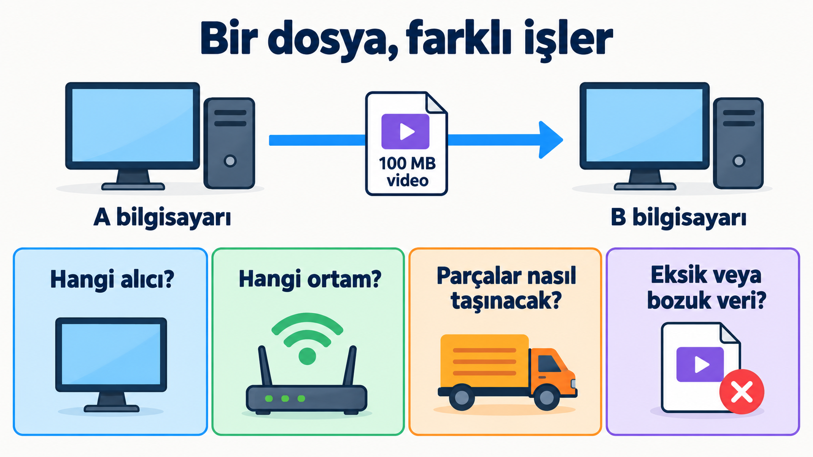{height="620" fig-align="center" fig-alt="100 MB video dosyası aktarımında alıcı, ortam, parçalama ve veri bütünlüğü soruları"}

::: {.notes}
Kullanıcının gönderme isteği tek bir işlemdir, fakat ağ açısından birden fazla iş doğurur. Aynı ağda başka bilgisayarlar varsa alıcı ayırt edilmelidir. Dosyanın bitleri ortamın taşıyabileceği sinyallerle temsil edilmelidir. Dosya, kullanılan aktarım birimlerinden büyük olduğunda parçalara ayrılır; bu da alıcının bütünü yeniden kurmasını gerektirir.

Burada kaydedilmiş bir video dosyasının aktarımını düşünüyoruz. Dosyayı aktarırken sıralama, eksiklik ve bütünlük ayrı sorulardır. Büyük dosyanın bütününü tek bir Ethernet frame'i gibi düşünemeyiz.
:::

---

## Parçalara ayırdık; nasıl birleştireceğiz?

```text
Dosyanın sırası:       P1 | P2 | P3 | P4
Alıcıya geliş sırası:  P1 | P3 | P2 | P4
```

Parçaların bütün içindeki yerini belirleyen bilgi gerekir.

::: {.notes}
Alıcı yalnız geliş sırasını kullanırsa içeriği yanlış birleştirir. Sıra bilgisi, üçüncü konuma ait parçayı ikinci gelmiş olsa da uygun yere yerleştirmeye yardımcı olur. P1–P4, bu şemada parçaların bütün içindeki konumlarını gösteren etiketlerdir.

Parçalama bir çözüm sağlarken yeni bir yönetim ihtiyacı doğurur. Veriyi bölmekle birlikte, parçaları tanımlayan ve birleştirmeyi mümkün kılan bilgiler de gereklidir.
:::

---

## Sıra, eksiklik ve bozulma aynı sorun mu?

:::: {.columns}

::: {.column width="70%"}
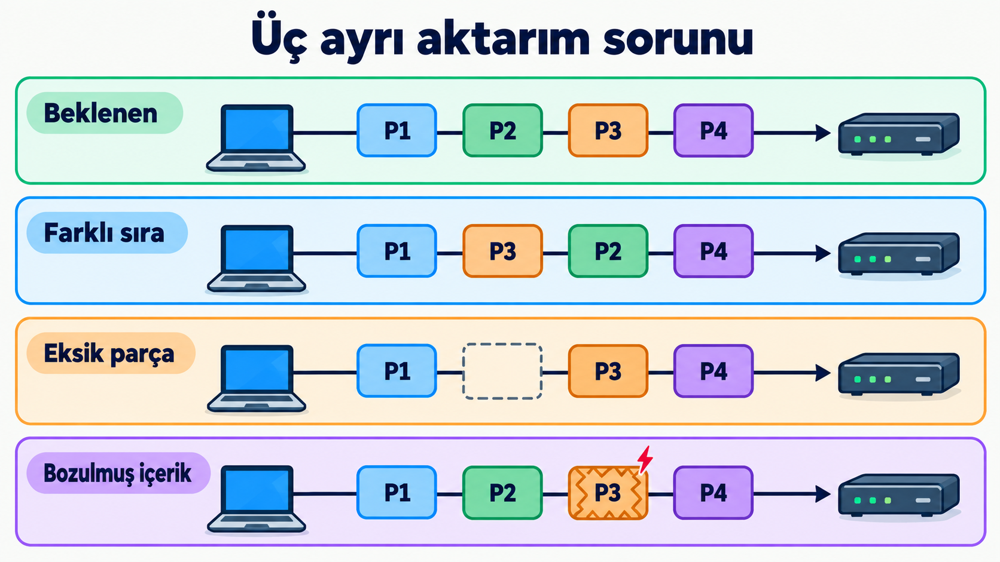{height="620" fig-align="center" fig-alt="Beklenen parça sırasıyla farklı sıra, eksik P2 ve bozulmuş P3 durumlarının karşılaştırılması"}
:::

::: {.column style="width: 28%; font-size: 0.72em;"}
| Sorun | Gereken iş |
|---|---|
| Farklı sıra | Bütün içindeki konumu belirleme |
| Eksik veri | Eksikliği saptama ve tamamlama |
| Bozulmuş veri | Hata denetimi |
:::

::::

::: {.notes}
Sıra bilgisi, P2'nin içeriğini kendiliğinden oluşturmaz. Alıcı eksikliği belirleyebilmek için beklenen veri hakkında bilgiye ihtiyaç duyar. Kullanılan iletişim hizmeti, geri bildirim ve yeniden gönderim gibi işlemlerle eksik veriyi tamamlayabilir; bu davranışı protokol kuralları belirler.

Bütün parçaların bulunması da içeriğin bozulmadığını tek başına kanıtlamaz. Ethernet frame'indeki hata denetim alanı, bozulmayı algılamaya yardımcı olan bilgiye örnektir. Hatanın saptanması ve kaybın giderilmesi ayrı işlemlerdir.
:::

---

## Gönderici alıcıdan hızlıysa?

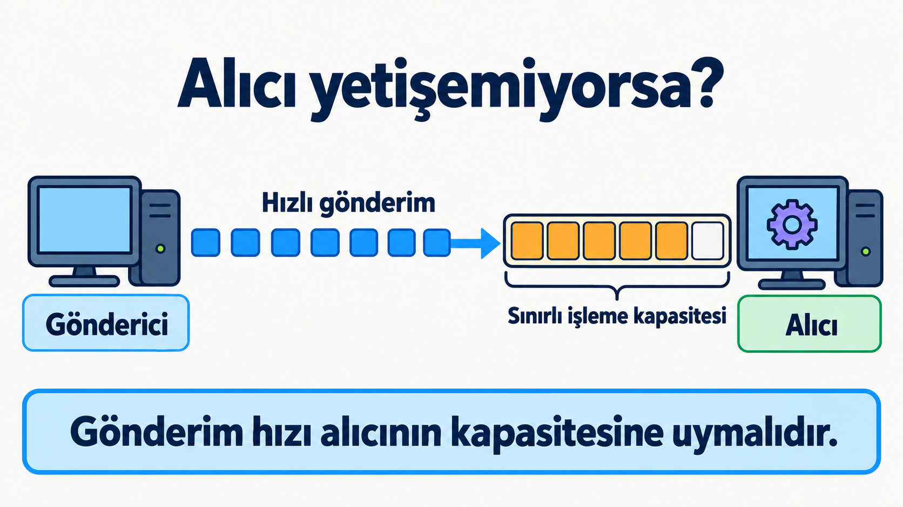{height="560" fig-align="center" fig-alt="Hızlı göndericiden gelen verinin alıcının sınırlı işleme kapasitesi önünde birikmesi"}

Alıcının kapasitesine göre gönderimi düzenlemek, kayıp veriyi tamamlamaktan farklı bir iştir.

::: {.notes}
Alıcı gelen veriyi yeterince hızlı işleyemiyorsa gönderimin düzenlenmesi gerekebilir. Bu soruda amaç, alıcıyı işleyebileceğinden fazla veriyle karşı karşıya bırakmamaktır. Eksik bir parçanın yeniden gönderilmesi ise oluşmuş bir eksikliği gidermeye yöneliktir.

Tek bir dosya aktarımında birden fazla kontrol ihtiyacının ortaya çıkması, bu ihtiyaçları birbirinden ayırarak tasarlamanın gerekçesidir.
:::

---

## Bir yöntemi değiştirmek bütün sistemi değiştirmeli mi?

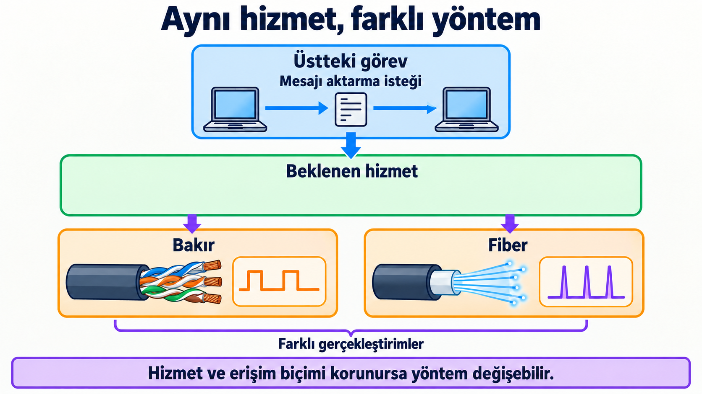{height="620" fig-align="center" fig-alt="Üst görevin kullandığı hizmet korunurken bakır ve fiber gerçekleştirimlerinin değişebilmesi"}

::: {.notes}
Uygulama kablonun elektriksel ayrıntılarını kendisi yönetirse, fiber bağlantıya geçiş uygulamayı da etkileyebilir. Sorumluluk ayrıldığında ilgili alt bileşenler bitlerin fiziksel temsilini yönetir; uygulama beklediği aktarım hizmetini kullanır.

Katmanlı mimari, her katmanın belirli sorumluluklar üstlenmesi ve üsttekine hizmet sunmasıyla bu ayrımı kurar. Bağımsızlık koşulludur: hizmetin özellikleri veya erişim biçimi değişirse üstteki iş de etkilenebilir. Diploma örneğinde de sonraki aşama, önceki bütün ayrıntılardan çok gerekli sonuca dayanıyordu.
:::

---

## İki uçta kim kiminle konuşur?

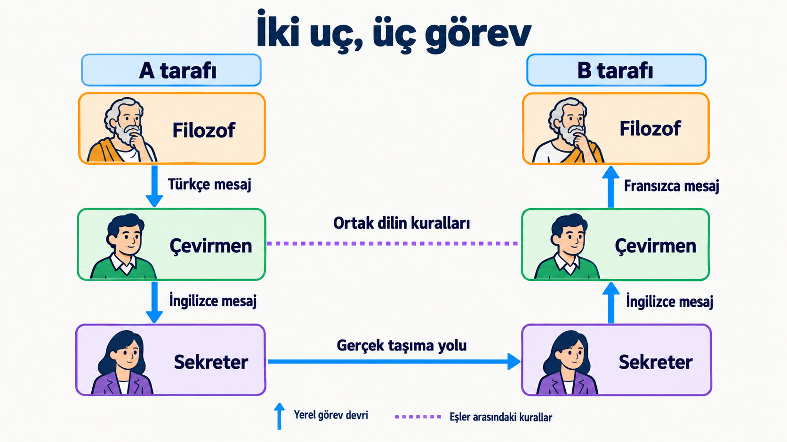{height="620" fig-align="center" fig-alt="İki uçta filozof, çevirmen ve sekreter rolleri; yerel görev devri, ortak dilin kuralları ve gerçek taşıma yolu"}

::: {.notes}
A'daki filozof mesajını yerel çevirmene verir. Çevirmen ortak dile dönüştürür; sekreter mesajı taşır. B tarafında sekreterden çevirmene, oradan filozofa ilerleyen işlem mesajı alıcının diline ulaştırır.

Dikey oklar yerel görev devridir. Noktalı çizgi iki çevirmenin uyduğu ortak kuralları gösterir; ayrı bir fiziksel yol değildir. Çevirmenler ortak dili birlikte değiştirip filozoflara sağladıkları hizmeti koruyabilir. Yalnız birinin dili değiştirmesi ise iletişimi bozar. Üç rol üç OSI katmanı değildir; her ağ katmanı içerik çevirmez.
:::

---

## Hizmet, arayüz ve protokol

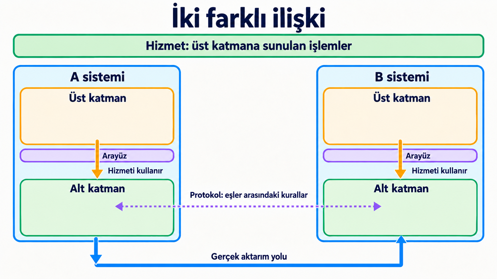{height="620" fig-align="center" fig-alt="Aynı sistemde arayüz üzerinden hizmet kullanımı ve farklı sistemlerin eş katmanları arasında protokol ilişkisi"}

::: {.notes}
Filozof kendi çevirmeninin hizmetini kullanır; iki çevirmen ise ortak dilin kurallarına uyar. Ağda da komşu katmanlar arasında hizmet kullanımıyla karşı uçtaki eşle protokol ilişkisi birlikte bulunur. Arayüz, aynı sistemde katmanın sunduğu hizmetin nasıl kullanılacağını belirler.

Gerçek aktarım yerelde aşağıya, fiziksel ortam üzerinden karşı tarafa ve orada yukarıya ilerler. Eş katmanların mantıksal iletişimi, verinin alt katmanları atladığı anlamına gelmez.
:::

---

## OSI neyi modeller?

OSI, iletişim sorumluluklarını yedi katmanda açıklayan bir referans modelidir.

- Model, görevleri ayırır.
- Protokol, mesaj biçimini ve alışveriş kurallarını belirler.
- Gerçek başlıkları kullanılan protokoller belirler.

::: {.notes}
Video örneğinde bulduğumuz işleri ortak bir çerçevede adlandırmak, farklı protokol ve cihazların görevlerini karşılaştırmayı sağlar. OSI böyle bir çerçevedir; tek başına çalıştırılan bir protokol değildir.

Bir aktarımı OSI ile açıklamak, yedi katmanın her birinde ayrı başlık bulunmasını veya her katmanın ayrı bir donanım kutusunda gerçekleştirilmesini gerektirmez. Modelin sorumluluklarıyla gerçek gerçekleştirim ayrıdır.

Yedi katmanı uygulamadan fiziksel katmana doğru, her biri kendi slaydında ele alıyoruz. Göndericinin işlemlerini bu sırayla izlemek, üst görevlerin alt hizmetlerden yararlandığını görünür kılar. Numaralar OSI modeline aittir. Önce her katmanın sorumluluğunu, ardından aynı Merhaba mesajının katman katman nasıl hazırlandığını inceleyeceğiz.
:::

---

## Uygulama: mesajın amacı

**Soru: Ne hakkında, hangi mesajlarla konuşuyoruz?**

```text
Web istemcisi ── kaynak isteği ──> Web sunucusu
Web istemcisi <──── yanıt ─────── Web sunucusu
```

HTTP gibi uygulama protokolleri, iki tarafın kullandığı mesajları düzenler.

```text
[7 Uygulama]  6  5  4  3  2  1
```

::: {.notes}
Uygulama katmanındaki iletişim, kullanıcının yapmak istediği işle bağlantılıdır. Web kaynağının istenmesi ve cevap verilmesi, uygulama protokolünün düzenlediği işlemlere örnektir.

Tarayıcının ekrana çizim yapması veya tıklamayı işlemesi programın başka görevleridir. Uygulama protokolünü programın bütünüyle özdeşleştirmemek gerekir.
:::

---

## Sunum: aynı A, farklı byte'lar

**Soru: Veriyi aynı biçimde yorumluyor muyuz?**

| Karakter | Kodlama | Onaltılık byte gösterimi |
|---|---|---|
| A | UTF-8 | 41 |
| A | UTF-16BE | 00 41 |

Anlam aynı; temsil farklı.

```text
7  [6 Sunum]  5  4  3  2  1
```

::: {.notes}
Kullanıcı A karakterini görür; iletimde belirli bir kodlamanın byte'ları taşınır. UTF-16BE, büyük anlamlı byte'ın önce geldiği kodlama biçimidir. İki tarafın temsil konusunda uyumlu olması, gelen byte'ların doğru yorumlanmasını sağlar.

Sunum sorumluluğu bu anlam ve temsil ilişkisini ele alır. Sıkıştırma ve şifreleme de bu çerçevede tartışılan görevlerdir; gerçek sistemlerde yerleşimleri kullanılan protokollere bağlıdır.
:::

---

## Oturum: etkileşimin düzenlenmesi

**Soru: Süren etkileşim nasıl düzenleniyor?**

- Diyalog ve işlem sırası
- Uzun etkileşimde devam noktalarının izlenmesi

```text
İşlem ilerler → Durum kaydedilir → Kesinti → Uygun noktadan devam
```

```text
7  6  [5 Oturum]  4  3  2  1
```

::: {.notes}
Bir devam noktası, hangi işlemlerin tamamlandığı hakkında bilgi verir. Kesinti sonrası tarafların uygun bir noktadan devam edebilmesi bu bilginin uyumlu tutulmasına dayanır. Bu soru tek bir parçanın kaybolup yeniden gönderilmesinden farklıdır.

OSI'nin bu sorumluluğu ayrı adlandırması her uygulamada bağımsız bir oturum protokolü bulunduğunu göstermez. Gerçek uygulamalar bu görevleri kendi içinde gerçekleştirebilir. Port bilgisi oturumun genel tanımı değildir.
:::

---

## Taşıma: hangi iletişim, hangi teslim hizmeti?

**Soru: Hangi uygulama iletişimine hangi teslim hizmeti?**

```text
Hedef bilgisayar
    ├─ Bir uygulama iletişimi
    └─ Başka bir uygulama iletişimi
```

- Port bilgisi uygulama iletişimlerini ayırt etmeye katılır.
- Teslim hizmeti: sıralı ve güvenilir teslim, alıcı kapasitesine uyma (akış kontrolü).

```text
7  6  5  [4 Taşıma]  3  2  1
```

::: {.notes}
Verinin doğru bilgisayara gelmesi, hangi iletişime teslim edileceğini tek başına belirlemez. Taşıma katmanı uygulama uçları arasındaki iletişime hizmet sunar; port bu ayırt etmede kullanılan bilgilerden biridir. Port, her tarayıcı sekmesine birebir atanan sekme numarası değildir.

Bazı taşıma hizmetleri eksik veriyi tamamlamak ve sıralı teslim sağlamak için işlemler uygular. Alıcının kapasitesine göre gönderimi sınırlamak ayrı bir sorumluluktur. Her taşıma protokolü bütün bu hizmetleri sağlamaz. Güvenilir teslim, şifreleme veya kimlik doğrulama anlamına gelmez; teslim özellikleri ile güvenlik gereksinimleri ayrı değerlendirilir.
:::

---

## Ağ: mantıksal hedef uç

**Soru: Hedef uç sisteme nasıl taşınacak?**

```text
Kaynak uç ───── mantıksal hedef adresi ─────> Hedef uç
```

- IP, mantıksal adres örneğidir.
- Router ağ katmanı bilgisiyle iletim yapar.

```text
7  6  5  4  [3 Ağ]  2  1
```

::: {.notes}
Ağ katmanı verinin kaynak uçtan hedef uca taşınmasını ele alır. Mantıksal adres bu hedefi belirtmeye yardımcı olur; router ağ katmanındaki iletim kararına katılır.

Bu görev Ethernet frame'inin yerel hedef arayüzünü belirtmesinden farklıdır. Aynı iletişimde farklı sorumlulukların bulunması, aynı türden adres bilgisini tekrar etmek anlamına gelmez.
:::

---

## Veri bağlantısı: yerel teslim

**Soru: Bağlantıda hangi arayüze teslim edilecek?**

```text
Ethernet frame'i
Kaynak MAC | Hedef MAC | Taşınan veri | Hata denetimi
```

Switch kaynak MAC'ten öğrenir, hedef MAC'e göre iletir.

```text
7  6  5  4  3  [2 Veri bağlantısı]  1
```

::: {.notes}
Bu çizim alanların gerçek sırası yerine işlevlerini gösterir. Ethernet, taşınan veriyi frame içinde yerel teslim bilgileriyle birleştirir. Önceki haftada switch'in iki MAC alanını farklı amaçlarla kullandığını gördük.

Hata denetimi bozulmayı algılamaya yardımcı olur; bozuk veriyi kendiliğinden düzeltmez. Veri bağlantı katmanındaki bütün protokollerin aynı güvenilirlik hizmetini sağladığı varsayılmaz.
:::

---

## Fiziksel: bitlerin ortamda temsili

**Soru: Bitler hangi sinyallerle aktarılacak?**

```text
Bitler → Elektriksel / optik / radyo sinyalleri → Bitler
```

Temsil ve zamanlama iki tarafta uyumlu olmalıdır.

```text
7  6  5  4  3  2  [1 Fiziksel]
```

::: {.notes}
Bakırda elektriksel, fiberde optik sinyaller kullanılır. Fiziksel katman bitleri ortamın taşıyabileceği sinyallerle temsil eder; karşı uç sinyalleri yorumlar.

Fiziksel aktarım veriyi ilk kez bite dönüştürmek değildir. Bitler verinin gösteriminde zaten bulunur. Buradaki soru onların ortamda nasıl taşınacağıdır.
:::

---

## Yedi katman, yedi sorumluluk sorusu

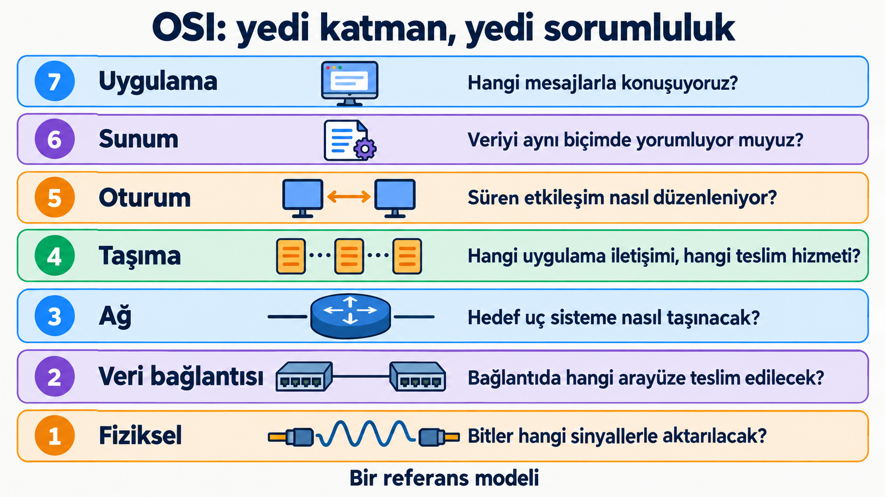{height="620" fig-align="center" fig-alt="OSI katmanlarının uygulamadan fiziksele sırası ve her katmanın cevapladığı sorumluluk sorusu"}

::: {.notes}
Aynı iletişimde mesajın amacı, veri temsili, etkileşim düzeni, uygulama uçları arasındaki teslim, hedef uç sisteme taşıma, yerel arayüze teslim ve fiziksel sinyal aktarımı birlikte bulunur. Katman adları, hangi sorumluluğa baktığımızı ayırt etmeyi sağlar.

Bu sorumlulukların ayrı adlandırılması, her birinin ayrı bir donanımda veya bağımsız protokol başlığıyla gerçekleştirilmesini gerektirmez.
:::

---

## MAC, IP ve port aynı soruyu mu cevaplar?

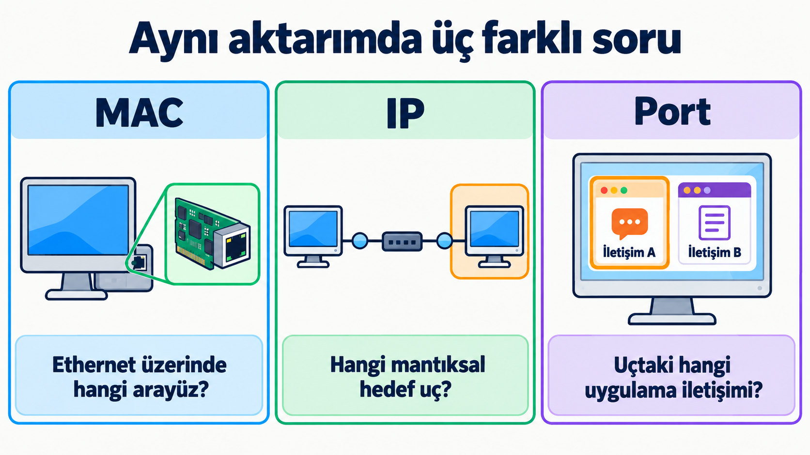{height="620" fig-align="center" fig-alt="MAC ile Ethernet arayüzünün, IP ile hedef ucun, port ile uygulama iletişiminin ayırt edilmesi"}

::: {.notes}
Aynı aktarımda bu bilgiler birlikte bulunabilir. Her biri ayrı sorumlulukta kullanıldığından biri diğerini gereksiz kılmaz. Bilgilerin mesajla birlikte taşınabilmesi için protokoller kendi alanlarını oluşturur.

Kapsülleme bu alanlarla taşınan içeriğin nasıl bir araya geldiğini gösterir.
:::

---

## Merhaba yola çıkıyor: 7 Uygulama

```text
7 Uygulama        [HTTP|Merhaba]
6 Sunum
5 Oturum
4 Taşıma
3 Ağ
2 Veri bağlantısı
1 Fiziksel
```

Merhaba, uygulama protokolünün bilgisiyle birlikte hazırlanır.

::: {.notes}
Gönderen uygulama Merhaba mesajını HTTP gibi bir uygulama protokolünün kurallarıyla hazırlar. Bu, zincirin başlangıcıdır; alt katmanlar bu birimi kendi yükleri olarak alır.
:::

---

## Merhaba yola çıkıyor: 6 Sunum

```text
7 Uygulama        [HTTP|Merhaba]
6 Sunum           [Sunum|HTTP|Merhaba]
5 Oturum
4 Taşıma
3 Ağ
2 Veri bağlantısı
1 Fiziksel
```

Sunum bilgisi, verinin hangi biçimde yorumlanacağını belirtir.

::: {.notes}
OSI gösteriminde sunum katmanı, verinin temsiliyle ilgili bilgiyi (örneğin metin kodlamasını) mesaja ekler. Gerçek protokol yığınlarında bu görev çoğunlukla uygulama protokolünün veya uygulamanın içinde yürür.
:::

---

## Merhaba yola çıkıyor: 5 Oturum

```text
7 Uygulama        [HTTP|Merhaba]
6 Sunum           [Sunum|HTTP|Merhaba]
5 Oturum          [Oturum|Sunum|HTTP|Merhaba]
4 Taşıma
3 Ağ
2 Veri bağlantısı
1 Fiziksel
```

Oturum bilgisi, süren etkileşimin düzenlenmesine hizmet eder.

::: {.notes}
OSI gösteriminde oturum katmanı etkileşimin düzenlenmesi için bilgi ekler. Bu slayttaki ayrı oturum başlığı, görevleri ayırt etmek için kullanılan gösterimdir; her uygulamada bağımsız bir oturum başlığı bulunduğunu söylemez.
:::

---

## Merhaba yola çıkıyor: 4 Taşıma

```text
7 Uygulama        [HTTP|Merhaba]
6 Sunum           [Sunum|HTTP|Merhaba]
5 Oturum          [Oturum|Sunum|HTTP|Merhaba]
4 Taşıma          [Port|Oturum|Sunum|HTTP|Merhaba]
3 Ağ
2 Veri bağlantısı
1 Fiziksel
```

Port bilgileri, uygulama iletişimlerini ayırt etmeye katılır.

::: {.notes}
Taşıma katmanı kaynak ve hedef port bilgisini ve kendi hizmeti için gereken kontrol bilgisini ekler. Büyük bir içerik söz konusuysa birden fazla taşıma birimine bölünür; bu örnekte Merhaba tek birime sığar.
:::

---

## Merhaba yola çıkıyor: 3 Ağ

```text
7 Uygulama        [HTTP|Merhaba]
6 Sunum           [Sunum|HTTP|Merhaba]
5 Oturum          [Oturum|Sunum|HTTP|Merhaba]
4 Taşıma          [Port|Oturum|Sunum|HTTP|Merhaba]
3 Ağ              [IP|Port|Oturum|Sunum|HTTP|Merhaba]
2 Veri bağlantısı
1 Fiziksel
```

IP adresleri, hedef uç sistemi belirtir.

::: {.notes}
Ağ katmanı kaynak ve hedef mantıksal adresleri ekler; router bu bilgiyle iletim kararına katılır. Birim artık ağlar arasında taşınabilecek bir paket biçimindedir.
:::

---

## Merhaba yola çıkıyor: 2 Veri bağlantısı

```text
7 Uygulama        [HTTP|Merhaba]
6 Sunum           [Sunum|HTTP|Merhaba]
5 Oturum          [Oturum|Sunum|HTTP|Merhaba]
4 Taşıma          [Port|Oturum|Sunum|HTTP|Merhaba]
3 Ağ              [IP|Port|Oturum|Sunum|HTTP|Merhaba]
2 Veri bağlantısı [MAC|IP|Port|Oturum|Sunum|HTTP|Merhaba|FCS]
1 Fiziksel
```

MAC adresleri yerel teslimi, FCS bozulma denetimini sağlar.

::: {.notes}
Veri bağlantısı katmanı IP paketini frame içine yerleştirir, başına yerel MAC bilgilerini, sonuna hata denetim alanını (FCS) ekler. Switch bu katmandaki bilgiyle iletim yapar. Frame'in yalnız başında değil sonunda da alan bulunabilir.
:::

---

## Merhaba yola çıkıyor: 1 Fiziksel

```text
7 Uygulama        [HTTP|Merhaba]
6 Sunum           [Sunum|HTTP|Merhaba]
5 Oturum          [Oturum|Sunum|HTTP|Merhaba]
4 Taşıma          [Port|Oturum|Sunum|HTTP|Merhaba]
3 Ağ              [IP|Port|Oturum|Sunum|HTTP|Merhaba]
2 Veri bağlantısı [MAC|IP|Port|Oturum|Sunum|HTTP|Merhaba|FCS]
1 Fiziksel        … 1 0 1 1 0 0 1 0 …  (bitler → sinyaller)
```

Frame'in bitleri sinyallere dönüşerek ortamda taşınır.

::: {.notes}
Fiziksel katman frame'in bitlerini ortamın taşıyabileceği sinyallerle temsil eder. Kapsülleme burada tamamlanır; karşı tarafta aynı katmanlar ters sırayla çözümleme yapar. Gösterilen bitler yalnız örnektir, Merhaba mesajının gerçek bit dizisi değildir.
:::

---

## OSI zinciri ile gerçek başlıklar

```text
OSI gösterimi:  MAC | IP | Port | Oturum | Sunum | HTTP | Merhaba | FCS
Sık görülen:    Ethernet | IP | TCP | HTTP | Merhaba | FCS
```

- OSI gösterimi, her katmanın bir bilgi eklediği ideal zincirdir.
- Gerçek başlıkları kullanılan protokoller belirler.
- Sunum ve oturum görevleri çoğunlukla uygulama içinde yürür.

::: {.notes}
Merhaba metni tek başına bütün teslim bilgilerini taşımaz. Protokoller kendi görevleri için gerekli bilgileri mesajın yanına ekler. Önceki yedi slayttaki zincir, görevleri ayırt etmek için kullandığımız gösterimdir; Ethernet, IP ve TCP üzerindeki HTTP örneğinde ayrı sunum ve oturum başlığı bulunmaz.

Bu örnekte Merhaba mesajı tek bir taşıma birimine sığar. Büyük dosyalarda ise içerik birden fazla birime ayrılabilir; her birim, kendi aktarımı için gerekli bilgileri taşır.
:::

---

## Birimin içindeki başlık ve yük

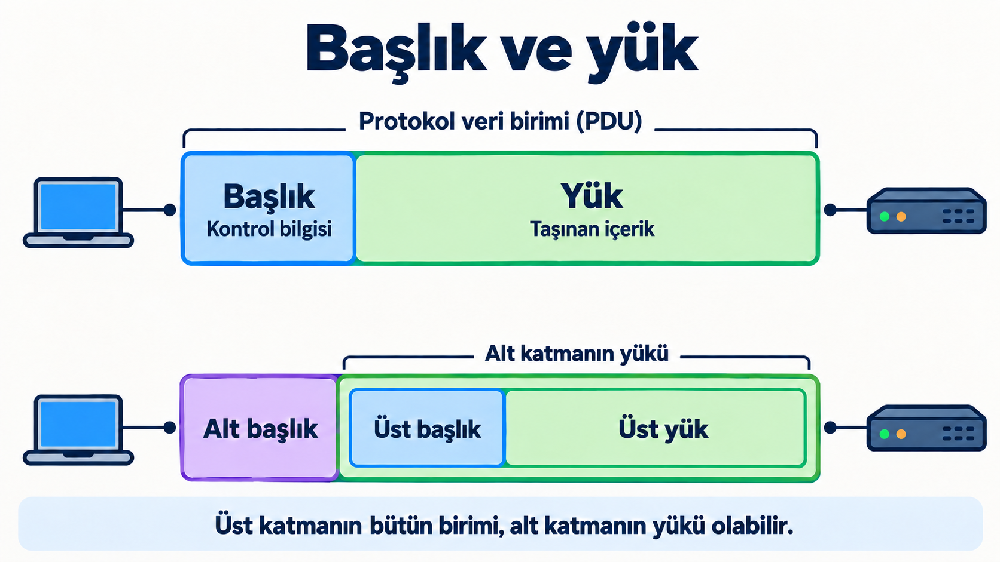{height="620" fig-align="center" fig-alt="Başlık ve yükten oluşan PDU ile üst birimin tamamının alt katmanın yükünde taşınması"}

::: {.notes}
PDU, bir katmanın protokolünün işlediği veri birimidir. Başlık o protokol için gerekli bilgileri, yük ise taşınan içeriği barındırır. Bazı protokollerde birimin sonunda da kontrol alanı bulunur; Ethernet'in FCS alanı bunun örneğidir.

Yük yalnız kullanıcının metni demek değildir. Daha alt protokole baktığımızda üst protokolün başlığı da onun yükünün içinde bulunabilir.
:::

---

## Kapsülleme: aynı mesaj, iç içe birimler

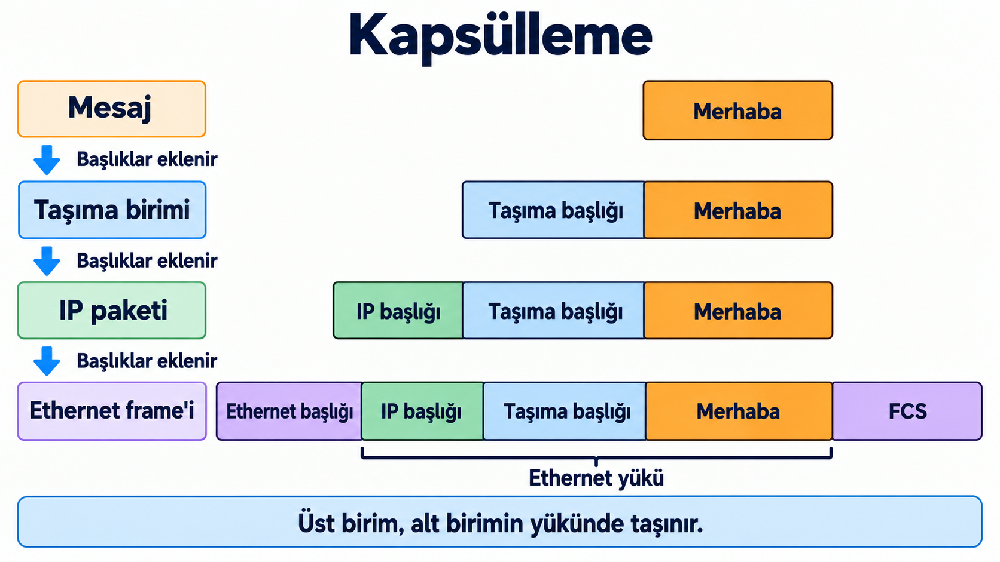{height="620" fig-align="center" fig-alt="Mesaja taşıma, IP ve Ethernet başlıklarının eklenmesi; FCS ve Ethernet yükünün sınırı"}

::: {.notes}
Taşıma protokolü mesajı yük olarak alır ve kendi başlığını ekler. IP, bu bütün birimi yük olarak taşır. Ethernet ise IP paketini yüküne yerleştirir, yerel teslim bilgilerini ve hata denetim alanını ekler. Bu iç içe yerleştirme kapsüllemedir.

Şemadaki alan boyları gerçek protokol alan uzunluklarını göstermez. Gerçek başlıkları OSI katman sayısı değil, kullanılan protokoller belirler. FCS, Ethernet frame'inin sonundaki hata denetim alanıdır. Frame'in bitleri fiziksel ortamda sinyallerle aktarılır.
:::

---

## Aynı veri neden farklı adlarla anılır?

| Bağlam | Birim |
|---|---|
| Uygulama | Mesaj |
| TCP | Segment |
| UDP | Datagram |
| IP | Paket / IP datagramı |
| Ethernet | Frame / çerçeve |

::: {.notes}
Adlar hangi protokolün biçimine ve sorumluluğuna baktığımızı ayırt eder. TCP birimiyle Ethernet frame'i aynı kapsamda birimler değildir: frame'in yükü taşıma birimiyle birlikte ağ başlığını da içerebilir.

Paket sözcüğü genel kullanımda farklı ağ birimlerine de uygulanır. UDP ve IP için datagram adının kullanılabilmesi nedeniyle protokol bağlamı belirtilmelidir. Fiziksel aktarımda birimin bitleri sinyallerle temsil edilir.
:::

---

## Alıcıda çözümleme

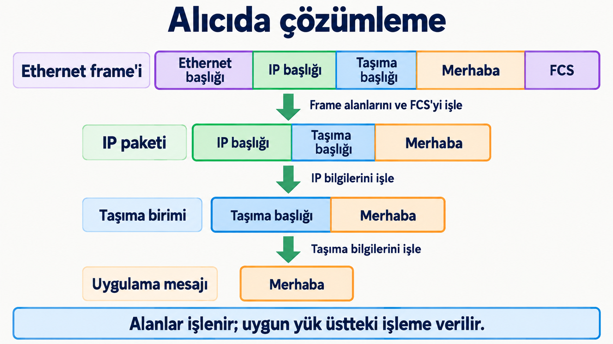{height="620" fig-align="center" fig-alt="Frame, IP paketi ve taşıma birimi alanlarının işlenmesiyle Merhaba mesajının uygulamaya teslimi"}

::: {.notes}
Alıcı sinyalleri bitler olarak yorumlar ve frame'i işler. Yerel kabul ve hata kontrollerinden geçen frame'in ağ birimi ilgili ağ işlemine verilir. Ağ bilgileri değerlendirildikten sonra taşıma birimi; taşıma işleminden sonra ilgili uygulama iletişimine mesaj teslim edilir.

Çözümleme gelişigüzel başlık silmek değildir. İlgili protokol alanları yorumlar, gerekli kontrolleri yapar ve uygun yükü aktarır. Hatalı frame normal bir başarılı mesaj teslimi gibi işlenmez.
:::

---

## Ethernet'in yükü yalnız Merhaba mı?

```text
Ethernet başlığı | IP başlığı | Taşıma başlığı | Merhaba | FCS
                └──────── Ethernet yükü ──────────────┘
```

Yükün sınırı, baktığımız protokole bağlıdır.

::: {.notes}
Ethernet açısından IP başlığı, taşıma başlığı ve mesaj birlikte taşınan yüktür. IP açısından ise taşıma başlığıyla mesaj yükü oluşturur. Bu nedenle yük kelimesi kullanılırken hangi protokolün biriminin incelendiği belirtilmelidir.

Alıcıdaki ters işlemler, bu iç içe sınırları ilgili protokolün kurallarıyla ayırır. Ethernet'in teslim bilgileri uygulamaya mesajın metni gibi verilmez.
:::

---

## Switch Merhaba'yı anlamadan nasıl iletir?

```text
A ─── Switch ─── B
         |
    Kaynak MAC + giriş portu → öğrenme
    Hedef MAC               → iletim kararı
```

::: {.notes}
Aynı yerel Ethernet ağındaki A ve B örneğinde switch kaynak MAC ile giriş portunu öğrenir. Hedef MAC tablodaysa uygun hedef portuna iletir; hedef bilinmiyorsa frame'i geldiği port dışındaki diğer uygun portlara ileterek flooding yapar.

Bu karar için uygulama metninin anlamını bilmesi gerekmez. Bilinmeyen unicast frame'in flooding ile iletilmesi, hedef MAC adresinin broadcast olduğu anlamına gelmez. Uç sistemin uygulamaya teslimiyle switch'in frame iletimi farklı işlerdir.
:::

---

## Uç sistem ve ara cihazın görevi

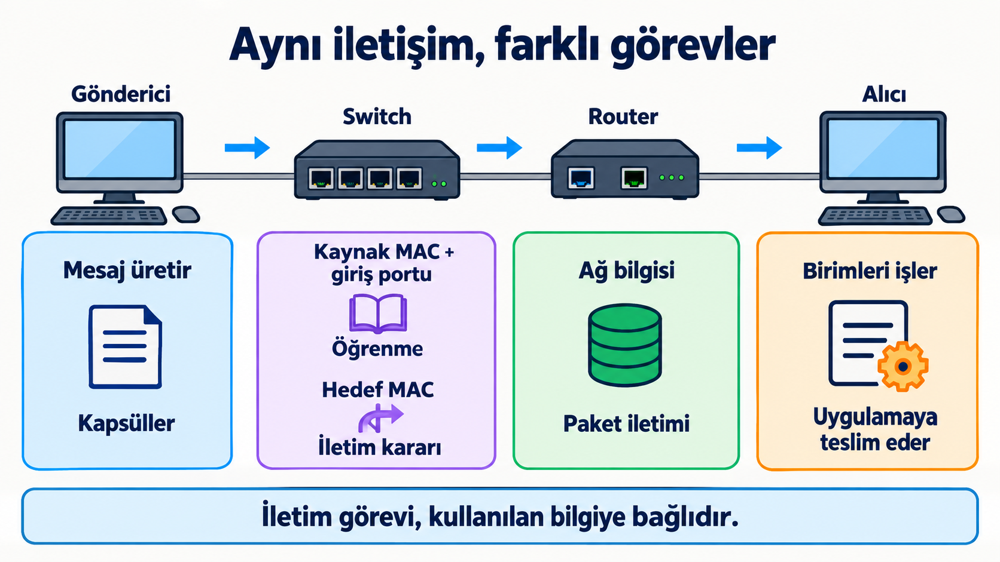{height="620" fig-align="center" fig-alt="Gönderici, switch, router ve alıcının kapsülleme, MAC tabanlı iletim, paket iletimi ve uygulamaya teslim görevleri"}

::: {.notes}
Her ara cihazın veriyi uygulamaya kadar açması gerekmez. Tipik iletim işlevinde link-layer switch link bilgisiyle, router ağ bilgisiyle görev yapar. Uç sistem mesajı uygulama iletişimine kadar işler.

Cihazlar, bu iletim görevlerinin yanında yönetim veya başka hizmetler için de protokoller kullanabilir. İletim rolü ile cihazın diğer hizmetleri ayrı değerlendirilir.
:::

---

## İletişimi gerekçesiyle açıklayalım

1. Parçaların farklı sırayla gelmesi ve bir parçanın eksik olması nasıl ayrılır?
2. Hizmet korunurken kullanılan yöntem değişebilir mi?
3. MAC, IP ve port hangi farklı sorulara cevap verir?
4. Ethernet yükünde hangi üst birimler bulunur?
5. Switch mesajın anlamını bilmeden hangi bilgiyle karar verir?

::: {.notes}
Farklı sıradaki parçalar konum bilgisiyle düzenlenebilir; eksik parçanın içeriği ise bu bilgiyle oluşmaz, ayrıca tamamlanmalıdır. Yöntem değişiminin üst görevi koruması hizmet ve arayüz koşuluna bağlıdır.

MAC yerel Ethernet arayüzünü, IP mantıksal hedef ucu belirtir; port uygulama iletişimlerini ayırt etmeye katılır. Örnekte Ethernet yükünde IP başlığı, taşıma başlığı ve mesaj birlikte bulunur. Switch kaynak MAC'ten öğrenip hedef MAC'e göre iletir; bu karar için mesajın anlamını yorumlaması gerekmez.
:::

---

## Kaynaklar

- Oktay Cesur, **OSI ders slaytları**: slayt 2–24 ve 29.
- Tanenbaum ve Wetherall, **Computer Networks**, 5. baskı: Bölüm 1, §1.3–1.4.1, yerel PDF 29–45.
- Forouzan, **Data Communications and Networking**, 5. baskı: Bölüm 2, yerel PDF 2–13.
- Kurose ve Ross, **Computer Networking: A Top-Down Approach**, 8. baskı: Bölüm 1, §1.5, yerel PDF 47–54.
- [Unicode: UTF kodlamaları ve byte sırası](https://www.unicode.org/faq/utf_bom.html).

::: {.notes}
Diploma ve video problemleri dersin OSI slaytlarındaki anlatım hattını izler. İki uçlu filozof–çevirmen–sekreter örneği Tanenbaum'a dayanır.

Hizmet/arayüz/protokol ayrımı Tanenbaum; hizmetin gerçekleştirim değişimi Forouzan ve Kurose; alıcıda çözümleme Kurose ve Forouzan ile desteklenmiştir. Kitap konumları kullanılan bölüm PDF'lerinin yerel sayfalarıdır; tam kitap PDF sırası değildir.
:::
