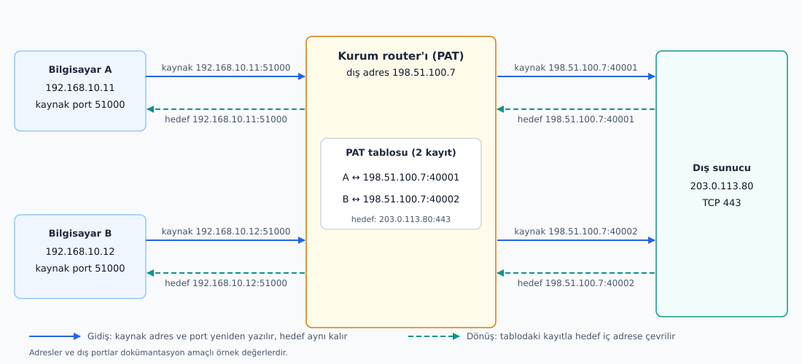

## İki bilgisayar, tek dış adres

- A: `192.168.10.11`, B: `192.168.10.12`
- İkisi de aynı web sunucusuna bağlanıyor: `203.0.113.80`, TCP 443 (dokümantasyon bloğundan örnek adres)
- Kurumun çıkışında kullanılan genel adres tek: `198.51.100.7` (dokümantasyon bloğundan örnek adres)

Sunucudan dönen yanıt A'ya mı gidecek, B'ye mi?

::: {.notes}
Örneğin sahnesi bu: iki bilgisayar, tek çıkış adresi, tek sunucu. Bu sorunun cevabı PAT tablosundadır: dönüş paketinin hangi bilgisayara gideceği tablodaki eşlemeden okunur.

Örnekteki dış adresler RFC 5737'nin dokümantasyon için ayırdığı bloklardan seçilmiştir; gerçek internet adresi değildir. `198.51.100.7` kurumun çıkış adresi, `203.0.113.80` dış sunucudur.
:::

---

## Özel adresler internette neden yönlendirilmez?

| Özel blok | Aralık |
| --- | --- |
| `10.0.0.0/8` | 10.0.0.0 – 10.255.255.255 |
| `172.16.0.0/12` | 172.16.0.0 – 172.31.255.255 |
| `192.168.0.0/16` | 192.168.0.0 – 192.168.255.255 |

- RFC 1918 blokları ayrı kurumlarda yeniden kullanılır
- İnternetteki yönlendiriciler bu adreslere giden paketler için tek bir "doğru" yön bilmez
- Özel kaynak adresli bir paket genel internete çıkarken yanıtın döneceği tek bir rota olmadığı için çıkışta kaynak adresinin yeniden yazılması gerekir; yalnız kurum içinde kalan trafikte bu çeviri gerekmez

::: {.notes}
Özel blokları 8. haftadan biliyorsunuz; burada önemli olan yanı şu: aynı `192.168.10.0/24` ağı binlerce kurumda var. Sunucu yanıtı `192.168.10.11` adresine gönderse, bu adres internette hangi kuruma ait olurdu? Hiçbirine; ISS'nin yönlendiricisi o paketi gideceği yere bağlayamaz.

Çözüm, paketin kaynak adresini çıkışta kurumun genel adresiyle değiştirmektir. Sunucu yanıtı `198.51.100.7` adresine gönderir; bu adresin sahibi belli, yanıt kuruma ulaşır. Bu çevirinin adı NAT ailesidir. Çevirinin yapılmadığı bir çıkışta yanıt bu yüzden kaybolur: ISS tarafında özel adrese giden yanıt için bir rota bulunmaz.
:::

---

## NAT ve PAT: ne dönüştürülüyor?

**NAT (ağ adresi çevirisi):** paket bir yönlendiriciden geçerken başlıktaki IP adreslerinden birini yeniden yazma işlemi. **PAT (NAPT):** aynı işlemin, adresle birlikte TCP/UDP portunu da yazan ve tablodaki kayıtla yanıtı geri eşleyen biçimi.

| | NAT | PAT (NAPT) |
| --- | --- | --- |
| Dönüştürülen alan | IP adresi | IP adresi **ve** TCP/UDP portu |
| Tipik kullanım | İç adres ↔ genel adres havuzundan bir adres | Çok sayıda iç bağlantı ↔ tek genel adres |
| Cisco IOS dinamik çeviri yapılandırması | `overload` olmadan (havuzdan bire bir) | `overload` (çoklu çıkış) |

- ICMP sorgularında port yoktur; eşleme için sorgu kimliği (query identifier) kullanılabilir
- `overload` görmemek, çevirinin yalnız IP eşlemesi olduğunu tek başına göstermez: elle yazılan port eşlemeleri de `overload` taşımaz

::: {.notes}
NAT adı hem çeviri ailesini hem, tablodaki dar anlamıyla, yalnız IP eşlemeyi anlatır. Tablodaki NAT iç adresi bir genel adresle eşleştirir. Elinizde kullanıcı sayısı kadar genel adres yoksa bu bire bir eşleme yetmez; kurumların genelde tek, bazen birkaç genel adresi vardır.

PAT bu darlığı TCP ve UDP'de portla aşar. Birçok iç bağlantı aynı genel adresi paylaşır, ayrım port numarasıyla yapılır. NAPT aynı şeyin ikinci adıdır; Cisco yapılandırmasında çoklu çıkışın anahtar sözcüğü `overload` olarak yer alır. ICMP sorgularında port yoktur; RFC 3022'ye göre eşleme için sorgu kimliği kullanılabilir. Bu bölümdeki eşleme örnekleri TCP bağlantısıdır. Gündelik konuşmada ev ve kurum çıkışlarının neredeyse hepsi PAT'tır, ama herkes ona "NAT" der. Bu yüzden bir kaynakta "NAT" yazdığında portun da çevrilip çevrilmediğine bakmak gerekir.
:::

---

## Yalnız adresi değiştirseydik?

| İstemci | Router'a giren kaynak | Yalnız IP değişseydi çıkan kaynak | Hedef |
| --- | --- | --- | --- |
| A | `192.168.10.11:51000` | `198.51.100.7:51000` | `203.0.113.80:443` |
| B | `192.168.10.12:51000` | `198.51.100.7:51000` | `203.0.113.80:443` |

Dışarıdan bakınca iki bağlantı **aynı görünür**.

Kaynak port, istemcinin işletim sisteminin bu bağlantı için seçtiği geçici numaradır; hedef port (`443`) sunucudaki HTTPS hizmetinin kapısıdır.

Bir TCP bağlantısını birlikte tanımlayan alanlar: protokol, kaynak IP:port, hedef IP:port.

::: {.notes}
İki işletim sistemi kaynak portunu birbirinden habersiz seçer; ikisinin de 51000'i seçmesi tuhaf değil, sadece şanssız bir denk gelmedir. Router yalnız kaynak IP'yi değiştirseydi sunucu iki bağlantıyı tek bir bağlantı gibi görürdü. Yanıt `198.51.100.7:51000` adresine döndüğünde router bunu A'ya mı yoksa B'ye mi verecekti? Ayırt edecek hiçbir alan kalmamış olurdu.

Bu yüzden PAT kaynak porta da bakar. Bağlantıyı birlikte tanımlayanlar protokol, kaynak IP, kaynak port, hedef IP ve hedef porttur. Bu gidişte hedef IP ve hedef port sunucuya ulaşsın diye aynı kalır. Kaynak IP her iki pakette de `198.51.100.7` olur. İki kaydı birbirinden ayıran alan kaynak portudur.
:::

---

## PAT tablosu: iki bağlantı, iki ayrı kayıt

| Protokol | İç kaynak | Dışarıdan görünen kaynak | Hedef |
| --- | --- | --- | --- |
| TCP | `192.168.10.11:51000` | `198.51.100.7:40001` | `203.0.113.80:443` |
| TCP | `192.168.10.12:51000` | `198.51.100.7:40002` | `203.0.113.80:443` |



Şekilde üstteki satır A'nın, alttaki satır B'nin yoludur; düz oklar gidişi, kesikli oklar dönüşü gösterir. Dış portlar `40001` ve `40002` örnek değerlerdir: cihaz atar, çakışma yoksa iç port aynı kalabilir.

::: {.notes}
Router kaynak portunu yeniden yazıp eşlemeyi kaydeder. Sunucu iki ayrı kaynak portu görür: 40001 ve 40002. IP aynıdır; bağlantıları ayıran bu kaynak portlarıdır.

Dış portlar örnek değerlerdir; gerçek cihaz başka portlar atayabilir, ardışık olmak zorunda da değildir. Çakışma yoksa bir cihaz iç portu olduğu gibi de bırakabilir. Bu örnekte sabitlenen mantık şudur: aynı sunucuya giden iki iç kaynak, dışarıda aynı IP'nin farklı portları olarak görünür.

Bir benzetme işe yarar: bir apartmanın kapıcısı, dairelerin giden mektuplarına "Apartman, referans no 40001" yazıyor ve defterine bu numaranın hangi daireye ait olduğunu not ediyor. Dışarıdaki kişi yalnız apartmanın adresini ve numarayı görür. Cevap mektubu aynı numarayı taşıdığında kapıcı deftere bakıp mektubu doğru daireye verir. PAT'ın defteri tabloydur, referans numarası dış porttur.
:::

---

## Aynı kayıt, cihazın diliyle

Router çıktıları bu kaydı dört alanla anlatır:

| Cihazdaki ad | Bu tablodaki karşılığı (A'nın bağlantısı) |
| --- | --- |
| Inside local | `192.168.10.11:51000` — iç kaynak |
| Inside global | `198.51.100.7:40001` — dışarıdan görünen kaynak |
| Outside local | `203.0.113.80:443` — hedefin iç taraftan görünümü |
| Outside global | `203.0.113.80:443` — hedefin dış taraftan görünümü |

Aşağıdaki satır açık işaretli temsili bir örnektir; çalışan cihazdan alınmış çıktı değildir. Alışılmış IOS sütun sırasıyla:

```text
Pro Inside global      Inside local       Outside local      Outside global
tcp 198.51.100.7:40001 192.168.10.11:51000 203.0.113.80:443  203.0.113.80:443
```

Kendi çıktınızda sırayı ezberlemeyin; sütun başlığını okuyun. Inside global, iç adresin dışarıdan görünen hâlidir.

::: {.notes}
"Local" iç ağdaki görünümü, "global" genel ağdaki görünümü anlatır; "inside" bizim tarafımızdaki cihazı, "outside" karşı tarafı belirtir. Yani inside local, A'nın iç ağdaki kendi adresi ve portu; inside global, aynı A'nın internette görünen adresi ve portu.

Bizim örnekte hedef sunucuyu çevirmiyoruz, bu yüzden outside local ile outside global aynı değeri taşıyor. Router çıktısında iki sütunun aynı yazıldığını gördüğünüzde bir hata aramayın; hedefin adresi çevrilmemiş demektir. Yukarıdaki satır temsili diziliştir, çalışan bir cihazdan kopyalanmadı.
:::

---

## Gidiş: ilk istek

| Aşama | Kaynak | Hedef |
| --- | --- | --- |
| A'nın gönderdiği | `192.168.10.11:51000` | `203.0.113.80:443` |
| Router'ın dışarı çıkardığı | `198.51.100.7:40001` | `203.0.113.80:443` |

- Router eşlemeyi tabloya yazar
- Yalnız **kaynak** alanları değişir; hedef olduğu gibi gider
- Cihaz diliyle: `Inside local` `192.168.10.11:51000` → `Inside global` `198.51.100.7:40001`

::: {.notes}
Eşleme ilk paketle oluşur. Router paketi alır, çıkışta PAT'a girecek mi diye kurallarına bakar, uygunsa kayıt açar ve kaynak alanını yeniden yazar. B'nin paketi için ayrı bir kayıt açılır: iç adresi farklıdır ve dış IP:port ikilisi A'nınkiyle çakışmamalıdır. Bu örnekte o kaydın dış portu 40002'dir.

Yeniden yazılan yalnız kaynak tarafıdır. Sunucu hedefin kendisi olduğunu bilir, kendi adresi ve portu değişmedi.
:::

---

## Dönüş: yanıt tabloya bakarak teslim edilir

| Aşama | Kaynak | Hedef |
| --- | --- | --- |
| Sunucunun dışarıdan gönderdiği | `203.0.113.80:443` | `198.51.100.7:40001` |
| Router'ın A'ya ilettiği | `203.0.113.80:443` | `192.168.10.11:51000` |

`40002` hedefli yanıt → B (`192.168.10.12:51000`)

Cihaz diliyle: `Inside global` `198.51.100.7:40001` → `Inside local` `192.168.10.11:51000`. Şekilde kesikli oklar bu yolu gösterir.

::: {.notes}
Yanıt `198.51.100.7:40001` hedefiyle, sunucunun adresinden gelir. Router protokolü, bu hedefi ve kayıttaki sunucu ucunu birlikte arar; A'nın satırını bulur. Hedefi `192.168.10.11:51000` yapar. Kaynak, sunucunun adresi olarak kalır. Paket artık iç ağa, A'ya yönlendirilebilir. `40002` hedefli yanıt B'nin satırına oturur: `192.168.10.12:51000`.

Başlangıçtaki soru böylece cevaplandı: yanıtın kime ait olduğunu belirleyen, router'ın gidişte yazdığı kayıttır. Yanıtın içinde A'nın adresi hiç geçmez; router o bilgiyi kendi tablosundan getirir.
:::

---

## Kaydı olmayan paket

Dışarıdan `198.51.100.7:40009` hedefine, daha önce açılmış bir kaydı olmayan bir TCP paketi gelirse?

. . .

Eşleşen kayıt yoktur. Router bir iç cihaz seçmez ve paketi iç ağa iletmez.

Kayıtlar bağlantı kapanınca veya zaman aşımı dolunca silinir. Bu davranış bir erişim politikası (ACL) kararı değildir; teslim edilecek bir kayıt bulunmamasının sonucudur.

::: {.notes}
Tablo gidişte dolduruluyor; yanıt gelmeden önce kayıt zaten vardır. Dışarıdan kendiliğinden başlayan bu pakette eşleme yok. Router tahminle bir iç cihaz seçmez ve paketi iç ağa iletmez. Bu, izin listesinin verdiği bir karar değildir; teslim edecek satır yoktur. Çıkışta PAT kullanan bir ağ, bu yüzden dışarıdan başlatılan bağlantılara kapalı gibi davranır; ancak bu, bir erişim politikasının yerini tutmaz.

İki ekleme gerekir. Kayıtlar süresiz kalmaz. Bağlantı kapandıktan sonra ya da cihazın kendi zaman aşımı dolunca silinirler. Süre burada sabit bir sayı değildir; gözlemi kayıt dururken yapmak gerekir. İçerideki bir sunucuyu dışarıdan erişilebilir yapmak istiyorsanız bunun için ayrı, elle tanımlanan bir eşleme kuralı yazılır. Bu, çıkıştaki `overload` kaydı değildir. Bu örnekte böyle bir kural yoktur.
:::

---

## Dört ayrı soru, dört ayrı mekanizma

| Soru | Mekanizma |
| --- | --- |
| Paket hangi yöne gidecek? | Yönlendirme |
| Hangi adres/port yazılacak? | NAT/PAT |
| Bu trafiğe izin var mı? | ACL / güvenlik duvarı |
| İçerik yolda okunabilir mi? | Şifreleme (uygulama içeriğinde TLS) |

PAT şifreleme yapmaz, izin vermez ya da engellemez; iç adresin dışarıda görünmemesi içeriği gizlemez.

::: {.notes}
PAT bir yönlendirme kararı vermez: paketi hangi arayüzden çıkaracağını rota tablosu söyler. PAT bir izin kararı da vermez: hangi trafiğin geçeceği ACL ya da güvenlik duvarı kurallarına bağlıdır. Router her üçünü aynı cihazda yapabilir; ama kural dizileri ayrıdır ve bir sorunu ararken hangisine baktığınızı bilmeniz gerekir.

PAT'ın içerikle işi yoktur. Sunucu `198.51.100.7` adresini görür, `192.168.10.11` adresini görmez. Bu, içeriğin gizlendiği anlamına gelmez. PAT şifreleme yapmaz. Düz HTTP'de yoldaki cihazlar uygulama içeriğini okuyabilir. Bu örnek 443 kapısını kullanır; o kapıda içerik gizleniyorsa bunu yapan PAT değil, TLS'tir. WPA2 ise istemci ile kablosuz erişim noktası arasındaki bağı korur, kurum çıkışından sunucuya kadar olan yolu değil. Özel adresin dışarıda görünmemesi, tek başına güvenlik değildir.
:::

---

## Eşlemeyi tamamla

Üçüncü bilgisayar `192.168.10.13:51000` adresinden aynı sunucuya bağlansın; router dış port olarak `40003` atasın.

1. Dışarı çıkan paketin kaynağı nedir?
2. Üçüncü bilgisayara ait yanıt, router'dan iç ağa çıkarken hedefi nedir?
3. Sunucudan `198.51.100.7:40002` hedefine gelen yanıt hangi bilgisayara gider?
4. Üçüncü bilgisayarın bağlantısı için `Inside local`, `Inside global`, `Outside local` ve `Outside global` alanlarını yazın.


::: {.notes}
Üç bilgisayar aynı iç kaynak portunu kullanır; bağlantıları iç adres ve dış port ayırır. Üçüncü bağlantı tabloya yeni bir satır ekler, ilk iki satır değişmez.

Hedef sunucu aynı kaldığı sürece dönüşte satırı dış IP:port ve sunucu ucu birlikte seçer; iç port değerleri değişse de yöntem aynıdır.
:::

---

## Özet

- Özel kaynak adresli paket genel internete çıkacaksa yanıt için tek bir rota yoktur; NAT/PAT yapılandırılmışsa çıkışta kaynak adresi yeniden yazılır, çeviri yokken kaynak adres aynı kalır
- PAT, TCP/UDP'de bağlantıyı dış kaynak portuyla tekil tutar; çakışma yoksa iç port aynı kalabilir, çakışma varsa port değişir ve çok sayıda iç bağlantı tek genel adreste ayrılır
- Router her bağlantı için eşleme kaydı tutar; yanıt bu kayıtla doğru istemciye döner
- NAT/PAT, yönlendirme, ACL ve şifreleme ayrı sorulara cevap verir

::: {.notes}
Elinizde bir PAT çıktısı olduğunda dört alanı sütun başlığından okuyun: inside local, inside global, outside local, outside global. Bu örnekte son ikisi aynı hedeftir; hedef adresi çevrilmemiştir. Kaydın yaşadığı sürede yanıtın nasıl döneceği o satırdan okunur.
:::
