<!--
Sunum taslağı. Dayanak: draft/taslaklar/bilgisayar-aglari-hafta-05-06/n1-osidan-tcpipye-mimari-ve-ip.md (id: cn5-6-n1, status: sunuma-kaynak-not, 16 Ekim 2026).
Üretim kuralları: _notes/cn_5-6/sunum-ajanina-yonerge.md. Kaynak konumları: _notes/cn_5-6/kaynak-dayanaklari.md.
Notes blokları öğrencinin sonradan çalışacağı konu anlatımıdır; sunucu yönlendirmesi içermez.
Yeni teknik iddia eklenmemiştir. Şekiller images/bilgisayar-aglari/hafta-05/ altındaki SVG'lerdir; render çıktısı alınmamıştır.
-->

## Aynı iletişim, TCP/IP gözüyle

Geçen haftanın "Merhaba" yolculuğu, bu kez web isteği olarak:

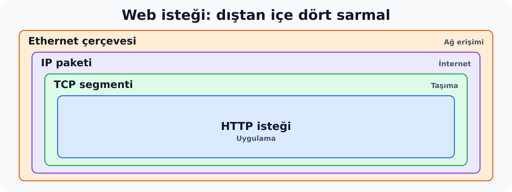{width="100%" fig-align="center" fig-alt="Web isteği iç içe: en dışta Ethernet çerçevesi, içinde IP paketi, onun içinde TCP segmenti, en içte HTTP isteği"}

İki soru:

- OSI'nin yedi katmanı gerçek ağda neye karşılık gelir?
- Yapının ortasındaki IP neyi vaat eder, neyi etmez?

::: {.notes}
Bir web isteği gönderilirken tarayıcı önce HTTP isteğini hazırlar. İstek bir TCP başlığıyla sarılır, ardından IP başlığı eklenir, en dışta da Ethernet çerçevesi bulunur. Bu, geçen hafta OSI ile öğrendiğimiz kapsüllemenin gerçek protokol adlarıyla yazılmış hâlidir.

Bu iç içe yapıda yedi katmanın hepsi ayrı bir kutu olarak yer almaz. Verinin nasıl temsil edileceği (sunum) ve konuşmanın nasıl yürütüleceği (oturum) işleri ayrı bir başlık taşımaz; HTTP'nin kuralları ile tarayıcının içinde kalır. Bu durum iki soru doğurur. Birincisi, OSI katmanlarının bu yapıdaki karşılığı nedir. İkincisi, yapının ortasında duran IP'nin hangi hizmeti verdiği ve hangi garantileri vermediğidir.

Ön bilgi olarak OSI katmanları, kapsülleme, Ethernet çerçevesi, MAC adresi ve temel ağ cihazları kullanılır. IP adresleri bu iki haftalık bölümde hazır verilir; ikilik dönüşüm, ağ adresi hesabı ve alt ağ bölme sonraki konulara aittir.
:::

---

## Yedi katmandan dörde: üst üç katman tek katman

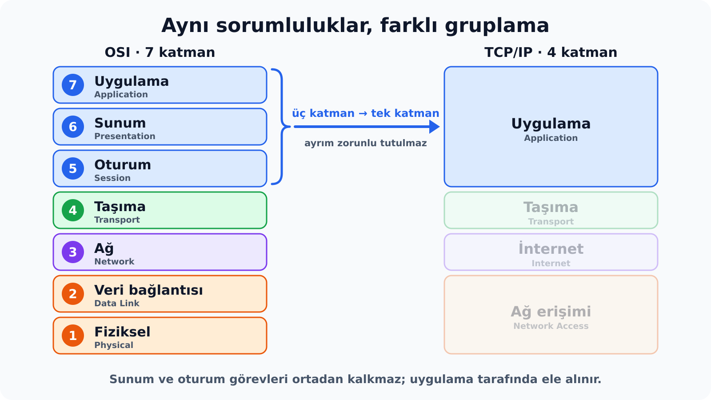{width="100%" fig-align="center" fig-alt="Solda OSI'nin yedi katmanı, sağda TCP/IP'nin dört katmanı; OSI'deki Uygulama, Sunum ve Oturum katmanları TCP/IP'de tek Uygulama katmanında toplanır"}

::: {.notes}
OSI, uygulama tarafındaki sorumlulukları üç ayrı katmanda tanımlar. Uygulama katmanı hangi mesajlarla konuşulacağını, sunum katmanı verinin hangi biçimde temsil edileceğini, oturum katmanı ise süren etkileşimin nasıl düzenleneceğini belirler. TCP/IP bu üçlü ayrımı zorunlu tutmaz ve hepsini tek bir **uygulama** (application) katmanında toplar.

Katman sayısının yediden dörde inmesi, TCP/IP'nin daha az iş yaptığı anlamına gelmez. İşler aynıdır; değişen, hangi işlerin ayrı bir katman olarak tanımlandığıdır. Taşıma, ağ ve alt katmanların eşleşmesi de benzer bir gruplama mantığına dayanır ve sonraki slaytta tamamlanır.
:::

---

## OSI görevleri, TCP/IP katmanları

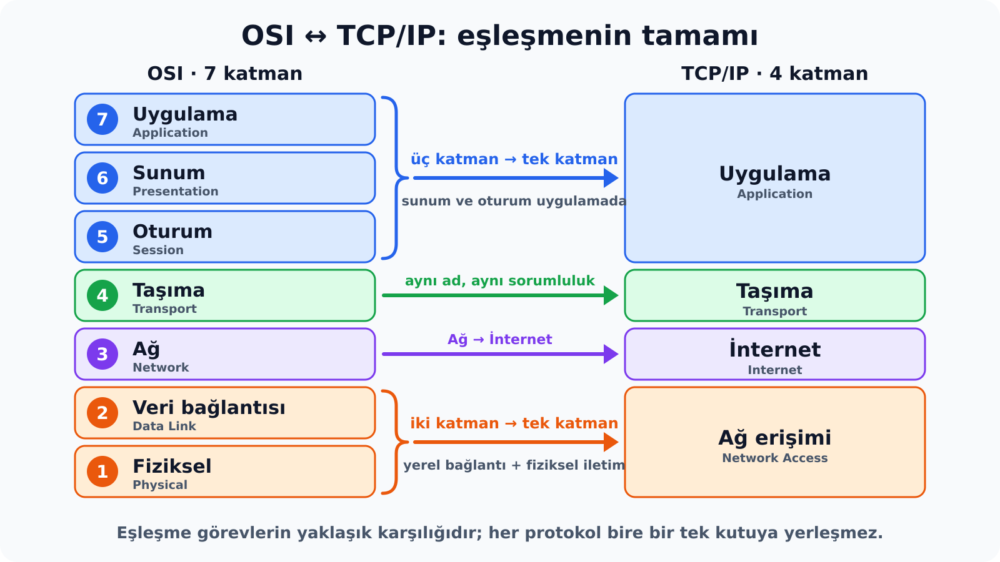{width="100%" fig-align="center" fig-alt="OSI Uygulama, Sunum ve Oturum katmanları TCP/IP Uygulama katmanına; Taşıma Taşıma katmanına; Ağ İnternet katmanına; Veri bağlantısı ve Fiziksel katmanlar Ağ erişimi katmanına karşılık gelir"}

Birleşen katmanlarda iş ortadan kalkmaz; aynı katman içinde yürür.

::: {.notes}
TCP/IP modeli OSI'deki görevleri daha az katmanda toplar. Uygulama, sunum ve oturum görevleri tek bir **uygulama** katmanında yer alır: verinin temsili ve konuşmanın yürütülmesi uygulamanın kendi kurallarında ve programın içinde kalır. **Taşıma** katmanı aynı adı taşır ve uygulamalar arasındaki uçtan uca iletişimi üstlenir. OSI'deki ağ katmanı **internet** katmanına karşılık gelir; paketin kaynaktan hedefe iletilmesi burada yapılır. Veri bağlantısı ve fiziksel katmanlar ise birlikte **ağ erişimi** katmanını oluşturur.

Birleşmenin anlamı, görevlerin ortadan kalkması değildir. Sunum ve oturum işleri yine yapılır; yalnız ayrı katman olarak adlandırılmaz.

Bu eşleme bire bir değildir. Bir protokolün hangi katmana ait olduğu bazen tartışmalıdır; eşleme görevlerin yaklaşık karşılığını verir. İki modelin tarihsel olarak birinin ötekinden sadeleştirilmesiyle doğduğu da söylenemez. Burada yapılan, iki modeli görevler üzerinden karşılaştırmaktır.
:::

---

## Dört katman mı, beş katman mı?

| Dört katmanlı | Beş katmanlı |
|---|---|
| Uygulama | Uygulama |
| Taşıma | Taşıma |
| İnternet | Ağ |
| **Ağ erişimi** | **Veri bağlantısı** + **Fiziksel** |

Aynı görevler, kaç parçaya bölünerek anlatıldığı farklı.

::: {.notes}
Kitaplarda TCP/IP için iki farklı katman sayısı görülür. Dört katmanlı gösterim yerel bağlantıyı tek parça, yani ağ erişimi olarak ele alır. Beş katmanlı öğretim gösterimi bunu ikiye ayırır: veri bağlantısı katmanı Ethernet çerçevesinin kurulmasını (adresler, hata denetimi), fiziksel katman ise bitlerin kabloda sinyale dönüşmesini kapsar. Bu iki işin farklı olması, öğretimde ayrı ele alınmalarını haklı kılar.

Beş katman, dört katmanın yeni bir sürümü değildir; aynı görevlerin kaç parçaya bölünerek anlatıldığındaki farktır. Bu derste genel haritada dört katmanlı gösterim kullanılır. Beş katmanlı bir kaynakla karşılaşıldığında ağ erişiminin ikiye ayrıldığını bilmek, iki gösterimi birlikte okumaya yeter.
:::

---

## Uygulama katmanı: üç sorumluluk, tek katman

| OSI'de ayrı katman | Sorduğu soru | TCP/IP'de kim ele alır? |
|---|---|---|
| Uygulama | Hangi mesajlarla konuşuyoruz? | Uygulama protokolü (HTTP, DNS, SMTP) |
| Sunum | Veri hangi biçimde temsil ediliyor? | Uygulama protokolü veya uygulama yazılımı |
| Oturum | Süren etkileşim nasıl düzenleniyor? | Uygulama protokolü veya uygulama yazılımı |

::: {.notes}
TCP/IP sunum ve oturum görevlerini ortadan kaldırmaz; yalnız bunları ayrı ve zorunlu katmanlar olarak tanımlamaz. Görevlerin nasıl yerine getirileceği kullanılan uygulama protokolüne ve uygulama yazılımına bırakılır. Örneğin bir web yanıtındaki metnin karakter kodlaması (UTF-8 gibi) HTTP mesajında belirtilir ve tarayıcı tarafından yorumlanır. Kullanıcının bir web sitesinde oturumunun açık kalması ise çoğu zaman uygulamanın çerez (cookie) gibi kendi mekanizmalarıyla sağlanır.

Bundan "uygulama katmanında ağla ilgili hiçbir şey yoktur" sonucu çıkmaz. HTTP, DNS ve SMTP, ağ üzerinden konuşan iki tarafın mesaj biçimlerini ve alışveriş kurallarını tanımlayan uygulama katmanı protokolleridir. Uygulama katmanında bulunan, ağ iletişiminin uygulamanın amacına göre düzenlenen kısmıdır.
:::

---

## Üç ayrı kavram: model, protokol, küme

| Kavram | Neyi anlatır? | Örnek |
|---|---|---|
| Model | Görevleri ve aralarındaki ilişkiyi | OSI, TCP/IP katmanları |
| Protokol | Bir iletişimin mesaj biçimini ve davranış kuralını | IP, TCP, HTTP |
| Protokol kümesi | Birlikte çalışan protokoller ailesini | TCP/IP ailesi |

"TCP/IP" adı hem aileyi hem dört katmanlı yapıyı anlatır.

::: {.notes}
"TCP/IP" adı iki anlamda kullanılır. Birincisi birlikte çalışan protokollerin ailesidir: IP, TCP, UDP, ICMP, DNS, HTTP ve diğerleri. İkincisi bu aileyi anlatmak için kullanılan dört katmanlı yapıdır. TCP ve IP ailenin yalnız iki üyesidir. "TCP/IP kullanılıyor" demek her uygulamanın TCP kullandığı anlamına gelmez; UDP üzerinde çalışan uygulamalar da ailenin içindedir.

Buradan üç kavram ayrılır. **Model**, iletişim görevlerini ve aralarındaki ilişkiyi anlatır. **Protokol**, belirli bir iletişimin mesaj biçimlerini ve davranış kurallarını tanımlar. **Protokol kümesi**, birlikte çalışan protokoller ailesidir.

OSI bir modeldir; gerçek ağlarda yaygın olan ise TCP/IP protokol ailesidir. Bu, TCP/IP'nin kuralsız olduğu anlamına gelmez: protokollerin hepsi standartlarla tanımlıdır ve katmanlı bir yapıyı da anlatabilir. Pratikte OSI'nin katman adları görevleri anlatmak için, TCP/IP protokolleri ise gerçek ağda olanı anlatmak için kullanılır.
:::

---

## TCP/IP: tek protokol değil, protokol ailesi

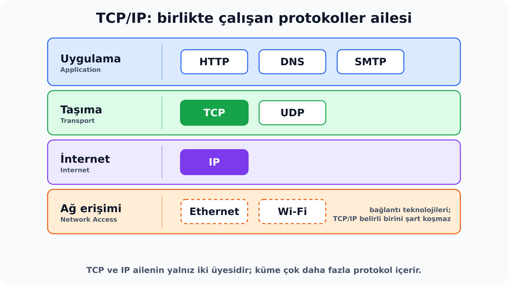{width="100%" fig-align="center" fig-alt="TCP/IP'nin dört katmanında birlikte çalışan protokoller: Uygulama katmanında HTTP, DNS ve SMTP; Taşıma katmanında TCP ve UDP; İnternet katmanında IP; Ağ erişimi katmanında Ethernet ve Wi-Fi"}

::: {.notes}
TCP/IP adı, yalnız TCP ve IP'nin kullanıldığı izlenimini verebilir. Oysa TCP/IP, farklı katmanlarda birlikte çalışan çok sayıda protokolü kapsayan bir protokol ailesidir. Web sayfası istemek için HTTP, alan adlarını adreslere çevirmek için DNS, e-posta göndermek için SMTP kullanılır. Taşıma katmanında TCP'nin yanında UDP de bulunur.

Bu protokoller birbirinin yerine geçmez; farklı işleri birlikte tamamlar. Bir web isteğinde HTTP isteğin anlamını, TCP verinin hangi uygulama iletişimine ait olduğunu ve nasıl teslim edileceğini, IP ise paketin hangi uç sisteme gideceğini belirler.

Ağ erişimi katmanındaki Ethernet ve Wi-Fi, IEEE standartlarıyla tanımlanan bağlantı teknolojileridir. TCP/IP, IP paketlerinin hangi bağlantı teknolojisi üzerinden taşınacağını tek bir seçeneğe bağlamaz. IP'nin kablolu, kablosuz veya başka türden çok farklı ağlar üzerinde çalışabilmesi bu esneklikten gelir.
:::

---

## Neden "TCP/IP" adı?

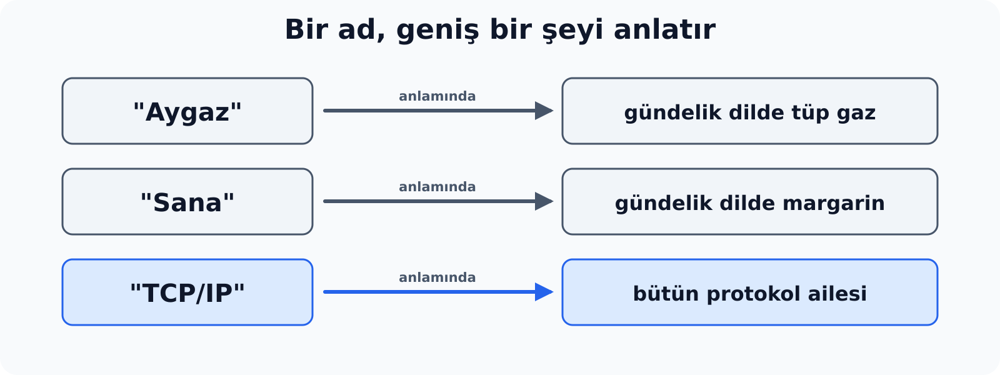{width="100%" fig-align="center" fig-alt="Aygaz tüp gazı, Sana margarini gündelik dilde anlatır; TCP/IP adı da bütün protokol ailesini anlatır"}

- Ad, ailenin iki merkezi protokolünden gelir; kapsamı çok daha geniştir.
- TCP/IP, Web'den **önce** vardı.

::: {.notes}
TCP/IP adı, ailenin merkezinde yer alan iki protokolden, TCP ve IP'den gelir. Gündelik dilde "Aygaz" adının tüp gaz, "Sana" adının margarin yerine kullanılması gibi, iki protokolün adı da bütün ailenin adı olarak kullanılır. Benzetmenin işlevi yalnız bu adlandırmayı açıklamaktır; TCP/IP'nin nasıl geliştiğini anlatmaz.

TCP/IP ile Web sık karıştırılır. ARPANET 1983'te TCP/IP'ye geçti. World Wide Web ise 1989'da önerildi ve 1990'larda mevcut TCP/IP tabanlı İnternet altyapısı üzerinde yaygınlaştı. Web, İnternet'in kendisi değil, İnternet üzerinde HTTP ile çalışan bir uygulamadır.
:::

---

## Hangi protokol hangi işi yapıyor?

| Katman | Protokoller | İş | Nerede açılır |
|---|---|---|---|
| Uygulama | HTTP/HTTPS, DNS, DHCP | Web, ad çözümleme, ağ ayarı | N4 |
| Uygulama | FTP, SMTP/POP3/IMAP | Dosya, e-posta | N4 |
| Uygulama | SSH, SNMP | Uzaktan erişim, yönetim | N4 |
| Taşıma | TCP, UDP | Uygulamaya ulaşma, teslim hizmetleri | N3 |
| İnternet | **IP** | Paketi kaynaktan hedefe iletme | **bu not** |
| İnternet | ICMP | Kontrol ve hata bildirimi | N2 |
| Ağ erişimi | Ethernet, ARP | Yerel çerçeve iletimi, IP→MAC | Ethernet önceki konu; ARP N2 |

::: {.notes}
Web sayfası açmak, dosya aktarmak ve uzak bir cihazı yönetmek farklı işlerdir; ama bu uygulamaların hepsi alttaki taşıma ve ağ hizmetlerini paylaşır. Protokol haritası, her protokolün iletişimin hangi kısmını üstlendiğini gösterir. Haritanın kullanım amacı, sonraki konularda bir protokolle karşılaşıldığında onu hangi katmana ve hangi işe yerleştireceğini bilmektir; bütün protokollerin ayrıntısı bu notta işlenmez.

ARP'nin yeri tartışmalıdır. IP adresi ile MAC adresi arasında köprü kurduğu için bazı kaynaklar onu internet katmanına, bazıları ağ erişimine yerleştirir. Bu derste ARP, yerel Ethernet teslimine yardım eden bir protokol olarak ele alınır ve hiçbir yerde IP paketinin içinde taşınıyormuş gibi gösterilmez. Ayrıntısı N2'dedir.
:::

---

## Kum saati: ortada tek IP hizmeti

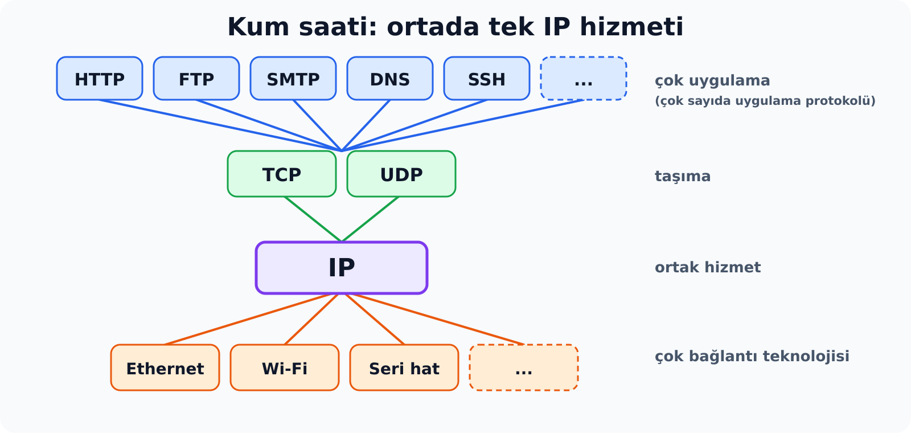{width="100%" fig-align="center" fig-alt="Kum saati: üstte çok sayıda uygulama protokolü, ortada TCP ve UDP, tam ortada IP, altta Ethernet, Wi-Fi ve seri hat gibi bağlantı teknolojileri"}

::: {.notes}
Protokol haritası bir kum saatine benzer: üstte çok sayıda uygulama protokolü, ortada taşıma için TCP ve UDP, tam ortada IP, altta ise farklı bağlantı teknolojileri vardır. Bu şekil, ağın bu kadar çeşitli uygulamaya hizmet edebilmesinin nedenlerinden birini gösterir. Uygulamalarla bağlantı teknolojileri arasındaki ortak nokta IP hizmetidir; bu yüzden yeni bir uygulama için bütün kablo ve kablosuz teknolojilerini, yeni bir bağlantı teknolojisi için bütün uygulamaları baştan tasarlamak gerekmez. İki taraf birbirinden bağımsız gelişebilir.

Kum saatinin ortası ortak bir hizmet düzeyi demektir. Bundan "her yerde tek ve hiç değişmeyen bir paket biçimi vardır" sonucu çıkarılmamalıdır; şeklin söylediği ortak hizmetin varlığıdır, biçimin sonsuza kadar sabit kalacağı değildir.
:::

---

## Aynı veri, dört katman

| TCP/IP katmanı | Birimin adı | Eklenen bilgi neyi sağlar? |
|---|---|---|
| Uygulama | Uygulama verisi | Mesajın anlamı (ör. HTTP isteği) |
| Taşıma | Segment | Hangi uygulama iletişimine ait olduğu |
| İnternet | Paket | Kaynak ve hedef IP adresi |
| Ağ erişimi | Çerçeve (frame) → bit | Yerel teslim (MAC) ve fiziksel aktarım |

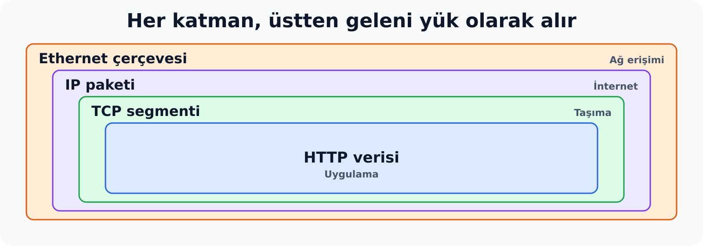{width="100%" fig-align="center" fig-alt="Ethernet çerçevesi içinde IP paketi, onun içinde TCP segmenti, onun içinde HTTP verisi"}

::: {.notes}
Aynı veri, gönderici tarafta TCP/IP katmanlarından aşağı doğru geçerken her katmanda o katmanın sorumluluğu için gereken bilgiyle birlikte taşınır. Uygulama verisi taşıma katmanında segmente, segment internet katmanında pakete, paket ağ erişimi katmanında çerçeveye yerleştirilir. Çerçevenin bitleri de fiziksel ortamda sinyallerle aktarılır.

Her katman üstten gelen birimin tamamını yük olarak alır ve kendi başlığını ekler. Bu nedenle Ethernet çerçevesinin yükünde yalnız kullanıcı verisi değil, IP başlığı, TCP başlığı ve HTTP verisi birlikte bulunur. Birim adları ezberlenecek etiketler değildir; hangi protokolün sorumluluğuna bakıldığını belirtir. Taşıma katmanında TCP yerine UDP kullanıldığında birim datagram olarak adlandırılır. Alıcı tarafta işlem ters yönde yürür: her katman kendi başlığını yorumlar ve yükü bir üst katmana iletir.
:::

---

## Paket hedefini nereden bilecek?

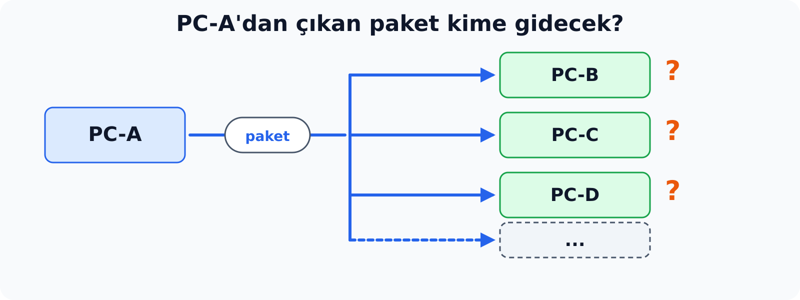{width="100%" fig-align="center" fig-alt="PC-A'dan çıkan paket PC-B, PC-C, PC-D ve diğer cihazlardan hangisine gideceğini bilmek zorundadır"}

Başka bir cihaza gönderilecek paket, hangi hedefe gideceğini nasıl bilir?

- Bütün cihazların aynı yorumladığı **ortak adresleme**
- Hedef adres paketin **üzerinde** taşınır
- Adres, bağlantı teknolojisinden bağımsız olmalı

::: {.notes}
Bir ağda çok sayıda cihaz bulunur ve gönderilen paket bunlardan yalnız birine gidecektir. Paketin doğru hedefe ulaşabilmesi için iki koşul gerekir. Birincisi, bütün cihazların aynı biçimde yorumladığı ortak bir adresleme düzenidir. İkincisi, paketin hedef adresini kendi üzerinde taşımasıdır; böylece yol üzerindeki cihazlar ve alıcı paketin kime gittiğini paketin kendisinden okuyabilir.

Bu adresleme düzeni kullanılan bağlantı teknolojisinden bağımsız olmalıdır. Paket yolculuğu boyunca Ethernet, Wi-Fi veya başka türden bağlantılardan geçebilir; hedef adresin bu geçişlerde aynı anlamı koruması gerekir. Bu problem internet katmanının sorumluluğudur ve bu katmanın temel protokolü IP'dir (Internet Protocol).
:::

---

## Katmanın merkezi: IP paketi

Taşıma başlığıyla sarılmış veriye IP kendi başlığını ekler: **paket**.

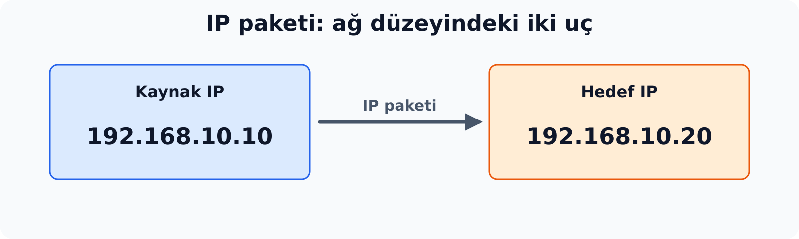{width="100%" fig-align="center" fig-alt="IP paketinde kaynak IP 192.168.10.10, hedef IP 192.168.10.20"}

IP adresi, paketin ağ düzeyindeki uçlarını belirtir.

::: {.notes}
Bir uygulama verisi taşıma katmanında bir başlıkla sarıldıktan sonra IP'ye ulaşır. IP buna kendi başlığını ekler ve ortaya **paket** çıkar. IP başlığının bu konuda önemli iki alanı kaynak IP adresi ve hedef IP adresidir; ikisi birlikte paketin ağ düzeyindeki uçlarını belirler.

Bu iki haftalık bölümde adreslerin nasıl yazıldığı ya da hangi ağa ait oldukları hesaplanmaz; hazır verilen adresler okunur.
:::

---

## IP adresi ile MAC adresi: iki ayrı iş

| | MAC adresi | IP adresi |
|---|---|---|
| Neyi adresler? | Yerel bağlantıdaki arayüzü | Paketin uçtan uca kaynağını ve hedefini |
| Nerede yazılı? | Ethernet çerçevesi | IP paketi |
| Ne için? | Çerçevenin yerel teslimi | Paketin hedefini belirtmek |
| Kim kullanır? | Ağ arayüzü ve switch | Kullanıcı ve uygulama (`ping`, yazıcı ekleme) |

Yönlendirmede (adres çevirisi yoksa):

- IP adresleri korunur
- Paket her bağlantıda yeni bir çerçeveyle taşınır

::: {.notes}
Bu iki adres sık karıştırılır. **MAC adresi** yerel bağlantıdaki bir arayüzü adresler ve Ethernet çerçevesinin yerel teslimi için kullanılır. **IP adresi** ise paketin uçtan uca hedefini ve kaynağını belirtir.

Adres çevirisi yapılmayan bir yönlendirme örneğinde kaynak ve hedef IP adresleri yolculuk boyunca aynı kalır; paket her bağlantıya uygun yeni bir Ethernet çerçevesiyle taşınır. Aynı yerel ağda ise switch çerçeveyi iletirken IP adreslerine bakmaz ve değiştirmez. Kullanıcı ve uygulamalar hedefi IP adresiyle belirtir; MAC adresini işletim sistemi çerçeve oluştururken kullanır ve kullanıcı onu çoğunlukla görmez. Ayrımın işe yaradığı yer N2'dir: yerel teslimde iki adres birlikte kullanılır. Yönlendirmenin ayrıntısı bu iki haftanın dışındadır.
:::

---

## Hedef IP kimi seçer?

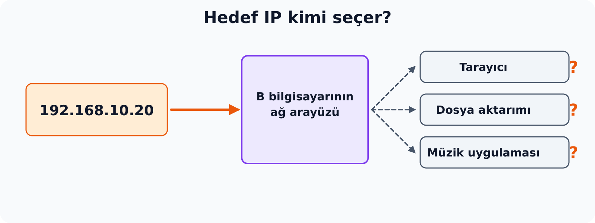{width="100%" fig-align="center" fig-alt="Hedef IP 192.168.10.20, B bilgisayarının ağ arayüzünü seçer; tarayıcı, dosya aktarımı ve müzik uygulamasından hangisine gideceği belli değildir"}

IP, **hangi arayüze** gideceğini söyler; **hangi uygulamaya** gideceğini söylemez.

::: {.notes}
Hedef IP adresi hedef bilgisayarın bir ağ arayüzünü adresler; o bilgisayarda çalışan belirli bir uygulamayı seçmez. Bir bilgisayarın birden fazla ağ arayüzü ve IP adresi olabilir. Tarayıcı, dosya aktarım programı ve bir müzik uygulaması aynı IP adresinden aynı anda ağ kullanabilir.

Gelen verinin bu uygulamalardan hangisine ait olduğu IP'nin görev alanında değildir. Bu soru taşıma katmanındaki portlarla cevaplanır (N3).
:::

---

## Alıcı paketi nasıl açıyor?

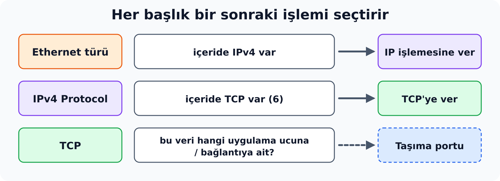{width="100%" fig-align="center" fig-alt="Alıcıda Ethernet türü, IPv4 Protocol değeri ve TCP portu sırayla bir sonraki işlemi seçtirir"}

Her başlık, **bir sonraki** işlemi seçtirir. Üç alan, üç ayrı iş:

- Ethernet türü
- IPv4 Protocol değeri
- Taşıma portu

::: {.notes}
Gönderen başlıkları iç içe ekler. Alıcıda bu işlemin tersini yapabilmek için her katmanın kendisine gelen içeriğin türünü tanıması gerekir. Bir zarfın içinde başka bir zarf olduğunu bilmek yetmez; içindekinin kime verileceğini de bilmek gerekir.

Ethernet çerçevesindeki **tür** bilgisi, taşınan içeriğin örneğin bir IPv4 paketi mi yoksa bir ARP mesajı mı olduğunu belirtir. IPv4 başlığındaki **Protocol** alanı, içerideki verinin hangi protokole verileceğini söyler. TCP ise kendi başlığındaki portları ve bağlantı bilgisini kullanarak verinin hangi uygulama ucuna ait olduğunu bulur. Alıcı paketin tamamını tek seferde anlamaya çalışmaz; katman katman işler.

Bu üç alan aynı şey değildir. IP başlığındaki Protocol numarası "içeride hangi taşıma ya da kontrol protokolü var" sorusunu, port numarası ise "bu veri hangi uygulama ucuna gidiyor" sorusunu cevaplar. Böylece kapsülleme yalnız başlık ekleme işlemi olmaktan çıkar: başlıklar alıcıda hangi işlemin yapılacağını da belirler.
:::

---

## IPv4 Protocol değerleri

| Değer | İçeride taşınan |
|---|---|
| 1 | ICMP |
| 6 | TCP |
| 17 | UDP |

ICMP örneğinde IP, içeriği doğrudan ICMP'ye verir; arada TCP veya UDP bulunmaz.

::: {.notes}
Gelen Ethernet çerçevesi IPv4 taşıyorsa IP işlemesi yapılır. IP başlığındaki Protocol değeri 6 ise içerik TCP'ye, 17 ise UDP'ye verilir. Değer 1 ise içerik ICMP'dir; ICMP mesajı IP paketinin içinde doğrudan taşınır ve port kullanmaz. Bu sayısal değerleri ezberlemek gerekmez. Bilinmesi gereken, böyle bir alanın var olduğu ve alıcıdaki yönlendirmeyi yaptığıdır.
:::

---

## Bağlantısız: önce konuşma kurmak yok

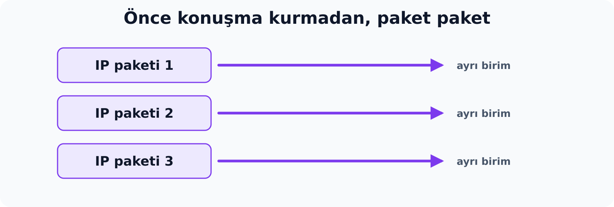{width="100%" fig-align="center" fig-alt="IP paketi 1, 2 ve 3 önceden konuşma kurulmadan ayrı birimler olarak gönderilir"}

- IP göndermeden önce "hazır mısın?" demez
- Uçtan uca bağlantı durumu kurmaz
- Her paket IP açısından ayrı bir birimdir

::: {.notes}
Bir video dosyasının yüzlerce IP paketine bölünerek gönderildiğini düşünelim. IP ilk paketi göndermeden önce karşı uca "sana paket göndereceğim" demez, bir el sıkışma yapmaz, iki uç arasında IP düzeyinde bir bağlantı durumu tutmaz. Paketi hazırlar ve gönderir. Bu özelliğe **bağlantısızlık** denir.

Terim yanıltıcı olabilir. Bağlantısız olmak, kablonun gereksiz olduğu ya da bilgisayarların fiziksel olarak bağlı olmadığı anlamına gelmez; yalnız IP'nin, taşımadan önce uçtan uca bir konuşma durumu kurmadığını söyler. Taşıma katmanındaki TCP bir bağlantı kurabilir ve o bağlantının mesajları da IP paketlerinde taşınır. Aynı iletişimde IP'nin bağlantısız, TCP'nin bağlantı yönelimli olması bu yüzden çelişmez: ikisi farklı katmanların kararlarıdır.
:::

---

## En iyi çaba: IP neyi garanti etmez?

IP tek başına şunları garanti etmez:

- Her paketin hedefe ulaşmasını
- Paketlerin gönderildikleri sırada gelmesini
- Bir paketin yalnız bir kez gelmesini
- Belirli bir sürede teslim edilmesini

::: {.notes}
IP'nin sunduğu hizmete **en iyi çaba** (best effort) denir: ağ, paketi mevcut koşullarda hedefe iletmeye çalışır, ama teslim için söz vermez. Garanti verilmemesinin somut nedenleri vardır. Yoğun bir ağ cihazının tamponu dolabilir ve gelen paketi atmak zorunda kalabilir. İki paket farklı yollardan giderse ikincisi önce varabilir. Bir bağlantı yol ortasında arızalanabilir.

IP'yi bu olasılıkların hepsini çözecek biçimde tasarlamak, her yönlendiriciye ve her bağlantıya ağır bir yük bindirirdi. Tasarımcılar bunun yerine ağı basit tuttular ve ihtiyacı olan uygulamanın eksikliği uçlarda tamamlamasını seçtiler. En iyi çaba, ağın bilerek kötü iletim yaptığı anlamına gelmez; yalnız sözleşmenin bu kadar olduğunu söyler.
:::

---

## Aynı IP, iki farklı ihtiyaç

| Uygulama | Kayıp olursa | Ne ister? |
|---|---|---|
| Dosya aktarımı | Tek bayt kaybı dosyayı bozar | Kaybı fark edip tamamlayan bir mekanizma |
| Görüntülü görüşme | Yarım saniye önceki ses parçası artık işe yaramaz | Beklemek yerine devam etmek |

Hangi garantinin isteneceği, IP adresinden değil uygulamanın gereksiniminden gelir.

::: {.notes}
İki uygulamanın ihtiyacı birbirine zıttır, ama ikisi de aynı IP'nin üzerinde çalışır. Dosya aktaran bir uygulamada tek baytın kaybı bile dosyayı bozar; bu uygulamanın kaybı fark edip tamamlayacak bir mekanizmaya ihtiyacı vardır. Canlı bir görüntülü görüşmede ise yarım saniye önce gitmiş, geç gelmiş bir ses parçası artık işe yaramaz; çünkü o an geçmiş ve konuşma ilerlemiştir. Bu uygulama kaybı beklemektense devam etmeyi tercih edebilir.

Ağ hangi uygulamanın konuştuğunu bilmediği için bu iki durum için ayrı ayrı davranamaz. Hangi garantinin isteneceği IP adresinden değil, uygulamanın gereksiniminden gelir ve bu seçimi taşıma katmanı sunar. Böylece IP'nin açtığı soru netleşir: paketlerin eksiksiz ve sıralı tamamlanması gerekiyorsa bunu kim sağlayacak ve hangi uygulama bunu isteyecek? Cevap N3'te taşıma katmanıdır.
:::

---

## Sırada: çerçevenin hedef adresi

- Pakette hedef IP yazılı
- Aynı yerel ağdaysa çerçevenin hedef **MAC** adresi de gerekir

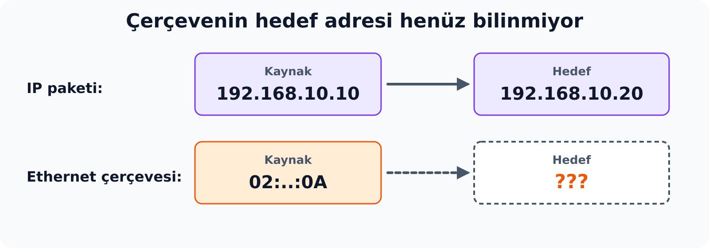{width="100%" fig-align="center" fig-alt="IP paketinde kaynak ve hedef IP bellidir; Ethernet çerçevesinde kaynak MAC 02:..:0A bellidir, hedef MAC bilinmiyor"}

::: {.notes}
Hedef IP adresi pakete yazıldı. Paket aynı yerel ağdaki bir bilgisayara gidecekse onu taşıyacak Ethernet çerçevesinin hedef adresine de ihtiyaç vardır. Ethernet kartı IP adresini okuyarak çerçeve teslim etmez; elde yalnız bir IP adresi olduğuna göre hedef MAC adresinin nasıl bulunacağı sorusu açık kalır. Bu soru N2'de ARP ile cevaplanır; ardından iletişimin çalışıp çalışmadığı ICMP ile sınanır.
:::
