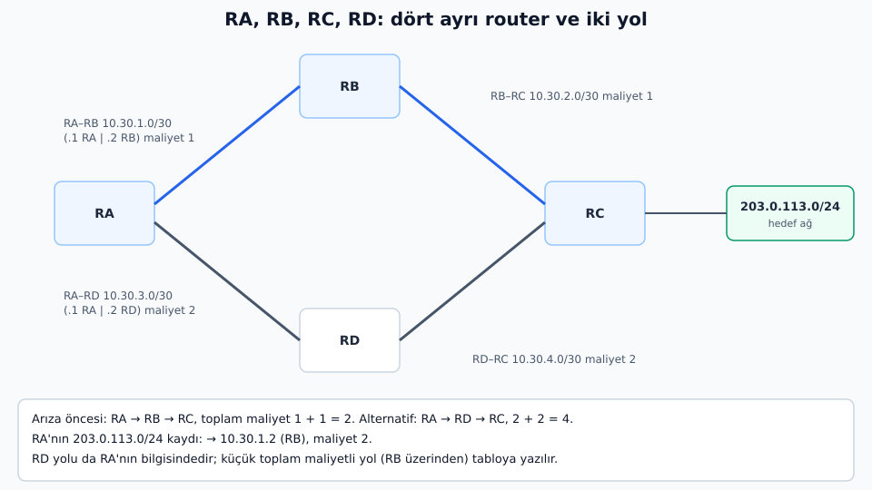
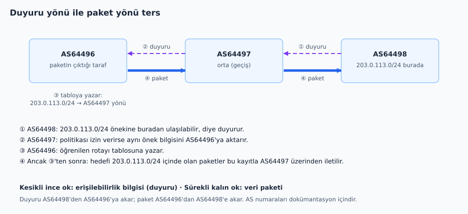

## Tablodaki kayıt oraya nasıl girdi?

Bir router'ın tablosunda şu satır var:

`203.0.113.0/24 → sonraki atlama 10.30.1.2`

Paket geldiğinde bu kaydı kullanmak kolay. Asıl sorular:

- Bu kayıt tabloya nasıl girdi?
- Yoldaki bağlantılardan biri koparsa kayıt ne olur?

::: {.notes}
Tabloyu okumakla tabloyu doldurmak ayrı işler. Birincisi her veri paketi geldiğinde olur; ikincisi veri paketinin gelişinden bağımsız, önceden gerçekleşir. Rota öğrenimi ve paket iletimi farklı zamanlarda yapılan iki ayrı iştir.

`203.0.113.0/24` yine dokümantasyon için ayrılmış örnek bloktur; gerçek bir duyuruyu temsil etmiyor.
:::

---

## Kayıtların üç kaynağı

| Kaynak | Tabloya katkısı | Bağlantı değişirse |
| --- | --- | --- |
| Doğrudan bağlı ağ | Etkin arayüzün ağı (`10.30.1.1/30` → `10.30.1.0/30`) | Arayüz kapanınca kayıt kaybolur |
| Statik rota | Yönetici hedefi ve sonraki atlamayı yazar | Sonraki atlama erişilebiliyorsa kalır; yolun ilerisindeki kopmayı kendisi düzeltmez |
| Dinamik yönlendirme | Router'lar erişilebilirlik veya bağlantı bilgisini paylaşır | Öğrenilen değişiklikle ilgili kayıt yenilenir |

::: {.notes}
Bağlı ağ bilgisi router'ın kendi arayüzlerinden gelir; router bunu kimseye sormaz. Arayüz etkinse ağ tabloya yazılır, kapanırsa kaldırılır.

Statik rota yöneticiden gelir. Dinamik yönlendirmede ise router, paylaşılan bilgiyle tabloyu kendisi doldurur. Aşağıdaki sahnede iki kaynağın farkı ortaya çıkıyor.
:::

---

## Örnek ağ

Bu sahnede **RA, RB, RC ve RD dört ayrı router'dır** (uç bilgisayar değildir). Hedef önek `203.0.113.0/24`, RC'nin arkasındadır. Bağlantı maliyetleri örnek bir ölçüttür.

*Şekil arıza öncesi durumu gösterir.*

- RA–RB–RC yolunun toplam maliyeti: 1+1 = **2**. Küçük maliyetli yol ucuz yoldur.
- RA–RD–RC yolunun toplam maliyeti: 2+2 = **4**.
- RC, `203.0.113.0/24` önekine doğrudan bağlıdır.
- Bağlantı ağları: RA–RB `10.30.1.0/30`, RB–RC `10.30.2.0/30`, RA–RD `10.30.3.0/30`, RD–RC `10.30.4.0/30`.

::: {.notes}
Ortada bir hedef var, iki yol var. Maliyet, küçük değeri daha uygun sayan bir ölçüttür; atlama sayısı, bant genişliğine bağlı bir değer ya da yönetici ataması olabilir. Bu örnekte bağlantılara yazılmış maliyetler kullanılıyor. Sayılar bir modeldir, cihazdan okunmuş ölçüm değildir.

RC'nin hedef ağa bakan bağlantısına ayrıca bir maliyet konmadı; iki yola da aynı değer eklenirse sıralama değişmez.

Adresler: RA'nın RB'ye giden arayüzü `10.30.1.1`, RB'nin RA'ya bakan arayüzü `10.30.1.2`; RA'nın RD'ye giden arayüzü `10.30.3.1`, RD'nin RA'ya bakan arayüzü `10.30.3.2`.

:::

---

## Statik rotada arıza: RA neyi bilmiyor?

RA'da elle yazılmış kayıt:

`203.0.113.0/24 → 10.30.1.2 (RB)`

**RB–RC bağlantısı koptu.**

- RA–RB bağlantısı sağlam. Sonraki atlama `10.30.1.2` hâlâ bu bağlantıda olduğu için kayıt tabloda durur.
- RA paketleri RB'ye göndermeye devam eder. RB'nin öneğe çıkışı RC yönündedir; RB–RC kopukken RB paketi iletemez, düşürür.
- RA–RD–RC yolu çalışıyor, fakat RA'nın tablosunda yok.

Yönetici düzeltirse yeni kayıt `203.0.113.0/24 → 10.30.3.2` (RD) olur. O zamana kadar RA, kopuk yola göndermeyi sürdürür.

::: {.notes}
Statik rotanın zayıf noktası bu: kayıt, RA'nın `10.30.1.2` adresine RA–RB bağlantısından ulaşabildiği sürece durur. Yolun geri kalanını kontrol etmez. RB–RC kopsa da RA'nın kendi arayüzü çalıştığı için kaydı kaldırmasına neden yoktur.

Bu örnekte yönetici sorunu fark edip RA'ya, sonraki atlaması `10.30.3.2` olan yeni kaydı yazabilir. Yüzlerce router'lı bir ağda aynı işi her değişiklikte elle yapmak hem yavaş hem hata riski taşıyan bir yöntemdir. İhtiyaç buradan çıkıyor: router'ların değişiklikleri birbirine kendiliğinden bildirmesi.
:::

---

## Dinamik yönlendirme: aynı arıza, otomatik güncelleme

**Dinamik yönlendirme:** router'ların yönlendirme protokolüyle erişilebilirlik bilgisi paylaşarak tablolarını kendilerinin oluşturması ve güncellemesi.

**Neden?** Yol sayısı ve değişiklik arttıkça elle bakım yetişmez; bağlantı kopunca alternatif yola geçiş insan müdahalesini beklememeli.

**Yakınsama:** bir değişiklikten sonra ilgili router'ların güncel duruma uygun bilgiye ulaşması süreci. Yakınsama anlık değildir.

**İki ayrı süreç:** rota öğrenimi paket gelmeden önce, bilgi paylaşımıyla yapılır; paket iletimi ise o an tabloda ne varsa onunla yapılır. Dinamik yönlendirme, her pakette yeni yol aramak anlamına gelmez.

Bağlantı maliyetini ölçüt alan bir protokolle, RA'nın bakış açısıyla sıra:

| Aşama | Ne olur? | RA'nın `203.0.113.0/24` kaydı |
| --- | --- | --- |
| 0. Arıza öncesi | RC, bağlı öneki duyurur. RA, maliyeti 2 olan RB yolunu seçer; maliyeti 4 olan RD yolu da bilinir | → RB (`10.30.1.2`), maliyet 2 |
| 1. Arıza | RB–RC kopar. RB, RC yönüne çıkamaz. RA arızayı öğrenmemiştir | → RB (`10.30.1.2`), maliyet 2 |
| 2. Güncelleme bilgisi | RB yolunun kalktığı bilgisi RA'ya ulaşır | RB yolu geçersiz |
| 3. Yeni kayıt | RA, bilinen RD yolunu kullanır | → RD (`10.30.3.2`), maliyet 4 |

Tablodaki 2 ve 4, şemadaki bağlantı maliyetlerinin toplamıdır.

**Aşama 1 ile 2 arasında** RA hâlâ RB'ye gönderir ve RB paketleri düşürür: yakınsama süresince geçici kayıp olur. **Aşama 3'ten sonra** gelen yeni paketler güncel kayda göre RD (`10.30.3.2`) üzerinden iletilir; hedef IP adresi aynı öneğe aittir, RA'nın değiştirdiği şey sonraki atlamadır.

::: {.notes}
Arıza öncesinde RA iki yolu da biliyor: RB üzerinden toplam 2, RD üzerinden 4. Küçük olanı tabloya yazdı. 2 ve 4, şemadaki bağlantı maliyetlerinin toplamıdır.

Arıza anında RA'nın kaydı aynı kalır, çünkü RA arızayı öğrenmemiştir. Kopukluğu ilk fark eden RB'dir; haber RA'ya ulaşınca RB yolu geçersiz olur. Bu aralıkta kayıp yaşanır.

Aşama 3'te RA'nın kaydı RD'ye döner: sonraki atlama `10.30.3.2`, toplam maliyet 4. Alternatif yol olmasaydı güncelleme yeni yol bulmak değil, öneğin tablodan kalkması olurdu; paket de iletilemezdi.

Router her veri paketi geldiğinde komşularına yol sormaz; tablo önceden, bilgi paylaşımıyla oluşur.
:::

---

## Kurum içinde RIP ve OSPF

Bir kurum kendi router'ları arasında aynı örnekteki gibi bilgi aktarır. İki temel yaklaşım iki ayrı ölçüte dayanır:

- **Atlama sayısı (hop count):** hedefe giderken geçilen bağlantı ya da router sayısı; her bağlantı eşit sayılır.
- **Bağlantı maliyeti (link cost):** her bağlantıya atanan değer; yolun maliyeti bağlantı değerlerinin toplamıdır.

Örnek ağdaki 2'ye karşı 4 karşılaştırması bağlantı maliyeti toplamıdır. Atlama sayısıyla ölçülürse RA–RB–RC ve RA–RD–RC yollarının ikisi de 2 atlamadır ve eşit görünür.

| Yaklaşım | Router ne paylaşır? | Ölçüt | Örnek ağda |
| --- | --- | --- | --- |
| **Distance-vector** (RIP) | Hedeflere uzaklık bilgisini komşularına | Atlama sayısı | RB, RA'ya "hedefe bir bağlantı uzaklığındayım" der; RA kendi bağlantısını ekleyip iki hesaplar. RD yolu da iki atlamadır: iki yol eşit görünür |
| **Link-state** (OSPF) | Kendi bağlantılarının durumunu diğer router'lara | Bağlantı maliyeti | Her router bağlantıları toplayıp ağın haritasını çıkarır, yolu kendi hesaplar: RB yolu 1+1 = 2, RD yolu 2+2 = 4, RB yolu seçilir |

İkisinde de amaç: değişen ağda kullanılabilir rotalar bulmak. "En iyi yol", kullanılan ölçüte göre belirlenir.

::: {.notes}
Mesafe vektöründe router yalnız komşusunun söylediğine güvenir; haritayı görmez. Bağlantı durumunda router'lar yakınsama sonrası aynı haritayı kullanır ve yolu kendisi hesaplar.

Şemadaki 1 ve 2 maliyetleri bir maliyet modelidir ve OSPF'nin ölçütüne uyar. RIP ise atlama sayar: RA–RB–RC ve RA–RD–RC ikisi de iki atlamadır, bu yüzden 2 ile 4 karşılaştırması RIP'in sonucu değildir. Eşit uzaklıkta hangi kaydın kalacağı bu örnekte belirli değildir; yani bu ağda RIP'in RB yolunu seçeceğini söyleyemeyiz.
:::

---

## İnternet ölçeği: otonom sistemler ve BGP

**Otonom sistem (AS):** ortak bir yönlendirme politikası altında tek bir yönetimin işlettiği ağlar bütünü (bir ISS ya da bir kurum ağı). Her AS bir numara taşır.

**BGP:** otonom sistemler arasında ağ öneklerine erişilebilirlik bilgisi aktaran protokol (RFC 4271).

**Neden RIP veya OSPF yetmez?** İnternet binlerce bağımsız işletmeciden oluşur. Her işletmeci kendi iç haritasını başkalarıyla paylaşmak istemez, kendi ticari ve güvenlik kurallarını uygulamak ister; tek bir ortak harita ve tek bir maliyet ölçütü bu ölçekte işlemez.

**Mekanizma:** bir AS, sahibi olduğu ya da taşımayı kabul ettiği öneki, politikası izin verdiği komşu AS'lere duyurur. Duyuru, önekin yanında hangi AS'lerden geçildiğini de taşır; bu bilgi döngüleri ayıklamaya ve politika uygulamaya yarar. Yol seçimi yalnız mesafeye değil, işletmecinin politikasına da dayanır.

RIP ve OSPF bir AS'nin *içindeki* yollarda, BGP AS'ler *arasındaki* erişilebilirlik duyurusunda kullanılır. Birbirinin alternatifi değildirler.

::: {.notes}
Bir ISS'nin işletmecisi kendi içindeki yolları kendisi yönetir, diğer işletmecilerin ağlarını yönetemez. Bu yüzden iç yönlendirme ile AS'ler arası yönlendirme farklı bağlamlarda ele alınır.

Politika örneği: bir işletmeci, ticari anlaşması olduğu komşudan öğrendiği yolu, daha kısa olan başka bir yola tercih edebilir ya da bir komşudan öğrendiği rotayı başka bir komşuya hiç duyurmayabilir. BGP'nin taşıdığı bilgi, önek ve o öneğe erişilebilirliktir; yol seçimi bunun yanında politikalara dayanır.
:::

---

## Duyuru okları ile veri okları ters yönlerde

Üç otonom sistem. Numaralar dokümantasyon için ayrılmış AS numaralarıdır. `203.0.113.0/24` AS64498'dedir; şema bu öneğin gerçek internet duyurusu değildir.

*Şekilde kesikli oklar duyuruyu, kalın sürekli oklar veri paketini gösterir.*

1. AS64498, `203.0.113.0/24` önekine kendi ağından ulaşılabildiğini duyurur.
2. AS64497 bunu öğrenir, politikası izin veriyorsa AS64496'ya aktarır.
3. AS64496 önek için AS64497 yönünde bir rota öğrenir.
4. **Ancak bundan sonra** AS64496'dan gelen paketler bu rotayla iletilir.

::: {.notes}
Duyuru ve paket iki farklı süreç: biri bilgi taşır, diğeri veri. Duyuru AS64498'den AS64496'ya, veri AS64496'dan AS64498'e akar. Adımların sırası da önemli: önce bilgi yayılır, sonra paket o bilgiyle iletilir.

Birden fazla yol öğrenilmişse seçim yalnız fiziksel mesafeye bakmaz; politika yönlendirmenin parçasıdır.
:::

---

## Tahsis kaydı ile yönlendirme farklı sorular cevaplar

IP adres kaynaklarının koordinasyonu kabaca şöyle işler: **IANA → bölgesel internet kayıt kuruluşları (RIPE NCC gibi) → ISS ve ağ işletmecileri.**

| Soru | Cevabı veren bilgi |
| --- | --- |
| Bu blok hangi kuruluşa tahsis edilmiş? | Adres tahsis/kayıt sistemi |
| Router bu hedefe hangi komşu üzerinden paket gönderecek? | Öğrenilmiş ve seçilmiş rotalar |

**Router, tahsis kaydına değil, tablosundaki rotalara bakar.** Bir bloğun bir ülkedeki kuruluşa tahsis edilmiş olması, paketin o ülkeye gideceği anlamına gelmez.

::: {.notes}
İki sistem iki ayrı soruya cevap veriyor. Tahsis kaydı bir bloğun kime verildiğini söyler: yönetimsel bir kayıt. Yönlendirme ise o bloğa nasıl ulaşılacağını söyler: işletmecilerin duyurduğu rotalar ve yerel politikalar.

Aynı kuruluş ağını farklı yönlerden duyurabilir, farklı işletmecilerin arkasında olabilir. 
:::

---

## Etkinlik: iki soru, kendi cümlelerinizle

Önceki slaytlardaki örnekleri kullanarak yanıtlayın:

1. **Hiç ziyaret edilmeyen bir siteye nasıl ulaşılır?** Cevabınızda en az şunlar geçsin: router'ın neye baktığı, rotanın nereden geldiği, kararın hangi kuralla verildiği.
2. **Adresin hangi ISS'ye tahsis edildiği biliniyorsa yönlendirme sorunu çözülmüş olur mu?** Neden olur ya da neden olmaz?

::: {.notes}
Yanıt hazırlarken kullanabileceğiniz kavramlar: hedef önek, en uzun önek eşleşmesi, statik/dinamik rota, BGP duyurusu, tahsis kaydı.
:::

