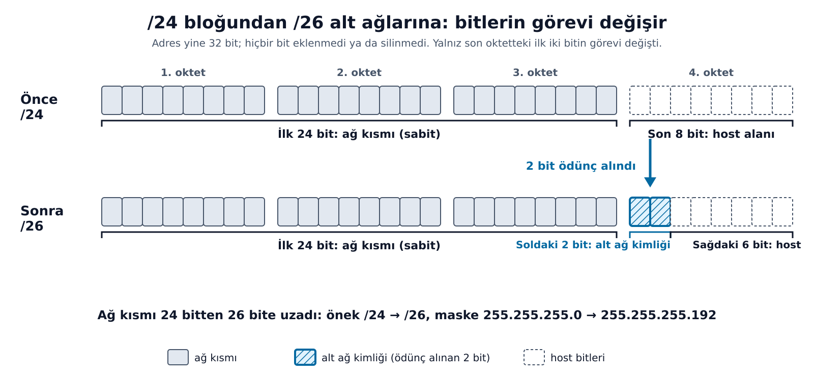
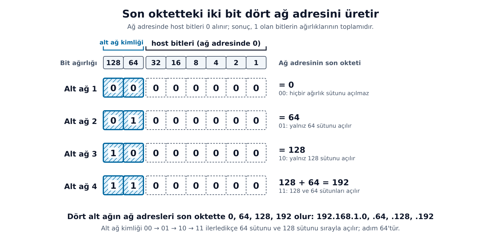
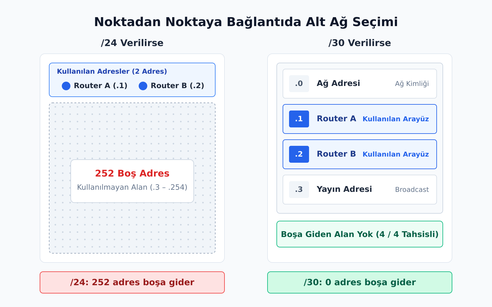

## Bir ortak alanda 2000 bilgisayar

- 2000 bilgisayar aynı Ethernet yayın alanında
- Bir bilgisayar hedef IP adresinin MAC adresini öğrenmek için **ARP isteği** yayınlar: "Bu IP kimde?"
- Yayın, alandaki her cihaza ulaşır
- Alan büyüdükçe yayını işleyen cihaz sayısı artar; bir döngü ya da aşırı yayın arızası da daha geniş bir alana yayılır. Fırtınayı başlatan şey cihaz sayısı değil arızalı kaynaktır, büyük alan ise arızanın bedelini büyütür

::: {.notes}
ARP'yi hatırlayalım: bir bilgisayar hedef IP adresinin MAC adresini bilmiyorsa bunu alandaki herkese sorar. Yalnız adresin sahibi cevap verir, ama soru herkese ulaşır ve her cihaz onu işler. Muhasebedeki bir bilgisayarın aradığı yazıcıyla hiçbir ilgisi olmayan bin dokuz yüz küsur cihaz da o çerçeveyi alır.

Alan büyüdükçe iki şey olur. Birincisi, her yayını alan cihaz sayısı artar. İkincisi, bir arıza daha geniş bir alana yayılır; sorunun kaynağını 2000 cihaz arasında bulmak da zorlaşır. Bir ağ döngüsü ya da aşırı yayın üreten hatalı bir ağ kartı varsa etki tüm alanda hissedilir. Yayın fırtınasını başlatan şey cihaz sayısının kendisi olmaz; fırtınayı döngü ya da aşırı yayın üreten kaynak başlatır. Alanın büyüklüğü ise fırtınanın kaç cihaza ulaşacağını belirler: büyük alan, aynı arızanın bedelini büyütür.
:::

---

## Alanı parçalara ayırmak: alt ağlara bölme nedir?

Muhasebe, satış, üretim ve yönetim ayrı bloklarda olsun.

**Alt ağlara bölme (subnetting), bir IP adres bloğunun daha uzun önekli, daha küçük adres bloklarına ayrılmasıdır.**

Sayıyla: `192.168.1.0/24` bloğu, `/26` önekli dört küçük bloğa ayrılabilir.

::: {.notes}
Her departmana kendi küçük bloğunu verirsek yönetim kolaylaşır: hangi adres hangi departmana ait, bir sorun hangi parçada çıktı, adrese bakarak okunur. "Daha uzun önekli" ifadesi şu demek: önek, adresin ağ kısmına ayrılan bit sayısıdır; önek uzadıkça ağ kısmı büyür, host kısmı küçülür ve blok küçülür.

Alt ağlara bölme fikri sınıflı adresleme döneminde de vardı; RFC 950 bu fikri tanımlar (https://www.rfc-editor.org/info/rfc950/). Yani bir IP bloğunu parçalara ayırmak ile blok boyutunu sınıflardan bağımsız belirlemek ayrı iki fikirdir. İkincisi, blok boyutunun sınıf sınırlarına bağlı kalmadan seçilebilmesidir.
:::

---

## IP bloğunu bölmek yayın alanını ayırır mı?

Aynı switch'e bağlı iki cihaza farklı IP blokları yazarsak ARP yayınları ayrılır mı?

. . .

**Ayrılmaz.** Yayın alanını ayıran şey IP öneki değil, Ethernet bağlantısıdır.

- Aynı switch'te, yayın alanını bölen ayrı bir mantıksal ayrım yoksa: tek yayın alanı
- Dört ayrı ve birbirine bağlı olmayan switch: dört ayrı yayın alanı

::: {.notes}
IP öneki bir hesap ve adresleme düzenidir. Ethernet çerçevesinin yayın olarak nereye gideceğini ise cihazların fiziksel ya da mantıksal olarak hangi bağlantıya bağlı olduğu belirler. Aynı switch'e bağlı iki cihazdan birine `192.168.1.5`, diğerine `192.168.1.70` yazsak da ARP yayını yine aynı switch üzerinden ikisine de ulaşır.

Bu laboratuvarda yayın alanlarını ayırmak için grupları birbirine bağlı olmayan ayrı switch'lere bağlarız; her switch kendi cihazlarıyla bir yayın alanı oluşturur. Farklı alanlardaki cihazların birbirine erişimi ise ayrıca denetlenen bir iştir: ayrı alanlar kendiliğinden bir yol sunmaz.

Hesap, IP bloğunun nasıl bölüneceğini verir; yayın alanını ise bağlantı belirler. Uygulamada her alt ağ ayrı bir switch'e bağlanacağı için adres planı fiziksel ayrımla da örtüşür; böylece hem hesabı hem yayın alanlarını aynı düzende görürüz.
:::

---

## 300 cihaz için hangi blok?

| Blok | Host biti | Kullanılabilir host |
| --- | ---: | ---: |
| `/24` | 8 | 254 |
| `/16` | 16 | 65.534 |

Sınıflı tahsiste kuruluşa verilen tek parça blok `/8`, `/16` ya da `/24` boyutundaydı. 300 cihazlık tek blokta `/24` yetmez.

. . .

`/16` seçilirse yaklaşık **65.234 adres** boşta kalır.

::: {.notes}
Hafta 8'deki hesapla gidelim. Host biti sayısı `h = 32 − önek` ile bulunur (`/24`'te 8, `/16`'da 16); ağ ve yayın adresi cihaza verilmediği için hostlara verilebilen adres sayısı `2^h − 2` olur. `/24`'te `h = 8` ve `2^8 − 2 = 254`; 300 cihaz sığmaz. `/16`'da `h = 16` ve `2^16 − 2 = 65.534`; 300 cihaz sığar ama `65.534 − 300 = 65.234` adres kullanılmadan kalır.

Sınıflı tahsiste kuruluşa tek parça olarak verilen blokların doğal sınırları `/8`, `/16` ve `/24` idi. Eldeki bir bloğu daha uzun önekli alt ağlara bölmek sınıflı dönemde de yapılabiliyordu; ama kuruluşa verilen parça bu üç boyuttan biriydi. İhtiyaç `/24` ile `/16` arasına düşünce ya yetmeyen ya da gereğinden büyük bir blok verilirdi. Çözüm, tahsis edilen blok boyutunu sınıf sınırlarından bağımsız, ihtiyaca göre belirlemenin bir yolunu bulmaktı.
:::

---

## CIDR: blok boyutunu önekle söylemek

**CIDR, adres bloklarını sınıf sınırlarına bağlı kalmadan ağ adresi ve önek uzunluğuyla ifade eden sınıfsız adresleme ve yönlendirme yaklaşımıdır.**

`192.168.1.0/24` → ilk **24 bit** ağ kısmı, kalan `32 − 24 = 8` bit host kısmı

| Önek | Host biti | Blok büyüklüğü |
| --- | ---: | ---: |
| `/25` | 7 | 128 |
| `/26` | 6 | 64 |
| `/27` | 5 | 32 |

::: {.notes}
Önekin oktet sınırında bitmesi gerekmez. `/26`, ilk üç oktetin tamamının ve dördüncü oktetin ilk iki bitinin ağ kısmı olduğunu söyler. Önek bir bit uzadığında host biti bir azalır ve blok yarıya iner: 128, 64, 32. Blok büyüklüğü `2^(host biti)` ile bulunur; kullanılabilir host sayısı için hafta 8'deki gibi iki adres çıkarılır: `/26` için `64 − 2 = 62`.

CIDR'ın kendisi alt ağlara bölmeden ayrı bir fikirdir: sınıf sınırlarından bağımsız blok tahsisini ve yönlendirmeyi anlatır (RFC 4632: https://www.rfc-editor.org/rfc/rfc4632.html). Burada ikisi aynı hesapta birleşir: önek uzunluğuyla yazılan bir bloğu parçalara ayırırız.
:::

---

## 300 cihaza en yakın blok kaç adreslik?

`2^8 − 2 = 254` yetmedi. Kaç host biti gerekir?

. . .

| Host biti `h` | Toplam adres `2^h` | Kullanılabilir `2^h − 2` |
| ---: | ---: | ---: |
| 8 | 256 | 254 |
| 9 | 512 | **510** |

`254 < 300 ≤ 510` → `h = 9` → önek `32 − 9 =` **`/23`** → maske `255.255.254.0`

::: {.notes}
Sayı doğrusu şöyle: 300, 254'ten büyük, 510'dan küçük. `h = 8` yetmez, `h = 9` yeter. Önek, 32 bitten host bitlerini çıkararak bulunur: `32 − 9 = 23`.

`/23` üçüncü oktete taşar: üçüncü oktetin son biti host alanına girer. Maskedeki 23 bitlik ağ kısmı `8 + 8 + 7` diye dağılır: ilk iki oktet sekizer bir (`255.255`), üçüncü oktet yedi bir ve bir sıfırdır: `11111110 = 128 + 64 + 32 + 16 + 8 + 4 + 2 = 254`. Dördüncü oktet `0` olur. Örnek blok `172.16.2.0/23`: adresler `172.16.2.0` ile `172.16.3.255` arasındadır. Ağ adresi `172.16.2.0`, yayın adresi `172.16.3.255`; kullanılabilir aralık `172.16.2.1`–`172.16.3.254` ve bu aralıkta `172.16.2.1`–`172.16.2.255` arasındaki 255 adres ile `172.16.3.0`–`172.16.3.254` arasındaki 255 adres bulunur: `255 + 255 = 510`. Aynı sayıya `512 − 2 = 510` diye de ulaşırız. Ayrı iki `/24` bloğu olsaydı her birinde ağ ve yayın adresi ayrılırdı ve `254 + 254 = 508` host kalırdı; tek `/23` blokta `172.16.2.255` ve `172.16.3.0` ağ ya da yayın adresi değildir, hosta verilebilen adreslerdir. Bu, iki ardışık `/24` adres aralığının tek blok olarak kullanılmasıdır.

Sağlama: 510 ≥ 300 ve fazlalık `510 − 300 = 210` adres; `/16`'daki 65.234'ün yanında çok küçük.
:::

---

## Dört parçayı ayırt etmek için kaç etiket gerekir?

Bir `/24` bloğunu **dört** eşit parçaya ayıracağız. Her parçanın adresleri ortak bir etiket taşısın.

- 1 bit → 2 değer: `0`, `1`
- 2 bit → 4 değer: `00`, `01`, `10`, `11`

. . .

Etiket, host alanının **ilk iki biti** olabilir.

::: {.notes}
Parçaları birbirinden ayıran bit kombinasyonlarına ihtiyacımız var. Bir bit iki farklı değer alır, iki parçaya yeter; iki bit dört değer üretir ve dört parçamız var. Etiketi host alanının başından alırız. Geri kalan bitler, her parçanın içinde host adreslerini ayırt eder.

Bit sayısı tam sayıdır; "bir buçuk bit" diye bir şey yoktur. Bu yüzden parça sayısı hep ikinin kuvveti olarak ilerler: 2, 4, 8, 16.
:::

---

## Bit ödünç alma

**Bit ödünç alma, host alanındaki bitlerin bir bölümünü yeni alt ağın ağ kısmına katmaktır.**

{width="100%" fig-align="center" fig-alt="192.168.1.0/24 bloğunda ilk 24 bit ağ kısmı, son 8 bit host alanıdır. /26'da son oktetin soldaki 2 biti alt ağ kimliği olur, sağdaki 6 bit host kalır; ilk 24 bit sabittir."}

::: {.notes}
Adres yine 32 bit uzunluğunda; hiçbir bit eklenmedi ya da silinmedi. Değişen, bitlerin görev dağılımıdır. Görselin üst şeridinde ilk 24 bit ağ kısmı, son 8 bit host alanıdır. Alt şeritte son oktetin soldaki iki biti artık host değil, hangi alt ağda olduğumuzu söyleyen alt ağ kimliğidir; sağdaki altı bit host olarak kalır. İlk 24 bit hiç değişmez.

Ödünç alınan bitler host alanının en soldaki bitleridir; ağ kısmı 24'ten 26 bite uzar, bu yüzden önek `/24`'ten `/26`'ya geçer. Maskedeki 1'ler soldan başlayıp kesintisiz sürer: son oktet `11000000 = 192` olduğu için `/26` maskesi `255.255.255.192` yazılır.
:::

---

## Alt ağ kimliği son oktette hangi ağ adresini verir?

Son oktetin bit ağırlıkları soldan sağa `128, 64, 32, 16, 8, 4, 2, 1`'dir. Ağ adresinde host bitleri `0` alınır; 1 olan bitlerin ağırlıkları toplanır.

{width="100%" fig-align="center" fig-alt="Son oktetin bit ağırlıkları 128, 64, 32, 16, 8, 4, 2, 1'dir. Alt ağ kimliği 00, 01, 10, 11 iken host bitleri 0 alınınca ağ adresinin son okteti 0, 64, 128, 192 olur."}

::: {.notes}
Dört alt ağın ağ adresleri, alt ağ kimliğinin dört değerinden gelir: `00000000 = 0`, `01000000 = 64`, `10000000 = 128`, `11000000 = 128 + 64 = 192`. Her satırda sağdaki altı host biti sıfırdır; çünkü ağ adresi, hostun hiçbir bitinin açılmadığı ilk adrestir.

Alt ağ başlangıçlarının 64'er artmasının nedeni budur: `01` etiketi `64` sütununu açar, `10` etiketi `128` sütununu açar, `11` etiketi ikisini birden açar. Ağırlıklar yalnız son oktetle ilgilidir; ilk üç oktet `192.168.1` olarak sabit kalır. Bu yüzden ağ adresleri `192.168.1.0`, `192.168.1.64`, `192.168.1.128` ve `192.168.1.192` olur.
:::

---

## Dört alt ağ için kaç bit, kaç host?

`n` ödünç alınan bit, `h` kalan host biti. Bu `/24` örneğinde `n + h = 8`, yani `h = 8 − n`. Aynı sonuca `h = 32 − yeni önek` ile de ulaşırız.

Alt ağ sayısı `2^n`. `2^n ≥ 4` koşulunu sağlayan en küçük `n` kaçtır? Yeni önek ve alt ağ başına host sayısı ne olur?

. . .

- `n = 2`
- Yeni önek: `24 + 2 =` **`/26`**
- `h = 32 − 26 = 6`
- Adres: `2^6 = 64`; kullanılabilir host: `64 − 2 =` **62**

Sağlama: `4 × 64 = 256 = 2^8`

::: {.notes}
`n = 1` iki alt ağ verir, yetmez. `n = 2` dört alt ağ verir ve tam gereken sayıdır. `n = 3` de sayıca yeterdi ama parçaları gereksiz küçültürdü; bu yüzden en küçük `n`'i seçeriz.

Kullandığımız formül hafta 8'dekiyle aynı: host biti `h` ise hosta verilebilen adres sayısı `2^h − 2`. Yalnız burada `h` artık `8` değil `6`. Genel kural `h = 32 − önek` olarak kalır; "`n + h = 8`" yalnızca son oktette ödünç alınan bu örneğe özgüdür.

Sağlama hesabı önemli: dört alt ağın 64'er adresi `256` eder; başlangıçtaki `/24` bloğu da `2^8 = 256` adresti. Blok tam paylaşıldı, ne artan ne eksik adres var. Hesap böyle kapanıyorsa doğru yoldayız.
:::

---

## Üç alt ağ istenirse?

- Bir bit: 2 alt ağ, iki bit: 4 alt ağ
- Üç eşit alt ağ için de **2 bit** alınır
- Üçü kullanılır, dördüncü yedek kalır

::: {.notes}
Bir biti bölerek üç farklı değer elde edemeyiz. İki bit dört değer verdiğine göre bir parça ihtiyaçtan fazladır. Boşta kalan bu parçayı büyüme olursa kullanırız.

İhtiyaç beş, altı ya da yedi alt ağsa `2^3 = 8` olduğu için üç bit gerekir. Kural aynı: ihtiyacı karşılayan en küçük `n`.
:::

---

## Alt ağlar neden 64'er artar?

`/26` maskesi: `255.255.255.192`

**Artış miktarı = 256 − 192 = 64**

Burada `192`, sınırın bulunduğu (son) oktetteki maske değeridir; sonuç o oktetteki artış adımını verir.

Alt ağlar son oktette `0, 64, 128, 192` değerlerinden başlar.

::: {.notes}
İlk üç oktet sabittir, sınır son oktetin içindedir. Bu yüzden çıkarmayı yalnız son oktete uygularız. `256`, bir oktetin alabileceği değer sayısıdır (`0`–`255`); maske değerini ondan çıkarmak, sınırın bulunduğu oktette bir alt ağdan sonrakine kaç adım atıldığını verir. `/26`'da bütün host bitleri son oktette olduğu için bu adım blok büyüklüğüyle de çakışır: `h = 6` host biti `2^6 = 64` değer alır.

Artış, sınırın bulunduğu oktetteki adımdır. `/26`'da bu son oktettir ve adım blok büyüklüğüne eşittir. Host bitleri iki oktete yayılan `/23`'te maske `255.255.254.0`'dır; üçüncü oktetteki adım `256 − 254 = 2`'dir (`172.16.2.0` bloğundan sonraki ağ `172.16.4.0`), blok büyüklüğü ise `h = 9` için `2^9 = 512` adrestir: üçüncü oktetteki 2 adım, her biri 256 adreslik son oktet ile çarpılır. 300 cihaz örneğindeki 510, bu 512'den iki adres çıkarılarak bulunur.
:::

---

## Dört alt ağın tam tablosu

| Alt ağ | Ağ adresi | İlk kullanılabilir | Son kullanılabilir | Yayın adresi |
| --- | --- | --- | --- | --- |
| 1 | `192.168.1.0/26` | `192.168.1.1` | `192.168.1.62` | `192.168.1.63` |
| 2 | `192.168.1.64/26` | `192.168.1.65` | `192.168.1.126` | `192.168.1.127` |
| 3 | `192.168.1.128/26` | `192.168.1.129` | `192.168.1.190` | `192.168.1.191` |
| 4 | `192.168.1.192/26` | `192.168.1.193` | `192.168.1.254` | `192.168.1.255` |

Yayın adresi = bir sonraki alt ağın ağ adresinden bir önceki adres.

::: {.notes}
Tabloyu sütun sütun dolduralım. Önce artış miktarıyla dört ağ adresini yazarız: `0, 64, 128, 192`. Sonra her satırın yayın adresini "sonraki ağ adresi − 1" ile buluruz: `64 − 1 = 63`, `128 − 1 = 127`, `192 − 1 = 191`. Son alt ağın yayın adresi bloğun son adresidir: `.255`. En son ilk ve son kullanılabilir adresleri yazarız: ağ adresinden bir fazlası ve yayın adresinden bir eksiği.

Her satırda kullanılabilir adres sayısı 62'dir; `.1`'den `.62`'ye saymak bunu doğrular. Bir satırın bitişi ile sonrakinin başlangıcı arasında boşluk ya da çakışma olmamalıdır: `.63`'ten sonra `.64`. Hesapta en hızlı hata kontrolü budur.
:::

---

## `.63` ve `.64` hangi maskede ne olur?

`192.168.1.63` ve `192.168.1.64` adresleri `/24`'te host muydu? `/26`'da ne olurlar?

. . .

- `/24`: ikisi de host adresi (ağ adresi `.0`, yayın adresi `.255`)
- `/26`: `.63` **yayın adresi**, `.64` **ağ adresi**

. . .

Kullanılabilir host sayısı: `/24`'te **254** → dört `/26`'da `4 × 62 =` **248**

::: {.notes}
Hafta 8'deki ağ ve yayın adresi kuralı burada somutlaşıyor: aynı sayının hangi rolü aldığını sayının kendisi değil, kullanılan önek belirler. `/24`'te `192.168.1.63` sıradan bir host adresidir. `/26`'da aynı adres birinci alt ağın son adresidir ve host bitlerinin tamamı 1'dir; yayın adresidir, bir cihaza verilemez. `.64` ise ikinci alt ağın ilk adresidir ve host bitlerinin tamamı 0'dır; ağ adresidir.

Kapasite hesabı da buradan çıkar. Tek `/24` bloğunda iki adres ayrılır (`.0` ve `.255`): `256 − 2 = 254`. Dört `/26` bloğunda her biri iki adres ayırır, toplam sekiz adres: `256 − 8 = 248`. Aradaki fark altı adrestir: `.63, .64, .127, .128, .191, .192`. Bunlar `/24`'te host'tu, `/26`'da yayın ya da ağ adresi oldu. Bölmenin bir bedeli vardır: parça sayısı arttıkça kullanılabilir toplam host sayısı biraz azalır.

Hafta 8'deki "ağ ve yayın adresi cihaza verilmez" kuralı burada somutlaşıyor.
:::

---

## Bu adres hangi alt ağda?

`192.168.1.100`, dört alt ağdan hangisindedir? Bir hosta verilebilir mi?

. . .

- `64 ≤ 100 < 128` → **2. alt ağ** (`192.168.1.64/26`)
- Ağ adresi `.64`, yayın adresi `.127`: `.100` ikisi de değil
- Hosta verilebilir

::: {.notes}
Önce artış basamaklarıyla karşılaştırırız: `100`, `64` ile `128` arasında. Sonra hosta verilebilirliği ayrıca kontrol ederiz: adres ağ adresine ya da yayın adresine eşitse hosta verilemez. `.100` ikisi de olmadığı için kullanılabilir. `.127` aynı alt ağda olsa da yayın adresidir.

İkili kontrol de aynı sonucu verir: `100 = 64 + 32 + 4 = 01100100`. İlk iki bit `01`, yani ikinci alt ağ; geri kalan `100100` bitleri host kısmıdır ve hepsi sıfır ya da hepsi bir değildir.
:::

---

## İki router arasında kaç adres gerekir?

İki router arayüzü arasındaki bağlantıda **yalnız iki** adres gerekiyor.

{width="100%" fig-align="center" fig-alt="İki router arası bağlantıya /24 verilmesi ile /30 verilmesinin kullanılan ve kullanılmayan adreslerinin karşılaştırılması"}

- `/24` verilirse 254 adresten **252'si** kullanılmaz
- `10.0.0.0/30` → `h = 2` → `2^2 − 2 = 2` kullanılabilir adres

| Görev | Adres |
| --- | --- |
| Ağ | `10.0.0.0` |
| Router 1 | `10.0.0.1` |
| Router 2 | `10.0.0.2` |
| Yayın | `10.0.0.3` |

Maske `255.255.255.252`, artış `256 − 252 = 4`.

**Bu laboratuvar, iki uçlu bağlantılar için `/30` bloğunu seçiyor.**

::: {.notes}
İki uçlu bir bağlantıda ihtiyaç iki adrestir. `/30` bloğunun dört adresinden ağ ve yayın adresi çıkınca tam iki adres kalır ve ikisini de iki router arayüzüne veririz. Maske son oktette `11111100 = 252` olur.

`/30`, bu laboratuvarın iki uçlu bağlantı için yaptığı bir seçimdir; her ağın uyması gereken tek kural değildir. Amaç, ihtiyaca yakın büyüklükte blok ayırmaktır: aynı bağlantıya `/24` verseydik 252 adres o bağlantıya bağlı kalırdı.
:::

---

## Ödünç alınan her bit ne değiştirir?

::: {.notes}
Düğmelerle 2, 4 ya da 8 alt ağ seçilir; her seçimde ödünç alınan bit sayısı, yeni önek, blok büyüklüğü ve alt ağ listesi birlikte güncellenir. 4 alt ağı seçince önceki tablonun sayılarını görürüz; iki gösterimi yan yana okuyalım.

Düğmeler arasında gezerken şuna bakalım: her ek bit alt ağ sayısını iki katına çıkarır, blok büyüklüğünü yarıya indirir (128, 64, 32). Her blokta iki adres ayrıldığı için kullanılabilir host sayıları 126, 62, 30 diye gider; adres sayıları ise tam yarıya iner. Toplam adres sayısı sabit olduğundan alt ağ sayısı ile alt ağ başına host sayısı birlikte artamaz.
:::

---

## Bölme yöntemi: adım sırası

| Adım | İşlem | Dört alt ağ örneği |
| --- | --- | --- |
| 1 | `2^n ≥ alt ağ sayısı` ile `n` | `n = 2` |
| 2 | Yeni önek = eski önek + `n` | `/26` |
| 3 | Artış = 256 − (sınırın bulunduğu oktetteki maske) | `256 − 192 = 64` |
| 4 | Ağ adreslerini artışla sırala; yayın adresi = sonraki ağ adresi − 1 | `0, 64, 128, 192` |
| 5 | Sağlama: üretilen parça sayısı `2^n` × blok büyüklüğü = ilk blok | `4 × 64 = 256` |

::: {.notes}
Adımlar sınırın son oktette olduğu durumlar için yazıldı: `/25`, `/26`, `/27` gibi önekler bu durumdur. Beşinci adım hesabın kendi içinde tutarlı olup olmadığını gösterir; bir yerde aritmetik hata yaptıysak toplam büyüklük tutmaz. Çarpılan sayı istenen alt ağ sayısı değil, üretilen `2^n` parçadır: üç alt ağ istendiğinde dört, altı alt ağ istendiğinde sekiz parça üretilir ve çarpım yine ilk bloğu verir.

Bu yöntem eşit büyüklükte parçalar üretir: bütün alt ağlar aynı öneki taşır.
:::

---

## `192.168.8.0/24` sekiz eşit parçaya nasıl bölünür?

Ödünç alınan bit sayısını, yeni öneki ve ikinci alt ağın host aralığını bulun.

. . .

- `2^3 = 8` → **3 bit**; önek `/27`; maske `255.255.255.224`
- Artış: `256 − 224 = 32`
- Başlangıçlar: `0, 32, 64, 96, 128, 160, 192, 224`
- 2. alt ağ: `192.168.8.32/27`; kullanılabilir `.33–.62`; yayın `.63`
- Host kapasitesi: `2^5 − 2 =` **30**

Sağlama: `8 × 32 = 256`

::: {.notes}
Dört alt ağda yaptığımız adımların aynısı. `2^n ≥ 8` ile `n = 3`, `24 + 3 = 27`. Son oktette ağ bitleri `11100000 = 128 + 64 + 32 = 224`; artış `256 − 224 = 32`. Alt ağlar `0, 32, 64, ...` diye gider; ikincisi `.32`'de başlar. Yayın adresi sonraki alt ağın başlangıcı `.64`'ten bir öncesi, yani `.63`'tür.

Host sayısı: `h = 32 − 27 = 5`, adres sayısı `2^5 = 32`, kullanılabilir `32 − 2 = 30`. Aralık sayımı: `62 − 33 + 1 = 30`. Sağlama: `8 × 32 = 256`.
:::

---

## Kendi başınıza: iki soru

**1.** `192.168.1.0/24` bloğu `/26` ile dörde bölünmüş. Şu adreslerin hangi alt ağda olduğunu ve bir hosta verilip verilemeyeceğini bulun:

`192.168.1.127` · `192.168.1.128` · `192.168.1.190` · `192.168.1.191`

**2.** `192.168.20.0/24` bloğundan **altı** eşit alt ağ gerekiyor. Kaç bit ödünç alınır? Yeni önek, artış ve alt ağ başına kullanılabilir host sayısı nedir? Kaç alt ağ boşta kalır? Altıncı alt ağın ağ adresini, kullanılabilir aralığını ve yayın adresini de yazın.

::: {.notes}
Birinci soruda önce artış basamaklarını (`0, 64, 128, 192`) yazın, her adresi bir basamağa yerleştirin; sonra adresin o alt ağın ağ adresi ya da yayın adresi olup olmadığına bakın. İkinci soruda `2^n ≥ 6` koşulunu kullanın ve sağlamayı yapın: ödünç aldığınız bitin ürettiği `2^n` parça sayısı × blok büyüklüğü ilk bloğa eşit olmalıdır; istediğiniz alt ağ sayısını değil, üretilen parça sayısını çarpın.

Cevaplarınızı yazarken her adımın gerekçesini de yazın: yalnız sonucu değil, hangi sayıyı neden seçtiğinizi gösterin.
:::
