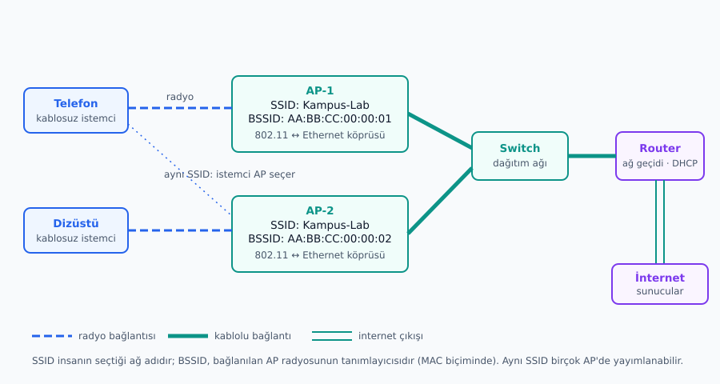
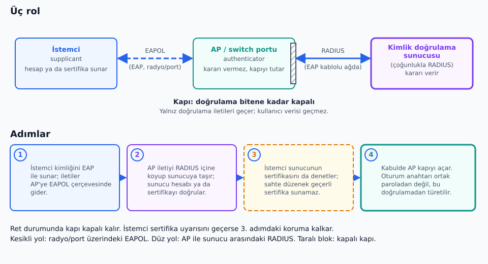
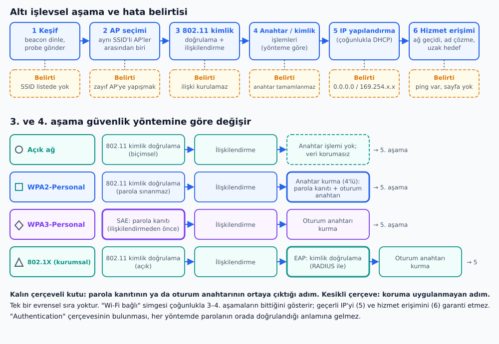
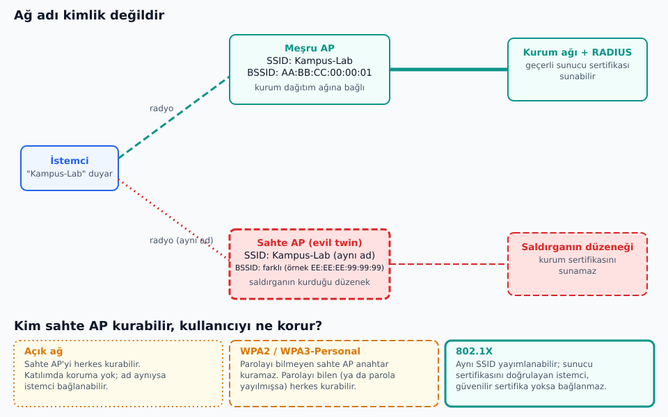
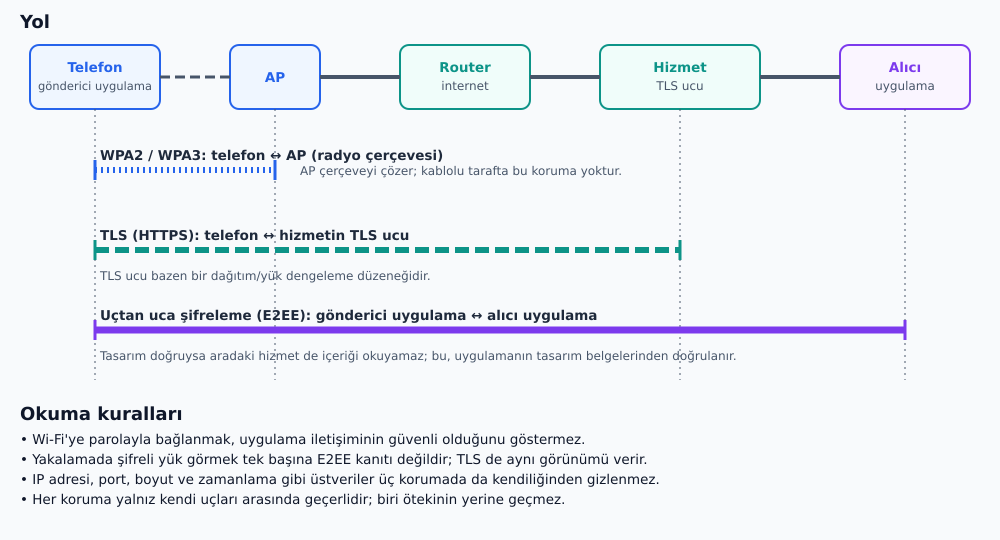

## Parola kabul edildi, sayfa açılmıyor

Telefonda üniversitenin ağ adını seçtiniz. Parola kabul edildi; Wi-Fi simgesi göründü. Ama web sayfası açılmıyor.

**Bağlı görünmek ile internete erişmek aynı şey mi?**

. . .

Üç ayrı iş var: **WLAN'a katılmak**, **IP yapılandırmasını almak**, **hizmete erişmek**. Her biri ayrı bir yerde başarısız olabilir.

::: {.notes}
Bu sorunun cevabı, Wi-Fi simgesinin neyi gösterdiğinde saklı. Simge, telefonun AP ile 802.11 düzeyinde ilişki kurduğunu gösterir; geçerli bir IP'yi veya hizmete erişimi kanıtlamaz. IP adresi, ağ geçidi ve DNS bilgisi ayrı bir süreçle, genellikle DHCP ile alınır. Hizmete erişim ise ağ geçidinin, ad çözümlemenin, yönlendirmenin ve hedef sunucunun çalışmasına bağlıdır. Hatayı bulmanın yolu, hangi işin başarısız olduğunu ayırmaktır; aynı parolayı tekrar tekrar yazmak yalnız ilk işi sınar.

IP, DHCP, DNS ve ağ geçidi önceki haftalardan tanıdıktır; kablosuz katılım, bu yapılandırmanın öncesine eklenen bir adımdır.
:::

---

## WLAN'ın parçaları

- **İstemci:** kablosuz arayüzü olan cihaz
- **AP:** radyo bağlantısını kablolu dağıtım ağına bağlayan cihaz
- **Dağıtım ağı:** AP'nin arkasındaki kablolu yerel ağ

AP, kablosuz çerçeveyi çözüp kablolu ağa aktaran katman-2 cihazıdır. DHCP, ağ geçidi ve yönlendirme görevleri AP'ye varsayılmaz; ağın tasarımına göre router'da, ayrı bir sunucuda ya da ev tipi bir cihazda aynı kutuda bulunur. "AP çalışıyor ama IP alamıyorum" durumunda sorun DHCP'ye giden yolda aranır.

::: {.notes}
AP'nin işi, kablosuz veri çerçevesini çözüp kablolu ağa aktarmaktır. DHCP, ağ geçidi ve yönlendirme işleri AP'nin bir görevi olarak varsayılmaz; bu görevler ağın tasarımına göre router'da, ayrı bir sunucuda ya da ev tipi bir cihazda aynı kutuda bulunabilir. Bizim laboratuvar ağımızda ağ geçidi ve DHCP router üzerinde olacak; AP yalnız kablosuz erişimi sağlayacak.

Bu ayrım hata ayıklamada işe yarar: "AP çalışıyor ama IP alamıyorum" cümlesi, sorunun AP'de değil DHCP'ye giden yolda aranabileceğini söyler.
:::

---

## SSID ve BSSID

| | Ne tanımlar | Örnek (temsili) |
| --- | --- | --- |
| **SSID** | Ağın adı; kullanıcının seçtiği | `Kampus-Lab` |
| **BSSID** | Belirli bir temel hizmet kümesinin tanımlayıcısı (MAC biçiminde) | `AA:BB:CC:00:00:01` |

Aynı SSID birden çok AP'de yayımlanabilir; BSSID hangisine bağlandığınızı gösterir.

**BSS (temel hizmet kümesi):** Bir AP radyosu ile ona bağlı istemcilerden oluşan hizmet birimi. BSSID bu birimin tanımlayıcısıdır ve altyapı ağlarında çoğunlukla AP radyosunun MAC adresidir.

::: {.notes}
Bir kampüste yüzlerce AP aynı SSID'yi yayımlar; böylece kullanıcı kat değiştirirken ağı yeniden seçmek zorunda kalmaz. İstemci hangi AP'ye bağlanacağını, duyduğu sinyale ve kendi kurallarına göre seçer. Cihazın hangi temel hizmet kümesinde olduğunu BSSID söyler. Bir radyoda birden çok SSID ayrı hizmet kümeleriyse her birinin BSSID'si ayrıdır. Altyapı ağlarında bu değer, o hizmet kümesini yayınlayan radyo arayüzünün MAC'i olarak karşımıza çıkar.

Güvenlik tarafında bu ayrım önemli: ağ adını görmek, hangi AP'ye bağlandığınızı söylemez. Sahte AP riskini düşünürken ağ adının kimlik olmadığını hatırlayalım.
:::

---

## Katılımın aşamaları ve her aşamanın hatası

| Aşama | Ne olur | Hata belirtisi |
| --- | --- | --- |
| 1. Keşif | İstemci AP'lerin periyodik duyurularını (beacon) dinler ya da ağ arayan istek (probe) gönderir | SSID listede yok |
| 2. AP seçimi | Aynı SSID'li AP'lerden biri seçilir | Zayıf AP'ye yapışıp kalmak |
| 3. 802.11 kimlik doğrulama ve ilişkilendirme | İstemci AP ile WLAN ilişkisini kurar | İlişki kurulamaz |
| 4. Anahtar işlemleri (güvenlik yöntemine göre) | Veri çerçeveleri için oturum anahtarları kurulur | Anahtar tamamlanmaz |
| 5. IP yapılandırması | Çoğunlukla DHCP ile IP, maske, ağ geçidi, DNS | Bu ağda geçerli IP yok (`0.0.0.0` ya da `169.254.x.x`) |
| 6. Hizmet erişimi | Ad çözülür; yerel ve uzak hedeflere iletişim kurulur | Ağ geçidi erişilir, ad veya hizmet açılmaz |

`169.254.x.x`, DHCP yanıtı gelmediğinde işletim sisteminin kendiliğinden ürettiği yerel (link-local) adrestir; ağ geçidine çıkamaz, yani bu WLAN'da geçerli bir kira değildir.

3. ve 4. aşamanın içeriği seçilen güvenlik yöntemine göre değişir; tek bir evrensel sıra yoktur. Teşhis aşamaları sırayla eler: SSID listede mi, ilişki kuruldu mu, IP bu ağda geçerli mi, ağ geçidine ping gidiyor mu, ad çözülüyor mu, hizmet açılıyor mu?

::: {.notes}
Tablo işlevsel aşamaları sıralar; farklı güvenlik yöntemleri bu mesajları aynı sırada ve aynı biçimde kullanmaz. Örneğin açık ağda anahtar işlemi yoktur. Parola hatasının çıktığı yer de yönteme göre değişir: bazen ilişkilendirmeden önce, WPA2-Personal'da ise ilişkilendirmeden sonraki anahtar kurmada. Ders boyunca tek bir evrensel el sıkışma aramıyoruz; her aşamada hangi işin tamamlandığına ve başarısız olursa nasıl bir belirti çıktığına bakıyoruz.

Keşifte AP'ler ağ adlarını belirli aralıklarla duyurur (beacon); istemci ayrıca belirli bir ağı soran istekler de gönderebilir. İlişkilendirme (association), istemcinin o AP üzerinden WLAN'a katılım ilişkisini kuran adımdır. İlişkilendirme tamamlanınca telefon çoğu zaman Wi-Fi'ye bağlı görünür. 5. ve 6. aşamalar bundan ayrıdır; önceki haftalardan bildiğimiz DHCP, ad çözümleme ve yerel/uzak erişimdir. DHCP yanıtı gelmezse bazı işletim sistemleri 169.254 ile başlayan link-local adres üretir. Bu adres o WLAN'da ağ geçidine çıkmaz.

Teşhis sırası da buradan çıkar: SSID listede mi, ilişki kuruldu mu, alınan IP bu ağda geçerli mi, ağ geçidine ping gidiyor mu, ad çözülüyor mu, hedef hizmet açılıyor mu. Her sorunun cevabı bir aşamayı eler.
:::

---

## Radyo herkesin anteninde: neden anahtar kurulur?

Havadaki çerçeveyi, aynı kanalda onu alacak biçimde dinleyen bir alıcı alabilir. Veri çerçevesini şifrelemek gerekir. Sıradan bir cihazın arabirim yakalaması komşuların tek adresli çerçevelerini göstermez; başkasının 802.11 çerçevelerini görmek için monitor mode, uygun donanım ve sürücü gerekir.

1. Parolayla doğrudan şifrelemek: ortak parolayı bilen herkes, **öteki istemcilerin** kendilerine özel çerçevelerini de çözer.
2. Parolayı **ham madde** olarak kullanmak: her istemci–AP oturumu için, bağlantı sırasında üretilen rastgele değerlerle **ayrı oturum anahtarı** türetilir. Parolayı bilmek tek başına başka bir oturumun anahtarını vermez; o oturumun el sıkışma mesajları da gerekir.

. . .

Bağlantı anahtarı, parolanın kendisi değil, o oturum için üretilmiş bir sonuçtur.

**WPA2-Personal'ın sınırı:** Ortak parolayı bilen ve bir istemcinin anahtar kurma (el sıkışma) mesajlarını yakalayan kişi, o oturumun anahtarını da türetebilir. Yakalanan el sıkışma üzerinde parola çevrimdışı denenerek tahmin edilebilir; zayıf parola bu yüzden risklidir. WPA3-Personal'ın parola temelli yöntemi bu iki sınırı hedefler.

::: {.notes}
Wi-Fi'de şifreleme bağlantı düzeyindedir: AP ile istemci arasındaki veri çerçeveleri, oturuma özel anahtarla şifrelenir. Parolayı bir kez bilmek yetmez; anahtar her bağlantıda iki taraftan gelen rastgele değerlerle yeniden türetilir. Böylece aynı parolayı kullanan iki istemcinin tek adresli anahtarları farklıdır.

Herkese giden yayın çerçeveleri için AP ortak bir grup anahtarı dağıtır. Ağa kabul edilmiş bir istemci bu yayınları çözebilir. Ağ adını duyuran beacon çerçevesi şifrelenmez; keşif bu yüzden parola olmadan da yapılır.

Ham madde olarak kullanılan parola bile iki sınır taşır: parolayı bilen biri el sıkışmayı yakalarsa o oturumun anahtarını türetebilir ve yakalanan el sıkışma üzerinde parola tahmini çevrimdışı, istenildiği kadar denenebilir. WPA3-Personal'ın parola temelli anahtar kurma yöntemi (SAE) tam olarak bu iki sorunu hedefler.
:::

---

## Üç yapılandırma: açık, WPA2-Personal, WPA3-Personal

| Yapılandırma | Bağlantı şifrelemesi | Anahtar kurma |
| --- | --- | --- |
| Klasik açık WLAN | Yok | Yok |
| **WPA2-Personal** | Var (AES-CCMP) | Ortak parola + her oturumda rastgele değerler |
| **WPA3-Personal** | Var | **SAE**: parola temelli, çevrimdışı tahmine ve sonradan çözmeye karşı daha dirençli |

**AES-CCMP**, veri çerçevelerini şifreleyen ve değiştirilmediklerini denetleyen şifreleme yöntemidir.

Cihazın ve AP'nin seçilen modu **birlikte** desteklemesi gerekir.

**SAE**, WPA3-Personal'ın parola temelli anahtar kurma yöntemidir. Parola, yakalanıp çevrimdışı denenebilecek doğrudan bir kanıt üretmez; her tahmin için AP ile etkileşim gerekir. Oturum anahtarı her doğrulamada farklı bir ortak sırdan türer; parola sonradan öğrenilse bile yakalanmış eski oturumun trafiği yalnız paroladan çözülemez. Bu, WPA2-Personal'da gördüğümüz iki sınırın karşılığıdır. Parola ya da cihazın her saldırıya karşı güvenli olduğu anlamına gelmez; karma modda WPA2 ile bağlanan istemcinin oturumu WPA2'nin sınırlarını taşır.

::: {.notes}
Açık WLAN'da dinleyen herkes veri çerçevelerini okuyabilir. WPA2-Personal'da ortak parola ve AES-CCMP ile şifreleme vardır. Arayüzde TKIP de görülebilir; laboratuvarın ve güncel güvenli seçimin modu AES-CCMP'dir. Parolanın güçlü olması ve gereksiz yere dağıtılmaması önemlidir, çünkü parolayı bilen bir kişi bağlantı mesajlarını yakaladığında o oturumu çözebilir.

WPA3-Personal'ın parola kanıtı SAE'dir ve ilişkilendirmeden önce kurulur. İşlevi şudur: parola, doğrudan yakalanabilir bir kanıt üretmez; SAE'nin tasarımında saldırgan, yakalanan mesajlarla çevrimdışı parola denemesi yapamaz, her tahmin için AP ile etkileşmek zorunda kalır. Veri anahtarı, WPA2'de olduğu gibi ilişkilendirme sonrası anahtar kurmayla tamamlanır. Parola sonradan öğrenilse bile edilgen yakalanmış eski oturumun veri anahtarı yalnız paroladan yeniden üretilemez. Bu iki kazanım, yukarıda gördüğümüz WPA2 sorununun karşılığıdır.

WPA3 desteği cihaz ve yazılım sürümüne bağlıdır. Eski bir istemci WPA3-Personal AP'ye bağlanamayabilir; AP'nin WPA2/WPA3 karma modu bu istemciyi WPA2 ile bağlar. O oturum WPA2'nin sınırını taşır. SAE'nin çevrimdışı tahmine direnci yalnız SAE ile kurulan oturumda vardır.
:::

---

## "Authentication" adı neyi yapar?

802.11'in kendi adlandırmasında bağlantı sırasında **authentication** (kimlik doğrulama) ve **association** (ilişkilendirme) çerçeveleri vardır.

- WPA2-Personal: parolanın bilinmesi, ilişkilendirmeden sonraki **anahtar kurma** adımında ortaya çıkar. Ondan önceki authentication çerçevesi parolayı sınamaz.
- WPA3-Personal: parola kanıtı authentication çerçevesinde, ilişkilendirmeden önce kurulur. Veri çerçevelerini koruyan oturum anahtarı, ilişkilendirmeden sonraki anahtar kurmada tamamlanır.
- Açık ağ: authentication çerçevesi biçimseldir; parola ya da anahtar kurma yoktur, veri çerçeveleri korumasızdır.
- 802.1X (kurumsal ağlardaki kullanıcı bazlı erişim kontrolü): açık authentication ve ilişkilendirmeden sonra EAP (kimlik bilgisini taşıyan çerçeve protokolü) ile kimlik doğrulama yapılır; oturum anahtarı bu doğrulamadan türetilir.

::: {.notes}
Bu terimler yanıltıcı olabilir: "authentication" çerçevesinin bulunması, her yöntemde parolanın o çerçevede doğrulandığı anlamına gelmez. WPA2-Personal'da bu çerçeve eski bir kalıntı gibi yalnız ağa girişin başlangıcıdır; asıl parola kanıtı sonraki anahtar kurma adımında ortaya çıkar. WPA3-Personal'da parola temelli anlaşma aynı çerçeve türünün içinde, ilişkilendirmeden önce yürür. Bu yüzden "authentication geçti" cümlesi tek başına parolanın doğrulandığını söylemez; hangi güvenlik yöntemi seçilmişse, ona bakılır. Parola kanıtının authentication içinde bitmesi, veri anahtarının da orada bittiği anlamına gelmez.
:::

---

## Ortak parola kurumlarda neden yetmez?

Üniversitede 3000 öğrenci tek bir WLAN parolasını biliyor. Biri mezun oluyor.

- Onun erişimini kapatmak için parola **herkes için** değişmeli.
- Parolayı bilen herkes aynı ağ adıyla **kendi AP'sini** de kurabilir.

. . .

**Kullanıcı bazlı kimlik doğrulama:** Her kullanıcı kendi hesabıyla girer; biri çıkarsa yalnız onun hesabı kapatılır.

**Erişim kontrolü:** Kimin hangi kaynağa hangi koşulda erişebileceğine karar vermek ve bunu uygulamaktır. Kimlik doğrulama "kimsin?" sorusunu, erişim kararı "neye erişebilirsin?" sorusunu cevaplar; ortak parola ikincisi için ayrım yapmaz.

::: {.notes}
Paylaşılan parolada kimlik yoktur; parolayı bilmek yetkidir. Bu, küçük bir ofiste çalışır; büyük kurumda hesap yönetimi gerektirir. Kurumsal WLAN'larda bunun çözümü 802.1X ve kullanıcı/cihaz bazlı kimlik doğrulamadır. Hesabı kapatmak yeni katılımları durdurur. Sürmekte olan ilişki, yeniden doğrulama süresi dolunca ya da sunucu oturumu sonlandırınca düşer.

İkinci madde: ortak parola kuruma ait AP'leri başkalarından ayırmak için yeterli bir kimlik sağlamaz. Parolayı bilen herkes aynı ad ve aynı parolayla AP kurabilir.
:::

---

## 802.1X: üç rol

**802.1X**, bir istemcinin kimliği doğrulanana kadar ağa veri erişimini kapalı tutan erişim kontrol çerçevesidir; erişim kontrolünün kapıdaki kısmıdır.

1. **İstemci (supplicant)** kimliğini, hesap ya da sertifika olarak EAP iletileriyle sunar. İstemci ile AP arasında bu iletiler EAPOL çerçevelerinde taşınır (EAPOL: EAP iletilerini istemci ile AP veya switch portu arasında taşıyan çerçeve biçimi).
2. **AP veya switch portu (authenticator)** kararı vermez; doğrulama bitene kadar yalnız doğrulama iletilerini geçirir, kullanıcı verisini geçirmez. İletileri sunucuya RADIUS içinde taşır (RADIUS: AP ile kimlik doğrulama sunucusu arasında EAP iletilerini ve kabul/ret kararını taşıyan ağ protokolü).
3. **Kimlik doğrulama sunucusu (çoğunlukla RADIUS)** hesabı ya da sertifikayı doğrular ve kabul veya ret kararını verir.
4. Kabul edilirse AP kapıyı açar. Oturum anahtarı ortak paroladan değil, bu doğrulamadan türetilir.
5. Doğru yapılandırılmış istemci, **sunucunun sertifikasını** da kontrol eder; kurum sunucusu gibi görünen sahte düzenek bu denetimi geçemez.

::: {.notes}
802.1X, ağa erişimden önce kullanıcıyı veya cihazı doğrulayan port temelli bir erişim kontrol çerçevesidir. Kablosuzda "port" kavramı, istemcinin AP üzerinden açılan sanal bağlantısıdır. Üç rol vardır: kimlik sunan istemci, erişimi denetleyen cihaz, kararı veren sunucu. EAP, kimlik bilgisini taşıyan protokoldür. İstemci ile AP arasında EAPOL çerçevelerinde, AP ile sunucu arasında genellikle RADIUS içinde gider.

Son madde önemli: kimlik doğrulama tek yönlü değildir. İstemci, konuştuğu sunucunun gerçek kurum sunucusu olduğunu sertifikasıyla kontrol etmelidir. Kullanıcı sertifika uyarısını geçip devam ederse bu koruma kalkar. Bu, sahte AP karşısındaki asıl savunmadır. Burada kimlik doğrulamanın kullanıcıya veya cihaza bağlandığını ve istemcinin sunucuya da güvendiğini görüyoruz.
:::

---

## Aynı ad, farklı güven: sahte erişim noktası

**Sahte AP (evil twin):** Meşru ağın adını yayımlayarak kullanıcıları kendine bağlamaya çalışan AP.

| Ağ türü | Sahte AP'yi kim kurabilir? | Kullanıcıyı ne korur? |
| --- | --- | --- |
| Açık | Herkes | Katılım koruması yok; ad aynıysa bağlanılır |
| WPA2/WPA3-Personal | Parolayı bilen herkes | Parolayı bilmeyen sahte AP bağlantı anahtarını kuramaz |
| 802.1X | Herkes aynı SSID'yi yayımlayabilir | Sunucu sertifikasını doğrulayan istemci; güvenilir sertifika yoksa bağlantı tamamlanmaz |

Parolanın herkesçe bilindiği ağlarda saldırgan da parolayı biliyordur ve sahte AP aynı parolayla çalışabilir. Kullanıcıya dönük savunmalar: kurumun verdiği bağlantı profilini kullanmak, sertifika uyarılarında durmak ve hassas hizmetlerde uygulama düzeyindeki güvenli bağlantıyı (TLS) doğrulamak.

::: {.notes}
Ağ adı bir kimlik değildir; herkes aynı SSID'yi yayımlayabilir. Bu yüzden tabloya "kim kurabilir?" sorusuyla bakıyoruz. Açık ağda sahte AP kurmak çok kolaydır. Parolalı ağda, istemci o parola yönteminde ısrar ediyorsa, parolayı bilmeyen bir saldırgan bağlantı anahtarını kuramaz. Parola bir panoda yazılıysa veya herkes biliyorsa saldırgan da biliyordur ve sahte AP aynı parolayla çalışabilir. 802.1X'te sahte AP'nin arkasındaki kimlik sunucusunun, istemcinin güvendiği sertifikayı sunması gerekir. İstemci doğrulama yapıyorsa bu başarısız olur.

Kullanıcıya dönük savunmalar: kurumun verdiği bağlantı profilini kullanmak, sertifika uyarılarında durmak ve hassas hizmetlerde uygulama düzeyinde güvenli bağlantıyı (TLS) doğrulamak.
:::

---

## Misafir ağı ve istemci izolasyonu

- **Misafir WLAN'ı** ayrı bir SSID'dir; misafirlerin hangi ağlara erişeceğini **ağ politikası** belirler.
- **İstemci izolasyonu:** AP, aynı AP'ye bağlı kablosuz istemcilerin birbirine doğrudan trafik göndermesini engelleyebilir. Başka bir AP'ye bağlı istemciyi ya da kurum içi sunucuya giden trafiği durdurmaz.

Kurum kaynaklarına erişim kararı dağıtım ağında ve router üzerinde, erişim politikası kurallarıyla uygulanır: hangi kaynaktan hangi hedefe hangi trafiğin geçebileceği orada yazılır. Misafir SSID'si ve istemci izolasyonu bu kuralların yerine geçmez.

::: {.notes}
Ayrı bir misafir SSID'si açmak, misafirlerin iç sunuculara ulaşamayacağı anlamına gelmez; bu, yönlendirme ve erişim kuralları ile sağlanır. İstemci izolasyonu ise aynı AP'ye bağlı iki misafirin birbirini görmesini sınırlar; örneğin bir kafede başka bir müşterinin cihazına doğrudan erişimi azaltır. Başka bir AP'ye bağlı istemciyi durdurmak için aynı sınırın dağıtım ağında da olması gerekir. Kurum iç kaynaklarını koruyan kurallar ise ağın yönlendirme ve erişim politikasında yer alır.
:::

---

## Bir mesajın yolu ve üç koruma

| Durum | WPA2/WPA3 (radyo) | TLS (hizmete) | E2EE |
| --- | --- | --- | --- |
| Parolalı Wi-Fi + HTTP | var | yok | yok |
| Parolalı Wi-Fi + HTTPS | var | var | yok |
| Klasik şifresiz açık Wi-Fi + HTTPS | yok | var | yok |
| Parolalı Wi-Fi + E2EE mesajlaşma | var | E2EE'den ayrı düşünülür | tasarım doğruysa var |

**WPA2/WPA3** telefon ile AP arasındaki radyo çerçevelerini korur; AP çerçeveyi çözer, kablolu tarafa çıkan pakette bu koruma yoktur. **TLS** (HTTPS'in güvenliği) istemci ile bağlandığı hizmetin TLS ucu arasında kurulur; bu uç bazen bir içerik dağıtım ya da yük dengeleme düzeneğidir. **Uçtan uca şifreleme (E2EE)**, mesaj içeriğini gönderici ile alıcı uygulama arasında korumayı hedefler; aradaki hizmetin içeriği okuyamaması amaçlanır ve bu, uygulamanın tasarım belgelerinden doğrulanır. Hizmete giden kanal birçok uygulamada ayrıca şifrelenir; bu E2EE'nin kendisi değildir. Ağ yakalamasında okunabilir mesaj görünmemesi tek başına E2EE kanıtı değildir; TLS de aynı görünümü verir.

::: {.notes}
Üç koruma, üç farklı uç çiftini bağlar. WPA2/WPA3 yalnız telefonla AP arasındaki radyo bağlantısını korur. AP veri çerçevesini çözer; kablolu tarafa çıkan pakette bu koruma yoktur. TLS (HTTPS'in güvenliği), istemci ile bağlandığı hizmetin TLS ucu arasında kurulur; bu uç bazen sunucunun kendisi değil, önündeki bir içerik dağıtım ya da yük dengeleme düzeneğidir. Uçtan uca şifreleme (E2EE), mesaj içeriğinin iletişimin iki ucundaki uygulamalar arasında korunmasını hedefler; aradaki hizmetin içeriği okuyamaması amaçlanır.

Tablo satırlarını okuyun: parolalı Wi-Fi üzerinde HTTP kullanan bir istemcinin radyo bağlantısı korunur, ama AP'den sonra aynı veri düz metindir. HTTPS'de içerik TLS ucuna kadar korunur. Mesajlaşma uygulamasındaki E2EE ise uygulamanın tasarımına dayanır ve bu tasarımın belgelerinden doğrulanır. Hizmete giden kanal birçok uygulamada ayrıca şifrelenir; bu şifreleme E2EE'nin kendisi değildir. Ağ yakalamasında okunabilir mesaj görünmemesi E2EE'yi göstermez; TLS de aynı görünümü verir.

Kablosuz ağa bağlanmak, uygulama iletişiminin otomatik olarak güvenli olduğu anlamına gelmez; hangi koruma hangi uçları bağlıyor sorusuna bakmak gerekir.
:::

---

## Kendinizi sınayın: hangi koruma devrede?

1. Evde **WPA3-Personal** ağında HTTPS ile bir siteyi açıyorsunuz. AP ile router arasındaki kablo dinleniyor. Ne görülür?
2. Kafede şifresiz **açık** Wi-Fi'de HTTP ile bir sayfa açıyorsunuz. Yanınızdaki kişi radyoyu uygun donanımla dinliyor. Ne görür?
3. Parolalı Wi-Fi'de bir mesajlaşma uygulaması mesajı yalnız TLS ile hizmete taşıyor ve E2EE kullanmıyor. Hizmet sağlayıcısı içeriği okuyabilir mi?

Her senaryo için tabloyu kendiniz doldurun:

| Senaryo | (a) Radyo halkasında (telefon–AP) içerik okunabilir mi? | (b) AP'den sonraki kablolu yolda içerik okunabilir mi? | (c) Hizmette içerik okunabilir mi; hangi üstveri görünür kalır? |
| --- | --- | --- | --- |
| 1. WPA3-Personal + HTTPS | | | |
| 2. Açık Wi-Fi + HTTP | | | |
| 3. Parolalı Wi-Fi + yalnız TLS ile mesajlaşma | | | |

::: {.notes}
Her hücre için önce şunu sorun: bu korumanın uçları hangi iki nokta? WPA2/WPA3 telefon ile AP'yi, TLS telefon ile hizmetin TLS ucunu, E2EE gönderici ile alıcı uygulamayı bağlar. Tablodaki üç sütun, yolun bu üç bölgesine denk gelir. Üstveri hücresinde IP adresi, port, boyut ve zamanlama gibi her zaman görünen alanları, şifresiz DNS ya da sunucu adı gibi koşullu olanlardan ayırın.
:::

