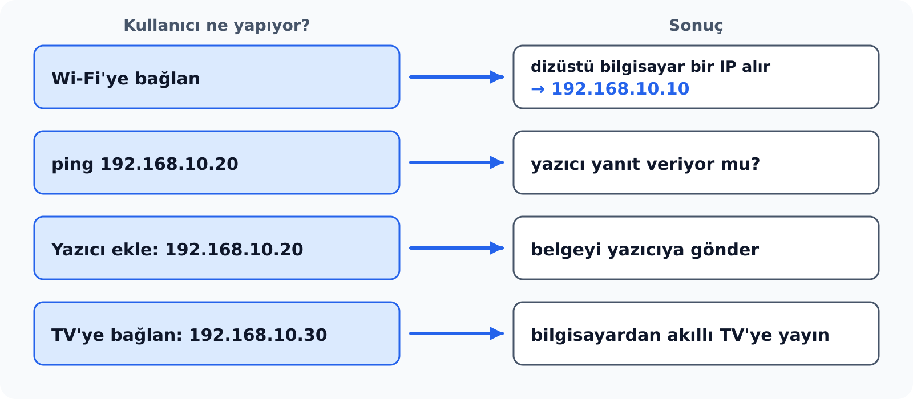
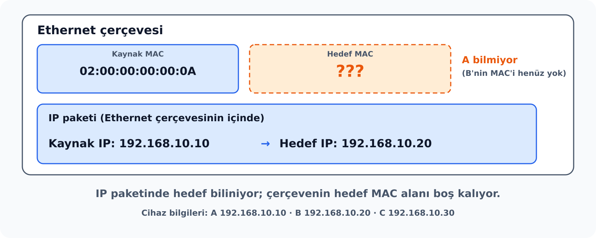
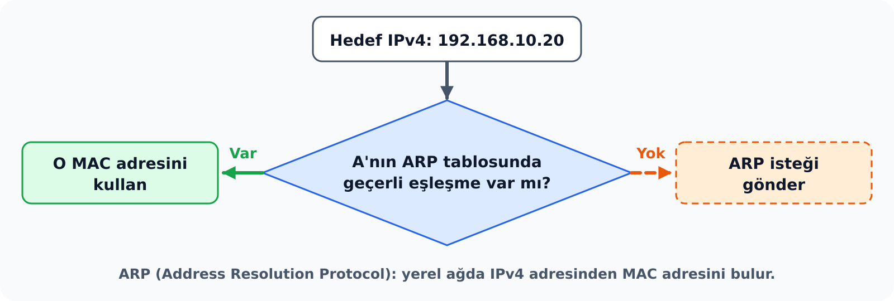
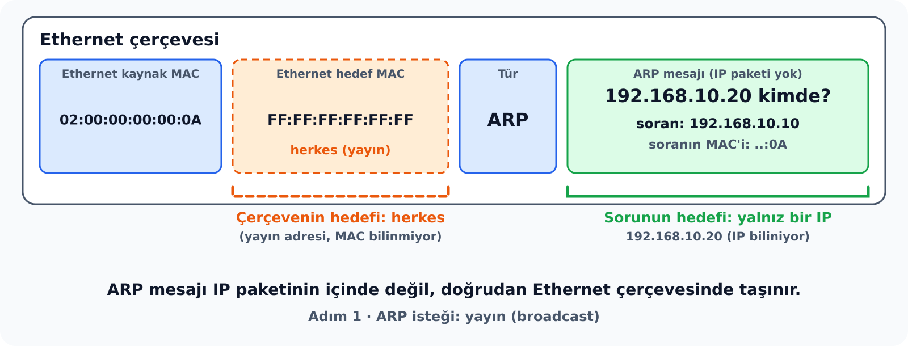
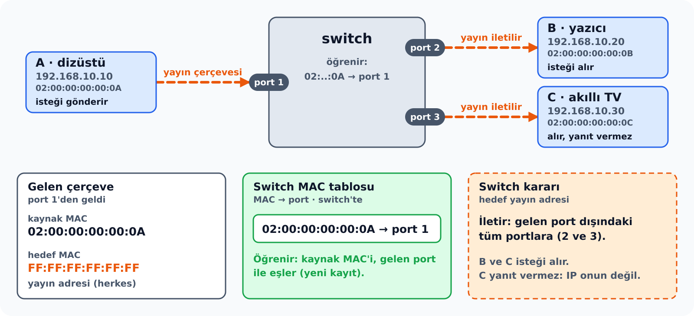
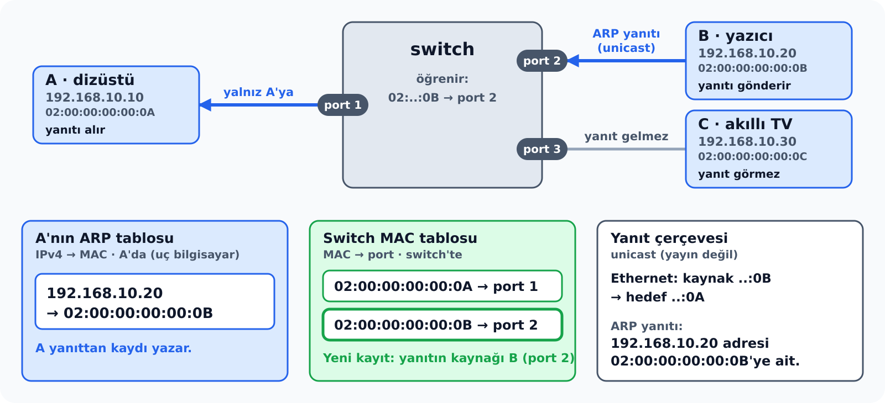
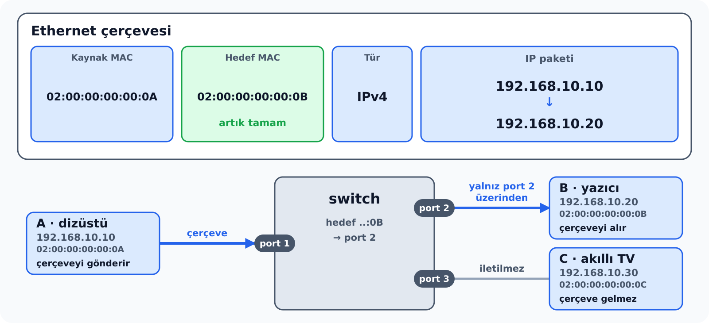
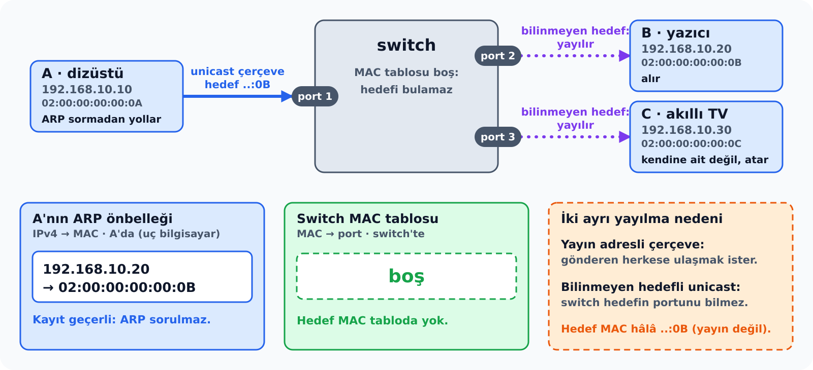
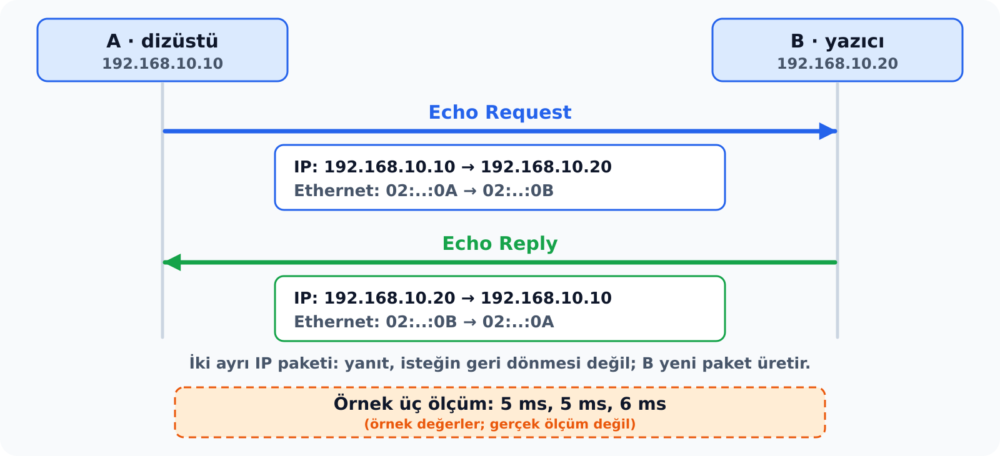
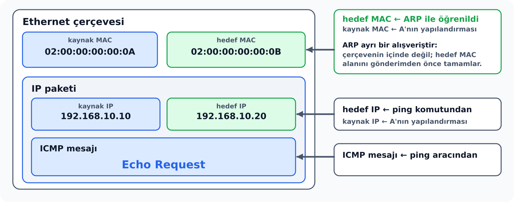

<!--
Sunum taslağı. Dayanak: draft/taslaklar/bilgisayar-aglari-hafta-05-06/n2-yerel-agda-iletisim-arp-ve-icmp.md (id: cn5-6-n2, status: sunuma-kaynak-not, 16 Ekim 2026).
Üretim kuralları: _notes/cn_5-6/sunum-ajanina-yonerge.md.
Notes blokları öğrencinin sonradan çalışacağı konu anlatımıdır; sunucu yönlendirmesi içermez.
Topoloji senaryodur; denenmiş .pkt dosyası yoktur. Şekiller images/bilgisayar-aglari/hafta-05/ altındaki SVG'lerdir; render çıktısı alınmamıştır. Ping süreleri örnek değerdir, gerçek ölçüm değildir.
Ortak varsayım: IPv4, aynı yerel Ethernet ağı, hazır yapılandırma; başlangıçta ARP önbelleği ve switch tablosu boş, başka trafik yok.
-->

## Evde Wi-Fi'ye bağlandık: cihazlara IP ile ulaşıyoruz

{width="100%" fig-align="center" fig-alt="Wi-Fi'ye bağlanan dizüstü 192.168.10.10 adresini alır; ping, yazıcı ekleme ve TV bağlantısında hedef IP adresiyle belirtilir."}

Yerel ağdaki cihazlara **IP adresiyle** ulaşıyoruz.

::: {.notes}
Ev ya da iş yerindeki bir yerel ağa bağlanan cihaz, ağdaki modem/router'dan otomatik olarak bir IP adresi alır; adresin nasıl atandığı N4'te DHCP ile anlatılır. Kullanıcı yerel ağdaki diğer cihazlarla çalışırken bu adresleri kullanır: yazıcı kurulurken yazıcının IP adresi girilir, bir cihazın yanıt verip vermediği `ping` ile denenir, akıllı TV'ye ya da ağ depolama cihazına IP adresi üzerinden bağlanılır.

Bu işlemlerin hiçbirinde kullanıcı bir MAC adresi yazmaz. Ev ağındaki modem/router kutusu kablosuz erişim noktası ile switch işlevini birlikte taşıyabilir; kablolu ve kablosuz cihazlar aynı yerel ağın parçasıdır. Devamında bu üç cihaz A (dizüstü), B (yazıcı) ve C (akıllı TV) adlarıyla anılır.
:::

---

## Bir çelişki mi?

| Daha önce (Ethernet ve MAC) | Bu not |
|---|---|
| Yerel ağda switch çerçeveyi **MAC adresine** göre iletir. | Yazıcıya ve TV'ye **IP adresiyle** ulaşıyoruz. |

**Soru:** Yerel ağda hangi adres kullanılıyor: IP mi, MAC mı?

::: {.notes}
Çelişki gibi görünen durum, iki adresin farklı katmanlarda ve farklı amaçlarla kullanılmasından kaynaklanır. Kullanıcı ve uygulama hedefi IP adresiyle belirtir; IP adresi paketin içinde taşınır ve paketin hangi uç sisteme gittiğini söyler. Ancak paket yerel bağlantıda tek başına iletilmez. Bir çerçeveye yerleştirilir ve switch bu çerçeveyi MAC adresine göre iletir.

Doğru soru "ikisi birlikte nasıl kullanılıyor?" sorusudur. Yerel ağdaki bir gönderim hem IP adresini hem MAC adresini gerektirir. Açık kalan nokta şudur: kullanıcı yalnız IP adresini bildiğine göre, çerçeve için gereken MAC adresi nereden bulunur? Çelişkinin çözümü ARP'dir: kullanıcı yazıcıyı kurarken yalnız IP adresini girer; IP adresinden MAC adresine geçişi işletim sistemi ARP ile kendiliğinden yapar.

Kablosuz bağlantı da bu soruyu ortadan kaldırmaz. Wi-Fi'de kullanılan çerçeveler de alıcıyı MAC adresiyle belirtir; aynı problem kablosuz ağda da vardır.
:::

---

## IP biliniyor; çerçeve kime gidecek?

| Cihaz | IPv4 | MAC | Switch portu |
|---|---|---|---|
| A (dizüstü) | 192.168.10.10 | 02:00:00:00:00:0A | 1 |
| B (yazıcı) | 192.168.10.20 | 02:00:00:00:00:0B | 2 |
| C (akıllı TV) | 192.168.10.30 | 02:00:00:00:00:0C | 3 |

{width="100%" fig-align="center" fig-alt="IP paketinde hedef 192.168.10.20 biliniyor; Ethernet çerçevesinin hedef MAC alanı bilinmiyor."}

::: {.notes}
A cihazı B'ye bir IP paketi göndermek istiyor. Pakette hedef IP olarak 192.168.10.20 yazılıdır. Ancak Ethernet kartı IP adresini okuyarak çerçeve teslim etmez; çerçevenin kime ait olduğunu **hedef MAC alanından** anlar. Dolayısıyla A'nın bu alana ne yazacağını bilmesi gerekir ve A, B'nin MAC adresini henüz bilmez.

Burada bir bakış açısı ayrımı önemlidir. Adres tablosuna dışarıdan bakan biri B'nin MAC adresini görür; ama A bu tabloyu görmez. A'nın elindeki tek bilgi hedefin IP adresidir. Bu soru N1'in sonunda açık kalan sorudur ve cevabını **ARP** (Address Resolution Protocol, Adres Çözümleme Protokolü) verir.

Bütün örnekler aynı üç cihaz, aynı switch portları ve aynı yerel Ethernet ağı üzerinde geçer; IP ayarları hazırdır. Hedef başka bir ağdaysa paketin nereye gideceği yönlendirme konusuna aittir.
:::

---

## Önce önbellek, sonra ARP isteği

{width="100%" fig-align="center" fig-alt="Karar akışı: A'nın ARP tablosunda geçerli eşleşme varsa o MAC kullanılır, yoksa ARP isteği gönderilir."}

**ARP** (Address Resolution Protocol): yerel ağda IPv4 adresinden MAC adresini bulur.

::: {.notes}
Çerçevenin hedef MAC adresini bulmak için A önce kendi **ARP tablosuna**, yani ARP önbelleğine bakar. Bu tablo yerel ağda daha önce öğrenilmiş IP–MAC eşleşmelerini tutar. Geçerli bir eşleşme varsa doğrudan kullanılır; böylece her paketten önce ağı yoklamak gerekmez. Eşleşme yoksa A bir **ARP isteği** gönderir.

Senaryoda başlangıçta tablolar boştur ve başka trafik yoktur. A'nın B için bir kaydı bulunmadığından ARP isteği göndermek zorundadır.
:::

---

## Adım 1: Yayın isteği

{width="100%" fig-align="center" fig-alt="ARP isteği: çerçevenin hedefi herkes (FF:FF:FF:FF:FF:FF), sorunun hedefi 192.168.10.20; ARP mesajı IP paketinde değil doğrudan Ethernet çerçevesindedir."}

İki hedef var: **çerçevenin hedefi** herkes, **sorunun hedefi** 192.168.10.20.

::: {.notes}
ARP isteği şu soruyu sorar: "192.168.10.20 adresi kimde?" A bu soruyu tek bir alıcıya gönderemez, çünkü B'nin MAC adresini bilmez. Bunun için Ethernet çerçevesinin hedef MAC alanına **broadcast adresini** (FF:FF:FF:FF:FF:FF) yazar. Yerel ağdaki herkes soruyu alır, ama sorulan IP adresi yalnız birindedir.

Bu istekte iki farklı "hedef" vardır ve karıştırılmamalıdır. Çerçevenin hedefi herkestir, çünkü MAC adresi bilinmemektedir. Sorunun hedefi ise 192.168.10.20'dir, çünkü IP adresi bilinmektedir.

ARP isteği bir IP paketinin içinde taşınmaz; doğrudan Ethernet çerçevesine yerleştirilir ve Ethernet tür alanı alıcıya içeride ARP olduğunu bildirir. Hedefin MAC adresi öğrenilmeden iletişimi başlatabilmeyi sağlayan araç, Ethernet yayın adresidir.
:::

---

## Adım 1'de switch ne yapıyor?

{width="100%" fig-align="center" fig-alt="A, B ve C switch'in 1, 2 ve 3. portlarına bağlı; yayın çerçevesi port 1'den gelir, switch A'yı öğrenir ve 2 ile 3'e iletir."}

B ve C isteği alır. C, sorulan IP kendisinin olmadığı için yanıt vermez.

::: {.notes}
Switch bu çerçeveyi aldığında iki şey yapar. Birincisi, çerçevenin **kaynak MAC adresinden** (..:0A) A'nın 1. porta bağlı olduğunu öğrenir. İkincisi, hedef yayın adresi olduğu için çerçeveyi gelen port dışındaki bütün portlara iletir. B ve C isteği alır. C, sorulan IP adresinin kendisine ait olmadığını görür ve cevap vermez; B kendi adresini tanır.

Bu aşamada C isteği almış olsa da switch C'yi öğrenmiş değildir. Switch kaynak adresleri yalnız kendi portlarına **gelen** çerçevelerden öğrenir. C bu alışverişte henüz çerçeve göndermemiştir.
:::

---

## Adım 2: Unicast yanıt

{width="100%" fig-align="center" fig-alt="B'nin unicast ARP yanıtı yalnız A'ya iletilir; A'nın ARP tablosu IPv4'ü MAC'e, switch'in MAC tablosu MAC'i porta eşler."}

Switch yanıtı yalnız A'nın portuna iletir ve `02:..:0B → port 2` kaydını öğrenir.

::: {.notes}
B isteği alınca A'nın IP ve MAC bilgisini de istekten öğrenmiş olur ve yanıtını doğrudan A'ya, yani **unicast** olarak gönderir. A bu bilgiyi ARP tablosuna yazar. Bekleyen IP paketi, hedef MAC alanı tamamlanmış bir Ethernet çerçevesine konabilir.

Switch bu yanıtın kaynak MAC adresinden B'nin 2. porta bağlı olduğunu öğrenir. A'nın portunu istekte zaten öğrenmiş olduğundan yanıtı yalnız A'nın portuna iletir.

ARP'nin ne yapmadığı da önemlidir: hedef IP adresini değiştirmez. Paket baştan sona 192.168.10.20 adresli kalır; ARP yalnız çerçeve için gereken yerel adres bilgisini tamamlar. ARP isteği yerel yayın alanına aittir ve yönlendiricilerden geçerek İnternet'e yayılmaz.
:::

---

## Adım 3: IP paketini taşıyan çerçeve

{width="100%" fig-align="center" fig-alt="Hedef MAC tamamlanmış Ethernet çerçevesi IPv4 paketini taşır; switch çerçeveyi yalnız port 2'den iletir."}

Artık hedef MAC tamam. Switch hedef MAC'e bakar ve çerçeveyi **port 2**'den iletir.

::: {.notes}
Alışverişin sırası şöyledir: önce yayın isteği, sonra unicast yanıt, en son da asıl işi yapan IP paketini taşıyan çerçeve. Bu üçüncü çerçevede ARP mesajı yoktur; Ethernet tür alanı içeride IPv4 bulunduğunu söyler. A'nın seçtiği hedef MAC adresi switch'in iletme kararını belirler: switch tablosunda ..:0B'nin 2. portta olduğunu bildiği için çerçeveyi yalnız o porttan iletir.
:::

---

## İki tablo, iki ayrı soru

| Tablo | Nerede? | Neyi eşleştirir? | Ne için? |
|---|---|---|---|
| ARP tablosu | Uç bilgisayarda (A) | **IPv4 → MAC** | Çerçevenin hedef MAC'ini **seçmek** |
| MAC tablosu | Switch'te | **MAC → port** | Gelen çerçeveyi uygun porttan **iletmek** |

A hedef MAC'i seçer; switch o MAC'e göre iletir. Switch IP başlığına bakmaz.

::: {.notes}
Aynı alışverişte iki tablo dolar ve ikisi birbirine benzediği için karıştırılır; oysa cevapladıkları sorular farklıdır. **ARP tablosu** uç bilgisayarda tutulur ve "bu IP adresinin MAC adresi nedir?" sorusunu cevaplar; kullanım yeri, gönderilecek çerçevenin hedef MAC alanını doldurmaktır. **MAC tablosu** switch'te tutulur ve "bu MAC adresi hangi portun arkasındadır?" sorusunu cevaplar; kullanım yeri, gelen çerçeveyi uygun porttan iletmektir.

Switch, A adına B'nin IP adresini çözmez. IP başlığına bakmaz; yalnız çerçevenin MAC adreslerine göre çalışır. Birini diğerinin yerine kullanmak, örneğin switch tablosunda IP adresi aramak, yanlıştır: bir tabloda IP vardır, öbüründe yoktur.
:::

---

## Aynı olay, iki tabloda

| Olay | A'nın ARP önbelleği | Switch'in öğrendiği |
|---|---|---|
| Başlangıç | boş | boş |
| A'nın yayın isteği switch'e gelir | B için eşleşme yok | `02:..:0A → port 1` |
| B'nin yanıtı switch'e gelir | Yanıt henüz A'ya ulaşmadı | `02:..:0B → port 2` |
| Yanıt A'ya ulaşır | `192.168.10.20 → 02:..:0B` | Önceki iki kayıt korunur |
| A, B'ye veri çerçevesi gönderir | Var olan eşleşme kullanılır | Hedef MAC, port 2'yi seçtirir |

Switch, C'yi ancak C'den bir çerçeve gelirse öğrenir.

::: {.notes}
Olayların sırası, iki kaydın farklı anlarda ve farklı cihazlarda oluştuğunu gösterir. İstek switch'e girdiği anda switch A'yı öğrenir; ama A'nın ARP önbelleğinde B için henüz bir kayıt yoktur. Yanıt switch'e girdiğinde switch B'yi öğrenir; yanıt yoldayken A'nın önbelleği hâlâ boştur. Yanıt A'ya ulaşınca ARP önbelleği dolar. Switch tablosunda ise C hiç yer almaz, çünkü C bu alışverişte çerçeve göndermemiştir.

Bu sonuç başka trafik olmadığı varsayımına bağlıdır. C de bir çerçeve gönderseydi switch onu da öğrenirdi. Yani switch'in bir cihazı öğrenmesi için o cihazdan çerçeve **gelmesi** gerekir; cihazın bir çerçeveyi alması bunun için yetmez.
:::

---

## Switch tablosu boşalırsa ARP önbelleği kalır

{width="100%" fig-align="center" fig-alt="Switch MAC tablosu boşken A ARP sormadan unicast çerçeve yollar; switch çerçeveyi diğer portlara yayar, C atar."}

Bilinmeyen hedefe yayma ile yayın adresli çerçevenin yayılması farklı nedenlere dayanır.

::: {.notes}
Yalnız switch'in tablosunun boşaldığını, A'nın ARP önbelleğinin ise hâlâ geçerli olduğunu düşünelim. A, B'nin MAC adresini bildiği için yeniden ARP sormadan çerçevesini gönderir. Switch hedef MAC adresini tablosunda bulamazsa bu unicast çerçeveyi aynı yayın alanındaki diğer portlara yayar. B çerçeveyi alır, C ise kendisine ait olmadığını görür. Çerçevenin hedef adresi yayın adresine dönüşmez; hâlâ ..:0B'dir.

Burada "herkese gitme" iki ayrı nedenle olabilir. Yayın adresli çerçeve, gönderen herkese ulaşmak istediği için yayılır. Bilinmeyen hedefe giden unicast çerçeve ise switch hedefin hangi portta olduğunu bilmediği için yayılır. Bu örnek, iki tablonun farklı cihazlarda ve birbirinden bağımsız tutulmasının doğrudan sonucudur.
:::

---

## Kaydın geçerliliği

- ARP önbelleğindeki dinamik kayıtlar süresiz değildir.
- Süre ve davranış işletim sistemine göre değişir.
- Elle girilmiş kalıcı kayıtlar olabilir.

Tabloda bir kaydın bulunması "az önce broadcast ile öğrendik" demek değildir.

::: {.notes}
İşletim sistemi dinamik ARP kayıtlarını bir süre sonra siler ya da yeniden doğrular; bu sürenin değeri sisteme göre değişir. Elle girilmiş kalıcı kayıtlar da olabilir. Tabloda görünen bir kayıt, daha önceki bir alışverişten kalmış olabilir.

Bunun pratik sonucu, tablo çıktılarını yorumlarken ortaya çıkar. `arp -a` çıktısında B'nin görünmesi, son ping'in B'yi o anda broadcast ile öğrendiğini göstermeyebilir; kayıt daha önceki bir alışverişten kalmış olabilir.
:::

---

## ICMP: IP iletişiminin kontrol mesajları

| Mesaj | Ne zaman? |
|---|---|
| Echo Request / Echo Reply | Bir hedefin erişilebilir olup olmadığını yoklamak |
| Destination Unreachable | Bazı teslim sorunlarında |
| Time Exceeded | Paketin yaşam sınırı aşıldığında |

- ICMP mesajı IP paketinin içinde taşınır: IPv4 **Protocol = 1**; port yok
- ARP mesajı IP paketinin içinde değil, **doğrudan Ethernet çerçevesinde** taşınır

::: {.notes}
ARP ile çerçeve B'ye ulaştı. Ancak IP'nin en iyi çaba hizmetinde paketlerin kaybolabileceğini biliyoruz (N1); bir şey ters giderse bunu haber verecek bir mekanizma gerekir. **ICMP** (Internet Control Message Protocol) bu işi görür: IP iletişimiyle ilgili kontrol ve hata bildirimlerini taşır. Başlıca mesaj türleri Echo Request/Echo Reply, Destination Unreachable ve Time Exceeded'dir.

ICMP mesajı bir IP paketinin içinde taşınır. IPv4 başlığındaki Protocol değeri 1 olduğunda içerik ICMP işlemesine verilir; TCP ya da UDP portu kullanılmaz. Echo mesajlarında kimlik ve sıra bilgisi bulunur; `ping` bu bilgilerle gelen yanıtı gönderdiği yoklamayla ilişkilendirir. Yanıtta, isteğin taşıdığı veri alanı da geri gönderilir.

ICMP'nin sınırı da bilinmelidir: her kayıp için bir ICMP mesajı üretileceği ya da bu mesajın kaynağa ulaşacağı garanti edilmez. ICMP en iyi çaba hizmetine geri bildirim ekler, ama onu güvenilir yapmaz.

ARP ile arasındaki taşınma farkı da önemlidir: ARP mesajı doğrudan Ethernet çerçevesinde, ICMP mesajı ise IP paketinin içinde taşınır.
:::

---

## Ping: iki ayrı IP paketi

{width="100%" fig-align="center" fig-alt="Echo Request ve Echo Reply ayrı IP paketleridir; kaynak ve hedef adresler yer değiştirir. Süreler örnek değerdir."}

| Mesaj | IP kaynak → hedef | Ethernet kaynak → hedef |
|---|---|---|
| Echo Request | `192.168.10.10 → 192.168.10.20` | `02:..:0A → 02:..:0B` |
| Echo Reply | `192.168.10.20 → 192.168.10.10` | `02:..:0B → 02:..:0A` |

::: {.notes}
`ping` komutu hedefe bir Echo Request gönderir ve Echo Reply bekler. İstek ile yanıt, aynı paketin dönüp gelmesi değildir. B, aldığı isteğe karşılık yeni bir ICMP yanıtı ve onu taşıyacak yeni bir IP paketi oluşturur. Hem IP hem Ethernet düzeyinde kaynak ile hedef yer değiştirir. A'da yanıtın görülmesi, gidiş kadar dönüşün de çalıştığına ilişkin bir gözlemdir.

Ping'in verdiği süre, isteğin gidip yanıtın geri gelmesinin toplamıdır. Bu süre yalnız kablodaki yayılma süresinden oluşmaz; uçların paketi işlemesi, bekleme süreleri ve yolun koşulları da içindedir. Gidiş ve dönüş sürelerinin eşit olduğu bilinmeden bu değeri ikiye bölüp "tek yön gecikmesi" demek yanlış olur. Örnekteki 5, 5 ve 6 ms değerleri örnek değerlerdir.
:::

---

## Echo Request çerçevesinin içi: hangi bilgi nereden geldi?

{width="100%" fig-align="center" fig-alt="Ethernet çerçevesi IP paketini, IP paketi ICMP Echo Request'i taşır; ARP çerçevenin içinde değil, hedef MAC'i önceden tamamlar."}

ARP bu çerçevenin **içinde yer almaz**; çerçevenin eksik hedef MAC alanını gönderimden önce tamamlar.

::: {.notes}
Echo Request çerçevesindeki her bilgi farklı bir kaynaktan gelir. Hedef IP adresi kullanıcının yazdığı ping komutundan, hedef MAC adresi ARP alışverişinden, ICMP mesajı ise ping aracından gelir. Kaynak IP ve kaynak MAC adresleri A'nın kendi yapılandırmasından alınır.

Bu çerçevede N2'nin bütün parçaları aynı anda bulunur: ICMP mesajı IP paketinin içinde, IP paketi Ethernet çerçevesinin içinde taşınır. ARP ise bu çerçevenin içinde yer almaz; çerçevenin hedef MAC alanını gönderimden önce tamamlayan ayrı bir alışveriştir. Uygulamada ICMP mesajı ve IP paketi önce hazırlanıp ARP tamamlanana kadar bekletilebilir. B, Echo Reply'ı gönderirken yeniden ARP istemez; A'nın MAC adresini ARP isteğinden zaten öğrenmiştir.
:::

---

## Yanıt geldi: ne biliyoruz?

**Biliyoruz:** o yoklama sırasında IP düzeyinde gidiş ve dönüş yolu çalıştı.

**Bilmiyoruz:**

- B'de web sunucusunun çalıştığını
- Doğru sayfanın bulunduğunu
- Güvenli bir bağlantının başarılı olacağını

::: {.notes}
Ping yanıtı, web sayfasının açılacağını göstermez. Echo alışverişi ile web hizmeti farklı protokollerin farklı işleridir. HTTP/1.1 web hizmetinde ilgili portta bağlantının kabul edilmesi ve HTTP isteğinin işlenmesi de gerekir; bunlar N3 ve N4'te anlatılır.

Ping sonucunu okurken sorulacak soru şudur: "B'de web sunucusunun çalıştığını, doğru sayfanın bulunduğunu ya da güvenli bağlantının başarılı olacağını bu sonuç kanıtlıyor mu?" Cevap hayırdır. Sonuç yalnız o yoklama sırasında IP düzeyindeki gidiş-dönüş erişimini gösterir.
:::

---

## Yanıt gelmedi: ne biliyoruz?

Biliyoruz: **belirlenen sürede Echo Reply alınamadı.** Neden bilinmiyor.

- Hedef veya bir bağlantı çalışmıyor olabilir
- İstek ya da yanıt yolda kaybolmuş olabilir
- ICMP filtreleniyor ya da hedef yanıt vermeyecek biçimde ayarlı olabilir
- Adresleme veya erişim koşullarında sorun olabilir

::: {.notes}
Zaman aşımı, belirlenen süre içinde Echo Reply alınamadığını bildirir; nedenini söylemez. Yanıt gelmemesinden "B kapalı" sonucu çıkarılamaz. Tek bir gözlem tek bir nedeni kesinleştirmez.

Aynı yerel ağdaki ilk yoklamada adres çözümlemesi henüz tamamlanmamışsa ilk deneme gecikebilir ya da yanıtsız kalabilir. Ancak "ilk ping her zaman başarısız olur" biçiminde bir kural yoktur. Böyle bir durumda ARP tablosuna bakmak, sorunun adres çözümlemesiyle ilgili olup olmadığını araştırmaya yardım eder.

Teşhis, gözleme yeni gözlem ekleyerek ilerler: ARP yanıtının gelip gelmediğine bakmak, bağlantı durumunu denetlemek ve başka bir hedefi sınamak olası nedenleri daraltır.
:::

---

## Laboratuvar akışı

1. A'dan B'ye `ping 192.168.10.20`; yanıtları ve süreleri not edin.
2. A'da `arp -a` ile B'nin eşleşmesini arayın; switch MAC tablosuna bakın.
3. Önbellek doluyken ping'i tekrarlayın: ARP isteği görülüyor mu?
4. B'nin bağlantısını kesin, ping'i tekrarlayın.

Her adımda **hangi olayın hangi tabloyu değiştirdiğini** kendi cümlelerinizle açıklayın.

::: {.notes}
Bu akış, hazır adresli iki bilgisayar ve bir switch üzerinde uygulanabilir. Başlangıçta ARP önbelleklerinin boş olması gerekir. Packet Tracer'da olayları izlemek için simülasyon görünümünde ARP ve ICMP mesajları seçilir. Gerçek bir ağda mesajların sırasını görmek için paket kaydı gerekir; yalnız ping çıktısı ARP alışverişini göstermez. Linux'ta komşuluk tablosu için `ip neigh` gibi komutlar da kullanılabilir; çıktının alanları sisteme göre değişir.

Her adımda hangi olayın hangi tabloyu değiştirdiği kendi cümlelerle açıklanmalıdır. Dördüncü adım ayrıca düşündürücüdür: bağlantıyı kesen kişi hangi değişikliği yaptığını bilir. Yalnız ping çıktısını gören başka biri aynı nedeni kesin olarak söyleyebilir mi? Bu soru, neden yanıt alınamadığını belirlemek için ek hangi gözlemlere ihtiyaç duyulduğunu tartışmayı gerektirir.
:::

---

## Packet Tracer'da aynı akışı gözleyelim

1. A ve B için iki PC, bir switch yerleştirin; PC'leri düz kabloyla (Copper Straight-Through) switch'e bağlayın.
2. PC'lere `192.168.10.10` ve `192.168.10.20` adreslerini girin.
3. Simulation Mode'a geçin; filtrede yalnız **ARP** ve **ICMP** kalsın.
4. A'nın komut satırında `ping 192.168.10.20` çalıştırın.
5. Event List'te sırayı izleyin: **ARP Request → ARP Reply → ICMP Echo Request → ICMP Echo Reply**.

::: {.notes}
Bu uygulamada yeni bir protokol yoktur; adım adım izlenen akış Packet Tracer'ın Simulation Mode'unda görünür hâle gelir. IP adresi girildiğinde Packet Tracer'ın otomatik doldurduğu maske değeri değiştirilmemelidir; maskenin anlamı sonraki adresleme konusunda anlatılır.

Event List'teki her olaya tıklandığında açılan pencerede çerçevenin ve paketin ayrıntıları görülebilir. Bu pencerede ARP isteğinin hedef MAC adresinin broadcast olduğu ve ICMP mesajının IP paketi içinde taşındığı doğrulanabilir. Aynı ping ikinci kez gönderildiğinde ARP olayları görülmez; A eşlemeyi ARP tablosunda tuttuğu için soruyu yeniden sormaz. Bu kayıt komut satırında `arp -a` ile kontrol edilebilir.
:::

---

## Kontrol soruları

1. Ev ağında yazıcıya IP adresiyle ulaşıyoruz; switch ise çerçeveyi MAC adresine göre iletiyor. Bu bir çelişki mi?
2. ARP Request neden broadcast, ARP Reply neden unicast gönderilir?
3. C, ARP isteğini aldı. Switch C'nin MAC adresini öğrenir mi?
4. ARP tablosu ile switch MAC tablosu arasındaki fark nedir?
5. ICMP mesajı hangi birimin içinde taşınır? ARP mesajından farkı nedir?
6. Ping yanıtı alınamadığında hedefin kapalı olduğu söylenebilir mi?

::: {.notes}
**1.** Çelişki yoktur: kullanıcı hedefi IP adresiyle belirtir ve bu adres IP paketinde taşınır; paketi taşıyan çerçevenin hedef alanı ise MAC adresidir. Kullanıcının bilmediği MAC adresini ARP bulur.

**2.** İstek broadcast gider, çünkü hedefin MAC adresi bilinmez. Yanıt unicast gider, çünkü yanıt veren cihaz, istekten soran cihazın MAC adresini öğrenmiştir.

**3.** Hayır. Switch kaynak adresleri yalnız kendi portlarına gelen çerçevelerden öğrenir; C henüz çerçeve göndermemiştir.

**4.** ARP tablosu uç bilgisayarda IPv4–MAC eşlemesini tutar ve hedef MAC'i seçmeye yarar. Switch MAC tablosu MAC–port eşlemesini tutar ve çerçeveyi iletmeye yarar.

**5.** ICMP mesajı IP paketinin içinde, ARP mesajı doğrudan Ethernet çerçevesinin içinde taşınır.

**6.** Hayır. Yanıt alınamaması, hedefin veya bir bağlantının çalışmamasından, isteğin ya da yanıtın kaybından, ICMP'nin engellenmesinden ya da adresleme sorunundan kaynaklanabilir.
:::

---

## B cevap verdi; ama hangi uygulama?

B gibi bir cihazda aynı anda çalışıyor olabilir:

- Web sunucusu
- Dosya aktarım programı
- Müzik uygulaması

Gelen veri hangisine ait?

::: {.notes}
B'den alınan ping yanıtı, B'ye bir cihaz olarak ulaşılabildiğini gösterir. İçinde çalışan uygulamalar hakkında bir şey söylemez. Gelen verinin hangi uygulamaya gideceği sorusunu N3'teki portlar ve taşıma katmanı cevaplar.
:::
