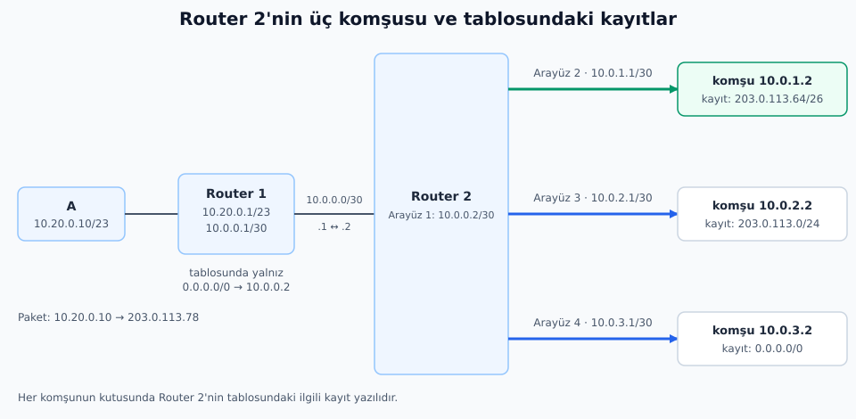
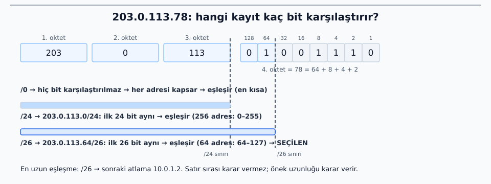

## Hiç ziyaret etmediğiniz bir siteye gidiyorsunuz

Adres çubuğuna az bilinen bir sitenin adını yazdınız. Hedef IP olarak `203.0.113.78` örneğini alıyoruz. Bu adres, dokümantasyon için ayrılmış `203.0.113.0/24` bloğundandır; gerçek bir sunucunun adresi değildir.

Paketin yolundaki router'lar bu hedefi, ya da sizi, daha önce tanımak zorunda mı?

::: {.notes}
Pek çok kişi router'ların popüler siteleri bir yerde kayıtlı tuttuğunu, az bilinen bir sitenin ise bir şekilde "aranması" gerektiğini düşünür. Bu sezgiyi sınamak için router'ın elinde gerçekte ne olduğuna bakacağız.

DNS ile ada karşılık bir IP alındığını kabul ediyoruz; kullandığımız sonuç örnek adres `203.0.113.78`. İlk atlama için ağ geçidi mantığı geçerli: paket kurumun router'ına teslim edildi. Merak edilen, router'ın ondan sonra ne yaptığı.
:::

---

## Router'ın elindeki bilgi: yönlendirme tablosu

**Yönlendirme tablosu:** router'ın, hedef ağ önekleri için hangi komşuya ve hangi arayüze paket göndereceğini tuttuğu kayıt listesi.

**Sonraki atlama (next hop):** paketin bir sonraki teslim edileceği komşu router'ın adresi. Doğrudan bağlı bir ağda hedefin kendisi aynı bağlantıdadır.

Kararda kullanılan üç alan: **hedef önek → sonraki atlama → çıkış arayüzü**

**Neden önek?** Bir satır bir web sitesini değil, bir adres kümesini tarif eder. `203.0.113.0/24` satırı 256 adresi kapsar; router her siteyi ayrı ayrı bilmek zorunda kalmaz.

::: {.notes}
Tablodaki satır bir web sitesini değil, bir ağ önekini tarif eder: `203.0.113.0/24` gibi. `/n` gösterimi, adresin ilk n bitinin sabit olduğu adres kümesini belirtir (RFC 4632).

`203.0.113.0/24` dokümantasyon için ayrılmış bir bloktur; gerçek bir sitenin ya da gerçek bir duyurunun adresi değildir. `10.0.x.x` ara bağlantı adresleri de örnek adreslerdir.
:::

---

## Örnek yol: kurum router'ı (Router 1)

A (`10.20.0.10`) Router 1'in LAN arayüzüne (`10.20.0.1/23`) bağlıdır; Router 1'in öbür arayüzü (`10.0.0.1/30`) Router 2'ye gider.

Router 1'in tablosu, yalnız ilgili kayıtlar:

| Hedef önek | Sonraki atlama | Çıkış arayüzü |
| --- | --- | --- |
| `10.20.0.0/23` | doğrudan bağlı | LAN |
| `10.0.0.0/30` | doğrudan bağlı | WAN |
| `0.0.0.0/0` | `10.0.0.2` | WAN |

**Varsayılan rota (default route):** `0.0.0.0/0` kaydıdır. `/0` önekinde hiçbir bit karşılaştırılmaz; bu yüzden her IPv4 adresini kapsar. Anlamı: "daha özel bir kaydım yoksa bu komşuya gönder." Router, her hedefi tek tek bilmeden de bir yön verebilir.

**Hedef `203.0.113.78`:** `10.20.0.0/23` ve `10.0.0.0/30` kayıtları `10.x` adreslerini kapsar, bu hedefi kapsamaz; yalnız `0.0.0.0/0` kapsıyor → paket `10.0.0.2`'ye gider.

::: {.notes}
Router 1 yalnız kendi LAN'ını, Router 2 bağlantısını ve bir varsayılan rotayı bu tabloda gösteriyor. `0.0.0.0/0` sıfır bitlik önek: hiçbir bit karşılaştırılmadığı için her IPv4 adresini kapsar. Anlamı: "daha özel bir bilgim yoksa bu komşuya gönder."

Router 1'in `203.0.113.78` hakkında hiçbir şey bilmediğine dikkat edin. Yine de karar verebiliyor: hedefi kapsayan tek kayıt varsayılan rota. Varsayılan rota tam bu durum için var.

Sonraki atlama, bir çıkış arayüzüne çözülen erişilebilir bir adres olmalıdır. `10.0.0.2`, doğrudan bağlı `10.0.0.0/30` ağının içindedir. Bu `/30` ağında `10.0.0.0` ağ adresi, `10.0.0.3` yayın adresidir; kullanılabilir adresler ağ adresi + 1 ve + 2 olan `10.0.0.1` ve `10.0.0.2`'dir. "WAN" etiketi bu örnekteki ara bağlantıyı gösterir; genel internetteki bir operatör ağı değildir.
:::

---

## Router 2 daha fazlasını biliyor

Router 2'nin arayüzleri: 1 = `10.0.0.2/30` (Router 1 tarafı), 2 = `10.0.1.1/30`, 3 = `10.0.2.1/30`, 4 = `10.0.3.1/30`.



*Şekilde Router 2'nin dört arayüzü ve her komşu için tablodaki kayıt görülür.*

Aşağıda yalnız `203.0.113.78` için baktığımız kayıtlar var. Bağlı `/30` ağlarının doğrudan kayıtları da tabloda durur; bu hedef onlara girmez.

| Hedef önek | Sonraki atlama | Çıkış arayüzü |
| --- | --- | --- |
| `203.0.113.0/24` | `10.0.2.2` | Arayüz 3 |
| `203.0.113.64/26` | `10.0.1.2` | Arayüz 2 |
| `0.0.0.0/0` | `10.0.3.2` | Arayüz 4 |

**Kapsıyor mu? Üç kaydı tek tek sınayalım:**

- `/24`: ilk üç oktet `203.0.113` aynı → kapsıyor (adresler `0`–`255`).
- `/26`: 26 = 24 + 2; ilk üç oktet (24 bit) ve dördüncü oktetin ilk 2 biti ağa, kalan 6 bit hosta aittir. 2⁶ = 64 adres olduğundan blok boyu 64'tür ve `203.0.113.64/26` bloğu `64`–`127` arasıdır. 78 bu 64 adreslik blokta yer alır: 78 − 64 = 14 < 64 → kapsıyor.
- `/0`: hiçbir bit karşılaştırılmaz → her adresi kapsıyor.

**Hedef `203.0.113.78` için üç kayıt da eşleşiyor.**

::: {.notes}
Her `/30` bağlantıda kullanılabilir adresler, o bloğun ağ adresinin 1 ve 2 fazlasıdır. Bu örneğin bütün `/30` blokları `.0` ile başladığı için sonraki atlamalar `.2` ile biter: `10.0.1.2`, `10.0.2.2`, `10.0.3.2`. Bir `/30` bloğu başka bir sayıyla başlasa (örneğin `.4`), kullanılabilir adresler `.5` ve `.6` olurdu.

Doğrudan bağlı `10.0.x.0/30` satırları `.78` ile eşleşmediği için seçime girmez. Üç farklı komşu, üç farklı sonraki atlama; router'ın seçmesi gereken tek bir kayıt var. Hangisi?
:::

---

## En uzun önek eşleşmesi

**En uzun önek eşleşmesi (longest-prefix match):** hedefi kapsayan kayıtlar arasından önek uzunluğu en büyük olan, yani en dar adres kümesini tarif eden kaydı seçmek.

**Neden en özgülü?** Daha uzun önek, o hedef için daha fazla bilgi taşır: `/24` "bu 256 adresin bir yerinde" derken `/26` "bu 64 adresin tam şurasında" der. Daha özel bilgiyi daha genel bilgiye feda etmek, eldeki en iyi bilgiyi atmak olurdu.

**Mekanizma:** router önce hedefi kapsayan bütün adayları bulur, sonra aralarından önek uzunluğu en büyük olanı seçer (RFC 1812, RFC 4632). Tablodaki satır sırası karar vermez.



*Şekilde üç kaydın kaç bit karşılaştırdığı görülür.*

`203.0.113.78` için: `/0` < `/24` < **`/26`** → sonraki atlama `10.0.1.2`

**Sınır:** yönetsel mesafe (AD; rotanın öğrenildiği kaynağın güvenilirlik sırası, küçük değer önceliklidir) ve metrik (aynı kaynağın kendi ölçütüyle verdiği yol maliyeti), aynı önek ve uzunluk için birden çok kaynak ya da yol varsa hangisinin tabloya gireceğini belirler. Farklı uzunluktaki iki kaydı kıyaslamaz; `/24` kaydı ne kadar "güvenilir" olursa olsun `/26` kaydının önüne geçemez.

::: {.notes}
"Uzun", önek bitlerinin sayısıdır; fiziksel yol uzunluğu değildir. Router sırayı değil, önek uzunluğunu karşılaştırır. `/24` satırı tabloda en üstte görünse bile `.78` için `/26` seçilir.

Varsayılan rota bu ölçüte göre en zayıf bilgidir; yalnız başka hiçbir şey eşleşmediğinde devreye girer.

AD ve metrik farklı bir soruya cevap verir: aynı hedef önek için ayrı kaynaklardan (statik, dinamik) kayıt geldiğinde hangisi tabloda kalsın? Uzunluk karşılaştırması bundan önce gelir. Sonraki atlamanın fiziksel olarak daha uzun bir yola çıkması bu karşılaştırmayı etkilemez.
:::

---

## Etkinlik: aynı tablo, farklı hedefler

Router 2 için her hedefte (1) kapsayan kayıtları listeleyin, (2) en uzununu seçin, (3) sonraki atlamayı yazın.

| Hedef IP | Kapsayan kayıtlar | Seçilen kayıt | Sonraki atlama |
| --- | --- | --- | --- |
| `203.0.113.20` | | | |
| `203.0.113.200` | | | |
| `198.51.100.20` | | | |

::: {.notes}
İpucu: `/26` bloğunun dördüncü oktet aralığını yazıp hedefin altında mı, içinde mi, üstünde mi kaldığına bakın. `198.51.100.20` dokümantasyon için ayrılmış başka bir adrestir; `203.0.113.0/24` dışında kalır.
:::

---

## Bir paket, iki ayrı karar

Aynı paket (hedef `203.0.113.78`), iki router, iki farklı tablo:

| Adım | Router | Eşleşen kayıt | Sonuç |
| --- | --- | --- | --- |
| 1 | Router 1 | `0.0.0.0/0` (tek eşleşme) | `10.0.0.2`'ye (Router 2) |
| 2 | Router 2 | `203.0.113.64/26` (en uzun) | `10.0.1.2`'ye (Router 3) |

Router 1 `/26` kaydını bilmiyor; Router 2 Router 1'in tablosunu bilmiyor.

TTL her router'da bir azalır: 64 → 63 (Router 1) → 62 (Router 2).

::: {.notes}
İlk router yalnız varsayılan rotayı kullanıyor; hedefe giden ayrıntılı yolu bilmesine gerek yok. Paket Router 2'ye ulaştığında Router 2 hedefi kendi tablosuyla baştan karşılaştırıyor ve daha özgül bir kayıt buluyor. Her router yalnız bir sonraki atlamayı seçiyor.

Bu yüzden hiçbir router'ın yolun tamamını bilmesi gerekmiyor. Fakat her atlamada bir sonraki router'ın hedefe doğru kullanılabilir bir kaydı olmalı; zincirde bir halka eksikse paket orada düşer.

Her router'da TTL bir azalır; kaynak 64 yazdıysa Router 1 paketi 63 ile, Router 2 62 ile yollar.

Bu örnekte Router 1 ve Router 2 paketi kaynak `10.20.0.10`, hedef `203.0.113.78` adresleriyle iletir; aralarında adres dönüşümü yoktur. Gerçek bir ev veya kurum çıkışında NAT/PAT kullanılıyorsa kaynak adres çıkışta değişebilir; dönüş paketleri de değişmiş adrese gelir. Eşleştirme kuralı yine aynıdır: router, önündeki paketin hedef IP'sine en uzun önekle bakar.
:::

---

## Bir kayıt silinirse karar nasıl değişir?

Router 2'de `.78` için `/26` varken → `10.0.1.2`.

**`/26` silinirse?** Kalan eşleşmeler `/24` ve `/0`; en uzunu `/24` → `10.0.2.2`.

Seçim kuralı sabit; değişen yalnız tablodaki kayıtlar.

**Eşleşen kayıt hiç kalmazsa**, router tahmin yürütmez: paketi düşürür ve koşullar uygunsa kaynağa ICMP "hedefe ulaşılamıyor" mesajı gönderir. Varsayılan rota varsa hedefi kapsar; paket, TTL yettiği sürece o komşuya verilir.


::: {.notes}
Her silmede kararın, tablodaki bir sonraki en uzun eşleşmeye kaydığını görüyoruz. Router'lara web sitesi tanıtmadığımız hâlde yolları kayıtlarla yönetebiliyoruz.

:::

---

## Etkinlik: silinen kayıtlar

Router 2'nin tablosu öncekiyle aynıdır: `203.0.113.0/24 → 10.0.2.2`, `203.0.113.64/26 → 10.0.1.2`, `0.0.0.0/0 → 10.0.3.2`.

1. Önce `/26`, sonra `/24` silinirse `203.0.113.78` için karar ne olur?
2. Yalnız `/24` silinirse `203.0.113.20` ve `203.0.113.78` için kararlar ne olur?

::: {.notes}
Her hedef için önce kapsayan kayıtları listeleyin, sonra en uzun öneki seçin.
:::

---

## Dönüş paketleri de kendi tablolarına bakar

Hedeften A'ya yanıt giderken paketin hedefi `10.20.0.10`'dur. Gidişte seçilen `203.0.113.64/26` bu adresi kapsamaz.

Yanıt Router 2'ye geldiğinde Router 2 kendi tablosuna bakar. Yukarıdaki kayıtlardan `10.20.0.10` adresine uyan yalnız `0.0.0.0/0`'dır; yanıt bu hâliyle `10.0.3.2`'ye gider. Router 1'e ulaşması için Router 2'nin tablosunda daha uzun bir kayıt gerekir. Router 2'ye şu kayıt eklenirse:

| Hedef önek | Sonraki atlama | Çıkış arayüzü |
| --- | --- | --- |
| `10.20.0.0/23` | `10.0.0.1` | Arayüz 1 (`10.0.0.2/30`) |

En uzun önek `/23`'tür: yanıt `10.0.0.1`'e, Router 1'e gider.

Dönüş yolu gidişin tersi olmak zorunda değildir. Bu örnekte Router 1 ile Router 2 arasında adres dönüşümü yoktur; yanıtın hedefi `10.20.0.10` kalır. Dönüşüm yapılan bir çıkışın ötesinde router, dönüş paketini dönüştürülmüş adresle eşler.

::: {.notes}
Gidiş kaydı dönüşü taşımaz. `10.20.0.10` için `/26` ve `/24` elenir; gösterilen tabloda kalan varsayılan rota paketi `10.0.3.2`'ye bakar. `/23` eklenince en uzun eşleşme değişir: 23 > 0. Aynı kural, gidişte `/26`'yı seçtiren kuraldır. Bu `/23` kaydı `203.0.113.78` hedefini kapsamaz; gidişte seçilen `/26` aynı kalır.

`10.0.0.1`, Arayüz 1'in `/30` komşusudur; sonraki atlama çıkış bağlantısında erişilebilirdir. Ping gibi istek–yanıt işlemleri iki yönde de rota ister; bu yüzden hem gidiş hem dönüş tablolarına bakmak gerekir.
:::

---

## Statik rota

**Statik rota:** yönetici tarafından elle yazılan kayıttır: "şu hedef ağa şu komşu üzerinden git."

Router 1'deki `0.0.0.0/0 → 10.0.0.2` kaydı bir **statik varsayılan rota** olabilir.

Bir statik kaydın çalışması için:

- **Sonraki atlama erişilebilir olmalıdır.** `10.0.0.2`, doğrudan bağlı `10.0.0.0/30` içindedir. Çıkış arayüzü kapalıysa router bu kaydı iletim tablosunda kullanamaz.
- **Komşuya ulaşmak hedefe ulaşmak değildir.** O komşunun da hedefe doğru bir kaydı olmalıdır.
- **Yanlış topolojide döngü olabilir.** İki komşu router birbirini varsayılan rota olarak gösterirse, ikisinin de tablosunda eşleşmeyen bir hedef için paket iki router arasında gidip gelir. Her geçişte TTL azalır; sıfıra inince paket düşer.

::: {.notes}
Statik rotanın yapılandırması, yönetici değiştirene veya silene kadar durur. İletim tablosuna girmesi için sonraki atlamanın bir çıkış arayüzüne çözülmesi gerekir. Çıkış arayüzü kapalıysa yapılandırma duruyor olsa da kayıt iletimde kullanılmaz.

Döngüde "eşleşen kayıt yok" durumu yoktur: her iki router'da `/0` hedefi kapsar ve her biri paketi diğerine iletir. Paketi sonunda durduran şey TTL'dir. Bu yüzden iki yönlü statik rota yazarken "bilinmeyen hedefler karşı tarafa gitsin" kuralını iki uca birden koymamak gerekir.

Küçük, değişmeyen ağlarda statik rota sade ve yeterlidir. Ağ büyüdükçe ya da yollar değiştikçe elle bakım zorlaşır.
:::

---

## traceroute ile yolu görünür kılmak

`traceroute` (Windows'ta `tracert`) TTL'yi 1'den başlatıp artırarak paket gönderir. Ara router, gelen paketin TTL'si iletmeye yetmiyorsa paketi düşürür ve yanıtlıyorsa ICMP zaman aşımı mesajı geri yollar. Hedef, kendisine ulaşan sorguya kendi yanıtını verir; bu yanıt zaman aşımı mesajı değildir.

Temsili çıktı (A'dan `203.0.113.78`'e; gerçek bir çalıştırmanın sonucu değildir):

```text
1   10.20.0.1      Router 1  (paketin geldiği arayüz)
2   10.0.0.2       Router 2
3   10.0.1.2       Router 3
4   203.0.113.78   hedef
```

**`*` satırı:** o atlamadan bu turlarda yanıt gelmemiştir. Bu **tek başına arıza noktasının kanıtı değildir.** Sonraki satırlarda yanıt geliyorsa paketler o router'dan geçmiştir; router ICMP yanıtı üretmiyor, sınırlıyor ya da filtreliyor olabilir.

::: {.notes}
TTL 1 ile giden ilk paket Router 1'de iletilemeden düşer; Router 1 zaman aşımı yanıtı verir (satır 1). TTL 2 ile giden paket Router 1'den geçer, Router 2'de düşer (satır 2). Her TTL değeri bir atlamayı yoklar. TTL burada bir ölçüm aracına dönüşüyor.

Satırdaki adres, bu örnekte yanıtın çıktığı arayüzdür. Paket Router 2'ye `10.0.0.2` arayüzünden girer ve yanıt aynı bağlantıdan A'ya dönerse satır 2'de `10.0.0.2` görünür. Yanıt başka bir arayüzden çıkarsa satırdaki adres değişir.

Son satır, Router 3'ün `203.0.113.78` adresini kendi bağlı ağına teslim ettiği varsayımına göredir. Windows `tracert` çoğunlukla ICMP yankı isteği gönderir ve hedef yankı yanıtı döner. Birçok Unix `traceroute` uygulaması UDP gönderir; hedef kapalı porta "porta ulaşılamıyor" ICMP'si dönebilir. İkisinde de görünen adres hedefin adresidir.

Çıktı temsilidir. `*`: sonraki satırlar doluysa, daha büyük TTL ile giden paketler daha ileri bir router'dan yanıt almıştır; yani yol o noktada kopmamıştır. Son satırlara kadar `*` sürüyorsa arıza düşünülebilir, ama o durumda bile yanıtın dönüş yolu da sorgulanmalıdır.
:::

---

## Başlangıç sorusuna dönüş

**Router'ların `203.0.113.78` hedefini önceden tanıması gerekir miydi?**

- Router 1 hedefi yalnız varsayılan rotayla eşledi.
- Router 2 hedefi `203.0.113.64/26` önekiyle eşledi.
- İki kayıt da bir **ağ önekini** tarif ediyor; ikisi de siteyi ya da ziyaretçiyi bilmiyor.

Bu eşleşmede `/26` kaydı 64 adresi, `/24` kaydı 256 adresi kapsar. Sitenin popüler olması eşleşen kaydı değiştirmez.

**Açık kalan soru:** Router 2'nin tablosundaki `203.0.113.0/24` ve `203.0.113.64/26` kayıtları oraya nereden geldi? Yoldaki bir bağlantı koparsa bu kayıtlar nasıl değişir?

::: {.notes}
64 ve 256, önekin eşleştirdiği adres kümesidir. Router 1'deki varsayılan rota, yöneticinin yazdığı statik bir varsayılan rota olabilir. Karşılaştırma site adına ya da ziyaret sayısına bakmaz.

Kayıtlar elle yazılabilir ya da router'lar arasında paylaşılan bilgiyle oluşabilir.

Kaynaklar: en uzun önek eşleşmesi ve TTL için RFC 1812; önek ve CIDR gösterimi için RFC 4632.
:::

