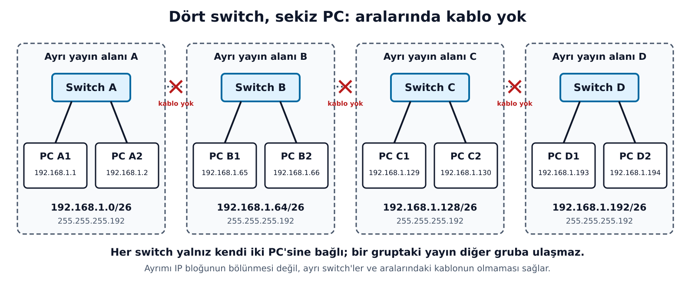

## Görev: iki adresleme düzeneği

Boş bir Packet Tracer çalışma alanında kendi topolojinizi kurun:

1. `192.168.1.0/24` bloğunu dört eşit alt ağa ayırın; her alt ağda iki PC bulunsun.
2. İki router arayüzünü `10.0.0.0/30` bloğuyla birbirine bağlayın.
3. Her testin sonucunu tabloya kaydedin.

::: {.notes}
Bu uygulama 9.1'deki hesabı bir ağ üzerinde sınamaktır. Sıra şöyle: hesaplayın, cihazlara yazın, ping ve `ipconfig` ile gözleyin, sonucu yorumlayın, yaptığınız değişikliği geri alın. Topolojiyi sıfırdan siz kuracaksınız; teslim edeceğiniz `.pkt` dosyası sizin kurduğunuz ağdır.

Bu düzenekte yalnız her alt ağın kendi içindeki erişim ve ayrı yayın alanları sınanır. Gruplar arasında kablo yoktur ve gruplar arası ping denenmez.
:::

---

## Önce kâğıt üzerinde: ağ ve yayın adresleri

Packet Tracer'ı açmadan dört alt ağ için tabloyu doldurun.

| Grup | Ağ adresi | Yayın adresi | Maske |
| --- | --- | --- | --- |
| A | | | |
| B | | | |
| C | | | |
| D | | | |

Sonra planın PC adresleri için, ilk tabloda bulduğunuz maskeyle **adres AND maske** sonucunu yazın:

| PC | Adres | Adres AND maske |
| --- | --- | --- |
| A1, A2 | `192.168.1.1`, `192.168.1.2` | |
| B1, B2 | `192.168.1.65`, `192.168.1.66` | |
| C1, C2 | `192.168.1.129`, `192.168.1.130` | |
| D1, D2 | `192.168.1.193`, `192.168.1.194` | |

::: {.notes}
`192.168.1.0/24` bloğunu dört eşit parçaya bölmek için kaç bit ödünç alınacağını, yeni öneki ve artışı 9.1'deki adımlarla bulun. Hafta 8'deki kural burada tek satır: adres AND maske, ağ adresini verir. Maske `255.255.255.192` olduğunda ilk üç oktet `255` olduğu için AND bu oktetlerin değerini değiştirmez; hesap yalnız son oktette yapılır (örneğin `200 AND 192 = 192`) ve sonuç üstteki tablonuzdaki ağ adresiyle uyuşmalıdır. Aynı maskeyi kullanan iki PC'nin AND sonucu aynıysa aynı ağdadırlar. Maskeler farklıysa her cihaz kendi maskesiyle hesaplanır; eşit çıkan sayı tek başına ağ tanımlarının aynı olduğunu göstermez.

Bu tabloyu cihazlara hiçbir şey yazmadan doldurmak, sonradan çıkan bir hatanın adreslemeden mi kablolamadan mı kaynaklandığını ayırmanızı kolaylaştırır. Teslimde bu tablo da yer alacak; cevapları kendi hesabınızdan çıkarın.
:::

---

## Dört switch, sekiz PC: ayrı yayın alanları

{width="100%" fig-align="center" fig-alt="Dört switch (A, B, C, D), her biri kendi iki PC'sine bağlı; switch'ler birbirine kablolu değildir, bu yüzden dört ayrı yayın alanı oluşur"}

Switch'ler arasında **kablo yok**. Her switch'e yalnız kendi grubunun iki PC'si bağlanır.

Aşağıdaki tablo, önceki slayttaki kâğıt üstü hesabınızın kontrolüdür: önce kendi tablonuzu doldurun, sonra karşılaştırın.

| Grup | PC 1 | PC 2 | Maske | Beklenen yerel ağ |
| --- | --- | --- | --- | --- |
| A | `192.168.1.1` | `192.168.1.2` | `255.255.255.192` | `192.168.1.0/26` |
| B | `192.168.1.65` | `192.168.1.66` | `255.255.255.192` | `192.168.1.64/26` |
| C | `192.168.1.129` | `192.168.1.130` | `255.255.255.192` | `192.168.1.128/26` |
| D | `192.168.1.193` | `192.168.1.194` | `255.255.255.192` | `192.168.1.192/26` |

::: {.notes}
Dört switch arasında kablo olmadığı için her grup ayrı bir Ethernet yayın alanıdır: A grubundaki bir ARP isteği B grubuna ulaşmaz. 9.1'de gördüğümüz sonuç burada kendini gösterir: IP bloğunu bölmek yayın alanını ayırmaz; yayın alanını ayıran, grupların ayrı switch'lere bağlanmasıdır.

Bağlantı ışıkları ya da arayüz durumları yeşile dönene kadar bekleyin. Switch ve router modelleri kullandığınız Packet Tracer sürümüne göre değişir; model adı seçerken cihazın port listesine bakın ve bağlantıyı kurduğunuz portu cihaz ekranından belirleyin.

PC adresleri, kendi hesabınızla aynı olmalı. Ağ adresiyle (`.0`, `.64`, `.128`, `.192`) PC adresini karıştırmayın: ağ adresi bir hosta verilemez.
:::

---

## PC'lere adres ve maske yazmak

Her PC'de **Desktop → IP Configuration → Static**:

- IPv4 adresi: tablodaki adres
- Subnet mask: `255.255.255.192`
- Default gateway: **boş**

**Varsayılan ağ geçidi:** PC'nin kendi ağı dışındaki bir adrese gönderdiği paketi teslim ettiği router arayüzüdür. Bu düzenekte PC'ler kendi alt ağlarının dışına paket göndermediği ve gruplar arasında router bağlantısı olmadığı için alan boş kalır.

::: {.notes}
Maske kutusu kendiliğinden doldurulmuş olabilir; elle `255.255.255.192` yazın ve ekranda okuyun. Her PC'nin adresini tabloyla yeniden karşılaştırın.

Ağ geçidi alanı bu düzenekte bilerek boş bırakılır: hiçbir PC kendi alt ağının dışına paket göndermez ve gruplar arasında yol yoktur.

Bir PC'de bir rakamı yanlış yazarsanız o PC'nin ağ adresi başka çıkabilir. Başarısız bir testte önce `ipconfig` çıktısına bakmak en kısa kontroldür.
:::

---

## Kendi grubundaki komşuya ping

Her grubun birinci PC'sinin komut satırında (**Desktop → Command Prompt**):

```text
ipconfig
ping 192.168.1.2
```

Yukarıdaki komutlar A grubu içindir. Her grup birinci PC'den ikinci PC'ye ping atar; adresler "Dört switch, sekiz PC" slaytındaki tablodadır.

**Her ping yoklaması iki paket gerektirir:** Echo Request hedefe, Echo Reply gönderene ulaşmalıdır. Komut birkaç yoklama gönderir; `4/4` dört yoklamanın dördünün de yanıt aldığı anlamına gelir.

::: {.notes}
`ipconfig` PC'nin kendi adresini, maskesini ve ağ geçidini gösterir. Ping'e geçmeden bu çıktıyı tablodaki planla karşılaştırın; maske `ipconfig` ya da PC'nin yapılandırma ekranıyla ayrıca okunur.

Ping, ICMP Echo Request'in hedefe ve Echo Reply'ın kaynağa ulaşmasına dayanır (Cisco'nun ping ve traceroute belgesi: https://www.cisco.com/c/en/us/support/docs/ios-nx-os-software/ios-software-releases-121-mainline/12778-ping-traceroute.html). Yanıt görmek iki yönün de çalıştığını gösterir.

İlk ping'de ARP çözümlemesi gerekir: PC hedefin MAC adresini bilmediği için önce bir ARP isteği yayınlar, yanıt gelince ICMP paketini gönderir. Bu yüzden ilk denemede bir zaman aşımı görülebilir. Aynı ping'i tekrarlayın; yanıt geliyorsa ilk kayıp çözümleme gecikmesiydi. Tekrarda da yanıt yoksa kalıcı bir hata vardır: adres, maske ve kabloları kontrol edin.

Simulation görünümünde ping sırasında önce ARP isteğinin gruptaki diğer PC'ye gittiğini, ardından ICMP paketlerinin izlendiğini görün. Ping bir hedefe ulaşmayı gösterir; maskenin plana uygun olduğunu göstermez.
:::

---

## İki router arasında `/30`

| | R1 | R2 |
| --- | --- | --- |
| Adres | `10.0.0.1` | `10.0.0.2` |
| Maske | `255.255.255.252` | `255.255.255.252` |

İki router yalnız **birbirine** bağlanır; switch'lere bağlanmaz.

```text
enable
configure terminal
interface <bağladığınız arayüz>
ip address 10.0.0.1 255.255.255.252
no shutdown
end
show ip interface brief
```

R2'de adres `10.0.0.2` olur. `no shutdown` arayüzü açar; `show ip interface brief` arayüz durumlarını listeler.

::: {.notes}
Router modeline göre arayüz adı değişir; bağlantıyı kurduğunuz arayüzü cihazın kendi ekranından belirleyin ve `<bağladığınız arayüz>` yerine yazın. Router'ın grafik yapılandırma ekranı da kullanılabilir: arayüzü seçip adres ve maskeyi girin ve arayüzü açın.

`enable` ayrıcalıklı moda, `configure terminal` yapılandırma moduna geçirir. `interface ...` hangi arayüzü ayarladığınızı seçer. `ip address` adres ve maskeyi atar; `no shutdown` arayüzü açar. `end` yapılandırma modundan çıkarır.

`10.0.0.0/30` bloğunda `10.0.0.0` ağ adresi, `10.0.0.3` yayın adresidir; kullanılan adresler `.1` ve `.2`'dir. `/30`, bu laboratuvarın iki uçlu bağlantı için yaptığı seçimdir.
:::

---

## Arayüz durumu ve karşılıklı ping

`show ip interface brief` çıktısında iki sütunu okuyun: **Status** ve **Protocol**. Çalışan bağlantıda ikisi de `up` olur; `administratively down` arayüzün kapalı olduğunu, `down` ise hatta ya da karşı uçta sorun olduğunu düşündürür.

R1'de:

```text
ping 10.0.0.2
```

R2'de:

```text
ping 10.0.0.1
```

::: {.notes}
Status arayüzün durumunu, Protocol hat protokolünün durumunu gösterir. İkisini de çıktıdan okuyup deney tablonuza yazın; ping başarısızsa önce bu iki sütuna bakın. Çalışan bir bağlantıda ikisini de `up` görmeyi bekleyin. `administratively down`, arayüzün `no shutdown` ile açılmadığını düşündürür; `down` ise bağlantıda ya da karşı uçta bir sorun olduğunu düşündürür: kabloyu ve karşı uç arayüzü kontrol edin.

Router'ın ilk ping'i de ARP çözümlemesinden dolayı bir ya da iki paket kaybedebilir; ping'i tekrarlayın. R1'den R2'ye ping, R2'ye gidip dönen yolu birlikte sınar. İki arayüz ayrı ayrı yapılandırıldığı için ping'i her iki uçtan da atarız ve her cihazda kendi `show ip interface brief` çıktısına bakarız.

Başarısız bir ping'in nedenini arayüzü kapalı olan tek bir uca bağlamayın; Echo Request ve Echo Reply'dan biri yolda kaybolmuş olabilir. Önce iki uçta da adresi, maskeyi ve arayüz durumunu kontrol edin.
:::

---

## Yanlış maske ne gösterir?

A2'nin maskesi yanlışlıkla `255.255.255.0` olsun. A1 → A2 ping'i sonuç verir mi?

. . .

AND hesabı:

- A1: `192.168.1.1` AND `255.255.255.192` = `192.168.1.0`; hedef `192.168.1.2` AND `255.255.255.192` = `192.168.1.0`. **Aynı ağ.**
- A2: `192.168.1.2` AND `255.255.255.0` = `192.168.1.0`; karşı taraf `192.168.1.1` AND `255.255.255.0` = `192.168.1.0`. **Aynı ağ.**

. . .

Hesap, yerel ping'in **çalışabileceğini** öngörür. **Başarılı ping, maskenin plana uygun olduğunu göstermez.**

::: {.notes}
Her iki PC de karşıdakini kendi ağında saydığı için ARP ile doğrudan haberleşir. Yanlış olan şey, A2'nin ağ sınırı bilgisidir: `/24` maskesiyle A2 bütün `192.168.1.0`–`192.168.1.255` aralığını kendi ağı sayar ve bu ağın yayın adresini `192.168.1.255` bilir. Planımızda A grubunun yayın adresi `192.168.1.63`'tür; A2'nin bilgisi planla uyuşmaz.

Bu bir öngörüdür; gözlem sizin. Ping iki cihazın birbirine ulaşıp ulaşmadığını gösterir. Maskenin plana uygun olup olmadığı ise `ipconfig` ya da cihaz yapılandırma ekranından okunur ve plandaki değerle karşılaştırılır.
:::

---

## Deney: değiştir, gözle, geri al

1. A grubunda PC 2'nin maskesini `255.255.255.0` yapın.
2. A1 → A2 ve A2 → A1 ping atın.
3. A2'de `ipconfig` çıktısına bakın.
4. Maskeyi `255.255.255.192` olarak geri alın ve `ipconfig` ile doğrulayın.

| Adım | Gözlemim |
| --- | --- |
| A1 → A2 | |
| A2 → A1 | |
| A2 `ipconfig` maskesi | |

**Yorumum:** ping neden sonuç verdi ya da vermedi? Plan neden yine de yanlış?

::: {.notes}
Gözleminizi kendi sonucunuza göre yazın; ekranda gördüğünüzü olduğu gibi kaydedin. Yorumunuzu önceki slayttaki AND hesabına bağlayın: ping'in sonucu hesapla uyuşuyor mu?

Deneyden sonra maskeyi geri aldığınızdan emin olun; teslim edeceğiniz dosyada bütün PC'lerin maskesi plandaki değerle kalmalıdır. `ipconfig` ile bunu bir kez daha okuyun.
:::

---

## Sonuçları kaydetmek

| Test | Maske (cihazdan okunan) | Beklenen | Gözlenen | Başarısızsa kontrol edilen alan |
| --- | --- | --- | --- | --- |
| A1 → A2 | | Yanıt | | |
| B1 → B2 | | Yanıt | | |
| C1 → C2 | | Yanıt | | |
| D1 → D2 | | Yanıt | | |
| R1 → R2 | | Yanıt | | |
| R2 → R1 | | Yanıt | | |
| A1 → A2 (A2 maskesi `/24`) | | | | |

**Teslim:** `.pkt` dosyası · kendi hesapladığınız ağ/yayın/maske tablosu · bu sonuç tablosu · yanlış maske deneyi için kısa yorum

::: {.notes}
İlk ping'de oluşan zaman aşımını tekrar denemeyle ayırın ve tabloya kalıcı sonucu yazın. "Gözlenen" sütununa kısa ve somut yazın: "4/4 yanıt" ya da "ilk paket kayıp, sonrakiler yanıt" gibi. Başarısız bir test için son sütunu doldurmak, hatayı nasıl aradığınızı gösterir: adres mi, maske mi, kablo mu, arayüz durumu mu?

Maske sütununu cihazdan okuyarak doldurun; plandan kopyalamayın. Son satır deneye aittir; gözleminizi ve bu testin planı neden doğrulamadığını bir cümleyle yazın.

Teslim edilen dosyada PC maskeleri `255.255.255.192`, router arayüz maskeleri `255.255.255.252` olmalıdır. Ağ ve yayın adreslerini kendi hesabınızdan yazın.
:::

---

## Hata bulma sırası

1. Kablo uçları ve bağlantı durumu: ışıklar yeşile dönene kadar bekleyin
2. `ipconfig` ile adres ve maske: plandakiyle aynı mı?
3. Adres grubun kullanılabilir aralığında mı; ağ ya da yayın adresine denk gelmiyor mu?
4. Router'da `show ip interface brief`: Status ve Protocol sütunları

::: {.notes}
Bu sıra en basit ve en sık görülen hatadan başlar. Çoğu zaman sorun cihazda değil bir alanın yanlış yazılmasındadır: bir rakam atlanmış adres, yanlış porta takılmış kablo ya da kapalı bırakılmış arayüz. Bir testin hangi adımda başarısız olduğunu bulduğunuzda tabloya ne yaptığınızı yazın.
:::
