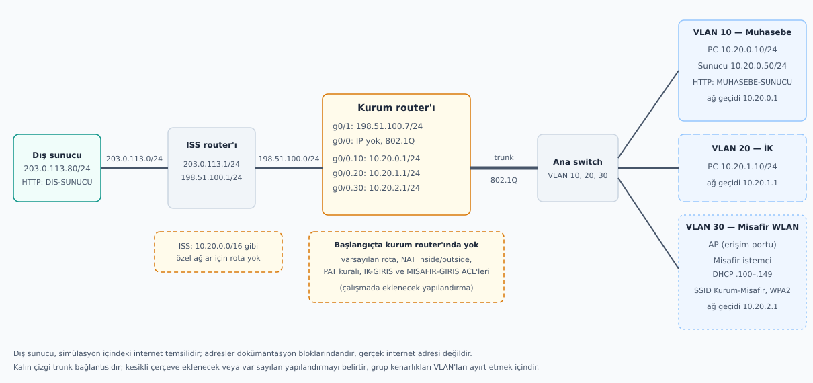

## Hedef: internete çıkış serbest, muhasebe sunucusu korunmuş

Muhasebe, insan kaynakları ve misafir WLAN'ı farklı alt ağlarda.

- Üçü de dış test sunucusuna erişebilmeli
- Muhasebe sunucusuna yalnız muhasebe ağı erişebilmeli

Bu hedefi Packet Tracer üzerinde **PAT** ve **ACL** ile gerçekleştirip ölçülebilir testlerle doğrulayacağız.

::: {.notes}
Bu çalışmada 12.1 ve 12.2'deki iki mekanizma, PAT ve erişim kontrolü, aynı ağda birlikte çalıştırılır. VLAN, alt arayüz, DHCP ve WLAN başlangıç koşulu olarak var sayılır; çalışma PAT, erişim kontrolü ve teşhise odaklanır.

Çalışmanın dört adımı bir zincir: önce **hesapla** (hangi sonucu bekliyoruz), sonra **yapılandır**, **test et**, bozup **geri al**. Beklentiyi önceden yazmazsanız test sonucu sizi şaşırtmaz ve sorunu da fark etmezsiniz.
:::

---

## Çalışma akışı

| Aşama | Çıktı |
| --- | --- |
| 1. Başlangıç koşullarının doğrulanması | Adresler, gateway'ler, iç erişim ve eksik olanlar kayda geçer |
| 2. PAT | İç istemciler dış sunucuya ulaşır; kayıt satırı okunur |
| 3. ACL | Muhasebe sunucusu İK ve misafire kapanır, dış sunucu erişimi açık kalır |
| 4. WLAN ve uçtan uca test | Kablolu ve kablosuz istemciler tabloya uygun sonuç verir |
| 5. Arıza analizi | Bir PAT hatası bulunur, düzeltilir, tekrar test edilir |
| 6. Kanıt kaydı | Beklenen/gözlenen tablosu tamamlanır |

::: {.notes}
Aşamalar bir zincirdir: önce başlangıç koşulları doğrulanır, böylece sonraki hatalar eklenen kurallara bağlanabilir. Sonra rota ve PAT ile çıkış kurulur, ACL ile erişim sınırlanır, kablolu ve kablosuz istemcilerle uçtan uca sınanır, bir arıza bulunup düzeltilir ve her sonuç beklenen–gözlenen tablosunda kanıtlanır.
:::

---

## Başlangıç koşulları

Bu çalışma, aşağıdaki koşulları sağlayan bir ağ varsayar. Koşullar sağlanmıyorsa önce onlar kurulmalıdır.



Ana switch'in kurum router'ına bakan portu trunk'tır. Kurum router'ında `GigabitEthernet0/0` IP taşımaz. VLAN 10, 20 ve 30 etiketleri `g0/0.10`, `g0/0.20` ve `g0/0.30` alt arayüzlerindedir.

- Switch: VLAN 10, 20 ve 30 tanımlı; muhasebe PC ve sunucusu VLAN 10, İK PC VLAN 20, AP VLAN 30 erişim portlarında
- Router: alt arayüzler 802.1Q etiketli ve adres planındaki IP'lerle yapılandırılmış; `g0/1` adresi tanımlı; varsayılan rota, NAT ve ACL yok
- ISS router'ı: yalnız iki doğrudan bağlı ağı bilir
- Misafir WLAN: `g0/0.30` üzerinde `10.20.2.100`–`.149` DHCP havuzu, AP'de `Kurum-Misafir` SSID'i ve WPA2-PSK
- İki sunucuda HTTP açık; sayfa gövdeleri `MUHASEBE-SUNUCU` ve `DIS-SUNUCU`
- Dış sunucu, simülasyondaki interneti temsil eder; `198.51.100.0/24` ve `203.0.113.0/24` dokümantasyon blokları olduğundan gerçek internet adresi değildir

::: {.notes}
VLAN, alt arayüz, DHCP ve WLAN bu çalışmada kurulacak yapı değil, başlangıç koşuludur. Koşullardan biri sağlanmıyorsa PAT ve ACL aşamasına geçilmez; eksik bir başlangıç sonradan ACL hatasıyla karışır. Arayüz adları farklıysa `show ip interface brief` ile karşılaştırın. Şekil hazır bir dosyayı değil, kurulması gereken ağın tarifini gösterir.

Dış adresler dokümantasyon blokları; bu topoloji internet çıkışını simülasyon içinde temsil eder, gerçek bir internet bağlantısı değildir.
:::

---

## Adres planı

| Öğe | Adres / prefix | Gateway |
| --- | --- | --- |
| Muhasebe PC | `10.20.0.10/24` | `10.20.0.1` |
| Muhasebe sunucusu | `10.20.0.50/24` | `10.20.0.1` |
| İK PC | `10.20.1.10/24` | `10.20.1.1` |
| Misafir istemci | DHCP: `10.20.2.100` – `10.20.2.149` aralığı | `10.20.2.1` |
| AP (VLAN 30 erişim portu) | Bu plan AP'ye IP yazmaz; yönetim adresi ayrı bir sorudur ve verilecekse DHCP `.100`–`.149` aralığının dışında olmalıdır | — |
| Kurum router'ı `g0/0.10` / `.20` / `.30` | `10.20.0.1/24` / `10.20.1.1/24` / `10.20.2.1/24` | — |
| Kurum router'ı `g0/1` | `198.51.100.7/24` | Komşu: `198.51.100.1` |
| ISS router'ı (kurum tarafı) | `198.51.100.1/24` | — |
| ISS router'ı (sunucu tarafı) | `203.0.113.1/24` | — |
| Dış test sunucusu | `203.0.113.80/24` | `203.0.113.1` |

SSID: `Kurum-Misafir` · WPA2 test parolası: `MisafirLab-2026!`

::: {.notes}
Üç iç ağ da `/24`; aynı büyüklükte ve çakışmıyor. Muhasebe PC'si ile sunucusu aynı LAN'da: `10.20.0.10` ve `10.20.0.50`. İK PC'si ve misafir istemcisi router üzerinden o sunucuya ulaşacak.

Test parolası yalnız laboratuvar içindir. Gerçek bir kablosuz ağda WPA2 parolası böyle paylaşılmaz.
:::

---

## Hazır olanlar ve sizin ekleyecekleriniz

| Başlangıç koşulu (var sayılır) | Siz ekleyeceksiniz |
| --- | --- |
| Switch VLAN 10/20/30, port ve trunk ayarları | Kurum router'ında `ip nat inside` / `ip nat outside` |
| Router alt arayüzleri ve IP'leri, `g0/1` adresi | Standart ACL `NAT-KAYNAK` ve `overload` kuralı |
| Misafir DHCP, AP, SSID ve WPA2 | Kurum router'ında varsayılan rota |
| ISS router'ı ve dış sunucu arayüzleri | `IK-GIRIS` ve `MISAFIR-GIRIS` ACL'leri ve arayüze bağlama |
| Her iki sunucuda HTTP açık. Muhasebe gövdesi `MUHASEBE-SUNUCU`, dış sunucu gövdesi `DIS-SUNUCU` | Doğrulama tablosu ve arıza düzeltmesi |

ISS router'ı yalnız doğrudan bağlı iki ağı bilir; `10.20.0.0/16` gibi özel ağlar için **rotası yoktur**.

::: {.notes}
Başlangıç koşulunda kurum router'ında varsayılan rota, NAT ve ACL yoktur; bunlar eklenir. Bu koşulların sağlandığını doğrulamak yeterlidir.

ISS router'ının özel ağlar için rotası olmaması bu çalışmanın başlangıç koşuludur.
:::

---

## Aşama 1 — başlamadan önce doğrulayın

| Test | Beklenen | Gözlenen |
| --- | --- | --- |
| Her istemcide `ipconfig`: IP, maske, gateway plana uygun | Plana uygun | |
| Misafir istemci `Kurum-Misafir` SSID'ine WPA2 parolasıyla bağlanır | `10.20.2.100`–`.149` arası adres | |
| Her istemci kendi gateway'ine ping | Yanıt var | |
| Muhasebe PC'si: `http://10.20.0.50` | Sayfa açılır; gövde `MUHASEBE-SUNUCU` | |
| İK PC'si: `http://10.20.0.50` | Sayfa açılır; gövde `MUHASEBE-SUNUCU` (ACL yok) | |
| Kurum router'ından `ping 198.51.100.1` | Yanıt var | |
| Kurum router'ından `ping 203.0.113.80` | Yanıt yok. Bu hedefe rota yok | |
| Herhangi bir iç istemciden `http://203.0.113.80` | Sayfa açılmaz. Rota yok; paket dışarı çıkmaz | |
| `show ip route` | `10.20.0.0/24`, `10.20.1.0/24`, `10.20.2.0/24` ve `198.51.100.0/24` bağlı. Varsayılan rota yok. Arayüz `/32` yerel satırı görülebilir | |

Sonuç beklenenden farklıysa PAT ve ACL aşamalarına geçmeyin; farkı yazıp eğitmene bildirin.

::: {.notes}
Bu tablo, başlangıç durumunun gerçekten tarif edilen gibi olduğunu ölçer. Sonuçlar iki işe yarar. Birincisi, sonradan bir test başarısız olduğunda sorunun sizin eklediğiniz kuraldan mı yoksa başlangıçtaki bir eksikten mi geldiğini ayırabilirsiniz.

İkincisi, öğretici bir sonuç: İK PC'si muhasebe sunucusuna bağlanabiliyor. Ağ çalışıyor ama politika uygulanmıyor; 12.2'deki "çalışması ile olması gereken aynı şey değil" sahnesi bu. Komşu `198.51.100.1` yanıtı, `g0/1` hattının çalıştığını gösterir. `203.0.113.80` için rota yoktur; kurum router'ı bu adrese kendi ping'ini de çıkarmaz. İç istemcide sayfanın açılmaması da önce bu rota eksikliğidir. PAT eksikliği, rota eklendikten sonraki denemede ayrılır.

Beklenen sütununu doğrulama öncesi okuyup tahmininizi kontrol edin; Gözlenen sütununu kendi sonuçlarınızla doldurun.
:::

---

## Aşama 1 — tahminlerinizi yazın

Yapılandırmadan önce cevaplayın:

1. Varsayılan rota eklenince, PAT yokken `10.20.0.10` dış sunucuya paket gönderirse yanıt gelir mi? Neden?
2. PAT eklendikten sonra `10.20.0.10` ile `10.20.1.10` aynı kaynak portundan aynı dış sunucuya bağlanırsa dış sunucu ikisini nasıl ayırır?
3. Hangi kaynakların `10.20.0.50` adresine ulaşması beklenir?

::: {.notes}
Her cevabın gerekçesini bir cümleyle yazın: hangi yol, hangi eşleme, hangi kural? Tahminleri sonraki aşamalardaki gözlemle karşılaştırın.


Aşağıdaki aşamalarda tahmininizi sonuçla karşılaştırın. Tahmin yanlış çıktıysa nedenini yazmak, o aşamanın asıl çıktısıdır.
:::

---

## Aşama 2 — önce varsayılan rota, sonra deneme

Genel yapılandırma kipinde, kurum router'ında:

```text
enable
configure terminal
ip route 0.0.0.0 0.0.0.0 198.51.100.1
end
```

Kurum router'ında `ping 203.0.113.80` deneyin.

**Beklenen:** yanıt var. Kaynak, router'ın `198.51.100.7` adresidir. ISS bu ağı bağlı yol olarak bilir. Bu yanıt NAT kullanmaz.

Muhasebe PC'sinden `http://203.0.113.80` açın.

**Beklenen:** sayfa açılmaz. Paket dışarı çıkar. Kaynak `10.20.0.10` kaldığı için yanıt dönmez.

::: {.notes}
Rota, kurum router'ının `203.0.113.80` hedefini `198.51.100.1` komşusuna göndermesini sağlar. Router kendi ping'inde kaynak `198.51.100.7` olur. Bu adres ISS'de doğrudan bağlıdır; yanıt döner. Bu başarı NAT kanıtı değildir.

Muhasebe PC'sinde kaynak `10.20.0.10` kalır. Dış sunucu yanıtı kendi ağ geçidi `203.0.113.1` üzerinden ISS'ye gider. ISS'nin `10.20.0.10` için rotası yoktur; yanıt kurum ağına ulaşmaz. Sayfa açılmaz. Sayfa açılırsa ISS'de özel ağa dönüş rotası veya kurum router'ında beklenmeyen bir NAT vardır; eğitmene bildirin. Router ping'i başarısızsa varsayılan rota, ISS arayüzleri veya dış sunucunun `203.0.113.1` ağ geçidi eksiktir.

Rota yapılandırmasında `0.0.0.0 0.0.0.0` "bütün hedefler" demektir; daha özel bir rota yoksa paket `198.51.100.1` komşusuna gider.
:::

---

## Aşama 2 — PAT yapılandırması

```text
configure terminal
interface GigabitEthernet0/0.10
 ip nat inside
 exit
interface GigabitEthernet0/0.20
 ip nat inside
 exit
interface GigabitEthernet0/0.30
 ip nat inside
 exit
interface GigabitEthernet0/1
 ip nat outside
 exit
ip access-list standard NAT-KAYNAK
 permit 10.20.0.0 0.0.0.255
 permit 10.20.1.0 0.0.0.255
 permit 10.20.2.0 0.0.0.255
 exit
ip nat inside source list NAT-KAYNAK interface GigabitEthernet0/1 overload
end
```

- `inside` / `outside`: hangi arayüz iç, hangisi dış taraf
- `NAT-KAYNAK`: çevrilecek kaynakların listesi; paket filtrelemez, listede olmayan kaynak yalnız çevrilmez
- `overload`: `g0/1` adresini birden fazla bağlantı paylaşır
- `0.0.0.255`: /24'ün joker maske karşılığı; son sekizli serbest

::: {.notes}
`NAT-KAYNAK`, paketleri filtrelemez; arayüze de bağlanmaz. Yalnızca "hangi kaynak adresleri çevrilsin?" sorusunun cevabını tutar. Listede olmayan bir iç kaynak çevrilmez ve ISS'ye özel adresle çıkar. Listede `deny` olsaydı da paket düşürülmezdi; kaynak yalnız çeviri dışında kalırdı, bu paket filtrelemedeki `deny`'den farklıdır.

`0.0.0.255`, bu `/24` ağların son sekizlisini serbest bırakan joker maskedir: ilk üç sekizli aynı olan adresler eşleşir. İç ağlar üç ayrı `/24` olduğu için üç satır yeterli.
:::

---

## Aşama 2 — PAT'ı sınayın

1. Muhasebe PC'sinden `http://203.0.113.80`
2. İK PC'sinden `http://203.0.113.80`
3. Hemen ardından router'da:

```text
show ip nat translations
show ip nat statistics
```

Kayıtlar zaman aşımıyla silinir; trafik üretip hemen bakın.

::: {.notes}
Her iki PC'den sayfa açılmalı ve gövdede `DIS-SUNUCU` yazmalı. Dönüş yolu artık var, çünkü ISS yanıtı `198.51.100.7` adresine gönderiyor ve router tablosundan iç istemciye aktarıyor. Statistics çıktısı çeviri sayılarını ve hangi arayüzlerin inside/outside olduğunu gösterir; yanlış arayüzü işaretlediyseniz burada fark edersiniz.

Ping de PAT'tan geçer, ama ICMP'de port yoktur; router eko isteğinin kimlik değerini port yerine kullanır ve çıktıda bu değer port alanında görünür. TCP satırlarıyla karıştırmayın.
:::

---

## Çıktıdaki bir TCP satırı nasıl okunur?

**Temsili** bir satır (sizin çıktınızdaki değerler farklı olabilir):

```text
Pro  Inside global         Inside local        Outside local       Outside global
tcp  198.51.100.7:40001    10.20.1.10:51000    203.0.113.80:80     203.0.113.80:80
```

| 12.1'deki PAT tablosu | Çıktı alanı | Temsili değer |
| --- | --- | --- |
| İç kaynak | Inside local | `10.20.1.10:51000` |
| Dışarıdan görünen kaynak | Inside global | `198.51.100.7:40001` |
| Hedef (sunucuya giden) | Outside local / Outside global | `203.0.113.80:80` |

Yanıt `198.51.100.7:40001` hedefiyle geldiğinde router aynı satırı kullanır ve paketi `10.20.1.10:51000` adresine çevirir.

::: {.notes}
Bu satır, aynı kaydın iç ve dış görünümünü birlikte taşır. Dış taraftan bakan sunucu yalnız `198.51.100.7:40001` kaynağını görür. İçeriden bakan İK PC'si kendini `10.20.1.10:51000` olarak bilir. Router ikisini bir arada tutar ve yanıt dönüşünde bu eşlemeyi kullanır.

Hedef iki sütunda aynı çünkü bu yapılandırmada hedef çevrilmiyor. Port değerleri gerçek çıktıda farklı olacaktır: kaynak portu istemcinin işletim sistemi seçer, dış portu cihaz atar; sabit bir değer beklemeyin. Temsili satır alanları tanıtır; sizin gözleminiz yerine geçmez. `10.20.1.10` ve hedef portu `80` bu uygulamanın HTTP denemesine aittir. 12.1'deki örnekte istemci `192.168.10.11`, hedef port `443` idi; burada adresler ve hedef port farklıdır. `40001` örnek bir değerdir.
:::

---

## Aşama 2 — kendi satırınızı okuyun

Gözleminizdeki bir **TCP** satırı için dört alanı yazın:

| İstemci | Inside local | Inside global | Outside local / global |
| --- | --- | --- | --- |
| Muhasebe PC | | | |
| İK PC | | | |

Bu iki bağlantının dış IP'si ortak mı? Dış portları aynı mı? Sunucudan gelen iki yanıtı router nasıl ayırır?

::: {.notes}
Alanları siz doldurun. Bir sayfa birden fazla TCP bağlantısı açabilir; istemci başına bir TCP satırı seçin. Gördüğünüz portları yazın; sabit bir port beklemeyin. Yanıtın dönüşünü anlatırken `show ip nat translations` çıktısında hangi alanlara baktığınızı belirtin.
:::

---

## Aşama 3 — ACL: hangi arayüze, hangi yöne?

| Kaynak | Liste | Bağlanacağı yer |
| --- | --- | --- |
| İK ağı | `IK-GIRIS` | `g0/0.20`, giriş (`in`) |
| Misafir ağı | `MISAFIR-GIRIS` | `g0/0.30`, giriş (`in`) |

Her listede iki kural: **muhasebe sunucusuna giden IP trafiğini engelle, diğer IP trafiğine izin ver.**

::: {.notes}
Karar kaynağa en yakın noktada verilir: İK ağından gelen paket router'a `g0/0.20` üzerinden girer. Liste kaynağa göre yazıldığından her kaynak ağ için ayrı bir liste var.

Muhasebe PC'si ve sunucu aynı LAN'dadır; aralarındaki paket router'a uğramaz, bu yüzden router'daki listeler o trafiği görmez.
:::

---

## Aşama 3 — ACL komutları

```text
configure terminal
ip access-list extended IK-GIRIS
 deny ip 10.20.1.0 0.0.0.255 host 10.20.0.50
 permit ip any any
 exit
ip access-list extended MISAFIR-GIRIS
 deny ip 10.20.2.0 0.0.0.255 host 10.20.0.50
 permit ip any any
 exit
interface GigabitEthernet0/0.20
 ip access-group IK-GIRIS in
 exit
interface GigabitEthernet0/0.30
 ip access-group MISAFIR-GIRIS in
 exit
end
```

- `0.0.0.255`: /24'ün joker maske karşılığı; son sekizli serbest
- `host 10.20.0.50`: tek adres
- Satır sırası: karar (`deny`/`permit`) · protokol (`ip`) · kaynak (ağ + joker maske) · hedef (`host` adres veya `any`)
- NAT ile ACL işlem sırası genellenmez; bu örnek yalnız giriş (`in`) yönünde bağlanan bu listeler için geçerlidir

Kontrol: `show access-lists` · `show ip interface GigabitEthernet0/0.20`

::: {.notes}
Sıra önemli: `deny` satırı önde, genel `permit` sonda. `permit ip any any` olmasaydı, sunucu dışındaki bütün İK trafiği (dış sunucu dahil) örtük engele takılırdı. ACL'de eşleşme sayaçları görünüyorsa test sonrası ilgili `deny` satırının sayacı artmış olmalı. Bu örnekte listeler iç adresleri görecek biçimde giriş yönünde bağlanır; NAT ile ACL'nin işlem sırası cihaza ve yöne göre değişir, bu işlem sırası yalnız giriş yönünde bağlanan bu ACL örneği için geçerlidir.

`deny` satırı yalnız `10.20.0.50` hedefidir. `permit ip any any` diğer IP trafiğini geçirir; İK ile misafir birbirine de bu izinden ulaşabilir. Politikada bu erişimi kapatan ayrı bir satır yoktur. Örtük engel, hiçbir satırın eşleşmediği pakete kalır.
:::

---

## Aşama 4 — WLAN ve uçtan uca test

1. Misafir istemci `Kurum-Misafir` ağına bağlı mı, `10.20.2.100`–`.149` arasında adres almış mı, gateway `10.20.2.1` mi?
2. Üç kaynaktan iki hedefe, **hem ping hem HTTP** testi yapın
3. Her sonucu kanıt tablosuna yazın

WPA2, misafir istemci ile AP arasındaki radyo bağlantısını korur. Sunucularda HTTP açıktır; HTTP içeriği AP'den sonra WPA koruması olmadan taşınır.

::: {.notes}
HTTP, tarayıcıda doğru sayfanın gelmesiyle doğrulanır. Muhasebe sunucusunun gövdesinde `MUHASEBE-SUNUCU`, dış sunucunun gövdesinde `DIS-SUNUCU` yazar. ICMP başarısı HTTP hizmetinin kanıtı olarak yazılmaz; ikisi ayrı testtir. Engellemeyi, başarısız test ile ilgili ACL satırının sayacının artışı birlikte kanıtlar.

Sunucular HTTP hizmeti verir; kayıtları HTTP ile tutun. 12.2'deki hat ayrımını burada somut olarak görüyorsunuz: misafirin Wi-Fi bağlantısı WPA2 ile korunur, ama HTTP içeriği AP'den sonra kablolu ağda korunmaz.
:::

---

## Aşama 5 — arıza: misafir NAT izin satırı kaldırılıyor

Çalışan yapılandırmanın bir kopyasında:

```text
configure terminal
ip access-list standard NAT-KAYNAK
 no permit 10.20.2.0 0.0.0.255
 end
clear ip nat translation *
```

Sonra misafir istemciden `http://203.0.113.80` ve İK PC'sinden aynı adresi deneyin.

**Tahmin:** hangi istemcinin erişimi bozulur? Neden?

::: {.notes}
`clear ip nat translation *` eski kayıtları siler. Bunu yapmasaydınız, silinen satırdan önce açılmış bir bağlantının kaydı zaman aşımına kadar yaşardı ve hızlı bir test hâlâ başarılı görünebilirdi. Eski bir kaydın yaşadığı sürede alınan başarı, kaldırılan satırın etkisini göstermez; yeni bağlantı için tabloya satır eklenip eklenmediğine bakın.

Tahmininizi önce yazın, sonra gözlemle ve aşağıdaki arama sırasıyla karşılaştırın.
:::

---

## Aşama 5 — sorunu bu sırayla arayın

1. **İstemci:** IP, maske, gateway ve bağlantı doğru mu?
2. **Rota:** `show ip route` — hedefe ve dönüşe giden yol var mı?
3. **NAT kaydı:** `show ip nat translations` — misafir kaynağı için yeni satır oluşuyor mu?
4. **ACL:** `show access-lists` — beklenmedik bir engel eşleşiyor mu?

Her adımda **gidiş** ve **dönüş** ayrı sorulur.

Her adımda baktığınız çıktıyı ve gözleminizi arıza kaydına yazın.

::: {.notes}
Sıra, kolaydan zora ve alttan üste doğrudur. Her adımda hangi çıktıya baktığınızı ve ne gördüğünüzü kaydedin; gidiş ve dönüşü ayrı değerlendirin. Sonuçlar arızanın hangi katmanda olduğunu gösterir.

Düzeltmeyi yaptıktan sonra aynı testi tekrarlayın ve sonucu kanıt tablosuna işleyin.

İsteğe bağlı ikinci arıza: `IK-GIRIS` altında yalnız `no permit ip any any` yazın. `deny` satırı kalsın. İK PC'sinin her iki hedefe erişimini önce tahmin edin, sonra sınayın. Sonra `permit ip any any` satırını geri ekleyip yeniden test edin. Bu denemeyi misafir NAT arızasıyla aynı anda yapmayın.
:::

---

## Aşama 6 — kanıt tablosu

| Kaynak → hedef | ICMP beklenen | ICMP gözlenen | HTTP beklenen | HTTP gözlenen | İlgili kural / eşleme |
| --- | --- | --- | --- | --- | --- |
| Muhasebe → `10.20.0.50` | İzin | | İzin | | Aynı LAN; ACL yok |
| İK → `10.20.0.50` | Engel | | Engel | | |
| Misafir → `10.20.0.50` | Engel | | Engel | | |
| Muhasebe → `203.0.113.80` | İzin | | İzin | | |
| İK → `203.0.113.80` | İzin | | İzin | | |
| Misafir → `203.0.113.80` | İzin | | İzin | | |

::: {.notes}
Beklenen sütunu, varsayılan rota, PAT ve iki ACL dururken ve arızadaki misafir `permit` satırı geri konmuşken geçerli olan hedeftir. Gözlenen sütunu sizin testlerinizin sonucudur. Boş hücreler gözlem sonrası doldurulur. "İlgili kural/eşleme" sütununa ACL satırını ya da PAT kaydını yazın: engellenen satırlar için ACL eşleşmesi, dış erişim satırları için PAT kaydı.

Beklenenle gözlenen uyuşmuyorsa, bu bir başarısızlık değil bulgudur; 5. aşamadaki dört adımla nedenini arayın.
:::

---

## Teslim: ne yazılacak?

1. Tamamlanmış kanıt tablosu
2. Dış erişime ait **bir PAT satırı**: dört alan ve yanıtın nasıl döndüğü
3. Engellenen sunucu erişimine ait **bir ACL eşleşmesi**: hangi liste, hangi satır, hangi arayüz/yön
4. Arıza kaydı: kaynak, hedef, hizmet, hatalı alan, düzeltme, tekrar test sonucu
5. Aşama 1'deki doğrulama farkları (varsa)
6. Kendi çalışma dosyanız

::: {.notes}
Dört alanlı PAT satırı 12.1'deki tablonun cihaz çıktısındaki karşılığı; ACL eşleşmesi ise 12.2'deki "ilk eşleşen kural" ilkesinin gözlemi. İkisi birlikte politikanın uygulandığını ve internet erişiminin gereksiz yere engellenmediğini gösterir. Tahmini sonuçlarla farklılaşan gözlemleri silmeyin; açıklamasıyla birlikte raporlayın.
:::
