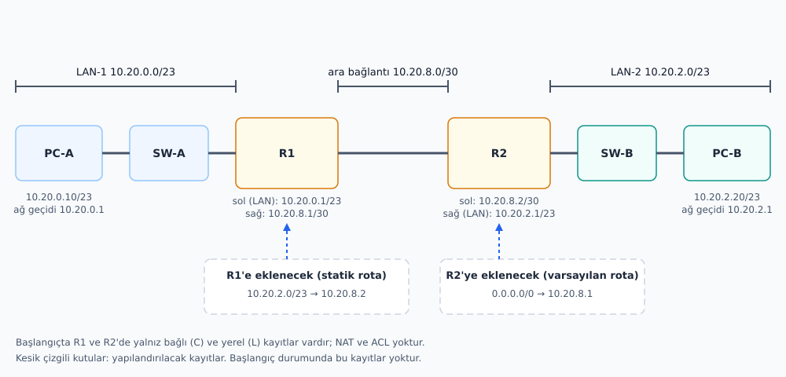

## Çalışma: iki LAN, iki router, eksik rotalar

Hedef: PC-A (`10.20.0.10`) ile PC-B (`10.20.2.20`) arasında **iki yönlü** erişimi kurmak.

| Aşama | Süre | Yapılacak iş |
| --- | ---: | --- |
| 1 | 15 dk | Topolojiyi kurup başlangıç durumunu doğrulamak |
| 2 | 15 dk | Rotaları hesaplayıp yapılandırmak |
| 3 | 15 dk | Rota tablosu ve erişimi doğrulamak |
| 4 | 15 dk | Hatalı durumları teşhis edip düzeltmek |

::: {.notes}
Çalışmada ağ geçidi ve ARP mantığı, tablo okuma ve en uzun önek eşleşmesi, statik rotanın kaynağı ve sınırı birlikte kullanılır.

Süreler bir öngörüdür; kurulum adımları cihaz modeline göre farklı sürebilir. Ağ geçidi, maske ve arayüz durumunu doğru kurmak rotalardan önce gelen koşuldur.
:::

---

## Başlangıç durumu



| Cihaz / arayüz | Adres | Ağ geçidi |
| --- | --- | --- |
| PC-A | `10.20.0.10/23` (`255.255.254.0`) | `10.20.0.1` |
| R1 LAN arayüzü | `10.20.0.1/23` | — |
| R1 ara bağlantı arayüzü | `10.20.8.1/30` (`255.255.255.252`) | — |
| R2 ara bağlantı arayüzü | `10.20.8.2/30` (`255.255.255.252`) | — |
| R2 LAN arayüzü | `10.20.2.1/23` | — |
| PC-B | `10.20.2.20/23` (`255.255.254.0`) | `10.20.2.1` |

- Bütün arayüzler etkin (`up/up`) olmalı. SW-A ve SW-B aynı yayın alanında yalnız bağlantı sağlar.
- **R1 ve R2'de yalnız bağlı ve yerel kayıtlar bulunur.** Statik, varsayılan veya dinamik yönlendirme kaydı yoktur.
- NAT ve ACL yoktur. Uç adresleri yolda değişmez.

**Tek router'dan farkı:** iki LAN'a da doğrudan bağlı tek bir router olsaydı iki ağ da router'ın bağlı (`C`) kaydında bulunur ve rota yazmak gerekmezdi. Burada LAN-2, R1'e doğrudan bağlı değildir; R1 ile R2 arasındaki `10.20.8.0/30` hattı iki router'ı bağlar ve uzak LAN'a giden kayıtları siz yazacaksınız.

::: {.notes}
Router arayüz adları kullandığınız cihaz modeline göre değişir; `show ip interface brief` hangi arayüzün hangi adresi taşıdığını gösterir.

Başlangıçta uzak LAN'a giden hiçbir kayıt olmadığı için PC-A ile PC-B birbirine ulaşamaz. Rotaları siz ekleyeceksiniz. Başka bir statik, varsayılan veya dinamik kayıt varsa deney tek değişkene bağlı kalmaz.

Adres, maske veya rota tablosu bu durumdan farklıysa çalışmaya başlamadan düzeltin.
:::

---

## Aşama 1 — Topolojiyi kur (cihaz modelinden bağımsız)

1. **Cihazlar:** iki router (R1, R2), iki anahtar (SW-A, SW-B), iki PC (PC-A, PC-B).
2. **Bağlantılar:** PC-A — SW-A — R1 — R2 — SW-B — PC-B. Router'lar arasında ve router–anahtar arasında arayüz tiplerine uygun kablo kullanın.
3. **PC'ler:** IP, maske ve ağ geçidini tablodaki gibi yazın (PC-A: `10.20.0.10`, `255.255.254.0`, `10.20.0.1`; PC-B: `10.20.2.20`, `255.255.254.0`, `10.20.2.1`).
4. **Router arayüz adları:** her router'da `show ip interface brief` ile hangi adın hangi bağlantıda olduğunu belirleyin.
5. **Router arayüzleri** (R1 örneği; `<LAN arayüzü>` ve `<ara bağlantı arayüzü>` yer tutucudur, R2 için tablodaki adresleri kullanın):

```text
enable
configure terminal
hostname R1
interface <LAN arayüzü>
 ip address 10.20.0.1 255.255.254.0
 no shutdown
interface <ara bağlantı arayüzü>
 ip address 10.20.8.1 255.255.255.252
 no shutdown
end
```

::: {.notes}
Modele göre ara bağlantı arayüzü Ethernet veya seri olabilir. Seri arayüzde bağlantının DCE ucuna saat hızı ayarı gerekebilir; bu çalışmada Ethernet tipi arayüz varsayılır.

Bu aşamada rota yazmıyoruz. Yalnız adres ve arayüz durumu doğru olmalı.
:::

---

## Aşama 1 — Başlangıç durumunu doğrula

PC'de `ipconfig`. Maske `255.255.254.0`, ağ geçidi tablodaki adres olmalıdır.

Router'da `show ip interface brief` ve `show ip route`. Arayüzler `up/up` olmalıdır. Tabloda yalnız `C` ve `L` kodlu satırlar olmalıdır; `S` (statik rota), `D` (EIGRP), `R` (RIP), `O` (OSPF) ve `B` (BGP) ile başlayan satır olmamalıdır. `C` doğrudan bağlı ağı, `L` arayüzün kendi adresini (`/32`) gösterir.

Temsili `show ip route` çıktısı (R1; yazılım sürümüne göre `L` satırları görünmeyebilir). Arayüz adları yer tutucudur:

```text
Gateway of last resort is not set

C    10.20.0.0/23 is directly connected, <LAN arayüzü>
L    10.20.0.1/32 is directly connected, <LAN arayüzü>
C    10.20.8.0/30 is directly connected, <ara bağlantı arayüzü>
L    10.20.8.1/32 is directly connected, <ara bağlantı arayüzü>
```

Yerel testler. Sonuç sütununu kendi denemenizle doldurun. İlk ping ARP öğrenimi nedeniyle kaybolabilir; testi yineleyin.

| Kaynak | Hedef | Gözlenen |
| --- | --- | --- |
| PC-A | `10.20.0.1` | |
| PC-B | `10.20.2.1` | |
| R1 | `10.20.8.2` | |
| PC-A | `10.20.2.20` | |

::: {.notes}
`C` ve `L` dışında bir kod, başlangıç koşulunun bozulduğunu gösterir. Bunu göz ile okumak, uzak kayıt olmadığını teyit etmenin yoludur.

Yerel testlerden biri başarısız olursa rota yazmadan önce adres, maske ve arayüz durumuna bakın. Anahtar portu yeni açıldıysa kısa süre iletime geçmeyebilir; o gecikme, rota eksikliğinden ayrıdır. Son satır uzak LAN'a gider; sonucu not edin.
:::

---

## Ping iki yönlü rota ister

Bir `ping`, iki paketten oluşur: **istek** (kaynaktan hedefe) ve **yanıt** (hedeften kaynağa).

- Yanıtın hedef adresi, isteğin **kaynak** adresidir.
- Bu yüzden ping'in başarılı olması için hem gidişte hem dönüşte, yoldaki her router'ın o yön için rotası olmalıdır.
- Bir `ping` başarısız olduğunda tek başına "gidiş mi, dönüş mü bozuk" bilgisi vermez; hangi adresin hangi cihazdan gönderildiği bu yüzden önemlidir.

Router'da kaynak seçmeden atılan `ping`, çıkış arayüzünün adresini kaynak alır.

::: {.notes}
Aşama 2'deki iki testin neden aynı sonucu vermediği bu ilkeyle açıklanır. Kaynak adresi hangi ağda olan bir paket için, dönüşte o ağa bir rota gerekir.
:::

---

## Aşama 2 — Önce hesapla (15 dk)

R1 için kayıt:

- Hedef ağ: `10.20.2.0/23` → ağ adresi `10.20.2.0`, maske `255.255.254.0`
- Sonraki atlama: R2'nin ara bağlantı adresi `10.20.8.2` (R1'in `10.20.8.0/30` ağında; `/30` ağında kullanılabilir adresler ağ adresi + 1 ve + 2, burada `.1` ve `.2`)

R2 için kayıt:

- R2'nin tek dış bağlantısı R1'dir. Bağlı olmayan her hedef için sonraki atlama `10.20.8.1`: **varsayılan rota** `0.0.0.0/0`

::: {.notes}
Önce kaydı kâğıtta kurup sonra yazmak hata ayıklamayı kolaylaştırır. R1 için hedefi tek bir uç adrese değil `/23` önekine bağlıyoruz; LAN-2'nin bütün adresleri bu öneğin içindedir. R2'de varsayılan rotayı seçmemizin nedeni, R2'nin R1'den başka çıkışı olmamasıdır. Bağlı ağlar daha uzun önek olduğu için varsayılan rota onları seçmez.

Bu çalışmadaki sonraki atlama, çıkış bağlantısında erişilebilir bir adres olmalıdır: `10.20.8.2`, R1'in `10.20.8.0/30` ağı içindedir.
:::

---

## Aşama 2 — Önce yalnız R1'e yaz, sonra test et

R1, ayrıcalıklı kipten genel yapılandırma kipine geçip kaydı yazar:

```text
enable
configure terminal
ip route 10.20.2.0 255.255.254.0 10.20.8.2
end
```

**Test etmeden önce, ping'in iki yönlü rota gerektiğini hatırlayarak tahmin edin;** sonra sınayın:

| Kaynak | Hedef | Tahmin (sizin) | Gözlenen |
| --- | --- | --- | --- |
| PC-A | `10.20.2.20` | | |
| R1 | `10.20.2.20` | | |

Her iki testte paketin kaynak adresini ve yanıtın hangi router'lardan geçmesi gerektiğini yazın. Simülatörde paket izleme kipi varsa onunla, yoksa her router'da `show ip route` çıktısına bakarak isteğin ve yanıtın hangi noktaya kadar ilerleyebildiğini belirleyin.

::: {.notes}
İki testi aynı paket öyküsü sanmayın: kaynak adresleri farklıdır. R1'in kaynak seçmeden attığı ping, çıkış arayüzünün (`10.20.8.1`) adresini kaynak alır; PC-A'nın kaynağı ise `10.20.0.10`'dur.
:::

---

## Aşama 2 — Dönüş rotasını ekle

R2, genel yapılandırma kipinde:

```text
enable
configure terminal
ip route 0.0.0.0 0.0.0.0 10.20.8.1
end
```

Önceki aşamadaki iki testi karşılaştırın: her testte yanıtın hedef adresi neydi ve R2'nin tablosunda o adrese giden hangi kayıt vardı? Kaydı ekledikten sonra PC-A → PC-B testini yineleyin. Ardından PC-B → PC-A testini de yapın.

**Kâğıt üzerinde bir soru:** R1'deki kaydı yanlışlıkla `255.255.255.0` maskesiyle (`10.20.2.0/24`) yazsaydık:

- `10.20.2.20` için bu kayıt eşleşir mi?
- `10.20.3.5` için eşleşir mi?
- R1'de başka kayıt yoksa `10.20.3.5` için ne olur? Neden?

::: {.notes}
`10.20.3.5` topolojide bir cihaz değildir; maskenin kapsadığı aralığı sınamak için seçilmiş bir adrestir. Rotayı yazmadan önce hesapladığımız `/23` kapsamı bu hatayı yakalar. Kısa sınanan tek bir adresin çalışması, bloğun tamamı doğru demek değildir.
:::

---

## Aşama 3 — Rotaları ve erişimi doğrula (15 dk)

`S` statik rotadır. `S*` varsayılan rota olarak seçilmiş statik kayıttır. `[1/0]` içinde ilk sayı **yönetsel mesafe (AD)** 1, ikinci sayı **metrik** 0'dır.

AD ve metrik, aynı önek için birden çok kaynaktan kayıt varsa hangisinin tabloya gireceğini seçer. Hedef için kullanılacak kayıt ise yine **en uzun önek eşleşmesiyle** belirlenir; AD ve metrik farklı uzunluktaki iki kaydı birbirine üstün kılamaz.

Temsili `show ip route` çıktıları (yalnız eklenen satırlar; satır sonunda çıkış arayüzünün adı da yazılabilir):

```text
R1:  S    10.20.2.0/23 [1/0] via 10.20.8.2
R2:  S*   0.0.0.0/0 [1/0] via 10.20.8.1
```

Doğrulama tablosunu kendi çıktınızla doldurun:

| Kaynak | Hedef | Gözlenen |
| --- | --- | --- |
| PC-A | `10.20.2.20` | |
| PC-B | `10.20.0.10` | |
| PC-A | `tracert 10.20.2.20` | Kaç satır? Her satırdaki adres hangi cihazın hangi arayüzüne ait? |

::: {.notes}
Çıktılar temsilidir; kendi çıktınızda kayıtların adresi ve kodu aynı olmalıdır, biçimde küçük farklar olabilir. R2'de ayrıca "Gateway of last resort is 10.20.8.1 to network 0.0.0.0" satırı görülebilir.

`tracert` her satırda TTL'i bir artırılmış yoklama gönderir. Ara satırlar router'ların ürettiği ICMP zaman aşımı yanıtlarıdır; son satır hedefin kendi yanıtıdır. Hangi cihazdan hangi komutu çalıştırdığınızı kaydedin.
:::

---

## Aşama 4 — Hatayı kanıtla bul, düzelt (15 dk)

Hatalardan önce her iki router'da `copy running-config startup-config` çalıştırın. Aşağıdaki hataları **tek tek** kurun, test edin, teşhis edin, düzeltin. Rota komutları genel yapılandırma kipinde, `shutdown` ilgili arayüz kipinde yazılır.

| Hata | Kurulum | Geri alma |
| --- | --- | --- |
| H1: eksik dönüş rotası | R2'de `no ip route 0.0.0.0 0.0.0.0 10.20.8.1` | Aynı rotayı yeniden yazın |
| H2: yanlış ağ geçidi | PC-A'nın ağ geçidini `10.20.0.99` yapın | Ağ geçidini `10.20.0.1` yapın |
| H3: kapalı arayüz | R2'de adresi `10.20.8.2` olan arayüzde `shutdown` | Aynı arayüzde `no shutdown` |

H3 için arayüz adını `show ip interface brief` içinde `10.20.8.2` satırından alın:

```text
enable
configure terminal
interface <10.20.8.2 satırındaki arayüz>
shutdown
end
```

Her hata için dört soruyu yanıtlayın:

1. Hangi test başarısız oldu?
2. Hangi yerel testler çalışmaya devam etti?
3. Eksik ya da hatalı kayıt hangi cihazdaydı?
4. Düzeltmenin etkisini hangi tekrar testi gösterdi?

::: {.notes}
Her hatadan sonra önceki hatayı düzeltip çalışan duruma dönün. Aynı anda birden fazla hata, neden–sonuç ilişkisini bozar.

H3'te ping sonucu, kapalı arayüzün karşı uçtaki arayüzü ve bağlı rotayı nasıl etkilediğine bağlıdır. Her iki router'da `show ip interface brief` ve `show ip route` çıktısını kaydedin: arayüz durumu ile tablodaki satırların ilişkisini kendi çıktınızdan okuyun. Bağlı rota kalkarsa sonraki atlamanın çözülüp çözülmediğine bakın.

Hata kaydında yalnız "ping çalışmadı" yazmak sorunun nedenini belirlemez. Cihazı, testi ve kaydı yazın.

Packet Tracer'da ağ geçidini Desktop → IP Configuration veya Config sekmesinden değiştirebilirsiniz.
:::

