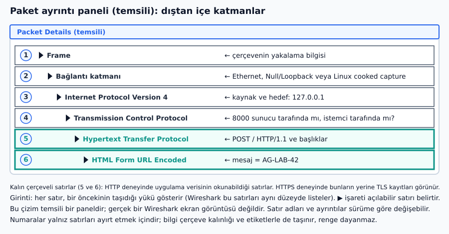
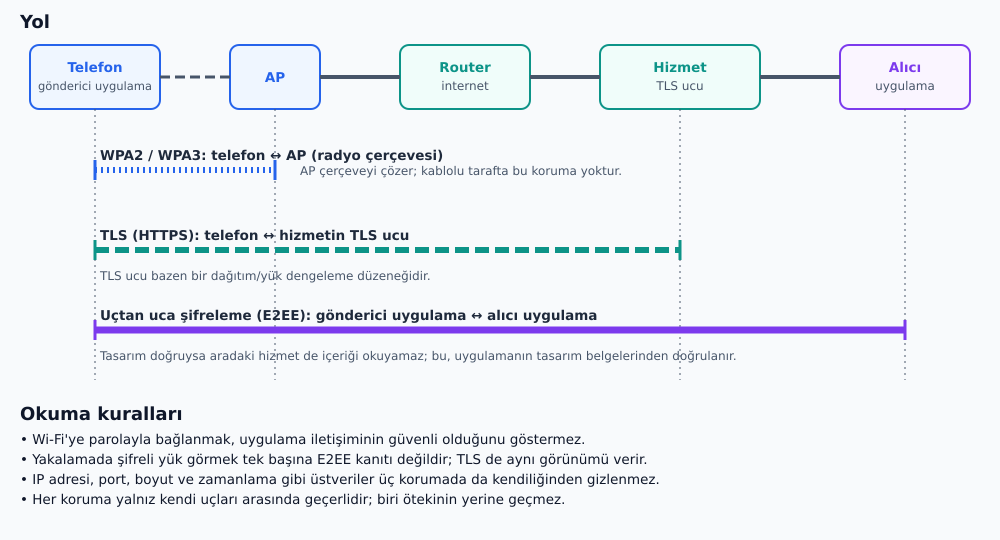

## Ana soru ve plan

Wireshark ağ arabiriminden geçen paketleri başlıklarıyla ve erişilebilir içerikleriyle gösterir. Aynı zararsız işareti önce şifresiz HTTP ile, sonra HTTPS ile göndereceksiniz ve ikisinin yakalamada nasıl göründüğünü karşılaştıracaksınız.

| Aşama | Süre |
| --- | ---: |
| 1. HTTP ile HTTPS karşılaştırması | 25 dk |
| 2. WhatsApp Web test trafiği | 20 dk |
| 3. Güvenlik tartışması | 15 dk |

**Test işareti:** `AG-LAB-42`

::: {.notes}
Yakalamak ile okumak farklı işlerdir. Şifrelenmiş uygulama verisi yakalanabilir; yakalanan baytlar anlamlı bir metin olarak okunamaz. İlk aşamada bunu kontrollü biçimde kuruyoruz: aynı işaret, aynı istek gövdesi; biri düz HTTP, diğeri TLS içindeki HTTP. İkisi de TCP ile gider ve bu bilgisayarın loopback arabiriminde kalır. Ardından yalnız kendi test oturumunuzla gerçek bir uygulamada nelerin görünür kaldığına bakıyoruz.

Tek işaret kullanmamızın nedeni, arama sonucunu karşılaştırılabilir kılmaktır. HTTP yakalamasında bulunan bir işaret, doğrulanmış HTTPS yakalamasında düz metin olarak yoksa değişen korumadır.
:::

---

## Kurallar: yalnız kendi, yalnız test trafiği

- Yalnız **kendi cihazınızda** ve **kendi rızanızla** oluşturduğunuz trafiği yakalayın.
- Gerçek parola ya da özel konuşma kullanmayın; yalnız test içeriği.
- Yakalama dosyalarını (`.pcapng`) başkalarıyla paylaşmayın, herkese açık depoya yüklemeyin.
- Teslimde yakalama dosyasını değil, doldurduğunuz **gözlem tablosunu** verin.
- Wireshark normal çalışırken yalnız bu bilgisayarın arabiriminden geçen trafiği yakalar; aynı WLAN'daki başkalarının trafiğini göstermez. Başkalarına ait 802.11 çerçeveleri için monitor mode, uygun donanım ve sürücü gerekir; bu çalışmada başkasının trafiği yakalanmaz.

::: {.notes}
Yakalama dosyaları, kişisel verilerin yanında hizmet uç noktalarını ve oturum üstverilerini de içerebilir. Teslimde dosya yerine, gerekli alanları ayıklayıp doldurduğunuz tablo istenir. Başkalarının telefonlarının veya mesajlarının trafiğini izlemek bu çalışmanın konusu olamaz.

Wireshark normal çalışırken kendi cihazınızın arabirimindeki erişilebilir trafiği yakalar. Aynı WLAN'daki diğer kullanıcıların paketlerini kendiliğinden göstermez.
:::

---

## Aşama 1 (25 dk) — Başlangıç kontrolü: iki dinleyici

Deneye başlamadan önce kendi bilgisayarınızda iki dinleyici çalışıyor olmalı (dinleyiciler ve `lab-localhost.pem`, ders için hazırlanan yardımcı sunucu betiğiyle kurulur):

| Dinleyici | Adres |
| --- | --- |
| HTTP | `127.0.0.1`, port `8000` |
| HTTPS | `127.0.0.1`, port `8443` |

Sertifika `localhost` ve `127.0.0.1` adlarını kapsamalıdır. HTTPS isteği `lab-localhost.pem` dosyasıyla doğrulanır. Komutları bu dosyanın bulunduğu dizinde çalıştırın.

Aynı işareti taşıyan iki istek. İşaret adres satırında değil, POST gövdesinin `mesaj` alanındadır:

```text
curl -i --data "mesaj=AG-LAB-42" http://127.0.0.1:8000/
curl -i --cacert lab-localhost.pem --data "mesaj=AG-LAB-42" https://127.0.0.1:8443/
```

Windows PowerShell'de `curl` yerine `curl.exe` yazın.

HTTPS komutunda `-k` kullanmayın; `-k` sertifika doğrulamasını kapatır. Doğrulama `--cacert` ile açık kalır.

Her komuttan sonra yanıt başlığının ilk satırına bakın: durum satırı `2xx` olmalıdır. `301` veya `302` ve `Location: https://…` başlığı, isteğin HTTPS'e yönlendirildiği anlamına gelir; bu durumda açık metin deneyi geçerli değildir.

::: {.notes}
Bu kontrol, Wireshark'ı açmadan önce iki isteğin gerçekten çalıştığını gösterir. Aksi hâlde HTTPS'te işareti bulamamak şifrelemeden mi, yoksa isteğin hiç gitmemesinden mi kaynaklandığı belli olmaz.

`curl -i`, yanıt başlıklarını da gösterir. İki komutta da durum satırı 2xx olmalıdır. `curl` sıfır çıkış koduyla bitse bile durum satırını okuyun; bağlantı kurulmuş bir 4xx yanıtı da sıfırla çıkabilir. `301`/`302` ve `Location: https://…` başlığı varsa istek HTTPS'e yönlendirilmiştir ve bu deney için geçerli bir açık metin kontrolü sayılmaz. `curl` yönlendirmeyi kendiliğinden izlemez. PowerShell'deki `curl` takma adı `Invoke-WebRequest` olduğu için yönlendirmeyi izleyebilir; bu yüzden `curl.exe` kullanın.

Başarılı yanıtın gövdesinde `tamam` satırı ve `mesaj=AG-LAB-42` vardır. HTTPS komutundaki `--cacert`, sunucu sertifikasını `lab-localhost.pem` ile doğrular. `-k` kullanmayın: `-k` doğrulamayı kapatır.

Bir hata görürseniz sessizce geçmeyin:

- `curl: (7)` bağlantı reddedildi: dinleyici çalışmıyor ya da port yanlış; eğitmene bildirin.
- `curl: (60)` sertifika doğrulanamadı: sertifika dosyası, ad ya da SAN uyuşmuyor; eğitmene bildirin.
- `curl: (77)` sertifika dosyası okunamadı: `lab-localhost.pem` bu dizinde değildir ya da yolu hatalıdır; eğitmene bildirin.
- `curl.exe` bulunamazsa eğitmene bildirin.

`https://localhost:8443/` aynı `--cacert` ve aynı gövdeyle denenebilir; sertifikanın `localhost` adını da kapsaması gerekir. `localhost` bazı sistemlerde önce IPv6 adresine çözülür. Dinleyici `127.0.0.1` üzerinde olduğu için bu deneme kısa bir reddedilme olarak yakalamada görünebilir. Ana deneyde `127.0.0.1` kullanın.
:::

---

## Loopback arabirimini yakalamak

İstekler bu cihazın içinde kalır; Wi-Fi veya Ethernet kartından geçmez. Wireshark'ta **loopback arabirimini** seçin:

| Sistem | Arabirim adı (sürüme göre değişir) |
| --- | --- |
| Linux | `lo` ("Loopback: lo") |
| macOS | `lo0` ("Loopback: lo0") |
| Windows | "Adapter for loopback traffic capture" veya "Npcap Loopback Adapter" |

Arabirim listesinde görünmüyorsa yakalama yetkisi ya da Npcap loopback desteği eksik olabilir; eğitmene bildirin.

Bu yakalamada 802.11 çerçeveleri ve WPA2/WPA3 koruması devrede değildir. Deney WPA korumasını ölçmez; yalnız düz HTTP ile TLS'nin yakalamadaki görünümünü karşılaştırır.

::: {.notes}
Loopback, bilgisayarın kendi kendine konuşma arabirimidir. Paket ağ kartına çıkmaz. Bu deneyde havadaki Wi-Fi çerçeveleri ve WPA koruması devrede değildir. Loopback yakalaması düz HTTP ile TLS'yi karşılaştırmak için uygundur; Wi-Fi koruması hakkında bir ölçüm vermez.

Çerçeve başlığı sürüme göre Ethernet (adresler sıfır), "Null/Loopback" ya da Linux'ta "Linux cooked capture" olarak görünebilir. Burada gerçek bir MAC alışverişi yoktur. Kaynak ve hedef IPv4 adresi ikisi de `127.0.0.1`'dir. İstemciden giden pakette hedef port `8000` ya da `8443`, kaynak port geçicidir. Sunucudan dönen pakette bu portlar yer değiştirir.
:::

---

## HTTP yakalaması ve ilk kaydı okumak

1. Loopback arabirimini seçip yakalamayı başlatın.
2. Paket listesinin üstündeki **görüntüleme filtresi** kutusuna `tcp.port == 8000` yazın. Yakalamayı başlatmadan önceki **yakalama filtresi** kutusuna yazmayın; ikisinin sözdizimi farklıdır ve bu ifade orada hata verir.
3. HTTP `curl` komutunu **bir kez** çalıştırın. Durum satırı 2xx olmalıdır.
4. Yakalamayı durdurun.
5. Paket listesinde istek paketini bulun: Info sütununda `POST /` ya da içinde veri taşıyan TCP paketi.

Alttaki panelde sırayla açın. HTTP katmanları, çözüm açıksa görünür:



Şema, paket ayrıntı panelinin temsilidir; gerçek ekran görüntüsü değildir ve satır adları sürüme göre değişebilir. Wireshark bu satırları aynı düzeyde listeler; şemadaki girinti, her katmanın bir öncekinin taşıdığı yük olduğunu gösterir.

Wireshark 8000 numaralı portu HTTP olarak tanımıyorsa paket yalnız TCP görünür. Pakete sağ tıklayıp **Follow → TCP Stream** ile akışı açın ya da **Analyze → Decode As** ile TCP port 8000'i HTTP olarak çözümleyin (menü adları sürüme göre değişebilir).

Sonra görüntüleme filtresine `frame contains "AG-LAB-42"` yazıp işareti arayın ve bulduğunuz paketin numarasını yazın.

::: {.notes}
Görüntüleme filtresi ekranda hangi paketlerin listeleneceğini seçer; yakalama dosyasındaki paketleri silmez. Bu ifadeyi, yakalamayı başlatmadan önce yazılan yakalama filtresine koymayın. Yakalama filtresinin dili başkadır.

Paket listesinde önce TCP üçlü el sıkışmasını görürsünüz (SYN, SYN/ACK, ACK); ardından istek verisini taşıyan segment gelir. Bu kısa gövde normalde tek segmenttedir. Info sütunundaki `POST /` işareti taşımaz; işaret gövdedeki `mesaj` alanındadır. Wireshark 8000 numaralı portu HTTP olarak tanımıyorsa paket TCP olarak kalır. Pakete sağ tıklayıp **Follow → TCP Stream** ile akışı açın ya da **Analyze → Decode As** ile TCP port 8000'i HTTP olarak çözümleyin. Menü adları sürüme göre değişebilir. Form katmanının etiketi de sürüme göre değişebilir; aradığınız alan `mesaj` değeridir.

200 yanıtının gövdesi aynı işareti geri yazar. HTTP yakalamasında işaret hem istekte hem yanıtta görülebilir.

İşareti iki yoldan kaydedin: TCP akışındaki `mesaj=AG-LAB-42` satırı ve `frame contains "AG-LAB-42"` görüntüleme filtresi. Akış bölünmüşse süzgeç tek çerçevede kaçırabilir; o zaman akış penceresine bakın. Bulduğunuz paket numarasını yazın. Bu paket, işaretin loopback yakalamasında açık metin olarak durduğunu gösterir.

Üç kayıt alın: işaretin bulunduğu paket numarası, bu paketteki kaynak ve hedef port, istek satırı.
:::

---

## HTTPS yakalaması

1. Yeni, kısa bir yakalama başlatın (loopback).
2. Görüntüleme filtresi: `tcp.port == 8443`.
3. HTTPS `curl` komutunu **bir kez** çalıştırın. Durum satırı 2xx olmalıdır. Yakalamayı durdurun.
4. Önce paketlerin **var olduğunu** kontrol edin: TCP el sıkışması, TLS kayıtları (`Client Hello`, `Server Hello`, `Application Data`).
5. Sonra görüntüleme filtresi: `frame contains "AG-LAB-42"`

. . .

Beklenen okuma, curl durum satırı 2xx ise: HTTP yakalamasında aynı arama işareti bulunur. HTTPS yakalamasında 8443 paketleri vardır, işaret araması sonuç vermez. Kendi tablonuza kendi paket numaralarınızı yazın.

Wireshark 8443 numaralı portu TLS olarak çözmezse **Analyze → Decode As** ile TLS seçin. Wireshark'a TLS anahtarı vermeyin: `SSLKEYLOGFILE` tanımlıysa ya da Wireshark'ın TLS anahtar günlüğü doluysa işaret düz metin görünebilir ve deney koşulu bozulur.

::: {.notes}
Sıra önemli. Önce curl çıktısında 2xx satırını, sonra 8443 üzerinde paketlerin durduğunu doğrulayın. Paket yoksa boş arama, yakalamanın o isteği görmediğini söyler. Durum satırı 2xx değilse boş arama, şifreleme sonucu değildir. İkisi de tamamsa ve `AG-LAB-42` ham çerçeve baytlarında yoksa, gövde TLS kayıtlarının içindedir ve bu yakalama onu düz metin olarak göstermez.

`frame contains` yakalanan baytlara bakar. TLS 1.3'te el sıkışmanın bir bölümü de `Application Data` etiketini taşır; bu etiket tek başına o paketin POST gövdesi olduğunu göstermez. Wireshark 8443 portunu TLS olarak çözmezse **Analyze → Decode As** ile TLS seçin. Menü adı sürüme göre değişebilir. Kullandığınız TLS sürümünde sertifika şifreli kayıtların içinde olabilir; `Certificate` satırını görmemeniz bu deneyin başarısızlığı değildir.

Wireshark'a TLS anahtarlarını vermiyoruz. `SSLKEYLOGFILE` tanımlıysa veya Wireshark'ın TLS anahtar günlüğü doluysa işaret düz metin olarak çıkabilir. O görünüm, deney koşulunun bozulduğunu gösterir.
:::

---

## Gözlemi nasıl yazarız?

Önce ne gördüğünüzü, sonra yorumu yazın. Aşağıdaki blok yazım şablonudur; N ve M yerine kendi sayılarınız gelir:

> **Gözlem:** HTTP yakalamasında `AG-LAB-42` işareti N numaralı pakette açık metin olarak göründü. HTTPS yakalamasında curl durum satırı 2xx idi, `tcp.port == 8443` filtresinde M paket vardı ve bunlar TLS kayıtlarıydı; işaret araması sonuç vermedi.
>
> **Yorum:** Aynı istek gövdesi düz HTTP'de okundu, TLS içinde okunmadı.

Bu yakalamalarda hâlâ görünen bilgiler: IP adresleri, portlar, TCP bağlantısı, paket boyutları, zamanlama. IP adresleri paketin yönlendirilmesi için, portlar uçtaki uygulamanın seçilmesi için açık taşınır; TLS ise uygulama verisini istemci ile hizmetin TLS ucu arasında korur. Uçtan uca şifreleme (E2EE) gönderici ile alıcı uygulama arasındaki ayrı bir korumadır; şifreli yük görmek tek başına E2EE göstermez.

::: {.notes}
Şablon, iki yakalama arasındaki farkın nasıl yazılacağını gösterir. Sayılar sizin dosyanızdan gelir. İşaret HTTP'de bulunup HTTPS'te bulunmuyorsa ve HTTPS denemesi 2xx ile bittiyse, okuduğunuz şey korumanın etkisidir. Bu yakalamalarda bağlantıyı tanımlayan bilgiler iki durumda da görünür.

Gözlem ve yorum ayrı yazılırsa, hangi cümlenin yakaladığınız verinin doğrudan sonucu, hangisinin çıkarım olduğu anlaşılır.
:::

---

## Aşama 2 (20 dk) — WhatsApp Web test trafiği

Bu yakalama **ayrı bir deneydir** ve loopback üzerinden değil, **gerçekten kullandığınız ağ arabirimi** (Wi-Fi veya Ethernet) üzerinden yapılır.

1. Başka tarayıcı etkinliğini azaltın; kendi test oturumunuzu açın.
2. Gerçek arabirimde kısa bir **başlangıç yakalaması** alın (mesaj göndermeden).
3. Yeni bir yakalama başlatın; test alıcınıza `AG-LAB-42` mesajını **bir kez** gönderin ve saatini not edin. Yakalamayı durdurun.
4. İncelenecekler: `Statistics → Conversations`, `Statistics → Endpoints`, `Statistics → Protocol Hierarchy` ve görüntüleme filtreleri `dns`, `tls`, `quic`, `frame contains "AG-LAB-42"`. `quic`, UDP üzerinde çalışan ve kendi taşıma şifrelemesini içeren QUIC protokolünü süzer. Boş `quic` sonucu QUIC olmadığını kanıtlamaz: yakalama bağlantı kurulumundan sonra başladıysa kısa başlıklı paketler düz UDP görünebilir; bu yüzden `Statistics → Protocol Hierarchy` ve UDP konuşmalarına da bakın. QUIC şifrelemesi TLS gibi bir taşıma korumasıdır ve E2EE kanıtı sayılmaz. Menü adları sürüme göre değişebilir.

Bu yakalamada şunları gözetin:

- WhatsApp Web'in kullandığı IP, port ve protokol sabit değildir; içerik dağıtım uçları, TCP üzerinde TLS ya da UDP üzerinde QUIC görülebilir. Yalnız gözlediklerinizi yazın.
- Tarayıcı arka planda başka istekler de yapar; mesajı gönderdiğiniz saniyedeki bir paketin o mesaja ait olduğu ya da bir mesajın tek pakete karşılık geldiği varsayılmaz.
- Normal yakalama yalnız bu bilgisayarın arabiriminden geçen trafiği görür; telefonunuzun ya da başkalarının trafiğini göstermez.

WhatsApp ile ilgili katılımınız mümkün değilse bu aşamayı atlayıp 3. aşamadaki soruları HTTPS gözleminizle yanıtlayabilirsiniz.

::: {.notes}
Yakalama bu bilgisayarın seçtiğiniz arabiriminden geçen trafiği görür. Telefonunuzun trafiği ve karşı tarafın trafiği bu yakalamanın dışındadır. Mesaj öncesi alınan başlangıç yakalaması, tarayıcının ve sayfanın kendi arka plan trafiğini gösterir.

WhatsApp Web'in kullandığı IP, port veya protokol sabit değildir. Adres, içeriği kullanıcıya yakın sunan bir dağıtım hizmetine ait olabilir. Taşıma TCP üzerinde TLS olabilir ya da UDP üzerinde çalışan, kendi taşıma şifrelemesini içeren bir protokol (QUIC; Wireshark'ta `quic` süzgeci) olabilir. Süzgeç boş dönerse bunu QUIC olmadığı sonucuna çevirmeyin; QUIC şifrelemesi de TLS gibi taşıma koruması sağlar, E2EE kanıtı değildir. DNS sorgusu şifreli gidebilir; `dns` filtresinin boş kalması deneyin başarısız olduğu anlamına gelmez. VPN açıksa dış başlıktaki adres, mesajın uç uygulaması olmayabilir. Gördüğünüz uçları yazın, önceden bir liste ezberlemeyin. Sunucu adı bir DNS sorgusunda ya da TLS el sıkışmasının açık alanında görünebilir; her yakalamada görünmesi beklenmez.

Tarayıcı aynı anda başka istekler de yapar. Mesajın gönderildiği saniyede görülen bir paketin o mesajı taşıdığını kesin olarak söyleyemezsiniz. Tek bir mesajın tek bir pakete karşılık geldiği de varsayılmaz. Raporlanabilecek veriler: zaman aralığındaki paket sayısı, görünen uç noktalar, boyutlar, TCP/UDP gibi taşıma bilgisi.

Aramanın sonucunu da gözlem olarak yazın: "Bu yakalamada `AG-LAB-42` metnini içeren paket bulamadım."
:::

---

## Ne görünür, ne görünmez?

| Veri | Yakalamada beklenen |
| --- | --- |
| Kaynak ve hedef IP, portlar, TCP/UDP, boyut, zaman | Bu yakalamaların IP paketlerinde görünür |
| Şifresiz HTTP istek gövdesi | Okunur |
| HTTPS içindeki uygulama verisi | Şifreli; olağan yakalamada okunamaz |
| WhatsApp Web mesaj metni | Olağan yakalamada okunamaz |
| Bir paketin kesin olarak WhatsApp'a ait olduğu | Çoğu zaman belirlenemez; tarayıcı ve altyapı trafiği karışır |
| E2EE'nin varlığı | Uygulamanın tasarım belgelerinden bilinir; bu yakalama onu tek başına göstermez |

Paket, yönlendirilmek için IP adresini ve uçtaki uygulamanın seçilmesi için portu açık taşır; TLS ise uygulama verisini istemci ile hizmetin TLS ucu arasında korur. E2EE gönderici ile alıcı uygulama arasındaki ayrı bir korumadır. Paketin görünmesi, içeriğinin okunabilmesi demek değildir.

::: {.notes}
Tablo, bu deneyin tasarlanmış beklentisidir; ölçtüğünüz sonuçla karşılaştırın. Son iki satır, okunamayan içeriğin tek başına hangi katmanı ayırt ettiğini sınırlar. TLS ile korunan bir gövde de, uçtan uca şifrelenen bir mesaj da olağan yakalamada düz metin olarak çıkmaz. İkisini ayıran, uygulamanın koruma uçlarıdır.
:::

---

## Aşama 3 (15 dk) — Kanıt tablosu

Her sütunu kendi yakalamanızla doldurun.

| Alan | HTTP (loopback) | HTTPS (loopback) | WhatsApp Web (gerçek arabirim) |
| --- | --- | --- | --- |
| Arabirim ve yakalama zamanı | | | |
| Görülen IP, port, taşıma protokolü | | | |
| Paket boyutu ve zamanlama | | | |
| `AG-LAB-42` okunabildi mi? | | | |
| Doğrudan gözlem (tek cümle) | | | |
| Bu gözlemle desteklenmeyen iddia | | | |

::: {.notes}
Son satır, gözlemin sınırını sizin yazmanızı ister: her sütunda önce ne ölçtüğünüzü, sonra bu ölçümün hangi iddiaya yetmediğini düşünün.
:::

---

## Üç koruma, üç uç çifti

| Koruma | Hangi uçlar arasında | Bu laboratuvarda |
| --- | --- | --- |
| WPA2/WPA3 | İstemci ile AP, radyo çerçevesi | Loopback'te devrede değil. Gerçek arabirimde sürücü, bu bilgisayarın kendi paketini çözdükten sonra Wireshark'a verir; havadaki WPA çerçevesi bu ekranda yoktur ve bu görünüm WPA'nın gücünü ölçmez |
| TLS (HTTPS) | İstemci ile hizmetin TLS ucu | HTTPS deneyinde devrede |
| E2EE | İletişimin iki uç uygulaması | WhatsApp'ın tasarımına bağlı; bu yakalamadan doğrulanamaz |



Yakalamada şifreli yük görmek tek başına E2EE kanıtı değildir; TLS de aynı görünümü verir.

::: {.notes}
Loopback deneyi düz HTTP ile TLS'yi yan yana koymak için kurulmuştur. Paket bilgisayarın içinde kaldığı için Wi-Fi koruması bu karşılaştırmaya girmez.

Gerçek arabirimde normal yakalama, işletim sisteminin bu bilgisayara verdiği paketleri gösterir. Wireshark burada WPA anahtarını çözmez ve aynı WLAN'daki başka istemcilerin havadaki çerçevelerini açmaz. WhatsApp test metninin okunamaması WPA ile açıklanamaz. Bu yakalamada metni gizleyen katman, uygulama ile TLS'tir.

Loopback'te görülen düz metin ve TLS farkı, bir mesajlaşma uygulamasının uçtan uca şifreleme kullandığı sonucunu taşımaz. Bu iddia, uygulamanın teknik belgelerinden ve tasarımından gelir.
:::

---

## Teslim soruları

1. HTTP ile HTTPS yakalamaları arasında hangi gözlem farkı vardı?
2. İçerik okunamazken IP, port ve paket boyutları hakkında hangi bilgiler görünür kaldı?
3. WhatsApp Web testinde mesaj metni bulunamadığında bu gözlem hangi güvenlik iddialarını **desteklemez**?
4. Aynı uygulamayı korumada WPA2/WPA3, TLS ve E2EE hangi farklı roller üstlenir?
5. Paketleri görebiliyorsak içeriği neden okuyamıyoruz? IP ve port bilgisini TLS uygulama verisiyle karşılaştırarak yanıtlayın.

::: {.notes}
Cevaplarda gözlemle yorumu ayrı yazın. Birinci ve ikinci soru kendi yakalamanızın doğrudan sonucudur. Üçüncü soru ölçtüğünüz verinin sınırını, dördüncü soru korumaların uç çiftlerini sorar.
:::


