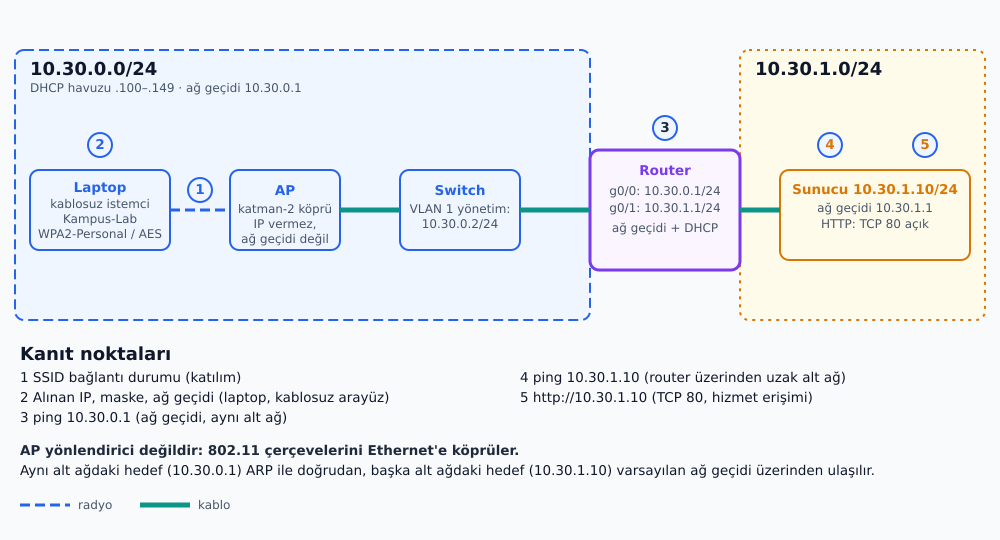

## Sorumuz: hangi aşamada başarısız?

Bir kablosuz istemciyi `Kampus-Lab` WLAN'ına katacak, DHCP ile adres almasını sağlayacak ve `10.30.1.10` sunucusunun web sayfasını açacaksınız. Ardından bilerek hata kurup başarısızlığın **hangi aşamada** olduğunu ayıracaksınız.

| Aşama | Süre |
| --- | ---: |
| 1. Başlangıç durumu ve topoloji | 15 dk |
| 2. Kablosuz güvenlik ayarı | 15 dk |
| 3. DHCP ile IP ve erişim testi | 15 dk |
| 4. Hata kurma ve teşhis | 15 dk |

::: {.notes}
Uygulama, 11.2'deki aşamalar tablosunu sınar: katılım, IP yapılandırması, hizmet erişimi. Her aşama için ayrı bir kanıt toplayacağız: SSID bağlantısı, geçerli IP, ağ geçidine ping, uzak sunucuya ping, web sayfası. Başarılı bir ping'in web hizmetinin açık olduğunu göstermediğini, bağlı görünen bir istemcinin geçerli IP almış olmayabileceğini bu kanıtlarla birlikte göreceksiniz.

Araç Cisco Packet Tracer'dır.
:::

---

## Aşama 1 — Başlangıç durumu (15 dk)



| Öğe | Değer |
| --- | --- |
| Router `g0/0` | `10.30.0.1/24` |
| Yönetim adresi | `10.30.0.2/24`, switch VLAN 1 üzerinde |
| DHCP (router üzerinde) | `10.30.0.0/24` içinden `10.30.0.100`–`10.30.0.149` |
| DHCP ağ geçidi | `10.30.0.1` |
| Router `g0/1` | `10.30.1.1/24` |
| Sunucu | `10.30.1.10/24`, ağ geçidi `10.30.1.1`, HTTP (TCP 80) açık |

AP bir katman-2 köprüdür: 802.11 çerçevelerini Ethernet'e aktarır, IP adresi dağıtmaz ve ağ geçidi değildir. `10.30.0.2` yalnız switch'in VLAN 1 yönetim arayüzündedir. İstemcinin ağ geçidi ve DHCP sunucusu router'dır (`10.30.0.1`).

**Kablolu kurulum** (hazır bir başlangıç dosyanız yoksa):

| Bağlantı | Kablo |
| --- | --- |
| Router `g0/0` ↔ switch'te bir port (örneğin `Fa0/1`) | düz (straight-through) |
| Switch'te başka bir port (örneğin `Fa0/2`) ↔ AP'nin Ethernet portu | düz (straight-through) |
| Router `g0/1` ↔ sunucunun Ethernet arabirimi | çapraz (cross-over) |

Port adları cihaz modeline göre değişir. Router:

```text
enable
configure terminal
interface g0/0
 ip address 10.30.0.1 255.255.255.0
 no shutdown
interface g0/1
 ip address 10.30.1.1 255.255.255.0
 no shutdown
ip dhcp excluded-address 10.30.0.1 10.30.0.99
ip dhcp excluded-address 10.30.0.150 10.30.0.254
ip dhcp pool KAMPUS
 network 10.30.0.0 255.255.255.0
 default-router 10.30.0.1
end
```

Switch yönetim adresi:

```text
enable
configure terminal
interface vlan 1
 ip address 10.30.0.2 255.255.255.0
 no shutdown
end
```

Sunucuda adres `10.30.1.10`, maske `255.255.255.0`, ağ geçidi `10.30.1.1` olur ve HTTP hizmeti açılır. Hazır bir başlangıç dosyası kullanıyorsanız yapılandırmayı bu değerlerle karşılaştırın.

::: {.notes}
Başlangıç durumu şudur: kablolu taraf yapılandırılmış ve çalışıyor; kablosuz SSID, güvenlik ve istemci eşlemesi kurulmamıştır. Kablolu taraf bu slayttaki kurulumla hazırlanır; uygulamanın değerlendirilen kısmı kablosuz katılım ve teşhistir.

İki ağ router'a doğrudan bağlıdır. `g0/0` ve `g0/1` up/up iken `10.30.0.0/24` ile `10.30.1.0/24` için bağlı rotalar oluşur. Ek statik rota, NAT veya ACL yoktur. Sunucu, switch'in bulunduğu ağda değildir; `g0/1` tarafındadır.

AP, istemciyi `10.30.0.0/24` üzerine köprüler. Adres dağıtmaz ve ağ geçidi gibi davranmaz. Ağ geçidi `10.30.0.1`'dir. Laptop laboratuvar ağına yalnız kablosuz arayüzle bağlıdır; switch'e Ethernet kablosu yoktur.

Aşağıdaki kontroller sağlanmadan 2. aşamaya geçmeyin.
:::

---

## Başlangıç kontrolü: kablolu taraf çalışıyor mu?

1. Router'da `enable` ile ayrıcalıklı moda geçin; arayüz durumu:

```text
show ip interface brief
```

Temsili çıktı:

```text
Interface              IP-Address      OK? Method Status                Protocol
GigabitEthernet0/0     10.30.0.1       YES manual up                    up
GigabitEthernet0/1     10.30.1.1       YES manual up                    up
```

2. Router'da `show ip dhcp pool`. Ağ adresi `10.30.0.0`, maske `255.255.255.0`, default-router `10.30.0.1` olmalıdır. Dağıtılan dar aralık, `ip dhcp excluded-address` ile hariç tutulan adreslerden çıkar: `.1`–`.99` ve `.150`–`.254` dağıtılmaz, kalan `.100`–`.149` kiralanır. Bu hariç adresleri `enable` modunda `show running-config` çıktısındaki `ip dhcp excluded-address` satırlarından doğrulayın. `show ip dhcp pool` çıktısı aralığı çoğunlukla tüm alt ağ olarak yazar; `.100`–`.149` sınırı o satırdan değil, hariç tutulan adreslerden çıkar. `.1` ve `.2` kiralanmaz.
3. Router'dan `ping 10.30.1.10`. Yanıt, sunucunun `10.30.1.0/24` üzerinde ICMP yanıtladığını gösterir.
4. Sunucuda adres `10.30.1.10`, maske `255.255.255.0`, ağ geçidi `10.30.1.1`. HTTP hizmeti açık (TCP 80).
5. Sunucunun komut satırından `ping 10.30.0.1`. Yanıt, sunucunun ağ geçidi üzerinden `10.30.0.0/24` ağına gidip döndüğünü gösterir.

**Bir adım başarısızsa eğitmene bildirin; 2. aşamaya geçmeyin.**

::: {.notes}
Bu kontrol, sorunun kablosuz tarafta mı yoksa baştan hazır olması gereken kablolu tarafta mı olduğunu ayırır. Kablolu erişim yokken istemci parolasını değiştirmek teşhis değildir. WPA2 katılımı oluşsa bile havuzdan adres gelmez.

`show ip interface brief` örneği temsilidir. Arayüz adı modelde daha uzun yazılabilir. Method sütununun metni de değişebilir. Eşleşecek yerler iki adres ile Status ve Protocol sütunlarının up olmasıdır.

`show ip dhcp pool` çoğu çıktıda IP aralığını tüm alt ağ olarak yazar. `.100`–`.149` sınırı o satırdan değil, hariç tutulan adreslerden okunur.

Router'dan sunucuya ping, hedef router ile aynı alt ağda olduğu için sunucuda kayıtlı ağ geçidini kullanmaz. Ağ geçidi alanını 4. adımda görürsünüz; 5. adım o kapının karşı ağa işlediğini gösterir. Aynı ping komutunda ilk paket zaman aşımına düşüp sonrakiler yanıt verirse erişim vardır.
:::

---

## Aşama 2 — Kablosuz güvenlik ayarı (15 dk)

| Ayar | AP'de | İstemcide |
| --- | --- | --- |
| SSID | `Kampus-Lab` | `Kampus-Lab` |
| Güvenlik modu | WPA2-Personal, şifreleme AES | aynı |
| Parola | `AgLab-2026-Deneme!` | aynı |

1. AP'nin kablosuz arayüzünde SSID, güvenlik modu ve parolayı ayarlayın.
2. İstemcide kablosuz arayüzün bulunduğunu ve açık olduğunu kontrol edin. Yoksa laptopu kapatın, kullandığınız modelin modül listesinden kablosuz modülü takın (gerekirse Ethernet modülünü çıkarın) ve yeniden açın. Switch'e giden Ethernet kablosu olmasın.
3. İstemcide aynı üç değeri girin; bağlanın.
4. Kayıt: istemcinin bağlı olduğu SSID ve bağlantı durumunu yazın.

Simülatör arayüzünde `WPA2-Personal` seçeneği `WPA2-PSK` adıyla görünebilir; şifreleme olarak AES seçin.

`AgLab-2026-Deneme!` yalnızca bu laboratuvar için seçilmiş bir test parolasıdır; başka bir ağda kullanmayın.

::: {.notes}
SSID, güvenlik modu ve parola AP ile istemcide uyuşmak zorundadır. Packet Tracer'da AP'nin kablosuz arayüzünü ayarladığınız ekranın adı ve istemcideki kablosuz ayar ekranı sürüme göre değişebilir; "SSID", "WPA2-PSK" ve "AES" seçeneklerini ayar ekranında bulun. İstemci olarak kullandığınız laptopta kablosuz arayüz modülü yoksa önce uygun modülü takmanız gerekebilir.

Kayıtta yalnız simülatörde seçip gözlemlediğiniz güvenlik modunu yazın. WPA2-Personal/AES, 11.2'de gördüğümüz parola temelli anahtar kurma ile şifrelemeyi içerir; bağlantı başarılıysa istemci ile AP arasında anahtarlar kurulmuş demektir. Bu, istemcinin IP aldığını veya sunucuya eriştiğini göstermez.
:::

---

## Aşama 3 — DHCP ile IP ve erişim testi (15 dk)

1. İstemcide IP ayarını **DHCP** yapın.
2. Komut satırında:

```text
ipconfig
ping 10.30.0.1
ping 10.30.1.10
```

3. Web tarayıcısında `http://10.30.1.10` adresini açın.

`ipconfig` çıktısında kablosuz arayüzün satırını okuyun; bağlantısız kablolu arayüz `0.0.0.0` gösterebilir ve bu bir kira değildir. İlk `ping` paketi ARP tamamlanmadan zaman aşımına düşebilir; aynı komutta sonraki yanıtlar geliyorsa erişim vardır.

Temsili çıktı. `10.30.0.120`, havuzdan bir örnektir; sizin adresiniz `10.30.0.100`–`10.30.0.149` içinde başka bir değer olabilir:

```text
IP Address......................: 10.30.0.120
Subnet Mask.....................: 255.255.255.0
Default Gateway.................: 10.30.0.1
```

::: {.notes}
Değeri kablosuz arayüzün satırından okuyun. Boştaki kablo arayüzü `0.0.0.0` kalabilir; onu kira saymayın. Geçerli kira `10.30.0.100` ile `10.30.0.149` arasındadır, iki uç da dahildir. Adres router'daki havuzdan gelir. `0.0.0.0` ve `169.254` ile başlayan adres bu havuz değildir.

İlk ICMP paketi ARP tamamlanmadan zaman aşımına düşebilir. Aynı komutta sonraki yanıtlar geliyorsa erişim vardır. Bütün paketler zaman aşımına düşüyorsa o satır başarısızdır.

`ping 10.30.0.1`, istemcinin ağ geçidine ulaştığını gösterir. `ping 10.30.1.10`, paketin router üzerinden sunucuya gidip döndüğünü gösterir. Web sayfası, sunucudaki HTTP hizmetinin TCP 80'de çalıştığını gösterir. Ping yanıtı bu hizmetin açık olduğunu göstermez. Adres çubuğundaki şema `http://` olur.
:::

---

## Test matrisi: her aşama için ayrı kanıt

| Test | Hangi aşamayı kanıtlar? | Beklenen | Gözlenen |
| --- | --- | --- | --- |
| İstemci `Kampus-Lab`'a bağlı | Katılım | SSID bağlı | |
| `ipconfig` (kablosuz arayüz) | IP yapılandırması | `10.30.0.100`–`10.30.0.149`, maske `255.255.255.0`, ağ geçidi `10.30.0.1` | |
| `ping 10.30.0.1` | Yerel ağ geçidi | Yanıt gelir | |
| `ping 10.30.1.10` | Router üzerinden uzak ağ | Yanıt gelir | |
| `http://10.30.1.10` | Hizmet erişimi (TCP 80) | Sayfa açılır | |

**Gözlenen** sütununu kendi sonuçlarınızla doldurun.

::: {.notes}
Beklenen sütunu modeldir. Gözlenen sütununu siz çalışırken doldurursunuz. İlk başarısız satır, teşhisin başladığı yerdir. Önceki aşama düzelmeden sonraki satır ayrı bir arıza kanıtı sayılmaz.

Katılım veya IP satırı başarısızsa sunucuyu yeniden kurmaya geçmeyin.
:::

---

## Aşama 4 — Hata kurma ve teşhis (15 dk)

Çalışan topolojiyi başka bir adla kaydedin; hatayı bu kopyada kurun. En az iki hata seçin. Bir hatayı kaydedip düzeltmeden ikinci hatayı eklemeyin.

| Hata | Nasıl kurulur | Tahmininiz / gözleminiz (siz doldurun) |
| --- | --- | --- |
| Yanlış SSID | İstemcide SSID `Kampus-Lab2`. AP `Kampus-Lab` kalır | |
| Yanlış parola | İstemcide parola `AgLab-2026-Yanlis!`. SSID aynı kalır | |
| Yanlış ağ geçidi | DHCP kapalı. Adres `10.30.0.200`, maske `255.255.255.0`, ağ geçidi `10.30.0.254`. SSID ve parola doğru | |

Yanlış ağ geçidini kurmadan önce doğru kapıyla kontrol edin: DHCP kapalı, adres `10.30.0.200`, maske `255.255.255.0`, ağ geçidi `10.30.0.1` iken `ping 10.30.1.10` yanıt vermelidir. Ancak bundan sonra yalnız ağ geçidini `10.30.0.254` yapın.

Eşli çalışıyorsanız bir kişi hatayı kursun, diğeri önce tahmin edip teşhis etsin; sonra roller değişsin.

Her hata için: **önce tahmininizi yazın**, sonra testleri sırayla çalıştırın, düzeltin, sonucu kaydedin.

Hatırlatma (10. hafta): hedef istemciyle aynı alt ağdaysa istemci ARP ile hedefe doğrudan ulaşır; hedef başka bir alt ağdaysa paket varsayılan ağ geçidine gönderilir. Bu yüzden `ping 10.30.0.1` ile `ping 10.30.1.10`, ağ geçidi ayarına farklı biçimde bağlıdır.

::: {.notes}
Tahmin yazarken 11.2'deki aşama tablosunu kullanın: hata hangi aşamada ortaya çıkar ve o aşamadan sonra hangi aşamalar hiç başlamaz? İki hatanın ilk bakışta benzer göründüğü yerde, onları ayıran tek alanı ya da testi arayın ve onu "Ayırıcı test" sütununa yazın.

Ağ geçidi deneyinde iki hedefin istemciyle aynı alt ağda olup olmadığını ve paketin hangi adrese (ARP ile doğrudan hedef mi, ağ geçidi mi) gönderildiğini her ping için ayrı ayrı düşünün. Doğru kapıyla alınan kontrol sonucu, değişen tek değerin ağ geçidi olmasını sağlar.

Deneyden sonra istemciyi tekrar DHCP'ye alın. Statik `10.30.0.200` ekranda kalmasın; havuzdan yeni bir adres gelsin. İlk çalışan duruma dönüp beş kanıtı bir kez yineleyin.
:::

---

## Teslim kaydı

Her seçtiğiniz hata için bir satır:

| Hata | Tahmin | İlk belirti | Ayırıcı test | Hatalı alan | Düzeltme sonrası sonuç |
| --- | --- | --- | --- | --- | --- |
| | | | | | |

Ayrıca beş kanıtı **ayrı ayrı** yazın:

1. SSID bağlantı durumu
2. Alınan IP, maske, ağ geçidi
3. Ağ geçidine ping sonucu
4. Sunucuya ping sonucu
5. Web sayfası sonucu

::: {.notes}
Kayıtta ayırıcı test sütunu önemlidir: "ping çalışmadı" bir teşhis değildir; hangi testin geçip hangisinin başarısız olduğunu ve bundan hangi aşamanın elendiğini yazmak teşhistir. Beş kanıtı ayrı yazmanız, aşamaların birbirinin yerine kullanılmaması içindir. SSID'nin görünmesi katılımı, katılım IP edinimini, IP edinimi sunucuya erişimi garanti etmez.
:::


