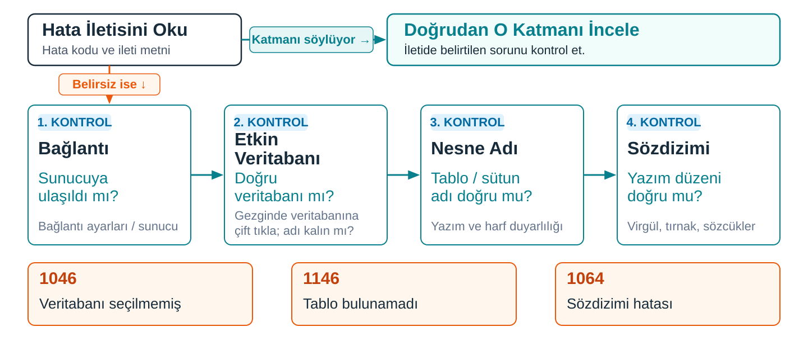

## Tabloyu komutlarla kurmak

Gezginde okuduğumuz `atolye_kayit` tablosunu **biri kurmuştu.**

> Bunu komutlardan oluşan bir dosyayla kurabilir miyiz?

. . .

**Betik:** Sunucuya sırayla gönderilecek komutları içeren, `.sql` uzantılı metin dosyası. Her komut noktalı virgülle biter.

```sql
DROP TABLE IF EXISTS atolye_kayit;

CREATE TABLE atolye_kayit (
  ogrenci_numarasi INT PRIMARY KEY,
  ad_soyad VARCHAR(100),
  telefon VARCHAR(20),
  kayit_tarihi DATE
);

INSERT INTO atolye_kayit (ogrenci_numarasi, ad_soyad, telefon, kayit_tarihi) VALUES
  (101, 'Can Demir', '05551112233', '2026-09-10'),
  (102, 'Zeynep Aydın', '05552223344', '2026-09-11'),
  (103, 'Mert Doğan', '05553334455', '2026-09-11'),
  (104, 'Elif Kaya', '05554445566', '2026-09-12'),
  (105, 'Can Demir', '05559998877', '2026-09-13');
```

::: {.notes}
Geçen notta `atolye` veritabanındaki hazır tabloyu gezginde okuduk. Tablo oradaydı, çünkü biri onu kurmuştu. Şimdi bu tabloyu komutlardan oluşan bir dosyayla kurabileceğimizi görüyoruz.

Bu dosyanın adı betik. Her komut bir noktalı virgülle bitiyor; noktalı virgül komutun orada bittiğini söylüyor ve betikteki komutları birbirinden ayırıyor.

Üç komut var ve her birinin işini söylemek yetiyor. İlk komut, veritabanında `atolye_kayit` adlı bir tablo varsa onu siliyor. İkinci komut, dört sütunlu `atolye_kayit` tablosunu kuruyor; `ogrenci_numarasi` birincil anahtar. Üçüncü komut, tabloya beş satır ekliyor.

Betiği çalıştırıp `atolye_kayit` tablosunun dört sütun ve beş satırla oluştuğunu kontrol edeceğiz.
:::

---

## Önce nerede çalıştığına bak

İlk komut bir tabloyu **siler.**

- Betiği `atolye`'de çalıştırırsak oradaki hazır tabloyu silip yeniden kurar.
- Bu çalışmada betiği **`deneme`** veritabanında çalıştırırız.

Betiğe **gerçek ad, telefon ya da parola yazılmaz.** Bu betikteki öğrenciler ve numaralar uydurmadır.

::: {.notes}
Komutlar kendiliğinden bir veritabanı seçmiyor. Başka bir veritabanı etkinse, o veritabanındaki aynı adlı tablo siliniyor. Derse özel, ayrı bir deneme veritabanı kullanmak, hata yaptığınızda zararın orada kalması demek.

Aynı gerekçe veriler için de geçerli. Betik dosyaları paylaşılır, kopyalanır, e-postayla gider. İçine yazdığınız gerçek bir ad, telefon ya da parola dosyayla birlikte dolaşır. Bu betikteki öğrenciler uydurma, telefon numaraları da. Betiklere parola yazılmaz.
:::

---

## Çalıştırmak ve çıktıyı okumak

Çalıştırmadan önce: bağlantı açık mı? Kalın yazılı etkin veritabanı **`deneme`** mi?

| Komut | Çıktı alanında | Anlamı |
| --- | --- | --- |
| `DROP TABLE IF EXISTS` | bir uyarı olabilir | Silecek tablo yoktu; **hata değil.** |
| `CREATE TABLE` | `0 row(s) affected` | Satır eklemez; yapıyı kurar. |
| `INSERT INTO` | `5 row(s) affected` | Beş satır eklendi. |

::: {.notes}
Çalıştırmadan önce iki şeye bakıyoruz: bağlantı açık mı, kalın yazılı etkin veritabanı `deneme` mi? Sonra betiği editörde açıp bütününü çalıştırıyoruz. Workbench tek bir komutu da çalıştırabilir, editördeki bütün metni de. Betikte bütün metni çalıştırıyorsunuz; tek komut çalıştırırsanız betiğin geri kalanı sunucuya hiç gitmez.

Çıktı alanında her komut için bir satır beliriyor. İlk komutta `deneme` içinde silinecek tablo yok; sunucu bunu bir uyarıyla bildirebilir. Uyarı, komutun çalıştığını ama yapacak iş bulamadığını söylüyor, hata değil. İkinci komutta `0 row(s) affected` gibi bir ileti geliyor. Sıfır satır, tablonun kurulmadığı anlamına gelmiyor; bu komut satır eklemiyor, tablonun yapısını kuruyor. Üçüncü komutta `5 row(s) affected`: beş satır eklenmiş.
:::

---

## Hata çıkmadı, peki iş oldu mu?

Çıktıda hata görmemek **işin yapıldığını göstermez.**

**Doğrulama sorgusu:** Betiğin işini yaptığını görmek için çalıştırılan, veriyi okuyup getiren hazır komut.

```sql
SELECT ogrenci_numarasi, ad_soyad, telefon, kayit_tarihi FROM atolye_kayit;
```

`deneme` etkinken **beş satır** gelmeli.

| ogrenci_numarasi | ad_soyad | telefon | kayit_tarihi |
| --- | --- | --- | --- |
| 101 | Can Demir | 05551112233 | 2026-09-10 |
| 102 | Zeynep Aydın | 05552223344 | 2026-09-11 |
| 103 | Mert Doğan | 05553334455 | 2026-09-11 |
| 104 | Elif Kaya | 05554445566 | 2026-09-12 |
| 105 | Can Demir | 05559998877 | 2026-09-13 |

Satırların sırası değişebilir; numaralarla değerlerin **eşleşmesine** bakılır.

::: {.notes}
İkinci komutun iletisi “sıfır satır” diyor ve tablo yine de kurulmuş. Betik yanlış veritabanında çalışsa da hata vermez, tablo yanlış yerde kurulur. İşin olduğunu görmenin yolu, sonucu bağımsız bir komutla okumak.

Bu iş için doğrulama sorgusu kullanıyoruz. `deneme` etkinken bu sorgu beş kaydı getirmeli. Etkin veritabanının `deneme` olduğunu da kontrol edip beş satırı beklenen değerlerle gördüğünüzde, tablonun doğru yerde kurulduğunu ve satırların yazıldığını doğrulamış olursunuz.

Satırların ekrandaki sırası değişebilir; bu yüzden numaralarla değerlerin eşleşmesini kontrol ediyoruz. Izgara boşsa ya da satır sayısı beş değilse çıktı alanına dönüp hangi komutta ne olduğuna bakıyoruz.

Gezginde `deneme` veritabanının altında `atolye_kayit` tablosunu da görebilirsiniz. Liste kendiliğinden yenilenmediyse gezgini yenileyin.
:::

---

## Betiği dosya olarak kaydetmek

Sunucu tabloları ve satırları saklar; **komutların yazılı olduğu metni saklamaz.**

Betiği `atolye_kayit_kur.sql` gibi, işini söyleyen bir adla kaydedin.

Aynı dosyayı yeniden çalıştırırsanız tablo **aynı beş kayıtla** yeniden kurulur.

::: {.notes}
Komut metnini yeniden açabilmek için onu bir `.sql` dosyasına kaydetmeniz gerekiyor. Dosyaya `atolye_kayit_kur.sql` gibi, işini söyleyen bir ad verin.

Kaydedilmiş betik çalışmanızı yeniden kurulabilir yapıyor. Aynı dosyayı uygun bağlantı ve etkin veritabanıyla yeniden çalıştırırsanız tablo aynı beş kayıtla kurulur. Betiğin ilk komutunun eski tabloyu silmesi bunun için: ikinci kez çalıştırdığınızda sunucu “tablo zaten var” diye takılmaz, tabloyu silip baştan kurar. Metni kaydetmezseniz editörü kapattıktan sonra aynı betiğe yeniden ulaşmayı güvenceye almamış olursunuz.
:::

---

## Çalışmadığında: iletinin üç parçası

```sql
SELECT ogrenci_numarasi, ad_soyad FROM atolye_yoklama;
```

```text
Error Code: 1146. Table 'deneme.atolye_yoklama' doesn't exist
```

- **Hata kodu:** `1146`
- **Açıklama:** `Table ... doesn't exist`
- **İşaret ettiği yer:** `deneme.atolye_yoklama`

::: {.notes}
`deneme` etkin ve önceki betikte kurulmamış `atolye_yoklama` tablosu için hazır sorguyu çalıştırdığınızı düşünün. Çıktı alanında bu ileti görünüyor.

İletinin üç parçası var. Hata kodu, sunucunun hata türüne verdiği numara; burada 1146. Sonra sunucunun İngilizce açıklaması geliyor: tablo yok. Son olarak iletinin işaret ettiği yer: veritabanı adı, nokta, tablo adı.

Kodları ezberlemenize gerek yok. Kod, iletiyi aramak ve iki hatayı birbirinden ayırmak için tutamaç. İleti metinleri MySQL sürümlerine göre küçük farklar gösterebilir; örnekleri kodu, açıklamayı ve gösterdiği nesneyle birlikte okuyoruz.
:::

---

## Hatayı nerede ararız? Dört katman

**Katman:** Hatanın aranacağı yer.

{.blp-diagram}

::: {.notes}
Komut çalışmadığında hatayı aradığımız dört yer var. Her birine katman diyoruz. Nesne, sunucuda adı olan tablo ya da sütun gibi bir şey. Sözdizimi ise komutun SQL'in yazım düzenine uyması. Şimdi dört ayrı hazır komut durumunu bu sırayla karşılaştıracağız.

Hata iletisi önceliklidir; açıkça bir sözdizimi hatası (1064) belirtiliyorsa doğrudan oraya bakılabilir. Dört katman zorunlu bir doğrulama algoritması değil, iletinin belirsiz kaldığı durumlarda izlenecek pratik bir kontrol yoludur. İlk katmandaki sorun sonrakini yanıltabilir: Etkin veritabanı seçilmemişse 1046 iletisi gelir. Yanlış veritabanı etkinse tablo adı doğru yazılmış olsa da 1146 ile “tablo yok” denebilir. Ayrıca ilk üç katman kısa bir bakışla kontrol edilirken sözdizimi komutu sözcük sözcük okumayı gerektirir.

İleti çoğu zaman katmanı kendisi söyler. Katmanı söylemediğinde ya da durum belirsiz kaldığında bu kontrol sırasıyla ilerliyorsunuz.
:::
---


## Bağlantı ve etkin veritabanı

**Bağlantı yok:** Komut sunucuya gitmez; önce sunucuya ulaşma sorunu çözülür.

**Etkin veritabanı yok:**

```text
Error Code: 1046. No database selected
```

**Yanlış etkin veritabanı** (`atolye_test` etkin, tablo `deneme`'de):

```sql
SELECT ogrenci_numarasi, ad_soyad FROM atolye_kayit;
```

```text
Error Code: 1146. Table 'atolye_test.atolye_kayit' doesn't exist
```

::: {.notes}
Bağlantı hiç açılmadıysa komut sunucuya gitmiyor. Bu bir bağlantı hatası; önce sunucuya ulaşma sorunu çözülmeli. Betiğin başındaki `DROP TABLE IF EXISTS` uyarısı farklı: komut çalıştı, yalnız silecek tablo bulamadı. Bağlantıyı kurarken ayırdığımız iki olasılığa dönüyorsunuz: sunucu çalışmıyor olabilir ya da bağlantı ayarları yanlış.

Bağlantı açık ama hiçbir veritabanı etkin değilse sorgu çalışmıyor; ileti “seçili veritabanı yok” diyor.

Yanlış etkin veritabanını ayırt etmek için `atolye_kayit` tablosunu kullanalım: betik bu tabloyu `deneme` içinde kurdu. Bu örnekte önceden hazırlanmış boş `atolye_test` etkin ve aynı sorguyu çalıştırıyoruz. İleti, sunucunun `atolye_test.atolye_kayit` aradığını gösteriyor. Tablonun bulunduğunu bildiğimiz veritabanı `deneme`; beklenen ve görünen adlar farklı. Bu örnekte sorun nesne adında değil, etkin veritabanında.
:::

---

## Nesne adı ve sözdizimi

```sql
SELECT ogrenci_numarasi, ad_soyad FROM atolye_kayitlar;
```

```text
Error Code: 1146. Table 'deneme.atolye_kayitlar' doesn't exist
```

```sql
SELECT ogrenci_numarasi, ad_soyad FORM atolye_kayit;
```

```text
Error Code: 1064. You have an error in your SQL syntax; ... near 'atolye_kayit' at line 1
```

**1146:** Sunucu komutu **çözmüş,** aradığı tabloyu bulamamış. Yazımı değiştirmek işe yaramaz; **veritabanına ve tablo adına** bakılır.

**1064:** Sunucu cümleyi **anlayamamış.** `FORM` yerine `FROM` yazılır.

::: {.notes}
Etkin veritabanı doğru ama tablo adı yanlış yazılmışsa kod yine 1146, ama bu kez etkin veritabanı doğru: `deneme`. Yanlış olan tablo adı. Gezginde `deneme` altındaki tablo adlarına bakınca `atolye_kayitlar` diye bir tablo olmadığını görüyorsunuz. Sütun adı yanlış yazılırsa sunucu bilinmeyen bir sütundan söz ediyor ve kod 1054 oluyor.

Komutun yazımı bozuksa kod 1064. İletinin ana cümlesi “SQL yazımında hata var”. İletinin devamı kılavuza bakmanızı söylüyor; işinize yarayan kısım `near` ile başlayan yer. `near`, sunucunun komutu anlamayı bıraktığı noktayı gösteriyor. Burada `atolye_kayit` gösteriliyor, oysa yanlış yazılan `FORM` sözcüğü ondan bir önce. İleti sunucunun takıldığı yeri söyler; asıl yanlış çoğu zaman o yerin hemen öncesindedir.

“Tablo bulunamadı” iletisini alınca komutun yazımıyla uğraşmak yaygın bir yanlış. Buradaki 1146 örneğinde sunucu komutu çözmüş, sonra aradığı tabloyu bulamamış. Yazımı değiştirmek bu ileti için işe yaramıyor. Bakılacak yer veritabanı ve tablo adı.

1064 aldıysanız durum tersi: sunucu cümleyi anlayamadı. Burada `FORM` yerine `FROM` yazıyorsunuz, sonra komutu yeniden değerlendiriyorsunuz.
:::

---


## Karar soruları

1. Betik `5 row(s) affected` dedi ama doğrulama sorgusu boş geldi. İlk neye bakarsınız?
2. `Error Code: 1146` aldınız. Komuttaki `FROM` sözcüğünü kontrol etmek mantıklı mı?
3. İletide `near 'atolye_kayit'` yazıyor. Hata `atolye_kayit` sözcüğünde mi?

::: {.notes}
1. Etkin veritabanına. Betik bir veritabanında çalışmış, doğrulama sorgusu başka bir veritabanında çalıştırılmış olabilir. Gezginde kalın yazılı veritabanını ve iletideki veritabanı adını karşılaştırırız.
2. Hayır. 1146 sunucunun komutu çözdüğünü ama tabloyu bulamadığını söylüyor. Bakılacak yer etkin veritabanı ve tablo adı.
3. Çoğu zaman hayır. `near` sunucunun takıldığı yeri gösterir; asıl yanlış genellikle o yerin hemen öncesinde. Örnekteki `FORM` böyleydi.
:::

---

## Bu nottan kalanlar

- **Betik** sırayla çalışan komutların `.sql` dosyasıdır; **deneme veritabanında** çalıştırılır, gerçek veri ya da parola içermez.
- Hata çıkmaması **işin olduğunu göstermez;** bir **doğrulama sorgusu** ile bakılır.
- İletinin üç parçası: **kod, açıklama, işaret ettiği yer.**
- Hata sırayla aranır: **bağlantı → etkin veritabanı → nesne adı → sözdizimi.**

::: {.notes}
Bu notta hazır bir betiği çalıştırdık, işini yaptığını doğruladık ve bir şey ters gittiğinde hatayı sırayla aramayı öğrendik.

Hâlâ başkasının yazdığı bir betiği çalıştırdık; komutun yazımını henüz kendimiz kurmadık.
:::
