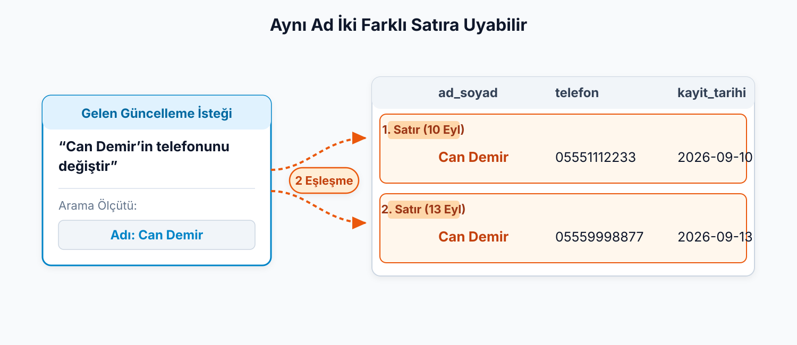

## Aynı ad iki farklı satıra uyabilir

13 Eylül'de atölyeye yeni bir Can Demir başvurdu. Başka bir kişi.

> “Can Demir'in telefonunu değiştir” isteği hangi satırı seçer?

. . .

{.blp-diagram}

- Aynı ad birden çok kişide olabilir.
- Aynı tarihte iki başvuru yapılabilir.
- Telefon ortak kullanılabilir veya boş kalabilir.

::: {.notes}
Tablodaki iki satır iki ayrı kişiye ait: 13 Eylül'de başvuran Can Demir, 10 Eylül'de başvurandan başka biri. Yalnız o, yeni numarasını bildirdi: 05550001122. Görevli de isteği şöyle veriyor: “Adı Can Demir olan satırın telefonunu 05550001122 yap.”

Bu tarife iki satır birden uyuyor. İstek ikisine de uygulanırsa 10 Eylül'deki Can Demir'in numarası kimse fark etmeden bozulur; adını yazan hiç kimse bunu istemedi. Yalnız birine uygulanırsa hangisi olduğu belli olmaz. Geçen notta VTYS'nin satırı bulduğunu söylemiştik. Burada satırı ada bakarak seçmesi işe yaramıyor.

Bu notun sorusu: bir satırı diğerlerinden güvenilir biçimde ayıran şey ne olabilir?

Tablodaki diğer sütunlara bakalım, belki biri satırı ayırır.

Ad olmuyor, az önce gördük. Tarih için iki satırlı tabloda yalnız ad tekrar ediyor; tarihler 10 ve 13 Eylül. Ama tarihin de tekrar edebildiğini önceki başvuru tablosundan hatırlayalım: Zeynep Aydın ve Mert Doğan 11 Eylül'de başvurmuştu. Aynı gün iki kişi başvurabilir.

Telefon örnek satırlarda farklı. Ama bunu garanti eden bir kural yok: kardeşler aynı ev telefonunu verebilir, biri telefon belirtmeyebilir. Bu sütunlara güvenerek satırı ayırmak mümkün olmayabilir. “Şimdilik farklı görünüyor” demek, “her zaman farklı olacak” demek değil.
:::

---

## Her satıra ayrı bir numara: birincil anahtar

| ogrenci_numarasi | ad_soyad | telefon |
| --- | --- | --- |
| 101 | Can Demir | 05551112233 |
| 105 | Can Demir | 05559998877 |

`ogrenci_numarasi = 105` tek bir satırı gösterir.

**Birincil anahtar:** Her satırı diğerlerinden ayıran sütun.

- Değerler **benzersiz** olmalı.
- Her satırda değer **bulunmalı**; boş bırakılamaz.

::: {.notes}
Çözüm basit: her satıra kendi numarasını verelim. Atölye her başvurana bir öğrenci numarası versin ve tabloya `ogrenci_numarasi` sütunu eklensin.

İstek artık şöyle kurulabilir: “105 numaralı satırın telefonunu değiştir.” 105 değerini taşıyan tek bir satır var. 101 numaralı Can Demir'in kaydı etkilenmiyor.

Bu numara, her satırı ötekilerden ayıran sütun. Böyle bir sütuna bir ad verelim.

Birincil anahtarın iki koşulu var. Birincisi benzersizlik: aynı değer iki satırda bulunursa numara satırı ayırt etmez. İkincisi boş bırakılamama: bir satırda değer yoksa o satırı bu numarayla güvenilir ve tekil biçimde seçemeyiz.

Önceki slayttaki başvuru tablosunun `ad_soyad`, `kayit_tarihi` ve `telefon` sütunlarına bu iki soruyu soralım. `ad_soyad` benzersiz değil. `kayit_tarihi` benzersiz değil. `telefon` şimdilik benzersiz görünüyor ama iki koşulu da güvenle sağlayacağına dair bir dayanak yok. Üç sütundan hiçbiri uygun olmadığı için tabloya yeni bir sütun ekledik. Tabloda iki koşulu sağlayan bir sütun olsaydı yenisini eklemek gerekmezdi.
:::

---

## Anahtar bir sayı mı olmalı?

`101`, `102`, `103` ... artan sayılar.

Atölye numaraları harfle başlayan bir kodla verseydi?

. . .

`A101`, `A102`, `A103` her satırda farklı ve doluysa anahtar olabilir.

**Anahtarın sayı olması gerekmez.**

::: {.notes}
Sütundaki 101, 102, 103 artan sayılar. Birincil anahtarın böyle artan bir sayı olması gerektiği düşünülebilir. Atölye numaraları A101, A102, A103 gibi harfle başlayan bir kodla verseydi? Bu kod da her satırda farklı, hiçbir satırda eksik değil. İki koşulu sağlıyor, dolayısıyla anahtar olabilir.

Elinizdeki bilinen bir örnek: bu dersin kodu BLP1005 de bir metin ve her ders için farklı. Sayılar çoğu zaman pratik olduğu için seçilir; anahtar olmanın koşulu sayı türünde olmak değil.
:::

---

## Her satırı güvenilir biçimde ayırt edebiliyor muyuz?

Başlık ve yazar aynı olan iki kitap nüshası olabilir.

Kütüphane kitapları için ayrı kayıtlar tutarken hangi sütun satırı ayırır?

::: {.notes}
Atölyede tek tür kayıt tutuyorduk: başvuranları. Bir kütüphane ise üyeler, kitaplar ve ödünç alınan kitaplar için ayrı kayıtlar tutar.

Kitap başlığı ve yazar iki nüshada aynı olabilir. Böyle bir tabloda hangi sütun satırı ayırır? Atölyedeki akıl yürütmeyi bu soruya taşıyacağız.
:::

---

## Bu nottan kalanlar

- Ad, tarih ve telefon satırı **güvenilir biçimde** ayırmayabilir.
- **Birincil anahtar** her satırı ayıran sütundur: benzersiz olmalı, boş bırakılamaz.
- Anahtar **sayı olmak zorunda değil**; benzersiz ve dolu bir metin kod da olur.

Bir kütüphane hangi şeyler için ayrı kayıt tutar? Buna neye bakarak karar veririz?

::: {.notes}
Bir sütunun satırı ayırabilmesi için iki koşula bakıyoruz: aynı değer tekrar etmemeli ve değer eksik olmamalı. Sütunun içinde ne tür bir değer olduğu, o iki koşuldan sonra gelen bir ayrıntı.

Atölyenin tek bir kayıt türü vardı. Kütüphanede üyeler, kitaplar ve ödünç alınan kitaplar var.
:::
