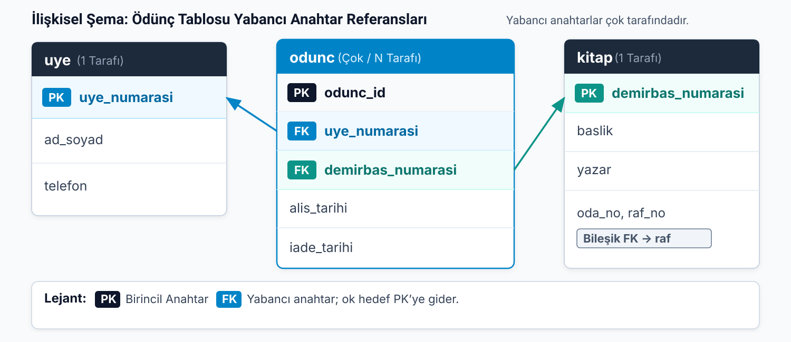
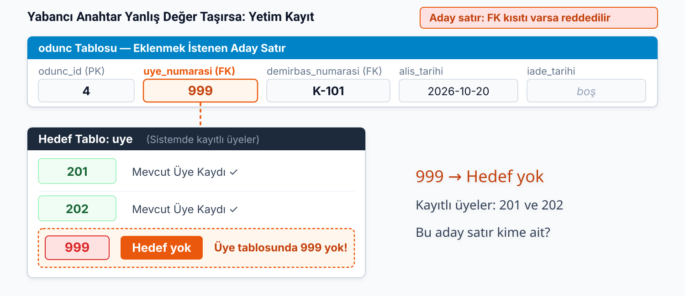

## Kutunun tablo karşılığı belli; çizgiyi nasıl saklarız?

| Kavramsal model | Tablo karşılığı |
| --- | --- |
| Varlık kutusu | Tablo |
| Nitelik | Sütun |
| PK işaretli nitelik | Birincil anahtar |

> Peki çizgi?

**Bağıntı (relation):** İlişkisel modelde tablo.

**İlişki (relationship):** Varlıklar arasındaki bağ.

Dönüşümün görevi, bağın **iş kurallarını** tabloların yapısında korumaktır.

::: {.notes}
Geçen notta kütüphane modelini kutular ve çizgilerle çizdik. Şimdi aynı modeli veritabanına taşıyoruz. Her kutu bir tablo oluyor, kutudaki her nitelik bir sütun oluyor, `PK` işaretli nitelik birincil anahtar oluyor. Bu karşılıklar belli.

Çizgi için böyle bir karşılık yok. Bir tablonun içine çizgi çizemeyiz. İlişkiyi tabloda saklayacak başka bir şey gerekiyor ve bu notun bütün işi o şeyi bulmak.

Bir terim karışıklığını baştan çözelim. İlişkisel modelde tabloya bağıntı diyoruz. Varlıklar arasındaki bağ ise ilişki. İki sözcük birbirine benziyor ama biri tabloyu, diğeri bağı adlandırıyor. Bu notta bağın tabloda nasıl saklandığına bakıyoruz.

Dönüşümün görevi şu: model bize bir iş kuralı veriyor, örneğin “her kitap en çok bir rafta durur”. Tablolar bu kuralı bozmayacak biçimde kurulmalı. Üç ilişki türünü sırayla ele alacağız, rafla başlıyoruz.
:::

---

## 1:N: raf satırına yazmak yetmez, anahtarı çok tarafı taşır

| oda_no (PK) | raf_no (PK) | konu |
| --- | --- | --- |
| 101 | 1 | Tarih |
| 101 | 2 | Edebiyat |
| 102 | 1 | Bilim |

`K-103` ve `K-104`, **(101, 2)** rafında duruyor.

. . .

Tek hücreye iki kod, her kitap için yeni sütun veya aynı rafı iki satırda yazmak uygun mu?

**Yabancı anahtar (foreign key, FK):** Başka bir tablodaki satırın birincil anahtarını taşıyan sütun ya da sütun grubu.

| demirbas_numarasi (PK) | baslik | yazar | oda_no (FK) | raf_no (FK) |
| --- | --- | --- | --- | --- |
| K-101 | Nutuk | Mustafa Kemal Atatürk | 101 | 1 |
| K-102 | Veritabanı Sistemleri | Ramez Elmasri | 102 | 1 |
| K-103 | Safahat | Mehmet Akif Ersoy | 101 | 2 |
| K-104 | Kürk Mantolu Madonna | Sabahattin Ali | 101 | 2 |

**Bire çok ilişkide yabancı anahtar çok tarafındaki tabloya konur.**

::: {.notes}
Hangi kitabın hangi rafta olduğunu raf tablosuna yazmayı deneyelim. 101 numaralı odanın 2 numaralı rafında K-103 ve K-104 duruyor.

Üç yol var, üçü de sorunlu. Tek hücreye iki numara yazarsak sütunun tek değer tutma düzenini bozarız. Sütun eklersek, kitap_1, kitap_2 gibi, rafta yüz kitap olduğunda yüz sütun gerekir. Rafın satırını iki kez yazarsak `(101, 2)` iki satırda geçer ve birincil anahtarın benzersizlik koşulu bozulur.

Peki tersini deneyelim: raf bilgisini kitabın satırına koysak?

Her kitap tek bir rafta durduğuna göre, kitabın satırına durduğu rafın anahtarını yazabiliriz. Rafın anahtarı iki sütunlu olduğu için kitap tablosu da iki sütun taşıyor: `oda_no` ve `raf_no`. Bu iki sütun birlikte tek bir yabancı anahtar.

Her kitap satırında tek bir `(oda_no, raf_no)` çifti var. Rafın kimliği kitaplarda yinelenebilir; ama rafın bilgilerinin hepsi yinelenmiyor. Rafın konusu yalnız raf tablosunda duruyor. 101'in 2 numaralı rafını iki kitap gösteriyor, konu bir kez saklanıyor.

Kural şu: bire çok ilişkide yabancı anahtar “çok” tarafındaki tabloya konur. Kitap çok tarafı olduğu için kitap tablosu raf tablosunu gösteriyor. Bir de not: henüz rafı belirlenmemiş bir kitabın bu bağı boş kalabilir. Örnek satırların hepsinde bir raf var ama kural bunu zorunlu kılmıyor.
:::

---

## N:M bağını iki tablodan biri taşıyabilir mi?

Üyeye kitap numarası eklersek Ahmet'in **ikinci kitabını** nereye yazacağız?

Kitaba üye numarası eklersek **bir sonraki ödünçte** önceki üyeye ne olacak?

. . .

**Bağlantı tablosu:** İki tablonun birincil anahtarlarını yabancı anahtar olarak ve ilişkiye ait nitelikleri taşıyan tablo.

Ödünç alma olayı için ayrı tablo: **odunc**.

::: {.notes}
Aynı yöntemi üye ve kitaba uygulayalım. Üye ile kitap arasındaki ilişki çoka çok. İki denemeye bakalım.

Önce `uye` tablosuna kitabın numarasını ekleyelim. Ahmet bir kitap aldı, numarasını yazdık. İkinci kitabı alınca ne yapacağız? Sütun eklersek kaç tane yeter? Ahmet'in satırını ikinci kez yazarsak üye numarası iki satırda aynı olur ve ad ile telefon da kopyalanır.

Şimdi `kitap` tablosuna üye numarası ekleyelim. Nutuk ekimde Ahmet'e verildi, numara yazıldı. Kasımda Ayşe'ye verildiğinde Ahmet'in numarasının üzerine Ayşe'ninki yazılıyor; kitabın geçmişi kaybolıyor.

Demek ki çoka çok ilişki iki tablodan birine yabancı anahtar eklemekle çözülmüyor. Çözüm, ikisinin arasına üçüncü bir tablo koymak. Bizim bağlantı tablomuz `odunc`. Bu tablo bir nesneyi değil bir olayı temsil ediyor: bir üyenin bir kitabı ödünç alması. Diyagramdaki `odunc` kutusu böylece kendi tablosunu buluyor.
:::

---

## Ödünç tablosu iki yabancı anahtar taşır

{.blp-diagram}

`uye ||--o< odunc` ve `kitap ||--o< odunc`: iki **1:N** bağ.

Kural aynı: yabancı anahtarlar **çok tarafına**, yani `odunc`a.

::: {.notes}
Diyagramda `uye` ile `odunc` ve `kitap` ile `odunc` arasında iki bire çok ilişki var. Az önceki kuralı uyguluyoruz: yabancı anahtar çok tarafına, yani `odunc` tablosuna konuyor. Bu yüzden `odunc` iki yabancı anahtar taşıyor: üyeyi ve kitabı gösteriyor.

Çoka çok ilişkiyi bu yüzden iki bire çok ilişkiye çevirmiş olduk. Çözüm yeni bir kural gerektirmedi; aynı kuralı iki kez uyguladık.

Sıradaki soru: `odunc`ın satırlarını hangi anahtar ayıracak?
:::

---

## Ödünç satırını ne ayırt eder?

`(uye_numarasi, demirbas_numarasi)` yetmez: üye 201, K-101'i ekimde alıp kasımda yeniden alabilir.

| Seçenek | Anahtar | Ne zaman uygun |
| --- | --- | --- |
| Bileşik | `(uye_numarasi, demirbas_numarasi, alis_tarihi)` | Alış günü aynı üye–kitap çiftinin olaylarını ayırıyorsa |
| Yapay numara | `odunc_id` | Her olayı tek numarayla göstermek istenirse |

Bu derste **`odunc_id`** ile ilerliyoruz.

::: {.notes}
İki yol var. Birincisi üç sütunu birlikte bileşik anahtar yapmak. Çift tek başına yetmez: üye 201 K-101'i ekimde alıp kasımda yeniden alabilir ve `(201, K-101)` iki satırda geçer. Bu yüzden `alis_tarihi` de gerekir.

Ama bu seçeneğin bir koşulu var: alış günü aynı üye–kitap çiftinin olaylarını ayırmalı. Aynı üye aynı kitabı aynı gün getirip yeniden alırsa üçlü iki olayda aynı kalır. Bu bir kurum kuralı meselesi.

İkinci yol, her ödünç kaydına ayrı bir numara vermek: `odunc_id`. Bu, her olayı tek bir numarayla gösteriyor ve koşul gerektirmiyor. Biz bu derste `odunc_id` ile ilerleyeceğiz; bileşik seçeneği, anahtarın nasıl seçileceğini göstermek için tabloda tutuyoruz.
:::

---

## Bire bir ilişkide yabancı anahtar nereye konur?

Üye ile kütüphane kartı: bir üyenin en çok bir kartı olur, bir kart en çok bir üyeye aittir.

| kart_numarasi (PK) | uye_numarasi (FK) | duzenleme_tarihi |
| --- | --- | --- |
| C-01 | 201 | 2026-09-14 |
| C-02 | 202 | 2026-09-20 |

Her kartın bir üyesi **zorunlu**; her üyenin kartı **isteğe bağlı.**

::: {.notes}
Bire bir ilişkide de karşılık aynı: ilişkiyi yabancı anahtar sütunu taşıyor. Ama bu kez iki tablodan birini seçebiliriz.

Kartta yabancı anahtar tutmak daha doğal. Her kartın mutlaka bir üyesi var ama her üyenin kartı olmak zorunda değil. Üye tablosuna kart numarası sütunu koysak, kartı olmayan üyelerde bu sütun boş kalırdı. Bu yüzden `kutuphane_karti` tablosu üyeyi gösteriyor.

Katılım bilgisi burada karar verdirdi: zorunlu tarafın tablosuna yabancı anahtar koymak, boş sütunları azaltıyor.
:::

---

## Yabancı anahtar tek başına bire bir yapmaz

| kart_numarasi (PK) | uye_numarasi (FK) | duzenleme_tarihi |
| --- | --- | --- |
| C-01 | 201 | 2026-09-14 |
| C-02 | 202 | 2026-09-20 |
| C-03 | 201 | 2026-10-02 |

Üye 201'in artık **iki kartı** var.

. . .

**Tekillik kuralı:** Bir sütundaki her değerin tabloda en çok bir kez geçmesini isteyen kural.

`uye_numarasi` sütununa bu kural eklenirse C-03 satırı yazılamaz.

::: {.notes}
Görevlinin yanlışlıkla bir kart daha girdiğini düşünelim: C-03 numaralı kart, yine 201 numaralı üyeye. Şimdiye kadar gösterdiğimiz anahtar kurallarıyla tablo bu satırı engellemiyor.

Neden? Yabancı anahtar sütunu başka bir tablodaki satırı gösterir ama kendi tablosunda aynı değerin kaç kez geçtiğine bakmaz. Bire çok ilişkide bu istediğimiz bir şeydi: çok tarafında aynı değer tekrar edebilmeliydi. Bire birde istemiyoruz. Üye 201'in iki kartı oldu ve ilişki kimse fark etmeden bire çoğa dönüştü.

Çözüm, `uye_numarasi` sütununa tekillik kuralı eklemek. Bu kuralla C-03 satırı yazılamaz: 201 zaten C-01 satırında duruyor. Birincil anahtar sütunları kendiliğinden benzersizdir. Yabancı anahtar sütunu ise değildir; bunu ona biz kazandırırız, yalnız bire bir ilişkilerde. Bire çok ilişkinin çok tarafında bu kuralı koymayız.
:::

---

## Tabloları örnek satırlarla okuyalım

| odunc_id (PK) | uye_numarasi (FK) | demirbas_numarasi (FK) | alis_tarihi | iade_tarihi |
| --- | --- | --- | --- | --- |
| 1 | 201 | K-101 | 2026-10-01 | 2026-10-15 |
| 2 | 201 | K-102 | 2026-10-05 | 2026-10-12 |
| 3 | 202 | K-101 | 2026-10-18 | (boş) |

`uye`: 201 Ahmet Yılmaz · 202 Ayşe Kaya.

::: {.notes}
Üç satıra iki soruyla bakalım. Ahmet iki kitap aldı mı? Evet, 1 ve 2 numaralı satırlarda 201 geçiyor. Ahmet'in adı ve telefonu `odunc`ta yok, yalnız numarası var. Telefonu değişirse yalnız `uye` tablosundaki 201 numaralı satırı güncelliyoruz ve ödünç geçmişinin hiçbir satırına dokunmuyoruz. Geçen notlardaki tutarsızlık sorununu burada çözmüş olduk.

K-101 iki farklı üyeye verildi mi? Evet, 1 ve 3 numaralı satırlarda. Nutuk `kitap` tablosunda tek satır; başlığı ve yazarı hiçbir yerde yinelenmiyor. Geçmiş `odunc` tablosunda eksiksiz birikiyor.

Üçüncü satırın `iade_tarihi` hücresi boş. Bu, kitabın henüz iade edilmediği anlamına geliyor: ortada henüz bir tarih yok. Bu boşluk, rafı belli olmayan bir kitabın boş raf sütunundan farklı bir nedenle boş; ikisini karıştırmayın.
:::

---

## Yabancı anahtar yanlış değer taşırsa: yetim kayıt

{.blp-diagram}

`uye` tablosunda 201 ve 202 var; **999 yok.**

> Bu satır kime ait?

**Yetim kayıt (orphan record):** Gösterdiği satırı bulunmayan kayıt.

**Referans bütünlüğü (referential integrity):** Bir yabancı anahtar sütunundaki her değer, hedef tablonun birincil anahtarında bulunmalıdır.

Boş değer hiçbir satırı göstermediği için **yetim sayılmaz.**

::: {.notes}
Yabancı anahtarlarda ortak bir soru daha var: yazılan değerin hedefte karşılığı bulunuyor mu? Görevli `odunc` tablosuna 4 numaralı satırı girsin. `uye` tablosunda 201 ve 202 var, 999 yok.

Bu satır K-101'in ödünç verildiğini söylüyor ama kime verildiğini kayıtlı hiçbir üye göstermiyor. Kitabı kimden geri isteyeceğimizi bu satırdan öğrenemeyiz.

Gösterdiği satırı bulunmayan kayda yetim kayıt diyoruz. Yetim kayıtları engelleyen kurala referans bütünlüğü deniyor: bir yabancı anahtar sütunundaki her değer, hedef tablonun birincil anahtarında bulunmalı.

Bir istisna var. İlişki isteğe bağlıysa sütun boş da kalabilir. Henüz rafı belli olmayan bir kitabın raf sütunları boş ve bu boş değer hiçbir satırı göstermediği için yetim sayılmıyor.

Şunu da not edelim: şemaya `FK` etiketi yazmak uygulamada kendiliğinden denetim oluşturmuyor. Yabancı anahtar kısıtları VTYS'ye tanıtıldığında VTYS ekleme ve güncellemelerde hedefin varlığını, silmelerde ise tanımlanan koruma kuralını uyguluyor.
:::

---

## Kural iki yerde koruma sağlar

**Ekleme ve güncelleme:** Hedef tabloda olmayan bir değer yazılamaz.

**Silme:** Kendisini gösteren satırı olan bir satır silinemez.

Üye 201 `odunc`ta 1 ve 2 numaralı satırlarda. `uye` tablosundan silinirse bu iki satır **yetim kalır.**

::: {.notes}
Birincisi ekleme ve güncelleme. Yeni bir satıra, hedef tabloda olmayan bir değer yazılamaz. Var olan bir satırdaki yabancı anahtar da hedefte olmayan bir değere değiştirilemez. `uye_numarasi` 999 olan satır bu yüzden girilemez.

İkincisi silme. Ödünç geçmişini koruyacağımız bu düzende, kendisini gösteren satırı olan bir satır hedef tablodan silinemez. Üye 201 üyelikten ayrılıyor ve görevli onu `uye` tablosundan silmek istiyor. Ama `odunc` tablosunda 1 ve 2 numaralı satırlar 201'i gösteriyor. Üye silinirse bu iki satır yetim kalır. Referans bütünlüğü silmeyi bu yüzden engelliyor.

:::

---

## Yetim kaydı bulun

`uye`: 201, 202 · `kitap`: K-101 … K-104

| odunc_id | uye_numarasi | demirbas_numarasi | alis_tarihi |
| --- | --- | --- | --- |
| 1 | 201 | K-101 | 2026-10-01 |
| 2 | 201 | K-102 | 2026-10-05 |
| 3 | 202 | K-101 | 2026-10-18 |
| 5 | 203 | K-102 | 2026-10-19 |
| 6 | 202 | K-150 | 2026-10-19 |

Hangi satırlar yetim?

. . .

**5** (üye 203 yok) ve **6** (kitap K-150 yok).

::: {.notes}
Denetim olmayan bir sistemde `odunc` tablosu bir süre sonra bu hâle gelmiş. Önce kendiniz bakın.

5 numaralı satır yetim: `uye` tablosunda 203 numaralı üye yok, ödünç alanın kim olduğu bilinmiyor. 6 numaralı satır da yetim: `kitap` tablosunda K-150 yok, ödünç verilen kitabın ne olduğu bilinmiyor. İkisi farklı sütundan kaynaklanıyor; ilkinde `uye_numarasi`, ikincisinde `demirbas_numarasi` hedefte karşılık bulamıyor. 1, 2 ve 3 numaralı satırların yabancı anahtar değerleri hedef tablolarda var.
:::

---

## Üç dönüşüm kuralı

| Modeldeki ilişki | Tablodaki karşılığı | Korunacak ek koşul |
| --- | --- | --- |
| raf–kitap, 1:N | `kitap` içinde `(oda_no, raf_no)` yabancı anahtarı | İki sütun birlikte aynı rafı gösterir; raf bağı isteğe bağlıdır. |
| üye–kitap, N:M | `odunc` içinde üye ve kitap yabancı anahtarları | Her olayın kendi anahtarı, alış ve iade tarihi vardır. |
| üye–kart, 1:1 | `kutuphane_karti` içinde `uye_numarasi` yabancı anahtarı | Üye numarası boş kalmaz ve kartlar arasında tekrarlanmaz. |

::: {.notes}
Şemayı üç dönüşüm kuralıyla okuyabiliriz. Bire çokta yabancı anahtar çok tarafına gidiyor. Çoka çokta ilişki bir bağlantı tablosuna dönüşüyor ve iki yabancı anahtar taşıyor. Bire birde yabancı anahtar zorunlu tarafa gidiyor ve tekillik kuralı ekleniyor.

Dolu yabancı anahtarların hedef satırlarının varlığı üç dönüşümde de korunuyor. Ödünçte üye ve kitap bağı zorunlu. Buna karşılık yeni bir kitabın henüz rafı olmayabilir. İade tarihinin boşluğu ise bir bağın isteğe bağlılığından kaynaklanmıyor; o olay henüz gerçekleşmedi.
:::

---

## Karar soruları

1. `kitap` tablosuna `oda_no` ve `raf_no` yerine yalnız `raf_no` koyarsak ne bozulur?
2. `odunc` tablosuna üyenin adını ve telefonunu da yazsak, Ahmet'in telefonu değişince ne yapmamız gerekir?
3. Kartlar için `uye_numarasi` sütununa tekillik kuralını koymazsak hangi iş kuralı bozulur?

::: {.notes}
1. Hedef anahtar iki sütunlu olduğu için yabancı anahtar da iki sütunlu olmak zorunda. Yalnız `raf_no` yazarsak 101'in 1 numaralı rafıyla 102'nin 1 numaralı rafını ayıramayız; kitabın hangi odadaki rafta olduğu belirsiz kalır.
2. Ahmet'in her ödünç satırında adı ve telefonu tekrar edeceği için, telefon değiştiğinde hepsini düzeltmemiz gerekir. Birini unutursak aynı telefon için iki farklı değer kalır. Bu yüzden ad ve telefon yalnız `uye` tablosunda duruyor ve `odunc` yalnız numarayı taşıyor.
3. “Bir üyenin en çok bir kartı olur” kuralı bozulur. Aynı üye numarası iki kart satırında geçebilir ve ilişki bire birden bire çoğa dönüşür; tablo bunu kendiliğinden engellemez.
:::

---

## Bu nottan kalanlar

- Kutu **tablo**, nitelik **sütun**; çizgi ise **yabancı anahtar sütunuyla** saklanır.
- **1:N:** yabancı anahtar çok tarafına. **N:M:** üçüncü bir **bağlantı tablosu**. **1:1:** zorunlu tarafa ve **tekillik kuralıyla.**
- **Referans bütünlüğü:** her yabancı anahtar değerinin hedefte karşılığı olmalı; yoksa **yetim kayıt** doğar.

Tek tabloda her bilgiyi tutsaydık ne olurdu?

::: {.notes}
Üye adı ve telefonunu, kitap başlığı ve yazarını kendi tablolarında bir kez sakladık; ödünç tablosunda olayları kimliklerle bağladık. Bu tasarım tekrarı önlüyor.

Peki bütün bilgiyi tek bir tabloya yazsaydık? Üye telefonu değiştiğinde hangi satırlara dokunmamız gerekirdi?
:::
