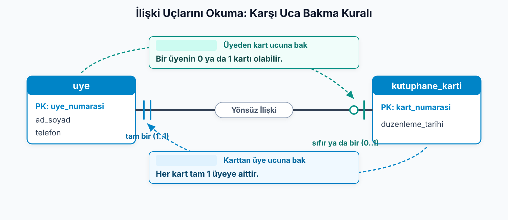

## Ödünç tarihleri kime ait?

“Ahmet Yılmaz, K-101 numaralı Nutuk'u 1 Ekim'de aldı, 15 Ekim'de getirdi.”

> Bu iki tarihi üyenin bilgisi mi sayacağız, kitabın mı?

**İlişki (relationship):** İki varlık arasındaki anlamlı bağ.

İlişkiye bir **fiille** ad veririz:

- Üye kitap **ödünç alır**.
- Raf kitap **barındırır**.
- Üye kütüphane kartına **sahiptir**.

::: {.notes}
Önceki notun sonunda bu soruyu açık bırakmıştık. Üye, kitap ve raf kendi kimliklerini taşıyor. Ama “Ahmet bu kitabı 1 Ekim'de aldı” bilgisi bu kimliklerden hangisine ait?

Üyenin niteliği olamaz: Ahmet başka kitaplar da alır ve her kitabın kendi tarihi vardır. Kitabın niteliği de olamaz: Nutuk'u başka üyeler de alır ve her seferinde başka tarihler çıkar. İki tarih ne üyeye ne kitaba ait; ikisinin karşılaştığı ana ait.

İki varlığın böyle bir karşılaşmasına ne diyeceğimizi ve bunu modelde nasıl göstereceğimizi bu notta çözüyoruz.

Bağı fiille adlandırmak, ne anlama geldiğini açık eder. Kütüphanede üç ilişki görüyoruz: üye kitap ödünç alır, raf kitap barındırır, üye kütüphane kartına sahiptir.

Bir bağ hakkında iş kuralı iki ayrı şey söylüyor. Birincisi, en çok kaç eşleşme olabileceği. İkincisi, en az kaç eşleşme olması gerektiği. Bu ikisini ayrı ayrı okuyacağız; çünkü ikisini karıştırmak bu konunun en yaygın hatası.
:::

---

## En çok sorusunu iki yönde sormalıyız

**Kardinalite (cardinality):** Bir varlığın ilişkide öbür varlıktan en çok kaç tanesiyle eşleşebildiği.

| İlişki | Birinci yön | Ters yön | Tür |
| --- | --- | --- | --- |
| Üye–kitap | Üye zaman içinde çok kitap alır. | Kitap zaman içinde çok üyeye verilir. | N:M |
| Raf–kitap | Raf çok kitap barındırır. | Kitap aynı anda en çok bir raftadır. | 1:N |
| Üye–kart | Üyenin en çok bir kartı olur. | Kart en çok bir üyeye aittir. | 1:1 |

::: {.notes}
Türü bulmak için soruyu iki yönde soruyoruz: bir X en çok kaç Y ile eşleşir, bir Y en çok kaç X ile?

Üye ve kitapla başlayalım. Bir üye zaman içinde çok kitap alabilir. Bir kitap da çok üyeye verilebilir: Nutuk ekimde Ahmet'te, kasımda Ayşe'de olabilir. İki yönde de “çok” olduğu için ilişki N:M.

Yalnız ilk soruyla durmak tuzak. “Bir üyenin çok kitabı var, demek ki bire çok” diyebiliriz; ama kitaba da sormadan türü belirlemiş olmayız. Raf ve kitapta cevaplar farklı: bir rafta çok kitap durabilir, bir kitap aynı anda en çok bir rafta durur. Bir yönde “çok”, öbür yönde “bir”: 1:N. Üye ve kartta ise iki yönde de en çok bir: 1:1.

Bir de uyarı: N ve M “çok” demek, belirli bir sayı değil.
:::

---

## En çok bir olması, mutlaka bir olması mı demek?

**Katılım (participation):** Bir varlığın ilişkide en az kaç eşleşmesi olması gerektiği.

**0:** İsteğe bağlı katılım · **1:** Zorunlu katılım.

| Kitap hakkındaki kural | Soru | Sınır |
| --- | --- | --- |
| En fazla bir rafta durur. | En çok kaç raf? | 1 |
| Yeni gelen kitabın rafı olmayabilir. | En az kaç raf? | 0 |

Bir kitap için raf sayısı: **0–1**.

::: {.notes}
Şimdi aynı ilişkilere başka bir soru soralım: bir varlığın ilişkide en az kaç eşleşmesi olmak zorunda? Bu katılım. En az bir eşleşme gerekiyorsa katılım zorunlu, sıfır eşleşme olabiliyorsa isteğe bağlı.

Tablodaki iki cümle birbirini çürütmüyor, çünkü farklı sorulara cevap veriyor. “Her kitap en fazla bir rafta durur” en çok kaç rafı sorusunun cevabı: 1. “Yeni gelen kitabın henüz rafı olmayabilir” en az kaç rafı sorusunun cevabı: 0. Birlikte okuyunca kitabın rafla ilişkisi en az 0, en çok 1. “En fazla bir rafı olur” demek “mutlaka bir rafı vardır” demek değil.

Üye ve kartta uçlar farklı. Üyenin kartı olmayabilir; üyenin katılımı isteğe bağlı. Ama kütüphane sahipsiz kart basmaz; kartın katılımı zorunlu. Aynı ilişkinin iki ucu farklı alt sınır taşıyabilir.
:::

---

## Her ilişkiyi dört sınırla okuyalım

| Bir varlıktan bakış | Karşı tarafta en az | En çok |
| --- | ---: | --- |
| Üye → kitap (ödünç geçmişi) | 0 | N |
| Kitap → üye (ödünç geçmişi) | 0 | N |
| Raf → kitap | 0 | N |
| Kitap → raf | 0 | 1 |
| Üye → kart | 0 | 1 |
| Kart → üye | 1 | 1 |

::: {.notes}
Her ilişki için iki yönde ikişer sınır var; yani dört sayı. Tabloyu satır satır okuyalım.

Yeni kayıt olmuş bir üye henüz hiç kitap almamış olabilir: en az 0. Yeni gelmiş bir kitap henüz kimseye verilmemiş olabilir: yine 0. Bir raf henüz boş olabilir; raftan kitaba alt sınır 0. Bir kitabın henüz rafı olmayabilir, ama en çok bir rafı var. Kartın üyesi ise zorunlu: 1.

Bir ayrıntı daha: kitabın rafta durma kuralı mevcut yeri, üye–kitap ödünç kuralı ise zaman içindeki geçmişi anlatıyor. Aynı kitabın zaman içinde birçok üyeye verilmesi, şu anda birden fazla rafta durduğu anlamına gelmiyor. Sınırları cümlelerden çıkarırken cümlenin hangi anı ya da zaman aralığını anlattığını kaybetmemek gerekiyor.
:::

---

## Kutular, çizgiler ve dört sembol

**Crow's Foot (karga ayağı):** Varlıkları kutuyla, ilişkileri çizgiyle, kardinalite ve katılımı çizgi uçlarındaki sembollerle gösteren çizim biçimi.

```text
+--------------------------+
| uye                      |
+--------------------------+
| uye_numarasi        PK   |
| ad_soyad                 |
| telefon                  |
+--------------------------+
```

| Sağdaki kutunun ucunda | Soldaki kutunun ucunda | Okunuş | En az | En çok |
| --- | --- | --- | ---: | --- |
| `\|\|` | `\|\|` | Tam bir | 1 | 1 |
| `o\|` | `\|o` | Sıfır ya da bir | 0 | 1 |
| `\|<` | `>\|` | Bir ya da çok | 1 | N |
| `o<` | `>o` | Sıfır ya da çok | 0 | N |

Dik çizgi **bir**, daire **sıfır**, çatal **çok** demektir.

::: {.notes}
Tablodaki sınırları, hangi varlıklar arasında geçerli olduklarıyla birlikte göstermek için kutular ve çizgiler kullanacağız. E-R modelini çizmek için birkaç farklı biçim var. Biz Crow's Foot, yani karga ayağı kullanıyoruz; adı “çok” ucunun üç çatallı karga ayağına benzemesinden geliyor. Kaynaklarda başka bir çizimle karşılaşırsanız aynı bilgiyi başka sembollerle gösteriyordur.

Kutunun üstünde varlığın adı, altında nitelikleri duruyor. Birincil anahtar olan niteliğin yanına `PK` yazıyoruz. Çizgi iki kutuyu birbirine bağlıyor ve her ucundaki sembol sınırları taşıyor.

Sembolleri üç işaretle kuruyoruz: dik çizgi “bir”, daire “sıfır”, çatal “çok”. Kutuya en yakın işaret en çok değerini, ondan sonra gelen işaret en az değerini söylüyor.

Tablo, kutu çizginin sağında olduğunda ve solunda olduğunda sembolün nasıl göründüğünü veriyor. Kutu solda olunca semboller aynalanıyor: sağdaki `o|` ile soldaki `|o` aynı sınırları anlatıyor. Çatalın yönünün değişmesi ilişkinin türünü değiştirmiyor.

Bu tabloyu ezberlemek zorunda değilsiniz. Üç işareti hatırlarsanız dört sembolü kendiniz kurabilirsiniz.
:::

---

## Bir kutudan başlayıp karşı uçtaki sınırı oku

```text
uye ||--o| kutuphane_karti
```

Bir üyeye karşılık kaç kart, bir karta karşılık kaç üye vardır?

. . .

{.blp-diagram}

::: {.notes}
Sembolü okurken en çok karışan nokta, hangi uçtaki sembolün neyi anlattığı. Kural şu: bir kutudan başla, çizgiyi öbür ucuna kadar izle. Oradaki sembol, başladığın varlığın bir tanesine karşılık öbür varlıktan kaç tane olabileceğini söylüyor.

Üyeden başlayalım. Çizgiyi izleyip kart ucuna geliyoruz; orada `o|` var: bir üyeye karşılık sıfır ya da bir kart. Karttan başlayalım. Üye ucunda `||` var: bir karta karşılık tam bir üye. Çizgi iki katılım kuralını birlikte söylüyor: üyenin kartı olmayabilir, her kartın bir üyesi vardır.

Sayıyı başladığınız kutunun yanından okursanız iki koşulu tersine çevirirsiniz. Karşı ucu okumak, sembol ezberini iş kuralıyla sınamanın yolu.
:::

---


## Ödünç olayının tarihlerini kendi kutusuna koyalım

```text
uye >o--o< kitap
```

Alış ve iade tarihlerini bu çizgiye nasıl yerleştireceğiz?

. . .

**Bağlantı varlığı:** Çoka çok ilişkinin kendi niteliklerini taşıyan ve ilişkinin yerine konan varlık.

```text
odunc: odunc_id (PK), alis_tarihi, iade_tarihi
```

::: {.notes}
Üye ve kitabı çizelim. İlişki çoka çok ve katılım iki yönde de isteğe bağlı: iki uçta da “sıfır ya da çok”. Ama ödünç alma ilişkisinin alış tarihi ve iade tarihi diye iki bilgisi vardı. Crow's Foot'ta çizginin üstüne nitelik yazılmaz; çizgi yalnızca bağı ve sınırlarını gösterir. Bu bilgiler üyenin ya da kitabın niteliği de olamaz.

Çözüm, ilişkinin kendisine bir kutu vermek. Çoka çok bir ilişkinin kendi niteliklerini taşıyan ve ilişkinin yerine konan varlığa bağlantı varlığı diyoruz. Bizimki `odunc`. Her ödünç kaydı artık bir varlık olduğuna göre, kendini ayırt eden bir anahtarı da olmalı. Her kayda bir numara veriyoruz: `odunc_id`.
:::

---

## Bağlantı varlığıyla çizgiyi okumak

```text
uye ||--o< odunc >o--|| kitap
```

- Üye → ödünç: **`o<`** — sıfır ya da çok ödünç kaydı.
- Ödünç → üye: **`||`** — tam bir üye.
- Kitap tarafı aynı.

Çoka çok ilişki **iki 1:N ilişkiye** ayrıldı.

::: {.notes}
Çoka çok ilişki iki bire çok ilişkiye ayrıldı. Üyeden ödünç ucuna bakınca `o<`: bir üyenin sıfır ya da çok ödünç kaydı var. Ödünçten üye ucuna bakınca `||`: bir ödünç kaydı tam bir üyeye ait. Kitap tarafı aynı. Artık üye ile kitap doğrudan bağlı değil; ödünç kaydı üzerinden bağlılar.

Kutuya dikkat edin: `odunc` kutusunda üye numarasını ya da demirbaş numarasını yazmadık. Kavramsal gösterimde başka bir varlığın anahtarını taşıyan sütun eklemiyoruz; bağ çizgide duruyor.
:::
---

## Raf–kitap çizimini siz çizin

Bir raf boş olabilir veya çok kitap barındırabilir. Kitabın henüz rafı olmayabilir; en çok bir rafı vardır.

`raf`: oda_no, raf_no, konu · `kitap`: demirbas_numarasi, baslik, yazar.

Kutuları, anahtarları ve çizgiyi çizin.

. . .

```text
raf:   oda_no (PK), raf_no (PK), konu
kitap: demirbas_numarasi (PK), baslik, yazar
raf |o--o< kitap
```

::: {.notes}
Önce kendiniz çizin, sonra bu çizimle karşılaştırın.

Rafın iki `PK`'si tek bir bileşik anahtar. Çizgiyi okuyalım: raftan başlayıp kitap ucuna bakıyoruz, `o<`: bir rafta sıfır ya da çok kitap. Kitaptan başlayıp raf ucuna bakıyoruz, `|o`: bir kitap sıfır ya da bir rafta. Yani yeni gelen ve henüz rafa konmamış kitap da modelde yerini buluyor.

Kitap kutusuna rafın `oda_no` ve `raf_no` değerlerini yazmadık. Kitabın hangi rafta durduğunu çizgi söylüyor.
:::

---

## Kütüphane modelindeki bütün bağları okuyalım

{.blp-diagram}

::: {.notes}
Kutuların kendi nitelikleri ve anahtarları modelde tamamlanıyor. Kartın kendi bilgisi olarak düzenlendiği tarihi de saklıyoruz.

Diyagram bütün bağları tek modelde gösteriyor. Soldan sağa okuyalım. Bir rafta sıfır ya da çok kitap bulunabilir, bir kitabın sıfır ya da bir rafı olabilir. Kitabın ve üyenin sıfır ya da çok ödünç kaydı var; her ödünç kaydı tam bir kitaba ve tam bir üyeye bağlı. Her kart tam bir üyeye ait, üyenin sıfır ya da bir kartı olabilir.

Tarihler ödünç kutusunda, rafın bileşik anahtarı raf kutusunda duruyor. Bağları çizgiler taşıdığı için ödünç kutusuna üye veya kitap numarası, kitap kutusuna da raf numaraları eklemedik.
:::

---


## Karar soruları

1. Her üyenin kütüphane kartı olması zorunlu olsaydı `uye ||--o| kutuphane_karti` çizgisi nasıl değişirdi?
2. `uye >o--o< kitap` çizgisini kitaptan başlayarak okuyun.
3. Ödünç tarihini kitap kutusuna yazsaydık, Nutuk bir üyeden ötekine geçtiğinde ne olurdu?

::: {.notes}
1. Kart ucundaki `o|` yerine `||` yazılırdı: `uye ||--|| kutuphane_karti`. Bir üyeye karşılık tam bir kart olurdu; kartın üyesi zaten zorunluydu.
2. Kitaptan başlayıp üye ucuna bakıyoruz: `o<`. Bir kitap için sıfır ya da çok üye. Hiç ödünç verilmemiş kitap da, birçok üyeye verilmiş kitap da bu sınıra giriyor.
3. Tek bir tarih sütunu olurdu; yeni ödünçte eski tarihin üzerine yazardık. Önceki üyenin ne zaman aldığı ve getirdiği kaybolurdu. Üstelik kitabın şu anda kimde olduğu ile geçmişte kimlerde olduğu aynı yere sıkışırdı. Her ödünç olayını ayrı kayıt yapan `odunc` kutusu bu yüzden gerekli.
:::

---

## Bu nottan kalanlar

- **İlişki** iki varlık arasındaki bağdır; fiille adlandırılır.
- **Kardinalite** en çok, **katılım** en az eşleşmeyi söyler; ikisi ayrı sorulardır.
- Crow's Foot'ta sembolü okurken **bir kutudan başlayıp karşı uçtaki sembole bakılır.**
- Çoka çok bir ilişkinin kendi bilgileri varsa **bağlantı varlığı** kurulur: `odunc`.

Çizdiğimiz çizgiler tablolarda hangi sütunlara dönüşür?

::: {.notes}
Kütüphane modeli artık kutularıyla, anahtarlarıyla ve bağlarıyla tamam. Ama bir sorunumuz var: veritabanında kutu da, çizgi de yok; tablo, sütun ve satır var.

Çizdiğimiz modelin tablo karşılığında kutuların ve niteliklerin yeri belli. Peki çizgiler hangi bilgileri taşıyan sütunlara dönüşecek?
:::
