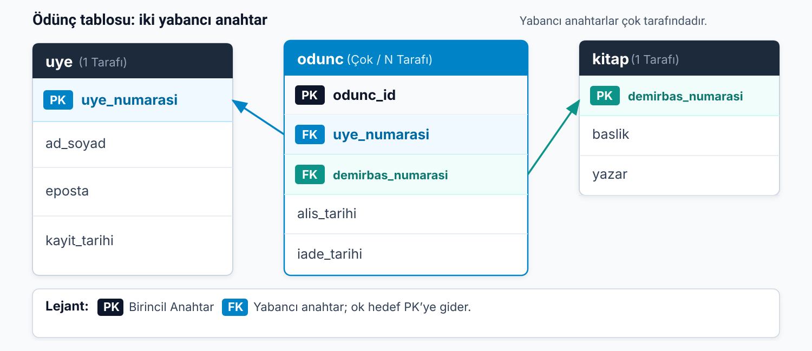
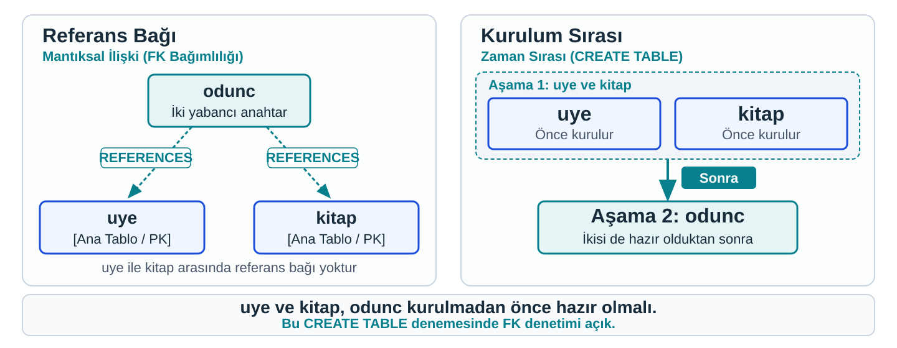

## Ödünç kaydını üye ve kitaba bağlayalım

`uye` ve `kitap` kendi kimliklerini taşıyor. `odunc` ikisine bağlanacak.

> Her ödünç satırı **bir üyeyi** ve **bir kitabı** göstermeli. Bunu sunucuya nasıl söyleriz?

. . .

**Yabancı anahtar:** Başka bir tablodaki satırın anahtarını taşıyan sütun. Şimdi bu bağı **SQL'de** yazacağız.

{.blp-diagram}

::: {.notes}
Üye ve kitap tabloları kendi kimliklerini taşıyor. Ödünç tablosu ikisine bağlanacak: her ödünç satırı bir üyeyi ve bir kitabı göstermeli. Çizginin tablodaki karşılığını yabancı anahtar olarak kurmuştuk. Burada bu bağlar birincil anahtarlara gidiyor.

Şimdiye kadar yabancı anahtarı kâğıtta ve örnek satırlarda gördük. Şimdi bunu sunucuya söyleyeceğiz; böylece kural kâğıtta kalmayıp sunucu tarafından uygulanacak.
:::

---


## Üç tablo, bir betik

```sql
CREATE DATABASE IF NOT EXISTS kutuphane;
USE kutuphane;

CREATE TABLE IF NOT EXISTS uye (
    uye_numarasi INT AUTO_INCREMENT,
    ad_soyad VARCHAR(100) NOT NULL,
    eposta VARCHAR(100) UNIQUE,
    kayit_tarihi DATE DEFAULT (CURRENT_DATE),
    PRIMARY KEY (uye_numarasi)
);

CREATE TABLE IF NOT EXISTS kitap (
    demirbas_numarasi VARCHAR(20),
    baslik VARCHAR(200) NOT NULL,
    yazar VARCHAR(100),
    PRIMARY KEY (demirbas_numarasi)
);

CREATE TABLE IF NOT EXISTS odunc (
    odunc_id INT AUTO_INCREMENT,
    uye_numarasi INT NOT NULL,
    demirbas_numarasi VARCHAR(20) NOT NULL,
    alis_tarihi DATE NOT NULL,
    iade_tarihi DATE,
    PRIMARY KEY (odunc_id),
    CONSTRAINT fk_odunc_uye FOREIGN KEY (uye_numarasi)
        REFERENCES uye (uye_numarasi),
    CONSTRAINT fk_odunc_kitap FOREIGN KEY (demirbas_numarasi)
        REFERENCES kitap (demirbas_numarasi)
);
```

`uye` ve `kitap` önceki notlardaki gibi; yeni olan **`odunc`.**

::: {.notes}
Üç tabloyu sırayla yazıyoruz. `uye` ve `kitap` önceki notta kurduklarımızın aynısı; `IF NOT EXISTS` sayesinde onlar zaten varsa komutlar hiçbir şeyi değiştirmeden geçiyor. Betiğin başında veritabanını kuran ve etkin yapan iki komut da var.

Yeni olan `odunc` tablosu. `odunc_id` ödünç kaydının kendi kimliği: otomatik artıyor ve birincil anahtar. `uye_numarasi`, `demirbas_numarasi` ve `alis_tarihi` `NOT NULL`, çünkü her ödünç kaydı bir üyeye, bir kitaba ve bir tarihe ait. `iade_tarihi` boş kalabilir; kitap iade edilmediyse hücrede `NULL` duruyor.
:::

---

## Yabancı anahtar satırını okumak

```sql
CONSTRAINT fk_odunc_uye FOREIGN KEY (uye_numarasi)
    REFERENCES uye (uye_numarasi)
```

- `FOREIGN KEY (uye_numarasi)` → bu tablodaki sütun yabancı anahtar.
- `REFERENCES uye (uye_numarasi)` → işaret ettiği **tablo ve sütun.**
- `CONSTRAINT fk_odunc_uye` → kurala verilen **ad.**

Ödünç kaydı, var olmayan bir üyeye **bağlanamaz.**

::: {.notes}
Birini soldan sağa okuyalım. `FOREIGN KEY (uye_numarasi)`, bu tablodaki `uye_numarasi` sütununun bir yabancı anahtar olduğunu söylüyor. `REFERENCES uye (uye_numarasi)` hangi sütuna işaret ettiğini söylüyor: `uye` tablosunun `uye_numarasi` sütunu. Sunucu böylece `odunc` tablosundaki her `uye_numarasi` değerinin `uye` tablosunda bulunmasını şart koşuyor. Bu, referans bütünlüğünün SQL'de uygulanması. Kitap için de aynı kural geçerli.

`CONSTRAINT fk_odunc_uye` bu kurala bir ad veriyor. Ad, bir ihlalde hata iletisinde görünüyor ve hangi kuralın bozulduğunu söylüyor. Adı `fk_` ile başlatıp tablo adını ve işaret edilen tablo adını ekliyoruz.

İki sütunun tipleri de kasıtlı olarak aynı: `odunc.uye_numarasi` `INT`, işaret ettiği `uye.uye_numarasi` `INT`; `demirbas_numarasi` iki tarafta da `VARCHAR(20)`. Yabancı anahtar sütununu, işaret ettiği birincil anahtarın tipiyle uyumlu seçiyoruz.
:::

---

## Hedef tablo henüz yoksa bağımlı tablo kurulamaz

:::: {.columns}
::: {.column width="50%"}
Temiz bir veritabanı kuralım ve etkin yapalım:

```sql
CREATE DATABASE IF NOT EXISTS sira_denemesi;
USE sira_denemesi;
```

`uye` ve `kitap` yokken `odunc` komutu:

```text
Error Code: 1824.
Failed to open the referenced table 'uye'
```

Sunucu `uye` tablosunu **aradı ve bulamadı.** Katman: **nesne adı.**
:::
::: {.column width="50%"}
{.blp-diagram .blp-diagram-compact}

**Yabancı anahtarın işaret ettiği tablo, onu taşıyan tablodan önce kurulur.**

`uye` ile `kitap` kendi aralarında herhangi bir sırayla; `odunc` ikisinden sonra.
:::
::::

::: {.notes}
Betikteki `odunc` komutunu, `uye` ve `kitap` henüz yokken çalıştıralım. Bunu görmek için temiz bir veritabanı gerekiyor; `sira_denemesi` adında yeni bir veritabanı kurup etkin yapıyoruz. Bu denemede hedef tablolar önceden bulunmamalı; IF NOT EXISTS ile oluşturulan veritabanının zaten var olması onun temiz olduğunu garanti etmiyor.

Sunucu 1824 kodunu veriyor. İleti “referans verilen tablo açılamadı” diyor. Komutun yazımında sorun yok: sunucu cümleyi çözdü, `REFERENCES uye` satırına gelince `uye` tablosunu aradı ve bulamadı. Geçen notta gördüğümüz dört katman içinde bu, nesne adı katmanı: aranan `uye` tablosu etkin veritabanında yok. Yazımı değiştirmek işe yaramıyor. Çözüm, `uye` tablosunu önce kurmak.

Kural şu: yabancı anahtarın işaret ettiği tablo, yabancı anahtarı taşıyan bağımlı tablodan önce kurulur. Kâğıtta bunu oklardan okuyabiliriz. `odunc`'tan `uye`'ye ve `kitap`'a ok gidiyor. Okun ucundaki tablo önce kurulur. `uye` ile `kitap` arasında ok yok; hangisinin önce kurulacağı fark etmez. İki sıra da çalışır. `odunc` ise ikisinden de önce gelemez.

Bu yüzden betik doğru sırada yazılmış. Sıra denemesinden sonra ana veritabanına dönüyoruz: `USE kutuphane;`.
:::

---


## Komut çalıştı, yapı doğru mu?

`odunc` komutundan iki `CONSTRAINT` satırını unutsaydık:

- komut **yine hatasız çalışırdı,**
- tablo **yabancı anahtarsız** kurulurdu.

Hatasız çalışmak yalnız sunucunun komutu anladığını söyler.

> Kuralın kurulduğunu nasıl görürüz?

. . .

**Yapıyı okuyarak** ve **kuralı bozmayı deneyerek.**

::: {.notes}
Üç tablo kuruldu ve betik hatasız çalıştı. Bu, kuralların sunucuda kurulduğunu göstermiyor. `odunc` tablosundaki iki `CONSTRAINT` satırını yazmayı unutsaydık komut yine hatasız çalışırdı ve tablo yabancı anahtarsız kurulurdu.

Hatasız çalışmak, yalnız sunucunun komutu anlayabildiğini söylüyor. Kuralın kurulduğunu görmenin iki yolu var: yapıyı okumak ve kuralı bozmayı denemek. Önce yapıyı okuyoruz.
:::

---

## `DESCRIBE` ile sütunları okumak

```sql
DESCRIBE uye;
```

| Field | Type | Null | Key | Default | Extra |
| --- | --- | --- | --- | --- | --- |
| uye_numarasi | int | NO | PRI | NULL | auto_increment |
| ad_soyad | varchar(100) | NO | | NULL | |
| eposta | varchar(100) | YES | UNI | NULL | |
| kayit_tarihi | date | YES | | curdate() | DEFAULT_GENERATED |

`PRI` birincil anahtar · `UNI` `UNIQUE` · `Null = NO` boş kalamaz.

::: {.notes}
`DESCRIBE`, bir tablonun sütunlarını, tiplerini ve kısıt işaretlerini listeleyen komut. Altı sütun var. `Field` sütunun adı, `Type` tipi. `Null`, sütunun boş kalıp kalamayacağını söylüyor: `NO` boş kalamaz, `YES` kalabilir. `Key` anahtar durumunu gösteriyor. `Default`, değer verilmezse yazılacak değeri, `Extra` sütunun ek özelliklerini söylüyor. Buradaki `DEFAULT_GENERATED`, varsayılanın sabit bir değer yerine bir ifadeden üretildiğini belirtiyor.

Satırları yazdığımız komutla eşleyelim. `uye_numarasi`: `Null` `NO`, `Key` `PRI`, `Extra` `auto_increment`. `PRI` birincil anahtar demek; birincil anahtar sütunu boş kalamaz, bu yüzden `Null` `NO`. `ad_soyad`: `Null` `NO`, yani `NOT NULL` kurulmuş. `eposta`: `Key` `UNI`, yani `UNIQUE`; `Null` `YES`, yani boş kalabilir. `kayit_tarihi`: `Default` sütununda `curdate()` var; değer verilmezse bugünün tarihi yazılıyor.
:::

---

## `odunc` tablosunu siz okuyun

```sql
DESCRIBE odunc;
```

| Field | Type | Null | Key | Default | Extra |
| --- | --- | --- | --- | --- | --- |
| odunc_id | int | NO | PRI | NULL | auto_increment |
| uye_numarasi | int | NO | MUL | NULL | |
| demirbas_numarasi | varchar(20) | NO | MUL | NULL | |
| alis_tarihi | date | NO | | NULL | |
| iade_tarihi | date | YES | | NULL | |

`MUL` yabancı anahtar sütunlarında görünür ama **tek başına yabancı anahtar kanıtı değildir.**

```sql
SHOW CREATE TABLE odunc;
```

`DESCRIBE`, `MUL` olan sütunun **hangi tabloya** bağlandığını söylemez.

Çıktıda aranan iki satır:

- `CONSTRAINT fk_odunc_uye FOREIGN KEY ... REFERENCES ...`
- `CONSTRAINT fk_odunc_kitap FOREIGN KEY ... REFERENCES ...`

::: {.notes}
Önce tabloya kendiniz bakın, sonra okumayı karşılaştırın. `odunc_id` birincil anahtar ve otomatik artıyor. `uye_numarasi` ve `demirbas_numarasi` sütunlarında `Key` olarak `MUL` var. `MUL`, sütunun benzersiz olmayan bir indeksin başında bulunduğunu gösteriyor; bu sütundaki değer tekrarlanabilir. İndeks, sunucunun değerlere erişmek için tuttuğu yardımcı yapı.

`MUL` tek başına yabancı anahtar kanıtı değil. Bir üye birçok ödünç satırında geçer, bir kitap da öyle; yabancı anahtar sütunlarında bu işareti görmemiz bundan. `iade_tarihi` `YES`: iade edilmemiş kitaplar için boş kalabilir.

`DESCRIBE` sütunları özetliyor ama `MUL` olan sütunun hangi tabloya bağlandığını söylemiyor. Tablonun sunucuda saklanan tam tanımını `SHOW CREATE TABLE` getiriyor.

Çıktıda tabloyu kuran komutun tam metnini görüyorsunuz. Aradığımız iki satır, yabancı anahtarların tanımı. Bu satırlar hangi sütunun hangi tabloya ve hangi sütuna bağlandığını açıkça yazıyor. Çıktının sonundaki motor ve karakter kümesi satırlarını okumamız gerekmiyor.
:::

---

## Kuralı bozmayı deneyelim

Önce var olan bir kitap sağlayalım (kurgu satır):

```sql
INSERT INTO kitap (demirbas_numarasi, baslik, yazar)
VALUES ('K-101', 'Örnek Kitap', 'Örnek Yazar');
```

`K-101` var; `uye` tablosunda **999 yok:**

```sql
INSERT INTO odunc (uye_numarasi, demirbas_numarasi, alis_tarihi)
VALUES (999, 'K-101', '2026-10-01');
```

- `INSERT INTO odunc` → odunc tablosuna satır ekle
- İlk parantez → hangi **sütunlara**
- `VALUES` parantezi → hangi **değerler,** aynı sırayla

::: {.notes}
Yapıyı okumak kuralın yazıldığını gösteriyor. Kuralın çalıştığını ise kuralı bozan bir satır göndererek görüyoruz. Bu denemeyi yeni kurulmuş modelde yapıyoruz: `uye` ve `kitap` henüz boş, dolayısıyla 999 numaralı üye yok. Yalnız üye kuralını sınamak için önce var olan bir kitap sağlıyoruz; hazır bir komut `kitap` tablosuna kurgu bir `K-101` satırı ekliyor.

Sonra olmayan üyeye ama var olan kitaba bağlı bir ödünç kaydı göndermeyi deniyoruz. Komutun parçalarını okuyalım. `INSERT INTO odunc` “odunc tablosuna satır ekle” diyor. İlk parantez hangi sütunlara değer vereceğimizi sıralıyor. `VALUES`'tan sonraki ikinci parantez, o değerleri aynı sırayla veriyor: 999 `uye_numarasi` için, `'K-101'` `demirbas_numarasi` için, `'2026-10-01'` `alis_tarihi` için. Metin ve tarih değerleri tek tırnak içinde yazılıyor; sayı yazılmıyor.
:::

---

## Sunucu satırı kabul etmez

```text
ERROR 1452 (23000): Cannot add or update a child row:
a foreign key constraint fails (`kutuphane`.`odunc`,
CONSTRAINT `fk_odunc_uye` FOREIGN KEY (`uye_numarasi`)
REFERENCES `uye` (`uye_numarasi`))
```

- `1452` → hata kodu
- `child row` → yabancı anahtarı taşıyan satır
- `fk_odunc_uye` → bozulan **kuralın adı**
- `REFERENCES uye` → kuralın işaret ettiği yer

Dört katmanın hiçbiri sorun değil:

- bağlantı açık, doğru veritabanı etkin,
- tablolar var, komutun yazımı doğru.

Sunucu komutu **anladı** ve çalıştırmaya kalktı; **gönderilen veri** bir kurala takıldı.

**Kısıt ihlali:** Komutun kendisi değil, gönderilen veri bir veri kuralını bozar.

::: {.notes}
Sunucu 1452 koduyla satırı reddediyor. İletinin yazılışı kullandığınız istemciye göre değişebilir; kod ve ana cümle aynı. Parçalarına ayıralım. 1452 hata kodu. `Cannot add or update a child row`: yabancı anahtarı taşıyan, yani bağımlı tablodaki bir satır eklenemiyor ya da güncellenemiyor. `a foreign key constraint fails`: bir yabancı anahtar kısıtı bozuldu. Sonra sorunun hangi veritabanında ve hangi tabloda olduğu geliyor. `CONSTRAINT fk_odunc_uye`: bozulan kuralın adı. Bu adı biz vermiştik; ileti işte bu yüzden hangi kuralın bozulduğunu söylüyor. `REFERENCES uye`: kuralın işaret ettiği yer. `uye` tablosunda 999 numaralı bir satır yok.

Bu ileti, yazdığımız referans kuralının kâğıtta kalmadığını gösteriyor: sunucu her satır eklenişinde kuralı denetliyor ve bozan satırı geri çeviriyor. Satır eklenmedi; `odunc` tablosu hâlâ boş.

Betik çalıştırırken hata iletisini okuma yönteminde dört katman kullanıyorduk: bağlantı, etkin veritabanı, nesne adı, sözdizimi. Bu iletide dördü de sorun değil. Bağlantı açık, doğru veritabanı etkin, tablolar var ve komutun yazımı doğru.

Sunucu komutu anladı ve çalıştırmaya kalktı, ama satırdaki bir değer bir veri kuralına takıldı. Buna kısıt ihlali diyelim ve katmanlara beşinci katman olarak ekleyelim: komutun kendisi değil, gönderilen veri kuralı bozuyor.
:::

---

## Yeni bir gereksinim: ödünç notu

Görevliler her ödünç kaydına kısa bir not düşebilsin:

> “Kitabın 12. sayfasında kurşun kalemle çizikler var.”

Not **zorunlu olmayacak.** `odunc` tablosunda böyle bir sütun **yok.**

> Tabloyu silip baştan mı kuralım?

. . .

Tabloyu silmek **yapıyı ve satırları birlikte** siler.

::: {.notes}
Kütüphane yönetimi yeni bir istekte bulundu: görevliler her ödünç kaydına kısa bir not düşebilsin. Not zorunlu olmayacak; çoğu ödünçte hiçbir şey yazılmayacak. `odunc` tablosunda böyle bir sütun yok.

İlk akla gelen yol, tabloyu silip `notlar` sütunuyla baştan kurmak. Hazır atölye betiğinde `DROP TABLE IF EXISTS` ile silip kurmak, aynı deneme verisine dönmemizi sağlıyordu. Kayıtları saklamamız gerektiğinde bunun sonucunu yeniden düşünmeliyiz.

Kütüphanenin üç yıldır çalıştığını ve ödünç tablosunda üç yıllık kayıt biriktiğini düşünelim. Şu an `odunc` tablomuz boş, ama gerçek bir kütüphanede böyle olmaz. Bir tablo, yapıdan ve satırlardan oluşur. Tabloyu silmek, ikisini birden siler. Yapıyı yeniden kurmak satırları geri getirmez. Yeni bir sütun için üç yıllık ödünç geçmişini kimse kaybetmeyi kabul etmez. Doğru yol, tablonun yapısını satırlara dokunmadan değiştirmek.
:::

---

## Tabloya sütun eklemek

```sql
USE kutuphane;
ALTER TABLE odunc ADD notlar VARCHAR(255);
```

- `ALTER` — değiştir · `TABLE odunc` — neyi
- `ADD` — ekleme işi
- `notlar VARCHAR(255)` — ad ve tip, kurarken yazdığımız gibi

`NOT NULL` yok: not **zorunlu değil.**

**ALTER TABLE:** Var olan bir tablonun yapısını değiştiren DDL komutu.

`CREATE TABLE IF NOT EXISTS` istediğimiz kadar çalıştırılabiliyordu. `ALTER TABLE ... ADD` ise **değil:**

```text
Error Code: 1060. Duplicate column name 'notlar'
```

Eklemeyi **bir kez** uygularız.

Tipi değiştirmek ya da sütun silmek de mümkün; alanı küçültmek **veri kaybettirebilir.**

::: {.notes}
`ALTER TABLE`, var olan bir tablonun yapısını değiştiren DDL komutu. Burada kullanacağımız sütun ekleme işlemi, mevcut satırları silmeden tabloyu genişletiyor.

Komutu soldan sağa okuyalım. `ALTER` “değiştir” demek, `TABLE odunc` neyi değiştirdiğimizi söylüyor, `ADD` ekleme işini seçiyor. Sonra gelen `notlar VARCHAR(255)`, tablo kurarken yazdığımız sütun tanımının aynısı: bir ad, bir tip. Sütun listesini saran ayrı parantez ve virgül yok; tek sütun ekliyoruz.

Tipi ve kısıtı önceki notlardaki sorulara sorarak seçtik. Not üzerinde hesap yapılmayacak ve uzunluğu sınırlı, kısa bir metin; o yüzden `VARCHAR(255)`. Not zorunlu olmadığı için `NOT NULL` yazmadık.

`CREATE TABLE IF NOT EXISTS` komutunu istediğimiz kadar çalıştırabiliyorduk. Bu komut öyle değil: ikinci kez çalıştırırsanız sunucu `notlar` sütununun zaten var olduğunu söylüyor ve hata veriyor. Bu eklemeyi bir kez uyguluyoruz.

Sütun tipini değiştirmek ya da bir sütunu silmek de mümkün. Ama alanı küçültmek, örneğin 255 karakterlik bir sütunu 50'ye indirmek, mevcut verinin bir kısmını kaybettirebilir.
:::

---

## Eklenen sütun satırlarda ne olur?

```sql
DESCRIBE odunc;
```

| Field | Type | Null | Key | Default | Extra |
| --- | --- | --- | --- | --- | --- |
| odunc_id | int | NO | PRI | NULL | auto_increment |
| uye_numarasi | int | NO | MUL | NULL | |
| demirbas_numarasi | varchar(20) | NO | MUL | NULL | |
| alis_tarihi | date | NO | | NULL | |
| iade_tarihi | date | YES | | NULL | |
| notlar | varchar(255) | YES | | NULL | |

`Null = YES`, `Default = NULL`: önceden kayıt varsa yeni hücreler **`NULL`** olur — “bu ödünç için not yok.”

::: {.notes}
Yapıyı yeniden inceleyelim. `notlar` sütunu tablonun sonuna eklenmiş. Çıktıdaki diğer satırlar aynı sütun tanımlarını gösteriyor; bunlar ödünç kayıtları değil, tablonun sütunları. `notlar` satırında iki bilgi önemli: `Null` sütununda `YES`, yani sütun boş kalabilir; `Default` sütununda `NULL`, yani değer verilmezse hücreye `NULL` yazılır.

Bu iki bilgi, tabloda zaten satırlar olduğunda ne olacağını söylüyor. Üç yıllık ödünç kaydı olsaydı, sütun eklendiği anda her satırın `notlar` hücresi için elimizde bir değer olmazdı. Sütun boş kalabildiği ve varsayılan değeri bulunmadığı için sunucu bu hücrelere `NULL` yazardı: “bu ödünç için not yok”. Eski kayıtlar ve önceki sütunlardaki değerler korunur; her kayıt yeni bir sütun kazanır.
:::

---

## Karar soruları

1. `uye` ve `kitap` tablolarını silip yeniden kurmadan önce `odunc` tablosuyla ne yapmak gerekir?
2. `DESCRIBE odunc` çıktısında `MUL` görüyoruz. Yabancı anahtar kurulduğunu söyleyebilir miyiz?
3. 1452 hatası aldık. Komutun yazımını mı değiştiririz?

::: {.notes}
1. Önce `odunc` tablosunu silmek gerekir; çünkü yabancı anahtar o tablonun içinde ve `uye` ile `kitap`'ı işaret ediyor. Kurarken okun ucundaki tablonun önce gelmesi gerektiği gibi, silerken de bağımlı tablo önce gider.
2. Hayır. `MUL` benzersiz olmayan bir indeksin başında olmayı gösterir. Yabancı anahtarı kanıtlamak için `SHOW CREATE TABLE odunc` ile `CONSTRAINT ... FOREIGN KEY` satırlarına bakılır.
3. Hayır. 1452'de sunucu komutu anladı; gönderilen değer bir kuralı bozuyor. Bakılacak yer değerler: 999 numaralı üye `uye` tablosunda var mı?
:::

---

## Bu nottan kalanlar

- **`FOREIGN KEY ... REFERENCES`** bağı sunucuya söyler; işaret edilen tablo **önce** kurulur.
- Komutun hatasız çalışması yapının doğru olduğunu göstermez: **`DESCRIBE`**, **`SHOW CREATE TABLE`** ve **kuralı bozmayı deneme** ile bakılır.
- Hata katmanları: bağlantı, etkin veritabanı, nesne adı, sözdizimi ve **kısıt ihlali.**
- **`ALTER TABLE ... ADD`** satırlara dokunmadan sütun ekler; eski satırlarda yeni hücre `NULL` olur.

::: {.notes}
İlişkili ve genişletilmiş yapıyı kurduk, doğruladık ve değiştirdik. İhlal denemesinde ödünç satırı eklenmedi; hazır verdiğimiz `K-101` kitap satırı yerinde duruyor. Yapıyı okumak, kuralı sınamak ve yeni sütunu yeniden okumak, yazdığımız komutların amaçlanan ürünü verdiğini ayrı ayrı gösterdi.
:::
