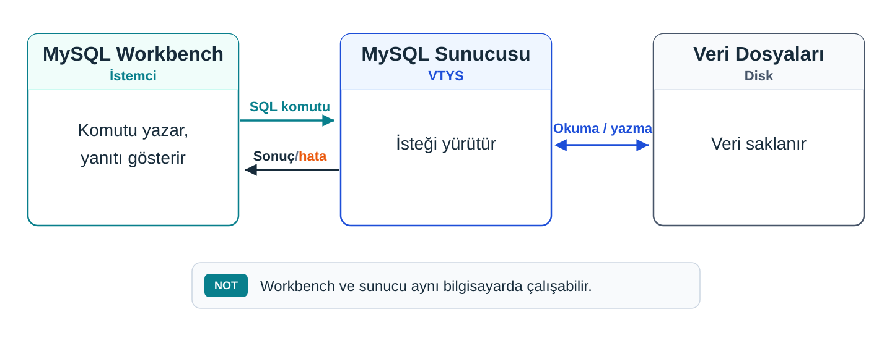
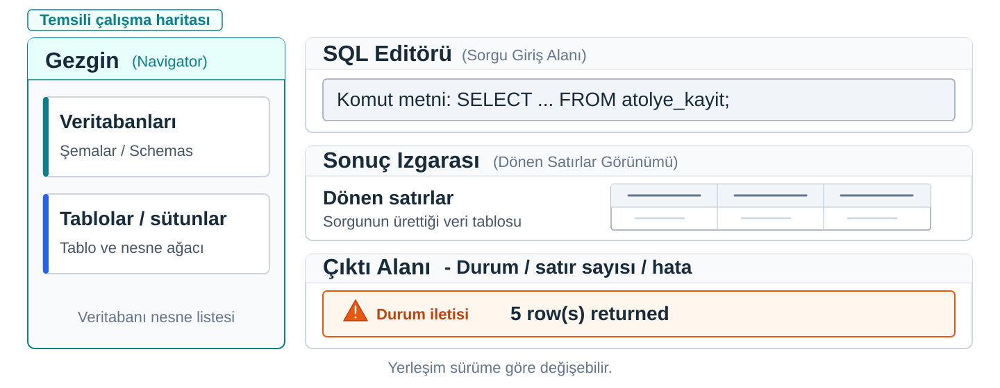

## Kâğıttaki tasarımı çalıştıralım

Dört tablo kâğıtta duruyor: `ogrenci`, `ogretim_uyesi`, `ders`, `kayit`.

> Bunları çalışan bir veritabanına çevirmek için neye ihtiyacımız var?

. . .

Bir **yazılıma**, ve ona istek gönderecek bir **programa.**

::: {.notes}
Dört tabloya ayırdığımız tasarım kâğıtta duruyor. Onu çalışan bir veritabanına çevirmek için bir yazılıma ihtiyacımız var.

İlk notta bir isteğin yolunu üç kutuyla çizmiştik: istemci, sunucu ve saklanan veri. Bu akışı şimdi MySQL ve Workbench üzerinde kuracağız. MySQL ile Workbench bilgisayarda ya da laboratuvarda kurulu ve hazır kabul ediliyor. Workbench üzerinden MySQL sunucusuna bağlantı kuracağız.
:::

---

## Veriyi hangi program yönetir?

{.blp-diagram}

**Workbench veriyi saklamaz;** ister ve gösterir. Veri sunucunun elindedir.

::: {.notes}
Sunucu kutusunda MySQL duruyor. MySQL bir VTYS; veritabanının kendisi değil, onu yöneten yazılım. MySQL sunucusu, MySQL'in bilgisayarda çalışan hâli: penceresi açık olmasa da arka planda çalışabilir, tabloları disk üzerindeki dosyalarda saklar ve kendisine gelen istekleri yürütür.

İstemci kutusunda MySQL Workbench duruyor. Workbench, SQL komutlarını yazdığınız, sunucuya gönderdiğiniz ve dönen yanıtı gösteren istemci programı. SQL de veritabanına ne yapmasını istediğinizi söyleyen komut dili. Tarayıcıyı açmak web sunucusunu başlatmadığı gibi, Workbench'i açmak da MySQL sunucusunu kendiliğinden başlatmaz; buna karşın iki program aynı bilgisayarda internet bağlantısına ihtiyaç duymadan yerel olarak haberleşebilir.

Bir şeyi baştan netleştirelim: Workbench veriyi saklamıyor. İstek gönderiyor ve yanıtı gösteriyor. Veri sunucunun elinde.
:::

---


## Workbench açıkken sunucuya ulaşabilir miyiz?

| Workbench | Sunucu | Sonuç |
| --- | --- | --- |
| Kapalı | Çalışıyor | Veri yerinde; bu istemciden istek gönderilmiyor. |
| Açık | Çalışmıyor | İsteği yürütecek sunucuya ulaşılamıyor. |

. . .

“Workbench'i açtım” ve “sunucuya bağlandım” **ayrı durumlardır.**

::: {.notes}
Gündelik konuşmada “MySQL'i açtım” deriz. Ekranda açılan şey Workbench. Sunucu ise zaten arka planda çalışıyordur ya da çalışmıyordur. Cümle iki programdan hangisinden söz ettiğini söylemiyor.

Fark iki durumda görünüyor. Workbench kapalı, sunucu çalışırken veri yerinde duruyor; yalnız bu istemciden istek gitmiyor. Workbench açık, sunucu çalışmıyorken ekranda bir program var ama isteğin gideceği yer yok.

İkinci satır sık yapılan bir yanılgıyı gösteriyor: Workbench'i açmak sunucuyu başlatmaz. Pencerenin açık olması veritabanına ulaştığınız anlamına gelmez. Biz de ikisini ayrı söyleyelim.
:::

---

## Bağlantı: hangi sunucuya, kim olarak

**Bağlantı:** Workbench'in bir sunucuya hangi adresle ve hangi kullanıcı olarak başvuracağını kaydeden ayarlar.

| Ayar | Söylediği | Örnek |
| --- | --- | --- |
| Sunucu adresi | Komutlar hangi bilgisayardaki sunucuya gidecek | `localhost` (bu bilgisayar) |
| Kullanıcı adı | Sunucu sizi hangi hesap olarak tanıyacak | derste kullanacağınız hazır hesap |

Parolayı Workbench **bağlanırken sorar.**

Workbench açılınca ders için hazırlanmış bağlantılar bir **listede** durur.

Hazır bağlantıyı açın, parola sorulursa girin.

Pencerede sunucudaki **veritabanlarının adları** belirirse bağlantı kurulmuştur.

::: {.notes}
Workbench sunucuya kendiliğinden ulaşmıyor. Hangi sunucuya, hangi kullanıcı olarak başvuracağını bir bağlantı söylüyor. Sunucu adresi komutların hangi bilgisayardaki sunucuya gideceğini, kullanıcı adı sunucunun sizi hangi hesap olarak tanıyacağını belirliyor. `localhost`, “bu bilgisayar” demek.

Parolayı Workbench bağlanırken soruyor. Sunucu kullanıcı adını ve parolayı kontrol ediyor, hesabı tanırsa bağlantı kuruluyor. Hesabı derste hazır bulacaksınız; nasıl tanımlandığını bilmeniz gerekmiyor.

Bağlantı kurulmadan Workbench komutu sunucuya gönderemiyor.

Hazır bağlantıyı açıyorsunuz, parola sorulursa giriyorsunuz. Bağlantı kurulunca pencerede sunucudaki veritabanlarının adlarını gösteren bir liste belirir.

Bu liste bağlantının kanıtı. Workbench listeyi kendisi üretemez; sunucuya soruyor ve gelen yanıtı gösteriyor. Liste ekrandaysa sunucu yanıt vermiş, bağlantı kurulmuş demektir. Bunu görmek için komut yazmanıza gerek yok.

Pencere ve düğme adları Workbench'in sürümüne göre biraz değişebilir. Değişmeyen şey, listenin sunucudan geldiği.
:::

---

## Bağlantı kurulamazsa

İki olasılık, ikisinde de ekranda **aynı şey** görünür: bağlantı kurulamadı.

- **Sunucu çalışmıyor:** gidilecek yer ayakta değil.
- **Ayar yanlış:** adres, kullanıcı adı ya da parola beklenenden farklı.

> Önce hangisine bakarız?

. . .

Önce **ayarlara** bakarız; onları siz düzeltebilirsiniz.

::: {.notes}
Bağlantı açılmayabilir. İki olasılık var ve ikisinde de ekranda aynı şey oluyor: bağlantı kurulamadığını bildiren bir ileti görünüyor.

Sunucu çalışmıyorsa gidilecek yer ayakta değil; ayarların hepsi doğru olsa da yanıt gelmiyor. Ayar yanlışsa, adres, kullanıcı adı ya da parola beklenenden farklı. Sunucu çalışıyor olabilir ama yanlış parolayı kabul etmiyor.

İlk bakılacak yer ayarlar, çünkü onları siz düzeltebilirsiniz: adres ve kullanıcı adı beklediğiniz gibi mi, parolayı doğru yazdınız mı? Ayarlar doğruysa sunucunun çalışıp çalışmadığını laboratuvarı ya da ortamı hazırlayan kişiye sorarsınız.
:::

---

## Komut hangi veritabanında çalışır?

```sql
SELECT ogrenci_numarasi, ad_soyad, telefon, kayit_tarihi FROM atolye_kayit;
```

| Etkin veritabanı | Sonuç |
| --- | --- |
| `atolye` | Tablo bulunur, beş satır döner. |
| `deneme` | Tablo orada yok; sunucu bulamadığını bildirir. |

**Etkin veritabanı:** Komutlarda yazılan tablo adlarının aranacağı veritabanı.

Gezginde **kalın yazıyla** görünür.

Başkasını etkin yapmak için gezginde adına **çift tıklayın.**

Hiçbiri kalın değilse **etkin veritabanı yoktur:** tablo adı yazan komut çalışmaz.

::: {.notes}
Bir sunucuda tek değil, birden çok veritabanı durabilir. Derste hazırladığımız sunucuda iki tane var: `atolye`, içinde atölye kayıt tablosu hazır duruyor; `deneme`, henüz boş. Workbench bunları şema adıyla listeler. Sunucunun kendi kullandığı veritabanları da listede görünebilir; onlara dokunmuyoruz.

Ekrandaki komutta tablonun adı yazıyor, hangi veritabanında durduğu yazmıyor. Sunucu tabloyu nerede arayacağını komuttan çıkaramıyor. Bunu etkin veritabanı belirliyor. Etkin `atolye` ise sunucu tabloyu buluyor ve beş satır dönüyor. Etkin `deneme` ise tablo orada yok; komut çalışamıyor.

Komut aynı, sonuç farklı. Fark komutta değil, etkin veritabanında.

Etkin veritabanı gezginde kalın yazıyla görünüyor. Başka bir tanesini etkin yapmak için gezginde o veritabanının adına çift tıklıyorsunuz. Bağlantı bir veritabanı seçilmeden açıldıysa hiçbiri kalın görünmüyor; etkin veritabanı yok ve tablo adı yazan bir komut çalışmıyor. Bu yüzden bir komutu çalıştırmadan önce kalın yazılı veritabanına bakmak iyi bir alışkanlık.

Küçük bir terim notu: MySQL'de `SCHEMA` ve `DATABASE` aynı nesneyi belirtiyor, Workbench'teki şema listesi bu veritabanlarını gösteriyor. Dersin başında şema sözcüğünü tablonun sütunlarını, tiplerini ve kurallarını anlatan yapı için de kullandık. Bir tablonun yapısını anlatırken kullandığımız anlamla, listedeki veritabanı adını ayırıyoruz.
:::

---

## Komut, dönen satırlar ve durum farklı yüzeylerdedir

{.blp-diagram}

> Izgarada hiçbir şey yoksa tablo mu silindi?

. . .

Hayır: önce **çıktı alanına** bakın.

::: {.notes}
Bağlantı kurulunca komutu nereye yazacağınızı ve yanıtı nerede okuyacağınızı ayırmanız gerekiyor. SQL editörü, komutu yazdığınız ya da hazır bir komutu açtığınız metin alanı. Editördeki metin, siz çalıştırana kadar yalnızca ekranda duran bir metin; sunucu onu görmüyor. Sonuç ızgarası sunucunun döndürdüğü satırları tablo biçiminde gösteriyor. Çıktı alanı komutun sunucuda nasıl sonuçlandığını bildiriyor: iş başarıyla bitti mi, kaç satır etkilendi ya da döndü, bir hata var mı.

Hazır sorgu, `atolye_kayit` tablosunun dört sütununu ve bütün satırlarını istiyor. `atolye` etkinken çalıştırınca üç yerde ayrı şeyler görünüyor.

Izgarada hiçbir şey görünmüyorsa tablo silinmiş olmaz. Izgara yalnız sunucu satır döndürdüğünde doluyor. Komut hata verdiyse ızgarada yeni bir şey belirmiyor ve nedeni çıktı alanında yazıyor. Izgara boş kalınca önce çıktı alanına bakılır. Pencerenin yerleşimi sürüme göre değişebilir; üç yüzeyin işi değişmez.
:::

---


## Kâğıttaki tabloyu sunucudaki yapıyla eşleyelim

| Kâğıttaki karar | Gezginde görülen karşılığı |
| --- | --- |
| Tablo adı: `atolye_kayit` | `atolye` altında `atolye_kayit` |
| Dört sütun | Tablonun altında dört sütun adı |
| Birincil anahtar: `ogrenci_numarasi` | Anahtar simgesi `ogrenci_numarasi`'nın yanında |

Gezgin **okumak** içindir; yapıyı komutla kuracağız.

::: {.notes}
Gezgin, bağlı sunucudaki veritabanlarını, tabloları ve sütunları ağaç olarak listeleyen panel. `atolye` veritabanını açarsanız altında tabloları görürsünüz. `atolye_kayit` tablosunu açarsanız sütunlarını görürsünüz: `ogrenci_numarasi`, `ad_soyad`, `telefon`, `kayit_tarihi`. `ogrenci_numarasi`'nın yanında bir anahtar simgesi duruyor; bu, o sütunun birincil anahtar olduğunu gösteriyor.

Kâğıtta aldığımız kararlar, sunucudaki gerçek tabloda da aynı yerde duruyor.

Gezginde tablo kurmak ya da değiştirmek de mümkün, ama biz yapıyı komutla kuracağız; gezginde okuyoruz, değiştirmiyoruz. Menülerin yerini ve simgelerin hepsinin adını ezberlemeniz gerekmiyor. Anahtar simgesinin birincil anahtarı gösterdiğini bilmeniz yeter.
:::

---

## Karar soruları

1. “MySQL'i açtım ama veritabanı gelmiyor” diyen birine ilk ne sorarsınız?
2. Etkin veritabanı `deneme` iken `atolye_kayit` tablosunu soran komutu çalıştırdınız. Tablo silindi mi?
3. Bağlantı kurulamadı iletisi sunucunun kapalı olduğunu mu kanıtlar?

::: {.notes}
1. Hangi programı açtığını: Workbench mi, sunucu mu? Workbench'i açmak sunucuyu başlatmaz; bağlantı kurulup veritabanı listesi gelmediyse sunucuya ulaşılamıyordur.
2. Hayır. Tablo `atolye`'de duruyor; komut `deneme`'de aradığı için bulamadı. Çıktı alanında tablonun bulunamadığı yazar; etkin veritabanını `atolye` yapmak yeter.
3. Hayır. Aynı ileti ayar yanlış olduğunda da görünür: adres, kullanıcı adı ya da parola hatalı olabilir. Önce ayarlara bakılır, sonra sunucunun çalışıp çalışmadığı sorulur.
:::

---

## Bu nottan kalanlar

- **Sunucu** veriyi saklar ve istekleri yürütür; **Workbench** istek gönderir ve yanıtı gösterir.
- Workbench'i **açmak** sunucuya **bağlanmak** demek değildir; bağlantıyı adres, kullanıcı ve parola kurar.
- Komutlar **etkin veritabanında** çalışır.
- Komut **editörde**, dönen satırlar **ızgarada**, durum **çıktı alanında** görünür; gezgin yapıyı okumak içindir.

::: {.notes}
Bu notta bağlantıyı kurduk ve çalışma alanının yüzeylerini ayırdık. Hâlâ yalnız hazır bir sorguyu çalıştırdık; kendi komutumuzu yazmadık.
:::
