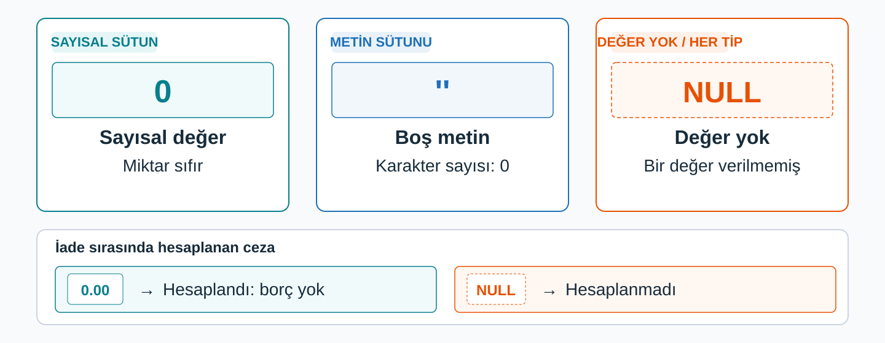
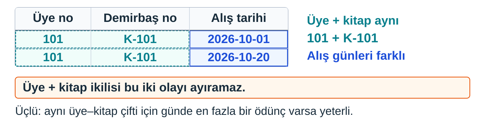

## Tablo kuralı kendisi bilirse

İlk `kitap` tablomuz yalnız ad ve tip biliyor. Oysa kütüphanenin kuralları var.

| İş kuralı | Kısıt | Anlamı |
| --- | --- | --- |
| Her üyenin adı soyadı kayıtlı olmalı | `NOT NULL` | Sütun boş bırakılamaz |
| İki üye aynı e-postayı kullanamaz | `UNIQUE` | Değerler birbirinden farklı olmalı |
| Kayıt tarihi, kaydın yapıldığı gün kendiliğinden yazılsın | `DEFAULT` | Değer verilmezse sunucunun yazacağı değer |

**Kısıt:** Sütuna girebilecek değerleri sınırlayan kural.

::: {.notes}
İlk tabloda kurduğumuz `kitap`, sütun adlarını ve tiplerini biliyor ama başlığın zorunlu olduğunu ya da demirbaş kodunun tekrarlanmaması gerektiğini bilmiyor. Oysa kütüphanenin kuralları var.

Kuralı tablo bilirse her satırı elle kontrol etmek zorunda kalmayız: sunucu kuralı bozan satırı kabul etmez. Sütuna girebilecek değerleri sınırlayan böyle bir kurala kısıt diyoruz. Üç iş kuralını üç kısıtla eşleştirdik. `NOT NULL` “boş bırakılamaz” diyor; önce boş kalmanın ne demek olduğunu netleştirelim.
:::

---

## Hücrede değer yoksa ne yazarız?

Üye kitabı bugün aldı. `iade_tarihi` sütununa ne yazacağız?

- `0` → takvimde **0 diye bir gün yok.**
- `''` (boş metin) → bir **metin,** tarih değil.
- Hücreyi **boş** bırakıp “burada değer yok” demek.

. . .

**NULL:** Bir hücrede değer bulunmadığını gösteren özel işaret.

{.blp-diagram .blp-diagram-compact}

::: {.notes}
Ödünç tablosunda her satır bir ödünç alışı anlatıyor ve `iade_tarihi` sütunu var. Bir üye kitabı bugün aldı; satırı yazıyoruz. İade tarihine ne yazacağız? Kitap henüz geri gelmedi, tarih yok. Akla üç yol geliyor.

Birincisi 0. Takvimde 0 diye bir gün yok. İkincisi boş metin. SQL'de metin değerleri tek tırnak içinde yazılır; içi boş iki tırnak da uzunluğu sıfır olan bir metin. Boş metin bir tarih değil. Üçüncü yol, hücreye hiçbir değer koymayıp “burada değer yok” demek.

NULL, bir hücrede değer bulunmadığını gösteren özel işaret: değer bilinmiyor, henüz girilmedi ya da bu satır için geçerli değil. NULL sıfır değil, boş metin de değil. 0 bir sayı, boş metin bir metin; ikisi de birer değer. NULL ise değerin kendisinin olmadığını söylüyor. Sayısal alanda da aynı ayrım geçerlidir: Bu kütüphanede ceza tutarı kitap iade edilirken hesaplanıyor. Zamanında teslim edilen kitabın kesinleşmiş cezası 0 TL; kitap iade edilmediği için hesabı yapılmamış ceza ise NULL. İlkinde borç olmadığı belli, ikincisinde tutar hesaplanmamış.

Aynı ayrım başka bir yerde de görünüyor. Yazarı olmayan bir derleme kitabı düşünelim. Yazar sütununa boş metin yazarsak “yazarın adı boş bir metin” demiş oluruz, bu da bir bilgi gibi durur. NULL bırakırsak “yazar bilgisi yok” deriz. Doğru olan ikincisi.
:::

---


## Kısıtları komutta yazmak

```sql
CREATE DATABASE IF NOT EXISTS kutuphane_deneme;
USE kutuphane_deneme;
CREATE TABLE IF NOT EXISTS uye (
    uye_numarasi INT,
    ad_soyad VARCHAR(100) NOT NULL,
    eposta VARCHAR(100) UNIQUE,
    kayit_tarihi DATE DEFAULT (CURRENT_DATE)
);
```

Kısıt, sütunun **adından ve tipinden sonra** yazılır.

- `ad_soyad VARCHAR(100) NOT NULL` → ad soyad vermeden üye eklenirse sunucu **kabul etmez.**
- `eposta VARCHAR(100) UNIQUE` → aynı e-postayla ikinci üye **reddedilir.**
- `kayit_tarihi DATE DEFAULT (CURRENT_DATE)` → tarih verilmezse sunucu **bugünün tarihini yazar.**

`DEFAULT (CURRENT_DATE)` biçimi MySQL **8.0.13** ve üzerini gerektirir.

::: {.notes}
`uye` tablosunu bu üç kısıtla kuralım. Denemeleri gerçek veritabanından ayırdığımız `kutuphane_deneme` içinde çalışıyoruz. İlk iki komut önceki notta yazdıklarımızın aynısı. Tablo komutunda kısıt, sütunun adından ve tipinden sonra yazılıyor.

`uye_numarasi` bu denemede henüz kimlik kuralı taşımıyor. Boş kalma kararlarını da tamamladıktan sonra bu kuralı ekleyeceğiz.

`NOT NULL` bu sütuna her satırda bir değer girilmesini şart koşuyor. Ad soyad vermeden üye eklemeye çalışırsak sunucu satırı kabul etmiyor.

`UNIQUE` iki satırın aynı e-postayı taşımasını engelliyor. İkinci bir üyeyi aynı adresle eklemeye çalışırsak sunucu onu da reddediyor.

`CURRENT_DATE` sunucunun bugünün tarihini veren hazır ifadesi. Üyeyi eklerken kayıt tarihi vermezsek sunucu eklendiği günün tarihini yazıyor. `DEFAULT` sabit bir değer ya da parantez içinde bir ifade alıyor; `CURRENT_DATE` bir ifade olduğu için parantezle yazılıyor.
:::

---

## Boş kalsın mı?

`eposta` sütununa `NOT NULL` yazmadık: üyelik için e-posta zorunlu olmayabilir. `ad_soyad` her üyede olmalı.

- Her ödünç kaydı bir üyeye aittir → üyeyi gösteren sütun **boş kalamaz:** `NOT NULL`.
- Yeni gelen kitabın henüz rafı olmayabilir → rafı gösteren sütun **boş kalabilir.**
- `iade_tarihi` kitap henüz geri gelmediği için boştur → `NOT NULL` **yazılmaz.**

::: {.notes}
Boş kalıp kalmayacağı kararı iş kuralından çıkıyor, tahmin edilmiyor. İlişkilerde katılım bu kararı verirken işe yarıyor.

Her ödünç kaydı bir üyeye ait. Ödünç kaydının üyeyle ilişkisi zorunlu, yani en az bir eşleşme var. O hâlde ödünç tablosunda üyeyi gösteren sütun boş kalamaz ve `NOT NULL` yazılır. Yeni gelen bir kitabın henüz rafı olmayabilir. Kitabın raf ilişkisi isteğe bağlı, sıfır eşleşme olabilir. Kitap tablosunda rafı gösteren sütun boş kalabilmeli, yani `NOT NULL` yazılmaz.

Bu örneklerde ilişkiyi taşıyan sütun, zorunlu katılımda boş bırakılamaz; isteğe bağlı katılımda boş kalabilir. `iade_tarihi` ise katılımdan dolayı değil, kitap henüz geri gelmediği için boş kalır. Orada da `NOT NULL` yazmayız ve hücre `NULL` olur.

Bu kurallar değerleri denetliyor. Satırı ayırt etmek için ise seçtiğimiz kimliğin hem benzersiz hem dolu olmasını birlikte güvenceye alıyoruz.
:::

---

## Satır kimliğini üye tablosuna yazmak

```sql
CREATE DATABASE IF NOT EXISTS kutuphane;
USE kutuphane;
CREATE TABLE IF NOT EXISTS uye (
    uye_numarasi INT AUTO_INCREMENT,
    ad_soyad VARCHAR(100) NOT NULL,
    eposta VARCHAR(100) UNIQUE,
    kayit_tarihi DATE DEFAULT (CURRENT_DATE),
    PRIMARY KEY (uye_numarasi)
);
```

Bu komut **`kutuphane`** veritabanında çalışır.

**PRIMARY KEY:** Bir sütunu (ya da sütun grubunu) birincil anahtar yapan kısıt. Değerler **benzersiz** olur, sütun **boş bırakılamaz.**

**AUTO_INCREMENT:** Sütuna değer verilmeden satır eklendiğinde sunucunun otomatik sayaçtan **yeni bir sayı üretmesi.**

Boş bırakılamayan sütuna ayrıca `NOT NULL` yazmayız: `PRIMARY KEY` bunu zaten kapsar.

::: {.notes}
Deneme veritabanındaki `uye` üç sütun kuralını gösteriyordu. Şimdi anahtarını da belirleyip `kutuphane` veritabanında kuruyoruz. Bu ayrı veritabanı, denemede önceden oluşturduğumuz tabloya dokunmadan tam tanımı kullanmamızı sağlıyor.

`ad_soyad`, `eposta` ve `kayit_tarihi` satırları denemede yazdığımızın aynısı. İki yeni öğe var.

`PRIMARY KEY (uye_numarasi)` satırı, parantez içindeki sütunu tablonun birincil anahtarı yapıyor. Sütunun değerleri benzersiz oluyor ve sütun boş bırakılamıyor. Hazır betikte `ogrenci_numarasi INT PRIMARY KEY` biçimini görmüştük. Aynı anlamı sütun listesinin sonunda ayrı bir satırda da yazabiliriz; bileşik anahtarda ayrı satır gerekiyor.

`AUTO_INCREMENT` değeri sunucu üretiyor. Sayıların kesintisiz olması satır kimliğinin koşulu değil. Numarayı kütüphane kendisi, sırayla üretecek; elle numara saymak zorunda kalmayacağız.
:::

---

## Otomatik artmak anahtar yapar mı?

```sql
CREATE TABLE IF NOT EXISTS kitap (
    demirbas_numarasi VARCHAR(20),
    baslik VARCHAR(200) NOT NULL,
    yazar VARCHAR(100),
    PRIMARY KEY (demirbas_numarasi)
);
```

Bu tabloda **`AUTO_INCREMENT` yok.** Kod dışarıdan verilir: `K-101`.

> Yine de `demirbas_numarasi` birincil anahtar mı?

. . .

Evet: `PRIMARY KEY` onu öyle tanımlıyor. Sütunu anahtar yapan **benzersiz ve dolu olması,** otomatik artması değil.

::: {.notes}
İki öğe yan yana durduğu için biri öbürünün sonucu gibi görünebilir. `kitap` tablosu bu görüntüyü bozuyor.

Bu tabloda `AUTO_INCREMENT` yok. Demirbaş kodunu sunucu üretmiyor; kurum `K-101` gibi kodları dışarıdan veriyor. Buna rağmen `demirbas_numarasi` bir birincil anahtar, çünkü `PRIMARY KEY` satırı onu öyle tanımlıyor. Başlık zorunlu, yazar bilgisi bulunmayabilir.

Soru şuydu: bir sütunu anahtar yapan otomatik artması mı, benzersiz ve dolu olması mı? Cevap ikincisi. `PRIMARY KEY` benzersizlik ve boş bırakılmama kuralını koyuyor. `AUTO_INCREMENT` yalnız değer üretiyor ve o satırın yerini tutmuyor. `uye_numarasi` hem otomatik artıyor hem anahtar; ikisi de ayrı satırlarda ayrı ayrı söylendiği için.
:::

---

## Bileşik anahtar

:::: {.columns}
::: {.column width="55%"}
```sql
CREATE DATABASE IF NOT EXISTS kutuphane_deneme;
USE kutuphane_deneme;
CREATE TABLE IF NOT EXISTS odunc (
    uye_numarasi INT,
    demirbas_numarasi VARCHAR(20),
    alis_tarihi DATE,
    iade_tarihi DATE,
    PRIMARY KEY (
        uye_numarasi,
        demirbas_numarasi,
        alis_tarihi
    )
);
```
:::
::: {.column width="45%"}
{.blp-diagram .blp-diagram-compact}

Üç sütun **birlikte** tek anahtar; üçü de boş bırakılamaz.

Üçlü, ancak **alış günü** aynı üye–kitap çiftinin her olayını ayırıyorsa yeterli.
:::
::::

Denemeden sonra ana modele dönülür: `USE kutuphane;`

::: {.notes}
Bir sütun yetmediğinde anahtar birkaç sütunun birlikteliği oluyor. Ödünç tablosunda bunu deneyelim. N:M ilişkisinin bağlantı tablosunun anahtarı için iki yol görmüştük: satırı ayırt eden sütunların birlikteliğini anahtar yapmak ya da her satıra ayrı bir numara vermek. Kütüphanenin gerçek ödünç tablosu ikinci yolu, `odunc_id` numarasını kullanıyor ve yabancı anahtarlarıyla ayrıca kuruluyor. Birinci yolun yazımını görmek için bu tabloyu deneme veritabanında kuruyoruz.

`PRIMARY KEY` parantezinin içine sütunları virgülle yazdık. Üçü birlikte tek bir anahtar oluşturuyor ve üçü de boş bırakılamıyor.

Neden üçü? `uye_numarasi` tek başına yetmez, çünkü bir üye çok kitap alır. `demirbas_numarasi` tek başına yetmez, çünkü bir kitap çok üyeye gider. İkisi birlikte de yetmez, çünkü aynı üye aynı kitabı iki ayrı günde ödünç alabilir.

Üç sütunun birlikteliği, ancak alış günü aynı üye–kitap çiftinin her ödünç olayını ayırıyorsa satırı ayırt ediyor. Aynı üye aynı kitabı aynı gün iade edip yeniden ödünç alırsa iki olayın üçlü değerleri aynı olur; bu anahtar seçeneği o durumda yeterli değil. Bu koşul sağlandığında `iade_tarihi` satırı ayırt etmek için gerekmez ve anahtara katılmaz.
:::

---


## `PRIMARY KEY` ve `UNIQUE`

| | `PRIMARY KEY` | `UNIQUE` |
| --- | --- | --- |
| Bir tabloda kaç tane? | En çok bir | Birden çok sütunda olabilir |
| `NULL` kabul eder mi? | Hayır | Evet; `NOT NULL` ayrıca yazılmadıkça |

`eposta` benzersiz ama **boş kalabilir:** her satırı bulmaya yetmez.

1:1 ilişkide yabancı anahtara koyduğumuz **tekillik kuralı** SQL'de `UNIQUE` olarak yazılır.

::: {.notes}
`uye` tablosunda iki benzersiz sütun var: `uye_numarasi` birincil anahtar, `eposta` `UNIQUE`. İkisi de tekrarı engelliyor; yine de aynı şey değiller.

Üye tablosunda e-posta benzersiz ama boş kalabilir. Bu yüzden her satırı bulmaya yetmez. `UNIQUE` yalnız benzersiz olmasını söylüyor, boş bırakılamamasını söylemiyor. Birincil anahtar ikisini birden söylediği için `UNIQUE` onun yerine geçemez.

E-R modelinin 1:1 dönüşümünde yabancı anahtar sütununa koyduğumuz tekillik kuralı da SQL'de `UNIQUE` olarak yazılıyor.
:::

---

## Karar soruları

1. Ödünç tablosunda `iade_tarihi` sütununa `NOT NULL` yazarsak ne olur?
2. `eposta` için `UNIQUE` yerine `PRIMARY KEY` yazsak ne kaybederiz?
3. Telefon sütunu için `UNIQUE` koymak neden riskli?

::: {.notes}
1. Henüz geri gelmemiş bir kitabın ödünç satırı yazılamaz; çünkü iade tarihi henüz yok. `iade_tarihi` katılımdan dolayı değil, olay henüz gerçekleşmediği için boş kalır; bu yüzden `NOT NULL` yazılmaz.
2. E-postası olmayan üyeleri tabloya giremezdik; birincil anahtar boş kalamaz. Ayrıca bir tabloda en çok bir birincil anahtar olur ve o da `uye_numarasi` olarak kalmalıydı.
3. İki kardeş aynı ev telefonunu verebilir. Telefon, iş kuralı bunu garanti etmedikçe tekrarlanabilir bir bilgidir; `UNIQUE` olması gereken kişileri kayıttan dışlar.
:::

---

## Bu nottan kalanlar

- **Kısıt** sütuna girebilecek değerleri sınırlar: `NOT NULL`, `UNIQUE`, `DEFAULT`.
- **NULL** değerin olmadığını söyler; sıfır ya da boş metin değildir.
- **PRIMARY KEY** benzersizlik ve doluluğu birlikte koyar; **AUTO_INCREMENT** yalnız değer üretir.
- Tek sütun yetmezse **bileşik anahtar:** sütunlar birlikte yazılır.

Denemeden sonra ana modele dönülür: `USE kutuphane;`

::: {.notes}
`uye` ve `kitap` kendi kimliklerini taşıyor.

Denemeyi bitirdikten sonra `USE kutuphane;` ile ana modele dönüyoruz.
:::
