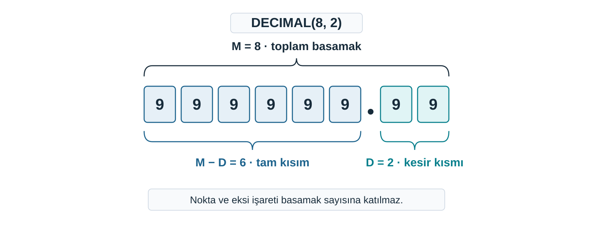

## Kâğıttaki tabloyu kendimiz kuracağız

Hazır betikte komutları çalıştırdık ama **yazmadık.**

Kütüphanenin `kitap` tablosunu kuracağız.

> Önce neye karar vermemiz gerekir?

. . .

Her şeye bir **ad,** her sütuna bir **değer türü.**

::: {.notes}
Hazır bir betiği çalıştırırken sunucuya komutlar gönderdik ama o komutları biz yazmadık. Bundan sonra yapıyı kendimiz kuracağız.

Kâğıttaki bir tabloyu sunucuda var etmek için önce her şeye bir ad vermemiz gerekiyor. Bu adlar komutların içine girecek ve çalışma boyunca aynı kalacak. Sonra her sütunun kabul edeceği değer türünü belirleyeceğiz. Kütüphanenin `kitap` tablosunu bu iki karardan sonra kuracağız.
:::

---

## Yapıyı kuran komutlar

**Veri Tanımlama Dili (DDL):** Veritabanının yapısını kuran ve değiştiren SQL komutlarının grubu.

- Veritabanı, tablo, sütun **DDL** ile kurulur.
- `CREATE TABLE` **satır eklemez.**
- Satırlarla ilgilenen komutlar ayrı bir gruptur (DML).

::: {.notes}
Bir betikteki komutların bir kısmı tabloları ve sütunları kurar, bir kısmı tablolara satır koyar. Kâğıtta bu fark kolay görünüyor: üye tablosunun sütun listesi yapı, bu tabloya yazılan bir üyenin satırı veri.

Yapıyı kuran komutların grubuna DDL diyoruz. Örneğin `CREATE TABLE` satır eklemez. Yapıyı silen bir DDL komutu ise içerideki satırları da silebilir; bu yüzden dikkatli olacağız. Satırlarla ilgilenen komutlar ayrı bir grup, DML. DDL ile kuracağımız tablolar başlangıçta boş.
:::

---

## Kavramsal ad, tanımlayıcı

| Kavramsal ad | Tanımlayıcı |
| --- | --- |
| Üye Numarası | `uye_numarasi` |
| Ad Soyad | `ad_soyad` |
| Kayıt Tarihi | `kayit_tarihi` |
| Öğrenci Numarası | `ogrenci_numarasi` |

**Tanımlayıcı:** Veritabanı, tablo ve sütun gibi nesnelere bizim verdiğimiz ad.

- Yalnız **küçük harf, rakam ve alt çizgi.**
- Türkçe harfler yerine **ASCII karşılıkları:** `ç→c`, `ğ→g`, `ı→i`, `ö→o`, `ş→s`, `ü→u`.
- Boşluk yerine **alt çizgi.**
- Adı, **neyi anlattığı belli** olacak biçimde seçeriz.

::: {.notes}
Varlık ve nitelikleri kâğıda yazarken “Üye Numarası” gibi adlar kullandık. SQL'de bu niteliğin sütununa `uye_numarasi` diyeceğiz. Veritabanı, tablo ve sütun gibi nesnelere bizim verdiğimiz adlara tanımlayıcı diyoruz.

Ad yalnızca bir yazım tercihi değil. Aynı nesne modelde, tabloda, betikte ve sonradan yazacağımız her komutta aynı adla geçer. Modelde “Üye Numarası”, tabloda `uye_no`, bir başka komutta `numara` yazarsak aynı sütun için üç ad olur ve her seferinde hangisinin hangisi olduğunu çözmemiz gerekir. Bir kez `uye_numarasi` dedikten sonra her yerde `uye_numarasi` yazıyoruz.

Gerekçe taşınabilirlik. Aynı betik başka bir bilgisayarda, başka bir işletim sisteminde çalışan bir sunucuda da çalışmalı. MySQL tablo adlarını sunucunun diskindeki dosya adlarıyla eşleştiriyor. Dosya sistemleri büyük ve küçük harfi her yerde aynı işlemez; Türkçe harfler ve boşluk da ortama göre farklı davranabilir. Her şey küçük harf ve ASCII olursa bu farklar başımıza iş açmaz.
:::

---

## Kurala uymayan adı düzeltin

| Yazılan ad | Sorun | Düzeltme |
| --- | --- | --- |
| `Öğrenci No` | ? | ? |
| `kayıt_tarihi` | ? | ? |
| `u_no` | ? | ? |
| `tar1` | ? | ? |

. . .

`ogrenci_numarasi` · `kayit_tarihi` · `uye_numarasi` · `alis_tarihi` ya da `iade_tarihi`

::: {.notes}
Dört ad kuralı bozuyor. Her satırda önce sorunu kendiniz bulun, sonra düzeltmeye bakın.

`Öğrenci No`: büyük harf, Türkçe harf, boşluk ve kısaltma var. `kayıt_tarihi`: yalnız `ı` harfi Türkçe. `u_no`: belirsiz kısaltma; üye mi, ürün mü? `tar1`: hangi tarih olduğu belli değil. Sonuncuda tek doğru yok; hangi tarihi tutacağımıza göre `alis_tarihi` ya da `iade_tarihi` seçiyoruz.
:::

---

## Komutta iki tür sözcük

```sql
CREATE DATABASE kutuphane_deneme;
```

- **Anahtar sözcük:** SQL'in bildiği sözcük. `CREATE`, `DATABASE`. **Büyük harfle** yazarız.
- **Tanımlayıcı:** Bizim verdiğimiz ad. `kutuphane_deneme`. **Küçük harfle** yazarız.

::: {.notes}
Bir komutta iki tür sözcük bulunuyor. SQL'in kendi bildiği, anlamı belli sözcüklere anahtar sözcük diyoruz. Öteki sözcükleri biz veriyoruz; bunlar tanımlayıcı. `CREATE` ve `DATABASE` anahtar sözcük: sunucu bunların ne yaptığını biliyor. `kutuphane_deneme` ise bizim bir veritabanına vereceğimiz ad.

Anahtar sözcükleri büyük, tanımlayıcıları küçük harfle yazıyoruz. Böylece bir komuta bakınca hangi sözcüğün SQL'e, hangisinin bize ait olduğunu bir bakışta görüyoruz. Komutun sonundaki noktalı virgülü ve yazılış ayrıntılarını komutları yazarken ayrıca açıyoruz; burada yalnız sözcüklerin türüne bakıyoruz.
:::

---

## Sütunda hangi değerler bulunacak?

**Veri tipi:** Bir sütuna girebilecek değerlerin türünü ve sınırını söyleyen tanım.

Tipleri önce **kâğıtta** seçiyoruz.

Telefon numarası: `0532 123 45 67`

> Aralardaki boşlukları kaldırınca yalnız rakam kalıyor. Sayı tipi olur mu?

- `0532` ile `532` aynı sayıdır: baştaki sıfır **kaybolur.**
- İki telefon numarasını toplamanın **anlamı yok.**
- Numara hesabın girdisi değil, bir **etikettir.**

Demirbaş kodu `1001`, `1002` iken `KTP-2026-0042` gelirse sayı tipli sütun **kabul etmez.**

> Rakamlardan oluşmak, sayı olmak için yetmez.

::: {.notes}
Adı belli olan her sütun için ikinci bir karar var: o sütuna hangi türden değerler girecek? Buna veri tipi diyoruz.

Kâğıttaki üye tablosunda `telefon` sütunu da vardı. SQL'de tabloyu küçük tutmak için onu kuracağımız tabloya almıyoruz ama tip kararı için iyi bir örnek. Aralardaki boşlukları kaldırınca yalnız rakamlar kalıyor; o hâlde sayı tipi uygun gibi duruyor. Bunu sınayalım.

Sayı olarak yazılan 0532 ile 532 aynı sayı, çünkü baştaki sıfır sayının değerine bir şey katmıyor. Telefon numarasını sayı olarak saklayan bir sütun baştaki sıfırı da saklamaz. İki telefon numarasını toplamanın ya da ortalamasını almanın da bir anlamı yok. Numara bir hesabın girdisi olmaz, bir etikettir.

Demirbaş kodunda da aynı şey var. Kütüphane kodlarına 1001, 1002 diye başlamış olsun. Bir gün KTP-2026-0042 gibi harfli bir koda geçerse, sayı tipli bir sütun bu değeri kabul etmez. Rakamlardan oluşmak, sayı olmak için yetmiyor.
:::

---

## Üç soru, beş tip

1. Bu değerle **hesap** yapılacak mı?
2. Metinse **uzunluğu** önceden kestirilebiliyor mu?
3. **Gerçek bir takvim gününü** mü saklıyoruz?

| Tip | Ne saklar |
| --- | --- |
| `INT` | tam sayı |
| `DECIMAL(M, D)` | kesin basamaklı ondalık sayı |
| `VARCHAR(n)` | en çok `n` karakterlik metin |
| `TEXT` | uzun metin |
| `DATE` | yıl-ay-gün biçiminde tarih |

::: {.notes}
Tipi seçerken üç soru soruyoruz. Bu değerle hesap yapılacak mı: toplanacak ya da çıkarılacak mı, yoksa sayı yalnız kurumun ürettiği bir sıra numarası mı? Metinse uzunluğu önceden kestirilebiliyor mu? Gerçek bir takvim gününü mü saklıyoruz?

Derste beş tiple çalışıyoruz. `INT` hesapta kullanılan tam sayı ya da kurumun ürettiği sıralı numara için. `DECIMAL` hesap yapılacak ve kuruşu doğru kalması gereken tutar için. `VARCHAR` hesap yok, uzunluk sınırlı ve kestirilebilir olduğunda. `TEXT` uzunluğu kestirilemeyen uzun metin için. `DATE` gerçek bir takvim günü için.

`DATE` yalnız tarihe benzeyen bir metin tutmaz. Sunucu girilen değerin gerçek bir gün olup olmadığına bakar, örneğin 30 Şubat'ı kabul etmez. Tarih sütununu metin yapsaydık bu denetimi kendimiz yapmak zorunda kalırdık.
:::

---

## Kütüphanenin sütunları

| Sütun | Tip | Gerekçe |
| --- | --- | --- |
| `uye_numarasi` | `INT` | Numarayı kütüphane sırayla üretir. |
| `ad_soyad`, `eposta`, `yazar` | `VARCHAR(100)` | Hesap yok; üst sınır kestirilebilir. |
| `kayit_tarihi`, `alis_tarihi`, `iade_tarihi` | `DATE` | Gerçek günler. |
| `demirbas_numarasi` | `VARCHAR(20)` | Kodu kurum verir; harf, tire, baştaki sıfır gelebilir. |
| `baslik` | `VARCHAR(200)` | Başlıklar uzun olabilir. |
| `telefon` | `VARCHAR(20)` | Baştaki sıfır, boşluk, parantez gelebilir. |

::: {.notes}
Üç soruyu kütüphanenin sütunlarına soralım. `uye_numarasi` ile `demirbas_numarasi` ikisi de numara ama tipleri farklı. Farkı yaratan şey, değeri kimin verdiği ve biçiminin değişip değişemeyeceği. Üye numarasını biz sayarak veriyoruz, biçimine biz karar veriyoruz. Demirbaş kodunu kurum belirliyor ve bir gün biçimini değiştirebiliyor.

Tutarı da düşünelim. Bir sütunda `12.50` gibi kuruşlu tutarlar tutacak olsak, hesap yapılacağı için sayı tipi gerekir. `DECIMAL`, değeri girildiği gibi, kesin basamaklarla saklar; kuruşların toplamlarda kaybolmaması gereken para için doğru seçim bu. SQL'de ondalık ayırıcı virgül değil, nokta.

Bir kitabın birkaç paragraflık tanıtım yazısı gibi uzunluğu kestirilemeyen bir metin için `TEXT` kullanırız. `TEXT`'e uzunluk yazmayız.
:::

---

## Tipin yanındaki sayılar

`VARCHAR(100)`: sütuna girebilecek **en uzun metnin karakter sayısı.**

`DECIMAL(M, D)`: `M` toplam basamak, `D` noktadan sonraki basamak.

{.blp-diagram}

> `DECIMAL(5, 2)` en çok hangi değeri tutar?

. . .

`999.99`

::: {.notes}
`VARCHAR(100)` yazarken parantezin içindeki sayı, sütuna girebilecek en uzun metnin karakter sayısı. Daha uzun bir metin sütuna sığmaz. Sayıyı gerçekçi en uzun değeri düşünerek seçiyoruz.

`DECIMAL(M, D)` içinde iki sayı var. `M` toplam basamak sayısı, `D` noktadan sonraki basamak sayısı. `DECIMAL(8, 2)` toplam sekiz basamak tutar ve ikisi noktadan sonraya ayrılır; geriye altı basamak kalır. En büyük değer 999999.99. Nokta ve eksi işareti basamak kutusu sayısına katılmaz.

Aynı okumayı kendiniz deneyin: `DECIMAL(5, 2)` en çok hangi değeri tutar? Beş basamağın ikisi noktadan sonra, üçü öncede; en büyük değer 999.99.
:::

---


## `kitap` tablosunun kâğıdı

| Sütun | Tip |
| --- | --- |
| `demirbas_numarasi` | `VARCHAR(20)` |
| `baslik` | `VARCHAR(200)` |
| `yazar` | `VARCHAR(100)` |

Sunucu bu kâğıttan habersiz. Üç komut yazacağız:

1. Bir **veritabanı** kur
2. Onu **etkin** yap
3. Tabloyu kur

::: {.notes}
Kütüphanedeki her fiziksel kitabı demirbaş koduyla izleyeceğiz. İlk `kitap` tablomuz için ad ve tip kararlarımız ekranda.

Sunucu bu kâğıttan habersiz. Tabloyu sunucuda var etmek için üç komut yazacağız: bir veritabanı kurmak, o veritabanını etkin yapmak ve tabloyu kurmak.
:::

---

## Veritabanını kurmak ve etkin yapmak

```sql
CREATE DATABASE IF NOT EXISTS kutuphane_deneme;
```

- `CREATE` — oluştur
- `DATABASE` — neyi: bir veritabanını
- `kutuphane_deneme` — bizim verdiğimiz ad
- `IF NOT EXISTS` — **yoksa:** varsa hata vermez, dokunmaz

```sql
USE kutuphane_deneme;
```

`USE` — kullan. Bundan sonraki komutlar bu veritabanında çalışır.

`USE`'u atlarsak:

```text
ERROR 1046 (3D000): No database selected
```

Komut anlaşıldı; **hangi veritabanında** çalışacağı bilinmiyor.

::: {.notes}
Tablolar bir veritabanının içinde durur. İlk tablo denemesini kütüphane tablolarından ayrı tutmak için `kutuphane_deneme` adında bir veritabanı kuruyoruz. MySQL'de veritabanı gezginde şema olarak da görünür.

Komutu soldan sağa okuyalım. `CREATE` oluştur demek; ardından neyi oluşturduğumuzu söyleyen bir sözcük geliyor: `DATABASE`. `kutuphane_deneme` bizim verdiğimiz ad. `IF NOT EXISTS` “yoksa” anlamına geliyor: bu adda bir veritabanı zaten varsa komut hata vermiyor ve var olana dokunmuyor.

Hazır betik yeniden çalışabiliyordu, çünkü ilk komutu eski tabloyu siliyordu. Burada `IF NOT EXISTS` var olana dokunmadan yeniden çalıştırmayı sağlıyor; `DROP TABLE IF EXISTS` ise tabloyu verisiyle silip yeniden kurmaya hazırlanıyor. Sonundaki noktalı virgül komutun orada bittiğini söylüyor; sunucu hangi komutun nerede bittiğini ondan anlıyor. Anahtar sözcüklerin harf büyüklüğünü sunucu ayırt etmez ama adlandırma kuralımız gereği biz onları büyük harfle yazıyoruz.

Veritabanını kurmak onu etkin yapmaz. Bunlar iki ayrı iş. Komutun hangi veritabanında çalışacağını `USE` söylüyor. Bu komuttan sonra yazdığımız komutlar `kutuphane_deneme` içinde çalışıyor. Gezginde adı kalın yazıldığında etkin olduğunu görürsünüz.

`USE` satırını atlayıp doğrudan tablo kurmaya çalışırsak, yani bağlantı yeni açılmış ve etkin veritabanı yokken, sunucu 1046 koduyla dönüyor. İletinin yazılışı kullandığınız istemciye göre biraz değişebilir; hata kodu ve ana cümle aynı.

Geçen notun dört katmanını hatırlayalım. Bu iletide komutun yazımıyla ilgili bir şikâyet yok; sunucu komutu anladı ama onu hangi veritabanında çalıştıracağını bilmiyor. Bu ikinci katman, yani etkin veritabanı. Çözüm komutu değiştirmek değil, önce `USE` ile etkin veritabanını seçmek.
:::

---

## Tabloyu kurmak

```sql
CREATE TABLE IF NOT EXISTS kitap (
    demirbas_numarasi VARCHAR(20),
    baslik VARCHAR(200),
    yazar VARCHAR(100)
);
```

- **Parantez** sütun listesini sarar; sütunları **virgül** ayırır, sonuncudan sonra virgül yok.
- Her sütun: **ad** ve **tip.**
- `VARCHAR(20)` içindeki parantez **tipin sınırıdır.**

Gezgini **yenileyin.** `kutuphane_deneme` altında `kitap`'ı bulun, sütunlara bakın.

Üç sütunun adı ve tipi **kâğıttakiyle aynı** olmalı.

Farklıysa komuttaki **yazımı**, **etkin veritabanını** ve tablonun **önceden var olup olmadığını** kontrol edin.

::: {.notes}
`CREATE TABLE` bir tablo kurar ve ardından tablonun adı gelir. Adın sonundaki parantez sütunların listesini sarıyor: açılış parantezi listeyi başlatıyor, kapanış parantezi bitiriyor. Her sütun bir ad ve bir tipten oluşuyor; ikisini bir boşluk ayırıyor. Sütunları virgül ayırıyor. Son sütundan sonra virgül konmuyor, çünkü ondan sonra ayıracak bir şey yok. Kapanış parantezinden sonra da komutu bitiren noktalı virgül geliyor.

Tipin yanındaki parantez ayrı bir şey: `VARCHAR(20)` içindeki 20, belirlediğimiz karakter sınırı. Tablo parantezi sütun listesini sarıyor, tip parantezi tipin sınırını söylüyor.

Boşluklar ve satır sonları komutun anlamını değiştirmez. Her sütunu ayrı satıra yazmamız yalnızca okumayı kolaylaştırıyor.

Burada da `IF NOT EXISTS` var. Komutu ikinci kez çalıştırırsanız sunucu `kitap` tablosunun var olduğunu görür, hata vermez ve tabloya dokunmaz. Dokunmaz derken şunu kastediyoruz: tablo kurulduktan sonra komuttaki `yazar VARCHAR(100)` tanımını `150` yapıp `CREATE TABLE IF NOT EXISTS` ile tekrar çalıştırmak yapıyı güncellemez; gezginde tabloyu açıp sütun tipine bakıldığında `yazar` sütununun `VARCHAR(100)` kaldığı görülür.

Komutlar çalışınca gezgindeki listeyi yenileyin. `kutuphane_deneme` altında `kitap` tablosunu bulun, tabloyu açıp sütunlara bakın. Üç sütunun adı ve tipi kâğıttakiyle aynı olmalı. Farklıysa kâğıtla komutu karşılaştırın; komuttaki yazımı, etkin veritabanını ve tablonun daha önce farklı bir tanımla kurulup kurulmadığını kontrol edin.
:::

---


## Karar soruları

1. `Kitap Adı` sütununu SQL'de nasıl adlandırırız?
2. Kitabın sayfa sayısı için hangi tipi seçersiniz?
3. Kurduğumuz `kitap` tablosuna başlıksız bir satır girilebilir mi?

::: {.notes}
1. `kitap_adi`. Küçük harf, Türkçe harf yok, boşluk yerine alt çizgi. Bu derste başlığı `baslik` olarak adlandırdık; neyi anlattığı belli bir ad seçmek yeter.
2. `INT`. Sayfa sayısı tam sayı; toplanıp ortalaması alınabilir, baştaki sıfır ya da harf gündeme gelmez.
3. Evet. Tablo henüz başlığın zorunluluğunu ve demirbaş kodunun tekilliğini denetlemiyor. Aynı `demirbas_numarasi` iki satırda da bulunabilir.
:::

---

## Bu nottan kalanlar

- **DDL** yapıyı kurar; satır eklemez.
- Adlar **tanımlayıcıdır:** küçük harf, ASCII, alt çizgi, anlamlı. Komutta **anahtar sözcük büyük, tanımlayıcı küçük** harfle yazılır.
- Tip, **hesap, uzunluk, takvim günü** sorularıyla seçilir; rakam görmek sayı demek değildir.
- Sıra: **`CREATE DATABASE` → `USE` → `CREATE TABLE`.**

Başlık boş kalabiliyor, aynı demirbaş kodu iki satırda bulunabiliyor. Bu kurallar tabloya nasıl yazılır?

::: {.notes}
Kurduğumuz tablo henüz başlığın zorunluluğunu ve demirbaş kodunun tekilliğini denetlemiyor. `baslik` boş kalabilir, aynı `demirbas_numarasi` iki satırda bulunabilir. Kütüphanenin kuralları ise var: her kitabın bir başlığı olmalı, iki kitap aynı demirbaş numarasını taşımamalı.

Bu kuralların tabloya nasıl yazılacağı henüz belli değil.
:::
