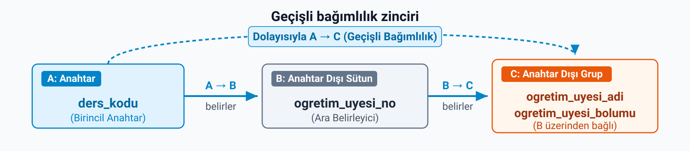
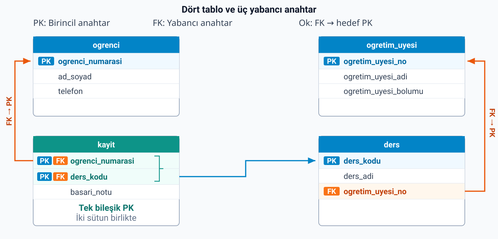

## Ders tablosunda tekrar nerede?

| ders_kodu | ders_adi | ogretim_uyesi_no | ogretim_uyesi_adi | ogretim_uyesi_bolumu |
| --- | --- | --- | --- | --- |
| BLP1005 | Veritabanı Sistemleri | 501 | Dr. Can Aksoy | Bilgisayar Programcılığı |
| MAT1002 | Matematik II | 502 | Doç. Elif Demir | Temel Bilimler |
| PRG1004 | Görsel Programlama | 501 | Dr. Can Aksoy | Bilgisayar Programcılığı |

Anahtar tek sütunlu: `ders_kodu`. Tablo 2NF'de. Yine de **Dr. Can Aksoy iki satırda.**

::: {.notes}
Geçen notun sonunda `ders` tablosunda Dr. Can Aksoy'un iki satırda yazılı olduğunu gördük. Bu tablonun anahtarı tek sütunlu, yani tek sütunlu anahtarda kısmi bağımlılık aramak anlamsız: tablo ikinci normal formda. Yine de tekrar var. Nedenini bağımlılıklardan okuyalım.
:::

---

## Bağımlılık bir zincir kuruyor

**Geçişli bağımlılık:** Bir anahtar dışı sütunun anahtara aracı bir anahtar dışı sütun üzerinden de bağlı olması.

{.blp-diagram}

- **Güncelleme:** Aksoy'un bölümü değişirse BLP1005 ve PRG1004 satırlarının ikisi de değişmeli.
- **Ekleme:** Henüz ders vermeyen **503** numaralı öğretim üyesi tabloya giremez; ders kodu boş bırakılamaz.
- **Silme:** MAT1002 kapanıp satırı silinirse **Doç. Elif Demir'in** adı ve bölümü de gider.

::: {.notes}
Ders kodu belli olunca öğretim üyesi numarası belli oluyor: BLP1005 ise 501. Numara belli olunca öğretim üyesinin adı ve bölümü belli oluyor: 501 ise Dr. Can Aksoy, Bilgisayar Programcılığı. Yani ad ve bölüm derse aynı zamanda öğretim üyesi numarası üzerinden de bağlı.

A anahtar, B ve C anahtar dışı birer sütun olsun. A → B ve B → C bağıntısı geçerliyken A → C de geçerlidir; ancak C sütunu A'ya B üzerinden geçişli bağlanır. Bizim tabloda A `ders_kodu`, B `ogretim_uyesi_no`, C ise öğretim üyesinin adı ve bölümü.

Bu bağımlılık, başlangıç defterindeki üç arızayı öğretim üyesi bilgisi için yeniden üretiyor. Aksoy'un bölümü değişirse iki satırı da değiştirmemiz gerekiyor. Henüz hiçbir ders vermeyen yeni bir öğretim üyesi tabloya giremiyor, çünkü satırın anahtarı olan ders kodu boş bırakılamaz. Ve MAT1002 dersi kapanıp satırı silinirse, Doç. Elif Demir'in adı ve bölümü de tablodan gidiyor.

Aynı hikâye, bu kez anahtar bileşik olmadan. Çözüm de benzer: zinciri ayıracağız.
:::

---

## Zinciri ayırmak

`ogretim_uyesi` — Anahtar: `ogretim_uyesi_no`

| ogretim_uyesi_no | ogretim_uyesi_adi | ogretim_uyesi_bolumu |
|---|---|---|
| 501 | Dr. Can Aksoy | Bilgisayar Programcılığı |
| 502 | Doç. Elif Demir | Temel Bilimler |

`ders` — Anahtar: `ders_kodu` · Yabancı anahtar: `ogretim_uyesi_no`

| ders_kodu | ders_adi | ogretim_uyesi_no |
|---|---|---|
| BLP1005 | Veritabanı Sistemleri | 501 |
| MAT1002 | Matematik II | 502 |
| PRG1004 | Görsel Programlama | 501 |

**Üçüncü normal form (3NF):** 2NF'de olan ve anahtar dışı sütunlarında geçişli bağımlılık bulunmayan tablo. Her anahtar dışı sütun anahtara **doğrudan** bağlıdır.

Bu derste tek aday anahtarlı tablolarla çalışıyoruz.

::: {.notes}
Zincirin sonundaki sütunları, aracı sütunla birlikte yeni bir tabloya taşıyoruz. Aracı sütun eski tabloda kalıyor ve orada yabancı anahtar oluyor.

Aksoy artık tek satırda. Bölümü değişirse tek yeri değiştiririz. 503 numaralı yeni öğretim üyesi ders vermeden `ogretim_uyesi` tablosuna girer. MAT1002 kapanıp satırı silinse Elif Demir tabloda kalır. `ders` tablosunda `ogretim_uyesi_no` bırakıldığı için hangi dersi kimin verdiği de kaybolmadı.

Bu tek aday anahtarlı örneklerde bir tablo ikinci normal formdaysa ve anahtar dışı sütunlarında geçişli bağımlılık içermiyorsa üçüncü normal formda. Her anahtar dışı sütun anahtara doğrudan bağlı.
:::

---

## Yabancı anahtar zincir demek değildir

`ders` tablosunda `ogretim_uyesi_no` hem anahtar dışı hem **yabancı anahtar.**

Aksoy hem Veritabanı Sistemleri'ni hem Görsel Programlama'yı yürütüyor: aynı numaranın karşısında **iki ders adı** var.

Yabancı anahtar **iki tabloyu** bağlar. Zincir ise **bir tablonun içinde**, anahtar dışı sütunların birbirini belirlemesidir.

::: {.notes}
`ders` tablosunda `ogretim_uyesi_no` anahtar dışı bir sütun ve aynı zamanda yabancı anahtar. Bu, tabloda geçişli bağımlılık olduğu anlamına gelmiyor. Zincir için aracı sütunun başka bir sütunu belirlemesi gerekir. `ogretim_uyesi_no` ders adını belirlemiyor: aynı numaranın karşısında iki farklı ders adı var.

Bu iki kavramı karıştırmayalım. Yabancı anahtar iki tabloyu birbirine bağlar. Zincir ise bir tablonun içinde anahtar dışı sütunların birbirini belirlemesi.
:::

---

## Dört tablo ve üç yabancı anahtar

{.blp-diagram}

Her yabancı anahtarın karşılığının bulunması **referans bütünlüğünü** korur.

::: {.notes}
`ogrenci` — Anahtar: `ogrenci_numarasi`

| ogrenci_numarasi | ad_soyad | telefon |
|---|---|---|
| 101 | Ahmet Yılmaz | 05554445566 |
| 102 | Ayşe Kaya | 05556667788 |
| 103 | Mehmet Çelik | 05558889900 |

`kayit` — Anahtar: `(ogrenci_numarasi, ders_kodu)`

| ogrenci_numarasi | ders_kodu | basari_notu |
|---|---|---:|
| 101 | BLP1005 | 85 |
| 101 | MAT1002 | 70 |
| 102 | BLP1005 | 90 |
| 103 | BLP1005 | 65 |

Öğretim üyesinin bilgilerini ayırırken öğrenci ve kayıt satırlarını değiştirmedik. Öğrenci tablosunda üç kişi, kayıtta dört öğrenci–ders çifti var. Ahmet'in iki derste bulunması öğrenci tablosunda onu çoğaltmıyor; kayıt tablosunda ayrı iki çift.

PRG1004 ders tablosunda ama henüz onu alan öğrenci olmadığı için kayıtta görünmüyor. MAT1002 notu başlangıçtaki 70 değerinde.

`kayit` tablosunun tek bir satırını alalım: öğrenci numarası 101, ders kodu BLP1005. Öğrenci numarasından Ahmet'in öğrenci satırına, ders kodundan ilgili ders satırına gideriz. Bu ders satırındaki 501 numarası da öğretim üyesi satırına ulaşır.

Bağı taşıyan sütunlar ayrıştırmadan sonra bu nedenle yerinde kalmıştır. Her kaydın öğrenci ve ders hedefi, her dersin de öğretim üyesi hedefi vardır. Hedefin bulunmasıyla hedef sütunun tekilliği iki ayrı özelliktir; satırları geri kurarken ikisine de ihtiyaç duyarız.
:::

---

## Dört tabloya karar verelim

| Tablo | Anahtar | Anahtar dışı sütunlar | Karar |
| --- | --- | --- | --- |
| `ogrenci` | `ogrenci_numarasi` | `ad_soyad`, `telefon` | Ad ile telefon birbirini belirlemiyor. |
| `ogretim_uyesi` | `ogretim_uyesi_no` | adı, bölümü | Ad ile bölüm birbirini belirlemiyor. |
| `ders` | `ders_kodu` | `ders_adi`, `ogretim_uyesi_no` | Ders adı ile numara birbirini belirlemiyor. |
| `kayit` | `(ogrenci_numarasi, ders_kodu)` | `basari_notu` | Tek sütun, anahtarın tamamına bağlı. |

Sıra: **anahtar nedir → bir parçasına bağlı var mı (2NF) → birbirini belirliyorlar mı (3NF).**

::: {.notes}
Bir tablonun üçüncü normal formda olup olmadığına şu sırayla karar veriyoruz: anahtar nedir; anahtarın bir parçasına bağlı sütun var mı, yani ikinci normal form; anahtar dışı sütunlar birbirini belirliyor mu, yani üçüncü normal form. Dört tabloyu bu sırayla sınadık ve dördü de üçüncü normal formda.

Ama bir sorumuz var. Tek tablo dört tabloya bölündü. Ahmet'in BLP1005 notunu, dersin adı ve öğretim üyesiyle birlikte artık tek bir yerde göremiyoruz. Bölmek bilgiyi dağıttı. Kaybettirdi mi?
:::

---

## Bir kayıt satırını geri kuralım

`kayit`: **(101, BLP1005, 85)**

1. `101` → `ogrenci`'de ara → *Ahmet Yılmaz, 05554445566*
2. `BLP1005` → `ders`'te ara → *Veritabanı Sistemleri, 501*
3. `501` → `ogretim_uyesi`'nde ara → *Dr. Can Aksoy, Bilgisayar Programcılığı*

`101 | Ahmet Yılmaz | 05554445566 | BLP1005 | Veritabanı Sistemleri | 501 | Dr. Can Aksoy | Bilgisayar Programcılığı | 85`

. . .

Başlangıç defterinin **ilk satırının aynısı.**

::: {.notes}
Eşlemeyi kâğıt üzerinde, satır satır yapıyoruz; SQL yazmıyoruz. `kayit` tablosunun ilk satırıyla başlayalım. `ogrenci_numarasi` 101: bu değeri `ogrenci` tablosunda anahtar sütunda arıyoruz, tek satır çıkıyor. `ders_kodu` BLP1005: `ders` tablosunda tek satır, öğretim üyesi numarası 501. 501'i `ogretim_uyesi` tablosunda arıyoruz, tek satır.

Bulduklarımızı `kayit` satırının yanına koyunca ekrandaki dokuz değer çıkıyor. Bu, başlangıç defterindeki tablonun ilk satırının aynısı.
:::

---

## Dört kayıt satırının hepsi geri geliyor

| ogrenci_numarasi | ad_soyad | ders_kodu | ders_adi | ogretim_uyesi_adi | basari_notu |
| --- | --- | --- | --- | --- | ---: |
| 101 | Ahmet Yılmaz | BLP1005 | Veritabanı Sistemleri | Dr. Can Aksoy | 85 |
| 101 | Ahmet Yılmaz | MAT1002 | Matematik II | Doç. Elif Demir | 70 |
| 102 | Ayşe Kaya | BLP1005 | Veritabanı Sistemleri | Dr. Can Aksoy | 90 |
| 103 | Mehmet Çelik | BLP1005 | Veritabanı Sistemleri | Dr. Can Aksoy | 65 |

**PRG1004** bu listede yok: hiçbir öğrenci o dersi almadı, başlangıç tablosunda da satırı yoktu.

Her aramada aradığımız değer, karşı tablonun **birincil anahtarıydı.**

- Birincil anahtar **tekildir:** her değer en çok bir satırda bulunur.
- Her yabancı anahtarın hedef değeri tabloda **bulunur.**

Dört `kayit` satırı, **dört** satır verdi.

::: {.notes}
Aynı işlemi diğer üç `kayit` satırına uygulayınca dört satır buluyoruz. Telefon, öğretim üyesi numarası ve bölüm de aynı yoldan geliyor; tabloda yer kalsın diye yazmadık.

Dört satır da başlangıçtaki satırlarla aynı. PRG1004 bu listede yok, çünkü hiçbir öğrenci o dersi almadı ve başlangıç tablosunda da bir satırı yoktu. Ders `ders` tablosunda duruyor; kimse almadığı için hiçbir `kayit` satırı ona işaret etmiyor.

Her aramada aradığımız değer karşı tablonun birincil anahtarıydı: 101 `ogrenci`'de, BLP1005 `ders`'te, 501 `ogretim_uyesi`'nde. Birincil anahtar tekil olduğu için her değer tabloda en çok bir satırda bulunuyor. Tekillik, bir aramanın satırı çoğaltmasını önlüyor. Ayrıca her yabancı anahtarın hedef değeri ilgili tabloda bulunuyor, hiçbir kayıt eşleşmesiz kalmıyor.

Eşlemeyi tekil olmayan bir sütunda yapsaydık bir değerin karşısında birden çok satır bulurduk ve olmayan öğrenci–ders birleşimleri doğardı. Birincil anahtara dayalı eşleme bu yüzden güvenli.
:::

---

## Bağ sütunu unutulursa

`ders` tablosunu bölerken `ogretim_uyesi_no` sütununu bırakmayı unuttuk:

| ders_kodu | ders_adi |
|---|---|
| BLP1005 | Veritabanı Sistemleri |
| MAT1002 | Matematik II |
| PRG1004 | Görsel Programlama |

> BLP1005'i 501 mi veriyor, 502 mi?

. . .

Hiçbir tabloda yazmıyor. Bölmeden önce yazan bilgi, **bölme sırasında kayboldu.**

**Kayıpsız ayrıştırma:** Parçalara ayrılan tabloların anahtar sütunlar üzerinden eşlenince başlangıç tablosunun her satırını eksiksiz geri verdiği ve fazladan satır üretmediği ayrıştırma.

Normalizasyon yalnız bölmek değildir: **yabancı anahtarlar da bölmenin parçasıdır.**

::: {.notes}
Şimdi bir hata yapalım. `ders` tablosunu bölerken `ogretim_uyesi_no` sütununu ders tablosunda bırakmayı unuttuk. `ogretim_uyesi` tablosu yerinde duruyor ama BLP1005'i 501 mi veriyor, 502 mi? Hiçbir tabloda yazmıyor.

`ders` ile `ogretim_uyesi` arasında ortak bir sütun kalmadı; bu iki tabloyu eşleyecek bir şey yok. Bölmeden önce tabloda yazan bilgi, bölme sırasında kayboldu.

Parçalara ayrılan tabloların anahtar sütunlar üzerinden eşlenince başlangıç tablosunun her satırını eksiksiz geri verdiği ve fazladan satır üretmediği ayrıştırmaya kayıpsız ayrıştırma diyoruz.

Normalizasyon, tabloyu bölmekten ibaret değil; yabancı anahtarlar da bölmenin parçası. Öğrenci–ders kaydında iki anahtar sütununu, ders tablosunda da öğretim üyesi numarasını korumamızın nedeni bu.

Başlangıçtaki dokuz sütunun bilgisi dört tabloda duruyor. Anahtar bağlarını izleyince aynı öğrenci–ders kayıtlarını eksiksiz ve fazladan eşleşme üretmeden okuyabiliyoruz.
:::

---

## Karar soruları

1. `ogretim_uyesi` tablosuna `bolum_baskani` sütunu eklenip her bölümün tek başkanı varsa tablo hâlâ 3NF'de mi?
2. `kayit` tablosunda `ders_kodu` yabancı anahtarını silseydik hangi bilgi kaybolurdu?
3. Eşlemeyi `telefon` sütunu üzerinden yapsaydık ne olabilirdi?

::: {.notes}
1. Hayır. `ogretim_uyesi_bolumu → bolum_baskani` bağımlılığı olur; başkan öğretim üyesine bölüm üzerinden bağlanır. Bu yeni bir geçişli bağımlılık; bölüm ayrı bir tabloya taşınırdı.
2. Hangi öğrencinin hangi derste hangi notu aldığı belirsiz kalırdı. Notun hangi derse ait olduğunu söyleyen bağ kaybolurdu.
3. İki öğrenci aynı telefonu verdiyse bir telefon değerinin karşısında iki satır çıkar ve olmayan eşleşmeler doğar. Eşleme tekil olmayan bir sütunda güvenli değil; birincil anahtar bu yüzden tercih ediliyor.
:::

---

## Bu nottan kalanlar

- **Geçişli bağımlılık:** A → B ve B → C ise C, A'ya B üzerinden bağlıdır. Zinciri **ayırmak** için aracı sütun taşınan tabloda anahtar olur, eskisinde yabancı anahtar kalır.
- **3NF:** her anahtar dışı sütun anahtara doğrudan bağlıdır. Yabancı anahtar zincir demek **değildir.**
- **Kayıpsız ayrıştırma:** anahtar bağlarıyla her satır **eksiksiz** ve **fazlasız** geri kurulur; bağ sütunu unutulursa bilgi kaybolur.

::: {.notes}
Bu notla birlikte kâğıt üzerindeki tasarım tamam: dört tablo, anahtarları ve anahtar bağlarıyla.
:::
