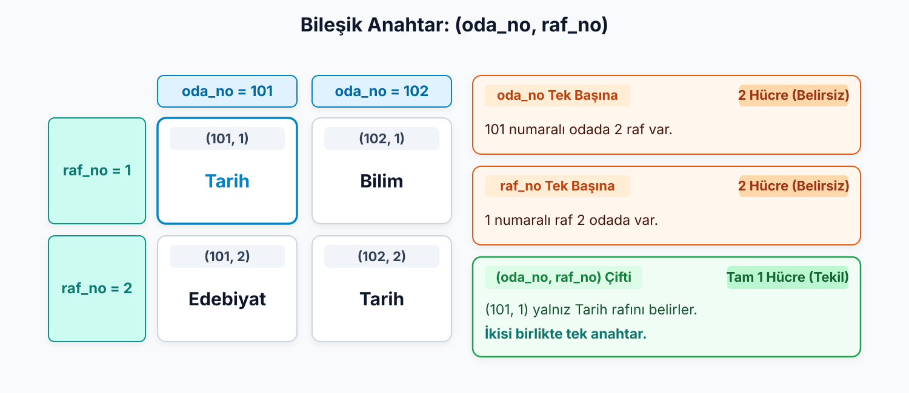

## Bir üye aynı anda üç kitap alırsa?

Kütüphane yöneticisi şunu söylüyor:

> Üyelerin adını soyadını, üye numarasını ve telefonunu tutmak istiyoruz. Her kitabın demirbaş numarasını, başlığını ve yazarını da kaydetmeliyiz.

> Üyenin adını kitap kaydına mı yazacağız? Üç kitabın adı tek hücreye sığar mı?

::: {.notes}
Atölyede tek bir şeyin kaydını tutuyorduk: başvuranları. Kütüphane böyle çalışmaz. Üyeler var, kitaplar var, bir de üyelerin kitap alıp geri getirmesi var. Hangi şeyler için ayrı kayıt tutacağımıza neye bakarak karar vereceğiz?

Hemen bir tablo açmaya kalkarsak sorular birikir. Kitap tablosuna kitabı alan üyenin adını yazarsak, üç kitap alan üyenin adı üç yerde tekrarlanır. Üyenin tablosuna kitapları yazarsak, bir hücreye kaç kitap sığacağını bilemeyiz. Bu soruları tabloyu kurmadan, kâğıt üzerinde cevaplamak çoğu zaman daha kolaydır.

Bu notun işi, yöneticinin günlük dilde söylediği bu cümleden başlayıp neyin kaydını tutacağımıza karar vermek, sonra da o kayıtların her birini nasıl ayırt edeceğimizi bulmak.
:::

---

## Önce kâğıt: iş kuralı ve E-R modeli

**İş kuralı:** Kurumun verisi hakkında koyduğu, saklanacak bilgiyi ve geçerli koşulları belirten kural.

**Varlık–İlişki modeli (E-R modeli):** Nesneleri, bilgilerini ve aralarındaki bağları tablolara geçmeden önce gösteren kavramsal model.

Yöneticinin cümlesi bir iş kuralıdır: kütüphanenin **hangi bilgiyi saklamak istediğini** söyler.

Önce yalnız bunu çözeceğiz; tabloyu ve programı sonra düşüneceğiz.

::: {.notes}
Yöneticinin cümlesi kurumun neyi bilmek istediğini söylüyor; bu bir iş kuralı. Kuralı çözerken "bunu hangi tabloya, hangi sütuna koyarım?" diye düşünmüyoruz. Önce kütüphanenin neyi bilmek istediğine bakıyoruz.

Bunu böyle yapmamızın nedeni şu: ayrı kayıt tutma kararının dayanağı programın sunduğu ekranlar değil, kurumun bilmek istedikleri olmalı. Kâğıttaki bu çalışmanın adı kavramsal modelleme, kullandığımız çizim dili de E-R modeli. Model hangi nesneler hakkında hangi bilgileri saklayacağımızı ve bu nesnelerin nasıl bağlandığını gösterir.
:::

---

## Gereksinimi “bir şey için bir bilgi sakla” diye ayıralım

| Üye için sakla | Kitap için sakla |
| --- | --- |
| Üye numarası | Demirbaş numarası |
| Ad ve soyad | Başlık |
| Telefon | Yazar |

"İçin"den önce hep aynı iki sözcük: **üye** ya da **kitap**.

"Sakla"dan önceki sözcükler onları **tarif eden bilgiler**.

**Varlık:** Hakkında bilgi saklamak istediğimiz, tek tek ayırt edebildiğimiz nesne.

**Nitelik:** Bir varlığı tarif eden tek bir bilgi.

**Varlık kümesi:** Aynı türden bütün varlıkların topluluğu.

```text
uye:   uye_numarasi, ad_soyad, telefon
kitap: demirbas_numarasi, baslik, yazar
```

::: {.notes}
Yöneticinin cümlesini aynı kalıba sokalım: "bir şey için bir bilgi sakla". Üye için üye numarası sakla, üye için ad ve soyad sakla, üye için telefon sakla; kitap için demirbaş numarası sakla, kitap için başlık sakla, kitap için yazar sakla. Ad ve soyadı tek bilgi sayıyoruz; böylece altı madde çıkıyor.

Maddelere bakınca bir şey dikkat çekiyor. "İçin"den önce gelen sözcük altı maddede de iki sözcükten biri: üye ya da kitap. Kurum bunlar hakkında bilgi saklamak istiyor. "Sakla"dan önceki sözcükler ise o şeyi tarif eden bilgiler. Tablonun sütunlarını bu iki rolün karşılığı olarak okuyabilirsiniz: sol sütun üyeyi, sağ sütun kitabı; altlarındaki satırlar da onları tarif eden bilgileri veriyor.

Bu iki rolün adı var.

Ahmet Yılmaz tek bir varlık; bütün üyeler üye varlık kümesini oluşturur. Konuşurken kısaca "üye varlığı" deriz ve çoğunlukla kümeyi kastederiz. Kitap için de aynısı geçerli: Nutuk'un bir nüshası varlık, kütüphanedeki bütün kitaplar kitap varlık kümesi.

Üyenin nitelikleri ad ve soyad, üye numarası ve telefon. Kitabın nitelikleri demirbaş numarası, başlık ve yazar. Modeli ekrandaki iki satırla yazabiliriz.

Adları yazarken bir alışkanlık edinelim: küçük harf, Türkçe karakter yok, sözcükler alt çizgiyle bağlı. Bu adlar sonra tabloda aynen sütun adı olacak; baştan böyle yazarsak dönüşümde ad değiştirmemiz gerekmez.
:::

---

## Yazarın rolünü saklanan bilgi belirler

| Gereksinim | Yazarın rolü |
| --- | --- |
| Kitabın başlığı gibi, yazarın yalnız adını tut | Kitabın niteliği |
| Yazarın doğum yılı ve ülkesini de tut | Ayrı varlık |

**Soru:** Bu kavram hakkında kendi bilgilerini de saklayacak mıyız?

::: {.notes}
Aynı `yazar` sözcüğü iki gereksinimde iki ayrı rol üstleniyor. Kütüphane yalnız kitabın başlık ve yazar adı gibi tanıtım bilgilerini saklıyorsa, yazarın adı kitabın bir bilgisi: nitelik. Kütüphane yazarın doğum yılını ve ülkesini de saklamak isterse yazarın artık kendi bilgileri var. Yazar, hakkında bilgi saklanan bir nesneye dönüşmüş olur: varlık.

Bir sözcüğün varlık mı nitelik mi olduğuna sözcüğün kendisi karar vermez; gereksinim karar verir. Ayırt etmek için tek soru yetiyor: bu kavram hakkında kendi bilgilerimizi de saklayacak mıyız? Saklayacaksak varlık, saklamayacaksak nitelik.

Üyenin telefonu için cevap hayır. Telefon numarası hakkında ayrıca bir şey tutmuyoruz, numarayı yalnızca üyeyi aramak için kullanıyoruz. Bu yüzden telefon üyenin niteliği.
:::

---

## Yayınevini nasıl modelleyelim?

Kütüphane yayınevinin **adını, adresini ve telefonunu** tutacak.

Yayınevi varlık mı, nitelik mi?

. . .

Kendi bilgileri var: **varlık.**

```text
yayinevi: ad, adres, telefon
```

::: {.notes}
Önce kendiniz karar verin, sonra devam edelim. Sorulacak soru aynı: yayınevi hakkında kendi bilgilerimizi de saklıyor muyuz? Adres ve telefon yayınevine ait bilgiler. Demek ki yayınevi yalnız kitabın üzerinde yazan bir ad değil, hakkında ayrı bilgi saklanan bir nesne: varlık.

Kütüphane yalnız "hangi yayınevi" bilgisini, yani adını tutsaydı, yayınevi kitabın bir niteliği olarak kalırdı. Gereksinim değişince model kararı da değişiyor.

Bir ayrıntıya dikkat edin: üyede de `telefon` var, yayınevinde de. İki sütun aynı adı taşıyor ama iki ayrı varlığın niteliği. Adın aynı olması bunları aynı bilgi yapmaz.
:::

---

## Modeldeki kararın tabloda bir karşılığı vardır

| Kavramsal model | Tablo dili | Örnek |
| --- | --- | --- |
| Varlık kümesi | Tablo | uye |
| Nitelik | Sütun | ad_soyad |
| Tek bir varlık | Satır | Ahmet Yılmaz'ın kaydı |

“Yazar ayrı varlık olsun mu?” → **model** kararı.

“Yazar tablosu olsun mu?” → bu kararın **sonucu**.

::: {.notes}
Aynı yapıya iki dilden bakıyoruz. Kâğıttaki model konuşurken varlık ve nitelik, veritabanındaki karşılığı konuşurken tablo, sütun ve satır deriz.

İki dili karıştırmamak işe yarıyor, çünkü kararlar farklı yerde veriliyor. "Yazar ayrı varlık olsun mu?" sorusunu kütüphane yöneticisiyle model üzerinde konuşuruz. "Yazar tablosu olsun mu?" sorusu ise bu kararın sonucu. Modelde satır diye bir şey yok; satır, tek bir varlığın tablodaki karşılığıdır. "Üye varlığının sütunu" ya da "tablonun niteliği" demiyoruz.

Böylece henüz tablolara geçmeden hangi şeylerin hangi bilgilerle tanımlanacağını belirlemiş oluyoruz.
:::

---

## Bir üyeyi hangi nitelik ayırt eder?

Bu karşılaştırmada kurum; üye numarası, kimlik numarası ve e-postayı **zorunlu ve benzersiz** istiyor. Bütün bilgiler kurgudur.

| uye_numarasi | kimlik_numarasi | eposta | ad_soyad |
| --- | --- | --- | --- |
| 201 | 00000000001 | ahmet@example.com | Ahmet Yılmaz |
| 202 | 00000000002 | ayse@example.com | Ayşe Kaya |
| 203 | 00000000003 | ahmet.y@example.com | Ahmet Yılmaz |

Hangi nitelikler tek başına bir üyeyi bulmaya yeter?

. . .

Üye numarası, kimlik numarası ve e-posta. **`ad_soyad` yetmez.**

::: {.notes}
Modelde hangi bilgilerin bulunacağını belirledik. Şimdi bu bilgilerle bir üyeyi nasıl ayırt edeceğimize bakıyoruz. Bunun için kurumun üye numarasının yanında kimlik numarası ve e-posta da istediği bir gereksinim düşünüyoruz. Tablodaki bütün kişi ve iletişim bilgileri kurgudur; kimlik numaraları gerçek kişilere ait olmayan gösterim değerleridir.

Önce adı eleyelim: 201 ile 203 aynı adı taşıyor, `ad_soyad` bu iki satırı ayıramaz. Diğer üç sütun ise her satırda farklı ve hiçbiri boş değil. Ama burada dikkat edin: bu üçünün aday olması üç satırda farklı görünmelerine dayanmıyor. Bu gereksinimde her üyede bulunmaları ve üyeler arasında tekrarlanmamaları bir iş kuralı. Örnek satırlar kuralı gösteriyor, kuralın yerini tutmuyor.

Kütüphanenin üyeyi kaydetmek için kimlik numarası ve e-posta toplaması zorunlu değil. Bu örnek, birden çok adayın bulunduğu bir durumda seçimin nasıl yapılacağını görmek için.
:::

---

## Aday anahtar, birincil anahtar ve seçim ölçütleri

**Aday anahtar:** Her varlığı benzersiz belirleyen, boş bırakılamayan ve gereksiz nitelik içermeyen nitelik ya da nitelik grubu.

**Birincil anahtar:** Adaylar arasından asıl kimlik olarak seçilen anahtar.

Üyede üç aday var. Birincisini seçeceğiz, öbürleri **benzersiz olmaya devam edecek.**

| Ölçüt | Karşılaştırma |
| --- | --- |
| Değişmezlik | E-posta değişebilir. |
| Kurumun denetimi | Kimlik numarasını dış kurum, üye numarasını kütüphane verir. |

Seçim: **`uye_numarasi`**.

::: {.notes}
Aday anahtarın tanımında üç koşul var: benzersiz belirlemek, boş bırakılamamak ve gereksiz nitelik içermemek. Üyede üç aday var ve her biri tek nitelikten oluşuyor.

Aday ile birincil anahtarı birbirine karıştırmayalım. Aday, kimlik olma koşullarını taşıyan her nitelik. Birincil anahtar, adaylar arasından asıl kimlik olarak seçtiğimiz tek anahtar. Seçilmeyen adaylar bu yüzden benzersiz olmaktan çıkmaz; yalnızca asıl kimlik sayılmazlar.

Peki seçimi neye bakarak yapacağız?

İki ölçüte bakıyoruz.

Birincisi değişmezlik. Kimlik, üye kütüphanede kaldığı sürece aynı kalmalı. E-posta benzersiz ama üye adresini değiştirebilir. Kimliği e-posta yaparsak üyenin adresini değiştirmesi kimliğini de değiştirir.

İkincisi kurumun denetimi. Kimlik numarasını bir dış kurum verir; kütüphane onun biçimini belirleyemez. Üstelik 11 haneli ve korunması gereken bir kişisel veri. `uye_numarasi` ise kütüphanenin kendi ürettiği, biçimine kendisinin karar verdiği bir numara.

İki ölçüte de en iyi uyan `uye_numarasi`. Birincil anahtar olarak onu seçiyoruz. Çekirdek üye modeli bu yüzden `uye_numarasi`, `ad_soyad` ve `telefon` olarak kalıyor.
:::

---

## Kitabın nüshası metin kodla ayırt edilebilir

Başlığı ve yazarı aynı olan, raftaki iki kopya (nüsha) olabilir.

Her nüshaya ayrı **`demirbas_numarasi`** verilir: `K-101`.

**Anahtarın sayı olması gerekmez:** Benzersiz ve dolu bir metin kod da kimlik olabilir.

::: {.notes}
Kitapta durum daha basit. Başlık ve yazar kitabın tanıtım bilgileridir; raftaki iki fiziksel kopyayı, yani nüshayı ayırmaz. Aynı kitabın iki nüshası olabilir ve ikisinin başlığı ve yazarı aynıdır.

Tek aday `demirbas_numarasi`. Her nüshaya kütüphane ayrı bir numara veriyor, örneğin `K-101`. Bu değer harf içerdiği için sayı değil metin. Ama bu, anahtar olmasına engel değil: anahtarın sayı olması gerekmez, benzersiz olması ve boş kalmaması yeter.

Üye numarasında olduğu gibi burada da kimliği örnekte rastgele farklı görünen değerler değil, kurumun numaralandırma kuralı destekliyor.
:::

---

## Bir rafı tek sayı belirleyebilir mi?

. . .

{.blp-diagram}

**Bileşik anahtar:** Birden çok niteliğin birlikte oluşturduğu tek anahtar.

`(oda_no, raf_no)` birlikte bir rafı belirler.

::: {.notes}
Kütüphanenin bütün odalarında raflar 1'den başlayarak numaralanıyor. `raf_no` tek başına bir rafı bulmaz: 1 numaralı raf hem 101'de hem 102'de var. `oda_no` da bulmaz: 101'de iki raf var.

Ama iki sütunu birlikte okuyunca `(101, 1)` tek bir rafı gösteriyor. Birden çok niteliğin birlikte oluşturduğu bu anahtara bileşik anahtar diyoruz.

Bir noktayı özellikle vurgulayalım: bileşik anahtar iki ayrı anahtar anlamına gelmez. `oda_no` tek başına anahtar değil, `raf_no` da. Anahtar tek ve çiftin tamamı; benzersizlik çift için aranır, ikisi de boş bırakılamaz.
:::

---


## Anahtarın her parçası gerekli mi?

`(oda_no, raf_no, konu)` grubundan `konu` çıkarılırsa kimlik bozulur mu?

. . .

Hayır. `(oda_no, raf_no)` yeterlidir. **Anahtarın her parçası gerekli olmalı.**

```text
uye:   uye_numarasi (PK), ad_soyad, telefon
kitap: demirbas_numarasi (PK), baslik, yazar
raf:   oda_no (PK), raf_no (PK), konu
```

::: {.notes}
`konu` sütununu da ekleyip `(oda_no, raf_no, konu)` üçlüsünü anahtar yapsak, bu üçlü de satırı ayırt eder. Ama `konu`yu çıkarsak `(oda_no, raf_no)` yine ayırt eder. Demek ki `konu` anahtara bir şey katmıyor.

Ölçüt şu: anahtardan hangi nitelik çıkarılırsa çıkarılsın, satırları ayırt etme işi bozulmalı. `(oda_no, raf_no)` bu ölçütü sağlıyor. `oda_no`yu çıkarırsak odalar arasında aynı numaralı raflar, `raf_no`yu çıkarırsak aynı odadaki raflar karışıyor. Aday anahtar tanımındaki "gereksiz nitelik içermeme" koşulu burada karşılığını buluyor.

Ekrandaki üç satırda `PK`, birincil anahtarın işareti. Rafta iki niteliğin yanında da `PK` var; bu, iki ayrı anahtar değil tek bileşik anahtarı gösteriyor. Böylece üye, kitap ve raf kendi kimliklerini taşıyan listelere dönüşmüş oluyor.
:::

---

## Karar soruları

1. Kitap tablosunda `baslik` birincil anahtar olabilir mi?
2. Kütüphane, üyenin e-postasını birincil anahtar yaparsa üye adresini değiştirdiğinde ne olur?
3. Raflar bütün kütüphanede 1'den 40'a kadar numaralansaydı `(oda_no, raf_no)` hâlâ uygun anahtar olur muydu?

::: {.notes}
1. Hayır. Aynı kitabın iki nüshası olabilir ve ikisinin başlığı aynıdır; başlık satırları ayırt etmez. Tekrarlanabilen bir niteliği kimlik yapamayız. Nüshaları ayıran, kütüphanenin verdiği `demirbas_numarasi`.
2. Kimliğin kendisi değişir. Kimlik, üye kütüphanede kaldığı sürece aynı kalmalıydı. Benzersiz olmak e-postayı iyi bir kimlik yapmıyor; değişebilir olması onu asıl kimlik için kötü aday yapıyor. Adres her değiştiğinde kimliği de değiştirmek zorunda kalırdık.
3. Hayır. Her raf kütüphane genelinde tek bir numara taşıyorsa `raf_no` tek başına rafı bulur. O zaman `oda_no` anahtara bir şey katmaz ve çıkarılabilir. Bileşik anahtar, tek nitelik yetmediği için vardır; tek nitelik yettiğinde gereksiz parça anahtardan çıkar. Yani anahtarı örnek tablodaki görünüşe değil, kurumun numaralandırma kuralına bakarak seçiyoruz.
:::

---

## Bu nottan kalanlar

- **Varlık**, hakkında bilgi saklamak istediğimiz nesne; **nitelik**, onu tarif eden tek bir bilgi. Hangisi olduğuna gereksinim karar verir.
- Model dilinde varlık, nitelik; tablo dilinde tablo, sütun, satır deriz.
- **Aday anahtar** kimlik olma koşullarını taşır; **birincil anahtar** adaylar arasından seçilen asıl kimliktir.
- Tek nitelik yetmediğinde **bileşik anahtar** kurulur; her parçası gerekli olmalı.

“Ahmet bu kitabı 1 Ekim'de aldı” bilgisi üyenin mi, kitabın mı?

::: {.notes}
Üye, kitap ve raf artık kendi kimliklerini taşıyor. Bir kayıt kümesinin kimliğini belirlemek, o kayıtların birbiriyle nasıl bağlandığını anlatmıyor; bu iki ayrı soru.

Üye bir kitabı ödünç aldığında iki kimlik karşılaşıyor: üyenin numarası ve kitabın demirbaş numarası. "Ahmet bu kitabı 1 Ekim'de aldı" bilgisi bu kimliklerden hangisine ait?
:::
