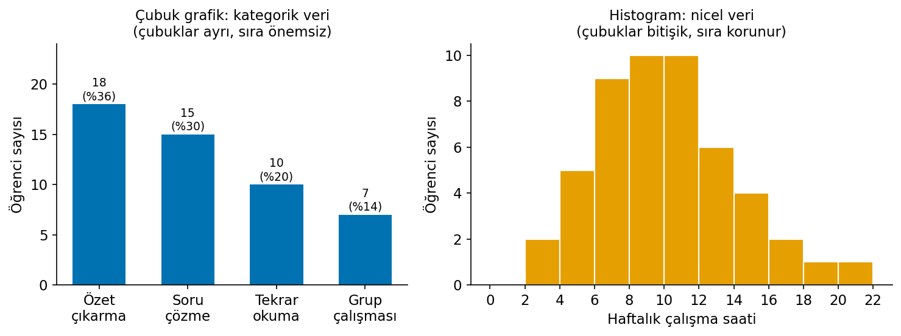
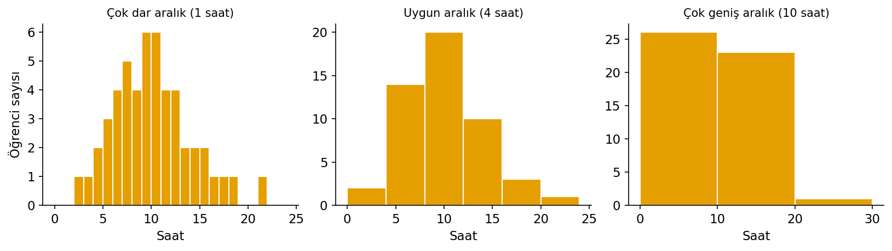
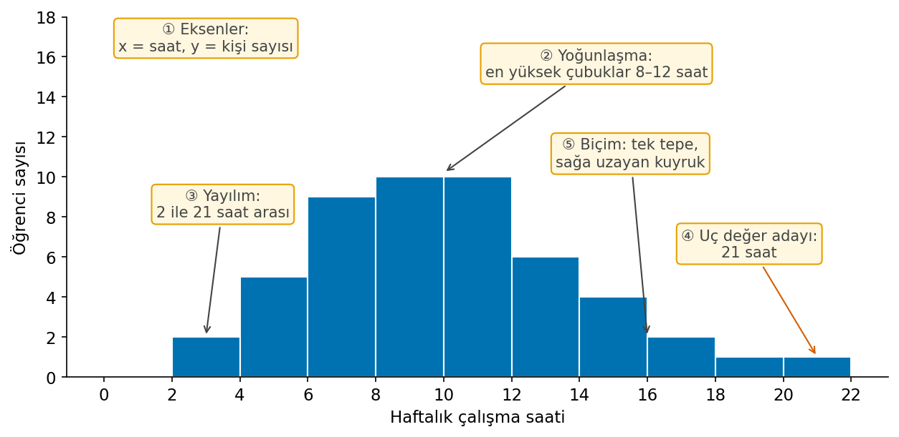
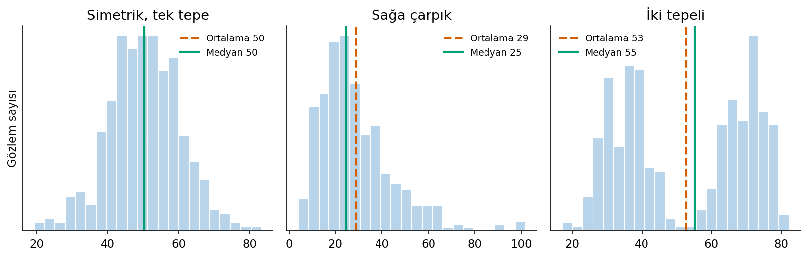
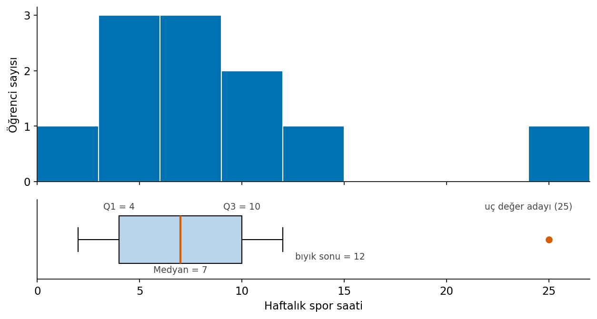
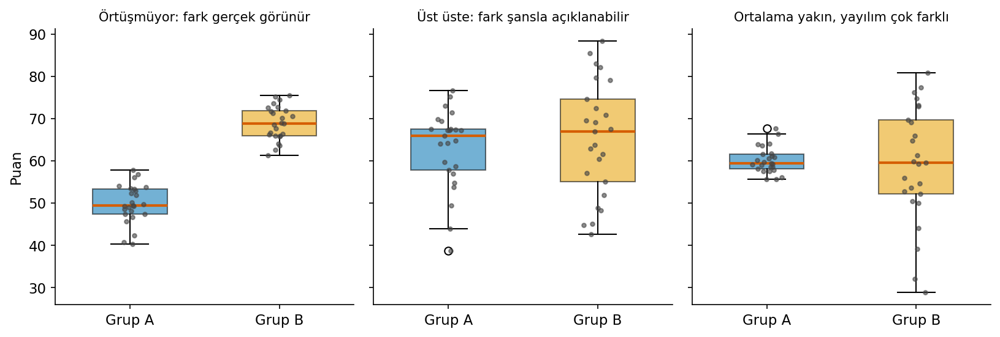
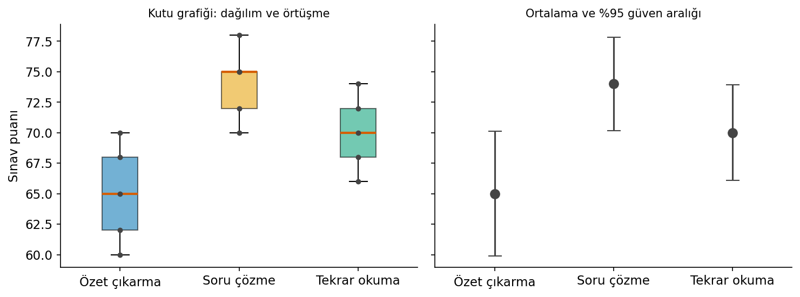
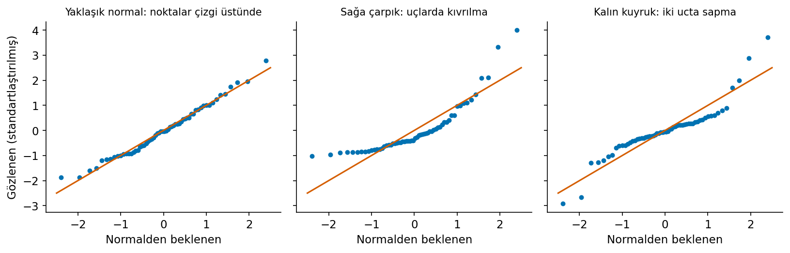
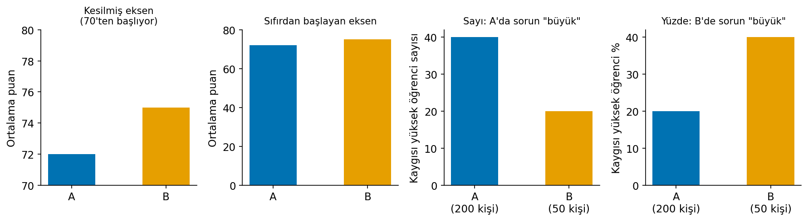

# Çalışma Notu: Grafik Okuma

::: {.callout-tip}
## Sesli özet

Grafik seçimi ve grafikle ne yapılacağı [Ses 3 — Grafik, biçim ve normal dağılım](https://drive.google.com/drive/folders/1HdJgyzj0fEquA3zM7CFzQd9tWKgfDBVG?usp=sharing){target="_blank"} (yaklaşık 12 dk) içinde kısaca anlatılır. Grafiklerin görsel yorumu sesle verilmez; bu notta görselle çalışın.

Sesli özetler yapay zekâ ile üretilmiştir ve bu notun yerine geçmez; fark olduğunda yazılı not esastır. Dosyalar Drive klasöründe `psi303-ses-…` adlarıyla durur ve tarayıcıda dinlenebilir.
:::

Grafik okumak bu derste tek bir konu değil, **her analizin ilk adımıdır.** Bir testten, bir özet ölçüden ya da bir varsayım kontrolünden önce veriye bakılır; gördüğünüz şey sözle söylenir, sayı sonra gelir. Sınavda "grafiği yorumlayın" tipi sorular bu yüzden her bölümden çıkabilir.

::: {.callout-tip}
## Tek cümlelik özet

**Önce eksene bak → yoğunlaşma, yayılım, uçlar, biçim → bunu sözle söyle → sonra sayıyla doğrula.** Sayı grafikle çelişiyorsa bir şeyler ters gitmiştir (hatalı kayıt, yanlış ölçme düzeyi, yanlış seçilmiş özet).
:::

## 1. Hangi durumda hangi grafik?

*Ayrıntı: [Veriyi görmek: Grafik okumak](tp_grafik-okuma.md)*

Seçim iki soruyla yapılır: **değişken hangi düzeyde?** ve **ne göstermek istiyorum?**

### Veri türüne göre

| Veri | Tablo | Tercih edilen grafik | Neden? | Tercih edilmez |
|---|---|---|---|---|
| **Kategorik (nominal)** | Frekans, yüzde | **Çubuk grafik** | Kategoriler ayrıdır; uzunluk karşılaştırması kolaydır | Histogram, çizgi grafik (sıra yok) |
| **Sıralı** | + birikimli yüzde | **Çubuk grafik** (sıra korunur) | Sıra bilgisi taşır, aralıklar eşit değildir | Pasta (sırayı gizler) |
| **Nicel (aralık/oran)** | Aralıklara toplayan frekans tablosu | **Histogram** | Biçimi, merkezi, yayılımı gösterir | Çubuk grafik (ayrık gibi görünür) |

### Amaca göre

| Ne göstermek istiyorum? | Tercih | Neden |
|---|---|---|
| Bir bütünün **büyük** parçalarını (örn. "yarısı", "dörtte biri"), kategori sayısı 2–4 | **Pasta** (çubuk da olur) | Tek bakışta pay görünür |
| Kategoriler arasında **tam sayı/yüzde karşılaştırması**, 5 ve daha fazla kategori | **Çubuk** | Göz uzunlukları, açıları ve alanları karşılaştırmaktan iyi ayırt eder |
| Tek bir nicel değişkenin **biçimi** (simetri, çarpıklık, tepe sayısı) | **Histogram** | Tepe sayısını ve kuyruğu yalnız o gösterir |
| **Uç değer adayı** aramak, **medyan ve IQR**'yi görmek | **Kutu grafiği** | Beş özeti ve uç noktaları tek şekle toplar |
| **Birden fazla grubu** merkez ve yayılım açısından karşılaştırmak | **Yan yana kutu grafiği** (gerekirse grup başına histogram) | Aynı eksende kıyaslanır |
| Grup ortalamalarını **belirsizlikle** birlikte göstermek | **Ortalama + güven aralığı grafiği** | Ortalamanın ne kadar kesin bilindiğini gösterir |
| **Normallik** kontrolü | **Q–Q grafiği** + histogram | Normalden sapmanın türünü gösterir |

### Histogram mı, kutu grafiği mi?

| | Histogram | Kutu grafiği |
|---|---|---|
| Tepe sayısını (iki tepeli mi?) gösterir | **Evet** | Hayır |
| Çarpıklığı gösterir | Evet (kuyruktan) | Dolaylı (medyan kutuda kayık, bir bıyık uzun) |
| Medyan, Q1, Q3 | Hayır | **Evet** |
| Uç değer adayı | Kopuk çubuk | **Ayrı nokta** |
| Çok sayıda grubu yan yana koymak | Zor | **Kolay** |

**Pratik kural:** Tek değişkenin biçimine bakıyorsanız histogram; grupları karşılaştırıyorsanız kutu grafiği; şüpheye düşerseniz ikisini birlikte çizin.

**Ölçme düzeyi yanlış tanımlanırsa grafik de yanlış çıkar.** Terapi türü 1, 2, 3 diye kodlanıp *Continuous* bırakılırsa yazılım ona histogram çizmeye hazırdır; sonuç anlamsızdır.

## 2. Frekans tablosu: üç yüzde, üç payda

"Sınava hazırlanırken en çok hangi yöntemi kullanırsınız?" (*n* = 50):

| Yöntem | Frekans | Yüzde | Birikimli yüzde |
|---|---:|---:|---:|
| Özet çıkarma | 18 | 36 | 36 |
| Soru çözme | 15 | 30 | 66 |
| Tekrar okuma | 10 | 20 | 86 |
| Grup çalışması | 7 | 14 | 100 |

- **Frekans** kaç kişi olduğunu, **yüzde** payı gösterir. İkisi birlikte verilir: yüzde farklı büyüklükteki grupları karşılaştırmayı sağlar, frekans payın kaç kişiye dayandığını gösterir.
- **Birikimli yüzde** yeni bir payda getirmez; yukarıdan aşağı toplanmış yüzdedir. Yalnız **sıralı** (ve nicel) veride anlamlıdır; nominal veride sıra olmadığı için "birikim" anlamsızdır.
- **Eksik cevap varsa iki yüzde vardır:**

| Cevap | Frekans | Yüzde (tüm katılımcılar) | Geçerli yüzde (cevap verenler) |
|---|---:|---:|---:|
| Evet | 30 | 50 | 60 |
| Hayır | 20 | 33,3 | 40 |
| Eksik | 10 | 16,7 | — |

"Evet": 30/60 = %50, ama 30/50 = **%60 geçerli yüzde**. İkisi de doğrudur; farklı paydadır. Raporda hangisinin verildiği ve kaç kişinin cevap vermediği belirtilir. SPSS'te geçerli yüzde "Valid Percent" olarak görünür.

## 3. Çubuk grafik, pasta grafik, histogram

| | **Çubuk grafik** | **Pasta grafik** | **Histogram** |
|---|---|---|---|
| Veri | Kategorik | Kategorik | Nicel |
| Görünüş | Ayrı çubuklar, aralarında boşluk | Bütünün dilimleri (toplam %100) | **Bitişik** çubuklar |
| Çubuk/dilim neyi gösterir? | Kategorinin frekansı ya da yüzdesi | Kategorinin payı | **Aralığa düşen gözlem sayısı** |
| Güçlü yanı | Karşılaştırması kolay | Az sayıda, belirgin farklı parçada "yarısı", "dörtte biri" | Biçimi, merkezi, yayılımı gösterir |
| Zayıf yanı | — | Benzer dilimleri karşılaştırmak zordur | **Aralık genişliği görünüşü değiştirir** |

- **Kategorik veride varsayılan tercih çubuk grafiktir;** pasta yalnız az sayıda ve belirgin farklı kategoride işe yarar.
- **Histogramda aralık genişliği** (kaç saatlik gruplara toplandığı) görünüşü değiştirir. Çok dar aralık gürültü gösterir, çok geniş aralık yapıyı gizler. Tek bir görünüşe bakıp karar vermeyin.
- **Çubuk ve histogram karıştırılmaz:** çubukların bitişik olması, bunun nicel veri olduğunu ve sıranın korunduğunu söyler.

{width="95%" fig-align="center" fig-alt="Solda dört çalışma yönteminin frekansını gösteren ayrık çubuk grafik, sağda elli öğrencinin haftalık çalışma saatlerini gösteren bitişik çubuklu histogram"}

**Okuma:** Solda yöntemlerin sırası keyfidir; çubukları yeniden sıralamak bilgiyi değiştirmez (nominal). Sağda x ekseni sayısal bir eksendir; çubukların yeri ve bitişikliği anlam taşır, sıra değiştirilemez.

{width="100%" fig-align="center" fig-alt="Aynı çalışma saati verisinin bir, dört ve on saatlik aralıklarla üç farklı histogramı"}

**Okuma:** Aynı elli değer üç genişlikle çizildi. Birinci çizim gürültülü ve pürüzlü; üçüncü çizim yapıyı tamamen gizliyor (iki çubuk, biçim görünmüyor); ortadaki çizim tek tepeyi ve sağa uzanan kuyruğu gösteriyor. Sonucu tek bir görünüşe bakarak yazmayın.

## 4. Histogram nasıl okunur?

**Okuma sırası** (her adımı sözle söyleyin):

1. **Eksenler ve birim:** x ekseninde ne var? y ekseni sayı mı, yüzde mi? y ekseni sıfırdan mı başlıyor?
2. **Yoğunlaşma:** Değerler nerede toplanıyor? (en yüksek çubuk/tepe)
3. **Yayılım:** En küçük ve en büyük değer nerede? Değerler geniş mi, dar bir alanda mı?
4. **Uçlar ve boşluklar:** Kalabalıktan kopuk bir değer var mı?
5. **Biçim:** Simetrik mi, bir yana mı uzuyor, kaç tepe var?

**Örnek okuma** (elli öğrencinin haftalık çalışma saati; en küçük 2, en büyük 21):

> "Çoğu öğrenci 4–12 saat çalışmış; en yoğun aralık 8–12 saat. Dağılım sağa doğru uzanan bir kuyruğa sahip ve 21 saatlik bir uç değer adayı var."

{width="90%" fig-align="center" fig-alt="Elli öğrencinin haftalık çalışma saati histogramı; eksenler, yoğunlaşma, yayılım, uç değer adayı ve biçim numaralı kutularla işaretlenmiş"}

Grafikteki numaralı kutular okuma sırasıyla aynıdır. Bu cümlede **sayı yok, gözlem var**. Yorum, "uç değer adayı" demekle yetinir: grafikte kopuk görünmek değeri silmeyi gerektirmez; olanaksız değilse veride kalır.

### Biçimi okuyup özet ölçüyü seçmek

Grafikte gördüğünüz biçim, hangi özet ölçüyü kullanacağınızı belirler:

| Grafikte gördüğünüz | Biçim | Ortalama ve medyan | Özet için |
|---|---|---|---|
| İki yarı birbirinin aynası, tek tepe | **Simetrik** | Hemen hemen aynı | *M* ve *SD* |
| Tepe solda, kuyruk **sağa** uzuyor | **Sağa çarpık** (gelir, tepki süresi) | Ortalama > medyan | *Mdn* ve *IQR* |
| Tepe sağda, kuyruk **sola** uzuyor | **Sola çarpık** (kolay sınav) | Ortalama < medyan | *Mdn* ve *IQR* |
| İki ayrı tepe | **İki tepeli** | Ortalama iki tepe arasında kalabilir, kimseyi anlatmaz | Grupları ayrı özetle |
| Çok düz, tepe yok | Düzgün / yayvan | | Grafikle tarif et |

{width="100%" fig-align="center" fig-alt="Üç histogram: simetrik dağılımda ortalama ve medyan çakışıyor, sağa çarpık dağılımda ortalama medyanın sağında, iki tepeli dağılımda ikisi de iki tepenin arasında kalıyor"}

**Okuma:**

- **Solda** iki çizgi üst üste: simetrik veride ortalama ve medyan aynı şeyi söyler, *M* ve *SD* uygundur.
- **Ortada** kuyruk sağa uzuyor; kesikli çizgi (ortalama) kuyruğa doğru çekilmiş, düz çizgi (medyan) tepenin yanında kalmış. **Tipik değeri medyan daha iyi gösterir.**
- **Sağda** iki ayrı tepe var; ortalama ve medyan iki tepenin **arasındaki boşluğa** düşüyor, yani hiçbir gerçek gruba ait değil. Burada tek bir özet yanıltır; iki alt grup ayrı özetlenir.

**Çarpıklığın adı kuyruğun yönünden gelir,** tepenin yanından değil. Çarpıklık ve basıklık katsayıları (≈ 0 simetrik; pozitif sağa çarpık; basıklıkta pozitif kalın kuyruk) **histogramla birlikte** okunur; katsayı tek başına karar vermez.

## 5. Kutu grafiği nasıl okunur?

| Parça | Ne gösterir? |
|---|---|
| **Kutu** | Q1'den Q3'e: verinin ortadaki yaklaşık yarısı (kutunun uzunluğu = IQR) |
| **Kutudaki çizgi** | Medyan |
| **Bıyıklar** | Kutudan en fazla 1,5 × IQR uzaktaki en uç değerlere kadar |
| **Noktalar** | Bıyık sınırının dışındaki **uç değer adayları** |

**Okurken:**

- **Medyan çizgisi kutunun ortasında mı?** Ortadaysa simetriye yakın; bir yana kayıksa ve bir bıyık daha uzunsa çarpıklık işaretidir.
- **İki grubun kutuları** yüksekliğe (merkez) ve uzunluğa (yayılım) göre karşılaştırılır; kutular ne kadar örtüşüyor?
- **Uzun kutu ya da uzun bıyık, "orada daha çok kişi var" demek değildir.** Kutu zaten verinin yaklaşık yarısını kapsar; uzunluk, değerlerin orada ne kadar yayıldığını gösterir.
- **Nokta, silinecek değer değildir.** Silinip silinmeyeceğine grafik değil, değerin olanaksız olup olmadığı karar verir.
- **Kutu grafiği biçimin ayrıntısını (tepe sayısını) göstermez;** iki tepeli bir veri kutu grafiğinde sıradan görünebilir. Histogramla birlikte bakın.

{width="90%" fig-align="center" fig-alt="Haftalık spor saatlerinin histogramı ve altında aynı verinin kutu grafiği; Q1 4, medyan 7, Q3 10, bıyık sonu 12, 25 saatlik bir uç değer adayı"}

**Okuma:** Histogramda değerlerin çoğu 2–15 saat arasında, 25 saatlik tek bir gözlem kopuk duruyor. Kutu grafiği aynı bilgiyi sayıyla verir: ortadaki yarı 4–10 saat (IQR = 6), medyan 7, bıyık 12'de bitiyor (üst sınır 10 + 1,5 × 6 = 19'un içinde kalan en uç değer), 25 ayrı nokta. Uç değer *SD*'yi şişirir (*M* = 8,27, *SD* = 6,33) ama medyanı ve IQR'yi etkilemez; bu veri için **medyan ve IQR** daha iyi özettir.

## 6. Grup karşılaştırma grafikleri

*Ayrıntı: [t-testi](tp_tek-ve-bagimsiz-orneklem-t-testi.md) · [ANOVA](tp_tek-yonlu-varyans-analizi.md) · [Post-hoc](tp_post-hoc-ve-karar-haritasi.md)*

Test yapmadan önce grupları grafikte okuyun. Üç soru sorun:

1. **Ortalamalar ne kadar uzak?**
2. **Gruplar ne kadar örtüşüyor?**
3. **Yayılımlar benzer mi?**

**Fark, grup içi yayılıma göre okunur.** Ortalamalar arası mesafe grup içi dağınıklığa göre büyükse farkın şansla açıklanması zorlaşır; küçükse şansla açıklanabilir. Bu cümle *t* ve *F* istatistiğinin sözlü tanımıdır: *t* = fark / standart hata, *F* = gruplar arası / grup içi değişkenlik.

| Grafikte | Yorum |
|---|---|
| Gruplar neredeyse hiç örtüşmüyor | Fark gerçek görünür |
| Gruplar büyük ölçüde üst üste | Fark şansla açıklanabilir |
| Ortalamalar yakın ama biri çok daha dağınık | Varyans eşitliği varsayımı için uyarı → **Welch** |
| Üç grup: uçlar ayrışıyor, ortadaki ikisiyle de örtüşüyor | ANOVA'da "bir yerde fark var"; post-hoc'ta uçlar ayrılır, ortadaki ikisinden ayrılmayabilir |

{width="100%" fig-align="center" fig-alt="Üç panelde iki grubun kutu grafiği ve gözlemleri: birinde gruplar hiç örtüşmüyor, birinde üst üste biniyor, birinde ortalamalar yakın ama bir grup çok daha dağınık"}

**Okuma:** **Sol panel:** B'nin en düşük değeri A'nın en yüksek değerinden yüksek; fark grup içi yayılımın çok üstünde, bir testin de büyük olasılıkla anlamlı çıkacağı durum. **Orta panel:** ortalamalar biraz farklı ama kutular büyük ölçüde üst üste; bu fark şansla açıklanabilir. **Sağ panel:** medyanlar neredeyse aynı, ama B çok daha dağınık; ortalama farkına değil **yayılım farkına** bakmak gerekir, varyans eşitliği şüphelidir (Welch).

{width="95%" fig-align="center" fig-alt="Üç çalışma yöntemi için kutu grafiği ve ortalama ile yüzde doksan beş güven aralığı grafiği"}

**Okuma (ANOVA örneği):** Soru çözme en yüksek, özet çıkarma en düşük; tekrar okuma ortada. Soldaki kutular örtüşüyor ama grup içi yayılımlar benzer. Sağdaki güven aralıklarında uçlar birbirinden zor ayrılıyor, tekrar okumanın aralığı ikisiyle de örtüşüyor. Bu, post-hoc sonucuyla uyumludur: yalnız uçlar (soru çözme ve özet çıkarma) anlamlı ayrışır. **Ortadaki grup için kesin konum söyleyemeyiz.**

**Ortalama + güven aralığı grafiği:** Aralıkları belirgin biçimde ayrılan gruplar büyük olasılıkla farklıdır; geniş ölçüde örtüşenler arasında güvenilir fark söylenemez. **İki güven aralığının biraz örtüşmesi, farkın anlamsız olduğunu kesin göstermez;** kesin karar teste aittir. Grafik sonucu görmenin ve anlatmanın aracıdır.

**Grafik *n*'yi göstermez.** Çok büyük gruplarda küçük bir fark da anlamlı çıkar; grafik "büyük" göstermez ama test "anlamlı" der. Bu yüzden *p* ve etki büyüklüğü ayrıca bakılır.

**Normallik her grupta ayrı** değerlendirilir; iki grubu birleştirip tek histograma bakmak yanıltır (ortalamaları farklı iki grup birleşince dağılım yayvanlaşır ya da iki tepeli görünür).

## 7. Q–Q grafiği

Verinin normal dağılımdan beklenen değerlerle karşılaştırması: yatay eksende normalden beklenen değerler, dikey eksende gerçek değerler.

| Grafikte | Yorum |
|---|---|
| Noktalar **köşegen çizgi üzerinde** | Yaklaşık normal |
| Uçlarda **sistemli kıvrılma** | Çarpıklık ya da kalın kuyruk |
| Küçük örneklemde hafif dalgalanma | Normal veride de olur; tek başına sorun sayılmaz |

{width="100%" fig-align="center" fig-alt="Üç Q–Q grafiği: normal veride noktalar köşegen çizgi üzerinde, sağa çarpık veride uçlarda yukarı kıvrılma, kalın kuyruklu veride iki uçta çizgiden sapma"}

**Okuma:** Solda noktalar çizgiyi izliyor (küçük dalgalanmalar normaldir). Ortada alt uçta noktalar çizginin üstünde yatıklaşıyor, üst uçta fırlıyor: bu, sağa çarpık bir veridir. Sağda iki uç da çizgiden uzaklaşıyor (alt uç aşağı, üst uç yukarı): kalın kuyruk, yani uç değerler beklenenden sık.

- **Shapiro–Wilk** aynı soruyu *p* ile cevaplar (*p* < 0,05 → normallikten anlamlı sapma). Büyük örneklemde önemsiz sapmalara bile duyarlı, küçükte ciddi sapmaları kaçırabilir.
- **Karar grafik, histogram ve örneklem büyüklüğüyle birlikte verilir.** Eşleştirilmiş testte Q–Q grafiği **fark puanları** için, ANOVA'da artıklar ya da gruplar için bakılır.

## 8. Yanıltıcı grafikler

| Yanıltma | Ne olur? | Nasıl yakalanır? |
|---|---|---|
| **Kesilmiş eksen** | y ekseni 70'ten başlarsa 72 ile 75 arasındaki 3 puan, çubuk boyunda 2,5 katı gibi görünür | **Önce eksene bak.** Çubuk grafikte eksen sıfırdan başlar, çünkü çubuğun boyu sayının kendisidir |
| **Sayı mı, yüzde mi?** | Bölüm A: 200 öğrenciden 40'ı (%20); B: 50 öğrenciden 20'si (%40). Sayıyla A'da, yüzdeyle B'de sorun "daha büyük" görünür | Grafiğin hangi soruya cevap verdiğine bak: "kaç kişiye destek gerek?" → sayı; "sorun nerede daha yaygın?" → yüzde |
| **Aralık genişliği** | Aynı veri farklı genişlikte aralıklarla farklı biçimlerde görünür | Birden fazla genişlik dene; tek görünüşe güvenme |
| **Pasta grafik** | Yakın dilimler ayırt edilemez | Çubuk grafik kullan |
| **Eksik cevapları saymamak** | "%60 evet" aslında tüm katılımcıların %50'si olabilir | Paydayı ve eksik sayısını oku |

### Aynı veri, farklı görünüş

{width="100%" fig-align="center" fig-alt="Aynı iki ortalama kesilmiş ve sıfırdan başlayan eksenle iki kez çizilmiş; aynı kaygı verisi sayı ve yüzde olarak iki kez çizilmiş ve farklı sonuç gösteriyor"}

**Okuma:** Soldaki iki grafik **aynı** 72 ve 75 değerlerini gösterir; kesilmiş eksende B, A'nın 2,5 katı gibi, sıfırdan başlayan eksende neredeyse eşit görünür. Sağdaki iki grafik de **aynı** veridir: sayıyla bakınca A'da, yüzdeyle bakınca B'de sorun büyük görünür. İkisi de doğru sayıları gösterir; soruya uyanı seçilir.

## 9. Yazılımda grafik

| | jamovi | SPSS |
|---|---|---|
| Frekans tablosu | *Exploration → Descriptives* → *Frequency tables* | *Analyze → Descriptive Statistics → Frequencies* |
| Çubuk grafik / histogram | *Descriptives → Plots* (*Bar plot*: kategorik, *Histogram*: sürekli) | *Frequencies → Charts* |
| Kutu grafiği | *Descriptives → Plots → Box plot* | *Explore* ya da *Graphs → Boxplot* |
| Q–Q grafiği, normallik | Test penceresinde *Assumption Checks → Q–Q plot, Normality* | *Explore → Plots → Normality plots with tests* |
| Grup ortalaması + GA | Test penceresinde *Descriptives plots* | *Plots* seçeneği ya da *Graphs* |

Çıktıyı okurken sıra: **önce betimsel istatistikler ve grafik, sonra varsayım tabloları, en son test tablosu.**

## 10. Grafik okuma cümlesi şablonu

Sınavda bir grafik yorumlarken şu kalıp işinizi görür:

> "[Ne ölçüldü] için değerler çoğunlukla **[nerede]** toplanıyor. Yayılım **[dar / geniş]**, değerler **[en küçük]** ile **[en büyük]** arasında. **[Uç değer / boşluk]** var/yok. Dağılım **[simetrik / sağa çarpık / sola çarpık / iki tepeli]**, bu yüzden özet için **[M ve SD / Mdn ve IQR]** uygun."

Grup karşılaştırmasında: "**[Grup A]** ortalaması en yüksek, **[Grup B]** en düşük; gruplar **[kısmen / hiç]** örtüşüyor, grup içi yayılımlar **[benzer / farklı]**. Bu, **[testin] ne göstermesini** bekletir."

## Çalışma soruları

1. Terapi türü (1, 2, 3 kodlu) için hangi grafik çizilir? Yazılım histogram önerirse sorun nedir?
2. Altmış katılımcıdan 10'u soruyu boş bırakmış; 30'u "evet" demiş. "Katılımcıların %60'ı evet dedi" cümlesi neden yanıltıcı olabilir?
3. Sağa uzanan kuyruklu bir histogramda ortalama ve medyan nasıl sıralanır; hangi özet çifti verilir?
4. Kutu grafiğinde bıyığın dışında bir nokta var. Silinir mi?
5. Kutu grafiğinde bir grubun kutusu diğerinden iki kat uzun. "Bu grupta iki kat çok kişi var" doğru mu?
6. İki grubun ortalama sınav puanı 72 ve 75, çubuk grafikte B, A'nın 2,5 katı görünüyor. Ne olmuş olabilir?
7. İki gruba ait güven aralıkları hafifçe örtüşüyor. "Fark anlamsızdır" diyebilir misiniz?
8. Q–Q grafiğinde noktalar uçlarda köşegenden ayrılıp kıvrılıyor. Bu ne anlama gelir?
9. Veride iki ayrı tepe var, ortalaması iki tepenin arasında. Ortalama bu veri için iyi bir özet midir?

::: {.callout-note collapse="true" title="Cevaplar"}
1. Kategorik → frekans tablosu ve **çubuk grafik**. Yazılım ona *Continuous* diyorsa kodlar sayı sanılmıştır; düzey *Nominal* yapılmalıdır.
2. Yüzde tüm katılımcılara bölünürse %50'dir (30/60); %60 yalnız cevap verenlerin payıdır (30/50), yani geçerli yüzdedir. Paydayı ve 10 eksik cevabı belirtmek gerekir.
3. **Ortalama > medyan** (ortalama kuyruğa çekilir); **medyan ve IQR** verilir (ortalamayla birlikte de verilebilir).
4. Hayır; **uç değer adayıdır.** Olanaksız bir değer ya da kayıtlı bir hata değilse veride kalır.
5. Hayır. Kutu her grupta verinin yaklaşık ortadaki yarısını kapsar; uzunluk **yayılımı** gösterir, kişi sayısını değil.
6. **y ekseni kesilmiş** (örneğin 70'ten başlıyor). Eksen sıfırdan başlatılırsa iki çubuk yaklaşık aynı yükseklikte görünür.
7. Hayır. Küçük örtüşme farkın anlamsız olduğunu kesin göstermez; kesin karar teste aittir.
8. Çarpıklık ya da kalın kuyruk işareti; normallikten sapma. Karar histogram ve örneklem büyüklüğüyle birlikte verilir.
9. Hayır. İki tepe iki alt grubu düşündürür; ortalama kimsenin tipik değerini göstermez. Grupları ayrı özetlemek düşünülür.
:::
