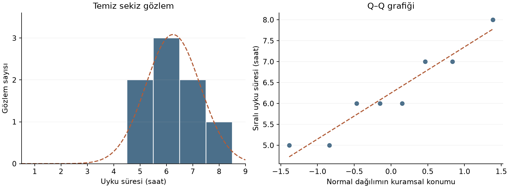
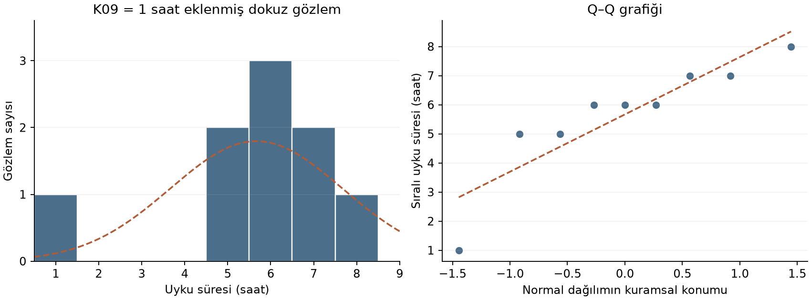

## Ortalama ve Standart Sapma Neyi Gizleyebilir?

K01–K08 `uyku_saati` verisinde $\bar{x}=6{,}25$ ve $s\approx 1{,}04$ bulunur. Ancak bir sayı dizisini yalnızca ortalama ve standart sapmayla anlatmak, dağılımın **şeklini** göstermez: benzer merkez ve yayılım değerleri çarpık ya da simetrik dağılımlarda görülebilir.

::: {.notes}
Ortalama ve standart sapma belirli sayısal özetlerdir; gözlemlerin nerede kümelendiğini veya hangi yönde kuyruk oluşturduğunu ayrı ayrı göstermez. Histogram bu eksik bilgiyi görünür kılar. Sekiz gözlemle gördüğümüz şeklin, hedef evrenin şeklini kesin olarak belirlemediğini de akılda tutarız.
:::

## Dağılımın Üç Farklı Şekli

Üç küçük dağılımın kuyruğunu karşılaştıralım. Merkez ve yayılımları eşit değildir; bu örneklerde karşılaştırılan özellik şekildir:

- **Simetrik:** 4, 5, 6, 6, 6, 7, 8 — değerler ortalamanın iki yanına dengeli dağılır.
- **Sağa çarpık:** 4, 5, 5, 5, 6, 7, 12 — çoğu değer düşük tarafta yoğunlaşır, birkaç yüksek değer kuyruğu sağa uzatır.
- **Sola çarpık:** 0, 5, 6, 7, 7, 7, 8 — birkaç düşük değer kuyruğu sola uzatır.

Çarpıklık, ortalama ile medyan arasındaki ilişkiyi etkiler: sağa çarpık bir dağılımda birkaç yüksek uç değer ortalamayı yukarı çeker, medyan ise sıralamadaki orta konuma dayandığı için uç değerlerin büyüklüğüne daha dayanıklıdır — bu yüzden sağa çarpık dağılımlarda ortalama genellikle medyandan büyüktür.

::: {.notes}
Sağa çarpık dizide toplam 44, ortalama yaklaşık 6,29, medyan 5'tir. 12 yerine 20 yazsak toplam ve ortalama artar, sıralamanın dördüncü değeri 5 kalır. Medyanın uç değerin büyüklüğüne daha dayanıklı olması buradan gelir. Bu, medyanın hiçbir kayıt değişiminden etkilenmeyeceği veya ortalama–medyan sırasının tek başına çarpıklığı kanıtladığı anlamına gelmez.
:::

## Değişken Türüne Uygun Grafik Seçimi

Grafik seçimi değişkenin ölçüm yapısına bağlıdır:

- Oran/aralık ölçekli sürekli bir değişken için (`uyku_saati` gibi) **histogram**: değer aralığı kutulara (bin) bölünür, her kutuya düşen gözlem sayısı çubuk yüksekliğiyle gösterilir.
- Nominal/ordinal bir değişken için (`bolum`, `uyku_kalitesi` gibi) **çubuk grafik**: her kategorinin sıklığı ayrı bir çubukla gösterilir, çubuklar arasında boşluk bırakılır çünkü kategoriler arasında sayısal bir süreklilik yoktur.

::: {.notes}
Örneğin 5 ve 6 saatlik değerleri aynı geniş kutuda toplarsak aralarındaki fark görünmez; çok dar kutular seçersek sekiz gözlemde boş kutular çoğalır. Makul kutu genişlikleri arasında değişmeyen bir örüntü, yalnız tek bir çizim tercihiyle ortaya çıkan görüntüden daha dikkatli yorumlanabilir. Yuvarlanmış tam saat kayıtları da kutu seçimine duyarlıdır.
:::

## Aykırı Bir Gözlem Geldiğinde: Önce Soru, Sonra Karar

K01–K08 tablosuna dokuzuncu bir kayıt ekleyelim: K09, `uyku_saati` = 1. Bu değer histogramda diğerlerinden ayrı, uzakta tek bir çubuk olarak görünür.

Böyle bir değerle karşılaşınca ilk soru **"bu değer neyi temsil ediyor?"** olmalıdır, "bu değeri silmeli miyim?" değil. İki farklı kaynak ayırt edilmelidir:

Gerçek ama uç bir gözlem olabilir — K09 kişisi o gece gerçekten çok az uyumuş olabilir (sınav, vardiyalı çalışma). Bu durumda değer veriyi doğru yansıtır ve yalnız uç olduğu için silinmemelidir. Ya da bir kayıt/ölçüm hatası olabilir — 25 saat gibi olanaksız bir kodlama buna örnektir. Bu durumda sorun gözlemde değil, kayıt sürecindedir.

::: {.notes}
İki standart sapma uzaklığı kaydın merkeze göre konumunu söyler. Aynı uzaklık, gerçekten az uyuyan bir kişide de hatalı girilmiş bir sayıda da görülebilir. Grafik bu iki olasılığı ayıramaz; kaynak kayda ve ölçüm tanımına dönmemiz gerekir. Gerçek bir uç gözlemi tutmak ile kayıt hatasını düzeltmek farklı kararlardır.
:::

## Betimlemenin Sınırı: Elimizdeki Veri, Bir Evren İddiası Değil

Betimleme yalnızca **eldeki veriyi** özetler; bu özetten bir evrene genelleme iddiası kurmaz. K01–K08'in ortalaması 6,25 saat demek, PSİ 303'e kayıtlı tüm öğrencilerin ortalamasının tam olarak bu olduğu anlamına gelmez.

::: {.notes}
6,25 saat sayısını değiştirmeden cümlenin öznesini değiştirebiliriz: “bu sekiz kişinin ortalaması” gözlenen tabloyu anlatır; “bütün PSİ 303 öğrencilerinin ortalaması” evren hakkında iddiadır. İkinci cümlede seçim düzeni ve örneklem değişkenliği hakkında ek bilgi gerekir. Aynı doğru hesap iki cümleye eşit dayanak sağlamaz.
:::

## İki Ayrı Değişkenlik: Standart Sapma ile Standart Hata

Standart sapma ($s\approx 1{,}04$ saat) K01–K08 içindeki **bireysel gözlemlerin** ortalamadan ne kadar saptığını ölçer. Aynı seçim düzeniyle çekilebilecek örneklemler için ise farklı bir soru sorulur: bu ortalamalar *kendi aralarında* ne kadar değişmektedir? Bu ikinci değişkenliği ölçen büyüklüğe **ortalamanın standart hatası** denir; dört kurgusal ortalamanın yakınlığı bu büyüklüğü doğrulamaz.

Bağımsız, aynı dağılımdan gelen sonlu varyanslı gözlemlerde ortalamanın standart hatası $\sigma/\sqrt{n}$; evren standart sapması bilinmiyorsa tahmini:

$$\widehat{SH} = \frac{s}{\sqrt{n}}\approx\frac{1{,}0351}{\sqrt{8}}\approx0{,}366\text{ saat}.$$

- Standart sapma ($s$) → **ham gözlemlerin** dağılımına ait.
- Standart hata → **örneklem ortalamalarının** dağılımına ait; $n$ arttıkça küçülür.

::: {.notes}
Temiz sekizlide tahmini standart hata $1{,}0351/\sqrt{8}\approx0{,}366$ saattir. Bireysel yayılım aynı kalırken n 8'den 32'ye çıkarsa payda iki katına çıkar ve standart hata yaklaşık 0,183 saate iner. Bireysel standart sapmanın yarıya indiğini söylemiyoruz; örneklem ortalamasının oynaklığı azalıyor. Bu basit hesap bağımsız ve aynı dağılımdan gelen gözlemleri varsayar; seçim yanlılığını ölçmez.
:::

## Normal Dağılım: Değişkenliğin Aldığı Şekil

Normal dağılım, simetrik dağılımların özel ve sık karşılaşılan bir biçimidir: tek tepeli, ortalama etrafında simetrik ve uçlara doğru giderek seyrekleşen bir çan eğrisi.

İki ayrı kullanım birbirine karıştırılmamalıdır: bazı ham değişkenler (ör. çok sayıda kişide ölçülen bir psikolojik özellik) yaklaşık normal dağılabilir — bu, dağılım şeklini gözle okuma alışkanlığının doğrudan devamı. Yukarıda kurduğumuz örnekleme dağılımı — örneklem ortalamalarının kendi dağılımı — de, bağımsız ve aynı dağılımdan gelen, sonlu varyanslı gözlemlerde örneklem yeterince büyükse yaklaşık normale yaklaşır.

::: {.notes}
Ham ölçümlerin dağılımı ile ortalamaların örnekleme dağılımını ayrı düşünelim. Daha çok kişi seçmek ham uyku sürelerini normal hâle getirmez. Bağımsız ve aynı dağılımdan gelen, sonlu varyanslı gözlemlerin ortalamaları için normal yaklaşım n büyüdükçe iyileşebilir. Başlangıçtaki çarpıklık ve kuyruklar bunun ne kadar hızlı gerçekleştiğini etkiler; n=8 için yeterli olduğunu yalnız büyüklüğe bakarak söyleyemeyiz.
:::

## Z-Puanı: Bir Gözlem Ne Kadar Tipik?

Bir gözlemin kendi dağılımı içinde ne kadar tipik ya da uç olduğunu ölçmek için **z-puanı** kullanılır:

$$z = \frac{x - \bar{x}}{s}$$

K01–K08 verisinde K05 (8 saat) için: $z = \dfrac{8-6{,}25}{1{,}0351} \approx 1{,}69$.

Standartlaştırılmış puan, dağılım normal olmasa da hesaplanabilir. Normal dağılım altında yaklaşık %95/±2 ilişkisi vardır; bu koşulu doğrulamadan z-puanını olasılığa veya kesin aykırılık kararına çeviremeyiz.

Bir örneklem ortalamasının referanstan farkı, bireysel standart sapma yerine ortalamanın standart hatasıyla ölçeklendirilir. Gerçek standart hata $\sigma/\sqrt{n}$ biliniyorsa normal modelde z yapısı; $s/\sqrt{n}$ ile tahmin ediliyorsa t yapısı elde edilir. Burada $\mu$ evren ortalamasıdır.

::: {.notes}
K05'in 8 saati ortalamadan 1,75 saat yukarıdadır. Bunu yaklaşık 1,0351 saate böldüğümüzde 1,69 standart sapma uzaklığı elde ederiz. İşaret yönü, büyüklük uzaklığı gösterir. Normal modele ait yaklaşık %95/±2 ilişkisi bu sekiz kişinin normalliğini doğrulayan bir kontrol değildir; z-puanı da tek başına kayıt silme veya hipotez testi kararı vermez.
:::

## Araştırma Sorusunu Sınanabilir İddiaya Çevirmek

Veriye bakmadan önce soruyu yazalım: “PSİ 303 öğrencilerinde ara sınav öncesi gece uyku süresi ile sınav performansı arasında evrende ilişki var mı?”

- **H0 — sıfır hipotezi:** evrende ilişki yoktur.
- **H1 — alternatif hipotez:** evrende ilişki vardır.

H0, araştırmacının inanması gereken sonuç değildir; veriyi karşılaştıracağımız durumdur. H0 ve H1 aynı değişkenlere ve aynı evrene ilişkin tamamlayıcı iddialardır. Bu yönsüz çiftte pozitif ve negatif ilişki H1'e dahildir.

::: {.notes}
“Bu sekiz kişinin ortalaması kaç?” sorusu betimsel olarak yanıtlanır; evren hakkında ilişki iddiası kurmaz. Uyku ile performans sorusunda ise tek tabloyu aşan bir iddia vardır. Hipotezler bu iddianın karşılaştırma noktasını belirler. Önce hipotezi yazıp sonra veriyi incelemek, görülen örüntüyü önceden beklenmiş sonuç gibi sunmamızı önler.
:::

## Yön İddiası Nereden Gelir?

Veriyi görmeden önce gerekçelendirilmiş bir pozitif ilişki beklentisi varsa yönlü çift kurabiliriz:

- **H0:** evrende pozitif ilişki yoktur; ilişki sıfır veya negatif olabilir.
- **H1:** evrende pozitif ilişki vardır.

Yönü destekleyen bir önbilgi yoksa ya da beklentiler çelişiyorsa yönsüz soru daha savunulabilirdir. Yön kararı gözlenen sonuca göre değiştirilmez.

::: {.notes}
Pozitif ilişkiyi öngören bir hipotez, negatif bir ilişki gözlendiğinde desteklenmiş olmaz. “İlişki vardır” ve “pozitif ilişki vardır” aynı iddia değildir; hangi sonuçların hipoteze karşılık gelebileceğini baştan farklı belirlerler. Yön gerekçesi önceki bulguya, teoriye veya açıklanabilir bir beklentiye dayanmalı; yalnız tabloda görülen eğilimden üretilmemelidir.
:::

## Şimdi Elimizde Veri Var — Bu, H0'ı Çürütmeye Yeter mi?

Uyku süresi–sınav performansı sorusunu bir H0/H1 çiftine çevirelim: H0 evrende ilişki olmadığını, yönsüz H1 ise evrende ilişki olduğunu söylesin. K01–K08 verisine kurgusal bir `sinav_puani` sütunu ekleyip pozitif yönlü bir örüntü gözlemlediğimizi düşünelim.

Soru "gözlenen bu örüntü H0'ı reddetmeye yeter mi?" görünür, ama eksik bir karşılaştırma içerir — neye göre "yeter"? Az önce kurduğumuz sezgi burada devreye girer: H0 doğru olsa bile örneklem sonuçları değişkenlik gösterir. Asıl soru şöyle çevrilmelidir: *gözlenen örüntü, H0 doğruyken de rastlantısal olarak bu kadar (veya daha uç) çıkabilir miydi?*

::: {.notes}
H0 modeli altında yeniden örnekler alsaydık seçtiğimiz istatistik aynı değer olmak zorunda değildi. Gözlenen değerin bu dağılımın merkezinden ne kadar uzak kaldığını soruyoruz. P-değeri, model doğru kabul edildiğinde bu kadar veya daha uç istatistiklerin ne sıklıkla oluştuğunu ifade eder; gözlenen ilişkinin nedenini belirlemez.
:::

## P-Değeri: Bu Sorunun Sayısal Yanıtı

**P-değeri**, H0'ı içeren istatistiksel model ve varsayımları altında, seçilen istatistiğin gözlenen kadar veya daha uç bir değer almasının olasılığıdır. Uçluğun ne olduğu önceden kurulan yönlü/yönsüz soruya bağlıdır.

Bu koşullu yapı fark edilmezse üç yanlış yorum ortaya çıkar:

P-değeri "H0'ın doğru olma olasılığı" değildir; H0 doğru **varsayılarak** hesaplanır ve bu varsayımın olasılığını vermez. Küçük bir p-değeri etkinin büyük olduğu anlamına gelmez. Ayrıca p-değeri örneklem büyüklüğünden bağımsız değildir: aynı büyüklükteki etki, büyük bir örneklemde daha küçük bir p-değeri üretebilir.

::: {.notes}
P = .03 ifadesinde koşul H0 ve model varsayımlarıdır. Bu model altında gözlenen kadar veya daha uç bir istatistik yaklaşık %3 olasılığa karşılık gelir. Bu sayı “H0'ın doğru olma olasılığı %3” veya “bulgunun gerçek olma olasılığı %97” olarak çevrilemez. Hesaplamanın koşulu ile hesaplanan olasılığın konusu yer değiştirmiş olur.
:::

## Anlamlılık Düzeyi: Veriden Önce Belirlenen Eşik

P-değeri tek başına bir karar vermez — **anlamlılık düzeyi** (α, geleneksel olarak .05) ile karşılaştırılır. α, veri toplanmadan **önce** belirlenen bir karar eşiğidir; p-değeri ise veri toplandıktan **sonra** hesaplanır.

Karar kuralı: p < α ise H0 reddedilir; p ≥ α ise H0 reddedilemez. "H0 kabul edilir" denmez — veri H0'ı çürütmeye yetmemiş olması, H0'ın doğru olduğunu göstermez; yalnızca eldeki kanıtın reddetmeye yetersiz kaldığını gösterir.

::: {.notes}
Eşiği sonucu gördükten sonra değiştirirsek artık başta belirlenen karar düzenini uygulamıyoruz. α=.05, geçerli model altında H0 doğruyken tekrar edilen sınamalarda yanlış reddetme sıklığını sınırlamayı hedefler. Belirli bir reddetme kararının yanlış olma olasılığının %5 olduğunu söylemez. H0 reddedilemediğinde ise veri H0'ı doğrulamış olmaz.
:::

## İki Türlü Yanlış Karar: Tip I ve Tip II Hata

| | H0 gerçekte doğru | H0 gerçekte yanlış |
|---|---|---|
| **H0 reddedildi** | Tip I hata ("yanlış alarm") | Doğru karar |
| **H0 reddedilemedi** | Doğru karar | Tip II hata ("kaçırılan etki") |

**Tip I hata**, H0 gerçekte doğruyken reddedilmesidir — evrende hiçbir ilişki yokken, örneklemde varmış gibi bir sonuca varmak. **Tip II hata** ise H0 gerçekte yanlışken reddedilememesidir — evrende gerçekten bir ilişki varken, örneklemin bunu yakalamaya yetmemesi.

::: {.notes}
H0 doğruyken örneklemdeki rastlantısal oynaklığı gerçek ilişki sanmak Tip I hatadır. H0 yanlışken oynaklık ve sınırlı bilgi yüzünden gerçek ilişkiyi ayırt edememek Tip II hatadır. Bu yüzden aynı “reddedilemedi” kararı, H0 gerçekte doğru olduğunda doğru, yanlış olduğunda hatalı olabilir; kararın kendisi evrendeki gerçeği doğrudan göstermez.
:::

## Anlamlı Olmak, Büyük Olmak Değildir

"İstatistiksel olarak anlamlı" (p < α) ile "etkinin büyüklüğü" farklı sorulara yanıt verir: biri "H0 modeli altında istatistik ne kadar uç ve önceden belirlenen karar eşiğini aşıyor mu?" sorusunu, diğeri "bu örüntü ne kadar büyük, pratikte önemli mi?" sorusunu yanıtlar.

Çok büyük bir örneklemde standart hata küçüldüğü için, pratikte önemsiz denecek kadar küçük bir fark bile anlamlı çıkabilir. Tersine, küçük bir örneklemde standart hata büyük olduğu için, evrende gerçekten var olan büyük bir fark bile anlamlı çıkmayabilir.

::: {.notes}
Gözlenen fark ve bireysel yayılım aynıyken daha çok bağımsız gözlem, standart hatayı küçültebilir. Aynı fark daha çok standart hata uzaklığına karşılık gelir ve p azalabilir. Farkın kendisi büyümemiştir. P, etkinin büyüklüğü ve belirsizlik hakkında gerekli bilgilerin yerine geçmez; pratik önem, farkın araştırma bağlamındaki karşılığıyla değerlendirilir.
:::

## Normallik Tanısı: Hazır Bir Çıktıyı Doğru Okumak

Hafta 1'in temiz sekiz uyku değeri ve K09 = 1 saat eklenmiş dokuzlu için hesaplanmış hazır çıktıyı karşılaştıralım. Gözlemler kurgusaldır; 25 saatlik bozulmuş temizlik kaydı bu hesaplarda kullanılmadı.

| Veri | n | Ortalama | Örneklem s | Shapiro–Wilk W | p |
|---|---:|---:|---:|---:|---:|
| Temiz uyku tablosu | 8 | 6,25 | 1,04 | 0,917 | 0,408 |
| K09 = 1 saat ekli | 9 | 5,667 | 2,000 | 0,834 | 0,049 |

::: {.notes}
Shapiro–Wilk çıktısında H0, gözlemlerin normal bir dağılımdan geldiğidir; W test istatistiği, p onun model altındaki uçluğuna karşılık gelen olasılıktır. α=.05 ile temiz sekizlide H0 reddedilemez; K09 ekli dokuzluda p yaklaşık .049 olduğu için reddedilir. İkinci sonuç eşiğe yakındır; iki kararın hiçbiri bir kaydın hatalı olduğunu göstermez. Hesap dayanağı [SciPy Shapiro–Wilk dokümantasyonudur](https://docs.scipy.org/doc/scipy/reference/generated/scipy.stats.shapiro.html).
:::

## Temiz Sekizli: Grafik Ne Gösteriyor?

::: {.notes}
Histogram gözlenen sürelerin nerede toplandığını gösterir. Kesikli çizilen normal eğri, aynı ortalama ve örneklem standart sapmasıyla kurulmuş bir karşılaştırmadır; verinin normal olduğunun kanıtı değildir. Q–Q grafiğinde normal dağılımdan beklenen konumlar ile sıralı gözlemler karşılaştırılır. Tam saate yuvarlanmış ve tekrar eden değerler, küçük örneklemde görünümü ve test yorumunu sınırlar. p=.408 olması normalliğin doğrulandığı anlamına gelmez.
:::

## K09 Eklendiğinde Ne Değişiyor?

::: {.notes}
K09 solda diğer sürelerden ayrı duruyor; Q–Q grafiğinin düşük değer ucunda da çizgiden uzaklaşıyor. Ortalama 6,25'ten yaklaşık 5,67'ye inerken standart sapma yaklaşık 1,04'ten 2 saate yükseliyor. Tek gözlem hem sayısal özeti hem şekli değiştiriyor. Ancak bir saat uyku gerçek bir kayıt olabilir; tanı sonucunu iyileştirmek için bu kaydı silmek veri yönetimi kararını sonuca göre değiştirmek olur.
:::

## Normallik Kararı Hangi Bilgilere Dayanır?

- p > .05, normalliğin kanıtı değildir.
- Grafik, n ve p aynı değişken ve aynı analiz tablosu için birlikte okunur.
- Gerçek bir uç kayıt, yalnız normallik sonucunu değiştirdiği için silinmez.
- Normalliği incelenen dağılım araştırma desenine bağlıdır.

::: {.notes}
Sekiz veya dokuz gözlem, bir sapmayı yakalamak için sınırlı bilgi taşır. Daha büyük bir örneklemde ise küçük bir sapma bile anlamlı çıkabilir. Hangi değişkeni inceleyeceğimizi ayrıca belirtiriz: kişinin ham ölçümü ile aynı kişinin iki ölçümünden elde edilen fark puanı ayrı değişkenlerdir. Bu nedenle “normal mi?” sorusunun yanıtı tek bir p-değerinden veya bütün sütunlara uygulanmış ortak bir etiketten çıkarılamaz.
:::

## Betimsel Özet ile Çıkarım İddiası: Ayrımı Tek Tabloda Görmek

| Soru | Hangi araç | Ne söyler, ne söylemez |
|---|---|---|
| Bu sekiz kişinin tipik değeri, yayılımı, şekli nedir? | Ortalama/medyan/mod, varyans/$s$, histogram | Yalnız eldeki veriyi özetler; evrene genelleme iddiası kurmaz. |
| Aynı seçim düzeninde örneklem ortalaması ne kadar değişir? | Ortalamanın standart hatası | Ortalamaların yayılımını anlatır; bireysel gözlemlerin yayılımı veya seçim yanlılığı değildir. |
| H0 modeli altında gözlenen istatistik ne kadar uç? | P-değeri, α, H0 kararı | Model altında gözlenen kadar veya daha uç istatistiğin olasılığını verir; sonucun rastlantıdan gelme veya H0'ın doğru olma olasılığı değildir. |
| Yanılma riski nereden gelir? | Tip I/II hata | α Tip I'i kontrol eder; Tip II örneklem/etki büyüklüğüyle ilgilidir. |

::: {.notes}
Betimsel özet gözlenen kişiler hakkında bilgi verir; standart hata belirli seçim koşullarında ortalamanın değişkenliğini ifade eder; p-değeri H0 modeli altında bir istatistiğin uçluğuna karşılık gelir. Bu üç bilgi aynı sayının farklı adları değildir. Rapor cümlesinde hangi soruyu yanıtladığımızı belirtirsek bir örneklem özetini evrenin kesin değeri gibi sunmayız.
:::

## Kısa Geri Kontrol

- Verilen sağa çarpık örnekte ortalama neden medyandan büyük çıktı? Bu sıra tek başına her dağılım için kesin bir tanı mıdır?
- K09'un `uyku_saati=1` değeri karşısında ilk sorulması gereken soru nedir — "sil miyim" mi, yoksa başka bir şey mi?
- Standart sapma ile standart hata hangi soruya, hangi dağılıma ait cevap verir?
- p = .03, α = .05 çıkıyor. Karar ne olur? Bu, "H1 kanıtlanmıştır" anlamına gelir mi?
- Küçük bir örneklemde bir normallik testi p = .21 veriyor. Bu, "veri kesinlikle normaldir" anlamına gelir mi?

::: {.notes}
P=.03 ve α=.05 için H0 reddedilir; bu karar H1'in kesin olarak kanıtlandığı anlamına gelmez. Küçük bir örneklemde p=.21 ise H0 reddedilemez; bu da normalliğin kanıtı değildir. İki örnekte aynı karar mantığı işler: eşik karşılaştırması, modelin veya karşı hipotezin doğruluk olasılığını hesaplamaz.
:::

## Uygulama: Hipotez, Özet ve Tanı — 60 dakika

1. **Hipotezi veriden önce yaz (10 dk):** veri içermeyen bir uyku–performans senaryosunda H0/H1 çiftini ve yön kararının gerekçesini yaz. Sonraki betimsel tablo bu hipotezin testi değildir; sınav puanı içermez.
2. **Temiz tabloyu kur ve özetle (20 dk):** [2. haftanın temiz K01–K08 tablosunu](tp_degiskeni-tanimlamak-ve-veriyi-yazilimda-kurmak.md) kullan. Uyku için n, ortalama, medyan, örneklem standart sapması ve açıklığı hesapla; histogram üret. Bölüm veya uyku kalitesi için sıklık ve uygun çubuk grafiği üret.
3. **Hazır tanı çıktısını yorumla (15 dk):** yukarıdaki sekizli/dokuzlu grafik ve Shapiro–Wilk tablosunu karşılaştır. Her biri için n, p ve grafik bulgusunu taşıyan kısa tanı yaz; K09'u tutma veya sorgulama gerekçesini belirt.
4. **Kararı ve anlamını yaz (15 dk):** ayrı, kurgusal bir sınama sonucunda p=.03, α=.05 verildiğinde H0 kararını yaz. Tip I/II hatanın karşılığını belirt; “H1 kesin kanıtlandı” ve “etki büyüktür” yorumlarının neden çıkmadığını açıkla.

Beklenen ürün: veriden önce yazılmış hipotez ve yön gerekçesi, betimsel özet ve grafikler, hazır çıktıdan gerekçeli normallik yorumu ve p/α karar cümlesi.

::: {.notes}
Temiz uyku tablosunda ortalama 6,25, medyan 6, açıklık 3 ve örneklem standart sapması yaklaşık 1,04 saattir. Bu değerlerle kendi yazılım çıktımızı denetleyebiliriz. Hazır normallik çıktısı uyku dağılımını inceler; p=.03 alıştırması ise ayrı bir kurgusal hipotez sınamasıdır. İki p-değerini aynı veriden hesaplanmış sonuç gibi birleştirmemeliyiz.
:::

Kaynak notu: p-değerinin yorumu [ASA ilkeleri](https://www.amstat.org/docs/default-source/amstat-documents/p-valuestatement.pdf), örneklem standart sapması ve z–t ayrımı [NIST](https://www.itl.nist.gov/div898/handbook/prc/section2/prc22.htm) ile kontrol edildi. Uyku gözlemleri öğretim kurgusudur; normallik tablosu bu dizilerden hesaplandı.
