## Betimlemeden çıkarıma: soru değişince ne değişir?

Soru 1: Bu sekiz öğrencinin ortalama uykusu nedir?

Soru 2: Hedef evrende ortalama uyku 7 saatten farklı mı?

Değişen üç şey: **sayının dayandığı dağılım · sayıyı taşıyan birim · sonucu geçerli kılan varsayımlar**

::: {.notes}
Birinci soru eldeki sekiz kaydı özetler; yanıtı hesaplanır ve biter. İkinci soru bu sekiz kaydın ötesine, hedef evrene uzanır. Aynı ortalama bu kez bir evren parametresi için kanıt olarak kullanılacağından üç şey denetlenmek zorundadır: sayının dayandığı dağılım (kişi puanları mı, örneklem ortalamaları mı), sayıyı taşıyan birim (tek bir kişi mi, bir örneklemin ortalaması mı) ve sonucu geçerli kılan varsayımlar (örnekleme süreci ve dağılım koşulları).

Eldeki sayım betimlemede kişi puanlarının dağılımını özetlerken, çıkarımda bu dağılımdan bağımsız ve aynı koşullarla çekilmiş örneklemlerin ortalamalarının oluşturduğu yeni dağılım temel alınır. Sayıyı taşıyan birim kişiden örneklem ortalamasına geçerken, verinin dayandığı dağılım ve varsayımlar denetlenmeden çıkarım adımı atılamaz.

Ön bilgi olarak daha önce kurulmuş dört işlem hatırlanır: hedef evren ile örneklem ayrımı, ölçüm düzeyi ve gözlem birimi, merkez ölçüleri ile $n-1$ paydalı örneklem varyansı, çeyrekler ile IQR ve uç kaydın incelenmesi. Bunlar yeniden kurulmaz, ortak veriyle işleme sokulur.
:::

---

## Ortak veri: sekiz öğrencinin bir gecelik uykusu

| Kişi | K01 | K02 | K03 | K04 | K05 | K06 | K07 | K08 |
|---|---:|---:|---:|---:|---:|---:|---:|---:|
| Uyku (saat) | 5 | 6 | 6 | 7 | 8 | 5 | 6 | 7 |

Kurgusal öğretim verisi; gerçek katılımcı verisi ve araştırma bulgusu değildir.

::: {.notes}
Veri, gerçek bir araştırmanın bulgusu olarak değil, hesap adımlarının elle izlenebilmesi için kurgulanmıştır. Her kişi bir gözlem birimidir ve her birim tek bir sayı taşır: bir gecelik uyku süresi, saat cinsinden. Bu yapı "satır bir kişidir" ayrımının temelidir; çünkü örneklem ortalamaları dağılımına geçildiğinde satırın neyi temsil ettiği değişecektir.

Aynı sekiz değer bütün bölümlerde temel alınır. Böylece hesaplanan her sayı, ayrı bir veri kümesinin sonucu değil, aynı kaydın farklı sorularına verilen yanıtlardır.
:::

---

## Betimsel özetler: *M*, medyan, mod, *s*, SH

Toplam = 50, *n* = 8 → *M* = 50/8 = 6,25 saat

Sıralı dizi: [5, 5, 6, 6, 6, 7, 7, 8] → medyan = 6; mod = 6

Sapma kareleri toplamı = 7,5 → $s^2 = 7{,}5/7 = 1{,}071429$ saat² → *s* = 1,035098 saat

Tahmini SH = $s/\sqrt{8}$ = 0,365963 saat

::: {.notes}
Medyan, sıralı dizide sekiz değerin ortasındaki dördüncü ve beşinci değerin ortalamasıdır; ikisi de 6 olduğundan medyan 6'dır. Mod, en sık tekrarlanan değerdir; 6 değeri üç kez geçer.

Örneklem varyansında payda $n-1 = 7$'dir. Payda $n = 8$ ile hesaplanan varyansın karekökü (standart sapma) alınırsa $\sqrt{7{,}5/8} = 0{,}968246$ saat çıkar; bu başka bir betimsel konvansiyondur ve buradaki $n-1$ paydalı örneklem $s$'si ile karıştırılmaz. Hesaplar tam değerle yürütülür, yalnız gösterimde yuvarlanır: yuvarlanmış *s* ile yürütülen bir işlemde son basamaklar kayar. SH, kişi puanlarının değil örneklem ortalamasının yayılımı için bir tahmindir.
:::

---

## Grafik bize hangi sayımı gösteriyor?

Frekans tablosu → histogram → kutu grafiği

Her biri aynı sekiz kaydı farklı bir işlemle özetler.

::: {.notes}
Temel soru şudur: bir çubuğun yüksekliği neyi sayar ve aynı veri farklı gösterimlerde neden farklı görünür? Üç gösterim birbirine geri doğrulatılır: tablo doğrudan değer sayımını verir, histogram sayımı belirli sınıf aralıklarına taşır, kutu grafiği sıralı listenin çeyreklerinden okunur. Üçü aynı veriden gelir ama aynı işlemden gelmez; bu ayrım Q1 ile sınıf sınırının çakışmasında belirginleşir.
:::

---

## Frekans ve göreli frekans

**Frekans:** bir değerin veride kaç kez gözlendiği.

**Göreli frekans:** frekansın *n*'ye bölümü (yüzde oranı).

| Uyku (saat) | Frekans | Göreli frekans |
|---:|---:|---:|
| 5 | 2 | %25 |
| 6 | 3 | %37,5 |
| 7 | 2 | %25 |
| 8 | 1 | %12,5 |
| Toplam | 8 | %100 |

::: {.notes}
Tablonun kendi içinde bir denetimi vardır: frekansların toplamı $2 + 3 + 2 + 1 = 8 = n$ olmalı ve yüzdelerin toplamı %100'e varmalıdır. Toplam *n*'ye eşit değilse bir gözlem hiç sayılmamış ya da mükerrer sayılmıştır. Bu kontrol, tabloyu yazılım çıktısından okurken de ilk işletilecek adımdır.

Göreli frekans, farklı büyüklükteki örneklemleri karşılaştırırken gerekir: iki ve üç gözlemin anlamı *n* = 8'de ve *n* = 800'de aynı değildir, ama %25 ile %37,5 aynı ölçekte okunabilir.
:::

---

## Histogram: sayımı aralıklara taşımak

**Histogram:** sürekli bir ölçeği sınıf aralıklarına bölen ve her aralığa düşen gözlem sayısını çubuk yüksekliği olarak gösteren grafik.

Sınıflar: [4,5; 5,5) · [5,5; 6,5) · [6,5; 7,5) · [7,5; 8,5)

Kural: sol uç dahil, sağ uç hariç. Çubuk yükseklikleri: 2, 3, 2, 1

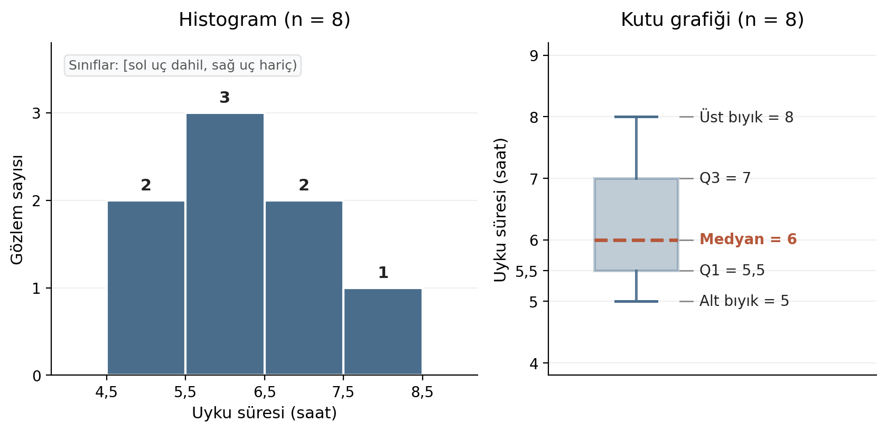{fig-alt="Sekiz uyku kaydının histogramında saat aralıklarının sayımları 2, 3, 2, 1; yanındaki kutu grafiğinde Q1 = 5,5, medyan = 6, Q3 = 7 ve bıyıklar 5 ile 8 saat."}

::: {.notes}
Sınıf sınırları açık yazılmazsa 5,5 gibi bir sınır değerinin hangi çubuğa gireceği belirsiz kalır; "sol uç dahil, sağ uç hariç" kuralı her değeri tek bir sınıfa yerleştirir. Burada değerler tam sayı olduğundan her sınıfa yalnız bir değer düşer ve çubuk yükseklikleri frekans tablosuyla birebir aynı çıkar. Bu özdeşlik veri tam sayıya yuvarlandığı için ortaya çıkar; sürekli ölçümlerde bir sınıfa birçok farklı değer girer ve tablo ile histogram bu kadar kolay eşleşmez.

Yatay eksen sürekli bir ölçektir (saat), dikey eksen o aralığa düşen gözlem sayısıdır.
:::

---

## Kutu grafiği: çeyrekler ve çitler

**Kutu grafiği:** verinin dağılımını, merkezini, çeyreklerini ve uç değerlerini çitler üzerinden özetleyen grafik.

- Alt yarı [5, 5, 6, 6] → Q1 = 5,5
- Üst yarı [6, 7, 7, 8] → Q3 = 7
- IQR = 7 − 5,5 = 1,5
- Çitler: Q1 − 1,5 × IQR = 3,25 ve Q3 + 1,5 × IQR = 9,25
- Bıyıklar çit içindeki gözlenen en uç değerde biter: 5 ve 8

::: {.notes}
Üst bıyık 9,25'te değil 8'de biter, çünkü 9,25 bir çittir (kuramsal sınırdır); bıyık, çit içinde gerçekten gözlenen en uç değere uzanır ve sekiz kayıtta en büyük değer 8'dir. Çeyrekleri farklı yazılımlar farklı algoritmalarla hesaplayabilir; fark çıkarsa değerler zorla eşitlenmez, kullanılan tanım kaydedilir.

Q1 = 5,5 sayısı histogramın [4,5; 5,5) ve [5,5; 6,5) sınıflarının ortak sınırıyla sayısal olarak çakışır. Bu çakışma iki işlemin aynı olduğunu göstermez: Q1 sıralı verinin alt yarısının medyanından gelir, sınıf sınırı ise sınıflama kararından. Veri başka bir sınıf genişliğiyle gruplansaydı sınırlar değişir, Q1 aynı kalırdı. Kutu grafiği ile histogram aynı veriyi farklı işlemlerle özetler.
:::

---

## Aynı veri, iki sınıf genişliği

Tepki süreleri (ms): R1 = [300, 320, 340, 360, 380, 400, 420, 800]; *M* = 415, medyan = 370, *s* = 160,6238

| Sınıf genişliği | Sınıf sınırları | Sayımlar |
|---:|---|---|
| 200 ms | [280; 480), [480; 680), [680; 880) | 7 / 0 / 1 |
| 100 ms | [280; 380), [380; 480), [480; 580), [580; 680), [680; 780), [780; 880) | 4 / 3 / 0 / 0 / 0 / 1 |

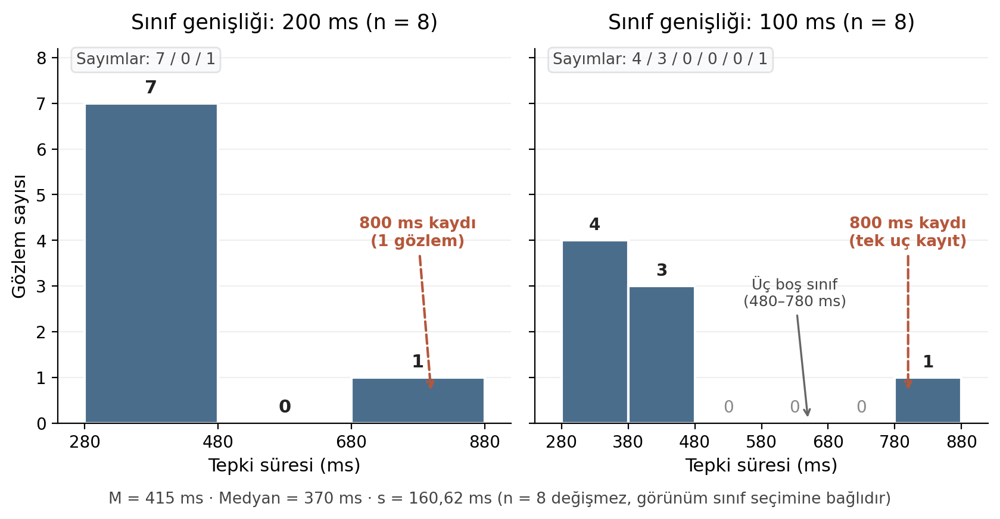{fig-alt="Ortak tepki süresi ekseninde 200 ms ve 100 ms sınıflı iki histogram; sayımlar 7/0/1 ve 4/3/0/0/0/1, her ikisinde n = 8 ve 800 ms uç kaydı işaretli."}

::: {.notes}
İki grafikte de *n* = 8'dir ve yatay aralık aynıdır; değişen tek şey sınıf genişliğidir. Çubuk yüksekliği bir sayıdır, yoğunluk değildir; bu yüzden genişlikleri farklı iki grafiğin çubukları birbirine yoğunluk gibi oranlanarak karşılaştırılmaz.

Dizideki 800 ms değeri, ortalamayı (415) medyanın (370) üzerine çeken uç bir kayıttır. Sınıf genişliği 200 ms olduğunda veri iki dolu sınıfa toplanır ve aradaki boşluk gizlenir; sınıf genişliği 100 ms'ye indirildiğinde ise sayımlar parçalanır, en sağdaki tek gözlem ile sol grup arasında üç boş sınıf açılır. Görünümdeki bu değişim verinin kendisinden değil, sınıf genişliği tercihinden kaynaklanır.
:::

---

## Boş sınıf ve ince sınıf ne söylemez?

1. 480–780 arasındaki boş sınıflar yeni bir alt grubun kanıtı değildir.
2. İnce sınıflar her zaman daha doğru değildir.
3. 800 ms'nin işaretlenmesi, silinmesi anlamına gelmez.

::: {.notes}
Birinci okuma: boş aralık yalnız bu sekiz kayıtta o aralıkta değer bulunmadığını söyler. Süreç ya da evren ayrımı bu tek boşluktan çıkarılamaz.

İkinci okuma: ince sınıf ayrıntıyı açabilir, ama küçük *n*'de görünümü parçalar. 100 ms'lik çizimde üç sınıfın boş olması veriden çok sınıf seçiminin ürünüdür. Histogram bu yüzden birden çok makul sınıf genişliğinde bakılarak okunur.

Üçüncü okuma: 800 ms en sağdaki çubuğu iki çizimde de tek başına oluşturur. Geçerli ama uç bir ölçüm de olabilir, hatalı bir kayıt da; grafik bunu belirlemez. Karar kaynağa dönülerek verilir.
:::

---

## Kategori sayımı ile miktar çubuğu: y ekseni neyi ölçer?

| Çubuk türü | Yatay eksen | Çubuk yüksekliği |
|---|---|---|
| Histogram | sürekli ölçek (saat) | aralığa düşen gözlem sayısı |
| Kategori çubuğu (uyku kalitesi kötü/orta/iyi: 2/4/2) | etiket | kategorideki kişi sayısı |
| Saat çubuğu (K01–K08) | kişi etiketi | o kişinin saat değeri |

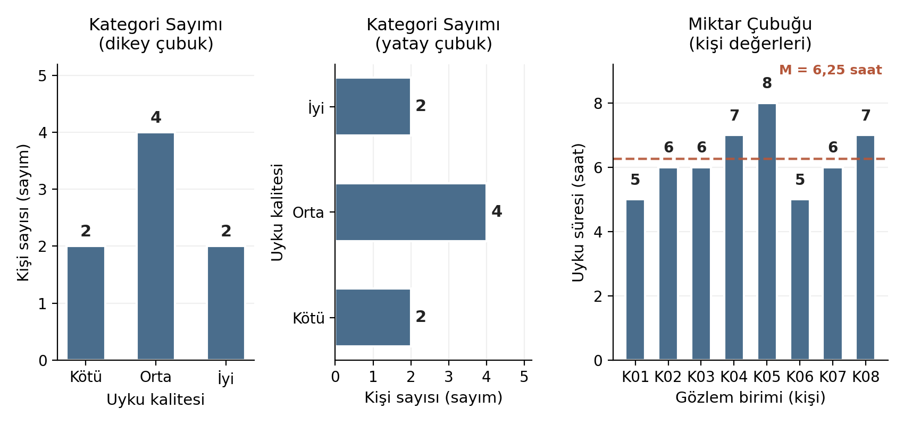{fig-alt="Solda ve ortada kötü, orta, iyi uyku kalitesi için 2/4/2 kişi sayımının dikey ve yatay çubukları; sağda K01–K08 uyku süreleri 5/6/6/7/8/5/6/7 saat ve 6,25 saat ortalama çizgisi."}

::: {.notes}
Üç grafik de çubuklardan oluşur, ama y eksenleri farklı şeyler ölçer. Kalite sıklığı (2/4/2) ayrı bir öğretim özetidir ve ana uyku tablosuyla kişi düzeyinde eşleştirilmemiştir; yani hangi kişinin hangi kalite düzeyinde olduğu bu özetten okunamaz. Y eksenine bakmak (kişi sayısı mı, saat mi) ayrımı hemen yapar.

Uzun kategori adları için çubuklar yatay çizilebilir. Yönelim sayıyı değiştirmez, yalnız okunabilirliği değiştirir.
:::

---

## Kendini kontrol et: grafik ve sayım

1. Frekans histogramını kategori çubuğundan ve saat çubuğundan nasıl ayırırsınız?
2. Bu veride üst bıyık neden 9,25'te değil 8'de biter?

::: {.notes}
Yanıt 1. Histogramın yatay ekseni sürekli bir ölçektir ve çubuk yüksekliği o sınıfa düşen gözlem sayısıdır. Kategori çubuğunda yatay eksen etikettir; çubuk o kategorideki gözlem sayısını verir. Saat çubuğunda çubuk yüksekliği bir kişinin değeridir, sayım değildir. Y eksenine bakmak (kişi sayısı mı, saat mi) ayrımı hemen yapar.

Yanıt 2. 9,25 çittir, yani bir sınır değeridir. Bıyık, çit içinde gerçekten gözlenen en uç değere uzanır; sekiz kayıtta en büyük değer 8'dir.
:::

---

## Kuyruk, kayma ve yayılım aynı şey mi?

Üç özellik, üç ayrı soru:

- Kuyruk yönü: dağılımın hangi tarafa doğru uzandığı
- Kayma: merkezin bilinen bir referanstan uzaklığı
- Yayılım: değerlerin merkez çevresindeki dağınıklığı

::: {.notes}
Ortalama ve standart sapma iki özettir; dağılımın şeklini tüketmezler. İki dağılımın ortalaması ve standart sapması aynı olsa bile kuyruk yönleri tamamen zıt olabilir ya da bir dağılım dış bir referansa göre sistematik biçimde kaymış bulunabilir. Kuyruk yönü ortalama ile medyan arasındaki konumu, kuyruk uzunluğu merkez çevresindeki yayılımı, referanstan uzaklık ise ölçümün kaymasını belirler; bu üç özellik birbirinden bağımsız incelenir.
:::

---

## S, R ve L dizileri

*n* = 7 değerlik üç dizi:

- S (simetrik) = [4, 5, 6, 6, 6, 7, 8]
- R (sağ kuyruk uzun) = [4, 5, 5, 5, 6, 7, 12]
- L (sol kuyruk uzun) = [0, 5, 6, 7, 7, 7, 8]

L, R'nin 6 çevresindeki yansımasıdır: $12 - \text{R} = [8, 7, 7, 7, 6, 5, 0]$ ve sıralanınca L elde edilir.

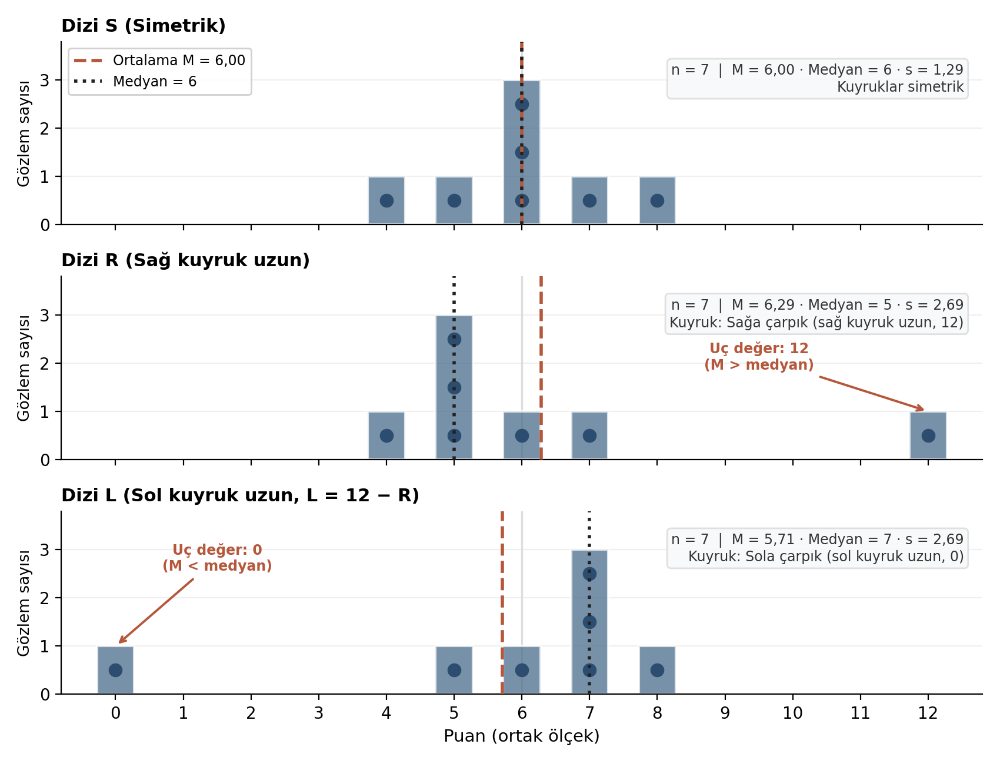{fig-alt="Ortak puan ekseninde S, R ve L dizilerinin yedişer ham noktası ve sayım çubukları; ortalama, medyan ve s etiketleri, R için 12 ve L için 0 uç değeri; L = 12 − R yansıması."}

::: {.notes}
Her *x* için *x* ile $12 - x$ değerlerinin ortalaması 6'dır; yani yansıma ekseni 6'dır. Yansıtmak sağ kuyruğu sol kuyruğa çevirir ve her değerin eksene uzaklığını korur. Bu yapı, merkez farkı ile yayılım farkının cebirle ayrı okunmasını sağlar.

Yedi nokta bir dağılımın şeklini belirlemez; dizilerin amacı kuyruk yönü ile ölçülerin ilişkisini bu üç durumda okumaktır. Eğri çizilirse yedi gözlemden evren şekli çıkarılmış izlenimi doğar.
:::

---

## Kuyruk yönü merkezi, uzunluğu yayılımı etkiler

| Dizi | *M* | Medyan | *s* |
|---|---:|---:|---:|
| S | 6 | 6 | 1,290994 |
| R | 6,285714 | 5 | 2,690371 |
| L | 5,714286 | 7 | 2,690371 |

::: {.notes}
Üç şey okunur. Birincisi, R'de birkaç büyük değer ortalamayı medyanın üstüne çeker (6,29 ve 5); L'de ters yönde olur (5,71 ve 7). İkincisi, L yansıma olduğundan *s* değişmez: L = $12 - \text{R}$ olduğundan L'nin ortalaması $12 - 6{,}285714 = 5{,}714286$'dır ve her değerin kendi ortalamasından sapması R'deki karşılığının yalnız işaret değiştirmiş halidir. Sapma kareleri aynı kaldığından R ile L'nin yayılımı eşittir (2,69). Üçüncüsü, S ile R'nin yayılımı farklıdır: 1,29 ve 2,69. Uzun sağ kuyruktaki 12 değeri yayılımı artırmıştır.

Dolayısıyla kuyruk yönü ortalama–medyan ilişkisini, kuyruk uzunluğu ise yayılımı etkiler; bunlar ayrı okunan özelliklerdir. Ortalama, medyan ve mod sırası her dağılım için teorem olarak yazılmaz; burada yalnız bu üç dizi okunur.
:::

---

## Kayma ile yayılım: ölçüm bağlamı

Michelson'ın ışık hızı için yaptığı beş deney dizisi:

- Referans çizgisinden uzaklık → **kayma**
- Kutu ve bıyık genişliği → **yayılım**

<!-- Görsel placeholder (gerçek kaynak görseli gerekli; asset henüz yok ve dosya adı uydurulmaz). Konum: bu slaytın sağ yarısı. Gösterilecek bilgi: Betimsel İstatistik ders sunumu, slayt 24'teki Michelson grafiği (beş deney, kutu/bıyık, gerçek hız referans çizgisi) kaynak atfıyla; referanstan uzaklık (kayma) ile kutu genişliği (yayılım) ayrı oklarla işaretlenir. Yeniden çizim, ancak aynı kaynak verisi elde edilip doğrulanırsa yapılır; erişim ve atıf izni netleşmeden yayına hazır sayılmaz. Öğretim amacı: aynı grafikte iki ayrı özelliği ayırt ettirmek. -->

::: {.notes}
Betimsel İstatistik ders sunumunun 24. slaytında beş deneyin kutu grafikleri ve kaynakta bulunan gerçek hız çizgisi birlikte çizilmiştir. Referans çizgisine göre kutuların merkezi yer değiştirmiş olabilir; kutu ve bıyık genişlikleri ise deneyler arasında farklıdır. Merkezin referanstan uzaklığı kaymayı, kutuların genişliği yayılımı gösterir ve iki özellik birbirinden bağımsız değişebilir.

Bu okumanın sınırı açıktır. Tek bir kutu sistematik bir hatayı kesin ispatlamaz; kayma, yinelenen deneylerde ve bilinen bir referans bağlamında yorumlanır. Sayılar grafikten kesin ölçüm gibi türetilmez ve ışık hızı verisi psikoloji puanı gibi etiketlenmez.
:::

---

## Uçluk ölçüm hatası mıdır?

Ayrı senaryo: ana diziye K09 = 1 saat eklenir (*n* = 9).

Toplam = 51 → *M* = 51/9 = 5,6667; medyan = 6

Uç değer ≠ ölçüm hatası

::: {.notes}
Tek düşük değer ortalamayı 6,25'ten 5,67'ye kaydırmıştır. Medyanın bu örnekte 6 kalması, medyanın uçlardan hiçbir zaman etkilenmediğini göstermez; medyan sıralamaya dayandığı için bu örnekte etkilenmemiştir.

K09 uç bir değerdir, ama uç olmak ölçüm hatası olmakla özdeş değildir. Kayıt, o gece gerçekten çok az uyuyan birinin gerçek ölçümü olabilir; ya da 25 saat gibi olanaksız bir kodlamanın sonucu olabilir. İlki veriyi doğru yansıtır, ikincisi kayıt sürecinin sorunudur. Ayrımı grafik değil, kaynağa dönüş yapar. Bu dokuz kayıtlı senaryo ana diziyi değiştirmez.
:::

---

## Kendini kontrol et: kayma ve yayılım

Çok dar ama bilinen referanstan kaymış bir ölçüm dizisi doğru mudur?

::: {.notes}
Hayır, doğruluğu garanti edilmez. Dar yayılım rastgele değişkenliğin az olduğunu söyler; referanstan kayma ise sistematik bir farktır ve dar yayılım onu dışlamaz. Bağımsız ve aynı ölçüm sürecinden tekrarlar alındığında gözlem sayısını artırmak, ortalama kestiriminin rastgele oynaklığını, yani standart hatasını azaltabilir. Tekil ölçümlerin yayılımı kendiliğinden küçülmez; daha çok ölçüm sistematik kaymayı da gidermez. Kaymış ölçümlerin ortalaması, referanstan uzak bir değer çevresinde daha az oynayabilir.
:::

---

## Standartlaştırmak neden yüzdeyi kendiliğinden vermez?

Ham *z* = sekiz kişi içindeki uzaklık

Normal modelde *z* = modelin içindeki uzaklık ve alan

İki ayrı nesne, tek harf

::: {.notes}
Aynı harf iki farklı hesabı adlandırır. Birinde ortalama ve standart sapma sekiz kayıttan hesaplanmış betimsel özetlerdir; ötekinde $\mu$ ve $\sigma$ bir modelin bilinen parametreleridir. Yüzde ancak ikincisinde, modelin alanından gelir; ham *z* yüzde vermez.
:::

---

## Ham *z*: sekiz kişi içinde uzaklık

**Ham *z*:** bir gözlemin kendi grubunun ortalamasından uzaklığı, standart sapma birimiyle.

$$z = \frac{x - M}{s}$$

K05 için: $z = (8 - 6{,}25)/1{,}035098 = 1{,}690661$

::: {.notes}
K05, bu sekiz kişinin ortalamasının yaklaşık 1,69 *s* üzerindedir. İşlem birimi (saat) ortadan kaldırır ve uzaklığı *s* birimiyle ifade eder. Veriyi normal yapmaz ve K05 için otomatik aykırı ya da silme kararı vermez: *z* bir uzaklık ölçüsüdür, karar ölçütü değildir.
:::

---

## ±2*s* aralığındaki oran, modelin %95'i değildir

$6{,}25 \pm 2 \times 1{,}035098 = [4{,}1798; 8{,}3202]$

Sekiz gözlemin tümü bu aralıkta → gözlenen oran %100

Normal modelin $\mu \pm 2\sigma$ aralığı: yaklaşık %95

::: {.notes}
İki yüzde aynı nesne değildir. %100, sekiz gözlemin sayımıdır; yaklaşık %95 ise bir kuramsal modelin alanıdır. Küçük bir örneklemde model yüzdesinin tam karşılığı gözlenmek zorunda değildir, bu yüzden %100 çıkması modelle çelişki sayılmaz. Standartlaştırma bu iki sayıyı birbirine çevirmez; çevirmek için bir model gerekir.
:::

---

## Normal model: olasılık alandır, yükseklik değil

$X \sim N(\mu = 50,\ \sigma = 10)$: varsayımsal bir normal puan modeli

Yoğunluk eğrisi altında toplam alan = 1

Bir aralığın olasılığı = iki sınır arasında kalan alan

$\mu \pm \sigma$: %68,27 · $\mu \pm 2\sigma$: %95,45 · $\mu \pm 3\sigma$: %99,73

::: {.notes}
Bu modelin $\sigma$ değeri bilinen bir parametredir; uyku verisinin *s*'siyle ilgisi yoktur. Eğrinin bir noktadaki yüksekliği olasılık değildir. Bunu genişliği değişen aralıklarla düşünmek yeterlidir: bir noktanın alanı sıfırdır, aralık genişledikçe alan artar. Yükseklik yüzde olsaydı tek bir noktanın olasılığı sıfırdan büyük olurdu.

Verilen yüzdeler modelin özelliğidir; küçük bir örneklemde gözlenmek zorunda değildir.
:::

---

## Ölçülen puanı standart normal modele taşımak

$$z = \frac{x - \mu}{\sigma}$$

**Standart normal model** $N(0,1)$: ortalaması 0, standart sapması 1 olan normal model.

Referans $\mu = 50$, $\sigma = 10$:

- Ölçüm 35 → $z = (35 - 50)/10 = -1{,}5$
- Ölçüm 70 → $z = (70 - 50)/10 = +2$

::: {.notes}
Bu formül ham *z*'den $M$ ve $s$ yerine $\mu$ ve $\sigma$ kullanmasıyla ayrılır; sınır puanı modelin ortalamasından kaç standart sapma uzakta olduğuna çevrilir ve alan hesabı tek bir standart tabloya indirgenir. $z = +2$ değerinin mutlak uzaklığı $z = -1{,}5$'ten büyüktür, yani 70 puanı modelde 35 puanından daha uzak bir noktadır. Burada seçilen $\sigma = 10$ bu örneğe özgü bir parametredir.
:::

---

## Kümülatif alan tablosu: $\Phi(z)$

**Kümülatif alan:** $\Phi(z) = P(Z \le z)$, standart normal eğrinin $z$'nin solunda kalan alanı.

| *z* | −1,56 | 0,42 | 1,00 | 1,56 | 2,53 |
|---|---:|---:|---:|---:|---:|
| $\Phi(z)$ | 0,0594 | 0,6628 | 0,8413 | 0,9406 | 0,9943 |

−1,56 için simetriden: $\Phi(-1{,}56) = 1 - \Phi(1{,}56) = 1 - 0{,}9406 = 0{,}0594$

::: {.notes}
Tablo her zaman soldan biriken alanı verir; bu yüzden sağ kuyruk ve iki sınır arası alan, kümülatif alanların tümleyeni ya da farkı olarak yazılır. Negatif *z* değerleri tabloda her zaman yer almayabilir; standart normal eğri 0 çevresinde simetrik olduğundan $\Phi(-z) = 1 - \Phi(z)$ ilişkisi bu eksikliği giderir. Tablo parçası burada yalnız bu üç işlem için seçilmiştir.
:::

---

## İşlem 1: $P(X > 60)$

$z = (60 - 50)/10 = 1$

Sağ kuyruk = kümülatif alanın tümleyeni:

$$P(X > 60) = 1 - \Phi(1) = 1 - 0{,}8413 = 0{,}1587$$

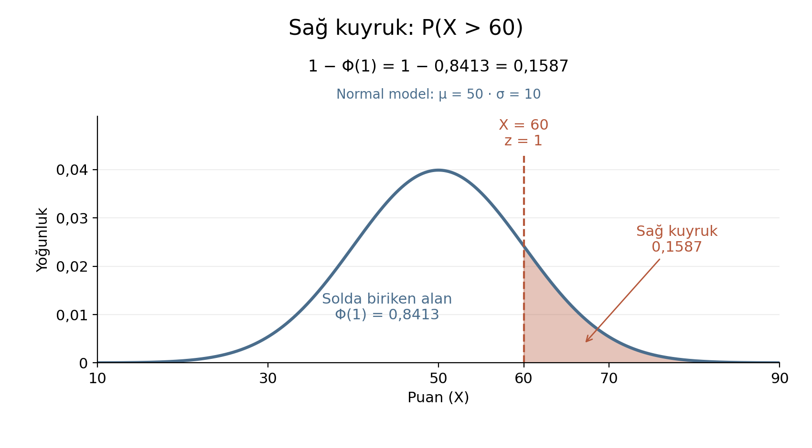{fig-alt="μ = 50 ve σ = 10 normal yoğunluk eğrisinde X = 60, z = 1 sınırının sağı taralı; sağ kuyruk 0,1587 ve solda biriken Φ(1) = 0,8413 etiketli."}

::: {.notes}
Tablo soldaki alanı verdiğinden, "60'tan büyük" olayı $1 - \Phi(1)$ olarak yazılır: toplam alan 1 olduğundan sağ kuyruk, kalan alandır. Üç işlem, Çıkarımsal İstatistik ders sunumunun 8–10. slaytlarındaki alan hesaplarından uyarlanmıştır; $\mu = 50$ ve $\sigma = 10$ bu örnek için seçilmiş parametrelerdir.
:::

---

## İşlem 2: $P(54{,}2 < X < 75{,}3)$

Sınırlar: $z_1 = (54{,}2 - 50)/10 = 0{,}42$ ve $z_2 = (75{,}3 - 50)/10 = 2{,}53$

İki sınır arası alan = kümülatif alanların farkı:

$$\Phi(2{,}53) - \Phi(0{,}42) = 0{,}9943 - 0{,}6628 = 0{,}3315$$

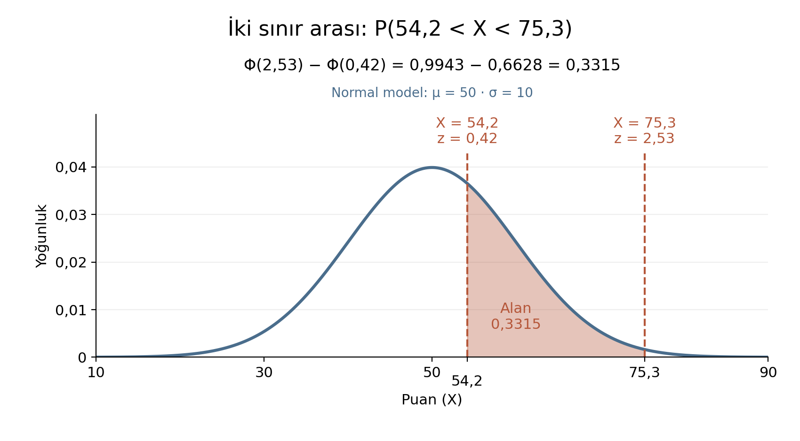{fig-alt="μ = 50 ve σ = 10 normal yoğunluk eğrisinde X = 54,2 (z = 0,42) ile X = 75,3 (z = 2,53) arası taralı; Φ(2,53) − Φ(0,42) = 0,3315."}

::: {.notes}
İki sınır arasındaki alan, üst sınırın solundaki alandan alt sınırın solundaki alanın çıkarılmasıyla bulunur: üst sınırın solunda kalan alan, alt sınırın solundaki alanı da içerir ve fark yalnız iki sınır arasındaki dilimi bırakır.
:::

---

## İşlem 3: $P(34{,}4 < X < 75{,}3)$

Sınırlar: $z_1 = (34{,}4 - 50)/10 = -1{,}56$ ve $z_2 = (75{,}3 - 50)/10 = 2{,}53$

$\Phi(-1{,}56) = 1 - 0{,}9406 = 0{,}0594$

$$\Phi(2{,}53) - \Phi(-1{,}56) = 0{,}9943 - 0{,}0594 = 0{,}9349$$

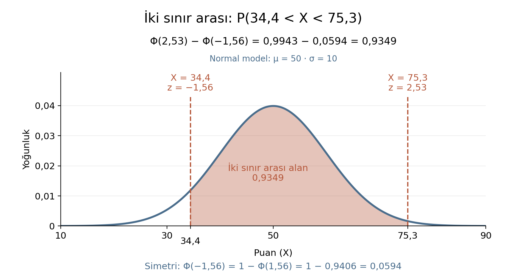{fig-alt="μ = 50 ve σ = 10 normal yoğunluk eğrisinde X = 34,4 (z = −1,56) ile X = 75,3 (z = 2,53) arası taralı; alan 0,9349 ve simetriden Φ(−1,56) = 0,0594."}

::: {.notes}
Alt sınır ortalamanın solunda olduğundan $z$ negatiftir ve tablodan doğrudan okunmaz; simetri kullanılır. İşlem üç adımdır ve her biri bir öncekinin çıktısıyla beslenir: sınırdan $z$'ye, $z$'den tablodaki kümülatif alana, kümülatif alanlardan istenen alana.

Doğrulama: aynı alanlar yazılımla daha çok ondalıkla hesaplandığında 0,158655, 0,331540 ve 0,934917 çıkar. Tablo değerleriyle fark son basamaktadır ve tablonun dört ondalığa yuvarlanmasından gelir; hata değildir.
:::

---

## Kendini kontrol et: normal alan

1. Aynı modelde $X < 40$ için alan nedir ve bağımsız olarak nasıl kontrol edersiniz?
2. Eğrinin 50'deki yüksekliği neden olasılık değildir?

::: {.notes}
Yanıt 1. $z = (40 - 50)/10 = -1$ ve simetriden $\Phi(-1) = 1 - \Phi(1) = 0{,}1587$. Kontrol: $X < 40$ ile $X > 60$ ortalamaya eşit uzaklıkta, karşılıklı kuyruklardır; simetri nedeniyle alanları eşittir ve birinci işlemle aynı sonucu verir.

Yanıt 2. Olasılık alandır ve tek bir noktanın alanı sıfırdır. Yükseklik, o noktanın çevresinde alanın ne kadar yoğun biriktiğini gösterir; aralığı genişletmek alanı artırır, yüksekliği değil.
:::

---

## Dağılım aileleri: normal tek model değildir

- $N(0,1)$: 0 çevresinde simetrik, her gerçek değeri destekler
- $U(-\sqrt{3}, \sqrt{3})$: yalnız bu aralıkta sabit yoğunluk taşır
- Üstel (ölçek 1): negatif değer almaz, 0'da başlar, sağa çarpık
- $t(7)$: 0 çevresinde simetrik, normalden kalın kuyruklu

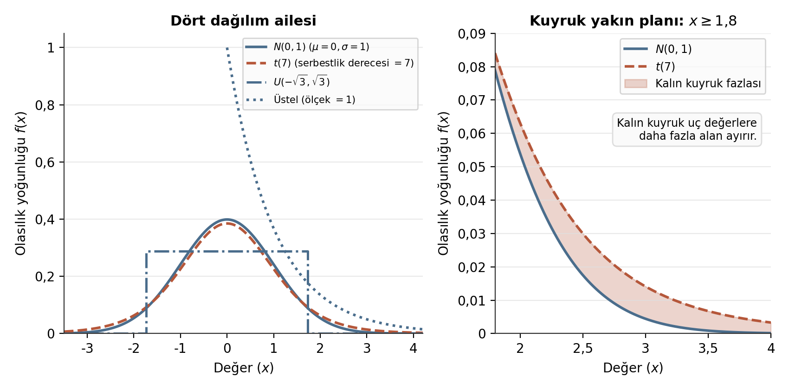{fig-alt="Solda N(0,1), U(−√3, √3), ölçek 1 üstel ve t(7) yoğunluk eğrileri; sağda x ≥ 1,8 için normal ile t(7) kuyrukları ve t dağılımının ek kuyruk alanı."}

::: {.notes}
Kalın kuyruk, uç değerlere daha fazla alan ayrılması demektir. $t(7)$ ile normal arasındaki fark merkezde küçük, kuyruklarda belirgindir; bu yüzden aynı sınır değeri $t(7)$'de normalden daha büyük bir kuyruk alanı verir. Bu dört model burada seçilmiş çizim parametreleridir; eşit varyanslı oldukları ya da ortak bir psikolojik evrenden geldikleri anlamına gelmez.
:::

---

## Bir sütunda kişi mi, örneklem ortalaması mı var?

Uyku sütunu: her satır **bir kişi**; *s* = 1,0351 saat → kişilerin birbirinden ayrılması

Başka bir soru: aynı büyüklükteki örneklemlerin **ortalamaları** kendi aralarında ne kadar değişir?

İkinci soru → örneklem ortalamaları dağılımı

::: {.notes}
Elimizde tek bir ortalama var: *M* = 6,25. Aynı evrenden başka sekiz kişi seçilseydi ortalama değişebilirdi. Bu değişkenlik kişiler arasındaki değişkenlik değildir. Kişi puanları, kişinin kendi uyku süresiyle ilgilidir; örneklem ortalamaları dağılımı ise bir örneklemin ortalamasının örneklemden örnekleme nasıl değiştiğiyle ilgilidir. İki dağılımın ölçü birimi aynıdır (saat); ancak dağılımdaki nesne veya sayılan birim farklıdır (biri tek bir kişi, öteki sekiz kişilik bir örneklemin ortalaması). Bu nedenle ikisinin standart sapmaları aynı şeyi ölçmez.
:::

---

## Bilinen küçük bir evren: tam sayım

Dört eşit olasılıklı kayıt: [300, 300, 300, 700] ms. Yerine koyarak, bağımsız seçim.

$P(300) = 3/4$, $P(700) = 1/4$

$\mu = (300 + 300 + 300 + 700)/4 = 400$ ms

$$\sigma^2 = \frac{3(300-400)^2 + (700-400)^2}{4} = \frac{30000 + 90000}{4} = 30000 \text{ ms}^2$$

$\sigma = \sqrt{30000} = 173{,}205081$ ms

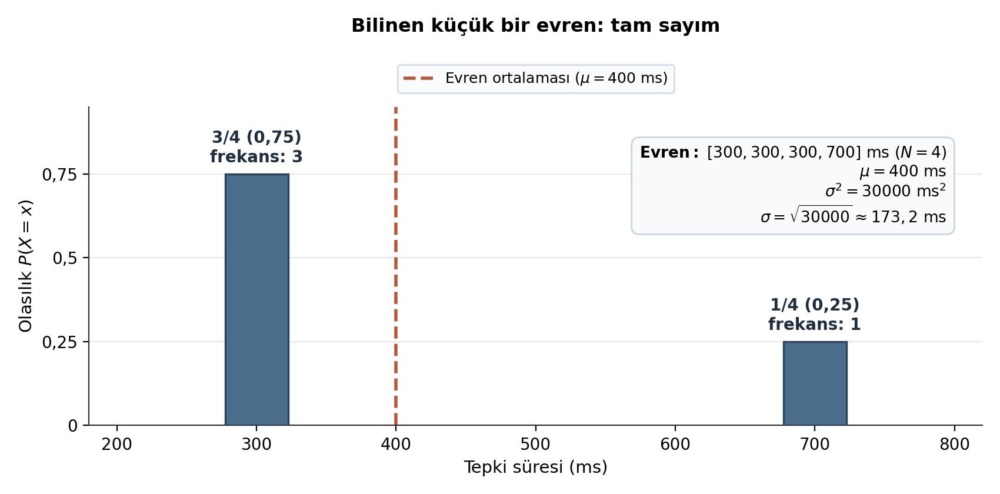{fig-alt="Tepki süresi ekseninde 300 ms için 3 kayıt ve 3/4 olasılık, 700 ms için 1 kayıt ve 1/4 olasılık çubukları; μ = 400 ms çizgisi ve evren varyansı ile standart sapması."}

::: {.notes}
Evren küçük ve açık olduğundan bütün olasılıklar sayılabilir; bu, örnekleme dağılımını simülasyona ya da formüle bırakmadan elle kurmayı sağlar. Yerine koyarak çekimde her çekim aynı evrenden bağımsız yapılır; bu nedenle her çekimde P(300) = 3/4 olur. Evren varyansı $\mu$ çevresinde bütün dört kaydın ortalama kare sapmasıdır; payda evrendeki kayıt sayısıdır (4), çünkü burada örnekten değil evrenin tamamından hesap yapılır.
:::

---

## *n* = 2 için bütün örneklem ortalamaları

Sıralı çiftlerin sayısı: $4^2 = 16$, hepsi eşit olasılıklı.

| Örneklem ortalaması | 300 | 500 | 700 |
|---:|---:|---:|---:|
| Çift sayısı | 9 | 6 | 1 |
| Olasılık | 9/16 | 6/16 | 1/16 |

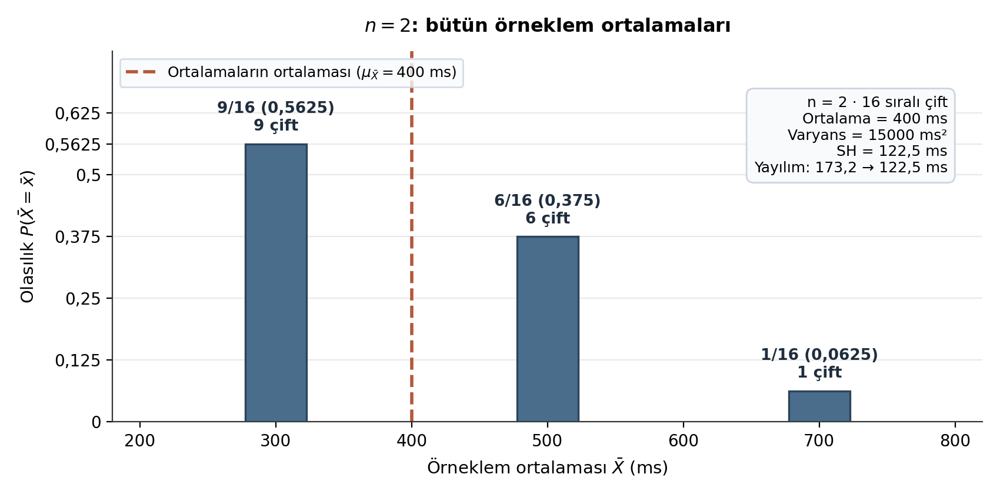{fig-alt="n = 2 için 16 sıralı çiftin ortalamaları: 300 ms için 9/16, 500 ms için 6/16, 700 ms için 1/16 olasılık çubukları; merkez 400 ms ve SH yaklaşık 122,5 ms."}

::: {.notes}
Ortalamanın 300 olması için iki çekimin de 300 olması gerekir: $3 \times 3 = 9$ çift. Ortalama 500 için biri 300, öteki 700 olmalıdır; iki sıra olası olduğundan $3 \times 1 \times 2 = 6$ çift vardır. Ortalama 700 için iki çekim de 700'dür: 1 çift. Toplam $9 + 6 + 1 = 16$ tüm çiftlerin sayısına eşit olduğundan sayım doğrulanmıştır.
:::

---

## Ortalamaların ortalaması ve standart hata

Ortalamaların ortalaması: $(9 \times 300 + 6 \times 500 + 1 \times 700)/16 = 400 = \mu$

Ortalamaların varyansı: $\dfrac{90000 + 60000 + 90000}{16} = 15000$

Standart hata: $\sqrt{15000} = 122{,}474487 = \sigma/\sqrt{2}$ ms

**Standart hata (SH):** bir örneklem istatistiğinin, aynı yolla tekrarlanan örneklemler arasındaki standart sapması.

::: {.notes}
İki dağılım aynı birimde (ms) ama farklı nesnelerdir: tek bir kaydın dağılımının standart sapması 173,2 ms'dir; iki kaydın ortalamasının dağılımının standart sapması 122,5 ms'dir. Ortalamaların ortalamasının $\mu$'ye eşit çıkması, örneklem ortalamasının evren ortalaması için yansız bir kestirim olduğunu bu evrende gösterir. İki kaydın ortalaması tek kayda göre daha az oynaktır, çünkü bir çiftte uç değerin (700) payı yarıya iner.
:::

---

## Standart hata örneklem büyüklüğüyle nasıl değişir?

Bağımsız, aynı evrenden çekimde: $\text{SH} = \sigma/\sqrt{n}$

- *n* = 5: $173{,}205081/\sqrt{5} = 77{,}459667$ ms
- *n* = 30: $173{,}205081/\sqrt{30} = 31{,}622777$ ms

*n* dört kat artınca: $\sigma/\sqrt{4n} = \tfrac{1}{2}\,\sigma/\sqrt{n}$ (SH yarıya iner)

Bireysel $\sigma$ aynı kalır: evren değişmemiştir.

::: {.notes}
Büyüyen örneklem ortalamanın oynaklığını azaltır, ama tek bir kişinin değerinin ne kadar değişebildiğini azaltmaz.

Ortalamaların dağılımı, sonlu varyanslı bağımsız ve aynı dağılımdan çekimde, *n* büyüdükçe yaklaşık normale yaklaşabilir. Bunun için sabit bir "*n* ≥ 30 yeter" kuralı yoktur. *n* = 2'deki dağılım da açıkça normal değildir: üç değerlidir ve eğiktir. Yerine koymadan sonlu bir evrenden çekimde ya da kümeli veya bağımlı örneklemede aynı formül sessizce kullanılmaz.
:::

---

## Simülasyonla doğrulama: kuramsal SH ve gerçekleşen *SD*

Dört kayıtlı evrenden [300, 300, 300, 700] yerine koyarak bağımsız çekimle üretilen 1000'er örneklemin sonuçları:

| Örneklem büyüklüğü | Tekrar sayısı | Kuramsal merkez (ms) | Gerçekleşen ortalama (ms) | Kuramsal SH (ms) | Gerçekleşen *SD* (ms) |
|---:|---:|---:|---:|---:|---:|
| *n* = 5 | 1000 | 400 | 399,520000 | 77,459667 | 77,040930 |
| *n* = 30 | 1000 | 400 | 401,106667 | 31,622777 | 31,868686 |

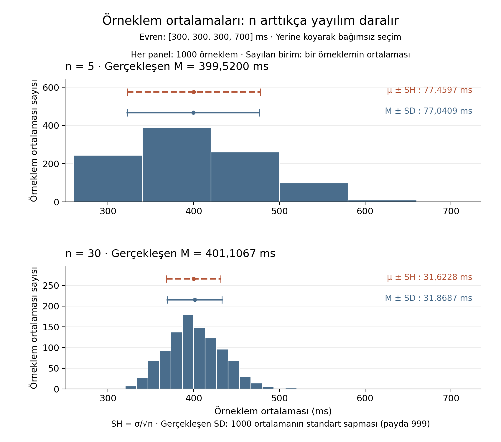{fig-alt="Ortak ms ekseninde 1000’er örneklem ortalamasının histogramları; n = 5 için M = 399,5200 ve SD = 77,0409 ms, n = 30 için M = 401,1067 ve SD = 31,8687 ms; kesikli μ ± SH ve düz M ± SD aralıkları."}

::: {.notes}
Evren [300, 300, 300, 700] ms evrenidir. Yerine koyarak bağımsız çekimle her bir *n* büyüklüğü için 1000 bağımsız örneklem çekilmiş ve her birinin ortalaması alınmıştır. Tablodaki gerçekleşen *SD*, bu 1000 ortalamanın $n-1 = 999$ paydasıyla hesaplanan örneklem standart sapmasıdır; tekil kayıtların standart sapması değildir.

Sonlu sayıda tekrar, olası örneklemlerin bütününü tam kuramsal olasılık ağırlıklarıyla temsil etmez; bu nedenle gerçekleşen merkez tam 400, gerçekleşen *SD* de tam kuramsal SH ile birebir çakışmaz. Kuramsal SH sonsuz tekrarda beklenen ideal oynaklıktır; 1000 tekrar bu ideale çok yaklaşır. İki örneklem büyüklüğünde de ortalamalar 400 çevresinde toplanırken *n* = 30'da yayılım belirgin biçimde daralmıştır; ancak başlangıç evreninin bireysel $\sigma = 173{,}2$ ms değeri değişmemiştir.
:::

---

## Simülasyon sonuçlarının frekanslarla bağımsız kontrolü

Her örneklemde 700 ms gelen kayıtların sayısına $k$ diyelim. Kalan $n - k$ kayıt 300 ms olduğundan örneklem ortalaması:

$$\bar{x} = 300 + \frac{400k}{n}$$

- Tek tek 1000 ortalamayı hesaplamak ile gerçekleşmedeki $k$ frekanslarının ağırlıklı ortalaması ve standart sapmasını ($n-1 = 999$ paydalı) almak aynı sonucu verir.
- Bağımsız kontrol: Her iki hesap yolu da tabloda verilen değerleri (399,52 ms / 77,04 ms ve 401,11 ms / 31,87 ms) tam olarak yeniden üretir.

::: {.notes}
Bir simülasyon çıktısı iki ayrı hesap yoluyla denetlenebilir. 1000 ortalamanın tekil listesinden doğrudan hesaplanan standart sapma ile olası $k$ değerlerinin gerçekleşen sayımları üzerinden yapılan ağırlıklı hesap birbiriyle tam olarak uyuşur. Böylece ham simülasyon çıktısı ile frekans tablosu birbirini karşılıklı olarak doğrular.
:::

---

## Uyku verisine dönüş: *s* ile $s/\sqrt{8}$

*s* = 1,0351 saat → kişilerin kendi ortalamalarından yayılımı

$s/\sqrt{8}$ = 0,3660 saat → sekiz kişilik örneklem ortalamalarının yayılımı için **tahmin**

Kesin değer $\sigma/\sqrt{8}$ olurdu; $\sigma$ bilinmediğinden yerine *s* konur.

::: {.notes}
Uyku evreninin $\sigma$ değeri bilinmediği için sonuç bir kestirimdir. Dört kurgusal ortalama (6,25; 5,9; 6,6; 6,1) yalnız sezgi içindir: aynı evrenden gelen örneklem ortalamalarının birbirinden farklı çıkabildiğini gösterir. Bunlardan evren olasılığı hesaplanmaz.

İki sayının birimi de saattir; farklı olan, dağılımdaki nesnedir. Birincinin nesnesi bir kişinin uyku değeri, ikincinin nesnesi bir örneklemin ortalamasıdır.
:::

---

## Kendini kontrol et: kişi ve ortalama

1. *n* = 2 evreninde örneklem ortalamasının 600 ms'nin üzerinde olma olasılığı nedir?
2. Uyku için *s* = 1,0351 ile $s/\sqrt{8}$ = 0,3660 neden aynı şeyi ölçmez?

::: {.notes}
Yanıt 1. Yalnız 700 ms ortalaması bu koşulu sağlar ve olasılığı 1/16 = %6,25'tir. Bu, belirli bir modelde belirli bir olayın olasılığıdır; hipotez testinin *p* değeri henüz değildir, çünkü ne H0 ne de bir uçluk tanımı kurulmuştur.

Yanıt 2. İkisinin ölçü birimi de saattir; farklı olan, dağılımdaki nesnedir. İlki bir sütundaki kişi uyku değerlerinin ortalamadan sapmasıdır (nesne: bir kişinin uyku değeri); ikincisi sekiz kişilik örneklem ortalamalarının örneklemden örnekleme değişimi için bir tahmindir (nesne: bir örneklemin ortalaması).
:::

---

## Aynı fark, neden iki farklı kuyruk alanı?

Araştırma sorusu: "Hedef evrendeki öğrencilerin ortalama uyku süresi 7 saatlik varsayımsal referanstan farklı mı?"

*M* → örneklemin **istatistiği**; $\mu$ → evrenin **parametresi**

Soru parametre üzerine kuruludur: $\mu - 7$

::: {.notes}
7 saat bir sağlık ya da klinik norm değil, öğretim için seçilmiş bir referanstır. Soruyu $\mu - 7$ biçiminde yazmak, hipotezin örneklemin kendisi hakkında değil evren hakkında kurulduğunu görünür kılar. "Bu sekiz kişinin ortalaması nedir?" sorusu ise ayrıca bir H0 gerektirmez; betimleme sorusudur.

Burada hipotez ve yön veriden önce belirlenmiş sayılır. Ortak veriyi önceden tanımak gerçek bir ön kayıt anlamına gelmez; öğretim senaryosunun varsayımıdır.
:::

---

## İstatistiksel hipotezler ve anlamlılık düzeyi ($\alpha$)

- İstatistiksel hipotez: evrenin bir parametresi veya dağılımı hakkında verilerle sınanabilir bir iddia.
- Sıfır hipotezi ($H_0$): sınamada esas alınan referans iddia.
- Alternatif hipotez ($H_1$): sıfır hipotezinin karşısındaki alternatif parametre bölgesi veya dağılım iddiası.
- Anlamlılık düzeyi ($\alpha$): hipotez testinde veriye bakılmadan önce belirlenen karar eşiği (bu ünitede $\alpha = 0{,}05$).

İddialar eldeki sekiz kişinin $M$ değeri hakkında değil, hedef evrenin $\mu$ parametresi hakkındadır. Hipotez ve $\alpha$ veriye bakıldıktan sonra değiştirilmez.

::: {.notes}
Örneklem verisi hipotezi kurmak için değil, önceden kurulmuş bir iddiayı sınamak için veri sağlar. $\alpha$, araştırma yürütülmeden önce belirlenen bir eşiktir; veriyi gördükten sonra bu eşiği değiştirmek hata denetimini bozar. $\alpha$, doğru sıfır hipotezi altında yanlış ret riskini sınırlar.
:::

---

## İki yönlü ve yönlü kurgu: alternatif ve null bölgeler

- İki yönlü kurgu: $H_0\colon \mu - 7 = 0$ karşıtı $H_1\colon \mu - 7 \ne 0$
  (Farkın yönü önceden öngörülmemiştir; sıfırdan her iki yöndeki uzaklaşma reddi destekler.)
- Yönlü kurgu (önceden, gerekçeyle azalma beklentisi): $H_1\colon \mu - 7 < 0$
  - Yönlü kurguda null bölge: $\mu - 7 \ge 0$ (yani $\mu = 7$ ve ondan büyük tüm değerler).
  - Hesap kuralı: Test hesabı, null bölgenin sınırı olan $\mu = 7$ dağılımında yapılır.

::: {.notes}
Yönlü kurguda sıfır hipotezi tek bir nokta değil, bir eşitsizlik ve parametre bölgesidir ($\mu \ge 7$). Test istatistiği hesabı ise null bölgenin sınır noktasında ($\mu = 7$) yürütülür. Evren ortalaması 7'nin üzerine çıktıkça, aynı düşük örneklem ortalamasını veya daha düşüğünü gözleme olasılığı azalır. Bu nedenle azalma yönündeki sınamada, null bölge içinde yanlış ret olasılığının en büyük olduğu sınır değeri $\mu = 7$ temel alınır. Hipotezin yönü veriye bakılmadan önce somut bir kuramsal ya da pratik gerekçeyle belirlenmelidir; veri sonrasında yön seçmek hata kontrolünü geçersiz kılar.
:::

---

## *p* değeri ne ve nereden?

**Tanım.** *p* değeri, $H_0$ ve kullanılan modelin koşulları altında, seçilmiş test istatistiğinin gözlenmiş kadar veya daha uç bir değer alma olasılığıdır.

- *p* ≠ $H_0$'ın doğru olma olasılığı
- *p* ≠ sonucun rastlantı olma olasılığı

::: {.notes}
Önceki bölümde örneklem ortalamalarının $H_0$ doğru olsa bile değişebildiği görüldü; *p* bu değişkenliğe dayanır: seçilen test istatistiğinin gözlenmiş kadar veya daha uç değerleri $H_0$ altında ne kadar sık görülür?

Tanım koşulludur: koşul $H_0$'ın ve model koşullarının doğru olmasıdır. Bu yüzden *p*, "$H_0$'ın doğru olma olasılığı" değildir; $P(H_0 \text{ doğru} \mid \text{veri})$ ayrı bir niceliktir ve *p* onu vermez. "Sonucun rastlantı olma olasılığı" da değildir, çünkü rastlantıdan söz etmek için $H_0$'ın doğru olduğu varsayılmıştır ve *p* o varsayımın olasılığını vermez.
:::

---

## Hazır *t* değeri: uyku verisi, referans 7

$M - 7 = 6{,}25 - 7 = -0{,}75$ saat; tahmini SH = 0,365963 saat

$$t(7) = -2{,}049390 \text{ (7 serbestlik derecesi)}$$

Bu değer **hazır çıktıdır**: ne ham *z*, ne de bilinen $\sigma$ ile yapılmış bir *z* testi.

::: {.notes}
Evrenin $\sigma$ değeri bilinmediğinden ortalamanın sınanmasında kullanılan istatistik $t$'dir. Burada $t$ bir jamovi ya da IBM SPSS tek örneklem çıktısı gibi hazır değer olarak verilir ve yalnız *p* ile kuyruk okuması için kullanılır; $t$'nin türetimi, serbestlik derecesinin anlamı ve güven aralığı bu birimin konusu değildir. Normal evren ve bağımsız örnekleme koşulları altında bu değerin referans dağılımı $t(7)$'dir.

Değerin mantığı kabaca şudur: fark $-0{,}75$, tahmini SH 0,365963'e bölünerek standart hata biriminde ifade edilir; $-0{,}75/0{,}365963 \approx -2{,}0494$. Bu bölme, ham *z*'deki kişi içi uzaklıktan farklı olarak ortalamanın oynaklığına göre ölçülür.
:::

---

## İki kuyruk, tek kuyruk: aynı fark, farklı *p*

| Kuruluş | Sayılan uç bölge | *p* |
|---|---|---:|
| İki yönlü | $t \le -2{,}04939$ ya da $t \ge +2{,}04939$ | 0,079602 |
| Önceden azalma beklentisi | $t \le -2{,}04939$ | 0,039801 |

Doğrulama: iki kuyruk ayna görüntüsüdür → 0,079602 / 2 = 0,039801

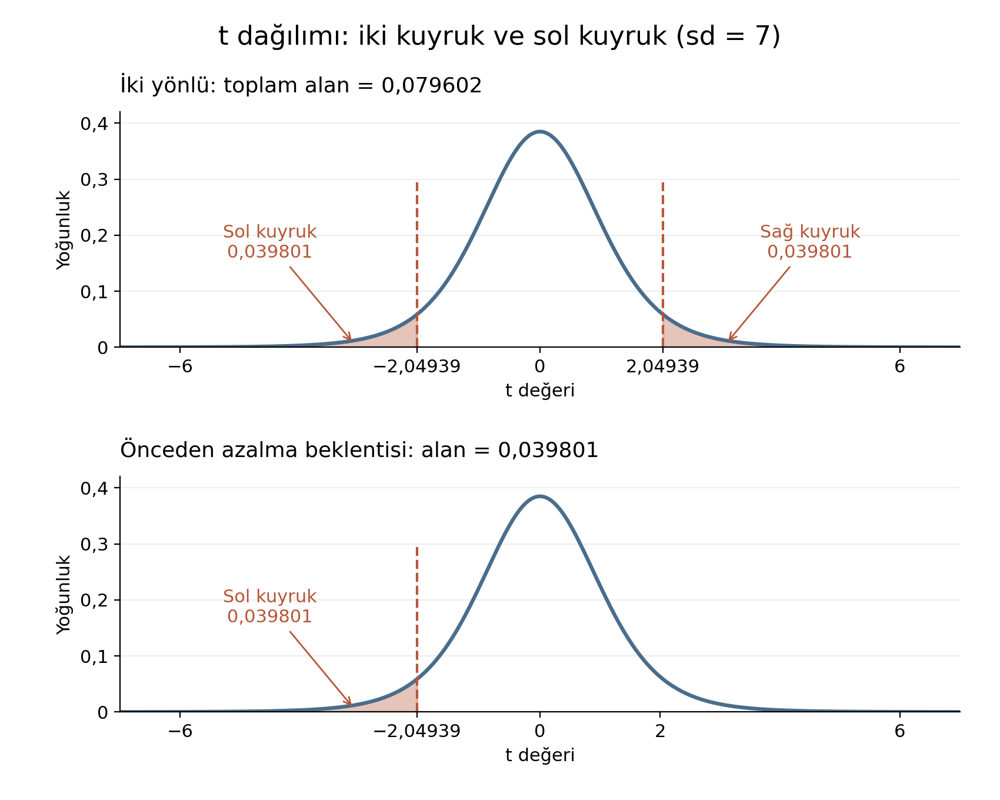{fig-alt="7 serbestlik dereceli t yoğunluk eğrisinde üst panelde ±2,04939 dışındaki iki kuyruk taralı, toplam alan 0,079602; alt panelde yalnız −2,04939 solundaki kuyruk taralı, alan 0,039801."}

::: {.notes}
İki yönlü *p* yönlü *p*'nin iki katıdır, çünkü $t(7)$ simetriktir ve gözlenen işaret (negatif) alternatifin yönüyle uyumludur. Aynı $-0{,}75$ saatlik fark iki kuruluşta da aynı kalır; değişen, alternatifin hangi uç bölgeyi saydığıdır. Bu yüzden *p*'nin değişmesi farkın ya da etkinin değiştiği anlamına gelmez.
:::

---

## Karar dili: *p* ile $\alpha$ karşılaştırması

İki yönlü: *p* = 0,0796 > 0,05 → $H_0$ reddedilemez

Önceden yönlü: *p* = 0,0398 < 0,05 → $H_0$ reddedilir

- *p* < $\alpha$ ise $H_0$ reddedilir; *p* ≥ $\alpha$ ise reddedilemez.
- "$H_0$ kabul edildi" · "$H_1$ kanıtlandı" · "fark kesinlikle yok" ifadeleri kullanılmaz.

::: {.notes}
İki kararı yan yana görmek yön seçiminin sonucu değiştirdiğini gösterir; bu, veriye bakıldıktan sonra yön seçmeye izin verildiği anlamına gelmez. Hipotezin yönü veriden önce belirlenmediyse yönlü *p* kullanılamaz. $\alpha$ veriden önce belirlenen eşiktir, *p* veriden sonra hesaplanır.

İki yönlü sonuç için doğru cümle: "Bu kurgusal öğretim örnekleminde, $\alpha$ = 0,05'te $\mu = 7$ $H_0$'ı reddedilemedi; sekiz kişilik veri bu kurulum altında $H_0$'la uyumsuzluğu göstermeye yetmedi."
:::

---

## Her *p* otomatik ikiye bölünemez

Önceden artış beklentisi: $H_1\colon \mu - 7 > 0$ → sağ kuyruk alanı $1 - 0{,}039801 \approx 0{,}960199$

Gözlenen azalma bu iddiayı desteklemez.

İki yönlü *p*'yi ikiye bölmek için iki koşul gerekir:

1. Gözlenen işaret alternatifin yönüyle uyumlu olmalıdır.
2. Referans dağılım simetrik olmalıdır.

::: {.notes}
Bir yazılım yönlü kuyruk seçeneği vermiyorsa iki yönlü *p* ikiye bölünerek yönlü *p* elde edilebilir; ama bu yalnız bu iki koşul sağlandığında doğrudur. Gözlenen işaret alternatifin yönüyle çelişiyorsa, yukarıdaki karşı örnekte olduğu gibi, yönlü *p* çok büyük çıkar ve ikiye bölme yanlış bir küçük değer verirdi.
:::

---

## Küçük *p* neyi vermez?

Küçük *p* etki büyüklüğü vermez; yalnız $H_0$ altında bu kadar uç bir değerin seyrek olduğunu söyler.

Büyük *n* örneklem ortalamalarının oynaklığını azaltabilir; yanlı seçimi ya da bağımsızlık sorununu gidermez.

::: {.notes}
Bu örneklem kurgusal ve küçüktür; bu veri, uyku evreni hakkında gerçek bir bulgunun raporuna dayanak olamaz. Küçük bir *p* de etkinin büyük ya da pratik açıdan önemli olduğunu söylemez; bunun için ayrıca tanımlı bir etki büyüklüğü ölçüsü gerekir.
:::

---

## Kendini kontrol et: *p* ve karar

1. İki yönlü *p* = 0,0796'yı gören bir öğrenci "azalma demek istedim" diyerek yönlü teste geçerse neden kabul edilemez?
2. *p* = 0,03 ve $\alpha$ = 0,05 çıktı. Karar nedir, neyi söylemez?

::: {.notes}
Yanıt 1. Yönlü *p*, hata kontrolünün sağlandığı kuruluşta, yani yön veriden önce belirlendiğinde geçerlidir. Veriyi gördükten sonra uç sonuç kümesi değiştirilmiştir; *p*'nin dayandığı başlangıç hata kontrolü ($\alpha$'nın yalnız doğru $H_0$ altında yanlış red oranını sınırlaması) korunmaz, çünkü sonuç bilinerek en uygun yön seçilmiştir.

Yanıt 2. *p* < $\alpha$ olduğundan $H_0$ reddedilir. Varsayımlar altında $H_0$'la uyumsuzluk vardır; bu, $H_0$'ın yanlış olduğunun kesin kanıtı, etkinin büyük olduğu ya da nedensellik anlamına gelmez.
:::

---

## Karar yanlışsa neyi kaçırmış oluruz?

Bir kaygı programı: $\Delta = \mu_{\text{program}} - \mu_{\text{kontrol}}$

$H_0\colon \Delta = 0$ · $H_1\colon \Delta \ne 0$ (azalma yararlı yön ise $\Delta < 0$)

| Gerçek durum | $H_0$ reddedildi | $H_0$ reddedilemedi |
|---|---|---|
| $\Delta = 0$ | Tip I hata: olmayan farkı bildirme | Doğru karar |
| $\Delta \ne 0$ | Doğru karar | Tip II hata: gerçek farkı kaçırma |

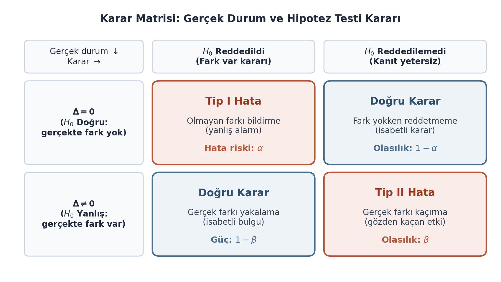{fig-alt="Satırları Δ = 0 ve Δ ≠ 0, sütunları H₀ reddedildi ve reddedilemedi olan karar matrisi; Tip I, Tip II ve iki doğru karar hücresi, α, β ve güç etiketleri."}

::: {.notes}
Karar verirken gerçeği bilmeyiz; yine de dört olası durum vardır. Azalma yararlı yön ise bu $\Delta < 0$'dır; yalnız herhangi bir farkın bulunması yarar kanıtı değildir.

Somut sonuçlar ayrıdır. Tip I'de etkisiz bir program fark varmış gibi yaygınlaştırılır. Tip II'de kaygıyı gerçekten azaltan bir program ($\Delta < 0$) fark yakalanmadığı için gözden kaçar. Hangi hatanın daha maliyetli olduğu araştırma bağlamına bağlıdır; evrensel bir sıralama yoktur.
:::

---

## Karar hatalarının tanımları: Tip I, Tip II ve güç

- Tip I hata: sıfır hipotezi doğruyken onu reddetme hatası (olmayan farkı bildirme; doğru $H_0$ altında riski $\alpha$ ile sınırlanır).
- Tip II hata: sıfır hipotezi yanlışken onu reddedememe hatası (gerçek farkı kaçırma; olasılığı $\beta$ ile gösterilir).
- Güç ($1 - \beta$): belirli bir gerçek etki büyüklüğü, araştırma deseni ve örneklem büyüklüğü ($n$) altında, yanlış olan sıfır hipotezini doğru biçimde reddetme olasılığı.

$$\text{Güç} = 1 - \beta$$

::: {.notes}
$\alpha = 0{,}05$, tek bir kararın %5 olasılıkla yanlış olduğu anlamına gelmez: gerçek durum bilinmiyorsa o tek karar için hata olasılığı bu sayıdan okunamaz. $\alpha$ yalnız $H_0$ doğruyken yanlış ret riskinin sınırıdır. $\beta$ ve dolayısıyla güç ($1 - \beta$) ise tek bir sabit sayı değildir; belirli bir gerçek etki büyüklüğüne, desene ve örneklem büyüklüğüne ($n$) bağlıdır. Bu ünitede yeni bir güç hesabı yapılmaz; ancak gücün formülünün ardındaki bu bağımlılıklar korunmalıdır.
:::

---

## Bilinen gerçekle reddedememe

Kaynak senaryo: iki evren, ortalamalar 171 ve 170, standart sapmalar 10'ar, her gruptan *n* = 500

Gerçek fark: 1 birim ($\Delta \ne 0$)

Saklı test çıktısı: $t \approx 1{,}14$; $p \approx 0{,}255$ → $\alpha = 0{,}05$'te $H_0$ reddedilemedi

Gerçek fark bilindiğinden: **Tip II hatası örneği**

::: {.notes}
Bu sayılar yalnız bu kaynak senaryoya aittir (Çıkarımsal İstatistik ders materyali); uyku verisine ya da kaygı programı örneğine taşınmaz. Evren ortalamalarının 171 ve 170 olması, gerçekleşen örneklem ortalamalarının bu değerler olduğu anlamına gelmez. Ayrıca iki örtüşen histogram eşitliğin kanıtı değildir ve tek bir gerçekleşmeden genel bir $\beta$ ya da güç tahmini yapılmaz.
:::

---

## Kendini kontrol et: hata türü

Gerçek $\Delta = -2$ olan bir evrende *p* = 0,25 ve $\alpha$ = 0,05 çıktı. Karar ve hata durumu nedir?

::: {.notes}
*p* ≥ $\alpha$ olduğundan $H_0$ reddedilemez. Gerçek fark sıfır olmadığı bilindiği için bu bilinen-gerçek senaryoda Tip II hata gerçekleşmiştir. Gerçek $\Delta$ bilinmiyorsa, yalnız *p*'den hatanın gerçekleştiği söylenemez.
:::

---

## Normallik testinin reddedememesi neyi gösterir?

Aynı sekiz uyku kaydı için üç gösterim: histogram · normal Q–Q grafiği · Shapiro–Wilk çıktısı

**Shapiro–Wilk testi:** bir örneklemin normal dağılımlı bir evrenden gelip gelmediğini sınayan normallik testi.

- Shapiro–Wilk çıktısı: *n* = 8, *W* = 0,917279, *p* = 0,408177
- $H_0$: veri normal dağılımlı bir evrenden gelir.
- *p* ≥ 0,05 → $H_0$ reddedilemez.

::: {.notes}
Çıktı jamovi ya da IBM SPSS normallik çıktısı gibi hazır bir değerdir. $H_0$'ın reddedilememesi "veri kesin normaldir" ya da "$t$'nin koşulu kanıtlandı" anlamına gelmez; yalnız bu *n* = 8'de normallikten bir sapma saptanamadığını söyler. Küçük *n*'de test sapmalara karşı sınırlı duyarlıdır; büyük *n*'de ise küçük sapmaları da yakalama olasılığı artar. Ne grafiğin kaba sınıf görünümü ne de testin *p* değeri tek başına normallik sertifikası verir.
:::

---

## Normal Q–Q grafiğinin mekanizması: konum ve ölçek ilişkisi

- Nicelik (kuantil): belirli bir birikimli orana karşılık gelen değer (ör. medyan, 0,50 birikimli oranının niceliğidir).
- Normal Q–Q grafiği: küçükten büyüğe sıralanmış gözlemleri, aynı sıra konumlarına karşılık gelen kuramsal standart normal niceliklerle eşleştiren grafik.
- Doğrusal beklentinin mekanizması: Evren normal dağılımlı ise, gözlenen değer ile kuramsal nicelik arasındaki ilişki konum ve ölçek dönüşümüdür:
  $$x = \mu + \sigma q$$
  (Burada $q$ standart normal nicelik, $\mu$ konum kayması, $\sigma$ ölçek katsayısıdır.)

::: {.notes}
Standart normal nicelik $q$, evren standart sapması $\sigma$ ile çarpılıp evren ortalaması $\mu$ eklendiğinde beklenen $x$ değerini verir. Bu doğrusal ilişki nedeniyle noktaların bir doğru çevresinde dizilmesi beklenir. Sonlu bir örneklemde rastgele örnekleme dalgalanmaları nedeniyle noktaların tam bir doğru üzerine kusursuz oturması beklenmez. Çizgiden belirgin ve sistematik uzaklaşmalar veya uçlardaki bükülmeler, normal model varsayımının sorgulanmasını gerektirir.
:::

---

## Temiz sekiz kayıt: histogram ve Q–Q grafiği

Gözlenen uyku süreleri: [5, 5, 6, 6, 6, 7, 7, 8] saat

- Q–Q panelinin yatay ekseni: kuramsal standart normal nicelik ($q$)
- Q–Q panelinin dikey ekseni: gözlenen uyku süresi ($x$, saat)

{fig-alt="Temiz sekiz uyku gözleminin histogramı (yatay eksen uyku süresi saat, dikey eksen gözlem sayısı; sınıflar 5, 6, 7, 8 saat çevresinde 2/3/2/1 yükseklikte; kesikli çizgi aynı ortalama ve s ile normal eğri) ve normal Q–Q grafiği"}

::: {.notes}
Sol panel sekiz kaydın histogramıdır: çubuk yükseklikleri 2, 3, 2 ve 1 gözlemdir; kesikli eğri aynı ortalama ve standart sapmayla çizilmiş ve gözlem sayısı ölçeğine çevrilmiş normal eğridir. Sağ panel normal Q–Q grafiğidir; kesikli çizgi görsel bir referans çizgisidir. Bu görseldeki çizgi ve nokta konumları bir görsel referans işlevi görür; grafiğin referans çizgisi algoritması veya nokta yerleşimi jamovi/SPSS çıktısı olarak doğrulanmış değildir ve yazılım çıktılarıyla birebir aynı formülü taşıdığı iddia edilmez. Shapiro–Wilk test değerleri ($W = 0{,}917279$, $p = 0{,}408177$) şeklin içinde yer almaz, bağımsız bir sayısal kontrol çıktısı olarak sunulur.

Aynı değerleri taşıyan kayıtlar (iki 5, üç 6, iki 7) basamak oluşturur; çünkü saatler tam sayıya yuvarlanmıştır. Noktalar referans çizgisi çevresindedir ve sistematik bir eğrilik görülmez; ancak sekiz noktadan kesin bir evren şekli türetilemez.
:::

---

## Karşı örnek: K09 = 1 eklenince

Shapiro–Wilk çıktısı: *n* = 9, *W* = 0,834, *p* = 0,0493

*p* < 0,05 → $H_0$ reddedilir: normallikten sapma saptandı.

{fig-alt="K09 = 1 saat eklenmiş dokuz gözlemin histogramı ve normal Q–Q grafiği; yatay eksende 1 saatlik tek bir uç çubuk, Q–Q grafiğinde sol alttaki nokta çizgiden uzak"}

::: {.notes}
Tek bir düşük değer Q–Q grafiğinde sol alttaki noktayı çizgiden uzaklaştırır ve histogramda ayrı, uzak bir çubuk olarak görünür. Bu sonuç K09'un silinmesi gerektiğini söylemez. Önce kayda dönülür: gerçek ama uç bir ölçüm de olabilir, kayıt hatası da.
:::

---

## İki senaryo yan yana

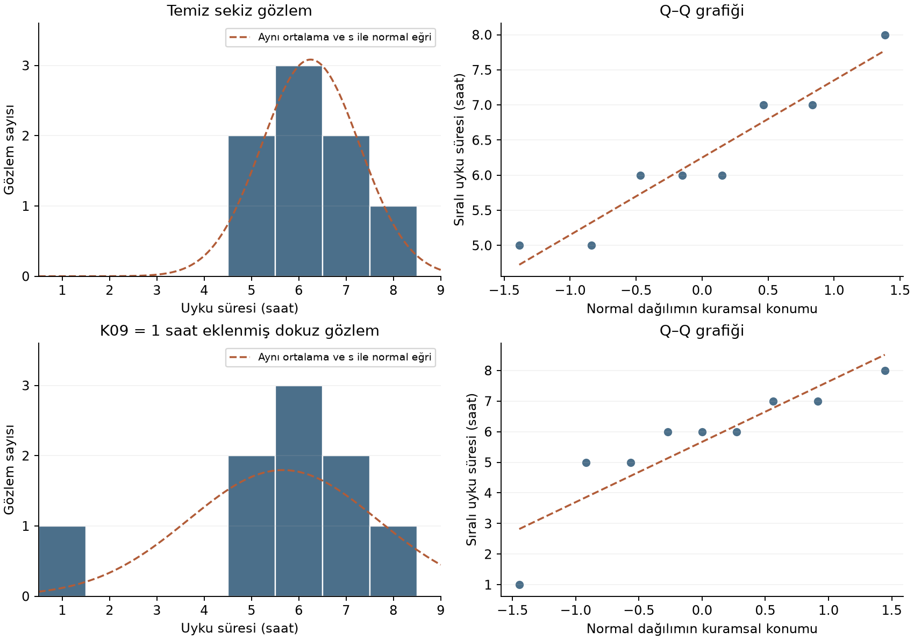{fig-alt="İki senaryonun karşılaştırması: üstte temiz sekiz gözlem, altta K09 = 1 saat eklenmiş dokuz gözlem; her satırda histogram (kesikli çizgi aynı ortalama ve s ile normal eğri) ve normal Q–Q grafiği"}

Temiz sekiz kayıt: *p* = 0,408 → sapma saptanmadı. K09'lu dokuz kayıt: *p* = 0,0493 → sapma saptandı.

::: {.notes}
Bu fark, *p*'nin eşik çevresinde duyarlı olduğunu da gösterir: 0,0493 ile 0,05 arasındaki mesafe küçüktür ve tek bir eşik karşılaştırması tanının tamamı değildir. Karar grafik, *n* ve araştırma deseniyle birlikte verilir.
:::

---

## Hangi nesne sınanıyor?

Levene testi → varyansların eşitliği

Shapiro–Wilk testi → normallik modeli

Birinin *p*'si diğerinin yanıtı değildir.

"*p* > 0,05 ise parametrik, değilse parametrik olmayan" biçiminde otomatik yönlendirme kurulmaz.

::: {.notes}
Karar grafik, *n* ve araştırma deseniyle birlikte verilir. Sorgulanan nesne desenle değişir: eşleşmiş ölçümlerde kişi içi fark puanları, bağımsız gruplarda grupların kendi içindeki dağılım. Burada tek örneklemli uyku verisinde sorgulanan nesne, sekiz uyku değerinin kendisidir.
:::

---

## Kendini kontrol et: normallik cümlesi

Bir öğrenci *W* = 0,9173 ve *p* = 0,4082'yi görüp "normallik kanıtlandı" yazıyor. Cümleyi düzeltin.

::: {.notes}
Düzeltilmiş cümle: "*n* = 8'de normallikten sapma bu veriyle saptanmadı; sonuç grafik, *n* ve desenle birlikte değerlendirilir." *p* ≥ $\alpha$ olması $H_0$'ın doğru olduğunu göstermez; yalnız reddetmeye yetecek kanıt olmadığını gösterir ve *n* = 8'de testin sapmayı yakalama gücü sınırlıdır.
:::

---

## Betimleme, ortalamanın oynaklığı, karar ve hata ayrımı (1/3): betimleme ve örnekleme

| Soru | Araç | Ne söyler | Ne söylemez |
|---|---|---|---|
| Bu sekiz kişinin tipik değeri, yayılımı ve şekli nedir? | *M*, medyan, mod, *s*, histogram, kutu | Eldeki sekiz kaydı özetler | Evren hakkında iddia kurmaz |
| Örneklem ortalaması örneklemden örnekleme ne kadar değişir? | Standart hata ($\sigma/\sqrt{n}$ veya $s/\sqrt{n}$ tahmini) | Ortalamaların oynaklığı | Kişi puanlarının yayılımı değildir (bu *s*'dir) |

::: {.notes}
Eldeki sekiz kişinin özetlenmesi ile bu kişilerden hesaplanan ortalamanın örneklemden örnekleme değişkenliği iki ayrı dağılım düzeyidir. Birinci düzeyde gözlem birimi tek bir kişidir ve yayılım $s$ ile ölçülür; ikinci düzeyde gözlem birimi sekiz kişilik bir örneklemin ortalamasıdır ve yayılım standart hata ile tahmin edilir. Bu iki düzey birbirine karıştırıldığında bireysel çeşitlilik ile kestirim belirsizliği özdeşleştirilmiş olur.
:::

---

## Betimleme, ortalamanın oynaklığı, karar ve hata ayrımı (2/3): uçluk ve karar kuralı

| Soru | Araç | Ne söyler | Ne söylemez |
|---|---|---|---|
| Gözlenen sonuç $H_0$ altında ne kadar uçtur? | *p*, $\alpha$, kuyruk | $H_0$ ve kullanılan modelin koşulları altında, seçilmiş test istatistiğinin gözlenmiş kadar veya daha uç değer alma olasılığı | $H_0$'ın doğru olma olasılığı, etkinin büyüklüğü ya da sonucun rastlantı olma olasılığı değildir |

::: {.notes}
$p$ değeri doğrudan bir hipotezin doğruluğunu ya da yanlışlığını puanlamaz. Koşullu bir olasılıktır: sıfır hipotezi ve model varsayımları doğru kabul edildiğinde, eldeki test istatistiğine eşit ya da daha aşırı bir sonucun ortaya çıkma sıklığını verir. Karar kuralı ($p < \alpha$), bu olasılık üzerinden bir eylem eşiği belirler; ancak $p$'nin küçüklüğü etkinin büyüklüğü anlamına gelmediği gibi, $p \ge \alpha$ olması da sıfır hipotezinin ispatlandığı anlamına gelmez.
:::

---

## Betimleme, ortalamanın oynaklığı, karar ve hata ayrımı (3/3): hata bedeli ve model kontrolü

| Soru | Araç | Ne söyler | Ne söylemez |
|---|---|---|---|
| Karar yanlışsa ne kaçırılır? | Tip I ($\alpha$), Tip II ($\beta$), güç | Karar hatalarının türü ve bedeli | Tek bir kararın yanlış olma olasılığı değildir |
| Normallik modelinden sapma var mı? | Grafik ve Shapiro–Wilk çıktısı | Bu $n$, grafik ve testle sapmanın saptanıp saptanmadığı | Normalliğin kanıtı ya da bir testin seçim kuralı değildir |

::: {.notes}
Koşullu olasılık ile kararın bedeli arasındaki ayrım kritiktir: $p$ değeri verinin sıfır hipoteziyle ne kadar uyumlu olduğunu sorgularken, hata türleri ve güç ($1-\beta$) bu karşılaştırmaya dayalı bir kararın gerçek dünyadaki bedelini ve riskini modeller. $\alpha$ doğru hipotezi yanlışlıkla reddetme riskini sınırlar; ancak tek bir kararın yanlış olma olasılığını söylemez. Model kontrolü (normallik) ise bu çıkarım araçlarının dayandığı varsayımların sınırlarını çizer; normallik testinin reddedilememesi varsayımın kesin kanıtı sayılamaz, küçük örneklemde sınırlı duyarlılığı gösterir.
:::

---

## Uygulama görevi: aynı sekiz kaydı yazılımda doğrulamak

Ortak uyku verisini jamovi (ana yol) ya da IBM SPSS Statistics (eşdeğer alternatif) ile analiz edin; bu sayıları yeniden üretin; ayrı ürün olarak betimsel rapor yazın.

Veri kaynağı: [PSI303-hafta3-uyku-kaygi.xlsx](../../../data/psi303/PSI303-hafta3-uyku-kaygi.xlsx)

K07 = 25 saat yazılıdır (bilinçli veri temizliği senaryosu). Dosya olduğu gibi açılırsa bu notun *M*, *s*, *W* ve *p* değerleri çıkmaz.

::: {.notes}
Temiz doğrulama için ya sekiz değer (5, 6, 6, 7, 8, 5, 6, 7) ayrı bir analiz tablosuna girilir ya da dosyanın ayrı bir kopyasında K07 değeri bu öğretim senaryosunun doğrulanmış değeri olan 6'ya düzeltilir; özgün dosya değiştirilmez. Uyku analizi *n* = 8 kayıtla yapılır. Kaygı puanı eksik olan kişilere göre kurulan *n* = 7 süzgeci ayrı bir analizin parçasıdır ve bu uyku kontrolüne uygulanmaz. Amaç menü ezberi değil, her sayının gerekçesini ve elle kontrol karşılığını yazabilmektir.
:::

---

## Beklenen ürünler

1. Özet ve frekans: *n*, ortalama, medyan, mod, *s*, tahmini SH, frekans tablosu; elle hesapla karşılaştırma
2. Gerçek grafikler: histogram (sınıf sınırları kayıtlı), kutu grafiği, Q–Q grafiği; eksen adları ve birimler açık
3. Tanıyı desenle okuma: Shapiro–Wilk çıktısı *n*, grafik ve desenle birlikte yorumlanır
4. Betimsel rapor ve sınırlılık: *n*, *M*, *SD* ve gerekirse tanı ile yazılır; kurgusal ve küçük veri sınırı belirtilir

::: {.notes}
Her ürün bir sonrakini besler: özet sayıları grafiklerle tutarlı olmalı, tanı çıktısı grafiklerle birlikte okunmalı, rapor da bunların hiçbirinin sınırını aşan iddia içermemelidir. Rapor cümlesi örneğin "*n* = 8, *M* = 6,25, *SD* = 1,04; küçük kurgusal örneklem" biçimindedir.
:::

---

## Bağımsız doğrulama ölçütü (1/2): betimsel özetler ve normallik modeli

Yazılım çıktısı ile beklenen kontrol değerleri uyuşmalı ya da farkın kayıtlı bir nedeni olmalı.

| Nesne | Beklenen kontrol değeri | Kaydedilecek ayar |
|---|---|---|
| Özet | *n* = 8; *M* = 6,25; *s* = 1,035098; SH = 0,365963 | filtresiz seçim, eksik kuralı, $n-1$ |
| K05 elle *z* | 1,690661 | ortalama ve *s* değerleri |
| Shapiro–Wilk | *W* = 0,917279; *p* = 0,408177 | test yöntemi |

::: {.notes}
Henüz alınmamış bir çıktı için bu değerler "beklenen kontrol değeri"dir; eşdeğerlik ancak çıktı alındıktan sonra denetlenir. Yazılımda çeyrek tanımları yarı-medyan hesabından farklılık gösterebilir; algoritma farkı raporda açıkça belirtilir ve değerler zorla eşitlenmeye çalışılmaz. Q–Q grafiğindeki nokta yerleşimleri ve referans çizgisi yazılımın benimsediği konvansiyona göre değişebilir.
:::

---

## Bağımsız doğrulama ölçütü (2/2): hazır hipotez testi çıktısı

Tek örneklem sınamasında kullanılan hazır referans değerler:

| Nesne | Beklenen kontrol değeri | Kaydedilecek ayar |
|---|---|---|
| Hazır tek örneklem *t* (referans 7) | *t*(7) = −2,049390; iki yönlü *p* = 0,079602; önceden azalma yönlü *p* = 0,039801 | referans 7, kuyruk seçimi, serbestlik derecesi |

::: {.notes}
Bir analiz aracı doğrudan yönlü kuyruk seçeneği sunmuyorsa, iki yönlü *p* değeri ikiye bölünerek yönlü *p* elde edilebilir; ancak bu işlem yalnız iki koşul sağlandığında geçerlidir: gözlenen istatistiğin işareti önceden belirlenmiş alternatif hipotezin yönüyle uyumlu olmalı ve referans dağılım ($t$) 0 çevresinde simetrik olmalıdır. Veri dosyası ve ek çalışma alıştırmaları için kurgusal öğretim verileri `../../../data/psi303/` dizini altındadır.
:::

---

## Kaynak notu

Frekans/histogram ve kutu grafiği fikirleri: Betimsel İstatistik ders sunumu. Normal alan üç işlemi: Çıkarımsal İstatistik ders sunumu, slayt 8–10. Bilinen evrende örneklem ortalaması ve karar hatası fikirleri: aynı dersin sunum ve uygulama materyali. Michelson grafiği: Betimsel İstatistik ders sunumu, slayt 24.

R1, S/R/L dizileri, $\mu = 50$ ve $\sigma = 10$ normal model, dört kayıtlı evren ve kaygı programı tablosu bu ders için kurulmuş öğretim örnekleridir; kaynakların özgün sonucu değildir.

::: {.notes}
Michelson grafiğinden sayılar kesin ölçüm olarak okunmamıştır. Normallik çıktıları (*W*, *p*) ortak sekiz uyku kaydından ve K09 = 1 saat eklenmiş dokuz kayıtlı ayrı senaryodan alınmış hazır kontrol değerleridir; jamovi ve IBM SPSS çıktılarıyla eşdeğerliği ilgili çıktı alınınca ayrıca karşılaştırılır.
:::
